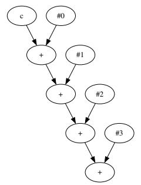
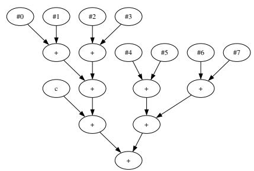
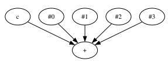
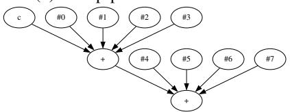
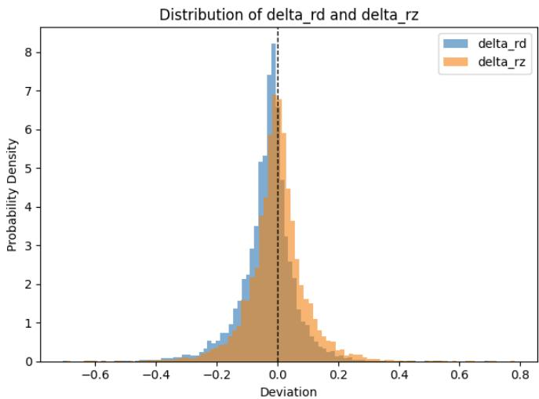

# MMA-Sim: Bit-Accurate Reference Model of Tensor Cores and Matrix Cores 图表详解

### 图像 1

图1(a)子图，顺序累加树。c是初始累加值，#0至#3代表四个乘积；箭头自上而下经过四个二元加法节点，依次形成(((c+#0)+#1)+#2)+#3。正文对应Ampere的DMMA.884。图示支持逐项累加的依赖顺序，没有位宽、舍入或周期信息；尤其不能仅凭“+”节点，就把一次融合乘加解释成乘法、加法分别舍入。

### 图像 2

图1(b)子图，分组成对求和树。#0—#3和#4—#7各先两两相加，再合成四项组和；左组和先与c相加，其结果最后与右组和结合。正文对应CDNA2的FP16指令v_mfma_f32_32x32x8_f16。连线显示组内成对、组间顺序累加，支持GPS的G=4结构；整棵树不是所有输入一起平衡归约，图中也没有显示冲零和舍入规则。

### 图像 3

图1(c)子图为五项融合求和：c与#0—#3共同指向一个多输入加法节点。正文以Ampere的HMMA.1684.F32.TF32说明该结构。箭头表示五项进入同一融合阶段；对应模型先统一指数并截位，再定点相加，最后正规化。图支持共同融合求和的结构判断，但不显示对齐位宽，不能把单个节点理解为任意精度或完全没有舍入。

### 图像 4

图1(d)子图展示两个五项融合求和串联。上方节点接收c与#0—#3，其输出再与#4—#7进入下方节点，形成八项点积加初值的计算。正文对应Ampere的HMMA.1688.F32.TF32及CoFDA。第二段依赖第一段生成的浮点中间值，段间正规化因而会影响位级结果；不能等同于九个输入一次融合，图中也未给出执行周期。

### 图像 5

图2为误差概率密度直方图：横轴是相对FP64参考结果的偏差，纵轴为概率密度，黑色虚线标出零。蓝色delta_rd来自CDNA3 FP16指令模型，橙色delta_rz来自假想RZ变体，二者均为MMA-Sim仿真。蓝色分布向负侧偏，橙色较对称，支持指定输入下存在方向性偏差。图未给样本数、均值或置信区间，不能据此读取训练准确率或普遍发生概率。

> 来源与版本：用户提供的 MMA-Sim arXiv:2511.10909v1（2025-11-14 作者稿）。经 MinerU 解析，由 Codex/GPT 翻译与解读，未调用 GLM 翻译 API。全文译文保留参考文献；技术总结、通俗讲解与图表说明属于解读。技术内容以所提供 v1 为准，不混入后续版本或未测 GPU 的结论。

[原始 PDF](https://arxiv.org/abs/2511.10909v1) · [架构建模目录](../index.md)
