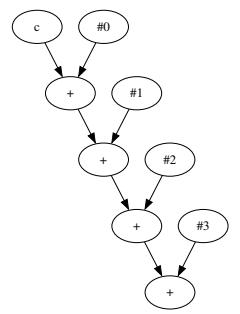
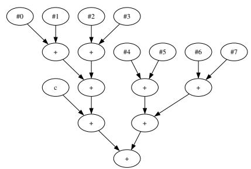
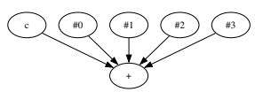
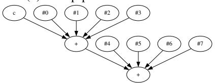
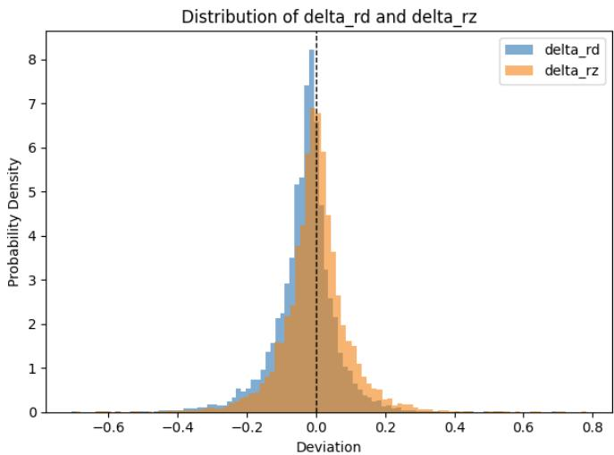

# MMA-Sim: Bit-Accurate Reference Model of Tensor Cores and Matrix Cores 原文翻译

# MMA-Sim：Tensor Core 和 Matrix Core 的位精确参考模型

Peichen Xie, Yang Wang, Fan Yang, Mao Yang

微软研究院

摘要——深度神经网络（DNN）快速增长的计算需求推动硬件厂商将矩阵乘法加速器（MMA），如 NVIDIA Tensor Core 和 AMD Matrix Core，集成到现代 GPU 中。然而，由于浮点矩阵乘法的算术规范各不相同且未公开，某些 MMA 可能导致数值不精确和不一致，从而损害 DNN 训练和推理的稳定性与可复现性。

本文提出了 MMA-Sim，这是首个位精确参考模型，揭示了十种 GPU 架构（其中八种来自 NVIDIA，两种来自 AMD）中 MMA 的详细算术行为。我们的方法结合针对性测试和随机测试来剖析 MMA，推导出九种算术算法，以模拟 MMA 的浮点矩阵乘法。大规模验证证实，MMA-Sim 与真实硬件逐位等价。利用 MMA-Sim，我们研究了影响 DNN 训练稳定性的算术行为，并识别出可能导致显著误差的未公开行为。

## I. 引言

为满足深度神经网络（DNN）迅速增长的计算需求，硬件厂商在其最新的 GPU 架构中引入了专用的浮点矩阵乘法加速器（MMA）。NVIDIA Tensor Cores [1], [2] 和 AMD Matrix Cores [3] 等 MMA 赋予了现代 GPU PetaFLOPS 级的计算能力，并在大语言模型（LLM）等前沿 DNN 的训练和推理中发挥着关键作用。

然而，这些高性能 MMA 的快速演进带来了新的挑战，因为目前没有公开文档明确规定浮点矩阵乘法的确切算术过程（§II）。近期研究 [4], [5] 表明，某些 MMA 的算术精度和动态范围不足，可能导致 DNN 训练准确率意外下降，对 LLM 尤其如此。诊断和预防这一问题具有挑战性，因为 MMA 的内部算术行为通常没有文档说明，因此人们对其了解有限。

此外，不同厂商对相同的矩阵乘法运算采用了不同的方法，即使是同一厂商的不同代 MMA 之间也存在差异 [6]。这些差异会导致矩阵乘法结果出现细微、有时甚至显著的数值不一致，进而损害上层 DNN 训练和推理的可复现性。

为应对这些挑战，本文提出了 MMA-Sim，这是首个位精确参考模型，能够揭示矩阵乘法加速器（MMA）的详细算术行为。给定具有指定数据类型和形状的输入矩阵，MMA-Sim 生成的输出矩阵与 MMA 的输出逐位匹配。通过忠实地建模每种 MMA 的算术行为，MMA-Sim 使人们能够深入理解、透明分析并位精确地模拟 MMA 中微妙而复杂的算术细节。借助 MMA-Sim，软件开发者可以诊断和预防精度敏感的 DNN 训练与推理中的数值问题，硬件设计者则可以设计出与现有且广泛采用的 MMA 在数值上保持一致的新 MMA。

对 MMA 进行位精确建模并非易事。大多数 MMA 对公众而言都是黑盒，这意味着其算术实现并未公开。为揭示每种 MMA 的每条矩阵乘法指令的详细算术行为，我们结合精心构造的输入和随机输入，检测 MMA 在边界情况和典型情况下的特性（§III）。根据观测结果，我们构建算术算法来建模相应指令的算术行为。算法规定了逐步计算过程，包括运算类型、运算顺序、舍入方法、精度以及其他实现细节。我们将每个算法的结果与 MMA 的输出在位级别进行仔细比对，以验证其正确性，并通过迭代改进，直至实现逐位等价。

将这种基于测试的方法应用于十种 GPU 架构的全部矩阵乘法指令后，我们构建了九种算术算法（§IV）。基于这九种算法，我们使用约 2800 行 Python 代码实现了 MMA-Sim。MMA-Sim 忠实地模拟了全部八种配备 Tensor Cores 的 NVIDIA GPU 架构（从 Volta 到 RTX Blackwell），以及最新的两种配备 Matrix Cores 的 AMD GPU 架构（CDNA2 和 CDNA3）中，所有浮点矩阵乘法指令各不相同的算术过程。我们通过广泛的大规模随机测试，将 MMA-Sim 与真实硬件进行对比验证（§V）。对于每条指令，我们使用超过一百万组随机生成的输入矩阵进行测试，结果证实 MMA-Sim 与相应硬件逐位等价。

借助 MMA-Sim，我们研究了此前报告的问题，并揭示了不同厂商和架构的 MMA 设计中许多此前未知的特性（§VI）。例如，我们证实，NVIDIA Hopper 架构的 8 位浮点（FP8）指令存在累加精度降低的情况，而 AMD CDNA2 架构的 16 位浮点（FP16 和 BF16）指令存在动态范围缩减的情况；正如先前工作 [4], [5] 所报告的，这两种情况都可能对 DNN 训练产生不利影响。我们还发现，NVIDIA Ada Lovelace 架构的 FP8 指令也存在累加精度降低的情况，并发现更新的 Blackwell 和 RTX Blackwell 架构提高了这一精度。此外，我们识别出 AMD CDNA3 架构的 TF32（TensorFloat-32）、FP16 和 BF16 指令采用了非对称舍入，这在某些条件下可能引入显著的数值误差和偏差。有趣的是，我们还发现，CDNA3 架构的 FP8 指令专门修改了舍入方法，从而缓解了此类问题。

这些发现展示了 MMA-Sim 作为分析工具在理解现代加速器详细算术行为方面的强大能力。对于软件开发者，MMA-Sim 弥合了硬件实现与软件预期之间的差距，使其能够系统地调查数值误差来源、分析训练算法的稳定性，以及针对特定硬件进行精度调优。对于硬件设计者，MMA-Sim 作为位精确参考模型，涵盖了全部细微的算术特性，为未来 MMA 的设计和验证提供了详细的功能规格。

综上，本文做出了以下贡献。

• 系统剖析 MMA 的算术行为。我们开发了一种基于测试的方法，通过精心构造的输入和随机输入检测每种 MMA 的算术行为，并推导出九种不同的算术算法，刻画其浮点矩阵乘法的算术过程。

• 位精确参考模型。我们提出了 MMA-Sim，这是首个位精确参考模型，利用九种算术算法模拟不同厂商和架构的现代 MMA 的确切算术行为。

• 实现与验证。我们为十种 GPU 架构（八种来自 NVIDIA，两种来自 AMD）实现了 MMA-Sim，并通过大规模随机测试验证其正确性，证实其与真实硬件逐位等价。

• 对 MMA 算术设计与使用的新见解。借助 MMA-Sim，我们识别出许多未公开的设计选择，这些选择能够解释已报告的 DNN 训练不稳定现象，或会引入新的数值问题；我们还为硬件和软件开发者提出了缓解方法。

• 实用的分析价值。MMA-Sim 将开源，为软件和硬件设计中的 MMA 算术行为建模、数值分析、算术设计规格制定以及硬件感知优化提供统一框架。

## II. 动机

浮点矩阵乘法是现代深度神经网络（DNN）中计算最密集的运算，在大语言模型（LLM）中尤其如此。为加速浮点矩阵乘法，现代 GPU 集成了专用的矩阵乘法加速器（MMA），例如 NVIDIA Tensor Cores 和 AMD Matrix Cores。MMA 提供了多种矩阵乘法指令（MMI），用于加速一个或多个矩阵乘加运算

$$
D _ {M \times N} = A _ {M \times K} \times B _ {K \times N} + C _ {M \times N},\tag{1}
$$

其中，A、B 和 $C$ 为输入矩阵，D 为输出矩阵。C 和 D 用作累加器，从而可以通过迭代执行矩阵乘加运算来计算大型矩阵乘法。例如，两个 64×64 矩阵相乘需要 $( 6 4 / M ) \times ( 6 4 / N ) \times ( 6 4 / K )$ 次矩阵乘加运算。

然而，MMI 的复杂性和多样性带来了对 DNN 具有深远影响的数值问题。由于目前尚无规范对 MMI 的设计和算术行为进行标准化，硬件厂商可以自行决定如何实现 MMI。因此，不同厂商提供的 MMI 具有不同的形状和数据类型，详见附录。尽管同一厂商的数代 MMA 中有些 MMI 保持了相同的形状和数据类型，但先前的研究 [7]– [9] 表明，不同代的 MMA 采用不同的方法来计算同一个矩阵乘加运算（公式 1）。

具体而言，由于没有规范定义公式 1 的标准输出，硬件厂商可以自由选择不同的计算精度、动态范围、舍入模式、特殊值处理规则等来实现该运算。这些实现细节并未公开记录，但它们对矩阵乘法及上层 DNN 的数值精度至关重要。例如，先前的研究 [4]、[5] 报告称，NVIDIA Hopper 架构上 8 位浮点（FP8）MMI 的累加精度，以及 CDNA2 架构上 16 位浮点（FP16 和 BF16）MMI 的动态范围，不足以支持稳定的 DNN 训练，并可能导致训练精度显著下降。由于根本原因在于硬件未公开记录的内部算术行为，软件开发人员很难诊断和解决这些问题。

此外，由于 MMI 在形状和算术行为上存在差异，不同的 MMA 会对相同的浮点矩阵乘法产生不一致的输出 [6]。因此，DNN 的可复现性受到影响，而在不同 MMA 上保持一致的 DNN 行为也变得非常困难。如果不了解现有 MMA 的算术行为，新的硬件厂商也很难确保与它们在数值上的一致性。

因此，对 MMA 的算术行为进行完整、准确的建模，对于解决这些问题至关重要。为此，我们旨在构建一个 MMA 的逐位精确参考模型，对每条 MMI 的算术行为进行全面剖析和逐位精确仿真。

## III. 方法

## A. 工作流程概述

逐位精确参考模型是一种可执行的行为模型，与相应硬件的算术行为逐位等价。对于每种矩阵乘法加速器（MMA）及每条矩阵乘法指令（MMI），逐位精确参考模型提供一个算术算法 f，使得对于任意形状和数据类型符合该 MMI 规定的输入矩阵 A、B 和 C，均有

$$
f (A, B, C) = \mathrm{MMI} _ {\mathrm{MMA}} (A, B, C),\tag{2}
$$

为构建这一逐位精确参考模型，我们采用一种基于测试的非侵入式方法，将硬件行为视为黑盒。具体而言，对于每一代 Tensor Cores 和 Matrix Cores，我们检查每条 MMI，并按照以下工作流程为该 MMI 构建一个算术算法 f。

1) 首先，我们构造专门设计的输入来测试 MMI，并根据它在 MMA 上的输出来检测其特性。这些特性包括求和顺序、累加精度、舍入模式、特殊值处理规则等。

2) 根据检测到的特性，我们构建一个计算公式 1 的算法，并使用 Python 实现该算法。

3) 然后，我们通过对比测试验证算法的正确性。给定超过一百万组随机输入，如果算法的输出与硬件的输出逐位一致，我们便在此停止，并检查下一条 MMI。

4) 否则，我们分析输出之间的差异，并据此改进算法，以修正不匹配之处。反复进行测试和改进，直至验证成功。

在本节余下部分，我们首先说明，对 MMI 的矩阵乘加运算建模可以简化为对点积加运算建模。随后，我们介绍所测试的主要特性，以及如何针对这些特性设计特殊输入。

## B. 问题简化

我们首先检查输出矩阵 D 的每个元素是否以相同方式计算，即点积加计算

$$
d _ {i j} = c _ {i j} + \sum_ {k = 0} ^ {K - 1} a _ {i k} b _ {k j}\tag{3}
$$

是否依赖于索引 i 和 $j .$。为测试这一点，我们首先设置 $i = 0$ 和 $j = 0$，并针对 $k = 0 , 1 , . . . , K - 1$ 生成随机输入 $a _ { 0 k } , \ b _ { k 0 }$ 和 $c _ { 0 0 }$。然后，对于所有其他的 i 和 $j$，我们设置 $a _ { i k } = a _ { 0 k } , b _ { k j } = b _ { 0 j }$，以及 $c _ { i j } = c _ { 0 0 }$。将输入发送至 MMA 后，我们发现输出中的每个元素 $d _ { i j }$ 都逐位相同。在大规模随机测试中，我们均观察到了这种一致的行为。因此，$D$ 中的每个输出元素都以相同方式计算。

在本文后续部分，我们将公式 3 的记法简化为

$$
\begin{array}{l} d = c + \sum_ {k = 0} ^ {K - 1} a _ {k} b _ {k} \\ \qquad = f (c, a _ {0}, a _ {1},..., a _ {K - 1}, b _ {0}, b _ {1},..., b _ {K - 1}). \end{array}\tag{4}
$$

因此，我们的目标简化为：为每条 MMI 的点积加计算构建一个具有 $( 2 K + 1 )$ ) 个输入的算法 $f ( c , \mathbf { a } , \mathbf { b } )$。

## C. 求和顺序

我们使用专门构造的输入来检测公式 4 计算中的求和顺序。这些输入的构造方式使得 $K + 1$ 个加数

$$
p _ {k} = \left\{ \begin{array}{l l} a _ {k} b _ {k} & \text { if } 0 \leq k <   K \\ c & \text { if } k = K \end{array} \right.\tag{5}
$$

由一个非常大的 2 的幂 X、其相反数 −X，以及 $K - 1$ 个具有相同值 y 的数组成，其中 y 是一个非常小的 2 的幂。将这样的输入送入 MMA 时，硬件输出除以 y 所得的值表示在 $p _ { i } + p _ { j } = 0 $ 相互抵消之后参与求和的加数个数，其中 $p _ { i } = X$，$p _ { j } = - X$，因此我们可以确定 $p _ { i }$ 与 $p _ { j }$ 之间求和运算的优先级。我们将 X 和 −X 放在不同位置进行这一数值实验，从而能够根据优先级信息构建求和树。我们利用 [9] 中的树构建算法来构建求和树。

由此，我们可以生成一棵表示求和顺序的求和树。例如，图 1 展示了我们为各代 Tensor Core 和 Matrix Core 上的 MMI 构建的四种典型求和树。

  
(c) 融合求和。  
(d) 融合求和链。

图 1：Tensor Core 和 Matrix Core 上的四种典型求和顺序。#i 表示乘积 $a _ { i } b _ { i }$

前两棵求和树是二叉树，表示求和由按不同顺序执行的二元加法运算组成。图 1(a) 展示了 Ampere 架构上 DMMA.884 指令的求和树，表明其采用顺序求和顺序。图 1(b) 展示了 CDNA2 架构上 v mfma f32 32x32x8 f16 指令的求和树，表明每组四个加数在组内采用成对求和顺序，而 c 与各组的和之间采用顺序求和顺序。

后两棵求和树是多叉树。一棵 t 叉树表示求和基于 t 项融合求和，这意味着在中间求和结果被规格化为浮点数之前，先将这 t 项相加。图 1(c) 展示了 Ampere 架构上 HMMA.1684.F32.TF32 指令的求和树，表明其采用 5 项融合求和。图 1(d) 展示了 Ampere 架构上 HMMA.1688.F32.TF32 指令的求和树，表明其迭代使用两次五项融合求和。

## D. 累加精度

我们使用专门构造的输入来检测公式 4 中求和的精度。对于每个基于二元加法运算的求和，我们使用 $1 . 0 + \epsilon$ 来测试其精度。具体而言，对于 $p _ { i }$ 与 $p _ { j }$ 的求和，我们首先设置 $p _ { i } =$ 1.0 和 $p _ { j } = \epsilon = 1 . 0$，并将其他加数设为零。接着，我们反复将 ϵ 减半，直到硬件输出满足 $d \neq$ $1 . 0 + \epsilon$。然后，我们得出结论：在该运算中，$p _ { j }$ 的累加精度为小数点后 $1 - \log _ { 2 } \epsilon$ 位。通过使用不同的 i 和 j 索引进行这一数值实验，我们可以确定所有加法运算中所有加数的精度。

对于每个 t 项融合求和，我们使用 −1.0 + 1.0 + ϵ 来测试该运算的精度。类似地，对于包含 $p _ { i } , \ p _ { j } .$ 和 $p _ { k }$ 的求和运算，我们首先设置 $p _ { i } = - 1 . 0 $、$p _ { j } ~ = ~ 1 . 0 $ 和 $p _ { k } = \epsilon = 1 . 0 $，并将其他加数设为零。接着，我们不断将 ϵ 减半，直到硬件输出 $d \neq \epsilon$。然后，我们得出结论：$p _ { k }$ 的精度为小数点后 $1 - \log _ { 2 } \epsilon$ 位。通过使用不同的 $i , j ,$ 和 k 索引进行这一数值实验，我们可以确定所有求和运算中所有加数的精度。

## E. 舍入模式

检测出累加精度后，我们通过专门构造的输入来分析每个求和运算的舍入模式。我们首先设置末位单位 $u = 2 \epsilon$。然后，我们构造输入，使未舍入的和等于 $1 . 0 + 0 . 7 5 u , 1 . 0 + 0 . 2 5 u , - 1 . 0 - 0 . 7 5 u , \mathrm { a n d } \ - 1 . 0 - 0 . 2 5 u$。根据舍入结果，我们参照表 I 确定舍入模式，其可能为向上舍入（RU）、向下舍入（RD）、向零舍入（RZ）、远离零舍入（RA）或舍入到最近值（RN）。

如果舍入模式属于 RN，我们进一步测试 $1 . 0 + 0 . 5 u , 1 . 0 + 1 . 5 u , - 1 . 0 - 0 . 5 u , \mathrm { a n d } - 1 . 0 - 1 . 5 u$。根据舍入结果，我们参照表 II 确定 RN 的等距情形处理规则，其可能为等距时向上舍入（RNU）、等距时向下舍入（RND）、等距时向零舍入（RNZ）、等距时远离零舍入（RNA）、等距时舍入到偶数（RNE）或等距时舍入到奇数（RNO）。

表 I：根据四个输入的舍入结果检测舍入模式。

<table><tr><td>输入</td><td>1+0.75u</td><td>1+0.25u</td><td>-1-0.75u</td><td>-1-0.25u</td></tr><tr><td>RU</td><td>1+u</td><td>1+u</td><td>-1</td><td>-1</td></tr><tr><td>RD</td><td>1</td><td>1</td><td>-1-u</td><td>-1-u</td></tr><tr><td>RZ</td><td>1</td><td>1</td><td>-1</td><td>-1</td></tr><tr><td>RA</td><td>1+u</td><td>1+u</td><td>-1-u</td><td>-1-u</td></tr><tr><td>RN</td><td>1+u</td><td>1</td><td>-1-u</td><td>-1</td></tr></table>

表 II：根据四个输入的舍入结果检测舍入到最近值模式的等距情形处理规则。

<table><tr><td>输入</td><td> $1 + {0.5u}$ </td><td> $1 + {1.5u}$ </td><td> $- 1 - {0.5u}$ </td><td> $- 1 - {1.5u}$ </td></tr><tr><td>RNU</td><td> $1 + u$ </td><td> $1 + u$ </td><td>-1</td><td> $- 1 - u$ </td></tr><tr><td>RND</td><td>1</td><td> $1 + u$ </td><td> $- 1 - u$ </td><td> $- 1 - {2u}$ </td></tr><tr><td>RNZ</td><td>1</td><td> $1 + u$ </td><td>-1</td><td> $- 1 - u$ </td></tr><tr><td>RNA</td><td> $1 + u$ </td><td> $1 + {2u}$ </td><td> $- 1 - u$ </td><td> $- 1 - {2u}$ </td></tr><tr><td>RNE</td><td>1</td><td> $1 + {2u}$ </td><td>-1</td><td> $- 1 - {2u}$ </td></tr><tr><td>RNO</td><td> $1 + u$ </td><td> $1 + u$ </td><td> $- 1 - u$ </td><td> $- 1 - u$ </td></tr></table>

## F. 特殊值处理

次正规数、负零、无穷大和 NaN 是浮点运算中的特殊值。我们构造边界条件下的输入，以探测 MMI 对特殊值的处理规则。

对于次正规数，我们首先将 c 设置为 0.5ϵ（其中 ϵ 是最小的正正规数），并将其他输入设置为零。如果硬件输出等于零，则表明次正规数输入 c 被置零。类似地，我们将一个输入 ak（或 $b _ { k } )$ 设置为 0.5ϵ，将对应的 bk（或 ak）设置为一，并将其他输入设置为零。如果硬件输出等于零，则表明次正规数输入 $a _ { k }$（或 $\boldsymbol { b } _ { k } )$ 被置零。接着，我们将一个输入设置为 $a _ { k } = 0 . 5$，将其对应的输入设置为 $b _ { k } = \epsilon ,$，并将其他输入设置为零，以探测乘法运算之后的次正规数值是否会被置零。最后，我们将一个加数设置为 $p _ { i } = 1 . 5 \epsilon ,$，将另一个加数设置为 $p _ { j } = - \epsilon _ { \ast }$，并将其他输入设置为零，以探测加法运算之后的次正规数值是否会被置零。

对于负零，我们通过将输入设置为 $t 0 ~ { \stackrel { - } { - } } 0 . 0 + { \breve { \sum } } _ { k = 0 } ^ { K - 1 } ( + 0 . 0 ) ~ \times$ (−0.0)，探测是否能够生成负零。硬件输出是否等于 −0.0，表明是否能够生成负零。

对于无穷大，我们对某个 k 设置 $a _ { k } = 2 . 0$，设置 $b _ { k } = 2 ^ { E } , c = - 2 ^ { E }$，并将其他输入设置为零，以探测乘法运算是否会溢出，其中 E 是输入浮点格式的最大指数。我们还通过测试 $2 ^ { E } +$ $2 ^ { E } - 2 ^ { E }$，探测中间求和是否会溢出。然后，我们通过测试边界条件 $( 2 - u ) \times 2 ^ { E } + 0 . 7 5 u \times 2 ^ { E } , ( 2 - u ) \times 2 ^ { E } + 0 . \mathsf { \bar { 5 } } u \times$ $2 ^ { \bar { E } } , ( 2 - u ) \times 2 ^ { \bar { E } } + 0 . 2 5 u \times 2 ^ { E } , ( - 2 + u ) \times 2 ^ { E } - 0 . 7 5 u \times 2 ^ { E } ,$ $( - 2 + u ) \times 2 ^ { E } - 0 . 5 u \times 2 ^ { E }$ 和 $( - 2 + u ) \times 2 ^ { E } - 0 . 2 5 u \times 2 ^ { E }$，探测溢出规则。对于 NaN，我们对某个 k 设置 $p _ { k } = 0 . 0 \times \infty$，并将其他输入设置为零；然后，对某些 i 和 $j ,$ 设置 $p _ { i } = - \infty$ 和 $p _ { j } = + \infty$，并将其他输入设置为零。我们发现，对于所有接受测试的 MMA，这两种情况都能生成 NaN。

## IV. 位精确参考模型

基于对十种 GPU 架构的矩阵乘法指令（MMI）所开展的数值实验，我们总共构建了九种算术算法。这十种架构包括全部八种搭载 Tensor Core 的 NVIDIA GPU 架构（从 Volta 到 RTX Blackwell），以及最新的两种搭载 Matrix Core 的 AMD 架构（CDNA2 和 CDNA3）。表 III 列出了我们为 Tensor Core 指令构建的算术算法，表 IV 列出了我们为 Matrix Core 指令构建的算术算法。

基于这些算术算法，我们构建了一个名为 MMA-Sim 的模拟器，作为我们的位精确参考模型。借助 MMA-Sim，用户可以通过提供输入浮点矩阵 A、B 和 C，模拟任意 GPU 架构中的任意 MMI，并获得输出矩阵 D，使其满足 $d _ { i j } = f ( c _ { i , j } , a _ { i 0 } , a _ { i 1 } , . . . , b _ { 0 j } , b _ { 1 j } , . . . )$，其中 f 是该 MMI 的算术算法。

## A. 顺序融合乘加（SFMA）算法

顺序融合乘加（SFMA）算法是针对 Tensor Core DMMA 指令以及 Matrix Core 双精度（FP64）和单精度（FP32）MFMA 指令构建的。在该算法中，通过依次应用标准融合乘加（FMA）运算来计算 $f ( c , \mathbf { a } , \mathbf { b } )$，如算法 1 所示。

算法 1 顺序融合乘加（SFMA）算法。
要求：  $a_{0}, a_{1}, \ldots, a_{K-1}, b_{0}, b_{1}, \ldots, b_{K-1}, c$ 
保证：  $d = \sum_{k=0}^{K-1} a_{k} b_{k} + c$ $d \leftarrow c$ 
从 $k \leftarrow 0$ 到 K - 1 循环
    $d \leftarrow \text{FMA}(a_{k}, b_{k}, d)$ 
返回 d

## B. 分组成对求和（GPS）算法

分组成对求和（GPS）算法是针对 CDNA2 架构上的 Matrix Core 16 位浮点（FP16 和 BF16）MFMA 指令构建的。在该算法中，$f ( c , \mathbf { a } , \mathbf { b } )$ 是带有次正规数置零处理的标准浮点加法和乘法运算的组合。具体而言，计算包含以下四个步骤。

步骤 1 是将输入次正规数置零。如果 A、B 或 C 中的任意数是次正规数，则将其置为正零（+0.0）。

步骤 2 是乘法运算。使用标准 FP32 乘法运算，将每个 $a _ { k }$ 与 $b _ { k }$ 相乘，生成 FP32 乘积 $p _ { k }$。然后，如果 $p _ { k }$ 是次正规数，则将其置零，同时保留其符号。

步骤 3 是成对求和。使用标准 FP32 加法运算，将每 G 个连续的乘积进行成对求和，并在将次正规数置零时保留其符号，如算法 2 所示。该步骤生成 $K / G$ 个 FP32 分组和，记为 $\gamma _ { 0 } , \gamma _ { 1 } , . . . , \gamma _ { K / G - 1 }$。

步骤 4 是顺序求和。最后，使用标准 FP32 加法运算，将 c 与这 $K / G$ 个分组和依次相加，并在将次正规数置零时保留其符号。

算法 3 详细描述了 GPS 算法。不同指令使用不同的 G 值，如下所列。

• 对于 FP16 MFMA 指令，$G = 4$。

• 对于带有 $\stackrel { 6 6 } { - } 1 \mathrm { k } ^ { \prime \prime }$ 后缀的 BF16 MFMA 指令，$G =$ 4。

• 对于不带 $\stackrel { 6 6 } { - } 1 \mathrm { k } ^ { \prime \prime }$ 后缀的 BF16 MFMA 指令，G = 2。

算法 2 成对求和函数。

要求：  $p_{0}, p_{1}, \ldots, p_{G-1}$ 

保证：  $\gamma = \sum_{k} p_{k}$ 

函数 PAIRWISESUM( $p_{0}, p_{1}, \ldots, p_{n-1}$ )

若 n = 1，则

返回  $p_{0}$ 

否则

 $\gamma \leftarrow \text{PAIRWISESum}(p_{0}, p_{1}, \ldots, p_{n/2-1})$ $\gamma \leftarrow \gamma + \text{PAIRWISESum}(p_{n/2}, p_{n/2+1}, \ldots, p_{n-1})$ $\gamma \leftarrow \gamma \times 0.0$  若  $|\gamma| < 2^{-126}$ $\triangleright$  置零并保留符号

返回  $\gamma$

算法 3 分组成对求和（GPS）算法。

要求：  $a_{0}, a_{1}, \ldots, a_{K-1}, b_{0}, b_{1}, \ldots, b_{K-1}, c$  和 G

保证：  $d = \sum_{k=0}^{K-1} a_{k} b_{k} + c$ 

从 $k \leftarrow 0$ 到 K - 1 循环

    $a_{k} \leftarrow +0.0$  若  $|a_{k}| < 2^{-126}$ $\triangleright$  置为正零

    $b_{k} \leftarrow +0.0$  若  $|b_{k}| < 2^{-126}$ $p_{k} \leftarrow \text{FP32}(a_{k}) \times \text{FP32}(b_{k})$ $p_{k} \leftarrow p_{k} \times 0.0$  若  $|p_{k}| < 2^{-126}$ $\triangleright$  置零并保留符号

    $d \leftarrow c$ $d \leftarrow +0.0$  若  $|d| < 2^{-126}$ $\triangleright$  置为正零

    从 $k \leftarrow 0$ 到 K - G 以 G 为步长循环

    $d \leftarrow d + \text{PAIRWISESum}(p_{k}, p_{k+1}, \ldots, p_{k+G-1})$ $d \leftarrow d \times 0.0$  若  $|d| < 2^{-126}$ $\triangleright$  置零并保留符号

返回 d

## C. 融合点积加（FDA）算法

融合点积加（FDA）算法是为 Tensor Core 上的所有 HMMA、QMMA、HGMMA、HQMMA、UTCHMMA 和 UTCQMMA 指令构建的，涵盖从 TF32 到 FP4 的浮点格式。在该算法中，一次 FDA 运算的计算包含五个步骤。

步骤 1 是检查特殊值，即无穷大和 NaN。如果输入中存在任何 NaN，或存在 $0 \times \infty$，则输出 d 为 NaN，对于 FP32 输出，其编码为 0x7FFFFFFF；对于 FP16 输出，其编码为 0x7FFF（NVIDIA 的规范 NaN）。如果各乘积和 $c ,$ 中同时存在 +∞ 和 −∞，则输出为 NaN。如果仅存在一种无穷大，则输出等于该无穷大。否则，不存在特殊值，进入下一步。

步骤 2 是使用各个 a 和 b 的有效数及指数计算它们的乘积。具体来说，我们分别使用 $s _ { a _ { k } } \times 2 ^ { e _ { a _ { k } } }$ 和 $s _ { b _ { k } } \times 2 ^ { e _ { b _ { k } } }$ 表示 $a _ { k }$ 和 $b _ { k }$，其中，对于规格化数，$1 \leq | s | <$ 2；对于非规格化数，$| s | < 1$，指数则从其原始浮点表示中获得（例如，对于 BF16 格式，$2 ^ { - 1 2 7 }$ 是一个非规格化数，应表示为 $0 . 5 \times 2 ^ { - 1 2 6 }$，因为 −126 是 BF16 的最小指数）。然后，通过 $s _ { k } = s _ { a _ { k } } \times s _ { b _ { k } }$ 和 $e _ { k } = e _ { a _ { k } } + e _ { b _ { k } }$ 计算乘积 $p _ { k } = a _ { k } b _ { k } = s _ { k } \times 2 ^ { e _ { k } }$。在此步骤中，不对乘积进行规格化。例如，如果 $a _ { k } = 1 . 5 \times 2 ^ { e _ { a _ { k } } }$ 且 $b _ { k } = 1 . 5 \times 2 ^ { e _ { b _ { k } } }$ k，则 pk 应为 $2 . 2 5 \times 2 ^ { e _ { a _ { k } } + e _ { b _ { l } } }$ k，而不是 $1 . 1 2 5 \times 2 ^ { e _ { a _ { k } } + e _ { b _ { k } } + 1 }$。有效数以定点数形式计算和存储，不会发生精度损失、溢出或下溢。

表 III：从 Volta 到 RTX Blackwell 的八种架构上 NVIDIA Tensor Core 指令的位精确算术算法。每个单元格展示了能够对该指令进行位精确建模的算法。N/A 表示该架构不支持该指令。

<table><tr><td>指令</td><td>Volta</td><td>Turing</td><td>Ampere</td><td>Ada Lovelace</td><td>Hopper</td><td>Blackwell</td><td>RTX Blackwell</td></tr><tr><td>HMMA.884.F32.F32HMMA.884.F32.F16HMMA.884.F16.F16</td><td>FDA(F=23)</td><td>FDA(F=24)</td><td>N/A</td><td>N/A</td><td>N/A</td><td>N/A</td><td>N/A</td></tr><tr><td>HMMA.1688.F32HMMA.1688.F16</td><td>N/A</td><td>FDA(F=24)</td><td>FDA(F=24)</td><td>FDA(F=24)</td><td>FDA(F=25)</td><td>FDA(F=25)</td><td>FDA(F=25)</td></tr><tr><td>DMMA.884 / DMMA.8x8x4</td><td>N/A</td><td>N/A</td><td>SFMA</td><td>SFMA</td><td>SFMA</td><td>SFMA</td><td>SFMA</td></tr><tr><td>HMMA.1688.F32.TF32HMMA.16816.F32HMMA.16816.F16HMMA.16816.F32.BF16</td><td>N/A</td><td>N/A</td><td>CoFDA(F=24)</td><td>CoFDA(F=24)</td><td>FDA(F=25)</td><td>FDA(F=25)</td><td>FDA(F=25)</td></tr><tr><td>HMMA.1684.F32.TF32HMMA.1688.F32.BF16</td><td>N/A</td><td>N/A</td><td>FDA(F=24)</td><td>FDA(F=24)</td><td>FDA(F=25)</td><td>FDA(F=25)</td><td>FDA(F=25)</td></tr><tr><td>QMMA.16832.F32.f8type.f8typeQMMA.16832.F16.f8type.f8type</td><td>N/A</td><td>N/A</td><td>N/A</td><td>CoFDA(F=13)</td><td>N/A</td><td>N/A</td><td>FDA(F=25)</td></tr><tr><td>QMMA.16816.F32.f8type.f8typeQMMA.16816.F16.f8type.f8type</td><td>N/A</td><td>N/A</td><td>N/A</td><td>FDA(F=13)</td><td>N/A</td><td>N/A</td><td>FDA(F=25)</td></tr><tr><td>DMMA.16x8x16DMMA.16x8x8DMMA.16x8x4</td><td>N/A</td><td>N/A</td><td>N/A</td><td>N/A</td><td>SFMA</td><td>N/A</td><td>N/A</td></tr><tr><td>HGMMA.64x8x8.F32.TF32HGMMA.64x8x16.F32HGMMA.64x8x16.F16HGMMA.64x8x16.F32.BF16</td><td>N/A</td><td>N/A</td><td>N/A</td><td>N/A</td><td>FDA(F=25)</td><td>N/A</td><td>N/A</td></tr><tr><td>QGMMA.64x8x32.F32.f8type.f8typeQGMMA.64x8x32.F16.f8type.f8type</td><td>N/A</td><td>N/A</td><td>N/A</td><td>N/A</td><td>FDA(F=13)</td><td>N/A</td><td>N/A</td></tr><tr><td>UTCHMMAUTCQMMMA</td><td>N/A</td><td>N/A</td><td>N/A</td><td>N/A</td><td>N/A</td><td>FDA(F=25)</td><td>N/A</td></tr><tr><td>UTCOMMAUTCOMMA.4X</td><td>N/A</td><td>N/A</td><td>N/A</td><td>N/A</td><td>N/A</td><td>GDFS</td><td>N/A</td></tr><tr><td>QMMA.16832.F32.f8f6f4type.f8f6f4typeQMMA.16832.F16.f8f6f4type.f8f6f4typeQMMA.SF.16832.F32.f8f6f4type.f8f6f4type.E8</td><td>N/A</td><td>N/A</td><td>N/A</td><td>N/A</td><td>N/A</td><td>N/A</td><td>FDA(F=25)</td></tr><tr><td>OMMA.SF.16864.F32.E2M1.E2M1.E8OMMA.SF.16864.F32.E2M1.E2M1.UE4M3.4X</td><td>N/A</td><td>N/A</td><td>N/A</td><td>N/A</td><td>N/A</td><td>N/A</td><td>GDFS</td></tr></table>

\* f8type 可以是 E4M3 或 E5M2，f8f6f4type 可以是 E4M3、E5M2、E2M3、E3M2 或 E2M1。

步骤 3 是将各乘积和 c 对齐到它们的最大指数 $e _ { m a x } = \operatorname* { m a x } \{ e _ { c } , e _ { 0 } , e _ { 1 } , e _ { 2 } , \ldots \}$。获得最大指数 $e _ { m a x } .$ 后，将每个有效数 $s _ { k }$（包括 $s _ { c }$ 和 $s _ { 0 } , s _ { 1 } , . . . )$ 分别右移 $e _ { m a x } - e _ { k }$ 位。结果仅保留 $F$ 个小数位，移出的位被截断（实际相当于向零舍入）。$F$ 的值取决于架构和指令，如下所示。

• Volta：对于 HMMA，F = 23。

• Turing 和 Ampere：对于 HMMA，F = 24。

• Ada Lovelace：对于 HMMA，F = 24；对于 QMMA，$F = 1 3$。

• Hopper：对于 HMMA 和 HGMMA，F = 25；对于 QGMMA，$F = 1 3$。

• Blackwell：F = 25，适用于 HMMA、UTCHMMA 和

## UTCQMMA.

• RTX Blackwell：对于 HMMA 和 QMMA，F = 25。

步骤 4 是对各乘积与 c 求和。经过步骤 3 中的对齐和截断，此步骤只需使用定点运算（F 个小数位）对移位后的有效数求和。因此，求和结果是精确的，并且与求和顺序无关。

步骤 5 是将和归一化为输出的浮点格式，即 FP32 或 FP16。步骤 4 之后，和表示为 $s _ { s u m } \times 2 ^ { e _ { m a x } }$。对于 FP32 输出，将该数归一化至 FP32 的指数范围。如果归一化结果的绝对值大于或等于 $2 ^ { 1 2 8 }$，则变为无穷大。否则，对于 Ada Lovelace QMMA 或 Hopper QGMMA 指令，其有效数在小数部分第 13 位处向零舍入（RZ）；对于其他指令，则在小数部分第 23 位处向零舍入。对于 FP16 输出，将该数归一化至 FP16 的指数范围。然后，使用舍入到最近值、遇中取偶（RNE）规则，在小数部分第 10 位处对其有效数进行舍入。如果舍入结果的绝对值大于或等于 $( 2 - 2 ^ { 1 1 } ) \times 2 ^ { 1 5 }$，则变为无穷大。否则，遵循 RNE 规则再次将其归一化为 FP16。

TF32 截断（步骤 0）及其意外后果。尽管 TF32 数编码为 E8M10，只有 19 个可用位，但它以 32 位存储（本质上是一个 FP32 数）。我们发现，Tensor Core 在计算时始终将最低的 13 个有效位视为零。这导致了一个有趣的后果：NaN 值可能被转换为无穷大。例如，如果输入元素为 0x7F800001（NaN），它就会被转换为无穷大（0x7F800000），这是出乎意料的。

表 IV：CDNA2 和 CDNA3 架构上 AMD Matrix Core 指令的位精确算术算法。省略了指令前缀 ${ } ^ { 6 6 } \mathrm { \bf V } _ { - }$ mfma ”。除非明确说明，否则我们使用 CDNA3 上重新格式化后的指令名称。

<table><tr><td>指令</td><td>CDNA2</td><td>CDNA3</td></tr><tr><td>f64_16x16x4_f64f64_4x4x4_4b_f64f32_32x32x1_2b_f32f32_16x16x1_4b_f32f32_4x4x1_16b_f32f32_32x32x2_f32f32_16x16x4_f32</td><td>SFMA</td><td>SFMA</td></tr><tr><td>f32_16x16x8_xf32</td><td>不适用</td><td>CoFDRDA</td></tr><tr><td>f32_32x32x4_xf32</td><td>不适用</td><td>FDRDA</td></tr><tr><td>f32_32x32x4_2b_f16f32_16x16x4_4b_f16f32_4x4x4_16b_f16f32_32x32x8_f16</td><td>GPS(G=4)</td><td>FDRDA</td></tr><tr><td>f32_16x16x16_f16</td><td>GPS(G=4)</td><td>CoFDRDA</td></tr><tr><td>(CDNA2 名称)f32_32x32x2bf16f32_16x16x2bf16f32_4x4x2bf16f32_32x32x4bf16f32_16x16x8bf16</td><td>GPS(G=2)</td><td>不适用</td></tr><tr><td>f32_32x32x4_2b_bf16f32_16x16x4_4b_bf16f32_4x4x4_16b_bf16f32_32x32x8_bf16</td><td>GPS(G=4)</td><td>FDRDA</td></tr><tr><td>f32_16x16x16_bf16</td><td>GPS(G=4)</td><td>CoFDRDA</td></tr><tr><td>f32_16x16x32_bf8_bf8f32_16x16x32_bf8_fp8f32_16x16x32_fp8_bf8f32_16x16x32_fp8_fp8</td><td>不适用</td><td>CoGFDRDA</td></tr><tr><td>f32_32x32x16_bf8_bf8f32_32x32x16_bf8_fp8f32_32x32x16_fp8_bf8f32_32x32x16_fp8_fp8</td><td>不适用</td><td>GFDRDA</td></tr></table>

缩放因子。用于 MXFP8、MXFP6 和 MXFP4 格式的 QMMA.SF 和 UTCQMMA 指令在输入中引入了 UE8M0 缩放因子（见附录 B）。要将缩放因子相乘，只需修改步骤 1 和步骤 2。在步骤 1 中，如果任一缩放因子为 NaN，则结果应为 NaN。在步骤 2 中，乘积 $p _ { k } = a _ { k } b _ { k } = s _ { k } \times 2 ^ { e _ { k } }$ 通过 $s _ { k } = s _ { a _ { k } } \times s _ { b _ { k } }$ 和 $e _ { k } = e _ { a _ { k } } + e _ { b _ { k } } + e _ { a _ { \lfloor k / 3 2 \rfloor } ^ { S F } } + e _ { b _ { \lfloor k / 3 2 \rfloor } ^ { S F } } .$ 计算得到。

## D. FDA 链（CoFDA）算法

对于大多数 Tensor Core 指令，$\begin{array} { r l r l } { d } & { { } } & { = } & { { } } \end{array}$ $g ( c , a _ { 0 } , a _ { 1 } , . . . , a _ { K - 1 } , b _ { 0 } , b _ { 1 } , . . . , b _ { K - 1 } )$，其中 $g ( c , \mathbf { a } , \mathbf { b } )$ 表示一次 FDA 运算。然而，对于 Ampere 和 Ada Lovelace 上的 HMMA.1688.F32.TF32、HMMA.16816.F32、HMMA.16816.F16 和 HMMA.16816.F32.BF16，以及 Ada Lovelace 上的 QMMA.16832.F32.f8type.f8type 和 QMMA.16832.F16.f8type.f8type，一次

FDA 运算只能计算 $K / 2$ 对乘数，而 d 通过两次 FDA 运算组成的链来计算，即

$$
\begin{array}{c} d = g (g (c, a _ {0}, a _ {1},..., a _ {K / 2 - 1}, b _ {0}, b _ {1},..., b _ {K / 2 - 1}), \\ a _ {K / 2}, a _ {K / 2 + 1},..., a _ {K - 1}, b _ {K / 2}, b _ {K / 2 + 1},..., b _ {K - 1}). \end{array}\tag{6}
$$

## E. 分组点积融合求和（GDFS）算法

分组点积融合求和（GDFS）算法是为 Tensor Core 上的所有 OMMA 和 UTCOMMA 指令构建的，涵盖 MXFP4 和 NVFP4 数据类型。在该算法中，一次 GDFS 运算的计算包含七个步骤。

步骤 1 是检查特殊值。由于 FP4 数没有无穷大或 NaN，而 UE4M3 和 UE8M0 数没有无穷大，因此此步骤相对简单。如果缩放因子中存在任意 NaN，或 c 为 NaN，则输出 d 为 NaN，编码为 0x7FFFFFFF。如果 c 为无穷大，则 $d = c .$ 否则，不存在特殊值，进入下一步。

步骤 2 是使用定点运算计算各个 a 和 b 的乘积。此时，乘积 $p _ { k } = a _ { k } b _ { k }$ 是一个定点数，其非零绝对值的范围为 0.25 至 36。此步骤没有精度损失，乘积被精确存储。

步骤 3 是以 16 个为一组对乘积求和。尽管输入块大小可以为 32 或 16，但求和组大小固定为 16。因此，使用定点运算对每 16 个连续乘积求和，生成 $6 4 / 1 6 = 4 $ 个分组点积，分别记为 $\sigma _ { 0 } , \sigma _ { 1 } , \sigma _ { 2 }$ 和 $\sigma _ { 3 }$。

步骤 4 是将各分组点积乘以各自的缩放因子。结果以有效数和指数表示为 $\gamma _ { k } = \sigma _ { k } a _ { | 1 6 k / S | } ^ { S F } b _ { | 1 6 k / S | } ^ { S F } = s _ { k } \times 2 ^ { e _ { k } }$，其中 S 表示块大小。有效数 sk 是分组点积乘以两个缩放因子的有效数之积，即 $s _ { k } = \sigma _ { k } s _ { a _ { \left\lfloor 1 6 k / S \right\rfloor } ^ { S F } } s _ { b _ { \left\lfloor 1 6 k / S \right\rfloor } ^ { S F } }$。指数 $e _ { k }$ 是两个缩放因子的指数之和，即 $e _ { k } = e _ { a _ { \mid 1 6 k / S \mid } ^ { S F } } + e _ { b _ { \mid 1 6 k / S \mid } ^ { S F } }$。这些有效数存储为定点数，具有 ${ \boldsymbol { F } } ^ { \prime } = { \boldsymbol { \mathbf { \check { \mathit { F } } } } } ^ { }$ 35 个小数位。到目前为止，任何计算或存储均未出现精度损失。

步骤 5 是将 $s _ { 0 } , s _ { 1 } , s _ { 2 } , s _ { 3 }$ 和 c 对齐到它们的最大指数 $e _ { m a x } = \operatorname* { m a x } \{ e _ { c } , e _ { 0 } , e _ { 1 } , e _ { 2 } , e _ { 3 } \}$，使用向零舍入（RZ）规则截断移出 $F = 3 5$ 个小数位范围的位。此步骤与 FDA 算法中的步骤 3 类似。

步骤 6 是使用定点运算对步骤 5 的结果求和，与 FDA 算法中的步骤 4 类似。

步骤 7 是将和归一化为 FP32，与 FDA 算法中的步骤 5 类似。

UE4M3 截断（步骤 0）。尽管 UE4M3 数只有 7 个可用位，但它以 8 位存储（本质上是一个 FP8 数）。Tensor Core 始终将其最高有效位视为零。

## F. 融合点积向下舍入加法（FDRDA）算法

融合点积向下舍入加法（FDRDA）算法针对 CDNA3 架构上的 Matrix Core TF32、FP16 和 BF16 MFMA 指令构建。在该算法中，一次 FDRDA 运算的计算包含七个步骤。

步骤 1 是检查特殊值，与 FDA 算法的步骤 1 相同。

步骤 2 是使用各个 a 和 b 的有效数及指数计算它们的乘积。这与 FDA 算法的步骤 2 基本相同，区别在于乘积可能溢出。如果 $p _ { k } \geq 2 ^ { 1 2 8 }$，则溢出为 ${ \mathrm { t o } } + \infty . { \mathrm { I f } } p _ { k } \leq - 2 ^ { 1 2 8 }$，则溢出为 $\mathrm { t o \mathrm { ~ - \infty } }$。

步骤 3 是再次检查特殊值。如果乘积中同时存在 $+ \infty$ 和 $- \infty$，则输出 d 为 NaN。如果只存在一种无穷大，则输出等于该无穷大。否则，不存在特殊值，进入下一步。

步骤 4 是将各乘积对齐到它们的最大指数 $e _ { d o t } ~ = ~ \operatorname* { m a x } \{ e _ { 0 } , e _ { 1 } , e _ { 2 } , \ldots \}$，截断移出的位。该步骤与 FDA 算法的步骤 3 类似，区别在于不包含 c。在该算法中，$F = 2 4$。

步骤 5 是使用定点算术对各乘积求和，与 FDA 算法的步骤 4 类似，区别在于不包含 $c .$。结果表示为 $s _ { d o t } \times 2 ^ { e _ { d o t } }$。

步骤 6 是将点积结果与 c 对齐到它们的最大指数 $e _ { m a x } = \operatorname* { m a x } \{ e _ { d o t } , e _ { c } \}$。类似地，在获得最大指数 $e _ { m a x } .$ 后，将有效数 $s _ { d o t }$ 右移 $e _ { m a x } - e _ { d o t }$ 位，并对移出第 31 个小数位之外的部分进行向下舍入（而非向零舍入）。将有效数 $s _ { c }$ 右移 $e _ { m a x } - e _ { c }$ 位，并对移出第 24 个小数位之外的部分进行向下舍入（而非向零舍入）。

步骤 7 是使用定点算术对两个舍入后的有效数求和，得到 $s _ { s u m }$。

步骤 8 是使用舍入到最近值、中间值舍入到偶数（RNE）规则，将结果 $s _ { s u m } \times 2 ^ { e _ { m a x } }$ 规格化为 FP32。这符合标准的 FP32 转换算法。

TF32 截断（步骤 0）。与 Tensor Core 类似，Matrix Core 始终将 TF32 输入的最低 13 位视为零，这可能会将 NaN 转换为无穷大。

## G. 链式 FDRDA（CoFDRDA）算法

对于大多数 TF32、FP16 和 BF16 MFMA 指令，$\begin{array} { l l l } { { \mathrm { C D N A 3 , } } } & { { d } } & { { = } } & { { g ( c , a _ { 0 } , a _ { 1 } , . . . , a _ { K - 1 } , b _ { 0 } , b _ { 1 } , . . . , b _ { K - 1 } ) } } \end{array}$，其中 $g ( c , \mathbf { a } , \mathbf { b } )$ 表示一次 FDRDA 运算。然而，对于 v mfma f32 16x16x8 xf32、v mfma f32 16x16x16 f16 和 v mfma f32 16x16x16 bf16，一次 FDRDA 运算只能计算 $K / 2$ 对乘数，d 通过串联两次 FDRDA 运算来计算，如公式 6 所示。

## H. 分组融合点积向下舍入加法（GFDRDA）算法

分组融合点积向下舍入加法（GFDRDA）算法针对 CDNA3 架构上的 Matrix Core FP8 MFMA 指令构建。在该算法中，一次 GFDRDA 运算的计算包含七个步骤。

步骤 1、2、3 与 FDRDA 算法的步骤 1、2、3 相同。

步骤 4 是将偶数索引的乘积对齐到它们的最大指数 $e _ { e v e n } = { \mathrm { m a x } } \{ e _ { 0 } , e _ { 2 } , e _ { 4 } , \ldots \}$，并将奇数索引的乘积对齐到它们的最大指数 $e _ { o d d } = \operatorname* { m a x } \{ e _ { 1 } , e _ { 3 } , e _ { 5 } , \ldots \}$。与 FDRDA 的步骤 4 类似，移出 $F = 2 4$ 个小数位之外的位使用向零舍入（RZ）规则截断。

步骤 5 是分别使用定点算术对两组乘积求和，与 FDRDA 的步骤 5 类似。结果表示为 $s _ { e v e n } \times 2 ^ { e _ { e v e n } }$ 和 $s _ { o d d } \times 2 ^ { e _ { o d d } }$。

步骤 6 是将两个点积对齐到它们的最大指数 $e _ { d o t } ~ = ~ \operatorname* { m a x } \{ e _ { e v e n } , e _ { o d d } \}$。有效数 $s _ { e v e n }$ 和 $s _ { o d d }$ 分别右移 $e _ { d o t } - e _ { e v e n }$ 位和 $e _ { d o t } \mathrm { ~ - ~ } e _ { o d d }$ 位。移出 $F = 2 4$ 个小数位之外的位采用向下舍入（RD），而非向零舍入。

步骤 7 是使用定点算术对两个舍入后的有效数求和，得到 $s _ { d o t }$。

步骤 8 是将点积结果与 c 对齐到它们的最大指数 $e _ { m a x } = \operatorname* { m a x } \{ e _ { d o t } , e _ { c } \}$。具体而言，将 $s _ { d o t }$ 右移 $e _ { m a x } \mathrm { ~ - ~ } e _ { d o t }$ 位，并在第 31 个小数位处向下舍入，与 FDRDA 的步骤 6 相同。类似地，将 $s _ { c }$ 右移 $e _ { m a x } - e _ { c }$ 位，并在第 24 个小数位处舍入。然而，$s _ { c }$ 的舍入模式还有一项额外检查：如果 $e _ { c } < e _ { m a x } - 2 5$，则对 $s _ { c }$ 采用向零舍入。否则，对 $s _ { c }$ 采用向下舍入。

步骤 9、10 与 FDRDA 的步骤 7、8 相同。

## I. 链式 GFDRDA（CoGFDRDA）算法

一次 GFDRDA 运算只能计算 16 对乘数。因此，对于 $K \ = \ 3 2$ 的 FP8 MFMA 指令，d 通过串联两次 GFDRDA 运算来计算，如公式 6 所示。

## V. 正确性验证

为验证参考模型 MMA-Sim 的正确性，我们将硬件行为与模型进行比较，并检查二者是否等价。由于硬件行为是一个黑盒，我们采用对比测试来验证逐位等价性。

为此，我们使用 2800+ 行 Python 代码实现 MMA-Sim。随后，我们使用 3000+ 行 CUDA 代码和 1400+ 行 HIP 代码，为每条 Tensor Core 和 Matrix Core 指令实现封装函数，并将它们集成到一个 Python 子包中。这样，我们就可以通过 Python 脚本生成输入，并将其同时发送给 MMA-Sim 和硬件。

我们在以下 GPU 上开展实验：NVIDIA V100（Volta）、NVIDIA T4（Turing）、NVIDIA A100（Ampere）、NVIDIA RTX 4090（Ada Lovelace）、NVIDIA H100（Hopper）、NVIDIA B200（Blackwell）、NVIDIA RTX PRO 6000 Blackwell（RTX Blackwell）、AMD MI250X（CDNA2）和 AMD MI300X（CDNA3）。这些 GPU 涵盖了所有配备 Tensor Core 的架构，以及配备 Matrix Core 的最新两代架构。

我们使用从随机比特流生成的超过一百万组输入来测试每条指令（覆盖一般情况和边界情况）。MMA-Sim 与硬件的输出逐位相同，表明 MMA-Sim 达到了位精确性（以下特殊情况除外）。

NaN 的特殊情况。即使对于 Tensor Core 的 FP32/FP16 NaN 输出，MMA-Sim 的输出也与硬件输出逐位相同。Tensor Core DMMA 指令和 Matrix Core MFMA 指令的 NaN 输出是例外。在这些情况下，尽管 MMA-Sim 和相应硬件都输出 NaN，但它们的 NaN 载荷可能不同。这是因为这些指令不使用 NaN 的规范编码，而且其 NaN 载荷的编码规则未知。据我们所知，目前没有软件需要 Tensor Core 或 Matrix Core 的 NaN 载荷，因此我们将这些情况留待未来工作处理。

## VI. 发现

## A. 累加精度的降低与提高

据 [4] 报告，Hopper 架构上 Tensor Core 的累加精度不足已导致 LLM 训练不稳定。我们发现，这一问题也存在于 Ada Lovelace 架构上。根据我们的位精确参考模型，Ada Lovelace 架构的 QMMA 指令使用具有 13 个小数位的 FDA 或 CoFDA 算法，与 Hopper 架构的 QGMMA 指令相同，后者也使用具有 13 个小数位的 FDA 算法（而非 [4] 所报告的 14 个尾数位）。相比之下，它们的 TF32、FP16 和 BF16 指令使用 24 个（Ada Lovelace）或 25 个（Hopper）小数位。

然而，我们发现，NVIDIA 已在其最新架构（Blackwell 和 RTX Blackwell）上解决了这一问题，将 FP8 矩阵乘法指令的精度提高到了 25 个小数位，与这两种架构上 TF32、FP16 和 BF16 指令的累加精度相同。此外，AMD 的 FP8 指令使用 24 个小数位，如 FDRDA 和 GFDRDA 算法所示。

架构启示。总之，除 Ada Lovelace 和 Hopper 架构的 FP8 指令外，大多数 Tensor Core 和 Matrix Core 指令至少使用 23 个小数位。因此，对于未来的 MMA 设计，我们建议至少使用 23 个小数位（即 FP32 的尾数位数）。更多位数也有助于提高数值准确性。

软件启示。在 Hopper 和 Ada Lovelace 架构上，我们建议软件开发者使用 FP16 或 BF16 指令执行 FP8 矩阵乘法，以牺牲效率为代价获得更高精度。

## B. 有限的动态范围

据 [5] 报告，CDNA2 将次正规数置零的行为可能影响 DNN 训练的稳定性。我们发现，AMD 已在 CDNA3 架构上通过全面支持次正规数解决了这一问题，如 FDRDA、CoF-DRDA、GFDRDA 和 CoGFDRDA 算法所示。然而，我们也注意到，当中间乘积的绝对值超过 2128 时，它们会溢出为无穷大。相比之下，在 NVIDIA Tensor Core 上，中间乘积不会溢出，如 FDA、CoFDA 和 GDFS 算法所示。

架构启示。总之，除 CDNA2 Matrix Core 外，所有 Tensor Core 和 Matrix Core 都支持 FP32 的动态范围。对于未来的 MMA 设计，我们建议全面支持 FP32 的动态范围，包括次正规数，以防止出现上述 DNN 训练问题。避免中间结果溢出也有益处。

软件启示。在 CDNA2 架构上，我们建议软件开发者对 FP16 矩阵乘法的输入进行缩放或归一化，以避免次正规数。或者，如 [5] 所建议，软件开发者可以牺牲精度，使用 BF16 指令执行 FP16 矩阵乘法。

## C. CDNA3 上的非对称舍入

我们发现，大多数 Tensor Core 和 Matrix Core 指令使用对称舍入模式，例如向零舍入（RZ）和舍入到最近值、中间值舍入到偶数（RNE）。然而，CDNA3 架构的 TF32、FP16 和 BF16 MFMA 指令使用非对称的向下舍入（RD）模式。如下面所示，在某些情况下，使用 RD 模式可能引入不可忽略的数值误差和数值偏差。

(a) 数值误差。我们以 CDNA3 FP16 MFMA 指令 v mfma f32 32x32x8 f16 为例。为了展示这一误差的显著程度，我们设置 $a _ { 0 } = a _ { 1 } = b _ { 0 } = 2 0 4 8$、$b _ { 1 } = - 2 0 4 8 , c = - 0 . 0 0 0 0 0 1$，并将所有其他输入设为零。在计算过程中，c 被向下舍入为 $\ t _ { 0 } - 2 ^ { - 2 } = - 0 . 2 5$，如 FDRDA 的步骤 6 所示。因此，2048×2048−2048×2048−0.000001 的计算结果为 −0.25，与真实结果 −0.000001 相差甚远。绝对误差为 0.249999。相比之下，使用采用 RZ 或 RNE 的其他指令计算 2048×2048−2048×2048−0.000001，结果为 0.0，其绝对误差仅为 0.000001。

(b) 数值偏差。为了展示数值偏差，我们使用 MMA-Sim 模拟 CDNA3 的 v mfma f32 32x32x8 f16 指令，以及一条假设的 v mfma f32 32x32x8 f16 rz 指令，该指令使用 RZ 而非 RD。我们从标准正态分布 N(0, 1) 中为 C 生成随机值，并从正态分布 $1 0 0 0 \times N ( 0 , 1 )$ 中为 A 和 B 生成随机值。将这些输入传入 MMA-Sim 后，我们得到 CDNA3 的输出 $D _ { R D }$ 和假设 MMA 的输出 $D _ { R Z }$。我们还使用 FP64 计算真实结果 $D _ { r e a l }$，并计算 $\delta _ { R D } = D _ { R D } - D _ { r e a l }$ 和 $\delta _ { R Z } = D _ { R Z } - D _ { r e a l }$。如图 2 所示，δ 的分布偏向负方向，而 $\delta _ { R Z }$ 的分布是对称的。

当 A 和 B 包含幅值较大的数，而 C 的元素为幅值相对较小的负数时，就会出现这些现象。我们注意到，AMD 已为 CDNA3 FP8 MFMA 指令添加了一个补丁。如 GFDRDA 的步骤 8 所示，其中额外检查了 c 的指数。$\mathrm { I f } \ e _ { c } < e _ { m a x } - 2 5$，则 c 被舍入到零，而非向下舍入。该补丁避免了上述情况。

架构启示。我们注意到，如果硬件使用补码编码存储和计算中间和，RD 是最自然的舍入选择，因为在补码编码中，只需截去最低有效位即可实现 RD。此外，如果硬件使用反码或原码编码，RZ 是最自然的选择，因为在这些编码中，只需截去最低有效位即可实现 RZ。由于浮点数基于原码编码，我们建议同样使用原码算术，并选择 RZ 作为舍入模式。

  
图 2：$\delta _ { R D }$ 与 $\delta _ { R Z }$ 的分布，前者为使用向下舍入（RD）模式的 CDNA3 FP16 MFMA 指令的数值偏差，后者为使用向零舍入（RZ）模式的假设 FP16 MFMA 指令的数值偏差。

软件启示。在 CDNA3 架构上，我们建议通过设置 $C = 0 ;$，仅使用 Matrix Core 执行矩阵乘法，并使用通用计算单元进行完整 FP32 精度的矩阵累加，以缓解 TF32、FP16 和 BF16 指令中的这一问题。

## VII. 相关工作

由于缺乏标准且一致的算术行为，矩阵乘法加速器（MMA）给 AI 研发带来了挑战。Deepseek 开发者 [4] 报告称，由于 Hopper 架构的 FP8 矩阵乘法指令的累加精度不足，其大语言模型的训练准确率显著下降。为缓解这一问题，他们使用额外的 CUDA Core 执行完整 FP32 精度的矩阵累加。PyTorch 开发者 [5] 报告称，CDNA2 架构的 FP16 和 BF16 MFMA 指令会将次正规数置零，而由于反向传播的梯度计算中经常出现次正规数值，FP16 DNN 训练可能无法收敛。为缓解这一问题，他们在反向传播中将 FP16 转换为 BF16 进行计算，这扩大了动态范围，但牺牲了精度。

此外，先前的研究报告称，由于浮点算术的复杂特性，不同硬件 [10]、GPU 厂商 [11] 以及不同代际的 MMA [6] 之间存在数值不一致问题。DNN 的可复现性是 AI 研究人员的一项重要目标 [12]–[14]，但与硬件相关的数值不一致性使其难以实现 [9]。

尽管许多研究对现有 MMA 的算术行为进行了建模，但这些模型均未被验证为逐位精确。Raihan 等人 [15] 直观地将 Tensor Core 的点积运算建模为由乘法和加法运算构成的满二叉树。然而，这一模型并不正确，Hickmann 等人通过数值实验对此进行了反证 [16]。他们的数值实验揭示了 Volta 架构上 Tensor Core 的若干特征。Fasi 等人 [7] 将数值实验扩展到 Turing 和 Ampere 架构上的 Tensor Core，Li 等人 [8] 则将其扩展到 Hopper 架构上的 Tensor Core，以及 CDNA1 和 CDNA2 架构上的 Matrix Core。Xie 等人 [9] 发明了一种算法，用于揭示 MMA 中的浮点求和顺序。然而，这些研究仅涵盖了加速器的部分算术行为，尚不足以构成逐位精确的参考模型。此外，正如 Valpey 等人 [17] 所报告的，这些研究中的部分结果并不正确。由于缺乏位级验证，这些研究的结果缺乏可靠性。

## VIII. 结论

本文介绍了 MMA-Sim，这是首个逐位精确的参考模型，揭示了 NVIDIA 和 AMD GPU 中矩阵乘法加速器（MMA）的详细算术行为。通过系统性测试和大规模验证，MMA-Sim 实现了与真实硬件的逐位等价，并揭示了许多此前未有文档记载的算术行为。

MMA-Sim 将开源，为透明的数值分析、跨厂商比较、算术行为复现，以及未来加速器和 AI 系统的精度感知协同设计提供可公开获取的工具。

## 附录

## A. 矩阵乘法的浮点格式

浮点矩阵乘法是数值计算、高性能计算和深度学习中最基础且占主导地位的运算之一。传统上，IEEE-754 双精度（FP64）和单精度（FP32）格式在软件和硬件中最为普遍。FP64 和 FP32 矩阵乘法使用标准 IEEE-754 算术 [18] 实现，即浮点乘法和加法，或融合乘加（FMA）运算。

随着深度神经网络（DNN）日益普及，浮点矩阵乘法的计算效率和可扩展性对现代计算机系统变得更加关键。为实现高效率和高可扩展性，近年来的 DNN，尤其是大语言模型（LLM），采用了低精度浮点格式。

在低精度格式中，TensorFloat-32（TF32）、半精度（FP16）和 brain-float16（BF16）格式对正规数、次正规数、零、无穷大和 NaN 使用了与 IEEE-754 标准类似的编码方法；它们只是减少了指数位数和尾数位数。其他格式则更加复杂。

八位格式（FP8）包括四种常见变体：E5M2、E4M3FN、E5M2FNUZ 和 E4M3FNUZ，其中

ExMy 表示 x 个指数位和 y 个尾数位，FN 和 FNUZ 表示不同的特殊编码方法（FN 不包含无穷大，FNUZ 既不包含无穷大，也不包含负零）。E5M2 和 E4M3FN 变体由 [19]、[20] 定义，并得到近年的 NVIDIA GPU 支持。E5M2FNUZ 和 E4M3FNUZ 变体由 [21] 定义，并得到 AMD CDNA3 GPU 支持。

六位（FP6）和四位（FP4）格式的编码方法不再支持无穷大、负零和 NaN。此外，一组 32 个 FP8、FP6 或 FP4 数可以通过乘以这 32 个元素共享的缩放因子，扩展为 MXFP8、MXFP6 或 MXFP4 格式 [20]。缩放因子编码为 UE8M0，它只能表示 NaN 和范围从 $2 ^ { - 1 2 7 }$ 到 $2 ^ { \bar { 1 2 7 } }$ 的 2 的幂。NVIDIA 还支持一种将块大小从 32 减小到 16 的 MXFP4 变体，以及另一种名为 NVFP4 的变体，后者还进一步将缩放因子的格式从 UE8M0 改为 UE4M3（无符号 E4M3FN）。

## B. 张量核心指令

NVIDIA GPU 提供线程束级矩阵乘累加指令（DMMA、HMMA、QMMA 和 OMMA），以使用张量核心执行矩阵乘加运算（公式 1）。此外，Hopper 架构提供线程束组级矩阵乘累加指令（HGMMA 和 QGMMA），Blackwell 架构提供线程束组级/线程束组对级矩阵乘累加指令（UTCHMMA、UTCQMMA 和 UTCOMMA）。所有这些张量核心指令及其兼容性均列于表 III。

这些张量核心指令支持大量数据类型和形状，这些信息由指令名称指示（UTCHMMA、UTCQMMA 和 UTCOMMA 指令除外，它们的类型和形状信息存储在指令描述符数据结构中）。矩阵的形状由 MNK 或 MxNxK 表示。例如，“16816”或“16x8x16”表示 $M = 1 6 , N = 8 ,$ 且 $K = 1 6 .$

对于 DMMA 指令，A、B、C 和 D 的数据类型均为双精度（FP64）。

对于 HMMA 和 HGMMA 指令，A 和 B 的数据类型必须相同。具体数据类型由指令后缀指示，如下所示。

• “.F32.TF32”表示 A 和 B 为 TF32，C 和 D 为 FP32。

• “.F32.BF16”表示 A 和 B 为 BF16，C 和 D 为 FP32。

• 否则，A 和 B 为 FP16。

$" . \mathrm { F } 3 2 "$ 或“.F32.F32”表示 C 和 D 为 FP32。

$ { ^ { 6 } }  { \mathrm { : } }  { \mathrm { F } } 1 6 ^ {  { 3 } }  { \mathrm { : } }  { \mathrm { o r } }$ “.F $1 6 . \mathrm { F 1 } 6 ^ { \prime \prime }$ 表示 C 和 D 为 FP16。

– “.F32.F16”表示 D 为 FP32，C 为 FP16。

HMMA.884 指令较为特殊，因为一条指令可以同时执行四个并发的 $8 \times 8 \times 4$ 矩阵乘法。其他指令仅执行一次 $M \times N \times$ K 矩阵乘法运算。

对于 QMMA 和 QGMMA 指令，C、D、A 和 B 的数据类型由“.cdtype.atype.btype”指示。A 或 B 可以是任意 FP8 数据类型（E4M3 或 E5M2），在 RTX Blackwell 架构上也可以是任意 FP8、FP6 或 FP4 数据类型（E4M3、E5M2、E2M3、E3M2 或 E2M1）。NVIDIA 使用 E4M3 表示 FP8 的 E4M3FN 编码。C 和 D 的数据类型必须相同，可以为 FP32 或 FP16。

QMMA.SF 指令支持 MXFP8、MXFP6 和 MXFP4 数据类型。具体而言，由“.cdtype.atype.btype.sftype”指示，C 和 D 为 FP32，$A _ { M \times K }$ 和 $B _ { K \times N }$ 为 FP8、FP6 或 FP4，缩放因子 $A _ { M \times ( K / 3 2 ) } ^ { S F }$ 和 $B _ { ( K / 3 2 ) \times N } ^ { S F }$ 为 UE8M0。每个输出元素按如下方式计算：

$$
d _ {i j} = c _ {i j} + \sum_ {k = 0} ^ {K - 1} a _ {i k} a _ {i \lfloor k / S \rfloor} ^ {S F} b _ {k j} b _ {\lfloor k / S \rfloor j} ^ {S F}\tag{7}
$$

其中，$S = 3 2$ 为块大小。

类似地，带有“.F32.E2M1.E2M1.E8”后缀的 OMMA.SF 指令支持 MXFP4 输入。此外，带有“.F32.E2M1.E2M1.UE4M3.4X”后缀的 OMMA.SF 指令支持 NVFP4 输入，其中缩放因子 $A _ { M \times ( K / 1 6 ) } ^ { S F }$ 和 $B _ { ( K / 1 6 ) \times N } ^ { S F }$ 为 UE4M3，块大小 S 为 16 而非 32。

Blackwell 专用指令支持类似的数据类型，以及 M 和 N 维度上的更多矩阵形状。具体而言，UTCHMMA 支持与 HGMMA 相同的数据类型组合，其中 TF32 对应 K = 8，FP16 和 BF16 对应 K = 16。UTCQMMA 支持与 RTX Blackwell 上的 QMMA 和 QMMA.SF 相同的数据类型组合，其中 K = 32，并可选用块大小为 32 的缩放因子。UTCOMMA 和 UTCOMMA.X4 支持与 OMMA.SF 指令相同的数据类型，其中 K = 64，块大小为 32 或 16。

## C. 矩阵核心指令

近期的 AMD GPU 提供线程束级矩阵融合乘加（MFMA）指令，以使用矩阵核心执行矩阵乘加运算（公式 1）。撰写本文时，我们没有 CDNA1 GPU，因此本文仅涵盖 CDNA2 和 CDNA3 架构，将 CDNA1 留待未来研究。我们在表 IV 中列出了它们的矩阵核心指令。

对于 CDNA2 MFMA 指令，形状和类型信息由格式为 v mfma cdtype MxNxKabtype 的指令名称指示。部分 BF16 指令带有“ 1k”后缀，以区别于从 CDNA1 继承的旧版 BF16 指令。

CDNA3 将指令重命名为 v mfma cdtype MxNxK[ Tb] abtype 格式，其中，对于 FP8 指令，abtype 可以为 atype btype，T 表示一条指令执行的并发矩阵乘法数量（CDNA2 也会这样执行，但在指令名称中省略了这一信息）。AMD 使用 xf32 表示 TF32，使用 fp8 表示 E4M3FNUZ，使用 bf8 表示 E5M2FNUZ。

## REFERENCES

[1] S. Markidis, S. W. D. Chien, E. Laure, I. B. Peng, and J. S. Vetter, “NVIDIA Tensor Core Programmability, Performance & Precision,” in IEEE International Parallel and Distributed Processing Symposium (IPDPS) Workshops. IEEE Computer Society, 2018, pp. 522–531. [Online]. Available: https://doi.org/10.1109/IPDPSW.2018.00091

[2] W. Sun, A. Li, T. Geng, S. Stuijk, and H. Corporaal, “Dissecting Tensor Cores via Microbenchmarks: Latency, Throughput and Numeric Behaviors,” IEEE Transactions on Parallel and Distributed Systems, vol. 34, no. 1, pp. 246–261, 2023. [Online]. Available: https: //doi.org/10.1109/TPDS.2022.3217824

[3] G. Schieffer, D. A. d. Medeiros, J. Faj, A. Marathe, and I. Peng, “On the Rise of AMD Matrix Cores: Performance, Power Efficiency, and Programmability,” in IEEE International Symposium on Performance Analysis of Systems and Software (ISPASS), 2024, pp. 132–143. [Online]. Available: https://doi.org/10.1109/ISPASS61541.2024.00022

[4] DeepSeek-AI, A. Liu, B. Feng, B. Xue, B. Wang, B. Wu, C. Lu, C. Zhao, C. Deng, C. Zhang, C. Ruan, D. Dai, D. Guo, D. Yang, D. Chen, D. Ji, E. Li, F. Lin, F. Dai, F. Luo, G. Hao, G. Chen, G. Li, H. Zhang, H. Bao, H. Xu, H. Wang, H. Zhang, H. Ding, H. Xin, H. Gao, H. Li, H. Qu, J. L. Cai, J. Liang, J. Guo, J. Ni, J. Li, J. Wang, J. Chen, J. Chen, J. Yuan, J. Qiu, J. Li, J. Song, K. Dong, K. Hu, K. Gao, K. Guan, K. Huang, K. Yu, L. Wang, L. Zhang, L. Xu, L. Xia, L. Zhao, L. Wang, L. Zhang, M. Li, M. Wang, M. Zhang, M. Zhang, M. Tang, M. Li, N. Tian, P. Huang, P. Wang, P. Zhang, Q. Wang, Q. Zhu, Q. Chen, Q. Du, R. J. Chen, R. L. Jin, R. Ge, R. Zhang, R. Pan, R. Wang, R. Xu, R. Zhang, R. Chen, S. S. Li, S. Lu, S. Zhou, S. Chen, S. Wu, S. Ye, S. Ma, S. Wang, S. Zhou, S. Yu, S. Zhou, S. Pan, T. Wang, T. Yun, T. Pei, T. Sun, W. L. Xiao, and W. Zeng, “DeepSeek-V3 Technical Report,” 2024, arXiv: 2412.19437. [Online]. Available: https://doi.org/10.48550/arXiv.2412.19437

[5] PyTorch Developers, “PyTorch Developer Notes - Numerical accuracy,” 2025. [Online]. Available: https://docs.pytorch.org/docs/stable/notes/ numerical accuracy.html

[6] X. Li, A. Li, B. Fang, K. Swirydowicz, I. Laguna, and G. Gopalakrishnan, “Discovery of Floating-Point Differences Between NVIDIA and AMD GPUs,” in International Symposium on Cluster, Cloud and Internet Computing (CCGRID), 2024, pp. 663–666. [Online]. Available: https://doi.org/10.1109/CCGrid59990.2024.00083

[7] M. Fasi, N. J. Higham, M. Mikaitis, and S. Pranesh, “Numerical behavior of NVIDIA tensor cores,” PeerJ Computer Science, vol. 7, p. e330, 2021. [Online]. Available: https://doi.org/10.7717/peerj-cs.330

[8] X. Li, A. Li, B. Fang, K. Swirydowicz, I. Laguna, and G. Gopalakrishnan, “FTTN: Feature-Targeted Testing for Numerical Properties of NVIDIA & AMD Matrix Accelerators,” in International Symposium on Cluster, Cloud and Internet Computing (CCGRID). IEEE, 2024, pp. 39–46. [Online]. Available: https://doi.org/10.1109/CCGrid59990.2024.00014

[9] P. Xie, Y. Gao, Y. Wang, and J. Xue, “Revealing Floating-Point Accumulation Orders in Software/Hardware Implementations,” in USENIX Annual Technical Conference (USENIX ATC), 2025, pp. 1425–1440. [Online]. Available: https://www.usenix.org/conference/ atc25/presentation/xie

[10] F. Jez´ equel, J. L. Lamotte, and I. Said, “Estimation of numerical´ reproducibility on CPU and GPU,” in Federated Conference on Computer Science and Information Systems (FedCSIS), 2015, pp. 675–680. [Online]. Available: https://doi.org/10.15439/2015F29

[11] A. H. Zahid, I. Laguna, and W. Le, “Testing GPU Numerics: Finding Numerical Differences Between NVIDIA and AMD GPUs,” in SC24- W: Workshops of the International Conference for High Performance Computing, Networking, Storage and Analysis, 2024, pp. 547–557. [Online]. Available: https://doi.org/10.1109/SCW63240.2024.00077

[12] H. V. Pham, S. Qian, J. Wang, T. Lutellier, J. Rosenthal, L. Tan, Y. Yu, and N. Nagappan, “Problems and Opportunities in Training Deep Learning Software Systems: An Analysis of Variance,” in International Conference on Automated Software Engineering (ASE), 2020, pp. 771–783. [Online]. Available: https://doi.org/10.1145/3324884.3416545

[13] B. Chen, M. Wen, Y. Shi, D. Lin, G. K. Rajbahadur, and Z. M. Jiang, “Towards Training Reproducible Deep Learning Models,” in International Conference on Software Engineering (ICSE), 2022, pp. 2202–2214. [Online]. Available: https://doi.org/10.1145/3510003. 3510163

[14] H. He and Thinking Machines Lab, “Defeating Nondeterminism in LLM Inference,” 2025. [Online]. Available: https://thinkingmachines.ai/ blog/defeating-nondeterminism-in-llm-inference/

[15] M. A. Raihan, N. Goli, and T. M. Aamodt, “Modeling Deep Learning Accelerator Enabled GPUs,” in IEEE International Symposium on Performance Analysis of Systems and Software (ISPASS), 2019, pp. 79–92. [Online]. Available: https://doi.org/10.1109/ISPASS.2019.00016

[16] B. J. Hickmann and D. Bradford, “Experimental Analysis of Matrix Multiplication Functional Units,” in IEEE Symposium on Computer Arithmetic (ARITH), 2019, pp. 116–119. [Online]. Available: https://doi.org/10.1109/ARITH.2019.00031

[17] B. Valpey, X. Li, S. Pai, and G. Gopalakrishnan, “An SMT Formalization of Mixed-Precision Matrix Multiplication: Modeling Three Generations of Tensor Cores,” 2025, arXiv: 2502.15999. [Online]. Available: https://doi.org/10.48550/arXiv.2502.15999

[18] IEEE, “IEEE Standard for Floating-Point Arithmetic,” 2019.

[19] P. Micikevicius, D. Stosic, N. Burgess, M. Cornea, P. Dubey, R. Grisenthwaite, S. Ha, A. Heinecke, P. Judd, J. Kamalu, N. Mellempudi, S. F. Oberman, M. Shoeybi, M. Y. Siu, and H. Wu, “FP8 Formats for Deep Learning,” 2022, arXiv: 2209.05433. [Online]. Available: https://doi.org/10.48550/arXiv.2209.05433

[20] Open Compute Project, “OCP Microscaling Formats (MX) Specification,” 2023.

[21] B. Noune, P. Jones, D. Justus, D. Masters, and C. Luschi, “8- bit Numerical Formats for Deep Neural Networks,” 2022, arXiv: 2206.02915. [Online]. Available: https://doi.org/10.48550/arXiv.2206. 02915

> 来源与版本：用户提供的 MMA-Sim arXiv:2511.10909v1（2025-11-14 作者稿）。经 MinerU 解析，由 Codex/GPT 翻译与解读，未调用 GLM 翻译 API。全文译文保留参考文献；技术总结、通俗讲解与图表说明属于解读。技术内容以所提供 v1 为准，不混入后续版本或未测 GPU 的结论。

[原始 PDF](https://arxiv.org/abs/2511.10909v1) · [架构建模目录](../index.md)
