# Ten-Four: An Open-Source Fused Dot Product Unit for Mixed-Precision GPGPU Tensor Cores — arXiv v3 图表详解

### 图像 1

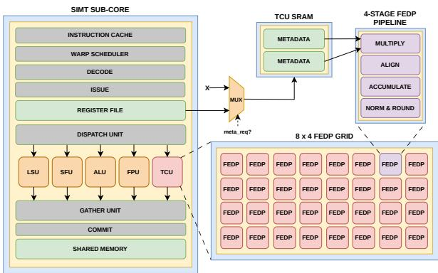

图1：Vortex SIMT子核与TCU扩展示意。左侧是取指、调度、寄存器、LSU/SFU/ALU/FPU/TCU等执行通路；右侧给出TCU SRAM元数据、4级FEDP流水及8×4 FEDP阵列。箭头体现寄存器到TCU的数据路径与meta请求复用。该图支持“Ten-Four并非独立加速器，而是贴近SIMT执行管线集成”的结论。

### 图像 2

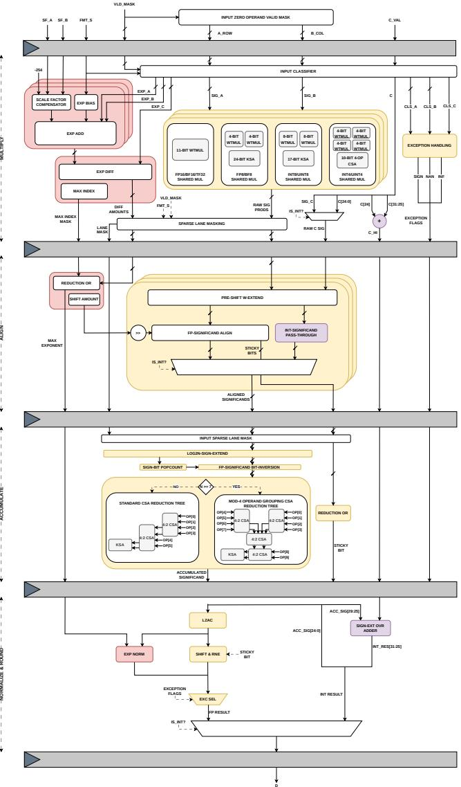

图2：Ten-Four完整微架构流程图。按纵向分四级：Multiply、Align、Accumulate、Normalize&Round。图中标出格式共享乘法器（11×11、8×8、4×4）、差分矩阵与最大指数路径、异常处理、稀疏mask门控、CSA树与KSA、LZAC和RNE、以及INT路径的C高低位拆分。可直接支撑论文“统一FP/INT管线+MX+稀疏门控”的核心主张。

### 图像 3

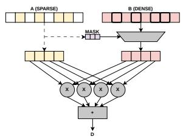

图3(a)：稀疏-稠密内积交互示意。A端稀疏后通过mask压缩，B端保持稠密，多个乘法lane后归约到单输出D。图中未出现“unused lane”标注，表达该情形下内积lane利用率较高。该子图用于对比说明：当仅一侧稀疏时，内积原语仍较自然，不必引入外积缓冲结构。

### 图像 4

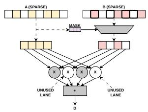

图3(b)：稀疏-稀疏内积交互示意。A与B都稀疏并mask后，乘法阵列中出现标注为“UNUSED LANE”的无效通道，说明双边稀疏难以在内积原语中完全利用。该图支持作者关于“内积存在内连接限制”的动机，并为后续lane门控（省电而非加速）提供依据。

### 图像 5

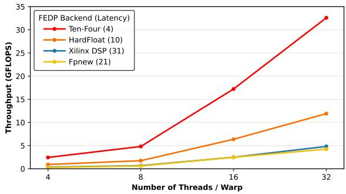

图4：不同FEDP后端在线程数4/8/16/32下的吞吐曲线，纵轴GFLOPS，横轴每warp线程数。Ten-Four（红）全程最高且随线程增长更陡；图例括号给出各后端流水时延（4/10/31/21）。观测与文中一致：Ten-Four约2.7×优于HardFloat，并显著领先DSP与FPnew，实现“低时延+高吞吐”联动。

### 图像 6

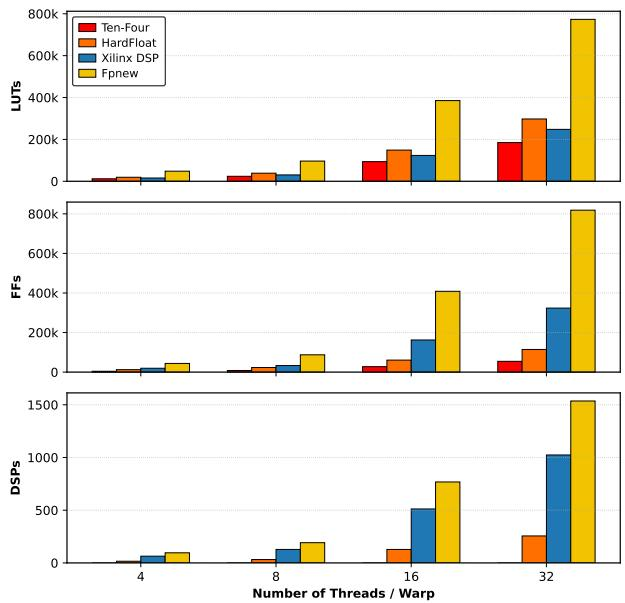

图5：FPGA实现资源柱状图，分三栏分别为LUT、FF、DSP；横轴线程数4/8/16/32，颜色对应四种后端。Ten-Four在LUT与FF均最低组，且DSP栏几乎为0；DSP/FPnew随规模上升资源激增。该图支撑“Ten-Four在高并发配置下仍具面积优势，并避免DSP块依赖”。

### 图像 7

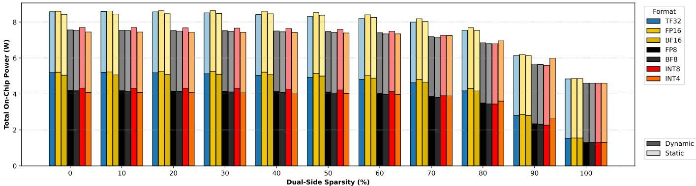

图6：总片上功耗随双边稀疏度变化（0–100%），每种格式堆叠静态+动态分量。横轴稀疏百分比，纵轴功耗W。静态部分近似不变，动态部分随稀疏上升明显下降；FP16总体最高，FP8/BF8与整数较低；高稀疏区INT4出现相对异常抬升。支持“门控主要降低动态功耗”的结论。

### 图像 8

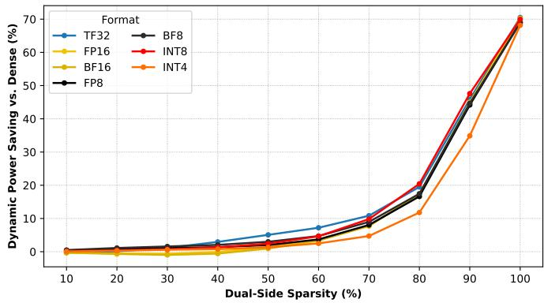

图7：相对稠密基线的动态功耗节省曲线。横轴双边稀疏度10–100%，纵轴节省百分比。多格式曲线在60%前提升有限，70%后拐点明显，90%附近达约35–48%，100%接近68–71%。INT4曲线在高稀疏段低于多数格式，呼应控制开销解释。图直接量化了稀疏门控收益区间。

### 图像 9

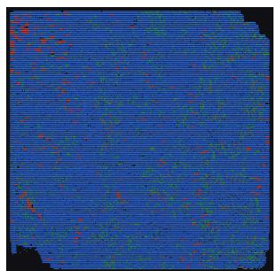

图8(a)：ASIC版图/GDS可视化截图。可见规则栅格与布线填充，左下有不规则空缺（可能为宏块/约束区域，OCR无法确认）。该图本身不提供轴信息，但证明设计已完成可导出版图阶段，支持“不仅停留RTL综合”的实现成熟度主张。

### 图像 10

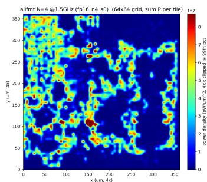

图8(b)：功率密度热力图，横纵轴为版图坐标x/y（um），色条为W/cm²量级（小字较模糊，具体刻度存在OCR不确定）。图中热点呈网状分布，局部红黄区集中。可支持“功耗并非单点极端聚集，具备可布线可散热的物理实现可行性”，但不能单独推出热可靠性结论。

### 图像 11

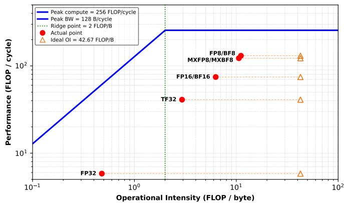

图9：TCU扩展SGEMM的roofline。横轴算术强度FLOP/byte（对数），纵轴性能FLOP/cycle（对数）；蓝线给出带宽斜线与计算平台，绿虚线是ridge point≈2。FP32点落在内存受限低区；TF32、FP16/BF16、FP8/BF8、MXFP8/MXBF8依次右上移动进入计算受限区。图支持“低精度TCU显著提高利用率，但仍受系统开销限制”。

> 版本：用户提供的 Ten-Four arXiv:2512.00053v3（2026-06-11）。经 MinerU 解析，使用 OpenAI 官方 Responses API 的 Codex 模型翻译和解读，未调用 GLM。参考文献保留原文，解读不属于论文原文。旧版独立保留，不覆盖。

[版本目录](../ten-four-versions.md) · [原文 v3](https://arxiv.org/abs/2512.00053v3)
