# Ten-Four: An Open-Source Fused Dot Product Unit for Mixed-Precision GPGPU Tensor Cores — arXiv v3 原文翻译

# Ten-Four：一种面向混合精度 GPGPU Tensor Core 的开源融合点积单元

Nikhil Rout

University of California, Los Angeles

nikhilrout97@gmail.com

Blaise Tine

University of California, Los Angeles

blaisetine@cs.ucla.edu

摘要——高效的混合精度 MMA 运算对于加速 GPGPU 上的深度学习工作负载至关重要。然而，现有开源 Tensor Core 实现依赖离散算术单元设计，导致高延迟、舍入误差累积以及较差的资源利用率。为应对这些挑战，我们提出了 Ten-Four，这是一种可配置的混合精度融合点积单元，在统一架构中集成了浮点与整数算术流水线，并作为开源、基于 RISC-V 的 Vortex GPGPU 的 Tensor Core Unit 扩展的一部分实现。它支持 TF32/FP16/BF16/FP8/BF8/INT8/INT4 低精度乘法与更高精度 FP32/INT32 累加，原生支持 Microscaling (MX)，并通过稀疏通道时钟门控实现动态功耗降低，同时在数值精度上与 NVIDIA Tensor Core 一致。Ten-Four 在 Xilinx U55C FPGA 上实现了 300 MHz Fmax 下 4 周期延迟，每个 Tensor Core 峰值吞吐量达到 130.368 GFLOPS，并在面积成本低于 60% 的情况下，相比等效的 Berkeley HardFloat 与 FPnew 实现获得 2.7×–7.9× 的加速。基于 7nm FinFET 的 ASIC 综合在 1.58 GHz $F _ { \mathbf { m a x } } .$ 下实现了 2.771 TFLOPS/W 的峰值能效。

关键词——融合点积，GPGPU 微架构，混合精度，稀疏性，Microscaling，Tensor Core

## I. 引言

随着深度学习工作负载的规模与普及不断增长，通用矩阵乘法（General Matrix Multiply, GEMM）加速已成为 GPU 设计者的关键优先事项，因为它在模型执行中占据主导地位。例如，对 NVIDIA B200 GPU 上的 Llama 3.1 8B 进行性能剖析表明，超过 80% 的运行时间花在执行某种 GEMM 变体上。为缓解这一瓶颈，GPU 厂商引入了专用的、面向吞吐量的矩阵引擎，例如 NVIDIA Tensor Cores [1] 和 AMD Matrix Cores [2]，分别用于执行专用的 Warp-Matrix-Multiply-Accumulate (WMMA) 和 Matrix-Fused-Multiply-Add (MFMA) 指令。

对这些指令的微基准测试揭示了底层硬件的关键微架构细节 [3–7]。Tensor Core 直接从 SIMT 子核寄存器文件接收输入子矩阵 A、B 和 C，执行 MxNxK 矩阵乘累加，并将结果子矩阵 D 回写到寄存器文件，这与其并列放置的整数 ALU、FPU 和 LSU SIMD 通道类似。通过避免中间结果的 RF 存储，融合 MMA 操作显著降低了功耗和内存流量。这使得在相同芯片面积内可实现更高的计算密度，从而提升数据中心 GPU 中愈发关键的 throughput/mm2 与 throughput/watt 指标。

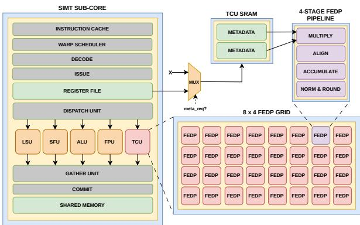  
图 1. 带 Tensor Core Unit 扩展的 Vortex GPGPU SIMT 子核

尽管商用 GPU 中的 Tensor Core 近年来取得了显著进展（NVIDIA FP16 Tensor Core FLOPS 从 Volta 到 Hopper 代提升了 8 倍 [8]），开源 GPGPU 设计空间仍落后于此，许多次优原型仅提供名义吞吐量。随着 Ampere 代以来引入 2:4 结构化稀疏性 [9, 10]，以及 NVIDIA Blackwell [13] 与 AMD CDNA 4 [14] 架构中原生硬件加速的 OCP Microscaling (MX) 格式支持 [11, 12]，这一差距进一步扩大。这在很大程度上源于开源设计依赖离散浮点算术单元库，从而引入高延迟、舍入误差累积和资源利用率低的问题。例如，Ventus GPGPU Tensor Core [15] 和 Virgo 集群级脉动阵列矩阵单元 [16] 使用了 Berkeley HardFloat [17] 库中的离散算术模块。类似地，Nada 等人 [18] 在其原型中使用了多个 FPnew [19] FMA 实例。

为解决开源 GPGPU 设计空间中缺乏高性能 Tensor Core 实现的问题，我们提出 Ten-Four：一种新颖、可配置的混合精度融合点积（Fused Dot Product, FEDP）单元微架构，构建于基于 RISC-V 的 Vortex GPGPU [20] 的 Tensor Core Unit (TCU) 扩展之上。Vortex 在多个粒度层级（核心、warp、线程、缓存层次）上的可配置性以及成熟的运行时生态，为构建和评估我们的设计提供了理想平台。图 1 展示了在每个 warp 32 线程配置下，我们如何采用由 8 元素 FEDP 单元构成的 [8x4] 网格，在 Vortex SIMT 子核内形成一个 TCU。

表 I  
现有浮点算术库与融合点积设计对比

<table><tr><td rowspan="2">设计</td><td rowspan="2">开源</td><td colspan="5">支持的输入格式</td><td rowspan="2">可配置</td><td rowspan="2">融合整数数据通路</td><td rowspan="2">Microscaling</td><td rowspan="2">稀疏通道时钟门控</td></tr><tr><td>TF32</td><td>FP16</td><td>BF16</td><td>FP8</td><td>BF8</td></tr><tr><td>Berkeley HardFloat [17]</td><td>✓</td><td>✕</td><td>✓</td><td>✕</td><td>✕</td><td>✕</td><td>✓</td><td>✕</td><td>✕</td><td>✕</td></tr><tr><td>FPnew [19]</td><td>✓</td><td>✕</td><td>✓</td><td>✓</td><td>✓</td><td>✕</td><td>✓</td><td>✕</td><td>✕</td><td>✓</td></tr><tr><td>FloPoCo [21]</td><td>✓</td><td>✕</td><td>✓</td><td>✕</td><td>✕</td><td>✕</td><td>✕</td><td>✕</td><td>✕</td><td>✕</td></tr><tr><td>ExSdotp [22]</td><td>✓</td><td>✕</td><td>✓</td><td>✓</td><td>✓</td><td>✓</td><td>✓</td><td>✕</td><td>✕</td><td>✕</td></tr><tr><td>MXDOTP [23]</td><td>✓</td><td>✕</td><td>✕</td><td>✕</td><td>✓</td><td>✓</td><td>✕</td><td>✕</td><td>✓</td><td>✕</td></tr><tr><td>Desrentes et al. [24]</td><td>✓</td><td>✕</td><td>✕</td><td>✕</td><td>✓</td><td>✓</td><td>✕</td><td>✕</td><td>✕</td><td>✕</td></tr><tr><td>Lutz et al. [25]</td><td>✕</td><td>✕</td><td>✕</td><td>✕</td><td>✓</td><td>✓</td><td>✓</td><td>✕</td><td>✓</td><td>✕</td></tr><tr><td>Cuyckens et al. [26]</td><td>✕</td><td>✕</td><td>✕</td><td>✕</td><td>✓</td><td>✓</td><td>✕</td><td>✓</td><td>✓</td><td>✕</td></tr><tr><td>Ten-Four (This Work)</td><td>✓</td><td>✓</td><td>✓</td><td>✓</td><td>✓</td><td>✓</td><td>✓</td><td>✓</td><td>✓</td><td>✓</td></tr></table>

据我们所知，这是首个弥合专用融合点积实现与 GPGPU Tensor Core 原型之间差距的开源工作。我们的关键贡献总结如下：

• 我们提出了一种可配置的 4 周期融合点积（FEDP）流水线，支持 FP16、BF16、TF32、FP8(E4M3) 和 BF8(E5M2) 低精度乘法，并在 Vortex GPGPU TCU 扩展中支持更高精度 FP32 累加。

• 我们描述了一种统一流水线方法，将整数算术集成到浮点数据通路中，仅引入极小开销，并通过一种新颖的加数拆分策略最大化资源复用。

• 我们提出了一种稀疏通道掩码（Sparse Lane Mask）方法：当输入 A 或 B 为零时，通过时钟门控降低动态功耗，从而使基于内点积的双侧稀疏 Tensor Core 设计更具实用性。

• 我们支持 Microscaling (MX) 格式的块量化输入，并在保持早期加数累加的同时，采用逐通道尺度因子补偿方案。

• 我们在 Xilinx U55C FPGA 上展示了：相较于等效 Berkeley HardFloat 和 FPnew 实现，在面积成本低于 60% 的情况下实现 2.7×-7.9× 加速

• 使用 ASAP7 7nm PDK 的 ASIC 综合在 1.58 GHz $F _ { \mathrm { m a x } }$ 下实现了 2.771 TFLOPS/W 的峰值能效，在等配置条件下每单元吞吐量超过 NVIDIA A100 Tensor Cores 约 12.3%。

## II. 背景与动机

## A. 张量核心中的 FEDP 计算

张量核心的 WMMA 指令作用于 warp 寄存器，这些寄存器由一个 warp 的全部 32 个线程协同加载和存储子矩阵操作数。可以将其概念化为一个在 32 个线程中复制的单个 32 位寄存器（例如 R0），从而提供总计 $3 2 \times 3 2 = 1 0 2 4$ 位的操作数容量。为最大化数据密度，每个线程的 32 位寄存器可打包两个 16 位、四个 8 位或八个 4 位元素。

每个 MMA 操作数子块都必须适配 warp 寄存器容量。对于 FP16 输入，一个 warp 寄存器可容纳 1024/16=64 个元素，对应矩阵 A 的 MxK=8x8 子块。然而，由于 FP32 累加将矩阵 C 限制为 1024/32=32 个元素，我们必须设定 N=4，从而得到 8x4x8 的 FP16/FP32 MMA 形状。对于 FP8 输入，加倍的打包密度扩展了归约维度，产生 8x4x16 的 FP8/FP32 形状。因此，一个张量核心可以实现为由 K 元素 FEDP 单元实例构成的 MxN 网格：

$$
D _ {m, n} ^ {F P 3 2} = \sum_ {i = 0} ^ {K - 1} \left(A _ {m, i} ^ {F P 1 6} \times B _ {i, n} ^ {F P 1 6}\right) + C _ {m, n} ^ {F P 3 2}\tag{1}
$$

## B. 现有工作的局限性

浮点库。Berkeley HardFloat [17] 提供符合 IEEE 754 的 HDL 模块，并使用重编码中间表示来支持可配置的指数位宽和尾数位宽。它已被广泛用于开源加速器项目，例如 Gemmini [27]、Virgo [16]、Ventus [15] 和 Chipyard SoC Framework [28]。FPnew [19] 是另一个参数化跨精度 FPU，面向支持 RISC-V F 扩展，具有可配置格式、流水线深度和按能耗比例执行特性。它被用于 PULP Platform [29]、Vortex FPU lanes [20] 以及 Nada 等人的 Tensor Core 原型 [18]。相比之下，FloPoCo [21] 专门面向 FPGA 算术生成，采用参数化 VHDL 运算器与自动流水线。

专用融合点积设计。多项基础工作 [22, 30, 31] 关注将点积由离散算术单元组合时所带来的延迟、舍入和资源开销问题，并引入了共享整数数据通路 [32]、Posit 格式支持 [24, 33]、Microscaling [23, 25, 26] 及其在计算集群中的集成 [34–37] 等特性。然而，这些工作仍然局限于特定格式或 ISA。Ten-Four 通过借鉴并泛化这些融合微架构，弥合了这一差距，将其扩展到更广泛、可配置、混合精度的 GPGPU 张量核心语境中，如表 I 所总结。

## III. TEN-FOUR 微架构

Ten-Four 是一个开源的融合点积硬件 IP 1，用于开发功能丰富的混合精度 GPGPU 张量核心，采用 SystemVerilog 编写。

## A. 关键算术子模块

混合精度融合内积点积数据通路需要若干多操作数加法。进位保存加法器（CSA）尤其适合该任务，因为它能够在无进位传播依赖的情况下，将 N 个各为 W 位的操作数有效规约为一个 $( \mathbf { W } + \mathrm { l o g _ { 2 } N } ) – \mathbf { b i t }$ 的和与进位。我们开发了一种标准 CSA：使用递归级联的 4:2 压缩器，并在操作数个数为奇数时使用条件 3:2 压缩器；同时还开发了基于 MOD-4 操作数分组的 CSA，以在需要累加七个或更多操作数时进一步最小化关键路径。最终求和由 Kogge-Stone Adder（KSA）完成；该结构通过其并行前缀树在每一级实现更低扇出，以牺牲面积效率为代价，相比超前进位设计可获得更低延迟。我们还实现了 Wallace 树乘法器（WTMUL），其部分积可借助 CSA 高效规约。我们决定不在设计中引入 Radix-4 Booth 重编码，因为在目标 4-11 位宽下，由位对编码带来的额外开销超过了部分积数量减半的收益。

## B. Ten-Four 混合精度浮点数据通路

根据 SIMT 子核心配置，Ten-Four 分别在 4/8 或 16/32 线程/warp 下执行四元素或八元素 FEDP。它还可以在编译时配置为选择性实例化可用输入格式中的任意子集或全部，以便根据应用需求减少面积并提升效率。例如，仅使用 FP16/BF16/TF32 格式的 LLM 训练工作负载，可以通过完全省略低精度格式逻辑而获益。Ten-Four 也显然支持在运行时通过源格式信号动态选择输入数据类型。如图 2 所示，完整的 Ten-Four 数据通路由 4 个流水级组成：

1) Stage-1：共享乘法器、差分矩阵与异常处理：Ten-Four 在尾数位宽相近的格式之间采用按类别共享乘法器方案，在格式专用乘法器的短关键路径与 Zhang 等人提出的统一子字部分积阵列面积效率之间做出了等权衡 [31]。例如，FP16、BF16 和 TF32 三者的尾数乘法都在一个 11×11 位 WTMUL 中完成。相应地，BF16 尾数在进入乘法器前需要做零扩展以保持相同位宽。请注意，由于输入以每个 32 位寄存器打包为 FP16/BF16 对或 FP8/BF8 四元组，对于给定的 K 元素点积，我们并行实例化 2×K 条乘法通道。由于按这种方式每个 32 位寄存器只能打包一个 TF32 操作数，因此该输入类型只有隔一条通道有效。相反，由于可将四个 FP8/BF8 元素打包在一起，它们需要额外一次归约，以在流水线后续阶段保持操作数计数一致。因此，FP8（E4M3）和 BF8（E5M2）共享两个 4×4 位 WTMUL，其乘积随后通过一个 24 位 KSA 求和。以这种方式，所有格式都收敛为原始 E8M25 中间表示，以在后续流水级中保持一致性并实现高效资源利用。

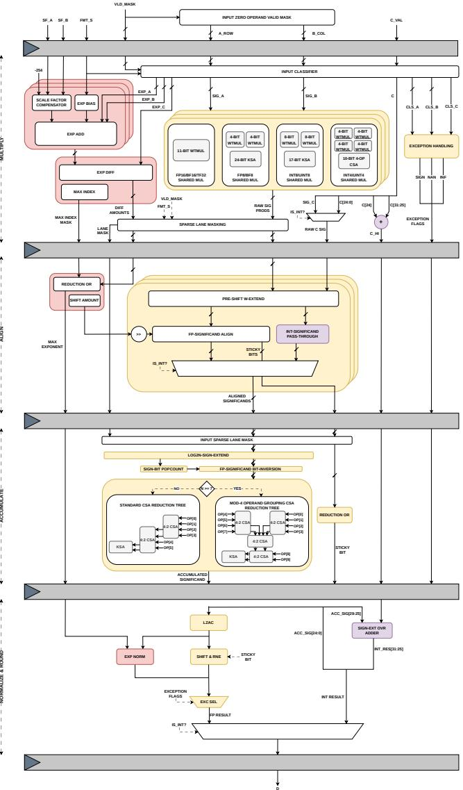  
图 2. Ten-Four 融合点积微架构

类似地，输入 A 和 B 操作数的指数和及其各自按格式到 FP32 的偏置转换，按以下方程计算：

$$
C O N V _ {F P 1 6 / F P 3 2} = B I A S _ {F P 3 2} - (2 \times B I A S _ {F P 1 6}) + 1\tag{2}
$$

$$
E X P _ {F P 3 2} = E X P _ {A} + E X P _ {B} + C O N V _ {F P 1 6 / F P 3 2}\tag{3}
$$

这些指数和被送入我们最大指数识别电路的第一部分，该电路将 Sohn 等人的基于减法器比较器架构 [30] 扩展为支持任意数量 N 的操作数。首先，并行计算所有 $( N - 1 ) \times ( N - 1 )$ 两两指数差，形成差分矩阵。每个减法器结果的符号位表明其操作数对的相对大小。为降低面积开销，我们利用对称性，仅计算上三角，并通过对符号位取补来导出下三角。随后，通过归约 AND 与 NOR 逻辑从符号矩阵中提取最大指数索引，并以 one-hot 编码掩码形式传递到下一阶段。

此外，与指数和尾数处理并行地执行标准 IEEE-754 兼容异常处理。对于每个乘积，我们检测 NaN 输入与无穷大乘零条件以捕获乘法异常。加法异常则通过在点积元素与加数之间识别符号相反的无穷大来检测，从而预先生成结果的符号、NaN 和无穷大标志。

2) Stage-2：最大指数、移位量与有效数对齐：该阶段通过对前一阶段 one-hot 编码掩码做归约 OR，完成最大指数识别。随后复用差分矩阵并在需要时对数值取负来导出移位量，与传统归约树比较器相比，以 $O ( N ^ { 2 } )$ 的面积代价获得近似 $O(1)$ 的关键路径复杂度（在较大 N 时实践中受扇出限制）。最后，使用计算出的移位量对有效数乘积进行对齐，并保留两个额外对齐位以及每条通道由移出位产生的 sticky 位以保持精度。

3) Stage-3：累加：朴素点积实现会在点积求和后再单独累加加数“C”，这需要额外的二操作数对齐、规格化和舍入，从而同时增加舍入误差和关键路径延迟。我们的设计从第一个流水级就集成了加数处理，其中 C 的指数参与最大指数查找，其有效数与乘积项一起进行对齐。

在这里，对齐后的有效数和加数首先符号扩展到 $2 5 { + } \log _ { 2 } ( 2 K )$ ) 位，以正确处理有符号算术。现在，我们不再在多操作数 CSA 之前对每个负项分别进行朴素的 2 的补码，而是仅对负有效数做按位取反，并将 +1 校正延后为在 CSA 中作为额外操作数统一处理，其数值就是累加中负项总数。该值通过对每条通道的符号位执行 popcount 计算得到。根据操作数总数——在 4/8 线程/warp 下为 6 个（K 个乘积、1 个加数、1 个校正项），或在 16/32 线程/warp 配置下为 10 个——在编译时选择标准 CSA 树或 MOD-4 操作数组分 CSA。同时，每通道 sticky 位也被归约 OR 成单个 sticky 位，用于对最终 FEDP 结果舍入。

4) Stage-4：规格化与舍入：最终流水级从有符号累加结果中提取幅值，并利用预测型前导零计数器（LZAC）确定规格化移位量。通过从最大指数中减去计算出的移位量来调整指数，同时通过将有效数左移来规格化尾数。使用 LSB、Guard、Round 以及先前提取的 Sticky 位应用标准最接近偶数舍入（RNE），生成最终 FP32 点积结果。若发生异常，则结果会被 IEEE 兼容的规范 NaN 或无穷大表示覆盖。

## C. 融合整数数据通路

整数点积运算需要浮点数据通路中已存在的多个算术组件 [26, 32]。融合两条流水线可消除仲裁器需求，并避免调度两个独立 Tensor Core 执行单元。因此，Ten-Four 也尝试做到这一点：在现有浮点数据通路内支持 INT8、UINT8、INT4 和 UINT4 乘法以及 INT32 累加，仅增加最小的多路复用开销。虽然整数格式拥有其各自按类别共享的乘法器，并且会直接穿过 stage 2，但代价显著更高的 stage 3 累加器同样可被整数格式复用。

然而，融合 32 位整数加数 C 的加法存在挑战，因为它超出了累加器宽度 $2 5 { + } \log _ { 2 } ( 2 \mathrm { K } )$ 位。我们采用一种新颖的拆分策略来解决这一约束。C 的低 25 位与乘积项一起在 stage 3 的 CSA 中累加，而仅高 7 位（在图 2 中记为 C HI）沿流水线传播，从而显著降低中间流水寄存器开销。在最终阶段，整数结果的高 7 位在与浮点规格化并行的过程中构建，方法是将来自累加器的符号扩展溢出与 C HI 相加。随后将其与低 25 位累加结果直接拼接，产生完整的 INT32 输出。

## D. 稀疏通道掩码与时钟门控

现代深度学习工作负载（包括剪枝后的 LLM、推荐系统和图神经网络）在权重和动态激活两侧天然都表现出显著稀疏性。尽管利用这种双侧稀疏性可以显著降低内存占用和带宽需求，当前 NVIDIA 稀疏 Tensor Core [8, 9, 13, 38] 由于内积计算原语本身存在根本性的未使用通道限制（如图 3 所示），仅支持权重矩阵上的 2:4 结构化稀疏。

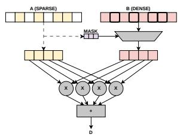

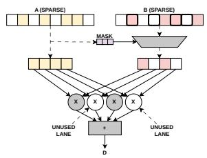  
(a) 稀疏-稠密交互  
(b) 稀疏-稀疏交互  
图 3. 内积原语的双侧稀疏性限制

Wang 等人提出了双侧稀疏 Tensor Core（DSTC）[39]，通过用外积单元替换内积单元来规避这一限制。外积通过对列向量-行向量对进行交叉乘法，自然避免了内连接问题，从而在乘法前先将稀疏输入压缩为稠密向量。然而，外积需要在 K 次归约步骤中于昂贵的累加缓冲区里存储完整的 M×N 中间部分矩阵，这会带来显著面积开销，并降低给定芯片面积下的计算密度。

Ten-Four 采用了一种务实的折中方案：保留面积高效的内积 FEDP 设计，同时至少通过选择性通道时钟门控来利用稀疏性实现功耗降低。如图 2 所示，由源操作数格式和零检测逻辑导出的输入有效掩码用于控制 FEDP 通道的时钟门控。当某通道输入被识别为零时，其流水线寄存器从一开始就被时钟门控，从而消除乘法与对齐阶段中的翻转活动（在这些阶段中，通道计算是自包含的）。然而，在进入发生多通道归约的累加器阶段之前，第三级流水线寄存器输出会与有效通道掩码进行 AND 门控，确保被禁用通道向 CSA 提供零值而非陈旧寄存器值。该方法在不引入外积设计那样的微架构复杂性或面积开销的前提下，降低了动态功耗，使其成为面向双侧稀疏工作负载 Tensor Core 的实用方案。值得注意的是，该方案与 2:4 结构化稀疏正交（其加速与功耗节省来自 K 维上将 WMMA 微操作减半），并且可与其同时应用。

## E. 微缩放（MX）格式支持

块浮点格式在保留低精度算术的内存与吞吐优势的同时，相比按张量量化可保持更高模型精度 [12, 40]。OCP MX 规范 [11] 将点积的内部精度与操作顺序留作实现定义，从而允许激进的微架构灵活性。

传统方法将两个 E8M0 缩放因子 $X ^ { ( A ) }$ 和 $X ^ { ( B ) }$ 相加，去除 FP32 偏置（−254），并在最终累加前将其应用于乘积求和（SoP）：

$$
D = X ^ {(A)} X ^ {(B)} \sum_ {i = 1} ^ {k} (A _ {i} \times B _ {i}) + C\tag{4}
$$

这种延后缩放与 Ten-Four 的流水线不兼容，因为加数 C 会从 Stage 1 起与 SoP 一起处理。Ten-Four 通过简单重排缩放因子的因式分解来解决这一问题：

$$
D = \sum_ {i = 1} ^ {k} \left[ X ^ {(A)} X ^ {(B)} \left(A _ {i} \times B _ {i}\right) \right] + C\tag{5}
$$

这种按通道缩放因子补偿方案，结合现有低精度指数与偏置电路，使得在极少修改下即可支持 MXFP8、MXBF8 和 MXINT8，如图 2 所示。

## IV. 评估

## A. FPGA 设计流程分析

我们将 Ten-Four 与等效的 Xilinx DSP IP、基于 Berkeley HardFloat [17] 和 FPnew [19] 的离散 TCU 实现进行对比评估，目标是在 AMD Xilinx Alveo U55C FPGA [41] 上达到 300 MHz 工作时钟频率，并覆盖一系列线程/warp 配置（NT = 4, 8, 16, 32）。

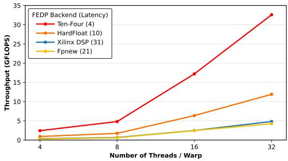  
图 4. FEDP 后端性能扩展（FP16/BF16）

图 4 显示，Ten-Four 实现了显著更高的单周期吞吐量2扩展（2.446–32.592 GFLOPS），相比 HardFloat（0.922–11.903 GFLOPS，∼2.7×）、Xilinx DSP（0.367–4.824 GFLOPS，∼6.7×）和 FPnew（0.304–4.244 GFLOPS，∼7.9×）更优。这一提升主要来自我们 4 周期延迟和 MOD-4 分组 CSA。

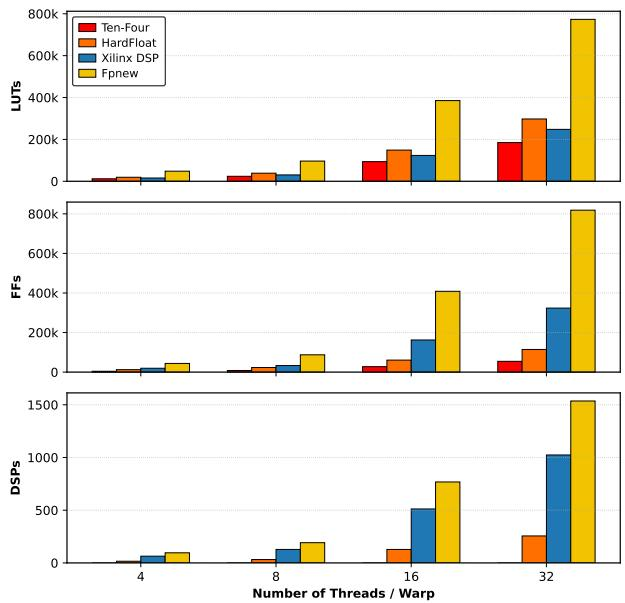  
图 5. FEDP 后端实现后面积利用率（FP16/BF16）

如图 5 所示，Ten-Four 在 LUT 使用上相较 HardFloat 降低 37–38%，相较 Xilinx DSP 降低 24–25%，相较 FPnew 降低 75–76%，尽管其完全消除了 DSP 块使用。与 HardFloat 相比，触发器使用也降低了 52–66%；与 Xilinx DSP 相比降低了 75–83%；与 FPnew 相比降低了 90–93%。

$$
^ 2 \mathrm{Single-cycleThroughput} = (\mathrm{FLOPs/Latency}) \times F _ {m a x}
$$

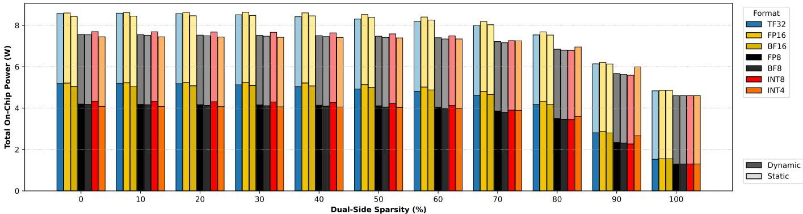  
图 6. FPGA 实现后总片上功耗与双侧稀疏性的关系

## B. 双侧稀疏通道掩码功耗分析

我们通过在 64x64x64 SGEMM 核上、对所有支持格式将双侧稀疏性以 10% 步长从 0–100% 扫描，来评估稀疏通道掩码时钟门控方案；功耗采用 Alveo U55C FPGA 上基于实现后的 SAIF 功耗估算。尽管静态功耗在所有格式与稀疏度下基本保持不变（∼3.30–3.39 W），如图 6 所示，FP16 表现出最高动态功耗（∼5.2 W）。由于仅交替通道激活方案以及更小尾数位宽，TF32 和 BF16 的功耗略低。FP8/BF8 与整数格式由于乘法器逻辑更精简，始终功耗最低。然而值得注意的是，在超过 70% 稀疏度时，INT4 的动态功耗可能高于 INT8，因为其更细粒度通道掩码相对于减少后的计算活动，引入了比例上更高的时钟门控控制开销。

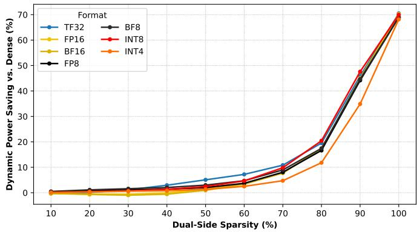  
图 7. 不同双侧稀疏度下的动态功耗节省

图 7 展示了相对于稠密基线的对应动态功耗节省。超过 70% 双侧稀疏度后，稀疏通道掩码的优势愈发明显：在 70% 时节省 4.7–10.8%，在 90% 时提升至 34.9–47.6%，在 100% 时达到 68.1–70.5%。这些结果表明，稀疏通道时钟门控是一种有效机制，能够与现有 2:4 结构化稀疏方案结合，以极小开销挖掘双侧稀疏工作负载中的动态功耗降低潜力。

## C. ASIC 设计流程分析

为验证 Ten-Four 的实际可行性，我们使用 Synopsys Design Compiler 和 ASAP7 7nm Predictive PDK [42] 对四元素（NT=4,8）和八元素（NT=16,32）点积配置进行综合。每种配置均综合为两个变体：一个最小化的仅 MXFP8/MXBF8 数据通路，用于建立精简面积基线；以及一个启用全部浮点与整数格式的全功能变体，用于捕获按格式共享逻辑扇出带来的开销。所有运行均以 1500 MHz、PVT\_0P7V\_25C 典型条件为目标，采用 asap $7 s \subset 7 \bar { \mathrm { p } } 5 t \_ \mathrm { L } \mathrm { A } \mathrm { O \_ } \mathrm { L V T \_ T T \_ n } 1$ dm 标准单元库。表 II 将 Ten-Four 与先前 FP8 点积加速器设计进行了比较。

TABLE II  
FP8 点积加速器设计对比

<table><tr><td>设计</td><td>工艺 nm</td><td>电压 V</td><td>频率 GHz</td><td>面积 mm $^{2}$ </td><td>吞吐量 GFLOPS</td><td>缩放支持</td></tr><tr><td>ExSdotp [22]</td><td>12</td><td>0.8</td><td>1.26</td><td> $5.13 \times 10^{-3}$ </td><td>20.2</td><td>✗</td></tr><tr><td>Desrentes et al. [24]</td><td>16</td><td>—</td><td>1.25</td><td> $9.81 \times 10^{-3}$ </td><td>80.0</td><td>✗</td></tr><tr><td>Lutz et al. [25]</td><td>5</td><td>—</td><td>3.6</td><td> $6.74 \times 10^{-4}$ </td><td>28.8</td><td>√ (1 × 7b)</td></tr><tr><td>MXDOTP [23]</td><td>12</td><td>0.8</td><td>1.09</td><td> $3.15 \times 10^{-3}$ </td><td>17.4</td><td>√ (2 × 8b)</td></tr><tr><td rowspan="2">Ten-Four（本文）</td><td rowspan="2">7</td><td rowspan="2">0.7</td><td>1.66</td><td> $1.06 \times 10^{-3}$ </td><td> $26.6^{\dagger}$ </td><td rowspan="2">√ (2 × 8b)</td></tr><tr><td>1.55</td><td> $1.93 \times 10^{-3}$ </td><td> $49.6^{\ddagger}$ </td></tr><tr><td rowspan="2">Ten-Four（全格式）</td><td rowspan="2">7</td><td rowspan="2">0.7</td><td>1.58</td><td> $2.40 \times 10^{-3}$ </td><td> $25.2^{\dagger*}$ </td><td rowspan="2">√ (2 × 8b)</td></tr><tr><td>1.58</td><td> $4.65 \times 10^{-3}$ </td><td> $50.4^{\ddagger*}$ </td></tr></table>

† NT=4/8 ‡ NT=16/32  
在 FP8/BF8 精度下测量；在 FP16/BF16 下为 ${ \frac { 1 } { 2 } } \times$，在 TF32 下为 $\textstyle { \frac { 1 } { 4 } } \rangle$

单个基于 Ten-Four 的 Tensor Core 可在 291.92 mW 下提供最高 404.5 GFLOPS 的 TF32、808.9 GFLOPS 的 FP16/BF16，以及 1.617 TFLOPS 的 FP8/BF8，实现 NT=32 时约 2.771 TFLOPS/W 的峰值能效。在与 NVIDIA A100 架构 [9] 进行工艺归一化、同配置比较时（同为 7nm，且公开文档显示其每个 Tensor Core 在 1410 MHz 加速时钟下约为 720 GFLOPS FP16/BF16），Ten-Four 在支持显著更广格式与特性范围的同时，实现了约 12.3% 更高的单位峰值吞吐。由 Synopsys ICC2 布局布线成功导出的功率密度网格和 GDS 布局如图 8 所示。

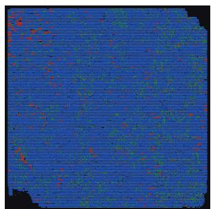  
(a) GDS 布局

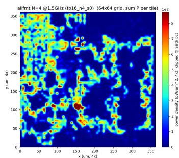  
(b) 功率密度网格  
图 8. Ten-Four FEDP ASIC 物理设计分析

## D. 数值精度验证

为验证 Ten-Four 的 FEDP 计算，我们开发了一个验证框架，使用基于 PyTorch 的 CUDA 内核生成来产生面向 NVIDIA Ada 架构 [38] RTX 4090 GPU 的格式特定 WMMA 与 PTX 例程，并将其作为硬件参考。我们的验证工具系统性覆盖六类不同特征的边界情况：正规数、非正规数、零、无穷大、NaN，以及灾难性消除场景。在全部 1,000,000+ 随机测试向量上，Ten-Four 在所有受支持的浮点（TF32、FP16、BF16、FP8 和 BF8）与整数（INT8 和 INT4）格式中，均产生与 NVIDIA Ada Tensor Core 输出按位完全一致的结果。

我们还通过 Vortex WMMA C++ API 移植了 FTTN 基准 [43]，以验证符合 IEEE 的非正规数处理与舍入，并将 Ten-Four 的精度特性与商用 GPU 的解析数值精度模型 [44] 进行比较，结果如表 III 所示。

TABLE III  
与 NVIDIA GPU 的数值精度对比

<table><tr><td>输入</td><td>GPU</td><td>非正规输入/输出</td><td>乘积对齐</td><td>累加</td><td> $N_{FMA}$  宽度</td><td>舍入模式</td></tr><tr><td rowspan="3">FP8BF8</td><td>H100</td><td>√</td><td>(2, 13)</td><td>21</td><td>32</td><td>截断</td></tr><tr><td>B200</td><td>√</td><td>(2, 25)</td><td>33</td><td>32</td><td>截断</td></tr><tr><td>Ten-Four</td><td>√</td><td>(2, 25)</td><td>30</td><td>16</td><td>RTN-TE</td></tr><tr><td rowspan="5">FP16BF16</td><td>V100</td><td>√</td><td>(2, 23)</td><td>28</td><td>4</td><td>截断</td></tr><tr><td>A100</td><td>√</td><td>(2, 24)</td><td>30</td><td>8</td><td>截断</td></tr><tr><td>H100</td><td>√</td><td>(2, 25)</td><td>32</td><td>16</td><td>截断</td></tr><tr><td>B200</td><td>√</td><td>(2, 25)</td><td>32</td><td>16</td><td>截断</td></tr><tr><td>Ten-Four</td><td>√</td><td>(2, 25)</td><td>30</td><td>8</td><td>RTN-TE</td></tr><tr><td rowspan="4">TF32</td><td>A100</td><td>√</td><td>(2, 24)</td><td>29</td><td>4</td><td>截断</td></tr><tr><td>H100</td><td>√</td><td>(2, 25)</td><td>31</td><td>8</td><td>截断</td></tr><tr><td>B200</td><td>√</td><td>(2, 25)</td><td>31</td><td>8</td><td>截断</td></tr><tr><td>Ten-Four</td><td>√</td><td>(2, 25)</td><td>30</td><td>4</td><td>RTN-TE</td></tr></table>

## E. TCU 扩展 SGEMM 内核 Roofline 分析

最后，我们在 Ten-Four 支持的所有格式上，对一个 256x256x256 的 SGEMM 内核执行 roofline 建模，使用与单个 NVIDIA SM 等效的 Vortex 配置（1 个 socket、4 个核心、16 个 warp、32 个线程）。如图 9 所示，依赖 FPU 的 FP32 基线仍受内存带宽限制，即使在这个相对较小的内核规模下，计算利用率也仅达到 2.3%。相比之下，启用 Ten-Four 的 TCU 在所有低精度格式下都将该内核推进到拐点（ridge point）之外并进入计算受限区域。计算利用率从 TF32 的 16.0% 逐步提升到 FP16/BF16 的 29.1%、FP8/BF8 的 51.1%，以及 MXFP8/MXBF8 的 47.8%。尽管相应的操作强度也有所提高，但仍显著低于理想的 N/6 = 42.7 FLOP/byte 值。

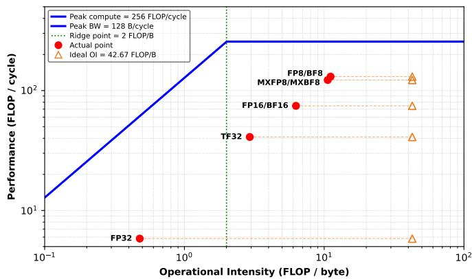  
图 9. 启用 Ten-Four 的 TCU 扩展 SGEMM roofline 分析

值得注意的是，从 TF32 迁移到 FP16/BF16，或从 FP16/BF16 迁移到 FP8/BF8 时，实现吞吐并未完美按 2× 缩放，因为该内核仍会产生来自 warp 调度、指令发射，以及寄存器与内存流量的非算术开销。由于缩放因子元数据访问会引入算术数据通路之外的额外开销，MXFP8/MXBF8 的表现略低于普通 FP8/BF8。

## V. 结论

在本文中，我们介绍了 Ten-Four，这是一种开源高性能融合点积单元（Fused Dot Product Unit）微架构，用于为基于 RISC-V 的 Vortex GPGPU 开发功能丰富的混合精度 Tensor Core 单元扩展。通过融合整数与浮点数据通路、对稀疏通道进行时钟门控，并通过提前被加数累加执行微缩放（Microscaling），Ten-Four 克服了当前基于离散算术单元的 Tensor Core FEDP 设计在延迟和资源利用率方面的限制。我们在 Xilinx U55C FPGA 上实现了 300 MHz 下 4 个周期的操作延迟，同时每个 Tensor Core 提供 130.368 GFLOPS 的峰值吞吐量，并且在数值精度上与 NVIDIA Tensor Core 相匹配。在 7nm FinFET 工艺下进行 ASIC 综合可达到 1.58 GHz 的 $F _ { \mathrm { m a x } }$ 和 2.771 TFLOPS/W 的峰值能效，在等配置（iso-configuration）下其单单元吞吐量比 NVIDIA A100 高约 ∼12.3%。Ten-Four 对低精度格式的支持还能够将 SGEMM 内核从内存受限区域推进到计算受限区域。此外，Ten-Four 的可配置 RTL 设计与验证方法使得未来能够快速原型化并评估定制的块量化（block-quantized）和非结构化稀疏格式，用于深度学习推理加速器的软硬件协同设计。

## REFERENCES

[1] NVIDIA Corporation, “NVIDIA Tesla V100 GPU Architecture,” https://images.nvidia.com/content/volta-architecture/pdf/ volta-architecture-whitepaper.pdf, 2017.

[2] AMD, “AMD CDNA 2 Architecture,” https://www.amd.com/ content/dam/amd/en/documents/instinct-business-docs/white-papers/ amd-cdna2-white-paper.pdf, 2021.

[3] Z. Jia et al., “Dissecting the nvidia volta gpu architecture via microbenchmarking,” 2018. [Online]. Available: https://arxiv.org/abs 1804.06826

[4] M. A. Raihan, N. Goli, and T. M. Aamodt, “Modeling deep learning accelerator enabled gpus,” in 2019 IEEE International Symposium on Performance Analysis of Systems and Software (ISPASS), 2019, pp. 79–92.

[5] H. Abdelkhalik et al., “Demystifying the nvidia ampere architecture through microbenchmarking and instruction-level analysis,” in 2022 IEEE High Performance Extreme Computing Conference (HPEC), 2022, pp. 1–8.

[6] W. Sun et al., “Dissecting tensor cores via microbenchmarks: Latency, throughput and numeric behaviors,” IEEE Transactions on Parallel and Distributed Systems, vol. 34, no. 1, pp. 246–261, 2023.

[7] W. Luo et al., “Benchmarking and dissecting the nvidia hopper gpu architecture,” in 2024 IEEE International Parallel and Distributed Processing Symposium (IPDPS), 2024, pp. 656–667.

[8] NVIDIA Corporation, “NVIDIA H100 Tensor Core GPU Architecture,” https://resources.nvidia.com/en-us-hopper-architecture/ nvidia-h100-tensor-c, 2022.

[9] “NVIDIA A100 Tensor Core GPU Architecture,” https://images.nvidia.com/aem-dam/en-zz/Solutions/data-center nvidia-ampere-architecture-whitepaper.pdf, 2020.

[10] A. Mishra et al., “Accelerating sparse deep neural networks,” 2021. [Online]. Available: https://arxiv.org/abs/2104.08378

[11] Open Compute Project, “OCP Microscaling Formats (MX) Specification v1.0,” https://www.opencompute.org/documents/ ocp-microscaling-formats-mx-v1-0-spec-final-pdf, 2023.

[12] B. D. Rouhani et al., “Microscaling data formats for deep learning,” 2023. [Online]. Available: https://arxiv.org/abs/2310.10537

[13] NVIDIA Corporation, “NVIDIA Blackwell Architecture Technical Brief,” https://resources.nvidia.com/en-us-blackwell-architecture/ blackwell-architecture-technical-brief, 2024.

[14] AMD, “AMD CDNA 4 Architecture,” https://www.amd.com/ content/dam/amd/en/documents/instinct-tech-docs/white-papers/ amd-cdna-4-architecture-whitepaper.pdf, 2025.

[15] J. Li et al., “Ventus: A high-performance open-source gpgpu based on risc-v and its vector extension,” in 2024 IEEE 42nd International Conference on Computer Design (ICCD), 2024, pp. 276–279.

[16] H. Kim et al., “Virgo: Cluster-level matrix unit integration in gpus for scalability and energy efficiency,” in Proceedings of the 30th ACM International Conference on Architectural Support for Programming Languages and Operating Systems, Volume 2, ser. ASPLOS ’25. New York, NY, USA: Association for Computing Machinery, 2025, p. 1382–1399. [Online]. Available: https://doi.org/10.1145/3676641.3716281

[17] J. R. Hauser, “Berkeley HardFloat floating-point arithmetic package, release 1,” https://www.jhauser.us/arithmetic/HardFloat.html, 2019.

[18] A. Nada, G. M. Sarda, and E. Lenormand, “Cooperative warp execution in tensor core for risc-v gpgpu,” in 2025 IEEE International Symposium on High Performance Computer Architecture (HPCA), 2025, pp. 1422–1436.

[19] S. Mach et al., “Fpnew: An open-source multiformat floating-point unit architecture for energy-proportional transprecision computing,” IEEE Transactions on Very Large Scale Integration (VLSI) Systems, vol. 29, no. 4, pp. 774–787, 2020.

[20] B. Tine et al., “Vortex: Extending the risc-v isa for gpgpu and 3d-graphics,” in MICRO-54: 54th Annual IEEE/ACM International Symposium on Microarchitecture, ser. MICRO ’21. New York, NY, USA: Association for Computing Machinery, 2021, p. 754–766. [Online]. Available: https://doi.org/10.1145/3466752.3480128

[21] F. de Dinechin and M. Kumm, Application-Specific Arithmetic. Springer, 2024. [Online]. Available: https://link.springer.com/book/10. 1007/978-3-031-42808-1

[22] L. Bertaccini et al., “Minifloat-nn and exsdotp: An isa extension and a modular open hardware unit for low-precision training on risc-v cores,” in 2022 IEEE 29th Symposium on Computer Arithmetic (ARITH), 2022, pp. 1–8.

[23] G. Islamoglu et al., “ MXDOTP: A RISC-V ISA Extension for Enabling Microscaling (MX) Floating-Point Dot Products ,” in 2025

IEEE 36th International Conference on Application-specific Systems, Architectures and Processors (ASAP). Los Alamitos, CA, USA: IEEE Computer Society, Jul. 2025, pp. 81–84. [Online]. Available: https://doi.ieeecomputersociety.org/10.1109/ASAP65064.2025.00021

[24] O. Desrentes, B. D. de Dinechin, and J. Le Maire, “Exact dot product accumulate operators for 8-bit floating-point deep learning,” in 2023 26th Euromicro Conference on Digital System Design (DSD), 2023, pp. 642–649.

[25] D. R. Lutz et al., “Fused fp8 4-way dot product with scaling and fp32 accumulation,” in 2024 IEEE 31st Symposium on Computer Arithmetic (ARITH), 2024, pp. 40–47.

[26] S. Cuyckens et al., “Efficient precision-scalable hardware for microscaling (mx) processing in robotics learning,” in 2025 IEEE/ACM International Symposium on Low Power Electronics and Design (ISLPED), 2025, pp. 1–7.

[27] H. Genc et al., “Gemmini: Enabling systematic deep-learning architecture evaluation via full-stack integration,” in Proceedings of the 58th Annual Design Automation Conference (DAC), 2021.

[28] A. Amid et al., “Chipyard: Integrated design, simulation, and implementation framework for custom socs,” IEEE Micro, vol. 40, no. 4, pp. 10–21, 2020.

[29] D. Rossi et al., “Pulp: A parallel ultra low power platform for next generation iot applications,” in 2015 IEEE Hot Chips 27 Symposium (HCS), 2015, pp. 1–39.

[30] J. Sohn and E. E. Swartzlander, “A fused floating-point four-term dot product unit,” IEEE Transactions on Circuits and Systems I: Regular Papers, vol. 63, no. 3, pp. 370–378, 2016.

[31] H. Zhang, D. Chen, and S.-B. Ko, “Efficient multiple-precision floatingpoint fused multiply-add with mixed-precision support,” IEEE Transac tions on Computers, vol. 68, no. 7, pp. 1035–1048, 2019.

[32] T. M. Bruintjes et al., “Sabrewing: A lightweight architecture for combined floating-point and integer arithmetic,” ACM Trans. Archit. Code Optim., vol. 8, no. 4, Jan. 2012. [Online]. Available: https://doi.org/10.1145/2086696.2086720

[33] Q. Li, C. Fang, and Z. Wang, “Pdpu: An open-source posit dot-product unit for deep learning applications,” in 2023 IEEE International Symposium on Circuits and Systems (ISCAS), 2023, pp. 1–5.

[34] Y. Kim et al., “Dacapo: Accelerating continuous learning in autonomous systems for video analytics,” in 2024 ACM/IEEE 51st Annual International Symposium on Computer Architecture (ISCA), 2024, pp. 1246– 1261.

[35] K. B. Nine et al., “Optimizing sparse/dense vegeta accelerator performance with microscaling quantization,” in 2025 IEEE International Symposium on Circuits and Systems (ISCAS), 2025, pp. 1–5.

[36] M. Wipfli et al., “Vmxdotp: A risc-v vector isa extension for efficient microscaling (mx) format acceleration,” in 2026 Design, Automation & Test in Europe Conference (DATE), 2026, pp. 1–7.

[37] S. Cuyckens et al., “Precision-scalable microscaling datapaths with optimized reduction tree for efficient npu integration,” in 2026 31st Asia and South Pacific Design Automation Conference (ASP-DAC), 2026, pp. 611–617.

[38] NVIDIA Corporation, “NVIDIA Ada GPU Architecture,” https://images.nvidia.com/aem-dam/Solutions/geforce/ada/ nvidia-ada-gpu-architecture.pdf, 2022.

[39] Y. Wang et al., “Dual-side sparse tensor core,” in 2021 ACM/IEEE 48th Annual International Symposium on Computer Architecture (ISCA), 2021, pp. 1083–1095.

[40] B. Darvish Rouhani et al., “With shared microexponents, a little shifting goes a long way,” in Proceedings of the 50th Annual International Symposium on Computer Architecture, ser. ISCA ’23. New York, NY, USA: Association for Computing Machinery, 2023. [Online]. Available: https://doi.org/10.1145/3579371.3589351

[41] AMD, “Alveo U55C Data Center Accelerator Cards Data Sheet (DS978),” https://docs.amd.com/r/en-US/ds978-u55c, 2023.

[42] L. T. Clark et al., “Asap7: A 7-nm finfet predictive process design kit,” Microelectronics Journal, vol. 53, pp. 105–115, 2016. [Online]. Available: https://www.sciencedirect.com/science/article/pii/S002626921630026X

[43] X. Li et al., “Fttn: Feature-targeted testing for numerical properties of nvidia & amd matrix accelerators,” in 2024 IEEE 24th International Symposium on Cluster, Cloud and Internet Computing (CCGrid), 2024, pp. 39–46.

[44] F. A. Khattak and M. Mikaitis, “Accurate models of nvidia tensor cores,” 2026. [Online]. Available: https://arxiv.org/abs/2512.07004

> 版本：用户提供的 Ten-Four arXiv:2512.00053v3（2026-06-11）。经 MinerU 解析，使用 OpenAI 官方 Responses API 的 Codex 模型翻译和解读，未调用 GLM。参考文献保留原文，解读不属于论文原文。旧版独立保留，不覆盖。

[版本目录](../ten-four-versions.md) · [原文 v3](https://arxiv.org/abs/2512.00053v3)
