# TensorForge: Synthesis-Backed Design Space Exploration of Multi-Precision Tensor Core Microarchitectures 图表详解

### 图像 1

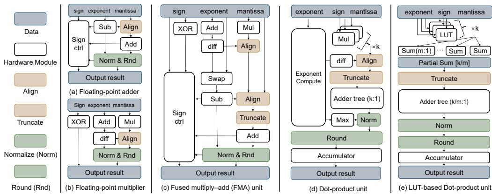

图 1 比较浮点加法器、乘法器、FMA、DP 与 LUT-DP 的信号路径。蓝色块是数据表示，米色是对齐，橙色是截断，绿色是规格化或舍入。DP 将 k 路乘积集中归约后处理；LUT-DP 先做 m 项局部归约再跨组求和。图支持比较共享边界，不提供具体总位宽或单一时延合同。

### 图像 2

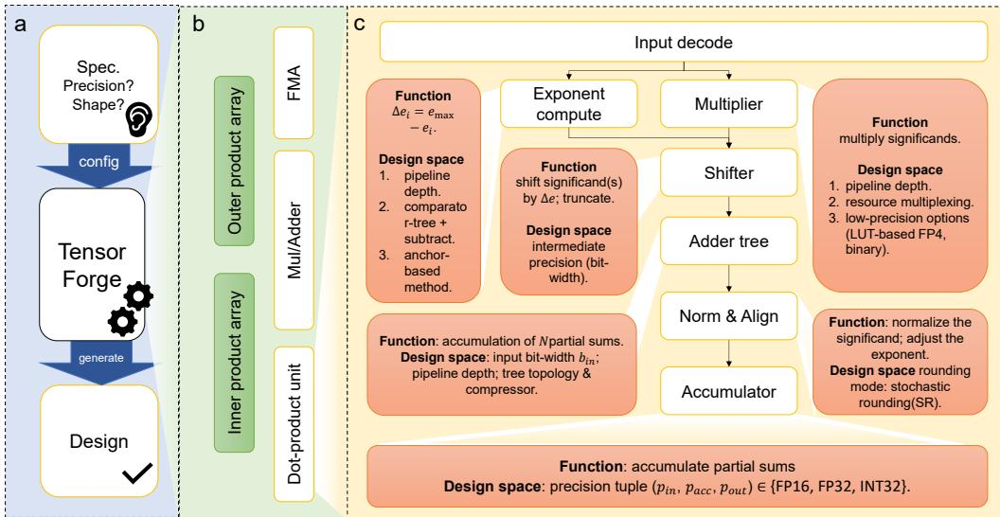

图 2 展示生成器流程与模块组成：精度、形状和规格输入驱动 RTL 生成；计算族覆盖内积、外积、FMA 和乘加组织。右侧列出指数处理、乘法、移位、归约、规格化与累加的配置项。它是参数化模板示意，不意味着一颗运行时单元同时支持全部 DSE 选择。

### 图像 3

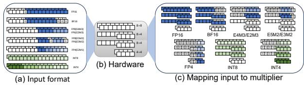

图 3 展示精度模式的操作数位置、底层乘法积木，以及 FP16/BF16、FP8/FP6、FP4 与整数的映射。白色/着色区域表示位域与有效硬件使用。需要结合有效数宽度理解，而不是把数据格式总位数直接等同于整数乘法器位数。

### 图像 4

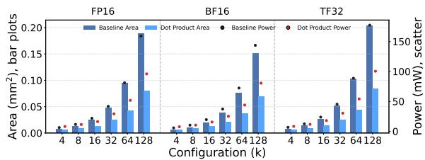

图 4 比较匹配吞吐、工艺、时序和流水条件下的乘加树基线与 DP 单元面积和功耗。随着 k 增大，DP 后端摊销收益增加；正文给出典型 k=16–64 的面积与功耗降幅。图不能证明任意数值合同或供数条件下同样成立。

### 图像 5

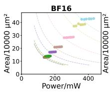

图 5 的 BF16 子图：横轴功耗 mW，纵轴面积（10000 μm²）。散点表示等峰值吞吐的不同阵列组织，虚线为参考等成本曲线。靠左下表示面积和功耗较低，具体 m、n、k 对应关系须结合原图例，不能从散点独立推断实际任务利用率。

### 图像 6

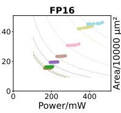

图 5 的 FP16 子图：横轴功耗 mW，纵轴面积（10000 μm²）。散点表示等峰值吞吐的不同阵列组织，虚线为参考等成本曲线。靠左下表示面积和功耗较低，具体 m、n、k 对应关系须结合原图例，不能从散点独立推断实际任务利用率。

### 图像 7

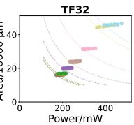

图 5 的 TF32 子图：横轴功耗 mW，纵轴面积（10000 μm²）。散点表示等峰值吞吐的不同阵列组织，虚线为参考等成本曲线。靠左下表示面积和功耗较低，具体 m、n、k 对应关系须结合原图例，不能从散点独立推断实际任务利用率。

### 图像 8

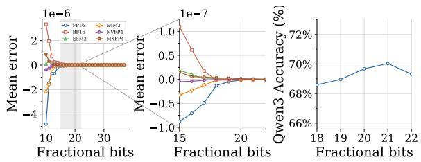

图 6 的面积效率子图，展示 1.41 GHz 下不同格式与 k 的吞吐归一化面积成本，包括常规和 LUT-FP4 配置。需要区分输入格式、输出精度与实现族，不能把所有曲线都看作同一数值功能。

### 图像 9

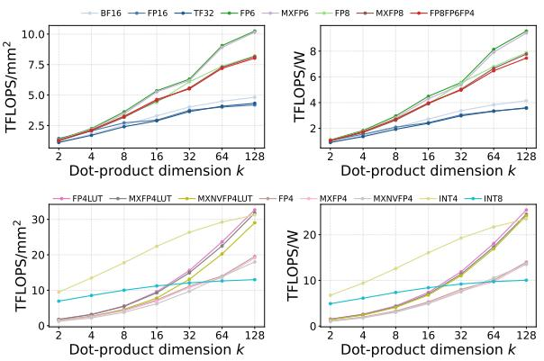

图 6 的能量效率子图，与面积效率图配套比较各精度随 k 的变化。较长点积能摊薄归约后端成本；LUT-FP4 的收益属于特定实现条件，不直接代表整 GPU 或完整推理系统能效。

### 图像 10

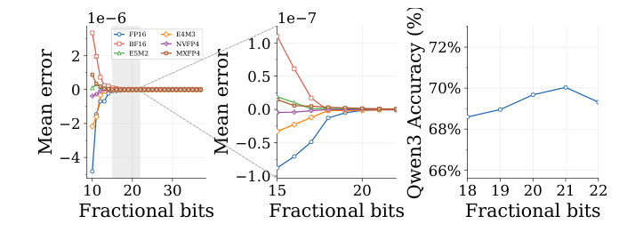

图 7：左侧两个面板给出不同小数保留位数下的平均误差，分别展示总体趋势和局部放大；右侧给出 Qwen3-0.6B 在 SuperGLUE RTE 的准确率，横轴为小数位数。它说明所测分布与任务上的经验阈值，不是与商业 Tensor Core 位一致性的证明。图像由原 PDF 第 6 页补回。

### 图像 11

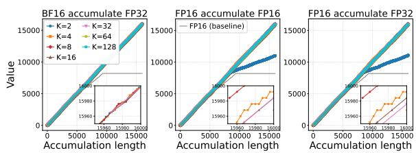

图 8 的三个面板分别是 BF16 输入/FP32 累加、FP16 输入/FP16 累加和 FP16 输入/FP32 累加。横轴为累加长度，纵轴为值，曲线区分 k。灰色基线显示逐次 FP16 累加的停滞，局部放大图比较分组精度差异；这是特定实验序列的结果，不代表全部输入的误差上界。

### 图像 12

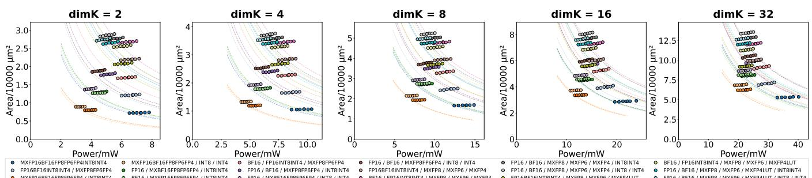

图 9 在多个 k 下比较 18 种共享策略的面积—功耗帕累托点。图例中的斜杠分隔独立数据通路；全共享通常面积最小，而 FP/INT 分组共享取得较好的综合折中。结果来自综合候选，解释性代理模型不替代综合测量。

### 图像 13

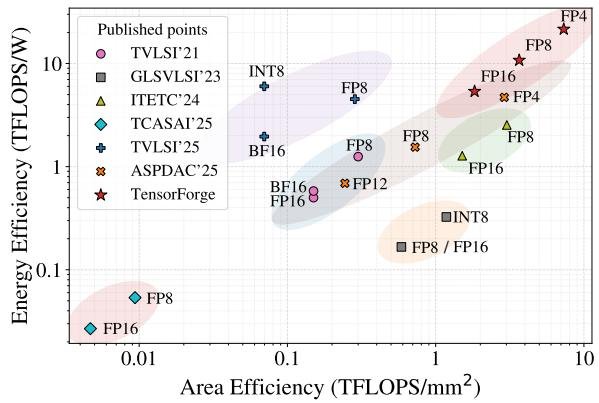

图 10 展示归一化到 22 nm 后的面积/能量效率比较。归一化后的比值与表 4 原工艺数据有不同口径，不能混用。跨文献的精度覆盖、累加方式及节点假设仍需逐项核对。

### 图像 14

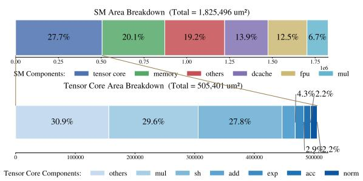

图 11 展示 Ventus SM 与集成 Tensor Core 的面积构成。正文报告 Tensor Core 占 SM 的 27.7%。这属于集成评估口径，不等于单个算术积木的面积占比，也不是商业 NVIDIA SM 的分解结果。

### 图像 15

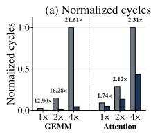

图 12(a) 比较 GEMM 与 attention 工作负载的执行周期/加速趋势。Tensor 路径减少总周期，较大 GEMM 获益更明显。需要结合图中任务规模和下两个子图理解，不从柱高推断未给出的模型端到端 tokens/s。

### 图像 16

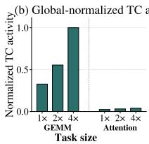

图 12(b) 展示 Tensor Core 活动率。更大的 GEMM 通常维持更高活动率，attention 较低，说明供数和调度影响峰值吞吐兑现。活动率是执行层指标，不等于算术精度或数值准确率。

### 图像 17

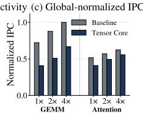

图 12(c) 比较 IPC。Tensor 路径即使 IPC 较低仍能减少总周期，因为每条 MMA 指令承载更多计算；IPC 不能单独衡量不同指令功能下的性能。

> 来源与版本：用户提供的 TensorForge 匿名稿 iccad2026-paper544.pdf；未据文件名推断会议录用状态。经 MinerU 解析，由 Codex/GPT 翻译与解读，未调用 GLM 翻译 API。全文译文保留参考文献；技术总结、通俗讲解与图表说明属于解读。技术内容以所提供稿件为准；综合、功耗评估和仿真集成不等同于流片实测。

[架构建模目录](../index.md)
