# TensorForge: Synthesis-Backed Design Space Exploration of Multi-Precision Tensor Core Microarchitectures 原文翻译

# TensorForge：综合支持的多精度张量核心微架构设计空间探索

Anonymous Author(s)

## 摘要

张量核心承担了 GPGPU 中的大部分 AI 计算，但在严格的带宽、功耗和面积预算下支持多种精度，仍然是一项重大的微架构挑战。我们提出 TensorForge，这是一个由综合支持的框架，用于探索多精度张量核心微架构。TensorForge 将计算单元组织、精度配置和资源共享作为架构可调参数，生成可综合的 RTL 以进行系统性比较，并从 600 多种配置中提炼出可付诸实践的设计规则。我们进一步将 TensorForge 生成的设计集成到开源 GPGPU 中，展示其实际部署可行性。与先前的多精度计算单元设计相比，TensorForge 生成的一个设计点将 FP8 的面积效率和能效分别提升至原来的 $1.77 \times$ 和 $1.49 \times$，将 FP4 的面积效率和能效分别提升至原来的 $1.35 \times$ 和 $3.04 \times$，同时拓展了面积–功耗帕累托前沿。RTL 和综合结果已公开发布于 https://anonymous.4open.science/r/TensorForge/。

## CCS 概念

\- 硬件 $\rightarrow$ 算术与数据通路电路。

## 关键词

张量核心，GPGPU，多精度，设计空间探索

## 1 引言

随着深度学习和大语言模型的快速发展，面向 AI 的通用 GPU（GPGPU）已成为支撑 AI 计算的核心硬件平台。在现代 GPGPU 架构 $[10, 12, 13, 21]$ 中，张量核作为专用矩阵计算单元，承担了 GPGPU 的大部分 AI 工作负载。例如，在从 A100 到 GB200 的 NVIDIA GPGPU 中，张量核的吞吐量是向量单元的 $16\times-31\times$；$[24]$ 表明，张量核约占单核面积的 $\sim75\%$。如此庞大的计算吞吐量和硅片面积占用，使张量核成为 GPGPU 设计中最关键的组件，值得深入探索与优化。

然而，张量核设计在算法和硬件两个方面都面临严峻挑战。在算法方面，量化算法正快速演进，呈现出精度多样化和粒度细化的双重趋势。在精度维度上，不同量化算法对数值格式提出了异构需求：GPTQ [7]、AWQ [19] 等仅权重量化的 W4A16 方法在 LLM 推理期间通过向量单元将 INT4 权重转换为 FP16/BF16，因此需要 FP16/BF16 张量核；SmoothQuant [32] 采用 W8A8，依赖 INT8 精度；DeepSeek V3 的训练流水线 [6] 要求采用 FP8 E4M3 并进行高精度累加；而 SVDQuant [17] 的权重与激活联合 4 位量化则需要 NVFP4 [1] 等新兴格式。在粒度维度上，量化策略已从粗粒度的逐张量/逐通道方案（由向量单元支持），发展为细粒度的逐块量化（例如 MXFP4 [29] 或 NVFP4 [1]），这要求张量核原生支持细粒度缩放因子。量化方法的快速演进要求张量核硬件具备灵活的多精度支持能力。

表 1：学术设计中不同精度的支持情况对比。rm 表示舍入模式。MX 表示微缩放格式 [29]。

<table><tr><td rowspan="2"></td><td colspan="9">深度学习精度</td><td>缩放</td><td>rm</td><td colspan="2">累加器</td></tr><tr><td>TF32</td><td>BF16</td><td>FP16</td><td>FP8</td><td>FP6</td><td>FP4</td><td>INT8</td><td>INT4</td><td>二进制</td><td>MX</td><td>SR</td><td>FP32</td><td>FP16</td></tr><tr><td>[24]</td><td></td><td>√</td><td>√</td><td>√</td><td></td><td></td><td></td><td></td><td></td><td></td><td></td><td>√</td><td>√</td></tr><tr><td>[9]</td><td></td><td></td><td></td><td>√</td><td></td><td>√</td><td></td><td>√</td><td></td><td></td><td>√</td><td></td><td>√</td></tr><tr><td>[22]</td><td>√</td><td></td><td>√</td><td>√</td><td></td><td></td><td></td><td></td><td></td><td></td><td></td><td>√</td><td>√</td></tr><tr><td>[5]</td><td></td><td>√</td><td>√</td><td>√</td><td></td><td></td><td></td><td></td><td></td><td></td><td>√</td><td>√</td><td>√</td></tr><tr><td>[2]</td><td></td><td></td><td></td><td></td><td></td><td>√</td><td></td><td>√</td><td></td><td></td><td>√</td><td></td><td></td></tr><tr><td>本文设计</td><td>√</td><td>√</td><td>√</td><td>√</td><td>√</td><td>√</td><td>√</td><td>√</td><td>√</td><td>√</td><td>√</td><td>√</td><td>√</td></tr></table>

从硬件角度来看，张量核的设计空间涵盖矩阵乘法电路的众多组件，并面临三重约束之间的权衡难题。首先，作为集成在 GPGPU 中的组件，张量核受限于片上存储带宽，必须在计算吞吐量与数据访问之间取得平衡。其次，功耗约束要求在扩展计算能力的同时严格控制能耗。此外，由于张量核会复制部署到所有流式多处理器（SM）中，其面积会直接影响整颗芯片的成本与可扩展性。这造成了一个根本矛盾：软件生态希望获得近乎全面的精度支持，以实现通用计算能力，而硬件必须在严格的面积和功耗预算内实现多精度功能。在这一多目标空间中找到最优设计点，是当代 GPGPU 张量核电路设计的一项关键挑战。

为弥合这一差距，我们提出 TensorForge：一个面向多精度张量核微架构的硬件级、算法无关的设计空间探索框架。TensorForge 使用 Chisel 硬件构建语言实现，提供覆盖完整层次结构的高度参数化设计模板：从基本计算单元（浮点乘法器、加法器、FMA 单元和点积单元）到复杂计算阵列（内积/外积阵列）。它支持主流及专用数值格式（FP32、FP16、BF16、FP8(E5M2/E4M3)、FP6(E3M2/E2M3)、FP4(E2M1)、INT8、INT4、二进制），以及微缩放（Microscaling）[29] 和 NVFP4 [1] 等细粒度量化引擎。通过对超过 600 种配置进行基于综合的评估，我们系统地研究了张量核设计中的三个基本问题：

\- 计算架构选择：通过在 FP16/BF16/TF32 吞吐量匹配约束下开展基于综合的评估，我们表明，相较于乘法器—加法器流水线，点积单元可将面积减少 $47\% -55\%$，功耗降低 $25\% -36\%$。在阵列层面，我们进一步表明，

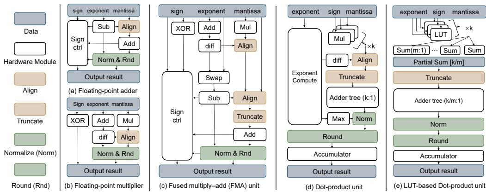  
图 1：不同硬件单元中 GEMM 运算的微架构。图中展示了五种常见功能单元：(a) 浮点加法器，(b) 浮点乘法器，(c) 融合乘加（FMA）单元，(d) 点积单元，以及 (e) 基于查找表（LUT）的点积单元。TensorForge 探索的是可配置的计算单元族，而非单一固定的算术数据通路。这里，k 表示内积长度。在基于 LUT 的设计中，m 表示每个小组的大小；首先在每个大小为 m 的组内局部累加部分和，然后沿 k 维度执行最终归约。

采用更大 k 的内积组织方式比外积组织方式能够获得更优的面积—功耗帕累托前沿，为不同计算规模下的架构选择提供了定量指导。

\- 数值精度权衡：我们从中间精度、累加器精度和随机舍入三个方面刻画设计空间中的数值可行域。结果表明，点积单元通过缓解小数被大数吞没的现象，提高了低精度累加的稳健性，而随机舍入在点积单元中仅带来 0.63% 的面积开销。

\- 精度复用策略：我们系统地分析了资源共享策略，并在面积—功耗平面中识别出一条清晰的统一式与混合式设计切换边界：完全统一的一体化设计可使面积最小化，而当不同数值格式族之间的精度异构性足够大时，按 FP/INT 划分的混合设计能够获得更优的帕累托前沿。经过保守的工艺归一化后，所选的一个 $k = 32$ 设计点相较于先前的多精度计算单元，在 FP8 下实现了 $1.77 \times / 1.49 \times$ 的面积效率/能效提升，在 FP4 下实现了 $1.35 \times / 3.04 \times$ 的面积效率/能效提升。

本文其余部分组织如下。第 2 节介绍背景与动机。第 3 节详细介绍 TensorForge 框架及其实现。第 4 节描述评估设置。第 5 节报告实验结果与分析。第 6 节总结全文。

## 2 背景与动机

## 2.1 相关工作

2.1.1 GPGPU 张量核心。如表 2 所示，NVIDIA GPGPU 张量核心已逐步支持多种乘法器精度，包括 NVFP4、FP8、FP16 和 BF16，同时支持以 FP16/FP32 精度进行累加。在 GPU 内部的组织方式方面，张量核心正朝着更大规模、更高异步程度的执行方式演进。基于逆向工程，[28] 首次提出了 Volta 架构中张量核心的结构假设，而 [8] 通过数值实验分析了 Volta 的数值行为。[24] 基于开源 GPGPU 设计，揭示了 GPGPU 内部一种经过优化的张量核心组织方式；然而，针对张量核心，仍然缺乏专门面向电路级 PPA（性能–功耗–面积）权衡和多格式资源共享策略的系统性方法。

表 2：NVIDIA GPGPU 张量核心的演进。

<table><tr><td>架构</td><td>FP16 FLOP/周期/SM</td><td>支持的精度</td></tr><tr><td>Volta</td><td>1024</td><td>FP16</td></tr><tr><td>Turing</td><td>1024</td><td>FP16/INT8/INT4/二进制</td></tr><tr><td>Ampere</td><td>2048</td><td>FP16/INT8/INT4/BF16/TF32/FP64</td></tr><tr><td>Hopper</td><td>4096</td><td>FP16/INT8/INT4/FP8/BF16/TF32/FP64</td></tr><tr><td>Blackwell</td><td>8192</td><td>FP16/INT8/FP8/FP4/BF16/TF32/FP64</td></tr></table>

2.1.2 面向 AI 硬件的 DSE 框架。大量已有工作开发了面向 AI 加速器的设计空间探索（DSE）框架，主要针对架构级评估、映射探索和成本建模。Timeloop [27]、MAESTRO [15]、ZigZag [23] 和 SparseLoo [31] 推进了对数据流、映射和硬件成本的解析式探索，而 TensorLib [11] 则支持基于生成器的加速器构建与评估。然而，这些框架主要关注架构级和映射级探索，而非以综合为支撑的张量核心微架构电路级设计。相比之下，我们的工作面向多精度 GPGPU 张量核心，在一个统一的、以综合为支撑的框架内，明确探索计算原语、跨精度共享、时序收敛以及低精度实现方案。

2.1.3 矩阵乘法单元的硬件设计。矩阵乘法单元的硬件设计空间可以从两个维度来理解：基本计算单元和阵列组织方式。二者共同决定了张量核心的性能–功耗–面积（PPA）特性。

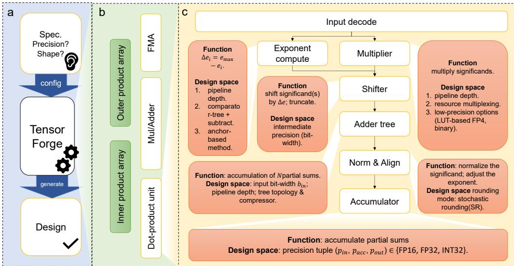  
图 2：TensorForge 概览。(a) 工作流程。(b) 核心组件。(c) 点积单元：功能与设计空间。

在阵列层面，已有设计涵盖了从数据流驱动的组织方式，例如 TPU v4 [14]、Huawei Ascend [18] 和 FlexFlow [20]，到指令驱动的广播式/并行阵列。由于 GPU 张量核心通过规则的 MMA 风格指令对外提供功能，本工作重点关注计算单元组织方式和广播式阵列构建，而非脉动式/数据流调度。

在计算单元层面，已有设计的差异体现在用于实现矩阵乘法的算术原语上，包括独立的乘法器/加法器、乘法器–加法器树、融合乘加（FMA）单元以及点积（DP）单元。这些选择直接影响累加成本、规格化开销和精度支持。例如，乘法器–加法器树为更高精度的计算提供了灵活的实现途径 $[24, 34]$，而对于更大规模的内积，DP 单元能够更好地分摊对齐和累加开销 $[8]$。表 1 总结了具有代表性的多精度计算单元设计 $[5, 9, 22, 24, 36]$。然而，这些工作大多是单独的设计，而非面向多精度张量核心微架构、以综合为支撑的系统性探索框架。

## 2.2 研究动机

设计 GPGPU 张量核心的一项关键挑战，是在同时满足软件需求和硬件约束的条件下，协同设计高效的张量核心电路。在软件方面，快速演进的多精度与量化方案不断引入新的数值格式，推动张量核心支持多种精度。在硬件方面，矩阵单元受到带宽、功耗和面积的严格限制，而多精度支持进一步收紧了 PPA 预算。

这些挑战促使我们构建一个系统性框架，以回答三个具体的设计问题：(i) 哪种计算单元组织方式最具成本效益？(ii) 不同精度和张量核心规模的实际面积与功耗成本是多少？(iii) 哪些多精度共享方案能够实现更优的帕累托权衡？这些问题共同推动了 TensorForge 的设计。

## 3 TensorForge 框架与实现

## 3.1 概览

如图 2 所示，TensorForge 是一个以综合为支撑、由约束驱动的 DSE 框架，而非仅面向少数手工设计的张量核心的一次性生成器。它采用由相互解耦、可复用的硬件原语构成的层次化组织方式：首先，根据精度、内积维度 k 和流水级设置，对乘法器、指数处理单元、移位器、加法树、规格化单元和累加器等算术模块进行参数化；随后，将这些原语组合成可配置的点积/FMA 数据通路，最后在用户指定的计算规模和精度约束下，将其实例化为内积或外积阵列。给定目标精度和吞吐量约束后，TensorForge 会实例化可行的候选设计，生成可综合的 RTL，通过综合和 CACTI 评估 PPA，并提取帕累托最优的设计规则。

生成器组织方式与可配置原语。TensorForge 围绕可复用的数据通路封装和阵列构造器进行组织。在单元层面，它围绕一个共享的内部模块提供 FP、FP/INT 混合、专用 INT 和 LUT-FP4 封装；该内部模块将乘法器、指数处理、移位器、加法树、规格化和累加器子模块分解出来。在阵列层面，这些封装在统一的、以综合为支撑的流程下，被实例化为内积和外积组织形式。图 2(c) 和表 3 共同明确展示了这一层次结构：图中展示了数据通路模板在原语层面的组成，而表中则形式化定义了设计空间变量，这些变量的组合产生了所报告的 600 多个可综合设计点。

## 3.2 DSE 空间定义

我们将一个 TensorForge 设计点形式化为

$$
x = (f _ {\mathrm{comp}}, o _ {\mathrm{array}}, k, \mathcal {P}, \phi_ {\mathrm{FP4}}, s, p _ {\mathrm{acc}}, p _ {\mathrm{int}}, n _ {\mathrm{align}}, r _ {\mathrm{SR}}, \pi) \in \mathcal {X},
$$

表 3：TensorForge 中的设计空间变量及其可行域。

<table><tr><td>符号</td><td>设计变量</td><td>取值域</td><td>架构含义 / 代表性设置</td></tr><tr><td> $f_{\text{comp}}$ </td><td>计算类型</td><td>乘加树 / FMA 树 / DP 单元</td><td>决定基本计算原语和数据通路组织；例如，基线 FMA、FP DP、FP/INT 混合 DP、INT DP。</td></tr><tr><td> $o_{\text{array}}$ </td><td>阵列组织</td><td>外积 / 内积</td><td>决定在固定吞吐量目标下如何平铺单元级数据通路；$k = 1$ 对应外积组织，而 $k = 2^n$（$n \in \mathbb{N}^+$）对应具有不同内积维度的内积阵列。</td></tr><tr><td> $\mathcal{P}$ </td><td>精度支持集合</td><td>支持的格式族</td><td>决定候选设计所涵盖的数值格式；例如，FP16、BF16、TF32、FP8、FP6、FP4、INT8、INT4、二进制以及 MX/NV 变体。</td></tr><tr><td>s</td><td>共享类型</td><td>统一 / 专用 / 混合</td><td>控制跨精度复用粒度和多路复用范围；例如，一体化复用、按 FP/INT 分区复用以及更细粒度的分区。</td></tr><tr><td> $p_{\text{acc}}$ </td><td>累加器精度</td><td>FP16 / FP32</td><td>控制最终累加的保真度和累加开销。</td></tr><tr><td> $p_{\text{int}}$ </td><td>中间精度</td><td>位宽扫描</td><td>控制规格化前的截断开销和数值可行性。</td></tr><tr><td> $n_{\text{align}}$ </td><td>规格化 / 对齐模式</td><td>启用 / 共享 / 模式专用</td><td>控制规格化/对齐逻辑的放置和复用。</td></tr><tr><td> $r_{\text{SR}}$ </td><td>SR 策略</td><td>关闭 / LFSR / 基于 TRNG</td><td>控制低精度舍入行为和对无偏累加的支持。</td></tr><tr><td> $\pi$ </td><td>流水线放置</td><td>逐级可配置</td><td>控制时序收敛、吞吐量实现以及流水级层面的 PPA 权衡。</td></tr></table>

其中，该元组选择计算类型、阵列组织、内积维度、支持的精度集合、FP4 实现、共享类型、累加器精度、中间精度、规格化/对齐模式、随机舍入选项以及流水线放置。给定所需精度集合 $P_{req}$ 和目标计算规模 $\Gamma_{req}$，可行集为

$$
\mathcal {F} \left(\mathcal {P} _ {\text { req }}, \Gamma_ {\text { req }}\right) = \left\{x \in \mathcal {X} \mid \operatorname{Prec} (x) \supseteq \mathcal {P} _ {\text { req }}, \text { Scale } (x) \geq \Gamma_ {\text { req }} \right\},
$$

此外，还要求生成的 RTL 在目标频率下实现时序收敛。因此，TensorForge 将张量核心生成表述为一个受约束的设计空间探索问题，其目标是在明确的精度和计算规模约束下识别帕累托最优设计族，而不是优化某个单独手选的标量。所报告的 600+ 种综合配置来自表 3 中主要维度的笛卡尔积，仅通过支持的精度覆盖范围、固定阵列规模下的吞吐量以及目标频率下的时序收敛等可行性约束进行筛选。对于每个可行设计，TensorForge 输出可综合的 RTL，并获取其综合后的面积和功耗，从而能够直接构建 PPA 帕累托前沿，以及用于张量核心架构选择的相应决策边界。

用于复用分析的代理模型。为解释第 5.3 节中的复用边界，我们基于按时钟频率分组的 560 个已综合点积单元样本，构建了一个经综合结果校准的两阶段代理模型。该模型使用与结构和复用相关的特征，例如精度支持、k、LUT-FP4 选项、格式数量、分组信息、规格化/累加支持以及多路复用器扇入。在 7 折交叉验证下，面积和功耗的平均 MAPE 分别为 3.45% 和 2.55%，平均 $R^{2}$ 分别为 0.9930 和 0.9965。该模型仅用于解释，所有报告的结果仍基于综合得到的设计。

## 3.3 点积单元模板

当阵列的内积维度 $k > 1$ 时，TensorForge 会实例化一个可配置的点积模板，而不是一个固定的黑盒单元。如图 2 所示，该模板使用图 2 中的原语系列，组合出输入解码、乘法器、指数计算、移位器、加法树、规格化和累加器模块。每个模块均可按精度系列、复用模式和流水级位置进行配置，因此同一个单元级模板可以复用于内积阵列、外积阵列和多精度比较，同时保持综合结果的可比性。

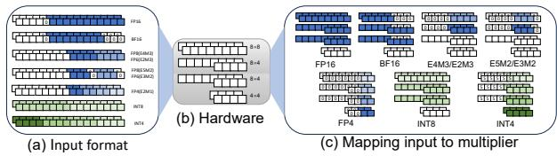  
图 3：乘法器复用策略示例。(a) 操作数在计算单元各乘法器通道中的逻辑放置方式，可实现一次 16 位、两次 8 位或四次 4 位乘法运算。(b) 与复用执行组织方式相对应的共享乘法器硬件的物理实现。(c) 在相应复用配置下，不同数值精度的操作数到硬件的映射示例。

如图 3 所示，尾数乘法器探索了两种整数乘法资源复用方案：(1) 在一个宽乘法器内打包多个小位宽运算；(2) 拼接多个小位宽乘法器以构成一个宽乘法器。指数计算单元将有效数移位 $\Delta e$，并截断至某一中间精度；该中间精度的保留位宽决定了单元的数值准确性。移位器根据指数差进行对齐，并在空间上放置部分积。加法树为数据通路提供深度可配置的并行归约，并可选择在不同树层级插入流水级分界，以权衡面积、时序和吞吐量。规格化模块执行浮点规格化和舍入，输出 FP16/FP32，并兼容 MX/NV FP4 等低精度格式。累加器支持 FP16/FP32 累加；其流水线深度和分段点均可配置。采用 64 路分区归约时，FP16 累加的准确性可以接近或达到 FP32 [30]。然而，对于 GPGPU 和 LLM 工作负载，这通常仍然不够：即使 FP22 也可能无法满足注意力计算和 LLM 数值运算的要求 [6, 35]。

一体化与混合复用实现。在代码库中，一体化单元通过选择一个涵盖各模式功能的 FP/INT 超集数据通路来实现，其乘法器、指数、规格化和累加模块通过依赖模式的多路选择实现共享；这最大限度地减少了重复的算术模块，但延长了关键路径，并扩大了开关活动范围。相比之下，我们的 DSE 中的混合设计点 (1,1,256) (1,2,128) (2,2,64) (4,4,16) (8,4,8) (8,8,4) (16,16,1) (128,1,2)

会分别实例化 FP 系列和 INT 系列的封装模块，并且仅在各系列内部复用硬件，因此数据在接口/调度层面共享，同时避免在算术关键路径上使用完全全局化的多路选择器。

基于 LUT 的 FP4 设计。由于 FP4 的尾数极短，乘法器/移位器的开销可能高于 LUT。TensorForge 同时提供乘法/移位实现和基于 LUT 的实现，支持 MX [29] 和 NVFP4 [1]。基于 LUT 的 FP4 的核心思想是，使用查找表替换 FP4 尾数乘法器以及指数计算和移位器阶段，直接生成一个送入加法树的定点值。这一设计源于 FP4 极短的尾数：两个 FP4 数相乘的定点结果仅有 256 种可能。因此，显式实现乘法器、指数计算和移位器在面积和功耗方面并不高效。LUT 生成的定点值随后由加法树进行归约，再进行规格化/舍入，最终累加至 FP16/FP32 累加器中（取决于配置）。这使得 LUT-FP4 与传统 FP4 数据通路能够在同一个点积单元模板下进行比较。

随机舍入（SR）使用概率舍入来提供无偏估计，防止小梯度增量被反复截断时出现的停滞，并解决有限位宽计算中的精度损失问题。TensorForge 从保护位开始提取被截断的尾数片段，然后将其与 LFSR 或 TRNG $[33]$ 生成的随机值相加或比较：如果相加产生进位，或者该片段大于随机值，则生成进位，并将结果向上舍入。

## 4 评估设置

TensorForge 使用 Chisel 实现，并根据用户指定的配置生成设计。生成的 RTL 使用 Verilator 进行评估和功能验证。综合和物理评估使用 Synopsys Design Compiler X-2025.06，在 TSMC 22 nm 工艺节点下进行。工作角设置为典型角（TT，25 °C）。目标频率为 1.41 GHz，我们对 1.25、1.30、1.35、1.40、1.41、1.45、1.50 GHz 这七个工作点进行扫描，以探索 PPA 随频率变化的趋势。总体而言，我们执行了超过 4500 次综合运行，覆盖超过 600 种配置。

对于基于 SRAM 的片上缓冲区（例如寄存器文件和共享内存），我们使用 CACTI 7[3] 对其面积和功耗进行建模，该工具可在相同的 $22\mathrm{nm}$ 节点下，对片上存储器的漏电功耗和每次访问的动态功耗进行详细的解析建模。对于数值可行性评估，除了合成点积测试外，我们还通过仿真 TensorForge 数据通路中的中间精度截断，对 Qwen3-0.6B 进行位级仿真。我们在 SuperGLUE RTE 任务上评估该模型，并报告准确率 $(\%)$ 作为指标。

## 5 结果与分析

## 5.1 计算架构边界：DP 与 FMA

问题。在 FP16/BF16/TF32 吞吐量匹配的约束下，FMA 型张量核心与以点积为中心的张量核心之间的帕累托边界在哪里？

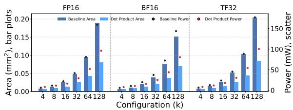  
图 4：吞吐量匹配的 FMA 型基线与点积单元的面积和功耗比较。

观察。如图 4 所示，我们在相同的工艺节点、综合流程、时序目标、流水线深度和峰值算力条件下，将由浮点乘加器树 [24] 构建的吞吐量匹配的 FMA 型基线，与由点积单元构建的 TensorForge 设计进行比较。随着 k 增大，DP 单元的面积和功耗优势逐渐扩大。对于 k = 16 - 64 的典型 FP16 配置，相比基线，DP 单元可节省约 47% - 55% 的面积和 25% - 36% 的功耗；当 k 进一步增大至 128 时，面积优势达到约 57%，功耗节省接近 40%。

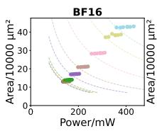

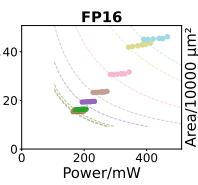

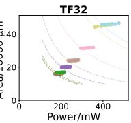  
图 5：由 FMA 和点积单元构建的吞吐量匹配阵列的面积–功耗帕累托比较。

在阵列层面，我们进一步使用上述 FMA 和 DP 单元构建了多种吞吐量匹配的组织结构，并用 mnk 表示其形状。当 k = 1 时，阵列对应外积组织结构；当 $k = 2^{n}$（$n \in N^{+}$）时，阵列则成为具有不同内积维度的内积阵列。如图 5 所示，随着组织结构从外积向更大 k 的内积阵列演变，帕累托前沿逐渐向左下角移动，表明在相同算力约束下，硬件成本更低。图 6 从吞吐量归一化的角度呈现了同一边界：更大的 k 同时提高了面积效率和能量效率，因为更大的内积能够更充分地摊薄规格化、累加和写回开销。

要点。设计规则 1。在吞吐量固定且支持 FP16、BF16、TF32 的条件下，当 k 超过一个适中的值时，基于 DP 的组织结构便取得帕累托支配优势，因为更大的内积能够摊薄规格化、累加和控制开销。

## 5.2 精度可行性与数值约束

问题。随着 k 变化，哪些中间精度、累加器精度和舍入策略能够使 DP 设计保持数值可行性？

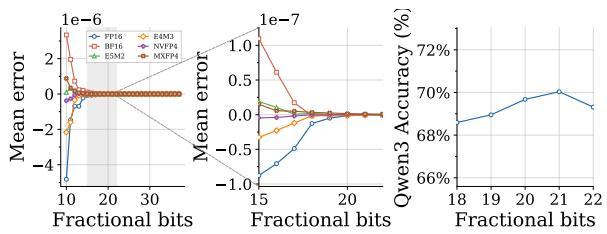

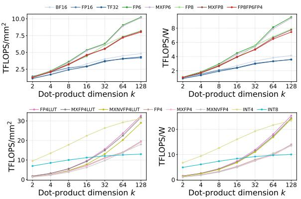  
图 6：在 1.41 GHz 下，单元级面积效率和能量效率随 k 变化的定量关系。

观察。点积单元 $\left(\sum_{i=1}^{k}a_{i}\cdot b_{i}+c_{i}\right)$ 改变了浮点运算的累加顺序，因此，中间精度、累加器精度、k 和随机舍入（SR）共同决定了设计空间中的数值可行域。

图 7 首先展示了中间精度对多种输入格式的影响，包括 FP16、BF16、E5M2、E4M3、NVFP4 和 MXFP4。对于所有这些格式，计算误差都随中间精度的增加而迅速下降，随后逐渐趋于稳定，表明存在一个明确的中间精度阈值。超过这一阈值后，进一步提高中间精度只能带来微小的改善。在我们的实验中，约 20 位的中间精度已足以使所有评估格式的误差保持在 $10^{-7}$ 以下。同样的阈值也体现在工作负载层面的位级仿真中：如图 7 右图所示，在 SuperGLUE RTE 上评估的 Qwen3-0.6B，其任务准确率在大致相同的中间精度区间趋于饱和，这表明进一步增加位宽对最终任务的收益有限。

我们进一步通过蒙特卡洛实验刻画这一可行性边界：对元素服从独立同分布高斯分布 $\mathcal{N}(0,1)$ 的 4096 维向量进行 200 次点积计算，并以 FP64 作为黄金参考模型。在采用 BF16/FP16 乘法器单元和 FP16/FP32 累加路径的条件下，图 8 表明，更大的 k 和更高的累加器精度均能提高数值鲁棒性。更大的 k 将可行性边界推向更激进的低精度配置，同时也降低了整个

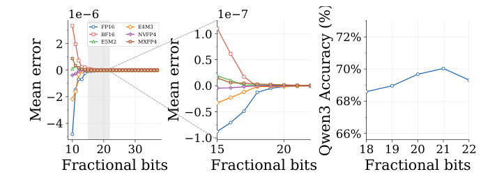

图 7：左：总体差值均值与小数位数的关系。右：Qwen3-0.6B 在 SuperGLUE RTE 上的性能。  
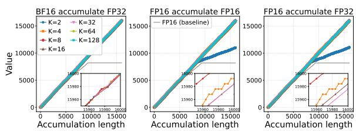  
图 8：不同累加器和点积单元设计的累加结果。

4096 项点积的最终累加误差，因为它减少了舍入步骤的数量。图 8 还解释了其内在机制。采用就近舍入、遇中间值取偶数的顺序 FP16 累加，在累加和达到 $2^{13}$ 时便会饱和，因为后续加数在对阶过程中被移出有效范围，且吞没效应使结果不再变化。通过将 $k$ 个输入分组并行处理，DP 阵列在最终累加步骤之前保留了更多有效位，从而缓解了吞没效应，这与文献 [30] 中的软件观察结果一致。SR 还能够以可忽略的硬件成本支持大幅降低累加器精度：在我们的实现中，SR 仅增加约 $0.63\%$ 的面积开销，同时提高了各低精度模式下的数值鲁棒性。

要点。设计规则 2。中间精度、累加器精度和 SR 共同定义了数值可行域；更大的 k 可以减少舍入损失，但大幅降低累加器精度仍需数值稳定的舍入机制支持。

## 5.3 共享边界：统一式与混合式

问题。在峰值吞吐量相同的条件下，统一的一体化设计与仅在相关精度族内部共享硬件的混合式设计之间，共享边界在哪里？

观察。我们使用 TensorForge 构建峰值吞吐量相同的多精度点积单元，然后扫描内积维度 k 和工作频率，以评估共享策略。在 18 种策略中，我们比较了三类具有代表性的设计：在单个一体化 DP 单元中实现所有精度的统一式设计、为每种精度分配独立 DP 单元的专用式设计，以及仅在相关格式组内部共享硬件的混合式设计。图 9 表明，对于给定的 k 和频率，统一的一体化 DP 单元始终具有最小面积，因为所有格式都紧密集成在单条数据通路中。然而，额外的多路复用逻辑和更宽的关键路径会增加功耗，因此这些设计在面积–功耗平面上往往被其他设计支配。相比之下，将浮点分支与整数分支分离、仅在各分支内部进行多路复用（FP16/BF16/FP8/FP6/FP4 与 INT8/INT4）的混合式设计，在所有 k 值下都能提供最稳健的帕累托前沿。随着 k 增大，其优势变得更加明显，因为全局多路复用的功耗开销增长速度超过了边际面积节省的增长速度。一种考虑复用的轻量级成本视角解释了这一切换边界。我们经过综合结果校准的两阶段代理模型，将总成本分解为各模式的专用项，以及由模式数量、尾数/指数分组、共享乘法器/指数/归一化逻辑、累加器支持、多路复用器

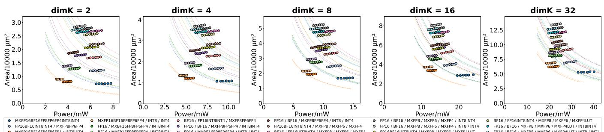

图 9：不同内积维度 k 下 18 种共享策略的面积–功耗帕累托前沿。图例中的 / 用于分隔不同的数据通路。一体化设计可使面积最小，而将 FP/INT 分离的混合式设计可实现最佳的帕累托最优权衡。

扇入和 k 决定的复用率项。该模型能够紧密跟踪综合结果的趋势（面积和功耗的平均 $R^{2} > 0.99$；面积/功耗的 MAPE = 3.45%/2.55%），并证实了同样的直觉：算术运算复用能够减少重复的数据通路面积，而激进的全局共享会增加多路复用、控制开销以及关键路径压力。因此，随着精度异构程度提高，完全统一的设计会离开帕累托前沿。

要点。设计规则 3。统一的一体化设计可使面积最小，但当跨精度族的精度异构程度足够大时，按 FP/INT 划分的混合式设计能够提供更好的面积–功耗帕累托前沿。

## 5.4 FP4 实现：算术运算与 LUT

问题。对于 FP4 支持，基于 LUT 的实现何时会优于传统的算术 FP4 数据通路？

观察。图 6 给出了对 TensorForge 生成的、采用 FP16 输出的点积单元在不同精度和 k 维度下更细粒度的面积与功耗评估。除了 FP16/TF32、FP8/FP6 和混合 FP×INT 模式之外，该图还比较了基于算术运算的 MX/NV 风格 FP4 实现与基于查找表的 FP4 实现。在所评估的设计中，相较于传统 FP4 单元，基于 LUT 的 FP4 将功耗降低了 24.27%–44.91%，将面积降低了 18.30%–40.15%。应将其视为一个独立的实现族，而非微小的电路调整。在 k 较小时，算术 FP4 仍具有竞争力，因为固定的查表和控制开销尚未得到充分摊销。然而，在 k 较大时，算术尾数处理、对齐和归一化开销的增长速度超过固定的查找表成本，因此，基于 LUT 的 FP4 在超低精度、大内积维度设计中进入了帕累托前沿。

要点。设计规则 4。对于 FP4 支持，应将算术实现与 LUT 实现视为两个独立的设计族；当 k 较大时，基于 LUT 的 FP4 可达到帕累托最优。

## 5.5 性能比较

如表 4 和图 10 所示，我们从 TensorForge 生成的设计中选取一个设计点，在功能和效率两方面与近期的多精度处理单元进行比较。所选设计点支持 TF32、FP16、BF16、MXFP8、MXFP6 和 MX/NVFP4，以及 FP16 和 FP32 两种累加精度。在格式覆盖范围方面，我们的设计与已有工作相当，同时还支持面向新兴量化工作流的 MX 风格和 NV 风格细粒度缩放低精度格式。

在各设计原始发表时采用的工艺节点下，所选 TensorForge 设计点相较于 $[9]$，在 FP8 下的面积效率/能效提升为 $2.93 \times /5.52\times$，在 FP4 下则为 $1.49 \times /3.62\times$。在同样基于原始工艺节点的比较中，其面积效率/能效相较于 $[25]$ 提升为 $26.50 \times /61.34\times$，相较于 $[26]$ 提升为 $7.53 \times /1.88\times$。

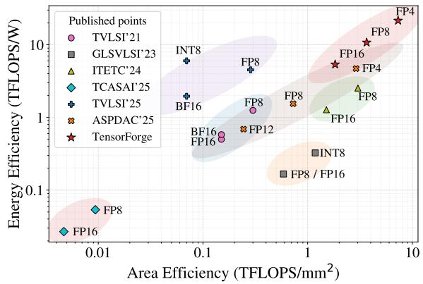  
图 10：不同设计在 22 nm 下的归一化面积效率/能效。

经过保守归一化至相同的 22 nm 工艺节点后，优势仍然显著。相较于 [9]，TensorForge 在 FP8 下的面积效率/能效仍提升为 $2.42 \times /3.60 \times$，在 FP4 下则为 $1.59 \times /1.84 \times$。作为跨基线的保守汇总，我们报告的归一化汇总结果为：FP8 下 $1.77 \times /1.49 \times$，FP4 下 $1.35 \times /3.04 \times$。这些增益主要来自两个因素：(1) k=32 的点积组织方式，在保持数值精度的同时分摊规格化、累加和控制开销；(2) 选择性多精度共享，既避免了专用设计中的冗余数据通路，又不会承担全局统一复用带来的全部功耗代价。

要点。设计规则 5。在跨论文比较中，TensorForge 表现最强的设计点来自中等至较大的 k 与选择性跨精度共享的结合；当功能匹配且工艺经过保守归一化后，这些设计点仍位于更优的面积—能耗前沿。

表 4：与已有设计的面积效率和能效比较。

<table><tr><td>设计</td><td colspan="2">TVLSI&#x27;21 [22]</td><td colspan="2">GLSVLSI&#x27;23 [36]</td><td colspan="2">ITETC&#x27;24 [4]</td><td colspan="2">TCASAI&#x27;25 [25]</td><td colspan="2">TVLSI&#x27;25 [26]</td><td colspan="2">ASPDAC&#x27;25 [9]</td><td colspan="2">本文设计</td></tr><tr><td>工艺</td><td colspan="2">22 nm</td><td colspan="2">28 nm</td><td colspan="2">12 nm</td><td colspan="2">65 nm</td><td colspan="2">28 nm</td><td colspan="2">28 nm</td><td colspan="2">22 nm</td></tr><tr><td>电压(V)</td><td colspan="2">0.8</td><td colspan="2">-</td><td colspan="2">0.8</td><td colspan="2">1.2</td><td colspan="2">-</td><td colspan="2">0.9</td><td colspan="2">0.9</td></tr><tr><td>频率(GHz)</td><td colspan="2">0.92</td><td colspan="2">2.5</td><td colspan="2">1.26</td><td colspan="2">0.741</td><td colspan="2">0.4</td><td colspan="2">1.43</td><td colspan="2">1.41</td></tr><tr><td></td><td>FP8</td><td>1.25</td><td>FP8</td><td>0.21</td><td>FP8</td><td>1.63</td><td>FP8</td><td>0.18</td><td>FP8</td><td>5.70</td><td>FP8</td><td>1.95</td><td>FP8</td><td>10.76</td></tr><tr><td rowspan="3">TFLOPS/W</td><td>FP16</td><td>0.50</td><td>FP16</td><td>0.21</td><td>FP16</td><td>0.82</td><td>FP16</td><td>0.09</td><td>BF16</td><td>2.47</td><td>FP12</td><td>0.87</td><td>FP16</td><td>5.37</td></tr><tr><td>BF16</td><td>0.58</td><td>INT8</td><td>0.41</td><td>-</td><td>-</td><td>BF16</td><td>0.09</td><td>INT8</td><td>7.58</td><td>FP4</td><td>5.93</td><td>FP4</td><td>21.53</td></tr><tr><td>FP8</td><td>0.30</td><td>FP8</td><td>1.01</td><td>FP8</td><td>1.06</td><td>FP8</td><td>0.14</td><td>FP8</td><td>0.49</td><td>FP8</td><td>1.25</td><td>FP8</td><td>3.66</td></tr><tr><td rowspan="2"> $TFLOPS/mm^2$ </td><td>FP16</td><td>0.15</td><td>FP16</td><td>1.01</td><td>FP16</td><td>0.53</td><td>FP16</td><td>0.07</td><td>BF16</td><td>0.12</td><td>FP12</td><td>0.42</td><td>FP16</td><td>1.83</td></tr><tr><td>BF16</td><td>0.15</td><td>INT8</td><td>2.03</td><td>-</td><td>-</td><td>BF16</td><td>0.07</td><td>INT8</td><td>0.12</td><td>FP4</td><td>4.99</td><td>FP4</td><td>7.31</td></tr></table>

## 5.6 案例研究

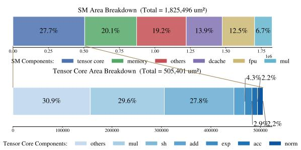  
图 11：GPGPU SM 和张量核心的面积构成。

我们将一个 $8 \times 4 \times 8$ 张量核心（支持 BF16、FP16、FP8、FP6、FP4、INT8、INT4，以及用于 FP8/FP6/FP4 的 MX/NV 缩放）集成到 Ventus GPGPU [16] 的 SM 中，并通过操作数收集器从寄存器文件获取操作数。在此配置下，集成的张量核心占图 11 中 SM 总面积的 27.7%。

表 5：Ventus 向量单元与集成的张量核心之间的比较。

<table><tr><td>单元</td><td>性能</td><td>性能/面积</td><td>性能/功耗</td></tr><tr><td>向量</td><td>0.09 TFLOPS</td><td> $0.40 \text{ TFLOPS/mm}^{2}$ </td><td>0.64 TFLOPS/W</td></tr><tr><td>张量</td><td>2.89 TFLOPS</td><td> $5.71 \text{ TFLOPS/mm}^{2}$ </td><td>8.36 TFLOPS/W</td></tr></table>

面积/功耗。在表 5 中，我们将包含 32 个 FMA 的 FP32 向量模块与集成张量核心的 FP4 性能进行比较。在相同频率下，张量核心实现了 2.89 TFLOPS 的峰值吞吐量。其面积为 $0.505\mathrm{mm}^2$，功耗为 0.345 W，对应的能效为 8.36 TFLOPS/W 和 5.71 TFLOPS/ $\mathrm{mm}^2$。与 FP32 向量模块相比，张量阵列将峰值吞吐量提升至 $32\times$，而面积仅为 $\sim 2.2\times$，功耗仅为 $\sim 2.43\times$。其能效提升至 $\sim 13.16\times$，面积效率提升至 $\sim 14.44\times$。这些增益主要源于其支持的较低浮点精度，以及相较于基线 FMA 单元对点积单元所做的电路级优化。在实际的 GPGPU 中，向量单元提供必要的基础能力（例如，用于非 GEMM 内核），而张量阵列则在 AI 工作负载的利用率和效率方面起主导作用。

性能。图 12 展示了集成张量核心的 Ventus 在 GEMM 和注意力工作负载上的系统级结果。如图 12(a) 所示，张量核心路径始终能够减少执行周期数，并且加速比随着工作负载规模的增大而提高。GEMM 的增益远大于注意力，这表明规则的 GEMM 工作负载能从张量核心执行中获益更多。图 12(b) 通过张量核心活跃度解释了这一趋势。规模更大的 GEMM 案例实现了更高的张量核心（TC）活跃度，而注意力的活跃度仍处于低得多的水平。这表明，更高的加速比与持续的张量核心利用率密切相关。图 12(c) 显示，张量核心路径的 IPC 低于基线。然而，它仍然实现了更少的总周期数，因为每条 MMA 指令承载的算术运算量显著更多。因此，整体收益更多取决于持续的张量核心活跃度，而非仅由 IPC 决定。

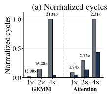

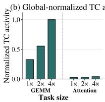

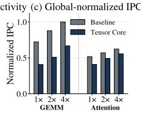  
图 12：GEMM 和注意力工作负载上的系统级结果。(a) 张量核心路径减少了周期数，规模越大，增益越大。(b) 更高的加速比与更高的张量核心活跃度相关。(c) 尽管张量核心路径的 IPC 较低，它仍能减少总周期数。

## 6 结论

TensorForge 框架提供了一种以综合为支撑的张量核心设计空间探索方法，并已通过集成到开源 Ventus GPGPU $[16]$ 中得到验证。基于 600 多个经过综合的设计点，TensorForge 提炼出了适用于计算架构、数值可行性、精度共享和 FP4 实现的可迁移设计规则，从而能够在明确的精度与计算规模约束下开展数据驱动的张量核心设计。与以往的多精度计算单元设计相比，所选的 k=32 设计点将 FP8 的面积效率/能效提升至 $1.77 \times /1.49 \times$，将 FP4 的面积效率/能效提升至 $1.35 \times /3.04 \times$。

## References

[1] 2024. NVIDIA Blackwell Architecture Technical Overview. https://resources.nvidia.com/en-us-blackwell-architecture.

[2] Sami Ben Ali, Silviu-Ioan Filip, and Olivier Sentieys. 2024. A Stochastic Rounding-Enabled Low-Precision Floating-Point MAC for DNN Training. In 2024 Design, Automation &amp; Test in Europe Conference &amp; Exhibition (DATE). IEEE, Valencia, Spain, 1–6. doi:10.23919/DATE58400.2024.10546735

[3] Rajeev Balasubramonian, Andrew B. Kahng, Naveen Muralimanohar, Ali Shafiee, and Vaishnav Srinivas. 2017. CACTI 7: New Tools for Interconnect Exploration in Innovative Off-Chip Memories. ACM Transactions on Architecture and Code Optimization 14, 2 (June 2017), 1–25. doi:10.1145/3085572

[4] Luca Bertaccini, Gianna Paulin, Matheus Cavalcante, Tim Fischer, Stefan Mach, and Luca Benini. 2024. MiniFloats on RISC-V Cores: ISA Extensions With Mixed-Precision Short Dot Products. IEEE Transactions on Emerging Topics in Computing 12, 4 (Oct. 2024), 1040–1055. doi:10.1109/TETC.2024.3365354

[5] Luca Bertaccini, Gianna Paulin, Tim Fischer, Stefan Mach, and Luca Benini. 2022. MiniFloat-NN and ExSdotp: An ISA Extension and a Modular Open Hardware Unit for Low-Precision Training on RISC-V Cores. In 2022 IEEE 29th Symposium on Computer Arithmetic (ARITH). 1–8. doi:10.1109/ARITH54963.2022.00010

[6] DeepSeek-AI. 2024. DeepSeek-V3 Technical Report. arXiv:2412.19437 [cs] doi:10.48550/arXiv.2412.19437

[7] Elias Frantar, Saleh Ashkboos, Torsten Hoefler, and Dan Alistarh. 2023. GPTQ: Accurate Post-Training Quantization for Generative Pre-trained Transformers. arXiv:2210.17323 [cs] doi:10.48550/arXiv.2210.17323

[8] Brian Hickmann and Dennis Bradford. 2019. Experimental Analysis of Matrix Multiplication Functional Units. In 2019 IEEE 26th Symposium on Computer Arithmetic (ARITH). IEEE, Kyoto, Japan, 116–119. doi:10.1109/ARITH.2019.00031

[9] Leren Huang, Yongpan Liu, Xinyuan Lin, Chenhan Wei, Wenyu Sun, Zengwei Wang, Boran Cao, Chi Zhang, Xiaoxia Fu, Wentao Zhao, and Sheng Zhang. 2025. MPICC: Multiple-Precision Inter-Combined MAC Unit with Stochastic Rounding for Ultra-Low-Precision Training. In Proceedings of the 30th Asia and South Pacific Design Automation Conference. ACM, Tokyo Japan, 554–559. doi:10.1145/3658617.3697641

[10] Aaron Jarmusch, Nathan Graddon, and Sunita Chandrasekaran. 2025. Dissecting the NVIDIA Blackwell Architecture with Microbenchmarks. arXiv:2507.10789 [cs] doi:10.48550/arXiv.2507.10789

[11] Liancheng Jia, Zizhang Luo, Liqiang Lu, and Yun Liang. 2021. TensorLib: A Spatial Accelerator Generation Framework for Tensor Algebra. In 2021 58th ACM/IEEE Design Automation Conference (DAC). 865–870. doi:10.1109/DAC18074.2021.9586329

[12] Zhe Jia, Marco Maggioni, Jeffrey Smith, and Daniele Paolo Scarpazza. 2019. Dissecting the NVidia Turing T4 GPU via Microbenchmarking. arXiv:1903.07486 [cs] doi:10.48550/arXiv.1903.07486

[13] Zhe Jia, Marco Maggioni, Benjamin Staiger, and Daniele P. Scarpazza. 2018. Dissecting the NVIDIA Volta GPU Architecture via Microbenchmarking. arXiv:1804.06826 [cs] doi:10.48550/arXiv.1804.06826

[14] Norm Jouppi, George Kurian, Sheng Li, Peter Ma, Rahul Nagarajan, Lifeng Nai, Nishant Patil, Suvinay Subramanian, Andy Swing, Brian Towles, Clifford Young, Xiang Zhou, Zongwei Zhou, and David A Patterson. 2023. TPU v4: An Optically Reconfigurable Supercomputer for Machine Learning with Hardware Support for Embeddings. In Proceedings of the 50th Annual International Symposium on Computer Architecture. ACM, Orlando FL USA, 1–14. doi:10.1145/3579371.3589350

[15] Hyoukjun Kwon, Prasanth Chatarasi, Vivek Sarkar, Tushar Krishna, Michael Pellauer, and Angshuman Parashar. 2020. MAESTRO: A Data-Centric Approach to Understand Reuse, Performance, and Hardware Cost of DNN Mappings. IEEE Micro 40, 3 (2020), 20–29. doi:10.1109/MM.2020.2985963

[16] Jingzhou Li, Fangfei Yu, Mingyuan Ma, Wei Liu, Yuhan Wang, Hualin Wu, and Hu He. 2025. RISC-V-Based GPGPU With Vector Capabilities for High-Performance Computing. IEEE Transactions on Very Large Scale Integration (VLSI) Systems 33, 8 (Aug. 2025), 2239–2251. doi:10.1109/TVLSI.2025.3574427

[17] Muyang Li, Yujun Lin, Zhekai Zhang, Tianle Cai, Junxian Guo, Xiuyu Li, Enze Xie, Chenlin Meng, Jun-Yan Zhu, and Song Han. 2025. SVDQuant: Absorbing Outliers by Low-Rank Component for 4-Bit Diffusion Models. In The Thirteenth International Conference on Learning Representations. https://openreview.net/forum?id=vWR3KuiQur

[18] Heng Liao, Jiajin Tu, Jing Xia, Hu Liu, Xiping Zhou, Honghui Yuan, and Yuxing Hu. 2021. Ascend: A Scalable and Unified Architecture for Ubiquitous Deep Neural Network Computing : Industry Track Paper. In 2021 IEEE International Symposium on High-Performance Computer Architecture (HPCA). 789–801. doi:10.1109/HPCA51647.2021.00071

[19] Ji Lin, Jiaming Tang, Haotian Tang, Shang Yang, Wei-Ming Chen, Wei-Chen Wang, Guangxuan Xiao, Xingyu Dang, Chuang Gan, and Song Han. 2024. Awq: Activation-aware weight quantization for on-device llm compression and acceleration. Proceedings of machine learning and systems 6 (2024), 87–100.

[20] Wenyan Lu, Guihai Yan, Jiajun Li, Shijun Gong, Yinhe Han, and Xiaowei Li. 2017. FlexFlow: A Flexible Dataflow Accelerator Architecture for Convolutional

Neural Networks. In 2017 IEEE International Symposium on High Performance Computer Architecture (HPCA). 553–564. doi:10.1109/HPCA.2017.29

[21] Weile Luo, Ruibo Fan, Zeyu Li, Dayou Du, Qiang Wang, and Xiaowen Chu. 2024. Benchmarking and Dissecting the Nvidia Hopper GPU Architecture. arXiv:2402.13499 [cs] doi:10.48550/arXiv.2402.13499

[22] Stefan Mach, Fabian Schuiki, Florian Zaruba, and Luca Benini. 2021. FPnew: An Open-Source Multiformat Floating-Point Unit Architecture for Energy-Proportional Transprecision Computing. IEEE Transactions on Very Large Scale Integration (VLSI) Systems 29, 4 (April 2021), 774–787. doi:10.1109/TVLSI.2020.3044752

[23] Linyan Mei, Pouya Houshmand, Vikram Jain, Sebastian Giraldo, and Marian Verhelst. 2021. ZigZag: Enlarging Joint Architecture-Mapping Design Space Exploration for DNN Accelerators. IEEE Trans. Comput. 70, 8 (2021), 1160–1174. doi:10.1109/TC.2021.3059962

[24] Abubakr Nada, Giuseppe Maria Sarda, and Erwan Lenormand. 2025. Cooperative Warp Execution in Tensor Core for RISC-V GPGPU. In 2025 IEEE International Symposium on High Performance Computer Architecture (HPCA). 1422–1436. doi:10.1109/HPCA61900.2025.00107

[25] Farzad Niknia, Ziheng Wang, Shanshan Liu, Pedro Reviriego, Zhen Gao, Paolo Montuschi, and Fabrizio Lombardi. 2025. A Configurable Floating-Point Fused Multiply-Add Design With Mixed Precision for AI Accelerators. IEEE Transactions on Circuits and Systems for Artificial Intelligence 2, 3 (2025), 248–261. doi:10.1109/TCASAI.2025.3569511

[26] Seock-Hwan Noh, Seungpyo Lee, Banseok Shin, Sehun Park, Yongjoo Jang, and Jaeha Kung. 2025. All-Rounder: A Flexible AI Accelerator With Diverse Data Format Support and Morphable Structure for Multi-DNN Processing. IEEE Transactions on Very Large Scale Integration (VLSI) Systems 33, 5 (2025), 1264–1277. doi:10.1109/TVLSI.2025.3540346

[27] Angshuman Parashar, Priyanka Raina, Yakun Sophia Shao, Yu-Hsin Chen, Victor A. Ying, Anurag Mukkara, Rangharajan Venkatesan, Brucek Khailany, Stephen W. Keckler, and Joel Emer. 2019. Timeloop: A Systematic Approach to DNN Accelerator Evaluation. In 2019 IEEE International Symposium on Performance Analysis of Systems and Software (ISPASS). IEEE, Madison, WI, USA, 304–315. doi:10.1109/ISPASS.2019.00042

[28] Md Aamir Raihan, Negar Goli, and Tor M Aamodt. 2019. Modeling Deep Learning Accelerator Enabled GPUs. In 2019 IEEE International Symposium on Performance Analysis of Systems and Software (ISPASS). IEEE, 79–92.

[29] Bita Darvish Rouhani, Nitin Garegrat, Tom Savell, Ankit More, Kyung-Nam Han, Ritchie Zhao, Mathew Hall, Jasmine Klar, Eric Chung, Yuan Yu, Michael Schulte, Ralph Wittig, Ian Bratt, Nigel Stephens, Jelena Milanovic, John Brothers, Pradeep Dubey, Marius Cornea, Alexander Heinecke, Andres Rodriguez, Martin Langhammer, Summer Deng, Maxim Naumov, Paulius Micikevicius, Michael Siu, and Colin Verrilli. 2023. OCP Microscaling Formats (MX) Specification. (Sept. 2023).

[30] Charbel Sakr, Naigang Wang, Chia-Yu Chen, Jungwook Choi, Ankur Agrawal, Naresh Shanbhag, and Kailash Gopalakrishnan. 2019. ACCUMULATION BIT-WIDTH SCALING FOR ULTRA- LOW PRECISION TRAINING OF DEEP NETWORKS. (2019).

[31] Yannan Nellie Wu, Po-An Tsai, Angshuman Parashar, Vivienne Sze, and Joel S. Emer. 2022. Sparseloop: An Analytical Approach To Sparse Tensor Accelerator Modeling. In 2022 55th IEEE/ACM International Symposium on Microarchitecture (MICRO). 1377–1395. doi:10.1109/MICRO56248.2022.00096

[32] Guangxuan Xiao, Ji Lin, Mickael Seznec, Hao Wu, Julien Demouth, and Song Han. 2023. SmoothQuant: Accurate and Efficient Post-Training Quantization for Large Language Models. In Proceedings of the 40th International Conference on Machine Learning (Proceedings of Machine Learning Research, Vol. 202), Andreas Krause, Emma Brunskill, Kyunghyun Cho, Barbara Engelhardt, Sivan Sabato, and Jonathan Scarlett (Eds.). PMLR, 38087–38099. https://proceedings.mlr.press/v202/xiao23c.html

[33] Kaiyuan Yang, Qing Dong, Zhehong Wang, Yi-Chun Shih, Yu-Der Chih, Jonathan Chang, David Blaauw, and Dennis Sylvester. 2018. A 28NM Integrated True Random Number Generator Harvesting Entropy from MRAM. In 2018 IEEE Symposium on VLSI Circuits. 171–172. doi:10.1109/VLSIC.2018.8502431

[34] Yifan Yang, Joel S. Emer, and Daniel Sanchez. 2024. Trapezoid: A Versatile Accelerator for Dense and Sparse Matrix Multiplications. In 2024 ACM/IEEE 51st Annual International Symposium on Computer Architecture (ISCA). 931–945. doi:10.1109/ISCA59077.2024.00072

[35] Jintao Zhang, Haofeng Huang, Pengle Zhang, Jia wei, Jun Zhu, and Jianfei Chen. 2025. SageAttention2: Efficient Attention with Thorough Outlier Smoothing and Per-thread INT4 Quantization. In Forty-second International Conference on Machine Learning. https://openreview.net/forum?id=nC8XliUxeg

[36] Jing Zhang, Libo Huang, Hongbing Tan, Ling Yang, Zhong Zheng, and Qianming Yang. 2023. Low-Cost Multiple-Precision Multiplication Unit Design For Deep Learning. In Proceedings of the Great Lakes Symposium on VLSI 2023. ACM, Knoxville TN USA, 9–14. doi:10.1145/3583781.3590269

> 来源与版本：用户提供的 TensorForge 匿名稿 iccad2026-paper544.pdf；未据文件名推断会议录用状态。经 MinerU 解析，由 Codex/GPT 翻译与解读，未调用 GLM 翻译 API。全文译文保留参考文献；技术总结、通俗讲解与图表说明属于解读。技术内容以所提供稿件为准；综合、功耗评估和仿真集成不等同于流片实测。

[架构建模目录](../index.md)
