# Bit Fusion: Bit-Level Dynamically Composable Architecture for Accelerating Deep Neural Networks 原文翻译

# Bit Fusion：用于加速深度神经网络的位级动态可组合架构

Hardik Sharma∗

Jongse Park∗

Naveen Suda†

Liangzhen Lai†

Benson Chau∗

Vikas Chandra†

Hadi Esmaeilzadeh‡

替代计算技术（ACT）实验室

∗佐治亚理工学院

†Arm 公司

{hsharma,jspark,ben.chau}@gatech.edu

‡加利福尼亚大学圣迭戈分校

{naveen.suda,liangzhen.lai,vikas.chandra}@arm.com

hadi@eng.ucsd.edu

摘要——深度神经网络（DNN）的硬件加速旨在应对其极高的计算强度。要充分发挥这一领域的加速潜力，需要理解并利用 DNN 的算法特性。本文基于这样一个算法层面的认识：可以在不损害分类准确率的情况下降低 DNN 中运算的位宽。然而，为防止准确率损失，不同 DNN 所需的位宽差异显著，甚至可能需要针对每一层单独调整。因此，固定位宽加速器要么为满足最坏情况下的位宽需求而只能提供有限的收益，要么不可避免地导致最终准确率下降。为缓解这些不足，本研究将动态位级融合／分解作为 DNN 加速器设计的一个新维度。我们通过设计位宽灵活可变的加速器 Bit Fusion 来探索这一维度。该加速器由位级处理单元阵列构成，这些处理单元可动态融合，以匹配 DNN 各层的位宽。这种架构灵活性使其能够在不损失准确率的情况下，以尽可能细的粒度最大限度地减少计算和通信。我们使用八个真实应用中的前馈和循环 DNN 来评估 Bit Fusion 的收益。所提出的微架构使用 Verilog 实现，并采用 45 nm 工艺进行综合。利用综合结果和周期精确仿真，我们将 Bit Fusion 的收益与两种最先进的 DNN 加速器 Eyeriss [1] 和 Stripes [2] 进行比较。在面积、频率和工艺技术相同的条件下，Bit Fusion 相较于 Eyeriss 实现了 3.9× 的加速比和 5.1× 的节能效果。与 Stripes 相比，当 Bit Fusion 的面积和频率设为与 Stripes 相同时，Bit Fusion 在 45 nm 工艺节点下实现了 2.6× 的加速比和 3.9× 的节能效果。扩展到 GPU 所采用的 16 nm 工艺节点后，Bit Fusion 的性能几乎与功耗为 250 瓦的 Titan $\mathbf { X p } ,$ 相当，后者使用 8 位向量指令，而 Bit Fusion 的功耗仅为 895 毫瓦。

关键词——位级可组合性；动态可组合性；深度神经网络；加速器；DNN；卷积神经网络；CNN；长短期记忆；LSTM；循环神经网络；RNN；量化；Bit Fusion；Bit Brick

## I. 引言

高性能计算机体系结构设计的进步一直是深度神经网络（DNN）快速发展的主要推动力。由于 DNN 对计算能力有着永无止境的需求，研究界 [1–28] 和工业界 [29–31] 自然而然地转向加速器，以满足现代 DNN 的计算需求。然而，DNN 的算法特性尚未得到充分利用，未能进一步突破其加速效率与性能的极限。

为此，我们利用 DNN 的以下三个算法特性，提出一种名为 Bit Fusion 的新型加速架构。（1）DNN 主要由大量可并行执行的乘加运算组成。（2）这些运算的位宽可以在不损失准确率的情况下降低 [32–36]。（3）然而，为了保持准确率，不同 DNN 所需的位宽差异显著，甚至可能需要为每一层单独调整位宽。因此，固定宽度的加速器设计要么为了满足最坏情况下的位宽需求而只能获得有限收益，要么不可避免地导致最终准确率下降。为了缓解这些不足，Bit Fusion 引入运行时位级融合/分解的概念，为 DNN 加速器设计开辟了一个新维度。我们通过设计一种支持灵活位宽的加速器来探索这一维度，该加速器由一组处理引擎构成，这些引擎能够以位级粒度进行融合，以匹配各个 DNN 层的位宽。

<table><tr><td>DNN</td><td>AlexNet</td><td>Cifar-10</td><td>LSTM</td><td>LeNet-5</td><td>ResNet-18</td><td>RNN</td><td>SVHN</td><td>VGG-7</td></tr><tr><td>乘加运算占比（%）</td><td>99.8</td><td>99.8</td><td>99.9</td><td>99.4</td><td>99.9</td><td>99.9</td><td>99.8</td><td>99.5</td></tr></table>

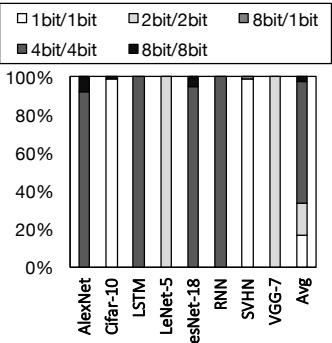

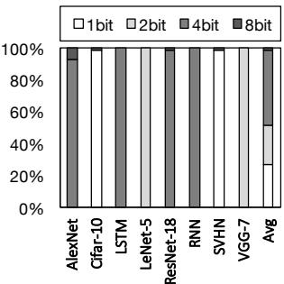  
(a) 乘加运算位宽（输入/权重）  
(b) 权重位宽分布  
图 1：真实世界 DNN 中的位宽变化。

该架构的位级灵活性使其能够在不损失准确率的情况下，以尽可能细的粒度最大限度地减少计算和通信。因此，以下三个见解既构成了 Bit Fusion 的设计动机，也指导了其设计。

首先，乘法运算符所需的位级操作数量与操作数位宽的乘积成正比，而加法运算符所需的位级操作数量则随位宽线性增长。因此，使乘加单元的位宽与 DNN 层降低后的位宽相匹配，可以近似按平方关系减少位级计算量。这一策略将显著影响加速效果，因为如图 1 中的表格所示，DNN 中绝大多数运算（> 99%）都是乘加运算。例如，AlexNet [36] 每进行一次单幅图像分类，总共需要 2682 百万次运算，其中 99.86%（2678 百万次）是乘加运算。为此，Bit Fusion 的计算单元可以动态融合或分解，以匹配每个乘加操作数的位宽，而无须将各操作数编码为相同位宽。

其次，DNN 加速的能耗通常主要来自对片上存储和片外存储器的数据访问 [1, 3, 4]。因此，Bit Fusion 配备了编码和存储器访问逻辑，以最低所需位宽存储和读取数值。该逻辑减少了片上和片外存储器读写的总位数，从而按比例降低存储器访问的能耗。此外，这一策略还提高了片上存储的有效容量。

第三，Bit Fusion 建立在大量已有研究的基础上，这些研究表明

DNN 可以在降低位宽的情况下运行，而不降低分类准确率 [2, 32–35, 37]。如图 1 所示，不同类别的真实世界 DNN 都存在这一机会。其中一类是卷积神经网络（CNN），它们通常使用卷积层和池化层，随后连接一组全连接层。图 1 中的 AlexNet、Cifar-10、LeNet-5、ResNet-18、SVHN 和 VGG-7 均属于这一类别。循环神经网络（RNN）是 DNN 的另一个子类，它们使用循环层，包括长短期记忆（LSTM）层和普通 RNN 层，从随时间变化的数据中提取时序特征。图 1 中的 RNN 和 LSTM 基准 DNN 代表了这些类别。此外，如图 1 中的表格所示，无论属于哪一类别，DNN 中的大多数运算（> 99%）都是乘加运算。如图 1(a) 所示，平均而言，97.3% 的乘加运算只需要 4 位或更低的位宽，甚至在某些 DNN 中，很大一部分运算可以用 1 位位宽完成。更有意思的是，为了保证准确率不受损失，位宽在同一 DNN 内部以及不同 DNN 之间都会变化。这种变化并不限于中间操作数，也存在于训练得到的权重中，如图 1(b) 所示。为了利用这一特性，可编程加速器需要在运行时提供位级灵活性，这促使我们提出了 Bit Fusion。

为了利用上述机会，本文作出以下贡献，并在 DNN 加速器设计中实现了一个新维度。

1) 动态位级融合与分解。本文引入并探索了具有位级灵活性的 DNN 加速器架构这一维度，即 Bit Fusion，使可在位级组合的处理引擎动态匹配 DNN 各层所需的不同位宽。通过提供这种灵活性，Bit Fusion 旨在逐层以位粒度最大限度地减少 DNN 所需的计算和通信。

2) 面向位级可组合性的微架构设计。为了探索 Bit Fusion，我们使用一种名为 BitBricks 的新型灵活位宽计算单元，设计并实现了一个 DNN 加速器。该加速器同时支持前馈层（CNN）和循环层（LSTM 和 RNN）。BitBricks 的二维阵列构成了一个可融合的处理引擎，能够以不同位宽执行 DNN 计算。该微架构还配备了存储逻辑，能够向 BitBricks 提供不同位宽的操作数。

3) 面向灵活位宽加速的软硬件抽象。为了使 DNN 应用能够利用这些独特的位级融合能力，我们提出了一种块结构指令集架构，称为 Fusion-ISA。为了摊销可编程性带来的开销，Fusion-ISA 将 DNN 层的运算表示为具有迭代语义的灵活位宽指令块。

这三项贡献定义了 Bit Fusion 的新型架构、一种可行的微架构实现，以及用于提供位级灵活性的软硬件抽象。其他具有互补性和启发性的工作探索了位串行计算 [2, 6]，但并未探索融合这一维度。相比之下，Bit Fusion 在空间上将一组 BitBricks 融合在一起，共同执行不同位宽的运算。我们使用八个真实世界中的前馈和循环 DNN，评估 Bit Fusion 的优势。我们使用 Verilog 实现了所提出的微架构，并采用 45 nm 工艺进行了综合。利用综合结果和周期精确仿真，我们将 Bit Fusion 与两种最先进的 DNN 加速器 Eyeriss [1] 和 Stripes [2] 进行比较。后者是一种经过优化的位串行架构。在面积、频率和工艺节点相同的条件下，Bit Fusion 相比 Eyeriss 可实现 3.9× 加速和 5.1× 节能。在 45 nm 工艺节点下，当 Bit Fusion 的面积和频率设为与 Stripes 相同时，相比 Stripes [2]，Bit Fusion 可实现 2.6× 加速和 3.9× 能耗降低。缩放至 GPU 所采用的 16 nm 工艺节点后，Bit Fusion 相比 Jetson TX2 移动 GPU 可实现 16× 加速。此外，Bit Fusion 的性能几乎可与使用 8 位向量指令、功耗为 250 瓦的 Titan Xp 相当，而 Bit Fusion 的功耗仅为 895 毫瓦。

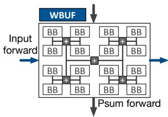  
(a) 包含 16 个 BitBricks 的融合单元

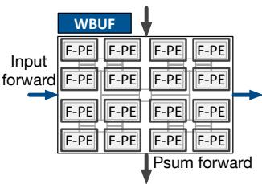

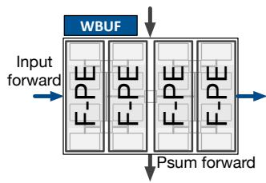  
(c) 4x 并行度，混合位宽（2 位权重，8 位输入）

(b) 16x 并行度，二值（1 位）或三值（2 位）  
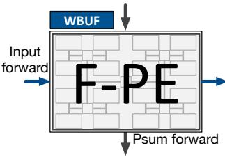  
(d) 无并行，8 位  
图 2：在融合单元中动态组合 BitBricks（BBs），构建融合处理引擎（Fused-PE），图中标为 F-PE。

## II. BIT FUSION 架构

为了以最细粒度最大限度地减少计算和通信，Bit Fusion 动态地使加速器架构与 DNN 所需的位宽相匹配，而不损失任何精度；所需位宽可能逐层变化。因此，Bit Fusion 由一组称为 BitBricks 的位级计算单元组成，这些单元通过动态组合，在逻辑上构建融合处理引擎（Fused-PE），以所需位宽执行 DNN 运算。具体而言，Fused-PEs 为乘加运算提供位级灵活性，而乘加运算是所有类型 DNN 中的主要运算。下面，我们将讨论如何将 BitBricks 动态融合在一起，以支持一系列位宽，同时在以较低位宽运行时显著提高并行度。

## A. 通过动态融合实现位级灵活性

如图 2 所示，Bit Fusion 将 BitBricks 排列为称作融合单元的二维物理分组。融合单元中的每个 BitBrick 均可独立执行二值 (0, +1) 和三值 (-1, 0, +1) 乘加运算。如图 2 所示，BitBricks 在运行时于逻辑上融合在一起，形成融合处理引擎（Fused-PEs），以匹配 DNN 层中乘加运算所需的位宽。融合单元中的 BitBricks 将传入的可变位宽输入（输入前传）与可变位宽权重（来自 WBUF）相乘，生成乘积。随后，融合单元将该乘积与传入的部分和相加，生成传出的部分和（图 2(a) 中的部分和前传）。

图 2(b)、2(c) 和 2(d) 展示了在逻辑上融合 BitBricks 的三种不同方式，分别形成：(b) 16 个支持三值（二值）的 Fused-PEs；(c) 四个支持混合位宽（权重为 2 位，输入为 8 位）的 Fused-PEs；(d) 一个支持 8 位操作数的 Fused-PE。对于二值或三值运算（图 2(b)），每个 Fused-PE 包含单个 BitBrick，从而提供最高的并行度。随后，融合单元将所有 Fused-PEs 的结果与传入的部分和相加，生成单个传出的部分和。图 2(c) 展示了将同一列中的四个 BitBricks 融合在一起，形成一个能够将 2 位权重与 8 位输入相乘的 Fused-PE。Fused-PE 所支持的操作数位宽取决于融合在一起的 BitBricks 的空间排列方式。通过改变这四个融合的 BitBricks 的空间排列方式，Fused-PE 还可以支持输入/权重为 8 位/2 位、4 位/4 位和 2 位/8 位的配置。最后，最多可将 16 个 BitBricks 融合在一起，构建一个能够对 8 位操作数执行乘加运算的 Fused-PE（图 2(d)）。BitBricks 按照 2 的幂次个数进行融合。也就是说，包含 16 个 BitBricks 的单个融合单元可以提供 1、2、4、8 和 16 个具有不同操作数位宽的 Fused-PEs。融合单元在位级上的动态可组合性，使该架构能够以匹配 DNN 操作数位宽的最细粒度，提供尽可能高的并行度。

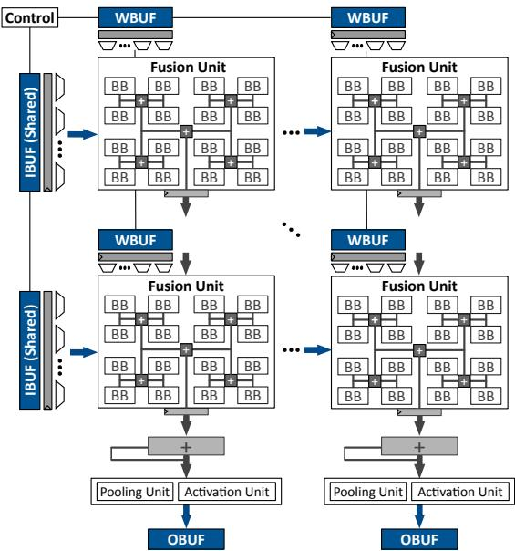  
图 3：Bit Fusion 脉动阵列架构，由一组可融合形成 Fused-PEs 的 BitBricks（BBs）组成。

## B. 加速器组织结构

Bit Fusion 的架构设计遵循两点洞见。首先，DNN 具有高度并行性，在加速器的面积预算内增加融合单元的数量能够显著提升性能。因此，必须尽量降低加速器中的控制开销，不仅要最大化融合单元的数量，还要尽量降低动态构建 Fused-PE 的开销，从而在面积预算内集成尽可能多的 BitBrick。其次，加速 DNN 时，片上 SRAM 和寄存器文件访问占据了主要的能耗 [1, 3, 4]。因此，必须在最大化数据复用的同时，减少与片上和片外存储器交换的比特数。

Bit Fusion 脉动阵列。基于这些洞见，我们采用由融合单元组成的二维脉动阵列作为 Bit Fusion 的架构，如图 3 所示。脉动组织结构通过在整个脉动阵列中共享控制逻辑来降低控制开销。更重要的是，脉动执行减轻了为每个 Fused-PE 配备控制逻辑的需求，而数据流架构则需要这样做。因此，脉动架构能够在给定的面积预算内容纳最多的 BitBrick。由此，整个由 Fused-PE 组成的脉动阵列充当单个计算单元，例如，可以执行一次采用不同位宽的矩阵-向量乘法操作，而位宽也决定了并行度。此外，融合单元的脉动组织结构使输入数据在阵列的各列之间共享，并沿阵列的各行累加部分结果，从而尽量减少对片上存储器的访问。如图 3 所示，输入缓冲区（IBUF）仅位于边缘，同时为各行提供数据。类似地，输出缓冲区（OBUF）位于底部，收集流动的结果，这些结果由每列的累加器进行累加。如图 3 所示，每列在其输出缓冲区之前都设有一个池化单元和一个激活单元。最后，脉动组织结构还消除了在融合单元内部为输入、输出或部分结果设置本地缓冲区的需求。因此，每个融合单元仅配备一个权重缓冲区（WBUF）。以 Fused-PE 为构建模块，脉动阵列的性能能够最大限度地匹配位宽，并在二值和三值配置下达到最高性能。

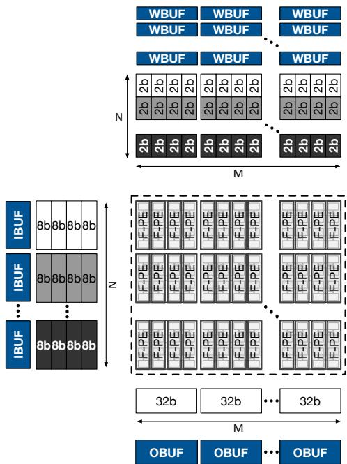

图 4：位宽灵活的矩阵-向量乘法。  
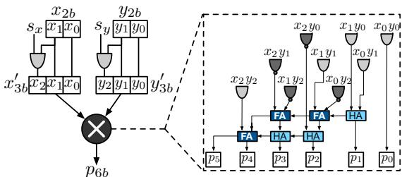  
图 5：单个 BitBrick。（HA：半加器，FA：全加器。）

存储器组织结构。根据 Fused-PE 的数量及其组织方式，缓冲区必须提供不同数量、不同位宽的操作数。因此，我们为输入缓冲区和权重缓冲区各增设一个寄存器，用于保存一行数据，并根据 Fused-PE 的位宽逐步向其提供数据。如图 3 所示，寄存器之后的一组多路选择器使这种数据馈送成为可能。这种设计的好处是避免多次访问缓冲区的数据阵列，从而节省能耗。采用这种设计，在每个周期，脉动阵列消耗一个输入向量和一个权重矩阵，以生成一个输出向量，同时使

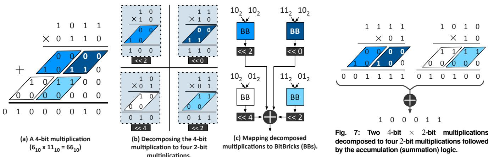  
图 6：使用 BitBrick 执行 4 位乘法。  
对缓冲区的访问次数最少，并尽可能采用最小位宽。

## C. Bit Fusion 执行模型

图 4 展示了在混合位宽模式下，将输入向量与权重矩阵相乘时的 Bit Fusion 脉动执行过程。输入向量具有 4 × N 个 8 位元素，这些元素与一个具有 $4 \times N \times M 2$ 位元素的矩阵相乘。因此，一个融合单元中的 16 个 BitBrick 在逻辑上组合成四个 8×2 Fused-PE。输入缓冲区和权重缓冲区每次访问均提供 32 位数据。如前所述，利用各缓冲区配备的多路选择器，在其输出寄存器中将读取的值拆分为 8 位输入值和 2 位权重值。输入值在每行的融合单元之间共享，而权重值则为各个 Fused-PE 专用。因此，所有 $4 \times N \times M$ 个 Fused-PE 并行工作，而输入缓冲区和权重缓冲区各只需读取一个 32 位值。利用权重较低的位宽，Bit Fusion 将并行度提高了 4×，同时将权重缓冲区数据阵列的访问次数减少为原来的四分之一。如上所述，每个融合单元将其 Fused-PE 的结果与传入的部分结果相加，并将部分输出转发至其下方的融合单元。如图 4 所示，我们为部分结果和最终结果提供 32 位位宽支持，以避免任何精度损失。

## III. BIT FUSION 微架构

在介绍了 Bit Fusion 的整体组织结构及其位宽灵活的脉动执行模型之后，本节将深入讨论 BitBrick 和融合单元的细节。使 Bit Fusion 能够实现位级动态组合的关键洞见是一项数学性质：当操作数的位宽为 2 的幂（4 位、8 位、16 位，依此类推）时，乘法操作可以分解为多个 2 位乘法。随后，可以通过移位加法操作组合这些分解后乘法的乘积，生成原始乘法的结果。操作数的位宽决定了所需分解乘法的数量，以及在相加之前对分解后乘积施加的移位量。基于这一洞见，我们设计了 Bit Fusion 架构的基本计算单元 BitBrick，使其支持最小位宽为 2 位的乘法操作。BitBrick 的两个 2 位操作数均可为有符号数或无符号数。下面，我们介绍单个 BitBrick 的设计。

## A. BitBrick 微架构

图 5 展示了单个 BitBrick 的微架构。如图所示，BitBrick 接收两个 2 位操作数——$x _ { 2 b }$ 和 $y _ { 2 b }$，以及两个对应的符号位——sx 和 $s _ { y }$ 作为输入。符号位 $s _ { x }$ 和 $s _ { y }$ 决定这两个 2 位操作数是有符号数（范围为 -2 到 1）还是无符号数（范围为 0 到 3）。根据符号位，BitBrick 首先扩展 2 位操作数 x 或 y，分别生成经过符号扩展的 3 位操作数 $x _ { 3 b } ^ { \prime }$ 或 $y _ { 3 b } ^ { \prime } .$。最后，BitBrick 使用一个 3 位有符号乘法器（在图 5 中以带圆圈的 × 表示）生成一个 6 位乘积 $p _ { 6 b }$。因此，BitBrick 支持有符号数和无符号数作为输入。下一小节将讨论 Bit Fusion 如何将不同位宽的乘加操作映射到 BitBrick。

## B. 将可变位宽运算映射到 BitBricks

为解释 BitBricks 如何组合以完成可变位宽操作数的乘法，以下讨论以 4 位乘法为例。如前所述，位宽为 2 的幂的乘法运算可以分解为能够使用 BitBricks 执行的 2 位乘法。图 6(a) 以 4 位操作数 $1 0 1 1 _ { 2 } \left( 1 1 _ { 1 0 } \right)$ 和 $0 1 1 0 _ { 2 } \ : ( 6 _ { 1 0 } )$ 相乘得到 01000010 $\left( 6 6 _ { 1 0 } \right)$ 为例，说明了这一数学性质。图 6(a) 中的 4 位乘法分解为四个 2 位乘法，如图 6(b) 所示。这些分解后的乘法使用 BitBricks 执行，生成分解后的乘积，如图 6(c) 所示。分解后的乘积需要先移位，再组合在一起。对于使用 BitBricks 执行的 4 位乘法，分解后的 2 位乘法结果分别左移 0、2、2 和 4 位，如图 6(c) 所示。

动态位宽灵活性。操作数的位宽决定了分解后的乘法结果在相加之前如何左移（乘以 2 的幂）。通过增加移位逻辑的灵活性，BitBricks 可以支持 2 位乘法，甚至支持混合位宽（4 位 × 2 位）乘法。图 7 展示了两个 4 位 × 2 位乘法的求和 $( 1 5 _ { 1 0 } \times 1 _ { 1 0 } +$ $1 0 _ { 1 0 } \times 2 _ { 1 0 } = 3 5 _ { 1 0 } )$。图 7 中的运算分解为四个 2 位乘法，映射到四个 BitBricks。图 6(a) 中的单个 4 位 × 4 位运算与图 7 中的两个 4 位 × 2 位运算所需的 BitBricks 数量相同。因此，4 位 × 2 位运算的性能是 4 位 × 4 位运算的两倍。图 6(a) 和图 7 中的运算之间，唯一的区别是分解后的乘积所需的移位量。同样，在执行 2 位 × 2 位运算时，通过将所有移位量设为零，每个 BitBrick 都可以执行一次乘法。

支持任意位宽。到目前为止的讨论展示了 4 位和 2 位操作数之间的乘法运算如何映射到 BitBricks。同一数学性质可以递归应用，以支持位宽大于 4 位的操作数。Bit Fusion 支持最高 16 位的操作数，方法是首先将 16 位乘法递归分解为 8 位、4 位，最后分解为 2 位乘法，这些乘法可以使用

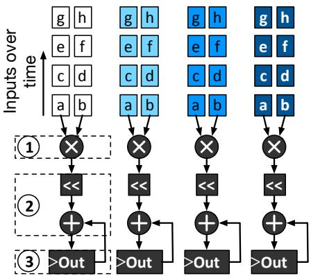

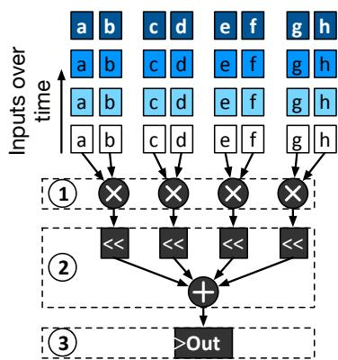  
图 8：时域设计。操作数 a−h 为 2 位。  
图 9：空间融合。操作数 a−h 为 2 位。

<table><tr><td>面积 (μm^2)</td><td>BitBricks</td><td>移位加法</td><td>寄存器</td><td>总面积</td></tr><tr><td>时域设计</td><td>463</td><td>2989</td><td>1454</td><td>4905</td></tr><tr><td>融合单元</td><td>369</td><td>934</td><td>91</td><td>1394</td></tr><tr><td>相较于时域设计的面积降低</td><td>1.3x</td><td>3.2x</td><td>16.0x</td><td>3.5x</td></tr><tr><td>功耗 (nW)</td><td>BitBricks</td><td>移位加法</td><td>寄存器</td><td>总功耗</td></tr><tr><td>时域设计</td><td>60</td><td>550</td><td>1103</td><td>1712</td></tr><tr><td>融合单元</td><td>46</td><td>424</td><td>69</td><td>538</td></tr><tr><td>相较于时域设计的功耗降低</td><td>1.3x</td><td>1.3x</td><td>16.0x</td><td>3.2x</td></tr></table>

使用商用 45 nm 工艺综合

图 10：融合单元的面积和功耗比较。时域设计作为参考。

BitBricks 执行。对于两个 2n 位操作数 $A _ { 2 n }$ 和 $B _ { 2 n }$ 之间的乘法，递归过程可以用数学形式表示如下。

$$
A _ {2 n} = 2 ^ {n} \times (A _ {2 n}) _ {h i} + 2 ^ {0} \times (A _ {2 n}) _ {l o}
$$

$$
B _ {2 n} = 2 ^ {n} \times (B _ {2 n}) _ {h i} + 2 ^ {0} \times (B _ {2 n}) _ {l o}\tag{1}
$$

$$
\begin{array}{c} A _ {2 n} \times B _ {2 n} = 2 ^ {2 n} \times (A _ {2 n}) _ {h i} \times (B _ {2 n}) _ {h i} + 2 ^ {n} \times (A _ {2 n}) _ {h i} \times (B _ {2 n}) _ {l o} \\ + 2 ^ {n} \times (A _ {2 n}) _ {l o} \times (B _ {2 n}) _ {h i} + 2 ^ {0} \times (A _ {2 n}) _ {l o} \times (B _ {2 n}) _ {l o} \end{array}\tag{2}
$$

$( A _ { 2 n } ) _ { h i }$ 和 $( A _ { 2 n } ) _ { l o }$ 分别表示 A 的最高 n 位和最低 n 位。通过递归应用上述等式，Bit Fusion 支持最高 16 位的操作数。当其中一个操作数的位宽较大时，我们使用下面的公式。

$$
A _ {2 n} \times B _ {n} = 2 ^ {n} \times (A _ {2 n}) _ {h i} \times B _ {n} + 2 ^ {0} \times (A _ {2 n}) _ {l o} \times B _ {n}\tag{3}
$$

每一层递归，从 16 位到 8 位、8 位到 4 位以及 4 位到 2 位，都需要额外的移位加法逻辑。移位加法逻辑带来的开销代表了位级灵活性的硬件成本。下一小节将详细介绍融合单元的设计，该单元使用 Bit-Bricks 执行最高 16 位的可变位宽乘加运算。

## C. 融合单元微架构

为实现位级可组合性，Bit Fusion 引入了空间融合，这是一种在单个周期内，将多个 BitBrick 生成的分解乘积在空间上组合起来的范式。相比之下，先前工作 [2, 38] 采用时域设计，在多个周期内独立使用单比特乘加单元。下面将详细介绍这两种方法。为进行公平比较，我们假设时域设计也使用 2 位乘法器；与完全位串行的设计相比，这种配置在面积、延迟和功耗方面表现更好。

时域设计。图 8 展示了一种支持可变位宽的时域设计。时域设计中的可变位宽乘法运算包括三个步骤：(1) 进行 2 位乘法以生成部分积，(2) 通过移位运算乘以相应的 2 的幂，以及 (3) 在寄存器中累加。时域设计需要 4 个周期来执行一次 4 位 × 4 位乘法。移位运算仅由一个四输入多路复用器（mux）实现。与固定的 4 位乘法器相比，时域设计使用面向 2 位操作数的小得多的乘法单元，所需面积显著减少。然而，移位器和累加器所需的门数量取决于支持的最高位宽（对于 Bit Fusion 而言为 16 位）。例如，在时域设计中，为支持最高 16 位的运算，移位器和累加器会占用约 90% 的面积，从而限制了这种方法带来的收益。

尽管如此，与支持所需最高位宽的固定位宽乘法器相比，时域设计仍能减少面积占用。

空间融合。相比之下，我们的空间乘法器在单个周期内，将四个 BitBrick 的结果在空间上组合（或融合）起来，以执行一次 4 位 × 4 位乘法、两次 4 位 × 2 位乘法，或四次 2 位 × 2 位乘法。图 9 展示了一种使用 BitBrick、支持两个操作数各自最高 4 位的空间乘法器设计。与时域设计类似，空间乘法器需要三个步骤：(1) 使用 BitBrick 进行乘法运算，(2) 使用移位加法树进行移位相加，以及 (3) 在寄存器中累加结果。空间乘法器通过使用移位加法树和单个共享累加器，减少所需的门数量，从而改进了时域设计。移位加法树的每一级由三个移位单元和一个四输入加法器组成，用于实现公式 (2) 和 (3) 中乘以 2 的幂的运算。与 4 位固定位宽乘法器相比，空间乘法器需要更多面积，但在执行 2 位运算时可提供 4× 的性能。总体而言，通过在相同面积内布置更多 BitBrick，空间融合可提供比时域设计更高的单位面积性能。

采用时空融合的融合单元。如前所述，融合单元可以执行可变位宽乘加运算，并支持 2 位至 16 位操作数。通过递归应用公式 (2) 和 (3)，我们可以使用时域设计、空间融合，或两者的组合来实现融合单元。在固定面积预算下，使用包含 64 个 BitBrick 的空间融合可以容纳最多的 BitBrick。与此同时，为空间融合中的 64 个 BitBrick 提供数据，需要每个融合单元以 128 位宽访问 SRAM 缓冲区（图 3 中的 IBUF 和 WBUF）。增加 SRAM 的宽度会增加 IBUF 和 WBUF 所需的面积。因此，我们进行了折中：通过空间融合在空间上组合 16 个 BitBrick，以支持最高 8 位的操作数，再结合时域设计，在四个周期内支持最高 16 位的操作数。这种混合方法平衡了位级灵活性与 SRAM 容量增大所带来的相应面积开销。图 10 将采用混合方法、包含 16 个 BitBrick 的融合单元与使用 16 个 BitBrick 的时域设计所需的面积和功耗进行了比较。如图所示，对于 16 个 BitBrick，与具有相同数量 2 位乘法器的时域设计相比，混合式融合单元的面积缩小了 3.5×，功耗降低了 3.2×。

与位串行时域执行的比较。先前的 Stripes [2]、UNPU [39] 和 Loom [38] 工作采用位串行计算来支持 DNN 运算的灵活位宽。在这三者中，Loom 是一种完全时域架构，类似于前面讨论的时域设计（图 8）。Stripes 和 UNPU 则采用混合设计，固定一个操作数的位宽，并支持另一个操作数的可变位宽。我们在第 V-B4 节中提供与 Stripes 的直接比较，并在下文中提供与 Loom 的定性比较。如图 10 的结果所示，在相同吞吐量下，Loom 所采用的这类完全时域设计，与我们可在空间上组合的融合单元相比，会消耗显著更多的面积和功耗。此外，完全时域设计以嵌套循环的形式遍历两个操作数的各个位，因此需要更多次 SRAM 访问。

表 I：Bit Fusion 指令集。  
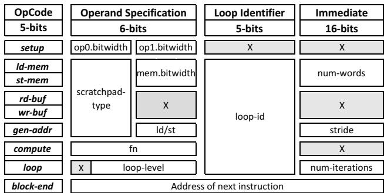

下一节将讨论 Bit Fusion-ISA，它向软件暴露 Bit Fusion 的位级灵活性。

## IV. 指令集架构

为利用 Bit Fusion 独特的位级灵活性，我们需要设计一种新的硬件—软件接口，以抽象方式暴露这些能力。此外，这种抽象必须具有足够的灵活性，使多种 DNN 模型能够利用位级融合。下面列出了一种 ISA 应满足的要求，以提供这种抽象，并支持各类 DNN 高效使用 Bit Fusion。

1) 通过对运算分组来摊销位级融合的成本。DNN 中的运算被组织为称为层的分组，其中同一种数学运算会重复大量次数（通常为数十万次）。为避免在如此规模下对运算进行细粒度控制所带来的开销，这种抽象需要在实现各层的指令块上摊销位级融合的成本。

2) 为 Bit Fusion 提供灵活的数据通路。如第 II 节所述，提供给融合处理单元（Fused-PE）的字数和每个字的位宽，都会随 BitBrick 的组合方式而变化。因此，数据访问指令的语义必须随融合配置而变化，以实现灵活的数据通路。

3) 为多种 DNN 层提供简洁的表达方式。由于 DNN 研究仍在不断变化，因此有必要设计一种具有足够通用性的 ISA，以表达多种 DNN 运算／层，同时尽量降低指令处理的冯·诺依曼开销，并保持较小的占用空间。

## A. 用于位宽灵活加速的 Fusion-ISA

表 I 总结了旨在满足这些要求的 Bit Fusion-ISA。本节其余部分将讨论指令格式，并阐述这些格式背后的设计思路。

面向 DNN 层的块结构 ISA。为了利用同一层中各项运算的共性，Bit Fusion ISA 采用块结构。因此，在实现某一特定层的每个指令块内，BitBrick 的融合配置保持固定。在本工作中，我们没有探索层内位宽变化。不过，Bit Fusion ISA 及其当前的微体系结构实现可以通过为单个层使用多个指令块，轻松支持这种变化。setup 指令标记指令块的开始，并将 Fusion Unit 及其数据传送逻辑配置为操作数所指定的位宽。该指令实际上为块中的所有指令定义了将 BitBrick 逻辑融合为 Fused-PE 的方式。block-end 指令表示一个块的结束，并在 next-inst 字段中提供下一条指令的地址。

DNN 层的简洁表达。DNN 包含大量简单运算，例如乘累加和取最大值，这些运算在大量神经元上重复执行（AlexNet 中的乘加运算超过 2600 百万次，见表 II）。因此，由于 DNN 所需的运算数量庞大，取指和译码产生的冯·诺依曼开销可能限制性能。为了尽量减少所需的取指和译码次数，我们利用了以下认识：DNN 中的每一层都是对高维数组执行的一系列简单数学运算。运算如何遍历数组元素，以及数学运算的类型（乘加/取最大值），唯一确定了一个层。因此，ISA 提供了 loop 指令，使我们能够以简洁的方式定义 DNN 层中的遍历和运算。每条 loop 指令在块内都有唯一的 ID。如表 I 所示，loop 指令中的 num-iterations 字段定义迭代次数。compute 指令指定运算类型，而 gen-addr 指令规定如何遍历输入/输出高维数组的元素。gen-addr 指令中的 stride 字段指定在循环中如何遍历数组元素，该循环由 loop-id 字段标识。setup 指令之后的字定义了用于填充输入、输出和权重这三个缓冲区的数据的存储器基地址。gen-addr 指令生成用于遍历存储器数据并填充缓冲区的地址。

$$
A d d r e s s = b a s e + \sum_ {i d} (l o o p \_ i t e r a t o r [ i d ] \times s t r i d e [ i d ])\tag{4}
$$

在公式（4）中，id 是块内所有 gen-addr 指令的 loop-id 字段，而 loop\_iterator 是相应循环的当前迭代及其步长。基本假设是，由相应 loop 指令重复执行的多条 gen-addr 指令定义了复杂的多维遍历，从而表达从 LSTM 到 CNN 的各种 DNN 层。在所评估的基准测试中，包含 30-86 条指令的块足以覆盖 LSTM、CNN、池化和全连接层。这些块组合使用 loop、compute 和 gen-addr 指令来定义这些 DNN 层的嵌套循环。这些统计数据表明，我们的 ISA 能够在提供位级融合能力的同时，简洁地表达各种 DNN 层。请注意，这些指令仅在指令块开始时取指和译码一次，从而将冯·诺依曼开销摊销到整个块的执行过程中。

管理 Fused-PE 的存储器访问。ld-mem/stmem 指令在图 3 中的片上缓冲区（IBUF、OBUF 和 WBUF）与片外存储器之间交换数据。类似地，rd-buf/wr-buf 指令对 scratchpad-type 字段指定的片上缓冲区进行数据读写，如表 I 所示。在这四条指令中，操作数是可变位宽数组，其大小取决于数组元素的数量及其位宽。这些参数控制着向 Fused-PE 提供数据的逻辑，并取决于位级融合配置（每个 Fusion Unit 中 Fused-PE 的数量）以及数据类型（输入/权重）。为了体现数据大小的这种变化，用于访问片上和片外存储器的 rd-buf/wr-buf 和 ld-mem/st-mem 指令的语义，会根据预先设置的所属指令块的融合配置而变化。具体而言，ld-mem/stmem 指令的存储器访问大小同时取决于其 num-words 字段和相应 setup 指令定义的融合配置。

片上与片外存储器访问的解耦。DNN 所需的数据量很大，因此存储器访问次数也很多。因而，片外存储器访问带来的延迟可能成为性能瓶颈。为了隐藏片外访问的延迟，ISA 将片上存储器访问与片外存储器访问解耦。此外，将这两类存储器访问解耦，使加速器能够使用简单的暂存缓冲区来复用片上数据，而无需使用由硬件管理的高速缓存。

## B. 代码优化

如第 IV 节所述，Fusion-ISA 使用简单指令与显式循环指令相结合来表达神经网络。使用较简单的指令使该 ISA 能够灵活地表达种类广泛的 DNN。不过，该 ISA 的灵活性也使其能够纳入针对特定层的优化，以进一步提升性能和节能效果。为简洁起见，我们以一个全连接层为例讨论代码优化。图 11 展示了与该示例对应的矩阵乘法。我们执行以下三项优化，如图 12 所示。循环顺序调整。循环顺序调整通过优化外层循环和内存指令的顺序，进一步减少片外访问。回顾一下，Bit Fusion-ISA 使用循环索引生成内存地址（第 IV 节）。当一条内存指令的地址不依赖于前一条循环指令的索引时，就可以交换它们的顺序。图 12(b) 中的优化代码采用输出固定方式执行全连接层，以减少对输出缓冲区的读写访问。改变顺序使 Bit Fusion 能够在输入固定、输出固定和权重固定方式之间切换，从而最大限度地减少片外和片上访问。

循环分块。循环分块将 Bit Fusion-ISA 中的一条循环指令划分为更小的块，使一次循环操作所需的数据能够放入片上暂存存储器。这些较小的块通过一条 LD/ST 指令访问，并在内层循环中复用，以减少片外访问。与图 12(a) 中的原始代码相比，图 12(b) 中的分块版本将输出缓冲区的片外访问次数缩减 IC× 倍，并将输出缓冲区的片上访问次数缩减 $\mathrm { \Delta } t i l e _ { i c }$ 倍。请注意，IC 是矩阵乘法运算的一个维度，如图 11 所示。卷积层通常需要六条循环指令，分块优化后增加至 12 条。增加指令数量对性能造成的开销可以忽略不计，因为取指和译码的成本被分摊到整个层的执行过程中。

层融合。如前所述，Bit Fusion 架构由一个 2 维乘法器脉动阵列和一个 1 维池化/激活单元阵列组成。当两个或更多连续层使用互不重叠的片上资源时，就可以合并这些层的指令，使第一层产生的数据直接馈入后续层，从而避免代价高昂的片外访问。例如，图 11 中的全连接层使用 2 维脉动

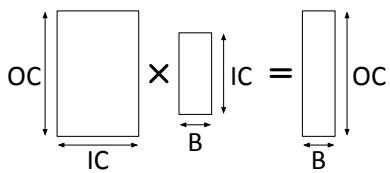  
图 11：单个全连接层。× 表示矩阵乘法。

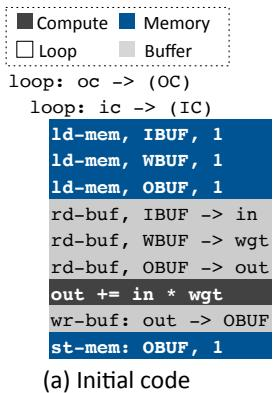

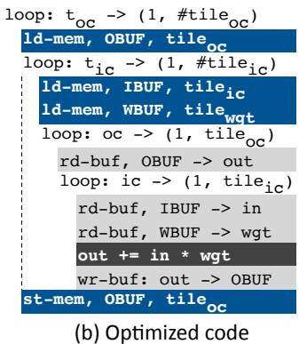  
图 12：(a) 全连接层的代码。(b) 使用循环分块和顺序调整后的优化代码。为清晰起见，省略了 setup 和 gen-addr 指令。阵列。如果下一层是激活层，那么我们可以融合这两层，并创建一个用于计算这两层的指令块。

## A. 方法

## V. 评估

基准测试。表 II 列出了来自不同领域的 8 个 CNN 和 RNN 基准测试，包括图像分类、目标识别和光学字符识别，以及语言建模。所选 DNN 基准测试使用大小各异的输入数据，使我们能够评估输入数据大小对 Bit Fusion 架构的影响。AlexNet [36, 40]、SVHN [35, 41]、CIFAR10 [35, 42]、LeNet-5 [34, 43]、VGG-7 [34, 44]、ResNet-18 [36, 45] 都是流行且广泛使用的 CNN 模型。其中，AlexNet 和 ResNet-18 基准测试是使用 ImageNet 数据集的图像分类应用，它们具有不同的网络拓扑结构。SVHN 和 LeNet-5 基准测试是光学字符识别应用，分别识别住宅外景照片中的门牌号码，以及手写/机器印刷字符。CIFAR10 和 VGG-7 是分别基于 CIFAR-10 和 ImageNet 数据集的目标识别应用。RNN [35] 和 LSTM [35, 46] 是在 Penn TreeBank 数据集 [47] 上执行语言建模的循环网络。在表 II 中，“乘加运算数”列显示各模型所需的乘加运算次数，“模型权重”列显示模型参数的大小。请注意，如图 1 所示，乘加运算和模型权重具有可变位宽。

降低位宽的 DNN 模型。Bit Fusion 旨在加速具有不同位宽要求的各类 DNN 模型的推理，同时不损失分类准确率。表 II 中列出的基准测试采用了先前工作 [32, 34–36] 提出的模型拓扑结构，这些工作训练低位宽 DNN，并达到与 32 位浮点模型相同的准确率。我们没有自行设计这些量化 DNN，只是从现有深度学习文献 [32, 34–36] 中获取了它们。Cifar-10、SVHN、LSTM 和 RNN 基准测试使用 [35] 中提出的量化模型。LeNet-5 和 VGG-7 基准测试使用三值（+1,0,-1）网络 [34]。AlexNet 和 ResNet-18 使用 [36] 中提出的 4 位 2× 加宽模型，这些模型将卷积层和全连接层的通道数加倍。我们为 Eyeriss 和 GPU 基线使用常规的 AlexNetResNet-18 1 1.02405386 1.037060345 1.040347071 1.041171497 和 ResNet-18 模型，并为 Bit Fusion 和 Stripes 使用RNN 1 3.953835189 15.11724316 21.40888746 21.41541032 它们的 2× 加宽量化模型。

表 II：评估的 CNN/RNN 基准测试。

<table><tr><td>DNN</td><td>类型</td><td>领域</td><td>数据集</td><td>乘加运算数</td><td>模型权重</td></tr><tr><td>AlexNet</td><td>CNN</td><td>图像分类</td><td>ImageNet</td><td>2,678 Mops</td><td>116.3 Mbytes</td></tr><tr><td>Cifar-10</td><td>CNN</td><td>目标识别</td><td>CIFAR-10</td><td>617 Mops</td><td>3.3 MBytes</td></tr><tr><td>LSTM</td><td>RNN</td><td>语言建模</td><td>Penn TreeBank</td><td>13 Mops</td><td>6.2 MBytes</td></tr><tr><td>LeNet-5</td><td>CNN</td><td>光学字符识别</td><td>MNIST</td><td>16 Mops</td><td>0.5 MBytes</td></tr><tr><td>ResNet-18</td><td>CNN</td><td>图像分类</td><td>ImageNet</td><td>4,269 Mops</td><td>13.0 Mbytes</td></tr><tr><td>RNN</td><td>RNN</td><td>语言建模</td><td>Penn TreeBank</td><td>17 Mops</td><td>8.0 MBytes</td></tr><tr><td>SVHN</td><td>CNN</td><td>光学字符识别</td><td>SVHN</td><td>158 Mops</td><td>0.8 MBytes</td></tr><tr><td>VGG-7</td><td>CNN</td><td>目标识别</td><td>CIFAR-10</td><td>317 Mops</td><td>2.7 MBytes</td></tr></table>

表 III：评估的 ASIC 和 GPU 平台。\*Stripes 的各项数值均为每个分块的数据。ean 3.90 5.10

<table><tr><td></td><td colspan="2">ASIC</td><td></td><td colspan="2">GPU</td></tr><tr><td>芯片</td><td>Eyeriss</td><td>Stripes*</td><td>芯片</td><td>Titan X</td><td>Tegra X2</td></tr><tr><td>核心数(1.1 mm^2)</td><td>168 PEs</td><td>4096 SIPs</td><td>核心数</td><td>3,584</td><td>256</td></tr><tr><td>片上存储器</td><td>181.5 KB</td><td>2 MB eDRAM16 KB SRAM</td><td>存储器</td><td>12 GB</td><td>8 GB</td></tr><tr><td rowspan="2">芯片面积 (mm^2)</td><td rowspan="2">5.87</td><td rowspan="2">3.62</td><td>芯片面积 (mm^2)</td><td>471</td><td>-</td></tr><tr><td>TDP</td><td>250 W</td><td>7.5 W</td></tr><tr><td>频率</td><td>500 MHz</td><td>980 MHz</td><td>频率</td><td>1,531 MHz</td><td>875 MHz</td></tr><tr><td>工艺</td><td>45 nm</td><td>45 nm</td><td>工艺</td><td>16 nm</td><td>16 nm</td></tr></table>

加速器开发与综合。我们使用 RTL-Verilog几何平均数 1.00 1.66 2.43 2.68 2.68 来实现 Bit Fusion 架构的配置，并通过大量 RTL 仿真验证设计。我们使用 Synopsys Design Compiler（L-2016.03-SP5）和商业标准单元库，在 45nm 工艺节点下综合 Bit Fusion。Design Compiler 提供芯片面积、可达到的频率以及动态/静态功耗，我们使用这些数据来估算 Bit Fusion 加速器的性能AlexNet 0.27 0.55 1.00 1.66 2.22 W 和能效。Cifar-10 0.25 0.50 1.00 2.00

Bit Fusion 的仿真基础设施。我们将每个 DNNLeNet-5 0.26 0.53 1 1.67 2.5 p 基准测试编译为 Fusion-ISA 的指令（第 IV 节）。ResNet-18 0.25 0.5 1 2 2.87 e 我们开发了一个周期精确模拟器，它接收给定 DNN 的 Fusion-ISARNN 0.25 0.5 1 2 4 S 指令，并模拟执行过程，以计算周期数以及对片上几何平均数 0.25 0.51 1.00 1.91 2.86 缓冲区（图 3 中的 IBUF、OBUF 和 WBUF）和片外存储器的访问次数。我们以 Bit Fusion 架构的 Verilog 实现为参照，验证模拟器的周期数。模拟器使用表 III 中定义的频率和周期数，测量 Bit Fusion 架构的执行时间。为评估能效，我们使用 CACTI-P [48] 的结果，对 Bit Fusion 加速器片上缓冲区的能耗进行建模。

与 Eyeriss 的比较。为测量比较对象 Eyeriss 的性能和能量耗散，我们使用其开源仿真基础设施 [4]。得到的面积和能耗指标如表 III 所示。如前所述，我们采用Net 1 12.00 23.00 3.20 与 Eyeriss 相同的面积预算，即计算单元的面积为 1.1 mm2r-10 1 13.00 29.00 34.00 30×，芯片面积为TM $5 . 8 7 \mathrm { m m } ^ { 2 }$，以此综合 Bit Fusion，如表 III 所示。6.40 6.70 38.00 up X2 20× 我们总共使用 112 KB SRAM 作为片上缓冲区（图 3 中的 IBUF、OBUF、    ee r 和 WBUF）。Eyeriss 处理 16 位操作数NN 1 6.9 7.2 39 S o，而 Bit Fusion 支持从 2、4、8 到 16 位的灵活位宽。HN 1 14.00 21.00 14.00 Al

与 Stripes 的比较。Stripes 的作者慷慨地分享了他们的模拟器 [2]。他们的功耗估算工具针对 65 nm 工艺节点，我们将其缩放至 45 nm。Stripes 使用串行内积提升 相对于 Stripes 单元（SIPs），处理 16 位输入和可变位宽的权重（1 至 16 位）。Stripes 由 16 个分块组成，每个分块具有基准测试 性能 能耗	 能耗 4096 个 SIPs。为进行公平比较，我们将 Stripes 每个分块中的 4096 个 SIPs 替换为我们提出的 Bit Fusion 脉动阵列，该阵列包含 512t 8× 个融合单元，每个单元包含 16 个 BitBrick，以匹配相同的计算面积预算LSTM 2.1 3.10 m ip $1 . 1 \mathsf { m m } ^ { 2 }$，这是缩放至 45 nm 后的面积，并且5.2 7.80 ro r 使用相同的片上存储器总容量。

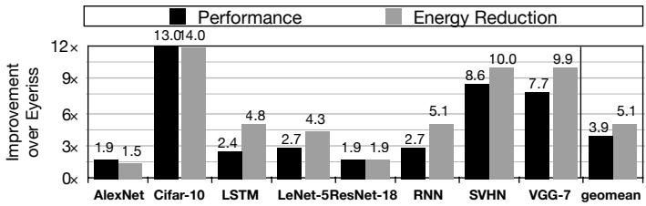  
图 13：Bit Fusion 相对于 Eyeriss 的性能和能耗改善。

与 GPU 的比较。我们使用两款基于 Nvidia Pascal 架构的 GPU（Titan Xp 和 Tegra X2）与 Bit Fusion 进行比较。表 III 展示了这两款 GPU 的详细信息。我们使用 Nvidia 的 批次 大小 = 64 批次 大小 = 256定制 TensorRT 4.0 [49] 库，该库使用最新的 CUDA 9.0 4.8 1.1 1.1 5.1 1.4 1.4和 cuDNN 7.1 编译，它们支持 8 位量化计算，这是该架构所能支持的 1最小位宽。在各 GPU 平台上，我们 e 4×使用 1,000 个批次进行预热，随后使用 10,000 个批次测量 S性能，并取平均值。为了进行直接比较，at我们按照 [50] 中介绍的方法，保守地将 Bit Fusion 缩放到 16 nm 工艺节点 0×，假设电压缩放为 0.86×，电容缩放为 0.42×。不过，我们假设其频率与 Eyeriss 相同，均为 500 MHz，并未提高 Bit Fusion 的频率。缩放后的 Bit Fusion 架构具有 4096 个 Fusion Unit，配备 896 KB SRAM，总芯片面积为 5.93 mm2，功耗为 895 毫瓦。作为参考，同样采用 16 nm 工艺节点的 Titan Xp，其芯片面积为 471 mm2，TDP 为 250 瓦，如表 III 所汇总。

## 256 位/周期 B. 实验结果

## 1) 与 Eyeriss 的比较：

性能和能耗的改善。为了评估 Bit Fusion 架构带来的 0×性能和效率收益，我们将其与先进的加速器 Eyeriss [1] 进行比较，后者提出了一种针对 DNN 优化的数据流架构。我们使两种架构的计算逻辑具有相同的面积预算 $1 . 1 \mathsf { m m } ^ { 2 }$：Bit Fusion 中为脉动阵列，Eyeriss 中为 PE，同时使两者的 SRAM 总容量保持一致。我们按照 [4] 中提出的方法，将 Eyeriss 中 PE、寄存器文件、片上网络和 DRAM 的面积与能耗缩放至 45nm 工艺。为了公平比较这两种架构，我们对 Eyeriss 和 Bit Fusion 均采用论文 [4] 中报告的相同频率 500MHz。图 13 展示了 Bit Fusion 相对于 Eyeriss 的性能和能耗收益。平均而言，Bit Fusion 实现了 3.9× 的加速，因为 Bit Fusion 架构能够 -FP32 TitanX-FP32 TitanX-INT8 Bit Fusion在给定面积下以较低位宽执行更多 DNN 运算 34 38 31 39 30 48，超过 Eyeriss。不同基准测试的性能提升因 DNN 运算类型和所需位宽而异。CNN 基准测试（AlexNet、SVHN、Cifar-10、LeNet-5、VGG-7 和 ResNet-18）的性能提升高于循环网络（RNN 和 LSTM），因为卷积运算更适合在 Bit Fusion 的脉动架构中复用数据。Cifar-10 获得的收益最高，加速比达到 13×，因为其中大部分运算都可以使用最小位宽（1 位输入和 1 位权重）进行计算，而且这些运算具有很高的并行度，可以利用数量增加的 Fused-PEs。相比之下，性能 能耗降低 ResNet-18 和 AlexNet 的加速比最低，为 1.9×，7.8因为这两个基准测试在 Bit Fusion 上进行量化执行时，卷积层和全连接层采用了两倍的通道数（2× 宽度）[36]。我们在 Eyeriss 上使用原始的 AlexNet 和 ResNet-18 模型，其实际所需的乘加运算量少 4×。总体而言，使用可变位宽提高了性能和能效，因为它增加了计算能力，并减少了 RNN 0.25 0.5 1 2 4 处于活动状态的硬件组件。图 13 还展示了能耗SVHN 0.25 0.50 1.00 1.96 2.56  Reduc4on Reduc4on 降低情况。平均改善幅度为 5.1×，其中最大改善幅度为 14×     AlexNet 1.8 2.70，来自 Cifar-10；最小改善幅度为 1.5×，来自 AlexNet。能耗的显著降低归功于 Fusion Unit 的组织方式和 LeNet-5 5.2 7.80 内存访问次数的减少，我们将在下文对此进行更详细的讨论。ResNet-18 2.6 4.40 能耗分解。为了解能耗SVHN 1.8 2.70降低的来源，我们按各个 VGG-7 2.9 4.40 硬件组件（计算单元、片上 SRAM 缓冲区、寄存器文件和片外 DRAM 存储器）分解其能耗。图 14 展示了 Bit Fusion 和 Eyeriss 各组件的能耗。此 9.9图应结合图 13 的能耗降低结果一起考察。这两种加速器均将超过 80% 的能耗性能 相比 于 GPU用于片上和片外内存访问。Bit Fusion 在内存访问方面的位级灵活性enchmark TX2 TitanX Bit	Fusion显著降低了片上缓冲区（IBUF、OBUF 和 WBUF，见 LSTM 1 3.91 3.35 e 图 3）和片外 DRAM 的能耗。此外，凭借位级灵活性，LeNet-5 1 9.95351829 8.37298514 up X2 6×我们的缓冲区在较低位宽下能够容纳更多数据，实际上使   ee  Reduc4on Bit Fusion 拥有更大的片上存储容量，从而减少了 SVHN 1 3.47 3.69 S 0×卷积	8/8-bit	105MOps 1.6694367456.502816144片外内存访问。Eyeriss 在每个 PE 内部采用局部寄存器文件VGG-7 1 3.73 3.84，这占据了能耗的很大一部分omean 1.00 4.65 4.32。Bit Fusion 的脉动架构避免了对 21.6 寄存器文件的需求，并对输入和部分结果实施显式数据共享，如图 3 所示。因此，Bit Fusion 节省了寄存器提升 相对于 Stripes文件的能耗，但需要更多 SRAM 访问。综合效果  Reduc4on Reduc4on Reduc4on 来自位级灵活性和 BitBricks 在 AlexNet 1.246088255 19.30401179 2.17 Bit Fusion 架构中的脉动组织方式，可使能耗平均降低 5.1×。Cifar-10 2.83257223 56.58504081 6.36 nt es 然而，片外 DRAM 访问仍然占据 e tr 4× 1bit Bit Fusion 能耗的很大一部分，而且由于 ResNet-18 4.198260328 58.32291119 6.55 pr e 2× 2bit计算和片上存储能耗的显著降低，其占比有所增加。RNN 1.9997864 11.77764983 1.32 I 0×

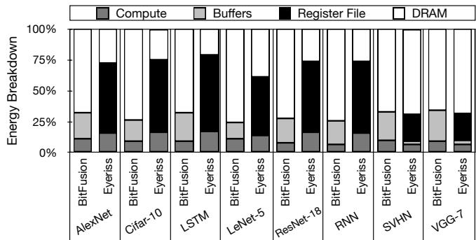

图 14：Bit Fusion 和 Eyeriss 的能耗分解。LSTM 1 6.40 6.70  
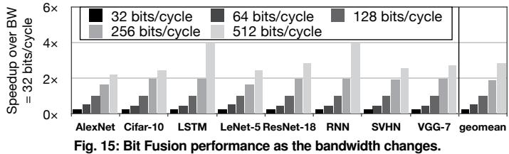

## 2) 敏感性研究：VGG-7 2.243595163 40.

对内存带宽的敏感性。片外带宽对性能的影响随 DNN几何平均值 2.44 36.77 4.13 8 位 拓扑结构而变化。为了理解带宽与性能之间的相关性，ops 我们进行了带宽敏感性研究。图 15 展示了当带宽从默认值的 0.25× 变化到 4× 时，Bit Fusion 的性能提升。本研究的基线是采用默认带宽（每周期 128 位）的 Bit Fusion。平均而言，当我们将带宽提高到 4× 时，Bit Fusion 相较于默认设置可实现 1.6× 的加速比，而在 /c 4×0.25× 带宽下，性能下降了 60%。由于 CNN bi基准测试具有更多的数据复用机会，因此与 RNN 基准测试相比，它们对带宽的 3敏感性较低。0×两个 RNN 基准测试 LSTM 和 RNN 的加速比几乎随带宽线性增长，因为它们的瓶颈在于带宽。en es 对批大小的敏感性。批处理通过在一批输入之间共享权重，摊薄权重 e tr 4×读取的开销。图 16 展示了 pr ve 2×当批大小从 1 增加到 0×256 时性能如何变化，其中以批大小为 1 作为基线（不进行批处理）。我们的默认批大小为 16。平均而言，批大小为 256 时，Bit Fusion 可实现 2.7× 的加速比，其中 RNN 的加速比最高，为 21.4×。由于批处理在带宽有限且性能受带宽制约时效果显著，因此其趋势与图 15 所示的带宽敏感性结果类似。然而，当批大小从 64 增加到 256 时，所有基准测试的收益都很有限，因为批大小超过 64 后，TitanX Bit Fusion带宽已足以使所有融合单元保持忙碌。

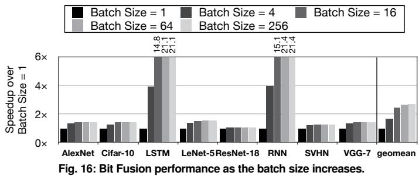

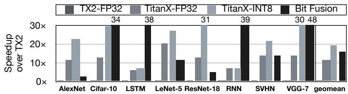  
its/周期 64 位/周期 128 位图 17： 与 GPU 的性能 比较。

## 3) 与 GPU 的比较：

与 GPU 的性能比较。GPU 是 DNN 最广泛使用的通用处理器。我们将 Bit Fusion 加速器的性能与两款 GPU 进行了比较：(1) Tegra X2 TM LeNet-5ResNet-18 RNN SVHN VGG-7 几何平均值（TX2），以及 (2) 基于 Pascal 架构的 Titan X（Titan Xp），其详细信息见表 III。如方法部分 V-A 节所述，我们将 Bit Fusion 缩放至与 GPU 相同的 16 nm 200工艺节点，并使用总计 4096 个融合单元。图 17 展示了以 TX2 为基线时 TitanX 和 Bit Fusion 的加速比。TX2 原生不支持 8 位模式。由于这种 RES支持的缺失，实验结果表明，在 TX2 中使用 8 位 et R10 M t-5 N -7 指令时会出现速度下降。如图 17 所示，采用单-0 99 0 0 0 0 99 0 16.5精度浮点（FP32）的 TitanX 平均速度为 TX2 的 12×。0 0 0 100 100 0 0 100 33.33333333使用 8 位模式时，加速比提高到 19×。尽管 GPU 可以 85 0 0 0 0 0 0 0 14.16666667从低至 8 位的计算中获益，但 Bit Fusion 可以从低至 2 位的运算中获得性能 ifar-10 LSTM LeNet-5 ResNet-18 RNN SVHN VGG-7 几何平均值收益。利用位级可组合性，Bit Fusion 相较于 TX2 可实现 16× 的加速比。VGG-7 基准测试取得了最高的 30× 和 48× 性能提升，分别来自 Titan Xp 99.8 99.9 99.9 99.4 99.7 99.9 99.8 99.5 99.8 0和 Bit Fusion。VGG-7 的高度并行性使 Titan Xp 和 Bit Fusion 都能充分利用所有可用的片上计算资源。Bit Fusion 的功耗为 895 毫瓦，而其速度仅比采用 8 位计算、功耗为 250 瓦的 Titan Xp 慢 16%，性能几乎与之相当。

## 4) 与 Stripes 的比较：

与 Stripes 的性能比较。图 18 展示了 Bit Fusion 相较于 Stripes 的性能和能耗收益。平均而言，Bit Fusion 相较于 Stripes 可实现 2.6× 的加速比。Stripes 使用位串行计算，仅支持 DNN 权重的可变位宽。与 Stripes 相比，Bit Fusion 架构提供了可动态组合的 BitBrick，以支持 DNN 输入和权重的灵活位宽。相较于 Stripes，Bit Fusion 在 LeNet-5 基准测试中实现了最高的 5.2× 加速比，在 AlexNet 基准测试中实现了最低的 1.8× 加速比。ResNet-18 是这些基准测试中最新且规模最大的模型，由于两个操作数都可以使用低位宽，因此取得了 2.6× 的性能收益。AlexNet 的第一个卷积层和最后一个全连接层使用 8 位输入/权重。这两个 8 位层限制了 Bit Fusion 相较于 Stripes 的收益。另一方面，LeNet-5 基准测试的输入和权重均使用低位宽，因此通过 Bit Fusion 获得了最高的性能收益。

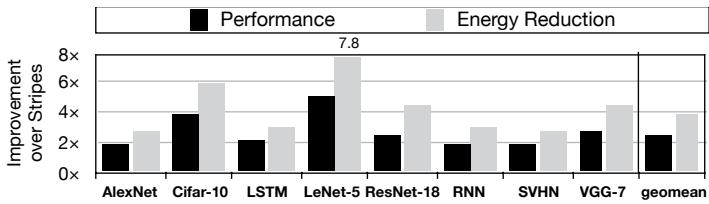  
图 18：Bit Fusion 相较于 Stripes 的性能和能耗改进。

相较于 Stripes 的能耗降低。图 18 还展示了 Bit Fusion 相较于 Stripes 的能耗改进。正如 Alex CIFA LST LeNe RES SVH VGG前文所述，当输入和权重均采用较低位宽时，Bit Fusion 可通过同时减少计算 18 和内存访问而获益。0 99 0 0 0 0 99 0 16.5平均而言，Bit Fusion 相较于 0 0 0 100 100 0 0 100 33.33333333Stripes 可使能耗降低 3.9×。LeNet-5 的能耗降幅最高，达到 7.8×，而 85 0 0 0 0 0 0 0 14.16666667AlexNet 基准测试相较于 Stripes 的能耗降幅最低，为 2.7×。对于 ResNet-18，能耗降低了 4×。

Bit Fusion 提供了一种与 Stripes 根本不同的方法，并探索了位级动态可组合性这一维度，99.8 99.9 99.9 99.4 99.7 99.9 99.8 99.5 99.8 从而显著改善了性能和能耗。

## VI. 相关工作

越来越多的相关工作致力于开发 DNN 加速器。Bit Fusion 与以往工作的根本区别在于，它引入并探索了位级可组合架构这一新维度，能够动态匹配 DNN 操作所需的位宽。Bit Fusion 旨在不损害 DNN 准确率的前提下，以尽可能细的粒度最大限度地减少计算和通信。下面，我们讨论最相关的工作。

DNN 中的精度灵活性。Stripes [2] 和 Tartan [6] 使用位串行计算单元来提供输入精度的灵活性，代价是额外的面积开销。这两项工作带来的性能和效率收益均与输入精度的降低程度成正比。我们在第 V 节中直接比较了 Bit Fusion 与 Stripes 的收益。UNPU [39] 采用 65 nm 工艺制造了一款位串行 DNN 加速器，与 Stripes [2] 类似。Loom [38] 使用位串行计算来实现精度灵活性。DeepRecon [51] 跳过全流水线浮点乘法器的部分流水级，以执行一次 16 位、两次 12 位或四次 8 位乘法。相比之下，Fusion Units 采用空间式设计，使用组合逻辑动态组合和拆分 2 位乘法器（BitBricks），以构建可变位宽的乘加单元。Moons 等人提出了低精度下的激进电压缩放技术，通过关闭乘法器的部分电路，在吞吐量不变的情况下提高能效 [37, 52]。因此，这些设计不具备融合能力。

TPU [30] 提出了一种面向 DNN 的脉动阵列架构，支持 8 位和 16 位精度。而本工作提出了一种动态组合低位宽计算单元（BitBricks）的架构，以匹配 DNN 各层的位宽需求。

二值 DNN 加速器。一些富有启发性的工作探索了针对二值 DNN 优化的 ASIC 和 FPGA 加速器。FINN [53] 使用 FPGA 加速二值 DNN，而 YodaNN [54] 和 BRein [55] 则提出了用于二值 DNN 的 ASIC 加速器。Kim 等人 [56] 分解二值 CNN 的卷积权重，以提高性能和能效。上述工作仅专注于二值 DNN，以牺牲分类准确率为代价实现高性能。而 Bit Fusion 灵活匹配 DNN 操作的位宽，在不损失准确率的情况下获得性能和能耗收益。

面向 DNN 的稀疏加速器。EIE [5]、Cambricon-X [15]、Cnvlutin [13] 和 SCNN [57] 探索 DNN 层中的稀疏性，并通过跳过零值计算来获得性能和能效收益。与上述工作相互正交，Bit Fusion 探索了面向 DNN 的位宽灵活加速器这一维度。

其他面向 DNN 的 ASIC 加速器。DaDianNao [7] 使用 eDRAM 消除片外访问，为 DNN 提供高性能和高效率。PuDianNao [9] 是一款面向机器学习设计的加速器，但不支持 CNN。Minerva [12] 提出了操作剪枝和数据量化技术，以降低 ASIC 加速的功耗。Eyeriss [1, 3] 提出了一种面向 DNN 的优化行驻留数据流，以提高效率。Tetris [4] 和 Neurocube [11] 提出了三维堆叠 DNN 加速器，为 DNN 操作提供高带宽。ISAAC [26]、PipeLayer [28] 和 Prime [27] 使用阻变存储器（ReRAM）加速 DNN。Ganax [58] 使用 SIMD-MIMD 架构支持 DNN 和生成模型。Snapea [59] 采用提前终止来跳过计算。

面向 DNN 的指令集。Cambricon [14] 提供了一种 ISA，使用向量和矩阵操作来表达 DNN 中的不同计算，相比 DaDianNao 没有显著的效率损失。DnnWeaver [22] 提出了一种粗粒度 ISA 来表达 DNN 的各层，这些层首先被转换为微码，以便在 FPGA 上加速。与以往工作不同，本工作提出的 Fusion-ISA 旨在实现位级灵活性，以加速 DNN。此外，Fusion-ISA 使用具有迭代语义的循环指令，显著减少指令占用空间。

代码优化技术。Alwani 等人 [60] 提出了层融合，将多个卷积层合并，以减少 FPGA 加速 CNN 时的片外访问。Escher [61] 提出了一款采用灵活缓冲机制的 CNN FPGA 加速器，用于平衡 CNN 中输入和权重的片外访问。上述工作启发了本文探索的代码优化，但本工作的关键贡献是一款具有位级灵活性的 DNN 加速器。

面向二值/XNOR DNN 的软件技术。QNN [35] 表明，面向基于 XNOR 的二值 DNN 的高效 GPU 内核可以带来最高 3.4× 的性能提升。XNOR-Net [62] 表明，面向二值/XNOR 网络的专用库可以在 CPU 上实现 58× 的加速。相比之下，Bit Fusion 是一种 ASIC 加速器架构，支持 DNN 使用广泛的位宽（从二值到 16 位），且不会损失准确率。

Core Fusion 和 CLPs。Core Fusion [63] 和 CLPs [64] 是可动态配置的片上多处理器，其中一组独立处理器可以融合，形成一个能力更强的 CPU。与这些富有启发性的工作相比，Bit Fusion 在位级进行组合，而不是在完整处理器核心的层级进行组合。

## VII. 结论

深度神经网络需要大量计算，但能够在使用极低位宽操作时保持准确率不变。利用 DNN 的这一特性，我们开发了 Bit Fusion，这是一种位级动态可组合架构，用于高效加速 DNN。该架构配备了一套 ISA，使软件能够利用这种位级融合能力，以尽可能细的粒度最大化计算并行性并最小化数据传输。我们在 45 nm 工艺节点下综合了所提出微架构的 Verilog 实现，并使用八个各层位宽需求不同的实际 DNN 进行了周期精确仿真，以评估 Bit Fusion 的收益。与最先进的加速器相比，Bit Fusion 实现了显著的加速和能耗收益。

## VIII. 致谢

我们感谢 Amir Yazdanbaksh、Divya Mahajan、Jacob Sacks 和 Payal Preet Bagga 提供的深刻讨论与意见。本工作部分得到了 NSF 项目 CNS#1703812、ECCS#1609823，美国空军科学研究办公室（AFOSR）青年研究者计划（YIP）项目 #FA9550-17-1-0274，以及 Google、Microsoft、Xilinx 和 Qualcomm 捐赠的支持。

## REFERENCES

[1] Y.-H. Chen, J. Emer, and V. Sze, “Eyeriss: A spatial architecture for energy-efficient dataflow for convolutional neural networks,” in ISCA, 2016.

[2] P. Judd, J. Albericio, T. Hetherington, T. M. Aamodt, and A. Moshovos, “Stripes: Bit-serial deep neural network computing,” in MICRO, 2016.

[3] Y.-H. Chen, T. Krishna, J. S. Emer, and V. Sze, “Eyeriss: An energy-efficient reconfigurable accelerator for deep convolutional neural networks,” JSSC, 2017.

[4] M. Gao, J. Pu, X. Yang, M. Horowitz, and C. Kozyrakis, “Tetris: Scalable and efficient neural network acceleration with 3d memory,” in ASPLOS, 2017.

[5] S. Han, X. Liu, H. Mao, J. Pu, A. Pedram, M. A. Horowitz, and W. J. Dally, “Eie: efficient inference engine on compressed deep neural network,” in ISCA, 2016.

[6] A. Delmas, S. Sharify, P. Judd, and A. Moshovos, “Tartan: Accelerating fully-connected and convolutional layers in deep learning networks by exploiting numerical precision variability,” arXiv, 2017.

[7] Y. Chen, T. Luo, S. Liu, S. Zhang, L. He, J. Wang, L. Li, T. Chen, Z. Xu, N. Sun, et al., “Dadiannao: A machine-learning supercomputer,” in MICRO, 2014.

[8] T. Chen, Z. Du, N. Sun, J. Wang, C. Wu, Y. Chen, and O. Temam, “Diannao: a small-footprint high-throughput accelerator for ubiquitous machine-learning,” in ASPLOS, 2014.

[9] D. Liu, T. Chen, S. Liu, J. Zhou, S. Zhou, O. Teman, X. Feng, X. Zhou, and Y. Chen, “Pudiannao: A polyvalent machine learning accelerator,” in ASPLOS, 2015.

[10] Z. Du, R. Fasthuber, T. Chen, P. Ienne, L. Li, T. Luo, X. Feng, Y. Chen, and O. Temam, “Shidiannao: shifting vision processing closer to the sensor,” in ISCA, 2015.

[11] D. Kim, J. Kung, S. Chai, S. Yalamanchili, and S. Mukhopadhyay, “Neurocube: A programmable digital neuromorphic architecture with high-density 3d memory,” in ISCA, 2016.

[12] B. Reagen, P. Whatmough, R. Adolf, S. Rama, H. Lee, S. K. Lee, J. M. Hernández-Lobato, G.-Y. Wei, and D. Brooks, “Minerva: Enabling low-power, highly-accurate deep neural network accelerators,” in ISCA, 2016.

[13] J. Albericio, P. Judd, T. Hetherington, T. Aamodt, N. E. Jerger, and A. Moshovos, “Cnvlutin: ineffectual-neuron-free deep neural network computing,” in ISCA, 2016.

[14] S. Liu, Z. Du, J. Tao, D. Han, T. Luo, Y. Xie, Y. Chen, and T. Chen, “Cambricon: An instruction set architecture for neural networks,” in ISCA, 2016.

[15] S. Zhang, Z. Du, L. Zhang, H. Lan, S. Liu, L. Li, Q. Guo, T. Chen, and Y. Chen, “Cambricon-x: An accelerator for sparse neural networks,” in MICRO, 2016.

[16] V. Gokhale, J. Jin, A. Dundar, B. Martini, and E. Culurciello, “A 240 g-ops/s mobile coprocessor for deep neural networks,” in CVPRW, 2014.

[17] J. Sim, J. S. Park, M. Kim, D. Bae, Y. Choi, and L. S. Kim, “14.6 a 1.42tops/w deep convolutional neural network recognition processor for intelligent ioe systems,” in ISSCC, 2016.

[18] F. Conti and L. Benini, “A ultra-low-energy convolution engine for fast brain-inspired vision in multicore clusters,” in DATE, 2015.

[19] Y. Wang, J. Xu, Y. Han, H. Li, and X. Li, “Deepburning: Automatic generation of fpga-based learning accelerators for the neural network family,” in DAC, 2016.

[20] L. Song, Y. Wang, Y. Han, X. Zhao, B. Liu, and X. Li, “C-brain: A deep learning accelerator that tames the diversity of cnns through adaptive data-level parallelization,” in DAC, 2016.

[21] C. Zhang, P. Li, G. Sun, Y. Guan, B. Xiao, and J. Cong, “Optimizing fpga-based accelerator design for deep convolutional neural networks,” in FPGA, 2015.

[22] H. Sharma, J. Park, D. Mahajan, E. Amaro, J. K. Kim, C. Shao, A. Misra, and H. Esmaeilzadeh, “From high-level deep neural models to fpgas,” in MICRO, 2016.

[23] M. Alwani, H. Chen, M. Ferdman, and P. Milder, “Fused-layer cnn accelerators,” in MICRO, 2016.

[24] N. Suda, V. Chandra, G. Dasika, A. Mohanty, Y. Ma, S. Vrudhula, J.-s. Seo, and Y. Cao, “Throughput-optimized opencl-based fpga accelerator for large-scale convolutional neural networks,” in FPGA, 2016.

[25] J. Qiu, J. Wang, S. Yao, K. Guo, B. Li, E. Zhou, J. Yu, T. Tang, N. Xu, S. Song, et al., “Going deeper with embedded fpga platform for convolutional neural network,” in FPGA, 2016.

[26] A. Shafiee, A. Nag, N. Muralimanohar, R. Balasubramonian, J. P. Strachan, M. Hu, R. S. Williams, and V. Srikumar, “Isaac: A convolutional neural network accelerator with in-situ analog arithmetic in crossbars,” in ISCA, 2016.

[27] P. Chi, S. Li, C. Xu, T. Zhang, J. Zhao, Y. Liu, Y. Wang, and Y. Xie, “Prime: A novel processing-in-memory architecture for neural network computation in reram-based main memory,” in ISCA, 2016.

[28] L. Song, X. Qian, H. Li, and Y. Chen, “Pipelayer: A pipelined reram-based accelerator for deep learning,” in HPCA, 2017.

[29] E. Chung, J. Fowers, K. Ovtcharov, M. Papamichael, A. Caulfield, T. Massengil, M. Liu, D. Lo, S. Alkalay,

M. Haselman, C. Boehn, O. Firestein, A. Forin, K. S. Gatlin, M. Ghandi, S. Heil, K. Holohan, T. Juhasz, R. K. Kovvuri, S. Lanka, F. van Megen, D. Mukhortov, P. Patel, S. Reinhardt, A. Sapek, R. Seera, B. Sridharan, L. Woods, P. Yi-Xiao, R. Zhao, and D. Burger, “Accelerating persistent neural networks at datacenter scale,” in HotChips, 2017.

[30] N. P. Jouppi, C. Young, N. Patil, D. Patterson, G. Agrawal, R. Bajwa, S. Bates, S. Bhatia, N. Boden, A. Borchers, et al., “In-datacenter performance analysis of a tensor processing unit,” in ISCA, 2017.

[31] “Apple a11-bionic.” https://en.wikipedia.org/wiki/Apple\_A11.

[32] S. Zhou, Z. Ni, X. Zhou, H. Wen, Y. Wu, and Y. Zou, “Dorefa-net: Training low bitwidth convolutional neural networks with low bitwidth gradients,” arXiv, 2016.

[33] C. Zhu, S. Han, H. Mao, and W. J. Dally, “Trained ternary quantization,” arXiv, 2016.

[34] F. Li, B. Zhang, and B. Liu, “Ternary weight networks,” arXiv, 2016.

[35] I. Hubara, M. Courbariaux, D. Soudry, R. El-Yaniv, and Y. Bengio, “Quantized neural networks: Training neural networks with low precision weights and activations,” arXiv, 2016.

[36] A. K. Mishra, E. Nurvitadhi, J. J. Cook, and D. Marr, “WRPN: wide reduced-precision networks,” arXiv, 2017.

[37] B. Moons, R. Uytterhoeven, W. Dehaene, and M. Verhelst, “Dvafs: Trading computational accuracy for energy through dynamic-voltage-accuracy-frequency-scaling,” in DATE, 2017.

[38] S. Sharify, A. D. Lascorz, P. Judd, and A. Moshovos, “Loom: Exploiting weight and activation precisions to accelerate convolutional neural networks,” arXiv, 2017.

[39] J. Lee, C. Kim, S. Kang, D. Shin, S. Kim, and H.-J. Yoo, “Unpu: A 50.6 tops/w unified deep neural network accelerator with 1b-to-16b fully-variable weight bit-precision,” in ISSCC, 2018.

[40] A. Krizhevsky, “One weird trick for parallelizing convolutional neural networks,” arXiv, 2014.

[41] Y. Netzer, T. Wang, A. Coates, A. Bissacco, B. Wu, and A. Y. Ng, “Reading digits in natural images with unsupervised feature learning,” in NIPS workshop on deep learning and unsupervisedfeature learning, 2011.

[42] A. Krizhevsky and G. Hinton, “Learning multiple layers of features from tiny images,” Computer Science Department, University ofToronto, Tech. Rep, 2009.

[43] Y. LeCun, L. Bottou, Y. Bengio, and P. Haffner, “Gradientbased learning applied to document recognition,” Proceedings of the IEEE, vol. 86, no. 11, pp. 2278–2324, 1998.

[44] K. Simonyan and A. Zisserman, “Very deep convolutional networks for large-scale image recognition,” arXiv, 2014.

[45] K. He, X. Zhang, S. Ren, and J. Sun, “Deep residual learning for image recognition,” in CVPR, 2016.

[46] S. Hochreiter and J. Schmidhuber, “Long short-term memory,” Neural computation, 1997.

[47] M. P. Marcus, M. A. Marcinkiewicz, and B. Santorini, “Building a large annotated corpus of english: The penn treebank,” Computational linguistics, 1993.

[48] S. Li, K. Chen, J. H. Ahn, J. B. Brockman, and N. P. Jouppi, “CACTI-P: Architecture-level Modeling for SRAM-based

Structures with Advanced Leakage Reduction Techniques,” in ICCAD, 2011.

[49] “Nvidia tensor rt 4.0.” https://developer.nvidia.com/tensorrt.

[50] H. Esmaeilzadeh, E. Blem, R. St. Amant, K. Sankaralingam, and D. Burger, “Dark silicon and the end of multicore scaling,” in ISCA, 2011.

[51] T. Rzayev, S. Moradi, D. H. Albonesi, and R. Manohar, “Deeprecon: Dynamically reconfigurable architecture for accelerating deep neural networks,” IJCNN, 2017.

[52] B. Moons and M. Verhelst, “A 0.3–2.6 tops/w precisionscalable processor for real-time large-scale convnets,” in VLSI-Circuits, 2016.

[53] Y. Umuroglu, N. J. Fraser, G. Gambardella, M. Blott, P. Leong, M. Jahre, and K. Vissers, “Finn: A framework for fast, scalable binarized neural network inference,” in FPGA, 2017.

[54] R. Andri, L. Cavigelli, D. Rossi, and L. Benini, “Yodann: An ultra-low power convolutional neural network accelerator based on binary weights,” arXiv, 2016.

[55] K. Ando, K. Ueyoshi, K. Orimo, H. Yonekawa, S. Sato, H. Nakahara, M. Ikebe, T. Asai, S. Takamaeda-Yamazaki, T. Kuroda, et al., “Brein memory: A 13-layer 4.2 k neuron/0.8 m synapse binary/ternary reconfigurable in-memory deep neural network accelerator in 65 nm cmos,” in VLSI, 2017.

[56] H. Kim, J. Sim, Y. Choi, and L.-S. Kim, “A kernel decomposition architecture for binary-weight convolutional neural networks,” in DAC, 2017.

[57] A. Parashar, M. Rhu, A. Mukkara, A. Puglielli, R. Venkatesan, B. Khailany, J. Emer, S. W. Keckler, and W. J. Dally, “SCNN: An Accelerator for Compressed-sparse Convolutional Neural Networks,” in ISCA, 2017.

[58] A. Yazdanbakhsh, H. Falahati, P. J. Wolfe, K. Samadi, H. Esmaeilzadeh, and N. S. Kim, “GANAX: A Unified SIMD-MIMD Acceleration for Generative Adversarial Network,” in ISCA, 2018.

[59] V. Aklaghi, A. Yazdanbakhsh, K. Samadi, H. Esmaeilzadeh, and R. K. Gupta, “Snapea: Predictive early activation for reducing computation in deep convolutional neural networks,” in ISCA, 2018.

[60] M. Alwani, H. Chen, M. Ferdman, and P. Milder, “Fused-layer cnn accelerator,” in MICRO, 2016.

[61] Y. Shen, M. Ferdman, and P. Milder, “Escher: A cnn accelerator with flexible buffering to minimize off-chip transfer,” in FCCM, 2017.

[62] M. Rastegari, V. Ordonez, J. Redmon, and A. Farhadi, “Xnor-net: Imagenet classification using binary convolutional neural networks,” arXiv, 2016.

[63] E. Ipek, M. Kirman, N. Kirman, and J. F. Martinez, “Core fusion: accommodating software diversity in chip multiprocessors,” in ISCA, 2007.

[64] C. Kim, S. Sethumadhavan, M. Govindan, N. Ranganathan, D. Gulati, D. Burger, and S. W. Keckler, “Composable lightweight processors,” in MICRO, 2007.

> 来源与版本：采用用户提供的 ISCA 2018 作者版本。图片与数学表达保留；本文讨论整数位级组合，不将其写成原生浮点三模式容量设计。

> 本文根据用户提供的 PDF 经 MinerU 解析，由 Codex/GPT 翻译和解读，未调用 GLM 翻译 API。参考文献保留原文；技术总结、通俗讲解和图表说明属于解读。[原文入口](https://doi.org/10.1109/ISCA.2018.00069)。
