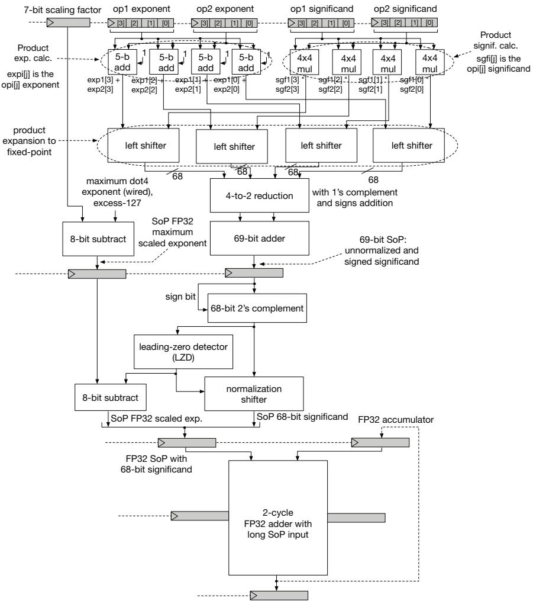
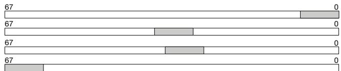
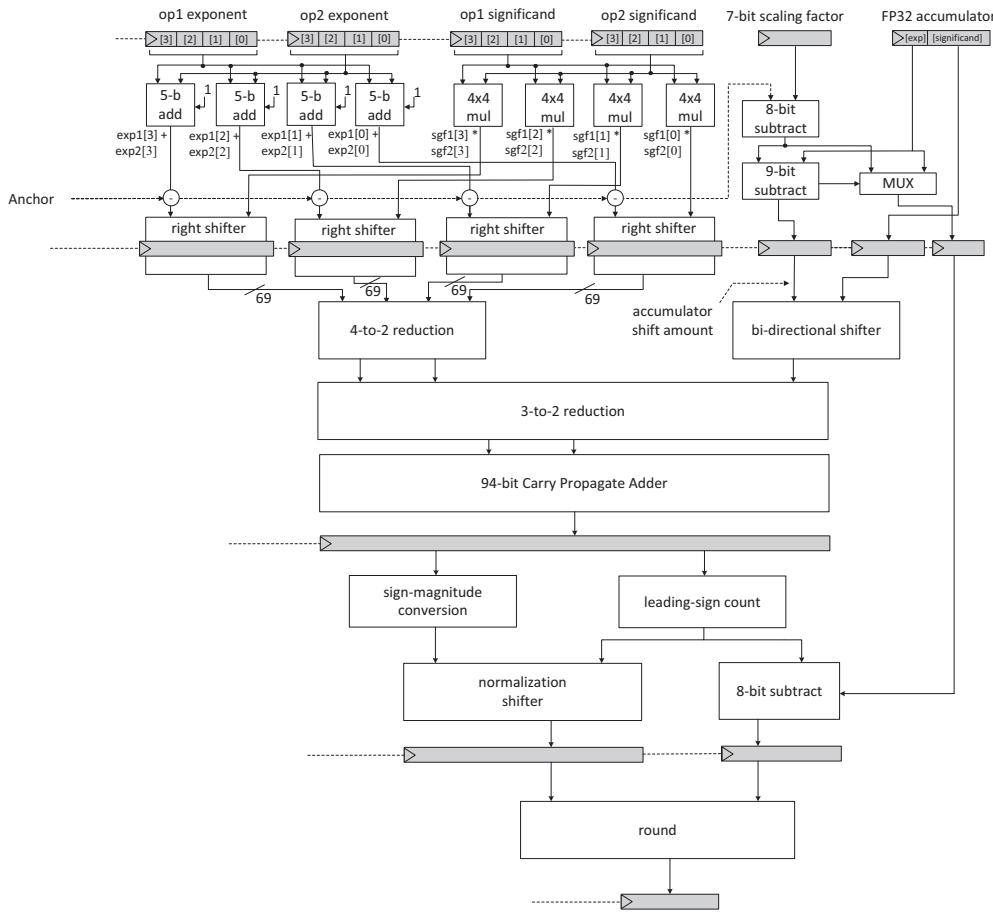

# Fused FP8 4-Way Dot Product With Scaling and FP32 Accumulation 图表详解

### 图像 1

图1为晚累加LA框图，无坐标轴。顶部四组指数加法器和4×4有效数乘法器并行工作；乘积经左移展开为68位定点数，进入4到2压缩和69位加法器。中部求绝对值、前导零检测及规格化，左侧同步减去缩放参数并修正指数；底部两周期FP32加法器接收68位长有效数和累加器。灰条表示流水寄存位置。该图支持“前两周期算点积、后两周期累加”的组织说明，不能据此读取吞吐或功耗。

### 图像 2

图2是乘积定点展开示意，无时间轴或性能纵轴。四条横框均表示68位容器，左端标67、右端标0，灰块表示8位乘积占据的位置：第一条靠低位，最后一条靠高位，中间两条位置接近且可重叠。它说明不同指数乘积可映射到固定位置后相加，支持省去运行时最大指数搜索的解释；灰块不是实测数据分布，也不表示四个流水阶段。

### 图像 3

图3为早累加EA专用通路，无坐标轴。左上四路乘积参照Anchor分段右移，形成69位操作数；右上缩放参数和累加器指数决定移位量及主指数，累加器经双向移位器并入压缩树。中部94位进位传播加法器输出未舍入总和，下部并行进行符号幅值转换和前导符号计数，再规格化、修正指数并舍入。该图展示提前融合累加器的机制，面积优势需结合综合表判断。

> 来源与版本：使用用户提供的 ARITH 2024 正式版；与后续期刊扩展分开，不混用页码和实验结果。

> 本文根据用户提供的 PDF 经 MinerU 解析，由 Codex/GPT 翻译和解读，未调用 GLM 翻译 API。参考文献保留原文；技术总结、通俗讲解和图表说明属于解读。[原文入口](https://doi.org/10.1109/ARITH61463.2024.00016)。
