# Jack Unit: An Area- and Energy-Efficient Multiply-Accumulate (MAC) Unit Supporting Diverse Data Formats 图表详解

### 图像 1

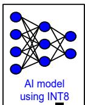

图1相关的INT8模型小图标，裁图未显示独立子图号。蓝色节点和连线表示神经网络，文字为“AI model using INT8”，没有横纵轴或性能数据。它为后续多格式MAC示意提供当前请求采用INT8的背景，支持讨论其他格式路径可能闲置；不能据此识别具体模型、网络规模、量化准确率或加速效果。

### 图像 2

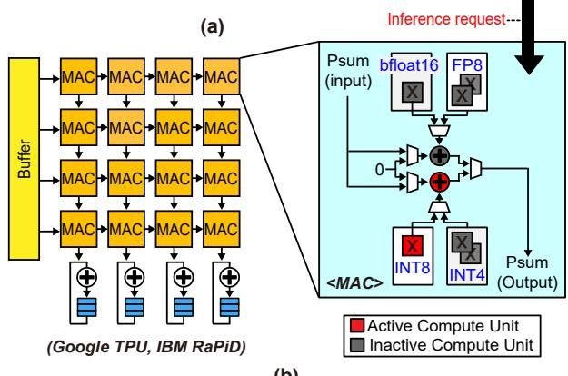

对应正文图1(b)的专用多格式MAC示意，裁图上方残留“(a)”标记，子图标记存在排版不确定性。左侧是带输入缓冲和底部累加路径的阵列；右侧展开一个MAC，显示bfloat16、FP8、INT8、INT4路径及部分和输入输出。红色表示当前INT8请求启用的计算单元，灰色为闲置单元，支持专用路径存在面积闲置的论点，并非实际芯片利用率测量。

### 图像 3

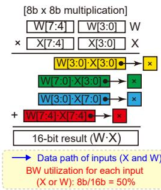

图2(a)的8×8乘法分解。W、X分别拆成高低4位，四个彩色子积按0、4、4、8位偏移归并，得到16位乘积。蓝色箭头说明输入通路，底部标注每个操作数以8位数据使用16位通路，带宽利用率为50%。这个比例针对图示互连组织，说明组合子乘法器可能带来输入冗余，不能泛化为所有8位乘法器的计算利用率。

### 图像 4

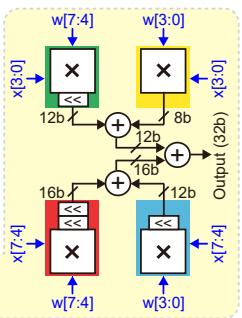

图2的四子乘法器结构裁图，位置对应正文图2(b)，但正文称其展示4×4模式，图中仍画有高低子字交叉相乘、移位和归并，图文口径需保留不确定性。黄、绿、蓝、红路径分别对应低低、两种交叉、高高子积，内部标有8、12、16位；右侧出口写32位。它能说明位权恢复结构，不能单凭该裁图认定四路独立输出或完整累加位宽。

### 图像 5

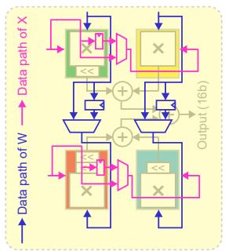

图2(c)展示重构CSM的输入数据通路，粉色为X、蓝色为W，箭头、多路选择和可旁路连接使输入能够沿流水路径传递。淡化的乘法、移位与加法结构用于说明互连相对算术核心的位置。作者借此支持不同精度下提高通路带宽利用率、降低布线成本的设计；图中没有周期刻度，不能由箭头数量直接推出端到端延迟或外部内存带宽。

### 图像 6

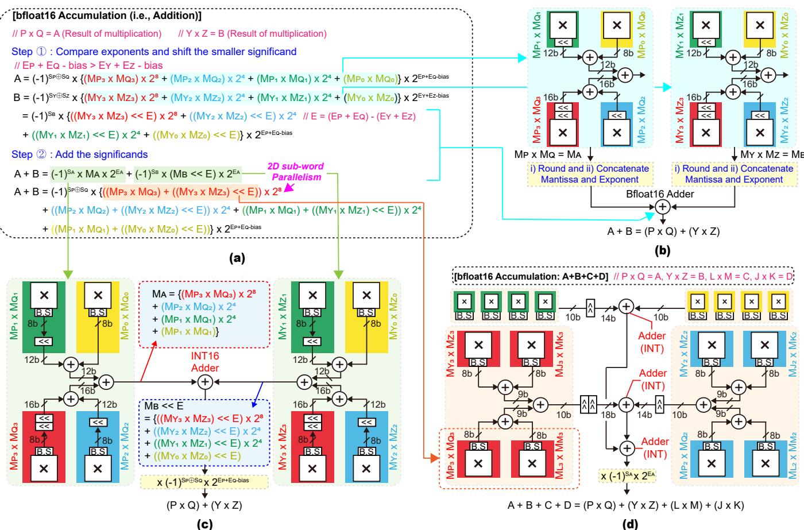

图3(a–d)串联三种累加组织：(a)说明指数比较、有效数对齐和相加；(b)先形成浮点乘积，再经浮点加法器；(c)在子积出口加入桶形移位器，用INT16加法累加；(d)跨四个CSM归组同位权子积，共享固定移位并缩窄早期路径。图中8至18位标注描述局部位宽。其“<<E”与较小项通常右移对齐的语义有冲突，不能据此补出精确舍入实现。

### 图像 7

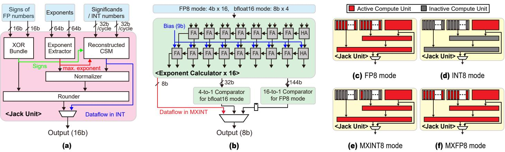

图4(a)给出Jack总体信号流：符号异或、指数提取与重构CSM共同计算，经规格化和rounder输出16位；整数另有旁路。(b)显示十六路指数计算及bfloat16四路、FP8十六路最大指数比较。(c–f)以红色、灰色区分FP8、INT8、MXINT8、MXFP8模式的启用和关闭模块。图支持按格式共享与门控的机制，不直接给出门控切换时间或节电比例。

### 图像 8

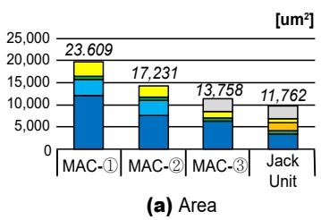

图5(a)比较MAC①、②、③与Jack面积，横轴为设计，纵轴单位µm²。柱顶依次标23609、17231、13758、11762，按这些注值，Jack相对①约改善2.01倍，相对③约1.17倍。该裁图没有完整分项图例，不强行为颜色指定模块。正文另写MAC①面积11084µm²，与图中数值不一致，因此绝对面积需视为未消解的图文冲突。

### 图像 9

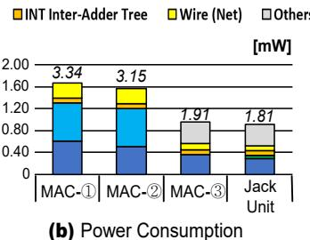

图5(b)横轴为四种MAC设计，纵轴标mW，堆叠条展示功耗组成，局部图例可见整数跨单元加法树、连线及其他项。柱顶依次写3.34、3.15、1.91、1.81，但纵轴刻度和条高与这些注值不匹配，正文又将MAC①写成1.67mW。图支持作者报告的相对降耗趋势，无法据此确定唯一绝对功耗口径；这些均为P&R后估计值。

### 图像 10

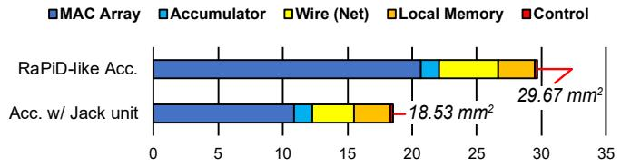

图6以水平堆叠条比较RaPiD-like与Jack加速器面积，横轴为mm²，颜色区分MAC阵列、累加器、连线、本地存储和控制。总面积分别为29.67与18.53mm²，支持约1.60倍面积改善；主要差异来自MAC阵列，布线也缩小。它是作者实现架构的布局结果，不能等同于商业RaPiD芯片实测；引言另述的2.02倍整机面积改善与本图不一致。

### 图像 11

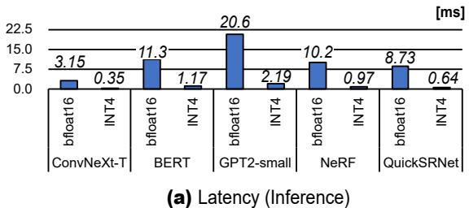

图7(a)横轴为五个模型及bfloat16、INT4模式，纵轴为推理时延ms。两模式依次为：ConvNeXt-T 3.15/0.35，BERT 11.3/1.17，GPT2-small 20.6/2.19，NeRF 10.2/0.97，QuickSRNet 8.73/0.64。它展示同一Jack架构切换精度的时延变化，没有画出基线时延；图值与正文9.06–13.08倍加速范围不能完全对应。

### 图像 12

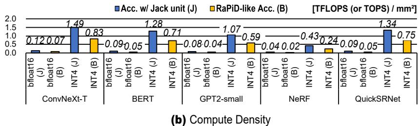

图7(b)纵轴为计算密度，单位TFLOPS或TOPS/mm²，蓝色J、黄色B对应Jack和基线。按五模型顺序，bfloat16的J/B为0.12/0.07、0.09/0.05、0.08/0.04、0.04/0.02、0.09/0.05；INT4为1.49/0.83、1.28/0.71、1.07/0.59、0.43/0.24、1.34/0.75。图支持同格式面积效率改善；计算密度不是访存意义的算术强度。

### 图像 13

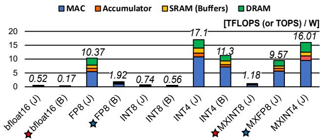

图8横轴为格式及J/B架构，纵轴是跨五模型平均能效，单位TFLOPS或TOPS/W；堆叠颜色表示MAC、累加器、SRAM和DRAM相关组成。Jack在INT4下标17.1，MXINT4为16.01，比较时需保留格式差异。红星连接MXINT8与基线bfloat16，蓝星连接MXFP8与基线FP8，对应正文7.13、4.98倍跨格式比较；图没有展示任务准确率或单位推理实际能耗。

> 来源与版本：ISLPED 2025 出版状态由作者实验室确认，技术内容和页码依据用户提供的作者 PDF；原文入口另列 arXiv:2507.04772。

> 本文根据用户提供的 PDF 经 MinerU 解析，由 Codex/GPT 翻译和解读，未调用 GLM 翻译 API。参考文献保留原文；技术总结、通俗讲解和图表说明属于解读。[原文入口](https://arxiv.org/abs/2507.04772)。
