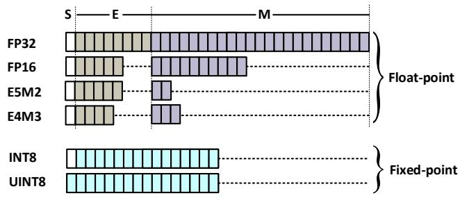
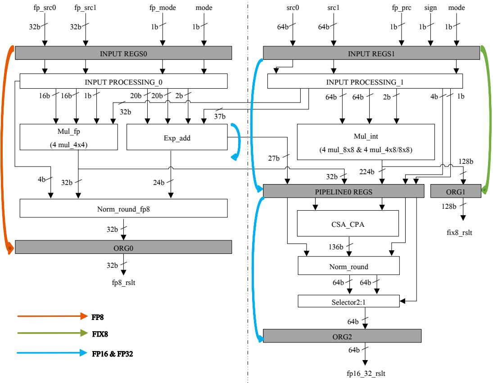
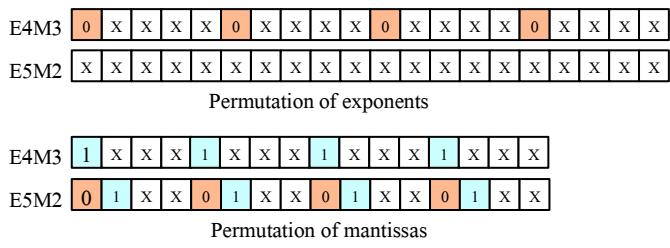
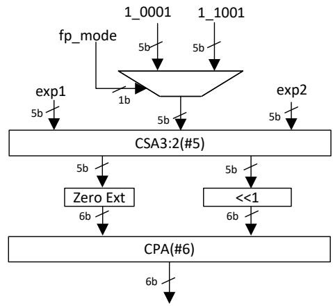
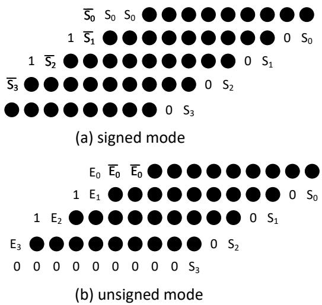
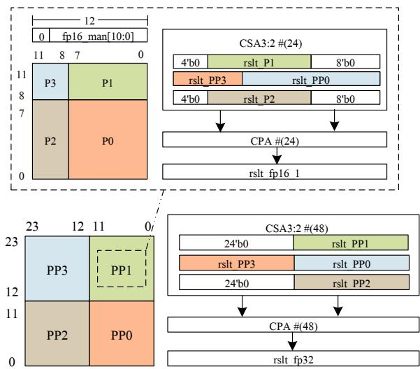
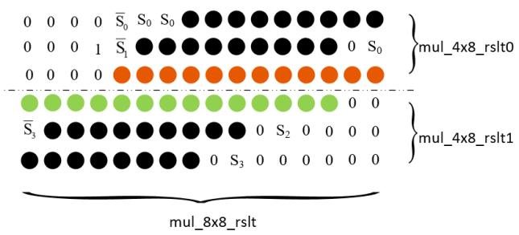
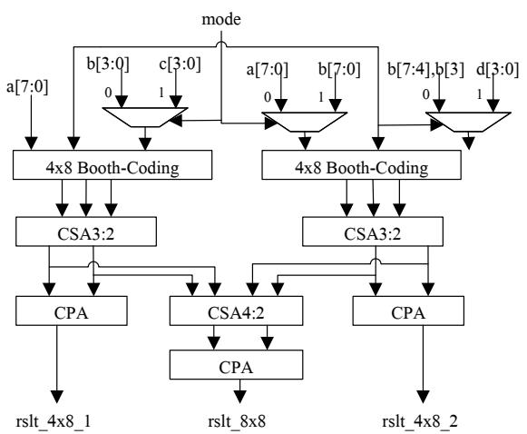
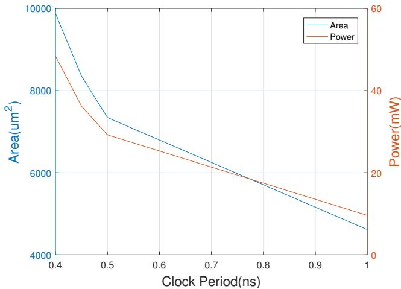

# Low-Cost Multiple-Precision Multiplication Unit Design For Deep Learning 图表详解

### 图像 1

图1为支持格式的字段示意，没有性能坐标轴。上部按S、E、M对齐浮点字段：FP32为1/8/23位，FP16为1/5/10位，两种FP8标为E5M2与E4M3。下部INT8和UINT8通过首位填色区分有无符号，不包含浮点指数区域。图能说明不同格式需要不同字段处理与尾数位宽，但不能证明特殊值兼容性；正文出现的E3M4、E4M2与此图标签不一致，应保留待核对。

### 图像 2

图2是整机数据通路。左侧两组32位输入进入FP8字段处理、四路尾数乘法、指数加法及归一化舍入，至ORG0输出；右侧两组64位输入进入整数乘法阵列。橙色箭头标FP8短路径，绿色标FIX8至ORG1的路径，蓝色标FP16/FP32经过中间寄存、压缩求和及ORG2的组合路径。图支持资源共享与路径分工，箭头长度不代表周期数，也不能消除正文的延迟冲突。

### 图像 3

图3包含同一整图的上下两组字段排列。上部是四个5位指数槽，E4M3各槽补一个0，E5M2使用全部指数位；下部是四个4位有效尾数槽，E4M3排列为1xxx，E5M2为01xx。x表示数据位，彩色0与1表示补位和隐含前导位。图说明两种FP8如何适配统一硬件；原图题对乘法器、加法器的对应措辞应结合实际字段含义理解。

### 图像 4

图4展示FP8指数求和，无横纵坐标。fp_mode控制选择5位常量10001或11001，与exp1、exp2一起进入CSA3:2；输出中的和向量补零、进位向量左移一位，再交给6位CPA。两常量对应文中−15与−7的5位补码编码。图支持共享偏置修正与指数加法结构，但补码高位、溢出及最终指数截取仍需结合完整实现核对。

### 图像 5

图5的(a)为有符号模式，(b)为无符号模式，均展示8×8乘法的部分积及扩展布局。黑点表示部分积位，各行横向错位体现位权；S、E、取反标记以及常量0、1用于符号扩展和修正。它不是吞吐或面积统计图。图说明两种符号模式需要不同边界处理，但正文对E的条件和otherwise均写为0，因此不能据图文唯一恢复修正逻辑。

### 图像 6

图6上部虚线框表示FP16：11位有效尾数补0后放入12位容器，按高4位、低8位划分P0至P3，并经24位CSA3:2与CPA重组。下部表示FP32：24位尾数拆成两个12位块，四个块乘积按12位偏移进入48位压缩和求和；虚线关联说明其中一个12×12块继续采用上部结构。图解释两层分解，24/48是重组容器宽度，不是输入尾数精度。

### 图像 7

图7展示混合乘法器在合成8×8结果时的部分积排列，上下括号分别对应两组4×8编码路径，底部括号为合成结果。黑点是普通部分积位；绿色行关联高半编码器使用低半最高位的边界处理，橙色行关联低半编码器的符号或无符号扩展。图强调拆分后仍需跨边界信息与修正，不能据此把整个8位Booth编码理解为两个完全独立的4位有符号乘法。

### 图像 8

图8是混合乘法器的详细数据流。顶部选择器在mode控制下重排a、b、c、d及b的分段边界输入，两套4×8 Booth编码器各连接CSA3:2。两侧CPA分别产生rslt_4x8_1、rslt_4x8_2；中央CSA4:2再接CPA，产生rslt_8x8。图能定位共享的部分积生成与初步压缩，以及独立或合并的末级求和；不能由此补造全文一致的mode控制真值表。

### 图像 9

图9横轴为时钟周期0.4—1.0ns；左纵轴及蓝线为面积，单位μm²，右纵轴及橙线为功耗，单位mW。周期越紧，两条曲线越高；0.4ns点对应正文给出的9874.87μm²和48.4mW。1.0ns端点读图约为4600μm²和10mW，属于近似观察。该图反映不同延迟约束下的综合成本权衡，不是芯片实测，也不是每次乘法能耗或网络任务性能曲线。

> 来源与版本：字体乱码变量、模式信号及面积/功耗单位已按原 PDF 恢复。原文中 FP8 格式命名、mode 控制值及延迟措辞有不一致，译文保留原文，解读中另行指出，不自行改写硬件合同。

> 本文根据用户提供的 PDF 经 MinerU 解析，由 Codex/GPT 翻译和解读，未调用 GLM 翻译 API。参考文献保留原文；技术总结、通俗讲解和图表说明属于解读。[原文入口](https://doi.org/10.1145/3583781.3590269)。
