# MFSA: A Multi-Format Systolic Array with Native Micro Scaling Support 图表详解

### 图像 1

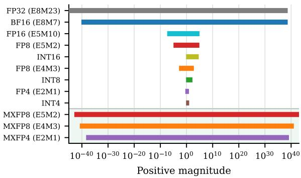

图1比较格式编码与正数幅值范围。横轴为对数幅值，约覆盖10⁻⁴⁰至10⁴⁰；纵向列出FP32、BF16、FP16、两种FP8、整数、FP4及底部三种MX格式。BF16与FP32范围接近，窄格式范围明显受限，MX共享尺度则扩展块级动态范围。条带只说明可表示量级，不代表区间内精度均匀，也不能据此认为MXFP4拥有FP32的有效数字精度或相同任务准确率。

### 图像 2

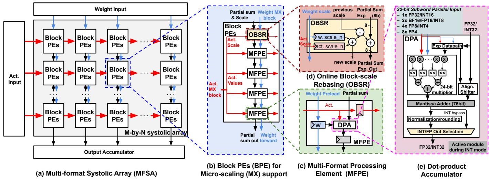

图2包含(a)—(e)五个层级，没有数值坐标轴。(a)红色激活横向流动，蓝色权重从顶部预装，黑色部分和沿列下传至输出累加器；(b)四个MFPE与边界OBSR组成BPE；(c)展示本地权重和DPA；(d)在块边界合并尺度、调整部分和指数；(e)展示32位打包输入、可重构乘法、76位加法器及整数旁路。它支持共享主数据通路的结构解释；块跨度随FP4八路、FP8四路而变化。

### 图像 3

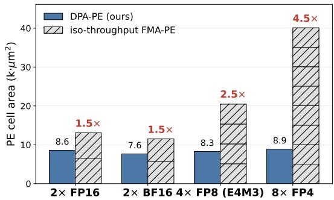

图3横轴为2路FP16、2路BF16、4路FP8 E4M3与8路FP4，纵轴为PE单元面积，单位kμm²。蓝柱DPA面积依次为8.6、7.6、8.3、8.9；斜纹柱堆叠对应数量的FMA单元，其面积分别约为DPA的1.5、1.5、2.5、4.5倍。正文说明比较匹配吞吐与时延，因此该图支持融合点积的面积优势随子字并行增加而扩大，不能读作同倍吞吐提升。

### 图像 4

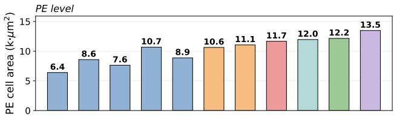

这是图4上半部分，纵轴为PE单元面积，单位kμm²；十二根柱与正文格式掩码表共用横向顺序，裁图没有独立横轴标签。前五个单格式FP32、FP16、BF16、CFP8、FP4分别为6.4、8.6、7.6、10.7、8.9，末柱含整数支持时为13.5。多格式柱未按各单格式面积直接相加，符合硬件共享思路。所给掩码表中部分中间列勾选相同，具体配置差别无法可靠确定。

### 图像 5

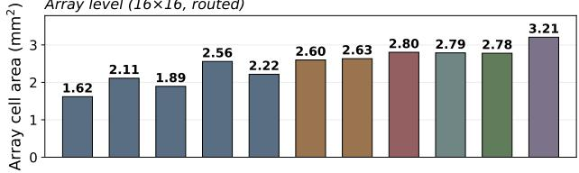

这是图4下半部分，与上图共用格式顺序，纵轴为完成布线的16×16阵列单元面积，单位mm²。前五个单格式值为1.62、2.11、1.89、2.56、2.22；正文明确BF16+CFP8为2.60，完整浮点为2.78，加入整数为3.21。各变体分别经过布局布线，面积差含物理实现影响。这里3.21对应增加MX之前的配置，不能与图7含MX的3.27或芯片外形面积混用。

### 图像 6

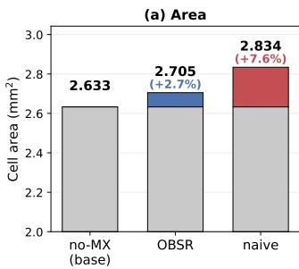

图5(a)比较同一16×16 CFP8+FP4底座的MX面积成本。横轴为无MX、OBSR和朴素方案，纵轴为单元面积mm²，且从2.0起画。三柱分别为2.633、2.705、2.834，彩色部分表示新增面积，对应2.7%和7.6%。64.2%的节省比较的是0.072与0.201 mm²新增部分，并非完整阵列面积减少64.2%；截断纵轴也会放大视觉差异。

### 图像 7

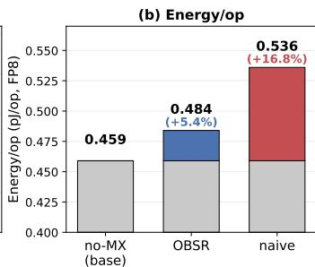

图5(b)沿用无MX、OBSR、朴素方案三组横轴，纵轴为FP8模式能量/操作，单位pJ/op，从约0.400起画。数值分别为0.459、0.484、0.536，新增开销标注5.4%和16.8%。OBSR相对朴素方案降低约67.5%的新增能耗，即比较0.025与0.077 pJ/op。该图针对支持MX所需硬件的能耗成本，不是整机功率或单次GEMM时延测量。

### 图像 8

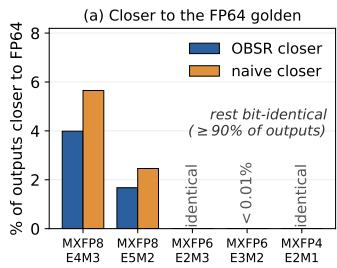

图6(a)横轴为MXFP8 E4M3/E5M2、MXFP6 E2M3/E3M2及MXFP4 E2M1，纵轴为全部输出中严格更接近FP64参照的百分比。蓝柱代表OBSR更近，橙柱代表朴素方案更近；两种MXFP8中橙柱略高，其余多数输出逐位相同。MXFP6 E2M3和MXFP4标为逐位一致，E3M2柱标注小于0.01%。该比例比较数值归约结果，不能解释为模型准确率。

### 图像 9

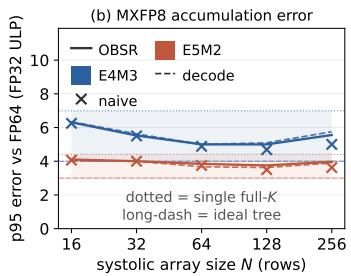

图6(b)横轴为阵列行数N，从16到256；纵轴为相对FP64参照的p95误差，以FP32 ULP计。蓝色为E4M3，红色为E5M2；实线对应OBSR，叉号为朴素方案，虚线标识解码结果，点线与长划线分别表示全K归约和理想树形归约参照。两实现曲线基本贴近，E4M3约在5—6 ULP量级，E5M2约4 ULP。误差不随行数单调增长，也不能把行数直接等同于GEMM归约长度。

### 图像 10

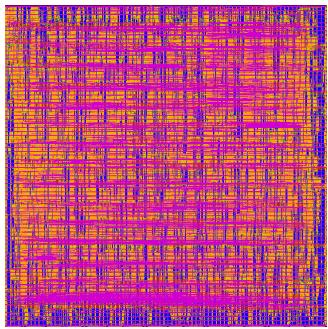

图7(a)是16×16 MFSA完成布局布线后的版图，无数值坐标轴。密集彩色线条呈现互连与物理实现，原图未给出颜色所对应金属层的图例，不宜据此辨认具体网络。图注报告TSMC 28 nm、1 GHz、2.40×2.40 mm²外形和3.27 mm²签核单元面积；外形面积为5.76 mm²，与单元面积口径不同。该图证明完成物理设计流程，不构成已制造芯片的照片或实测证据。

### 图像 11

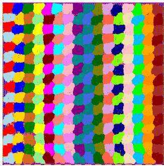

图7(b)将同一版图中的256个MFPE分别着色，用于观察逻辑16×16阵列在物理放置中的分布，没有坐标轴或定量色标。色块整体呈行列排列，局部边界随放置而变化，可与(a)的布线图配合理解阵列集成。颜色用于区分实例，不能解释为功耗、温度、精度模式或性能大小；图中也未单独标识OBSR，因此无法据色块直接测量其面积开销。

> 来源与版本：用户提供的 arXiv:2610.19645v1（2026-10-14 预印本），不标作已录用会议论文。经 MinerU 解析，由 Codex/GPT 翻译与解读，未调用 GLM 翻译 API。全文翻译保留参考文献；其余报告为解读。

[原文入口](https://arxiv.org/abs/2610.19645) · [多精度算术目录](../index.md)
