# MPICC: Multiple-Precision Inter-Combined MAC Unit with Stochastic Rounding for Ultra-Low-Precision Training 图表详解

### 图像 1

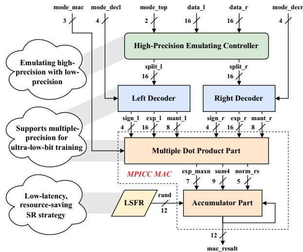

图1为整体数据流。两路16位输入先经过高精度模拟控制器，再进入左右解码器，输出符号、指数和尾数字段；点积结果送入累加部分，12位结果反馈形成部分和。图中标作LSFR的模块提供12位随机数。左侧三处说明分别对应高精度模拟、多精度点积和低开销随机舍入。解读：虚线框强调共享MAC核心，不能从此框图直接读出各模式吞吐或面积占比。

### 图像 2

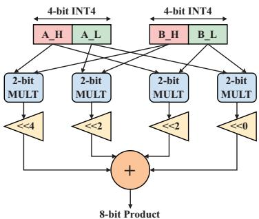

图2展示4位乘法的片段展开。A、B各拆成高低两个2位部分，交叉送入四个2位乘法器，再分别左移4、2、2、0位，求和形成8位乘积。移位量表示二进制位权，不表示等待周期。该图解释可组合算术的基础；扩展到浮点点积后，还必须加入指数对齐、符号处理和归一化，不能仅靠改变这四个固定移位量完成所有格式。

### 图像 3

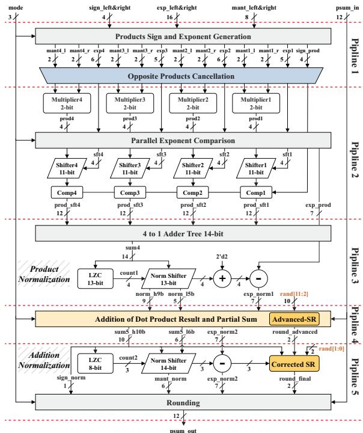

图4沿纵向给出五级数据流：符号与指数生成及反号抵消；四路2位乘法、指数比较和对齐；14位加法树与乘积归一化；点积与部分和相加并提前舍入；加法归一化、舍入校正和输出。右侧及边缘连线传递指数、部分和与随机位。解读：它体现归约和累加的分工，不能据五级虚线直接推定无流水200 MHz配置的端到端时延。

### 图像 4

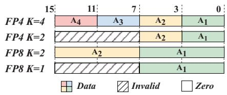

图3(a)说明16位输入的打包方式，顶部数字是位位置。FP4、K=4时装入四个4位元素；K=2时仅低八位有效。FP8、K=2时包含两个8位元素，K=1时仅低八位有效。斜线区域表示无效字段，图例另区分数据与零。解读：K需要结合另一乘数的格式理解，这里出现两个FP8元素，并不意味着支持两个FP8×FP8同时运算。

### 图像 5

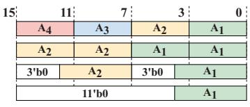

该图按内容对应图3(c)的指数解码布局；原文相邻子图标题的排版存在歧义。横向为15至0位，四行展示不同模式下指数的放置：四个字段独立排列、两个字段重复、两个较宽字段配零，以及只保留一个较宽字段。3'b0、11'b0表示补零。重复字段用于后续共享小乘法通路，不能将重复的A1、A2当作新增独立输入。

### 图像 6

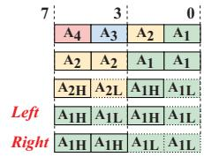

图3(d)为8位尾数解码结果，每格对应一个2位片段。上方展示四个短尾数及两个尾数重复排列；中间把较宽尾数拆成高、低部分。底部Left与Right采用不同重复顺序，使对应列相乘后覆盖高高、低高、高低、低低交叉项。解读：这种排列让四个小乘法器兼任一个宽尾数乘法器，其结果还需结合模式及指数进行加权。

### 图像 7

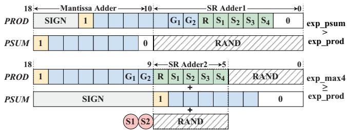

图5(a)展示尾数相加期间的Advanced-SR，横向数字为对齐后的位位置。上部对应PROD被对齐，随机数接在PSUM最低有效位之后；下部对应PSUM被对齐，随机数分段参与两路SR加法，形成S1、S2提前进位。SIGN、隐含1及G、R、S字段标明主尾数与低位信息的关系。解读：辅助低位加法提前生成信息，并非连续执行两次最终量化。

### 图像 8

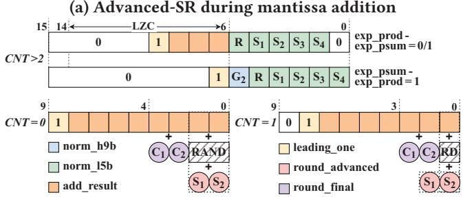

按CNT内容，此图对应图5(b)的归一化校正，尽管图片顶端残留(a)标题。上部展示CNT>2时，按指数差把低位接回移位通路；下部展示CNT=0、1时，结果低位、随机位及提前进位如何生成最终进位。颜色区分归一化高低段、加法结果与进位。CNT=2的直接采用规则见正文，不能把此图当作四种情况均完整绘出的示意。

### 图像 9

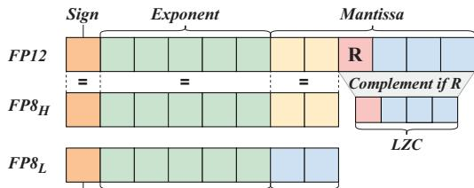

图6按符号、指数、尾数分区，说明一个FP12如何分成FP8高、低分量。高分量复用符号、指数和高两位尾数，R位控制近邻舍入；低分量从剩余位经求补、前导零计数和指数调整得到，符号随R变化。图中等号标示字段复用关系。解读：它描述输入分解，不能据此宣称省略低低乘积后的三次MAC与原生FP12乘法完全等价。

### 图像 10

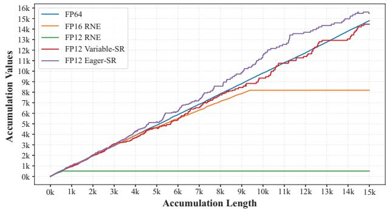

图7横轴为累计次数，纵轴为累加值，比较FP64、FP16 RNE及三种FP12方案。FP12 RNE在512附近形成平台，FP16 RNE最终停在8192；Variable-SR与Eager-SR继续增长，此次轨迹中前者整体更贴近FP64，后者偏高。图支持随机舍入缓解该输入设置下的停滞。解读：单条轨迹不能证明随机舍入的统计偏差，也不能代替多次训练的准确率统计。

### 图像 11

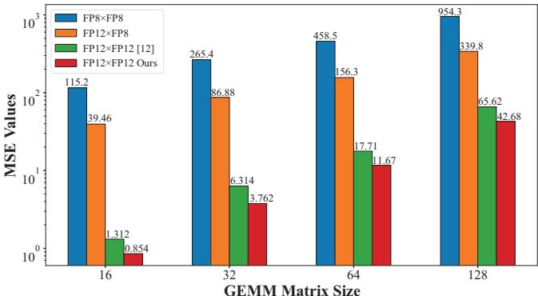

图8横轴为GEMM矩阵尺寸16、32、64、128，纵轴为对数刻度MSE。蓝、橙、绿、红分别代表FP8×FP8、FP12×FP8、文献[12]分解及本文FP12×FP12。红柱为0.854、3.762、11.67、42.68，均低于绿柱1.312、6.314、17.71、65.62。解读：尺寸增大时绝对误差上升，本文分解在这些随机矩阵上更准，但图未给出归一化误差。

### 图像 12

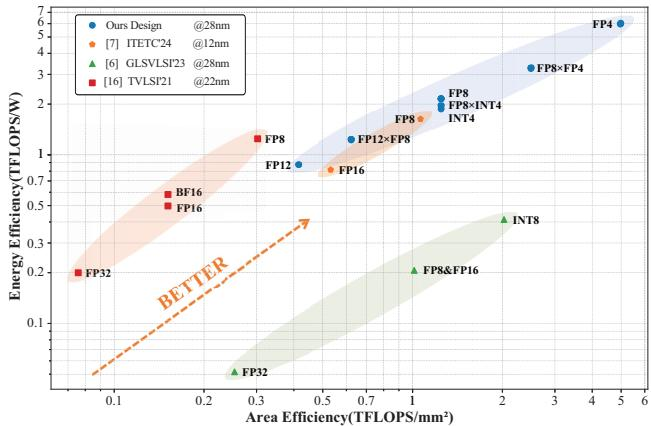

图9以对数坐标比较面积效率与能量效率，横轴为TFLOPS/mm²，纵轴为TFLOPS/W，越靠右上越高。本文FP8点约为(1.246,1.948)，FP4点约为(4.985,5.931)。不同符号对应不同工艺和既有设计。解读：4.69、3.64倍来自本文FP4与文献[7]FP8点比较，是跨精度峰值比；图中并没有该基线的FP4同精度实测点。

> 来源与版本：本页仅翻译 MPICC_paper.pdf。按用户要求，MPICC_ppt.pdf 不解析、不翻译、不发布。FP8_H/FP8_L 等字体乱码按论文 PDF 修复。

> 本文根据用户提供的 PDF 经 MinerU 解析，由 Codex/GPT 翻译和解读，未调用 GLM 翻译 API。参考文献保留原文；技术总结、通俗讲解和图表说明属于解读。[原文入口](https://doi.org/10.1145/3658617.3697641)。
