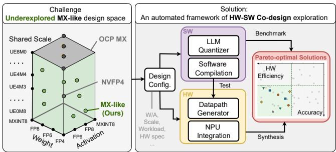
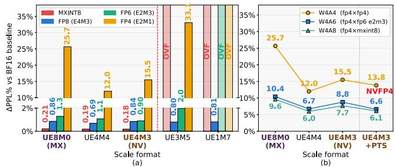
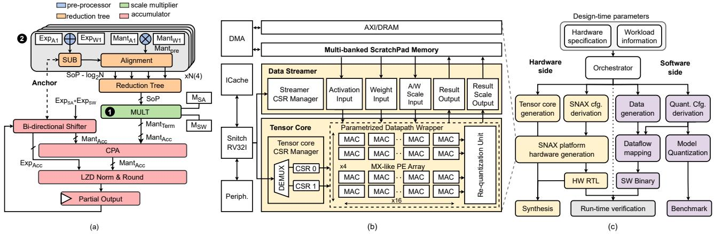
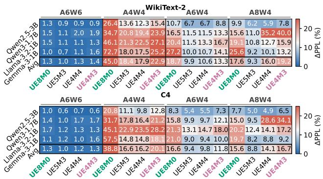
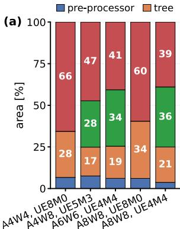
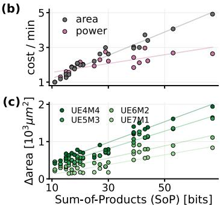
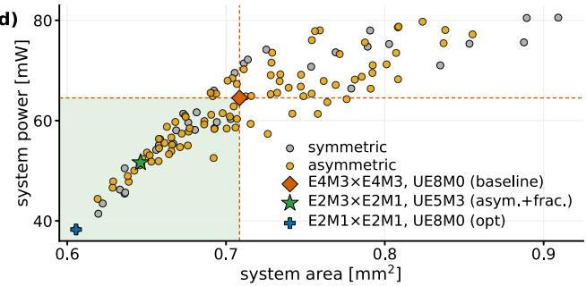
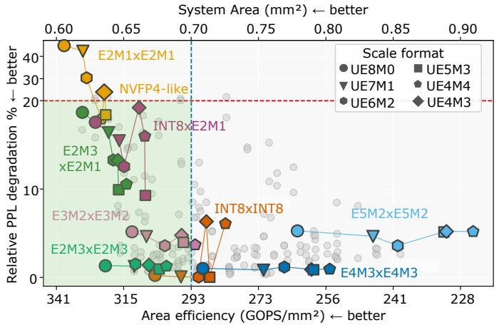
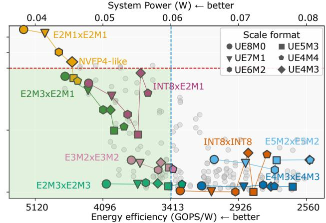

# MX-like Tensor Core for LLM Inference with NPU Integration via Hardware-Software Co-Design Exploration 原文翻译

# 面向 LLM 推理的类 MX 张量核心：通过硬件—软件协同设计探索实现 NPU 集成

Zijun Zhao∗ zijun.zhao@student.kuleuven.be KU Leuven 比利时鲁汶

Ruichu Ao ruichu.ao@student.kuleuven.be KU Leuven 比利时鲁汶

Marian Verhelst marian.verhelst@kuleuven.be KU Leuven 比利时鲁汶

Stef Cuyckens stef.cuyckens@kuleuven.be KU Leuven 比利时鲁汶

Chao Fang† chao.fang@kuleuven.be KU Leuven 比利时鲁汶

## 摘要

OCP 微缩放（MX）和 NVFP4 等分块缩放量化格式已被广泛用作 LLM 推理的高效数据格式。然而，由共享缩放因子、权重和激活格式的组合所构成的设计空间尚未得到系统探索，该空间中精度与硅片成本之间的联合权衡也尚未得到刻画，因此，面向基于 NPU 的边缘 LLM 部署，哪些配置才是真正的帕累托最优配置，仍是一个悬而未决的问题。为弥补这一空白，我们对上述尚未得到充分探索的类 MX 设计空间开展了硬件—软件（HW–SW）联合协同设计探索，并提出三项创新。1）我们定义并系统刻画了类 MX 设计空间中完整的 8 位缩放因子格式族，同时联合考察非对称权重—激活精度，找到了优于 MX 和类 NVFP4（不使用逐张量缩放，PTS）基线的配置。2）我们构建了针对各格式专门设计的 MAC 数据通路模板，从而能够公平评估整个设计空间中的硬件成本。3）我们开发了一套集成到开源 SNAX NPU 平台中的自动化协同设计流程，支持对整个设计空间开展 HW-SW 联合分析。总体而言，我们的协同设计探索揭示，只有在激进的 FP4 量化下，缩放因子格式才会产生影响，由此形成了针对具体场景选择缩放因子格式和非对称权重—激活精度的设计指南。我们进一步确定，在 FP4 条件下，UE5M3 能够在精度与硬件成本之间取得有利的权衡：相较于类 NVFP4 基线，其困惑度劣化幅度最多降低 25.3%，代价仅为 +0.06% 的面积开销和 +0.49% 的功耗开销。

## CCS 概念

• 硬件 → 算术与数据通路电路；硬件—软件协同设计；• 计算机系统组织 → 神经网络。

  
图 1：我们提出的类 MX 设计空间（左），以及用于探索该空间以寻找帕累托最优配置的自动化 HW-SW 协同设计框架（右）概览。

## 关键词

微缩放（MX）、分块缩放量化、LLM 推理、NPU、硬件—软件协同设计、设计空间探索

## ACM 参考文献格式：

Zijun Zhao, Ruichu Ao, Stef Cuyckens, Marian Verhelst, and Chao Fang. 2027. MX-like Tensor Core for LLM Inference with NPU Integration via Hardware-Software Co-Design Exploration. In 32nd Asia and South Pacific Design Automation Conference (ASPDAC ’27), January 25–28, 2027, Tokyo, Japan. ACM, New York, NY, USA, 8 pages. https://doi.org/10.1145/3840404. 3848173

## 1 引言

大语言模型（LLM）在从自然语言理解到代码生成的广泛任务中展现出了卓越性能 [13]。然而，能力不断增强的同时，模型规模也在相应增长 [3]，需要越来越多的内存和计算资源。这使得 LLM 的高效部署成为一项重大挑战，而当部署目标从数据中心 GPU [19] 转向边缘 NPU [37] 时，这一问题变得更加紧迫。

块缩放量化 [9, 10, 23, 29] 通过对张量内部的小组进行量化，并为每组分配一个共享缩放因子以适应其局部分布，来应对这一问题。这使高精度数值能够以低位宽数据类型存储和计算，在保持准确率的同时降低内存占用和功耗。如图 1 所示，OCP MX [27] 规范和 NVIDIA 的 NVFP4 [23] 代表了由此形成的准确率与硬件权衡中的两个业界端点。MX 采用无符号的 2 的幂形式块缩放因子（UE8M0），以获得极高的硬件效率，而 NVFP4 则采用带小数尾数的 UE4M3 块缩放因子，以提高量化粒度的精细程度。

表 1：与已有工作的比较

<table><tr><td>相关工作</td><td>设计空间探索</td><td>缩放因子</td><td>非对称 $^{\dagger}$ (A, W)</td><td>硅成本</td><td>NPU 集成</td></tr><tr><td>Rouhani et al. [28]</td><td>硬件+软件</td><td>ExM0</td><td>~</td><td>√</td><td>✕</td></tr><tr><td>FP4-All-the-Way [5]</td><td> $SW^{FP4}$ </td><td>E8M0–E1M6</td><td>✕</td><td>✕</td><td>✕</td></tr><tr><td>Fasoli et al. [11]</td><td> $SW^{FP4}$ </td><td>UE5M3</td><td>✕</td><td>~</td><td>✕</td></tr><tr><td>FGMP [14]</td><td>✕</td><td>UE4M3</td><td>~</td><td>√</td><td>✕</td></tr><tr><td>Cuyckens et al. [7]</td><td>✕</td><td>UE8M0</td><td>✕</td><td>√</td><td>√</td></tr><tr><td>MXDotP [15]</td><td>✕</td><td>UE8M0</td><td>✕</td><td>√</td><td>√</td></tr><tr><td>本文工作‡</td><td>硬件+软件</td><td>UE8M0–UE4M4</td><td>√</td><td>√</td><td>√</td></tr></table>

∼：部分覆盖。†：非对称列中的 ✗ 表示仅支持对称配置。FP4：仅限 FP4 情形。‡：代码可在以下地址获取：  
https://github.com/KULeuven-MICAS/MX-Like-for-LLM-Inference.

然而，MX 和 NVFP4 各自固定采用缩放因子格式空间中的一个点，分别为 UE8M0 和 UE4M3。在算法层面，已有工作 [11, 29] 仅探索了图 1 所示类 MX 设计空间中的一小部分：[29] 遍历了 INT8、FP8、FP6 和 FP4 元素格式，但将缩放因子格式固定为 E8M0；而 [11] 探索了带小数尾数的缩放因子格式，却将分析限制在 FP4 范围内，因此缩放因子格式与元素格式之间的联合作用尚未得到充分刻画。另一项考量进一步加剧了这种不确定性：激活张量与权重张量呈现不同的分布 [33, 34]。激活值呈重尾分布，包含显著的离群值，而权重则呈近高斯分布，这表明非对称的权重与激活配置可能带来益处。这种非对称性主要在逐张量和逐词元粒度的仅权重量化中得到研究 [33, 34]，但在块缩放场景中受到的关注有限。

在硬件层面，类 MX 格式空间上的硅成本曲面仍未得到量化。已有的 MX 兼容 MAC 数据通路将缩放因子固定为 UE8M0，并采用对称的（激活、权重）操作数：它们要么仅实现 FP8 [15, 18]，要么采用可在运行时伸缩精度的单元，为所有 MX 元素格式复用硬件 [7, 8]，使得单个格式组合的固有成本无法被观察到。此外，带小数尾数的缩放因子会引入缩放因子尾数乘法器，而操作数对会改变整条数据通路的位宽，从而使某一格式轴上的成本与另外两个格式轴相互耦合。要公平评估这一空间，需要在统一的微架构下，为每种格式组合构建专用数据通路。

此外，上述两个空白并非相互独立。孤立地考察准确率和硬件成本并不足够，因为在其中一个方面表现出色的格式，在另一个方面可能并非最优。算法研究 [11, 29] 对硬件成本评估的严谨程度不一，且往往较为有限，并未进行系统性的硅实现评估；而已有硬件设计 [7, 15] 则针对固定格式刻画硅成本。因此，面向边缘 NPU 部署的准确率与硅成本联合帕累托前沿仍未得到描绘。

在本文中，如图 1（左）所示，我们通过对介于 MX 与 NVFP4 之间、由缩放因子格式、权重格式和激活格式共同张成的类 MX 设计空间开展硬件与软件（HW–SW）联合协同设计探索，来填补这些空白。为在格式轴之间存在耦合的情况下公平揭示每种格式组合的成本，我们在统一的微架构下为每种格式构建专用数据通路，并将其集成到面向边缘 NPU 部署的自动化流程中，以开展准确率与硅成本的联合分析。我们的贡献如下：

• 类 MX 设计空间刻画：我们识别了类 MX 设计空间中一个此前被忽视的区域，涵盖中间缩放因子格式和非对称的权重与激活精度，并对其进行系统性刻画，揭示了优于 MX 和类 NVFP4 两种基线的配置。

• 参数化 MAC 数据通路模板：我们为 MX 兼容数据通路设计了参数化模板，以支持类 MX 格式组合，并评估整个设计空间中硬件成本的变化。

• 自动化协同设计流程：我们提供了一套涵盖硬件生成、系统集成和数值验证的自动化端到端流程，支持高效的设计空间探索（DSE）及硬件与软件联合分析，从而在特定应用的准确率要求和硬件预算约束下识别实用配置。

在构建硬件效率与软件准确率的帕累托前沿后，我们发现，在 A6W6 以上的精度配置中，UE8M0 缩放因子更优，而 UE5M3 缩放因子在 FP4 量化中占据主导地位，非对称配置和指数位宽较窄的元素格式还能带来进一步收益。这些发现共同为在特定应用的准确率和硬件约束下选择块缩放量化配置提供了面向具体情形的指导。

## 2 背景与动机

表 1 从揭示研究空白的五个维度，将我们的工作与已有工作进行对比。据我们所知，尚无已有工作覆盖全部五个维度。我们从以下几个方面展开说明。

LLM 量化算法：近期的算法研究从两个方向改进分块缩放方案。第一个方向是调整缩放格式本身。[5] 在 FP4 训练中遍历了 FP8 类型的缩放因子，并发现分数型 E4M3 缩放因子在准确率上最优。Fasoli 等人 [11] 为 FP4 推理提出了 UE5M3 缩放因子。第二个方向是使表示形式多样化。AMXFP4 [17] 和 BlockDialect [16] 等逐块方案证实了非对称、块专用格式的价值。这一方向最有力的硬件证据来自单一方案与单一基线之间的单点验证：UE5M3 缩放逻辑的单点面积比较 [11]、显示 AMXFP4 的开销比 MXFP4 高约 10% 的 MAC 综合结果 [17]，以及与 FP4 的 MAC 级匹配比较 [16]。这些研究均未刻画成本如何随缩放格式族变化、如何与元素格式耦合，也未考察 FP4 场景中的发现是否在更高精度下仍然成立，这促使我们扩展设计空间。

兼容 MX 的 MAC 与张量核：面向分块缩放格式的硬件支持遵循三种策略。1）固定功能单元针对一种格式进行高效实现。例如，融合式 FP8 点积单元 [18] 和 Snitch 集群上的 ISA 扩展 [15]。2）运行时硬件复用使数据通路的精度可扩展：子字并行在全部六种 MX 元素格式之间复用 2 位乘法器和加法器 [7, 8]。3）运行时复制则为每一种支持的格式组合配备并行单元。FGMP [14] 在每条通道中放置四个点积单元，以混合处理 FP4 和 FP8 块，其数据通路面积为单格式单元的 3.5×。这些设计 [7, 8, 14, 15, 18] 在效率与格式覆盖范围之间的权衡方式各不相同，但都未触及相同的两个维度。每种设计都将块缩放因子固定为单一格式，即 UE8M0 或 UE4M3，且无一支持对完全非对称运算的分析。因此，已有设计无法实现或评估本工作探索的更广泛的缩放格式与非对称设计空间，这促使我们采用针对每种配置专门化的数据通路模板，以揭示各配置的硬件成本。

  
图 2：不同缩放格式下的相对 PPL 损失（%）：（a）对称格式配置（W = A）；（b）采用 FP4 权重的非对称格式配置。（b）中的 NVFP4 还额外包含 NVIDIA 的 FP32 PTS。NV（类 NVFP4）表示不含 PTS 的 UE4M3 缩放因子。OVF（溢出）标记 ΔPPL 超过 40% 的配置。

准确率与硅片成本的联合探索：准确率与硅片成本的联合探索已应用于量化设计空间的多个维度。少数工作联合探索了准确率与硅片成本，每项工作各沿一个维度展开：VS-Quant [9] 中的量化位宽、为 MX 标准 [27] 奠定基础的共享微指数 [28] 中的分块缩放结构，以及近期一项扫描研究 [6] 中的数制与 MAC 参数。这些研究均未改变块缩放格式本身的指数与尾数位划分，也未将其与完整范围的非对称权重和激活操作数组合配对。

## 3 设计空间探索

## 3.1 类 MX 设计空间表征

我们在完整的 8 位缩放格式族上定义类 MX 设计空间，并将其与对称和非对称的权重与激活精度配对。NVFP4 的 UE4M3 缩放因子为保持 FP8 对齐而始终不使用符号位，与之不同，该格式族将每一位都重新分配给指数范围或尾数精度；我们刻画其准确率分布，以识别实用配置。

所评估的元素格式包括 FP4 E2M1、FP6 E2M3/E3M2、FP8 E4M3/E5M2 和 MXINT8，均遵循 OCP 微缩放（MX）规范 [27]，覆盖从 8 位到 4 位的精度，这是与边缘部署最相关的范围。块缩放格式族参数化为 UEeMm，其中 $e$ 为指数位数，$m$ 为尾数位数 $( e + m = 8 )$，解码方式如下：

$$
S = \left\{ \begin{array}{l l} 2 ^ {e _ {b} - \text { bias }} (1 + m _ {b} / 2 ^ {m}) & e _ {b} > 0 \\ 2 ^ {1 - \text { bias }} \cdot m _ {b} / 2 ^ {m} & e _ {b} = 0 \end{array} \right., \quad \text { bias } = 2 ^ {e - 1} - 1.\tag{1}
$$

对于 UE8M0 $( m = 0 )$，有限缩放因子解码为 $S = 2 ^ { e _ { b } - 1 2 7 }$，其中 $e _ { b } \in \{ 0 , \ldots , 2 5 4 \}$。按照 [27] 的定义，编码 $e _ { b } = 2 5 5$ 保留用于 NaN。搜索空间覆盖 UE8M0 至 UE0M8，并额外纳入 UE4M3，以便与 NVFP4 直接比较。对于每种缩放格式，遵循近期 MX 训练和推理方案 [22, 30] 所采用的分块缩放量化流程，块缩放因子按 $S = \operatorname* { m a x } | x | / Q _ { \mathrm { m a x } }$ 计算并向上舍入，其中 $Q _ { \mathrm { m a x } }$ 是元素格式可表示的最大值。

然而，由缩放格式、权重格式和激活格式构成的这一设计空间存在大量组合，采用严格的实验设置进行穷举评估在计算上难以承受。为将这一设计空间裁剪为一组实用配置，并识别其中的明确趋势，我们使用 Qwen2.5-3B [24] 和 Llama-3.2-1B [13]，在 30 个随机采样、每个包含 2048 个词元的序列上计算 WikiText-2 [20] 困惑度，刻画其准确率分布，如图 2 所示。所有量化均采用 16 的块大小，以确保与 NVFP4 量化设置公平比较。为衡量量化相对于各模型自身的全精度基线造成的准确率下降，我们采用以下相对困惑度指标：

$$
\Delta \mathrm{PPL} _ {\%} = \frac {\mathrm{PPL} - \mathrm{PPL} _ {\mathrm{base}}}{\mathrm{PPL} _ {\mathrm{base}}} \times 100 \%,\tag{2}
$$

其中，数值越低，表示准确率保留得越好。

这一表征得出了三项发现，决定了实用设计空间的范围。首先，缩放格式的指数位宽存在一个硬性下限。如图 2(a) 中 Qwen2.5-3B 的结果所示，指数位数少于 4 位的格式（UE3M5 至 UE0M8）在大多数权重与激活组合下都会导致准确率严重下降，因为缩放因子无法表示激活张量的动态范围。这将实用缩放格式限制在 UE8M0 至 UE4M4 以及 UE4M3，排除了约一半的设计空间。其次，在这一范围内，UE5M3 和 UE4M4 等分数型缩放格式相较于 UE8M0 和 NVFP4 的 UE4M3 具有可测得的准确率优势，尤其是在 FP4 场景中。相比之下，NVFP4 还在块缩放因子之上引入了第二级 FP32 逐张量缩放因子 [23]。如图 2(b) 所示，在这一范围内，引入该 PTS 仅能带来微小的准确率提升，却需要额外两次遍历整个张量的内存访问来执行张量级缩放。由于选择更好的缩放格式可以在不引入这一开销的情况下获得更大的准确率提升，本工作优先考虑缩放格式选择，而非逐张量缩放。第三，在相同权重精度下，非对称权重与激活配置比对称配置进一步提高了准确率；如图 2(b) 所示，这一效果在 FP4 场景中最为显著，因此有必要在数据通路中支持非对称运算。

上述发现将实用设计空间缩小为不含 PTS 的 UE8M0 至 UE4M4，并确定 UE5M3 和 UE4M4 等分数型缩放格式是 FP4 场景中最有前景的候选。第 4 节将在四个模型和两个数据集上进一步评估保留空间中的配置，以考察所观察到的趋势是否具有普适性。然而，分数型缩放因子需要乘法器，而非简单的移位操作，因此会引入硬件成本；我们在接下来介绍的数据通路设计中计入了这一成本。

## 3.2 数据通路模板实现

为研究激活值、权重和缩放因子的精度如何影响硬件实现，我们提出了一种 MAC 数据通路模板。图 3a 展示了该数据通路。预处理器生成四个操作数乘积，再由共享归约树对其求和。在进入归约树之前，依据预先计算的锚点位置进行对齐，从而避免在乘积之间比较指数 [18]。随后是一个缩放乘法器，接着由双向移位器进行对齐，使部分结果能够通过进位传播加法器（CPA）与当前缩放项相加。然后，累加结果经过前导零检测（LZD）规格化器和就近舍入且中间值取偶（RNE）舍入器 [27]。经过 LZD 规格化器和舍入器后的输出被写回累加寄存器，并在下一个 MAC 周期中再次读出，作为当前累计和。

先前兼容 MX 的设计主要关注采用 E8M0 缩放因子的 FP8 操作数 [15, 18]。而为了探索类 MX 设计空间，我们提出的通用硬件模板在此基础上引入了两项创新：❶ 当缩放因子含有小数部分，无法作为二的幂被并入双向移位器时，我们在归约树之后实现一个额外的乘法器。❷ 我们沿五个格式维度 $( \mathbf { e } _ { \mathrm { A } } , \mathbf { m } _ { \mathrm { A } } , \mathbf { e } _ { \mathrm { W } } , \mathbf { m } _ { \mathrm { W } } , \mathbf { m } _ { \mathrm { S } } )$ 对数据通路进行参数化，这些参数表示激活值、权重和共享缩放因子的指数与尾数位宽1，并为每种配置生成专用数据通路。一个 Chisel [2] 生成器在展开时对这些参数求值，并为每个设计点生成一个 RTL 实例。这种参数化能够容纳非对称操作数对以及带小数部分的缩放因子，从而公平比较类 MX 设计空间中的硬件开销。

表 2 给出了各级位宽关于这些维度的函数关系。这些位宽揭示了决定开销的两个性质。首先，操作数的指数从上下两端决定归约树的位宽。锚点位于最大乘积幅值处，而乘积和（SoP）字段向下延伸至最小次正规数乘积 $( E _ { s u b } ^ { A } , E _ { s u b } ^ { W } )$。因此，指数位宽较大的格式会付出双重开销。其次，缩放乘法器继承了相同的 SoP 位宽。因此，带小数部分的缩放因子的开销与操作数对密不可分。此外，${ \mathrm { M a n t } } _ { \mathrm { A c c } }$ 还会附加部分结果的固定宽度有效数（例如，BF16 为 8 位），该宽度独立于任何格式维度。

为了具体说明这一点，考虑采用 UE6M2 缩放因子的 E4M3 × E2M1。激活值 E4M3 的最大正规数指数为 $E _ { \operatorname* { m a x } } ^ { A } = 8$，最小正规数指数为 $\mathrm { E } _ { \operatorname* { m i n } } ^ { \mathrm { A } } ~ = ~ - 6 ;$ 权重 E2M1 的相应指数为 $\mathrm { E } _ { \mathrm { m a x } } ^ { \mathrm { W } } ~ = ~ 2$ 和 $E _ { \mathrm { m i n } } ^ { W } = 0$。因此，可能的最大乘积幅值为 $2 . 6 2 5 \times 2 ^ { 1 0 } \approx$ $2 ^ { \overbrace { 1 1 . 4 } } \ [ 2 7 ]$，其最高有效位位于 $2 ^ { 0 }$ 上方 11 个位置处，作为锚点；最小次正规数乘积 2 $\bar { ^ { 9 } } \times 2 ^ { - 1 } = 2 ^ { - 1 0 }$ 的最高有效位则位于下方 $\left| E _ { s u b } ^ { A } + E _ { s u b } ^ { W } \right| = 1 0$ 个位置处。为四路累加增加 log $N = 2$ 位，再加上一个符号位，将最高位提升至 $2 ^ { 1 4 }$，因此 SoP 字段覆盖从 $2 ^ { - 1 0 }$ 到 $2 ^ { 1 4 } ,$ 的位置，总计 25 位。随后，缩放乘法器附加 $2 { \left( m _ { S } + 1 \right) } + 1 = 7$ 位，使得 $\mathrm { M a n t } _ { \mathrm { T e r m } } = 3 2 .$

表 2：根据格式配置推导的数据通路位宽。对于 UE8M0 缩放因子 $( m _ { S } { = } 0 )$，第 4 行的 $\mathtt { M a n t } _ { \mathrm { T e r m } }$ 简化为 SoP。

<table><tr><td>信号</td><td>含义</td><td>公式</td></tr><tr><td> $Mant_{Pre}$ </td><td>尾数乘积位宽</td><td> $(m_A + 1) + (m_W + 1)$ </td></tr><tr><td>Anchor</td><td>锚点对齐位置</td><td> $(E_{max}^A + E_{max}^W + 1) + \log_2 N + 1$ </td></tr><tr><td>SoP</td><td>乘积和位宽</td><td> $1 + Anchor + |E_{sub}^A + E_{sub}^W|$ </td></tr><tr><td> $Mant_{Term}$ </td><td>缩放项位宽</td><td> $SoP + 2(m_S + 1) + 1$ </td></tr><tr><td> $Mant_{Acc}$ </td><td>累加器位宽</td><td> $Mant_{Term} + 8 + 1$ </td></tr></table>

而 BF16 累加器在 CPA 处进一步增加 9 位，使得 Man $_ \mathrm { \bar { \cdot } A c c } = 4 1$

## 3.3 自动化协同设计框架

硬件–软件联合 DSE 需要评估数百种量化配置，每种配置都需要匹配的硬件实例和一致的软件测试环境。手动完成这些工作意味着，必须为每种配置手工推导用于定义内存布局和数据流映射的运行时数值，并手动保持软件参考实现与硬件 RTL 同步。在这一规模下，该过程既耗费人力，又容易出错。因此，我们引入了一套自动化协同设计流程，可从单一的设计时输入推导出所有下游参数、数据流映射和 RTL 实例，无需手动计算。

我们的协同设计流程基于 SNAX 平台 [1] 构建。SNAX 是一个开源 RISC-V 计算集群，其中一个轻量级 Snitch [36] 核心通过控制与状态寄存器（CSR）指令，将计算卸载至相连的加速器。如图 3b 所示，共享暂存存储器和参数化数据流传输器适配了 DSE 中不断变化的数据位宽；而在张量核心内部，CSR 管理器、空间并行度可在设计时配置的二维 PE 阵列以及重量化单元负责执行 MAC 和格式转换。

在此平台基础上，该流程由顶层编排器驱动，如图 3c 所示。编排器接收一组统一的设计时参数，包括操作数数据类型、缩放因子数据类型、工作负载维度和张量核心维度，并将其转换为供下游流程使用的配置。随后，它基于这一共享配置驱动两条并行路径。在软件编译路径上，编排器调用数据生成过程，通过我们定制的量化函数生成量化测试数据和软件参考输出，同时为目标量化配置和工作负载推导运行时 CSR 数值，以定义内存布局和计算数据流。该路径结合运行时库生成软件二进制文件。与此同时，选定的 LLM 由我们定制的量化器进行量化，并在目标数据集上评估，以获得精度基准。在硬件生成路径上，张量核心数据通路直接根据编排器的参数生成，而推导得到的 SNAX 配置则被送入 SNAX 工具链，以生成流传输器和 CSR 管理器等外围组件；该配置包括根据目标带宽需求计算得到的流传输器位宽。这两个步骤均使用 Chisel [2] 生成可综合的硬件 RTL。随后，对软件二进制文件和硬件 RTL 进行协同仿真，以确认生成的硬件行为与软件参考实现一致。另外，对 RTL 进行综合以获得面积和功耗，这些结果与精度基准共同构成硬件–软件协同分析的输入。

  
图 3：类 MX 协同设计探索的整体框架。它由（a）类 MX MAC 数据通路模板组成，该模板位于（b）集成到开源 SNAX 平台中的张量核心内，并通过（c）自动化协同设计流程实现敏捷生成。

  
图 4：在 WikiText-2（上）和 C4（下）上，不同缩放因子格式和 W/A 配置的相对 PPL 退化。W/A 精度：8 = MXINT8，6 = E2M3，4 = E2M1。绿色/粉色表头标示 MX/NVFP4 基线配置。

## 4 实验结果

## 4.1 实验设置

在软件方面，我们扩展了 microxcaling [21] 的开源 MX 量化库和 BitMoD [4]，以产生与硬件数据通路完全一致的数值结果。我们在 WikiText 2 [20] 的完整测试集以及从 C4 [26] 中随机抽取的 256 条长度为 2048 个 token 的序列上，评估了四个语言模型：Qwen2.5-3B [24]、Qwen3-1.7B [25]、Llama 3.2-1B [13] 和 Gemma-3-1B [12]，以使我们的发现能够推广至不同数据集。精度以式（2）定义的困惑度退化 ΔPPL% 衡量。

在硬件方面，所有生成的设计均使用 Synopsys Design Compiler，基于 TSMC 28 nm 工艺，在 400 MHz 下进行综合，采用典型–典型工艺角、0.8 V 供电电压下的标准单元。功耗使用 Synopsys PrimeTime PX 估算，所依据的开关活动来自覆盖 2048 次 MAC 运算的门级仿真，以使平均活动趋于稳定。在系统层面，我们在 SNAX 集群 [35] 中实例化了一个 4×16 PE 阵列及其重量化单元，以涵盖完整的张量核心开销；其输入由 Qwen2.5-3B [24] 中一个代表性 Transformer 层的真实权重和激活张量的 32×1024 分块提供，我们观察到这些张量的分布在各层之间保持一致。报告的面积和功耗包括与非对称操作数位宽及小数缩放因子元数据相关的片上存储和数据搬移开销。每种配置都映射到相同的 64-PE 阵列，并采用易于达到的 400 MHz 时序约束，以确保所有设计均达到最小面积，因此均维持相同的 204.8 GOPS 吞吐量。

## 4.2 精度表征

基于第 3.1 节的观察，我们首先在四个模型上评估 UE5M3 与 UE4M4 的差异，以及非对称精度的极限。缩放因子格式对精度的影响在很大程度上取决于目标精度区间：在高精度下，其影响可以忽略不计，但当采用激进量化时，它便成为决定性因素。以 A6W6 作为高精度区间的代表，如图 4 所示，在每个模型上，四种缩放因子格式产生的 ΔPPL% 均处于 1.0–1.4% 这一狭窄范围内，因此在这一精度下，缩放因子格式的选择对结果影响很小。

在 FP4 量化区间，情况发生了显著变化。在极端的 A4W4 情况下，粗粒度的 UE8M0 缩放因子导致严重退化，平均达到 45.0%，而 UE5M3、UE4M4 和 NVFP4 的 UE4M3 均明显优于它，将平均 ΔPPL 降低了约一半。通过重新利用格式中未使用的那一位，UE5M3 和 UE4M4 的表现进一步优于 UE4M3，平均改善约 5 个百分点，这一差距源于式（1）。然而，二者并不能互换，因为 UE5M3 扩大了动态范围，而 UE4M4 提高了精度。图 4 还表明，这一差异在 Qwen3-1.7B 上表现得尤为突出。其后部层中的激活离群值一旦量化为 MXINT8，就会超出 UE4M4 和 UE4M3 的四位指数范围，造成严重退化；而 UE5M3 扩展后的指数范围能够容纳相同的离群值，因此仍是更稳健的选择。

(d)  
  
图 5：（a）五种格式的面积构成（%）。（b）采用 UE8M0 时，所有操作数对的面积和功耗随对齐后的 SoP 位宽变化的关系，面积和功耗均以 MXFP4 配置归一化。（c）相较于 UE8M0，小数缩放因子带来的面积增量。（d）系统级散点图，其中阴影区域包含面积和功耗均低于 MXFP8 基线的配置。

在缩放因子格式选择的基础上，非对称权重–激活量化可进一步带来改善，这在 FP4 区间尤为明显，与第 3.1 节所指出的分布非对称性所预示的情况一致。从 A4W4 转为非对称的 A6W4，即仅将激活格式提升至 FP6，可降低全部四种缩放因子格式下的 $\Delta \mathrm { P P L } _ { \mathcal { I } _ { 0 } }$，使 UE5M3 的退化从 18.4% 降至 9.9%，UE4M4 的退化从 17.9% 降至 8.8%，均接近减半。进一步将激活精度提升至 MXINT8（A8W4），仅使 UE5M3 的退化小幅进一步降低至 6.1%，而 UE4M4 和 UE4M3 由于指数范围有限，退化反而分别升至 16.0% 和 19.2%。

## 4.3 硬件成本评估

在本小节中，我们从数据通路各级到系统层面，评估类 MX 格式的硅成本分布。首先，我们按格式将数据通路划分为若干级，如图 5(a) 所示。累加器始终占据最大的面积，占比为 39–66%。带小数部分的缩放因子会引入一个缩放乘法器，其面积占比可达 36%，而 UE8M0 缩放因子不需要该乘法器。这一成本可追溯至表 2，其中乘法器与累加器共用 $\mathtt { M a n t } _ { \mathrm { T e r m } }$ 字段。

随后，我们将缩放因子固定为 UE8M0，遍历操作数对，考察面积和功耗随对齐后的乘积和（SoP）位宽的变化；该位宽随操作数的 e 和 m 增大而增长，如图 5(b) 所示。当 SoP 位宽从 11 位增加到 67 位时，MAC 面积增长至 4.9 倍，但功耗仅增长至 2.6 倍，因为面积随 SoP 位宽变化，而功耗由乘法器中的实际翻转活动决定，相对于 SoP 呈散点分布。带小数部分的缩放因子的乘法器也作用于同一个 SoP 字段，因此其成本与操作数对相耦合，如图 5(c) 所示。成本最高的缩放因子 UE4M4 在较窄的 INT8×E2M1 上增加约 $0 . 5 \times 1 0 ^ { 3 } \mu m ^ { 2 }$ 的面积，而在较宽的 E5M2×E5M2 上则增加 $1 . 9 \times 1 0 ^ { 3 } \mu m ^ { 2 }$，相差 3.6 倍；任何单一设计点都无法揭示这种差异。

在部署预算构成约束的系统层面，这些机制带来了收益，如图 5(d) 所示。在 126 种配置中，有 60 种的面积和功耗均低于传统的对称 FP8 基线，即采用 UE8M0 的 E4M3×E4M3；该基线的面积为 $0 . 7 0 8 m m ^ { 2 }$，功耗为 64.5 mW，而这 60 种配置中有 30 种采用非对称精度和带小数部分的缩放因子。一个具有代表性的例子是以绿色星形标记的采用 UE5M3 的 E2M3×E2M1，其面积为 $0 . 6 4 6 m m ^ { 2 }$，功耗为 51.6 mW，面积减少 9%，功耗降低 20%，同时还具备默认配置所没有的带小数部分的缩放因子。然而，仅凭成本这一维度无法决定哪种成本可接受的格式值得采用。以蓝色叉号标记的仅考虑成本时的最优配置，是采用 UE8M0 的 FP4 操作数对，面积为 0.606 mm2，功耗为 38.3 mW，但第 4.2 节的精度表征排除了这一配置。

## 4.4 硬件–软件联合分析

现在，我们结合精度与硬件成本，利用图 6 中的硬件–软件联合分析，确定真正的帕累托最优配置。每个点代表类 MX 空间中的一种配置，其纵坐标为四个模型上的平均 $\Delta \mathrm { P P L } _ { \mathcal { I } _ { o } }$，横坐标为系统级成本；这些点所对应的每一个实例都由我们的自动化协同设计流程生成、验证并综合。

我们发现，两个单方面的结论各自恰好只在一个精度区间内成立。在高于 A6W6 的精度下，选择主要由硬件成本决定，因为 UE8M0 是帕累托最优的，而带小数部分的缩放因子不会带来精度收益，却会使系统功耗和面积相较 UE8M0 基线分别增加最多 +22% 和 +17%。FP4 精度区间的情况则相反：同样的 UE4M4 缩放因子此时可使 ΔPPL 改善 27 个百分点，从 UE8M0 下的 45.0% 降至 17.9%；而在采用 FP4 操作数时，同样的带小数部分的缩放因子所产生的额外开销降至面积 +4.6%、功耗 +20.8%。在带小数部分的缩放因子族中，UE5M3 成为最佳折中点：相较于类 NVFP4 的 UE4M3，其 ΔPPL 降低了 25.3%，而面积和功耗仅比该基线增加 +0.06% 和 +0.49%，并且如第 4.2 节所述，其鲁棒性优于 UE4M4。因此，我们推荐将 UE5M3 作为 FP4 的缩放因子格式。

我们进一步在图 6 中标出了三个部署阈值：1) 20 % 的困惑度退化预算，其依据是实验中与同系列较小规模的未量化模型的比较；2) 60 mW 的功耗预算，在我们的恒定吞吐量下对应 3413 GOPS/W，接近已有精度可伸缩 MX 集群在 FP4 模式下的水平 [7]；以及 $3 ) \mathrm { a } 0 . 7 \mathrm { m m } ^ { 2 }$ 的面积预算，与已有 MX 系统在更先进工艺节点上的 $0 . 5 9 \mathrm { - } 0 . 6 0 \mathrm { m m } ^ { 2 }$ 面积相一致 [7, 15]，同时为我们使用的 28 nm 工艺留出了余量。请注意，我们的结论不依赖这些具体数值，对于 15–25% 范围内的任何精度阈值和 56–64 mW 范围内的任何功耗预算均成立。在这些约束下，两种传统基线都不可行。对称 MXFP4 的退化为 45.0%，不带逐张量缩放因子的类 NVFP4 UE4M3 配置则为 22.9%，均未能满足要求；而大多数可行点都是此前这两种标准均未定义过的采用非对称精度和带小数部分缩放因子的配置，其中以采用 UE5M3 缩放因子的 A6W4（E2M3×E2M1）为首。

这种联合分析使实践者能够根据自身的精度和硬件预算选择配置，并指出随着边缘部署的发展，未来硬件应支持哪些精度组合 [31, 32]。

  
图 6：我们的硬件–软件协同设计探索的帕累托前沿。x 轴表示 NPU 系统的面积（左）和功耗（右）。y 轴表示四个模型 [12, 13, 24, 25] 在 WikiText-2 [20] 完整测试集上的平均 $\Delta \mathbf { P } \mathbf { P } \mathbf { L } _ { \mathcal { T } _ { 0 } }$。红色点线标出了 20 % 的平均相对困惑度退化预算。蓝色点线标出了边缘端的具体硬件约束 [7, 15]。

## 5 结论

在本工作中，我们刻画了此前尚未探索的类 MX 设计空间中的精度与硅成本联合帕累托前沿，该空间由缩放因子格式、权重格式和激活格式共同构成。我们定义了完整的 8 位缩放因子格式族，并联合考虑非对称的权重与激活精度，构建了针对各格式专门定制的 MAC 数据通路模板，以在整个设计空间中公平评估硬件成本，并将两者集成到开源 SNAX NPU 平台上的自动化协同设计流程中。我们的联合探索表明，在高于 A6W6 的精度下，缩放因子格式基本没有影响，UE8M0 仍然是帕累托最优的；但在 FP4 下，缩放因子格式成为决定性因素，UE5M3 与非对称的权重与激活精度相结合，相较于类 NVFP4 基线可将困惑度退化降低最多 25.3%，而硬件开销几乎可以忽略。

## 致谢

作者感谢来自比利时 KU Leuven 的 ESAT-MICAS 的 Ryan Antonio 和 Xiaoling Yi，感谢他们为本工作提供的有益讨论与支持。本项目获得了欧洲研究理事会（ERC）第 101088865 号资助协议、佛兰德斯人工智能研究计划，以及佛兰德斯政府的 Methusalem 长期结构性资助的部分支持。

## References

[1] Ryan Albert Antonio, Joren Dumoulin, Xiaoling Yi, Josse Van Delm, Yunhao Deng, Guilherme Paim, and Marian Verhelst. 2025. An Open-Source HW-SW Co-Development Framework Enabling Eficient Multi-Accelerator Systems. In 2025 IEEE/ACM International Symposium on Low Power Electronics and Design (ISLPED). 1–7.

[2] Jonathan Bachrach, Huy Vo, Brian Richards, Yunsup Lee, Andrew Waterman, Rimas Avižienis, John Wawrzynek, and Krste Asanović. 2012. Chisel: Construct ing Hardware in a Scala Embedded Language. In Proceedings ofthe 49th Annual Design Automation Conference (DAC). 1216–1225.

[3] Yasaman Bahri, Ethan Dyer, Jared Kaplan, Jaehoon Lee, and Utkarsh Sharma. 2024. Explaining Neural Scaling Laws. Proceedings of the National Academy of Sciences (PNAS) 121, 27 (2024), e2311878121.

[4] Yuzong Chen, Ahmed F. AbouElhamayed, Xilai Dai, Yang Wang, Marta Andronic, George A. Constantinides, and Mohamed S. Abdelfattah. 2025. BitMoD: Bit-serial Mixture-of-Datatype LLM Acceleration. In 2025 IEEE International Symposium on High Performance Computer Architecture (HPCA). 1082–1097.

[5] Brian Chmiel, Maxim Fishman, Ron Banner, and Daniel Soudry. 2025. FP4 All the Way: Fully Quantized Training of Large Language Models. In Advances in Neural Information Processing Systems (NeurIPS).

[6] Brian Crafton, Xiaochen Peng, Xiaoyu Sun, Ashwin Lele, Bo Zhang, Win-San Khwa, and Kerem Akarvardar. 2025. Finding the Pareto Frontier of Low-Precision Data Formats and MAC Architecture for LLM Inference. In Proceedings of the 62nd ACM/IEEE Design Automation Conference (DAC)

[7] Stef Cuyckens, Xiaoling Yi, Robin Geens, Joren Dumoulin, Martin Wiesner, Chao Fang, and Marian Verhelst. 2026. Precision-Scalable Microscaling Datapaths with Optimized Reduction Tree for Eficient NPU Integration. In 2026 31st Asia and South Pacific Design Automation Conference (ASP-DAC). 611–617.

[8] Stef Cuyckens, Xiaoling Yi, Nitish Satya Murthy, Chao Fang, and Marian Verhelst. 2025. Eficient Precision-Scalable Hardware for Microscaling (MX) Processing in Robotics Learning. In 2025 IEEE/ACM International Symposium on Low Power Electronics and Design (ISLPED). 1–7.

[9] Steve Dai, Rangha Venkatesan, Mark Ren, Brian Zimmer, William Dally, and Brucek Khailany. 2021. VS-Quant: Per-Vector Scaled Quantization for Accurate Low-Precision Neural Network Inference. In Proceedings ofMachine Learning and Systems (MLSys), Vol. 3. 873–884.

[10] Chao Fang, Man Shi, Robin Geens, Arne Symons, Zhongfeng Wang, and Marian Verhelst. 2025. Anda: Unlocking Eficient LLM Inference with a Variable-Length Grouped Activation Data Format. In 2025 IEEE International Symposium on High Performance Computer Architecture (HPCA). 1467–1481.

[11] Andrea Fasoli, Monodeep Kar, Chi-Chun Liu, Swagath Venkataramani, Viji Srinivasan, Leland Chang, and Naigang Wang. 2026. Is Finer Better? The Limits of Microscaling Formats in Large Language Models. In International Conference on Learning Representations (ICLR).

[12] Gemma Team. 2025. Gemma 3 Technical Report. arXiv preprint arXiv:2503.19786 (2025).

[13] Aaron Grattafiori et al. 2024. The Llama 3 Herd of Models. (2024). arXiv:2407.21783 [cs.AI] https://arxiv.org/abs/2407.21783

[14] Coleman Hooper, Charbel Sakr, Ben Keller, Rangharajan Venkatesan, Kurt Keutzer, Sophia Shao, and Brucek Khailany. 2025. FGMP: Fine-Grained Mixed Precision Weight and Activation Quantization for Hardware-Accelerated LLM Inference. arXiv preprint arXiv:2504.14152 (2025).

[15] Gamze İslamoğlu, Luca Bertaccini, Arpan Suravi Prasad, Francesco Conti, Angelo Garofalo, and Luca Benini. 2025. MXDOTP: A RISC-V ISA Extension for Enabling Microscaling (MX) Floating-Point Dot Products. In 2025 IEEE 36th International Conference on Application-specific Systems, Architectures and Processors (ASAP). 81–84.

[16] Wonsuk Jang and Thierry Tambe. 2025. BlockDialect: Block-wise Fine-grained Mixed Format Quantization for Energy-Eficient LLM Inference. In Proceedings ofthe 42nd International Conference on Machine Learning (ICML) (PMLR, Vol. 267). 26925–26945.

[17] Janghwan Lee, Jiwoong Park, Jinseok Kim, Yongjik Kim, Jungju Oh, Jinwook Oh, and Jungwook Choi. 2025. AMXFP4: Taming Activation Outliers with Asymmetric Microscaling Floating-Point for 4-bit LLM Inference. In Findings of the Association for Computational Linguistics (ACL Findings). 14993–15013.

[18] David Lutz, Anisha Saini, Mairin Kroes, Thomas Elmer, and Harsha Valsaraju. 2024. Fused FP8 4-Way Dot Product With Scaling and FP32 Accumulation. In 2024 IEEE 31st Symposium on Computer Arithmetic (ARITH). 40–47.

[19] Xiaoyu Ma and David Patterson. 2026. Challenges and Research Directions for Large Language Model Inference Hardware. Computer 59, 5 (2026), 55–64. doi:10.1109/MC.2026.3652916

[20] Stephen Merity, Caiming Xiong, James Bradbury, and Richard Socher. 2017. Pointer Sentinel Mixture Models. In International Conference on Learning Representations (ICLR).

[21] Microsoft. 2023. microxcaling: PyTorch Emulation Library for Microscaling (MX)- compatible Data Formats. https://github.com/microsoft/microxcaling. GitHub repository.

[22] Asit Mishra, Dusan Stosic, Simon Layton, and Paulius Micikevicius. 2025. Recipes for Pre-training LLMs with MXFP8. arXiv preprint arXiv:2506.08027.

[23] NVIDIA, Felix Abecassis, Anjulie Agrusa, Dong Ahn, et al. 2025. Pretraining Large Language Models with NVFP4. arXiv preprint arXiv:2509.25149 (2025).

[24] Qwen Team. 2024. Qwen2.5 Technical Report. arXiv preprint arXiv:2412.15115 (2024).

[25] Qwen Team. 2025. Qwen3 Technical Report. arXiv preprint arXiv:2505.09388 (2025).

[26] Colin Rafel, Noam Shazeer, Adam Roberts, Katherine Lee, Sharan Narang, Michael Matena, Yanqi Zhou, Wei Li, and Peter J. Liu. 2020. Exploring the Limits of Transfer Learning with a Unified Text-to-Text Transformer. Journal of Machine Learning Research (JMLR) 21, 140 (2020), 1–67. http://jmlr.org/papers/v21/20- 074.html

[27] Bita Darvish Rouhani et al. 2023. OCP Microscaling Formats (MX) Specifica tion. Open Compute Project. https://www.opencompute.org/documents/ocpmicroscaling-formats-mx-v1-0-spec-final-pd

[28] Bita Darvish Rouhani, Ritchie Zhao, Venmugil Elango, Rasoul Shafipour, Mathew Hall, Maral Mesmakhosroshahi, Ankit More, Levi Melnick, Maximilian Golub,

Girish Varatkar, et al. 2023. With Shared Microexponents, A Little Shifting Goes a Long Way. In Proceedings ofthe 50th Annual International Symposium on Computer Architecture (ISCA).

[29] Bita Darvish Rouhani, Ritchie Zhao, Ankit More, Mathew Hall, Alireza Khodamoradi, Summer Deng, Dhruv Choudhary, Marius Cornea, Eric Dellinger, Kristof Denolf, et al. 2023. Microscaling Data Formats for Deep Learning. arXiv preprint arXiv:2310.10537 (2023).

[30] Albert Tseng, Tao Yu, and Youngsuk Park. 2025. Training LLMs with MXFP4. In Proceedings ofthe 28th International Conference on Artificial Intelligence and Statistics (AISTATS) (PMLR, Vol. 258). 1630–1638.

[31] Fei Wang, Chao Xue, Taoran Liu, Li Shen, Ye Liu, and Changxing Ding. 2026. Beyond Activation Alignment: The Alignment-Diversity Tradeof in Task-Aware LLM Quantization. arXiv preprint arXiv:2607.00908.

[32] Xubin Wang, Qing Li, and Weijia Jia. 2025. Cognitive Edge Computing: A Comprehensive Survey on Optimizing Large Models and AI Agents for Pervasive Deployment. arXiv preprint arXiv:2501.03265.

[33] Guangxuan Xiao, Ji Lin, Mickael Seznec, Hao Wu, Julien Demouth, and Song Han. 2023. SmoothQuant: Accurate and Eficient Post-Training Quantization for Large Language Models. In Proceedings of the 40th International Conference on Machine Learning (ICML) (PMLR, Vol. 202). 38087–38099.

[34] Zhewei Yao, Xiaoxia Wu, Cheng Li, Stephen Youn, and Yuxiong He. 2024. Exploring Post-training Quantization in LLMs from Comprehensive Study to Low Rank Compensation. In Proceedings ofthe AAAI Conference on Artificial Intelligence (AAAI), Vol. 38. 19377–19385.

[35] Xiaoling Yi, Ryan Antonio, Joren Dumoulin, Jiacong Sun, Josse Van Delm, Guil herme Paim, and Marian Verhelst. 2025. OpenGeMM: A High-Utilization GeMM Accelerator Generator with Lightweight RISC-V Control and Tight Memory Coupling. In Proceedings ofthe 30th Asia and South Pacific Design Automation Conference (ASP-DAC). 1055–1061.

[36] Florian Zaruba, Fabian Schuiki, Torsten Hoefler, and Luca Benini. 2021. Snitch: A Tiny Pseudo Dual-Issue Processor for Area and Energy Eficient Execution of Floating-Point Intensive Workloads. IEEE Transactions on Computers (TC) 70, 11 (2021), 1845–1860.

[37] Yue Zheng, Yuhao Chen, Bin Qian, Xiufang Shi, Yuanchao Shu, and Jiming Chen. 2025. A Review on Edge Large Language Models: Design, Execution, and Applications. ACM Computing Surveys (CSUR) 57, 8, Article 209 (2025), 35 pages. doi:10.1145/3719664

> 来源与版本：用户提供的 arXiv:2610.26083v1（2026-10-19 预印本），PDF 标注 ASPDAC 2027 与 DOI 10.1145/3840404.3848173；当前翻译依据该作者稿。经 MinerU 解析，由 Codex/GPT 翻译与解读，未调用 GLM 翻译 API。全文翻译保留参考文献；其余报告为解读。

[原文入口](https://arxiv.org/abs/2610.26083) · [多精度算术目录](../index.md)
