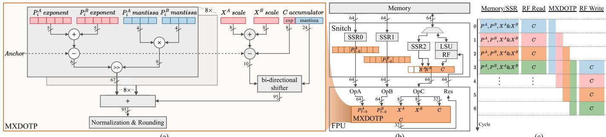
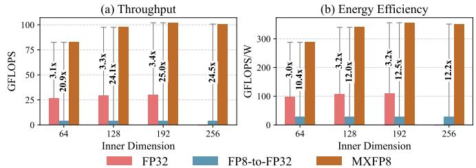

# MXDOTP: A RISC-V ISA Extension for Enabling Microscaling (MX) Floating-Point Dot Products 图表详解

### 图像 1

图1包含三个子图。(a)展示私有指数相加、尾数相乘与对齐，以及双尺度和FP32累加器经移位进入95位累加、归一化舍入的路径，符号位被省略。(b)显示SSR0/1送入两组64位元素，SSR2尺度与RF中的C拼接后进入FPU第三输入。(c)纵向为周期，横向为Memory/SSR、RF Read、MXDOTP和RF Write，彩色任务交叠体现三级流水供数与回写。它支持接口复用及流水重叠的解释，不能证明完整内核达到100%利用率。

### 图像 2

图4(a)纵轴为GFLOPS，(b)为GFLOPS/W；两图横轴均为内维64、128、192、256，输出固定64×64。粉、蓝、橙柱分别表示FP32、FP8-to-FP32和MXFP8，箭头标出倍率。MXFP8峰值为102GFLOPS、356GFLOPS/W，相对软件MX最高提升25倍和12.5倍。K=256缺少FP32柱源于L1容量限制，不能视为零性能；柱高反映吞吐与能效，不是单次任务时延。

> 来源与版本：使用用户提供的 arXiv:2505.13159v1 作者稿，正式会议为 ASAP 2025；实际实现以 MXFP8 为重点，不将标准的所有 MX 类型都视作已实现。

> 本文根据用户提供的 PDF 经 MinerU 解析，由 Codex/GPT 翻译和解读，未调用 GLM 翻译 API。参考文献保留原文；技术总结、通俗讲解和图表说明属于解读。[原文入口](https://doi.org/10.1109/ASAP65064.2025.00021)。
