# Rethinking Floating Point Overheads for Mixed Precision DNN Accelerators 原文翻译

# 重新思考混合精度 DNN 加速器中的浮点开销

Hamzah Abdel-Aziz 1 Ali Shafiee 1 Jong Hoon Shin 1 Ardavan Pedram 1 Joseph H. Hassoun 1

## 摘要

本文提出了一种混合精度卷积单元架构，支持不同精度的整数和浮点（FP）运算。所提出的架构基于低位宽内积单元，并通过时间分解实现更高精度。我们说明了如何在基于整数运算的架构中集成 FP 计算，并评估了支持 FP 算术运算所引入的开销。我们认为，FP 内积的对齐和加法开销可能相当显著，因为最大指数差可能高达 58 位，从而需要规模庞大的对齐逻辑。为解决这一问题，我们通过实证说明，所需的乘积位宽不超过 26 位，且在大多数推理场景中，最多 8 位的对齐就已足够。基于上述观察，我们提出了新的优化方法，以降低 FP 算术运算的硬件开销。基于仿真和硬件实现的实证结果表明，FP16 开销显著降低。与典型的混合精度实现相比，所提出架构以 TFLOPS/mm2 和 TOPS/mm2 衡量的面积效率分别最高提升 25% 和 46%，以 TFLOPS/W 和 TOPS/W 衡量的能效分别最高提升 40% 和 63%。

## 1 引言

深度神经网络（DNN）在计算机视觉、自然语言处理和推荐系统等现代人工智能任务中取得了巨大成功（Le-Cun et al., 2015）。遗憾的是，DNN 的成功是以显著的计算复杂度（例如能耗、执行时间等）为代价的。因此，人们使用专用硬件单元（DNN 加速器）对 DNN 进行加速，以同时提高性能和能效（Jouppi et al., 2017; ten, 2017; Reuther et al., 2019）。DNN 加速器可以采用量化方案来减少 DNN 的内存占用和计算时间（Deng et al., 2020）。典型的量化方案将 DNN 的所有层压缩为相同的低位宽整数类型，但这可能并非最优，因为不同层具有不同的冗余度和特征分布（Wang et al., 2019; Wu et al., 2018a）。另一方面，混合精度量化方案为不同层分配不同的精度（即位宽），与统一量化相比表现出显著改善（Song et al., 2020; Wang et al., 2019; Chu et al., 2019; Cai et al., 2020）。因此，为了保持 FP32 级别的准确率，人们考虑采用混合精度量化方案（Song et al., 2020; Wang et al., 2019; Chu et al., 2019; Cai et al., 2020），或采用将少数层保留为浮点（FP）类型、其余层量化为整数的混合方法（Zhu et al., 2016; Venkatesh et al., 2017）。

在无法进行量化的若干情况下（在线学习、私有数据集、支持遗留代码等），推理和训练会采用半精度浮点（FP16）及自定义浮点数据类型（例如 bfloat16（Abadi et al., 2016））。它们可以将内存占用和计算量减少一半，而不会造成显著的准确率损失，并且通常只需对张量进行降精度类型转换即可获得。FP16 在众多 DNN 训练应用中表现出显著优势，在这些应用中，通常使用 FP16 作为权重和激活值的数据类型，而使用 FP32 进行累加和梯度更新（Micikevicius et al., 2017; Jia et al., 2018; Ott et al., 2019）。

在同一个 DNN 应用内部或不同 DNN 应用之间，数据精度差异显著，涵盖从低位宽整数到浮点数据类型的范围（例如 INT4、INT8、FP16 等）。因此，要充分利用不同软件优化方法（例如低位宽量化）的优势，能够灵活支持多种数据类型的混合精度 DNN 加速器至关重要，有时甚至是必需的。此外，还可以利用对多种数据类型的灵活支持，根据可用资源在准确率和效率之间进行权衡（Shen et al., 2020）。混合精度加速器通常基于低精度算术单元设计，而更高精度的运算可以通过在时间或空间上融合低精度算术单元来支持。

DNN 的计算归根结底以点积为基本运算。通常，内积可以通过在时间上复用一个乘加（MAC）单元来实现，也可以在空间上使用一个由乘法器及其后的加法树构成的内积（IP）单元来实现。在实现用于点积运算的算术单元时，乘法器和加法器的位宽是主要的架构决策。对于基于 IP 和基于 MAC 的两类算术单元，乘法器精度都是决定最终性能和效率的关键因素。例如，较高的乘法器精度（例如 8 × 8）会限制较低位宽量化（例如 INT4）带来的收益。另一方面，虽然低精度乘法器对于低位宽量化而言效率较高，但它们会使加法单元产生过多的开销。因此，乘法器的位宽根据常见情况下的量化位宽来确定。在基于整数 IP 的架构中，加法器的位宽与乘法器输出的位宽相匹配。因此，这类架构可以通过使用更小的加法器并共享累加逻辑来提高能效。然而，在基于乘加（MAC）的架构中（Chen et al., 2016），加法器还需要充当累加器，因此尺寸更大。对于配备了针对低位宽量化 DNN 优化的低精度乘法器的低功耗加速器，这种开销更加明显。

实现浮点 IP（FP-IP）运算需要在求和之前对齐各个乘积，这需要大型移位单元和加法器。从理论上讲，FP16 乘积之间的最大对齐范围要求将乘积移位最多 58 位。因此，为了对齐任意两个 FP16 乘积，加法树的精度（即位宽）要求其输入精度额外增加 58 位。这种对齐仅在浮点运算中需要，但对于整数运算却表现为显著的功耗和面积开销，尤其是在 IP 单元基于低精度乘法器构建时。

本文探索了同时支持基于浮点和整数的卷积的 IP 单元在设计空间中的权衡。我们论证了一种原生支持 INT4 运算的高密度、低功耗卷积单元的合理性。此外，我们还考察了支持更大位宽的整数和浮点运算所固有的开销。我们考虑 INT4 主要有两个原因。首先，这种数据类型是若干针对深度学习优化的现代架构所支持的最小数据类型（例如 AMD MI50（amd）、Nvidia Turing 架构（Kilgariff et al., 2018）和 Intel Sprig Hill（Wechsler et al., 2019））。其次，近期的量化研究报告了 4 位量化方案的可喜结果（Fang et al., 2020; Jung et al., 2019; Nagel et al., 2020; Choukroun et al., 2019; Banner et al., 2019b; Wang et al., 2019; Choi et al., 2018; Zhuang et al., 2020）。尽管如此，所提出的优化并不限于 INT4，也可以应用于其他情况（例如 INT8），我们将在第 4 节中讨论这一点。

本文的贡献如下：

1. 我们研究了对齐能力受限的 FP-IP 运算近似版本。我们推导了绝对误差的数学界，并基于 DNN 模型和合成数值进行了数值分析。我们推测，对于 FP16 和 FP32 累加器，如果近似 FP-IP 能够分别将乘积移位至少 16 位和 27 位以进行对齐，就可以保持基于 GPU 的计算所达到的准确率。

2. 我们展示了如何使用较小的移位单元和加法器，在多个周期内实现大幅度对齐。这种方法将软件的准确率要求与底层 IP 单元的实现解耦。它还能够以牺牲浮点任务性能为代价，实现更紧凑的电路。

3. 我们将 IP 单元划分为更小的簇，而非在一个 tile 中同步运行大量 IP 单元。这可以隔离需要大幅度对齐的 FP-IP 运算，并将性能下降限制在一个簇内。

4. 我们研究了所提出架构的设计权衡。

所提出的架构采用标准 7nm 工艺实现，在面积效率方面，以 TFLOPS/mm2 和 TOPS/mm2 衡量时分别最高可提升 25% 和 46%；在能效方面，以 TFLOPS/W 和 TOPS/W 衡量时分别最高可提升 40% 和 63%。

本文其余部分组织如下。第 2 节介绍所提出的混合精度内积单元（IPU）架构，并解释它如何支持包括 FP16 在内的不同数据类型。第 3 节首先回顾 FP16 运算的对齐要求，并提出架构优化以降低 FP16 的开销。第 4 节介绍我们的方法并讨论实验结果。第 5 节回顾相关工作，第 6 节对全文进行总结。

## 2 混合精度内积单元

为了支持不同的数据类型和精度，我们采用一种细粒度卷积单元，它能够原生执行 INT4 运算，并通过时间复用实现更大的位宽。我们将 INT4 视为默认的常见情况，因为最近的多项研究工作正在推动用于高效推理的 INT4 量化方案（Jung et al., 2019; Nagel et al., 2020）。不过，所提出的架构也可以应用于以 INT8 为基准等其他情况。

图 1 展示了所提出的混合精度 n 输入 IPU 的构成模块，该 IPU 基于 5b×5b 有符号乘法器。所提出的 IPU 可以在单个周期内完成有符号或无符号的 INT4 IPU 乘法。此外，更高精度的运算可以通过多次半字节迭代来完成。半字节迭代的总次数等于两个乘法操作数的半字节数量之积。乘积被传递至局部右移单元，该单元在 FP 模式下用于对齐，移位后的输出连接到加法树。加法树的结果被送入累加器。在接下来的两个小节中，我们将分别详细说明 INT 和 FP 模式下的微架构。

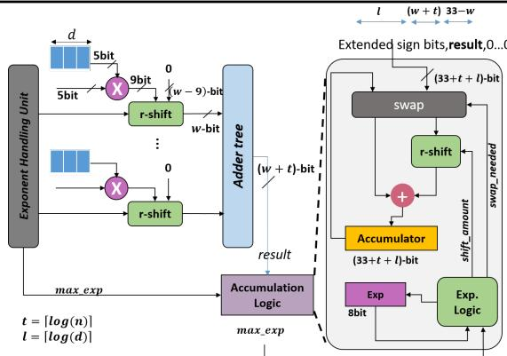  
图 1. 所提出的混合精度 IPU 数据通路的微架构，具有 n 个输入和 w 位 IPU 精度。

## 2.1 INT 模式

IPU 基于 INT4，更高 INT 精度的计算基于半字节迭代。例如，如果乘法操作数为 INT8 和 INT12，那么需要六次半字节迭代才能完成单次 IP 运算中的 INT8 与 INT12 乘法。局部移位量始终为 0，因为 INT 模式下不需要对齐。加法树的结果在右侧拼接上 $( 3 3 - w )$ 个零位，并始终通过交换单元送入累加器移位单元。移位量取决于半字节操作数的位权。例如，假设 $N _ { k }$ 表示一个数的各个半字节 $( \mathrm { i . e . , } \ N _ { 0 }$ 是最低有效半字节），则对第一个和第二个操作数的半字节 $N _ { i }$ 和 $N _ { j }$ 执行 IPU 运算后，其结果的移位量为 $4 \times \left( \left( K _ { a } - i - 1 \right) + \left( K _ { b } - j - 1 \right) \right)$ )，其中 $K _ { a }$ 和 $K _ { b }$ 分别是操作数 a 和 $b ,$ 的半字节总数。累加器最多可以累加 $n \times d$ 个乘法结果，其中 n 是 IPU 输入的数量，d 是 IPU 在不发生溢出的情况下能够进行累加的最大次数。在这种情况下，累加器的位宽应至少为 $3 3 + t + l ,$，其中 $l = \lceil \log _ { 2 } d \rceil$。在 INT 模式下，我们假设 exp = 最大指数 = 0。

## 2.2 FP 模式

在 FP 模式下，尾数乘法的计算方式与 INT12 IPU 运算类似，但需要执行以下额外操作。

数值转换：我们将 FP 数的幅值定义为：对于次正规数，为 0.mantissa；对于正规 FP 数，为 1.mantissa，其中 mantissa 表示尾数。考虑符号位时，我们也将其称为带符号幅值。假设 $M [ 1 1 : 0 ]$ 是 FP16 数的 12 位带符号幅值，则将其转换为以下三个 5 位半字节操作数：$N _ { 2 } = \{ M _ { 1 1 } -$ $M _ { 7 } \} , N _ { 1 } = \{ 0 , M _ { 6 } - M _ { 3 } \}$，以及 $N _ { 0 } = \{ 0 , M _ { 2 } - M _ { 0 } , 0 \}$。这种分解在 $N _ { 0 }$ 的最低有效位引入了一个零。由于 FP-IP 运算依赖右移和截断来对齐乘积，因此操作数的隐式左移能够保留更高的精度。

局部对齐：乘积结果应相对于所有乘积中的最大指数进行对齐（更多细节见附录 A）。因此，每个乘法器的输出都会传入一个局部右移单元，该单元从指数处理单元（EHU）接收移位量。EHU 按顺序执行以下步骤来计算乘积指数：（1）将操作数的无偏指数逐元素相加；（2）计算乘积指数的最大值；（3）根据各乘积指数与最大指数之间的差值，计算对齐移位量。由于一次 FP-IP 运算包含多次半字节迭代，且这些迭代的指数计算相同，因此多个 IPU 可以共享一个 EHU，以分摊其开销（即在 IPU 之间进行时分复用）。

FP16 乘积的指数范围为 [−28, 30]，因此两个 FP16 乘积之间的指数差（即右移量）最多可达 58 位。一般而言，乘积的位宽会随右移量（即与最大指数对齐所需的移位量）的增加而增大。然而，由于累加器的精度有限，采用近似计算就已足够，此时可以限制乘积的对齐范围，并将其截断为较小的位宽。我们将这一位宽定义为 IPU 精度，并用它对 IPU 进行参数化。IPU 精度也是局部右移的最大位数，以及加法树的位宽。我们将在第 3.1 节量化精度对计算准确性的影响。

累加器操作：在计算一个像素的过程中，FP 累加器保存两个值：累加器的指数及其未归一化的带符号幅值。当所有输入向量对均完成计算和累加后，累加器中的结果会被归一化，并重新格式化为标准表示形式（即 FP16 或 FP32）。

累加逻辑的细节如图 1 右侧所示。累加器具有一个 $( 3 3 + t + l )$ 位寄存器和一个右移单元（t 和 l 的定义见图 1）。因此，该寄存器的大小允许最多右移 33 位；如第 3.1 节所述，这足以保持准确性。

INT 模式累加器的右移逻辑只能右移 4k 位 $( k \in { 1 , 2 , . . , 6 } )$，而 FP-IP 可以右移 [0:33+t+l] 范围内的任意位数。移位量由指数逻辑计算，等于 $4 \times$ $( ( 3 - i - 1 ) + ( 3 - j - 1 ) ) + | m a x _ { - } e x p - e x p |$，其中 i 和 j 是输入半字节的索引，exp 是累加器的指数值，max exp 是加法树的指数（即最大指数）。每当需要左移时，都会先执行交换操作，再执行右移，因此不需要单独的左移单元。换言之，只有当 max exp > exp 时，才会触发交换操作。

相对于 exp，累加器的值是一个 $3 3 + t + l$ 位定点数，其中包括符号位，整数部分占 $( 3 + t + l )$ 位，小数部分占 30 位。请注意，累加器保存的是近似值，因为最低有效位被丢弃，而且其位宽是根据 IPU 的实际规模配置的。在将结果写回存储器之前，会将其舍入为标准格式（即 FP16 或 FP32）。

在本文的其余部分中，我们将 $I P U ( w )$ 定义为一个内积单元，它具有 5 位有符号乘法器、w 位加法树，以及能够将乘法器输出右移并截断最多 w 位的局部右移器。我们将 w 称为 IPU 的加法树精度，简称 IPU 精度。一般而言，$I P U ( w )$ 的计算结果可能不准确，因为只考虑局部移位器结果中最高的 w 个有效位。不过，也存在例外：

命题 1 对于 $I P U ( w )$，如果 EHU 给出的所有乘积的对齐移位量均小于 $w - 9$，则不需要截断，且加法树的结果是准确的。我们将 w − 9 称为 IPU 的安全精度。

显然，面积和功耗开销会随着 IPU 精度的提高而增加（见第 4.2 节）。所需的最大精度由软件要求和累加器精度决定（见第 3.1 节）。

## 3 浮点逻辑优化

本节针对大型移位器和加法树规模带来的开销，首先针对 FP16 和 FP32 累加器，评估保持准确性所需的最小移位量和加法器大小（第 3.1 节）。基于这一评估，我们提出优化方法，以使用相对较小的移位单元和加法器来实现 FP IPU（第 3.2 节和第 3.3 节）。

## 3.1 FP16 的精度要求

如第 2 节所述，一次 FP-IP 运算会被分解为多次半字节迭代。在典型实现中，每次迭代的乘法器输出都需要进行大幅度的对齐移位，而加法树的输入具有较高精度。然而，由于累加器（FP16 或 FP32）的精度有限，这些高精度信息最终会被丢弃，因此可以使用近似的 FP-IP 对齐方式，而不会造成显著的准确性损失。图 2 展示了针对我们基于半字节的 IPU 架构定制的近似 FP-IP 运算伪代码。近似 FP-IP 只计算乘积的最高有效精度位（第 5–7 行）。精度参数使我们能够量化绝对误差。

Approximate_nibble_iteration(A, B, i, j, precision)

%输入1： $A = < a_{0}, ..., a_{n-1} >$ 

%输入2： $B = < b_{0}, ..., b_{n-1} >$ 

% $a_{k}^{i}$ 和 $b_{k}^{j}$ 分别是 $a_{k}$ 和 $b_{k}$ 的第 i 个和第 j 个半字节 $a_{k}^{i} = \text{nibble}(i, \text{signed magnitude}(a_{k})) \% a_{k}^{i} \text{ 为 5 位}$ $b_{k}^{j} = \text{nibble}(j, \text{signed magnitude}(b_{k})) \% b_{k}^{i} \text{ 为 5 位}$ 

% 假设指数中的偏置已经移除

1: for k in 0 to n - 1

2:  $c_{k} \leftarrow \exp(a_{k}) + \exp(b_{k}) \% - 28 \leq c_{i} \leq 30$ 

3: max  $\leftarrow$  maximum( $c_{k}$ )

4: for k in 0 to n - 1

5:  $d_{k} = a_{k}^{i} \times b_{k}^{j} \% d_{k} \text{ 为 9 位（包括符号位）}$ 

6:  $d_{k} = d_{k} \ll (\text{precision} - 9) \% d_{k} \text{ 为 precision 位}$ 

% 若 (max - $c_{i}$ ) &gt; precision → $d_{k} = 0$ 

7:  $d_{k} = d_{k} \gg (\text{max} - c_{i})$ 

% Sum 为 precision + log(n) 位

8: Sum = ( $d_{0} + \cdots + d_{n-1}$ )

9: return (max, sum)

FP - IP(A, B, acc, exp, precision)

% (acc, exp) 是当前累加器的未规格化

% 符号—幅值表示及其指数值。

% 输入1： $A = < a_{0}, ..., a_{n-1} >$ 

% 输入2： $B = < b_{0}, ..., b_{n-1} >$ 

1: for i in 0 to 3

2: for j in 0 to 3

3: (max, sum) =

4: approximate_nibble_iteration(A, B, i, j, precision)

% 更新逻辑见图 4.b

5: update_accumulator(max, sum, acc, sum)

图 2. 近似半字节迭代版本的伪代码（上），以及采用近似半字节迭代方法的 FP-IP 运算伪代码（下）。Precision 为 IPU 精度。

定理 1 对于具有 n 对 FP16 输入的 FP-IP，approx nibble iteration(i, j, precision) 引起的绝对误差，记为 abs error(i, j)，不大于 $2 2 5 \times 2 ^ { ( 4 \times ( i + j ) - 2 2 ) } \times$ 2max−precision $\times \ ( n - 1 )$，其中 max 是该浮点运算中所有乘积的最大指数。

证明：由于篇幅限制，我们仅给出证明概要。当除一个乘积外，其余所有 $n - 1$ 个乘积都向右移位 precision 位，因而全部成为误差时，误差最大。要使绝对误差最大，这些乘积应具有相同的符号，且操作数均取最大值（即 15）。因此，它们的乘积为 $1 5 \times 1 5 = 2 2 5$。因子 $2 ^ { ( 4 \times ( i + j ) ) }$ 用于根据半字节的有效位权重进行正确对齐。需要因子 $\bar { 2 } ^ { - 2 \bar { 2 } }$，是因为相对于其自身的指数，每个浮点数的整数部分占 3 位，小数部分占 22 位。

注 1 最高有效半字节的迭代（即 $i + j )$ 最大的迭代）对绝对误差的贡献最显著。

FP-IP 运算的结果由九次近似半字节迭代的结果累加到累加器中得到。然而，只需要 11 位或

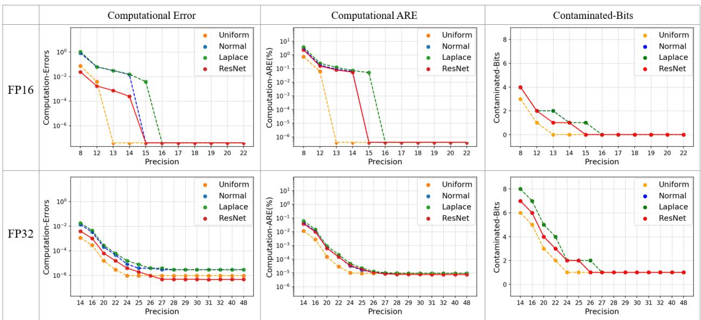  
图 3. 从左到右：不同分布和不同累加器下的绝对误差、绝对相对误差（ARE）百分比，以及受污染位数：FP16（上）和 FP32（下）。每行的前两幅误差图均采用对数刻度的 Y 轴。

24 位累加结果的最高有效位，分别对应 FP16 或 FP32 累加器。遗憾的是，累加器是未规格化的，其前导非零位的位置取决于输入值。因此，无法为每次近似半字节迭代确定一个固定精度，以对任何有效位损失作出保证。因此，我们使用数值分析来寻找合适的移位参数。在分析中，我们既考虑合成输入值，也考虑从 Resnet-18 和 Resnet-50 卷积层的张量中采样得到的输入值。我们使用拉普拉斯分布和正态分布生成合成输入向量，因为它们与 DNN 张量的分布相似 (Park et al., 2018)；对于张量经过重新缩放的情况，我们使用均匀分布，这种重新缩放是针对基于 FP16 的训练提出的建议 (Micikevicius et al., 2017)。在分析中，我们考虑了为这三种分布生成的 1M 个样本，以及 Resnet-18 和 Resnet-50 卷积层中 5% 的数据样本。对于不同的 IPU 精度，我们测量三个指标的中位数：绝对计算误差、相对于 FP32 CPU 结果的绝对相对误差（以百分比表示），以及受污染位数。受污染位数是指近似 FP-IP 的结果与 FP32 CPU 计算结果之间不同的位的数量。图 3 包含了 FP16 和 FP32 两种累加器情况下的误差分析图。根据这一分析，我们发现，在 FP16 情况下，当 IPU 精度为 16 位时，相对误差和绝对误差都小于 $1 0 ^ { - 6 }$。此外，受污染位数的中位数为零（均值 = 0.5）。对于 FP32 累加器，当 IPU 精度 ≥ 26 位时，两种误差都降至 $1 0 ^ { - 5 }$ 以下。然而，受污染位数的中位数从 27b IPU 精度开始才达到最小值。我们得出结论：为了保持 FP32 CPU 的准确性，FP16 FP-IP 运算至少需要 16b 和 27b 的 IPU 精度，以便

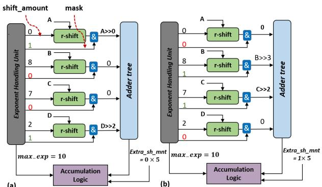  
图 4. (sp = 5) 时的逐步示例，其中 (A,B,C,D) 为幅值，(10,2,3,8) 为指数。相对于最大指数 max exp = 10，这些指数可写为 $( 0 , - 8 , - 7 , - 2 )$。(a) 第一个周期：MC-IPU 仅执行乘积 A 和 D，因为它们的右移量位于 $P _ { 0 } = [ 0 , 5 ]$ 内。(b) 第二个周期：MC-IPU 计算乘积 B 和 C，因为它们的右移量位于 $P _ { 1 } = [ 5 , 1 0 ]$ 内。

## 分别累加到 FP16 和 FP32 中。

我们还评估了 IPU 精度对 ResNet-18 和 ResNet-50 在 ImageNet 数据集上的 Top-1 准确率的影响 (He et al., 2016)。我们观察到，当 FP16 使用的 IPU 精度为 12 或更高时，它在所有批次上都能保持与 FP32 CPU 相同的准确率（即 Top-1 和 Top-5）。当 IPU 精度为 8 位时，与 CPU 计算相比，最终平均准确率也没有显著差异。然而，我们观察到，某些批次的准确率下降高达 17%，而其他一些批次的准确率提高高达 17%。我们尚不确定，这种提高只是随机行为，还是因为较低精度可能具有 (Courbariaux et al., 2015b) 所提出的正则化效果。无论如何，尽管有上述结果，由于与 FP32 模型相比，各个批次的准确率存在波动，8 位 IPU 精度仍不足以适用于所有 CNN 推理。

## 3.2 多周期 IPU

如第 3.1 节所述，近似半字节迭代需要 27 位加法和对齐操作，才能在 FP32 累加中保持与 CPU 实现相同的精度。如第 4 节所示，大位宽移位器和加法器在 IPU 的面积构成中占据很大比重，并且在以 INT 模式运行时会带来开销。为了同时保持高精度和低面积开销，我们提出使用多周期 IPU(w)（MC-IPU(w)），在 DNN 需要大幅度对齐时使用多个周期，其中 w 表示加法树的位宽。因此，当卷积计算块以 INT 模式运行的频率高于 FP 模式时，设计人员可以考虑采用更低的 MC-IPU 精度。

MC-IPU 基于命题 1：如果所有对齐量都小于安全精度（sp），则求和是精确的。否则，MC-IPU 将执行以下步骤以保持计算精度。首先，将乘积分成多个分区，使所需移位量属于 $[ k \times s p , ( k + 1 ) \times s p ]$ 的乘积位于分区 k $( P _ { k } )$ 中。其次，将分区 k 中的所有乘积在相同的周期内相加，并屏蔽所有其他乘积。注意，$P _ { k }$ 中的所有乘积都需要至少移位 $k \times s p$。因此，MC-IPU 将移位量分为两部分：（1）在加法树之后执行的 $k \times s p$；（2）在局部执行的剩余部分。由于剩余部分均小于 $s p ,$，因此可以使用局部移位单元完成，而不会损失任何精度（命题 1）。

图 4 展示了 MC-IPU(14) 的一个逐步执行示例，其中 $s p = 5$。在此示例中，我们将参与求和的乘积表示为 A、B、C 和 D，其指数分别为 10、2、3 和 8。因此，最大指数为 max exp = 10。在求和之前，各乘积应分别右移 0、8、7 和 2 位，以相对于 max exp 进行对齐。对齐和求和在两个周期内完成，具体如下：在第一个周期中，A 和 D 分别右移零位和两位后相加。注意，电路中增加了按位与逻辑，用于在此周期中屏蔽输入 B 和 C。在第二个周期中，B 和 C 相加，它们分别需要右移八位和七位。由于局部移位器最多只能精确移位五位，我们将右移分成两步执行：先在局部分别移位 (8 − 5) 位和 (7 − 5) 位，再将加法树的结果移位五位。

总体而言，多周期 IPU 为 IPU 引入了三项新的开销：（1）每个乘法器都需要按位与逻辑；（2）更新移位逻辑，在每个周期中将共享的移位量提供给累加逻辑（图 4 中的 extra sh mnt）；（3）修改 EHU 单元。MC-IPU 的 EHU 单元如图 5 所示。它由五个阶段组成。第一阶段接收激活值指数和权重指数，并将它们相加以计算乘积指数。第二和第三阶段计算最大指数及其与各乘积指数之间的差值。第四阶段屏蔽超过软件精度的差值（见第 3.1 节）。前四个阶段是 IPU 和 MC-IPU 共有的。然而，最后一个阶段仅用于 MC-IPU，并且可能根据 MC-IPU 所需的周期数被调用多次。此阶段为每个乘积保留一位，用于指示该乘积是否已完成对齐（图 5 中的 servi）。对于尚未对齐的乘积，此阶段将指数差值与阈值进行比较。在周期 k 中，阈值等于 $( k + 1 ) \times s p$（见图 5 中的代码）。一旦所有乘积均已对齐 $( \mathrm { i . e . , } s e r v _ { i } = 1 )$，EHU 就完成了对一个 FP-IP 的处理。注意，多个 MC-IPU 共享一个 EHU，因为全部九次半字节迭代只需要使用它一次。

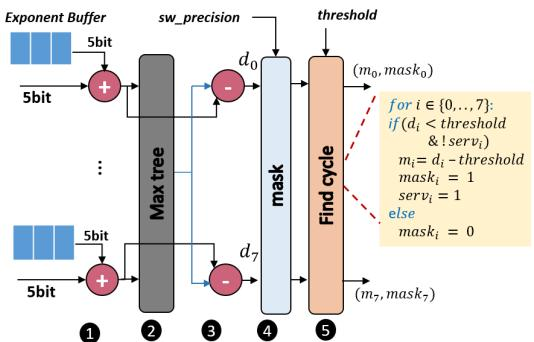  
图 5. MC-IPU 的 EHU 数据通路。

## 3.3 计算块内的 IPU 分簇

在上一节中，我们展示了 MC-IPU 如何将 FP 内积分解为半字节迭代，并在一个或多个周期内计算每次迭代，从而执行 FP 内积。在采用 MC-IPU 的卷积计算块中，每次迭代的周期数取决于两个因素：（1）MC-IPU 的精度（即加法树位宽）。（2）卷积计算块中所有 MC-IPU 所需的最大对齐量。当卷积计算块中的某个 MC-IPU 需要大幅度对齐时，它会使其他 MC-IPU 停顿。

设计此类 IPU 架构时，首先需要考虑 INT 和 FP 操作各自所占的比例。而第二个因素可以通过将 MC-IPU 划分为较小的簇并让各簇独立运行来处理。这样，如果某个 MC-IPU 需要多个周期，它只会使自身所在簇中的 MC-IPU 停顿。为了让各簇独立运行，每个簇都应配备自己的局部输入和输出缓冲区。输出缓冲区用于在将结果写回激活值存储体之前，同步不同簇的结果。注意，激活值缓冲区会向每个局部输入缓冲区广播输入，即使只有一个缓冲区已满，也会停止广播，从而使整个计算块停顿。

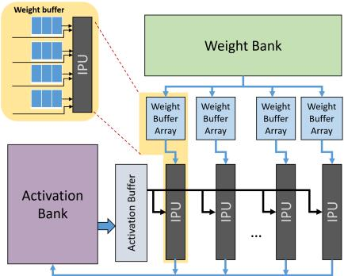  
图 6. 卷积计算块架构。

## 4 方法与结果

本节介绍顶层架构和实验设置。随后，我们评估所提架构的硬件开销及其对性能的影响。我们还将讨论与一些相关工作的比较。

## 4.1 顶层架构

我们考虑一类由基于 IP 的计算块构成的高层架构。基于 IP 的计算块对能效至关重要，尤其是在使用低精度乘法器时。基于 IP 的卷积计算块由多个 IPU 组成，每个 IPU 被分配给一个输出特征图（OFM）（即在输出通道（K）上展开）。所有 IPU 共享相同的输入向量，这些向量来自输入特征图（IFMs）的不同通道（即在输入通道维度（C）上展开）。如图 6(a) 所示，卷积计算块的数据通路由以下组件构成：(1) 内积单元：由一组乘法器组成，其输出送入加法树。加法树的结果累加到部分和累加器中。(2) 权重存储体：包含分配给该计算块的各个 OFM 所需的全部滤波器。(3) 权重缓冲区：包含当前 OFM 所使用的滤波器子集。每个乘法器具有固定数量的权重，这一数量称为权重缓冲区深度。只有权重驻留（WS）（Chen et al., 2016）架构才需要权重缓冲区，其可采用触发器、寄存器文件或小型 SRAM 实现。每个权重缓冲区中的元素数量决定了输出/部分和的带宽需求。(4) 激活存储体：包含当前的激活输入张量、部分和张量和输出张量。(5) 激活缓冲区：充当激活存储体的软件缓存。

我们考虑两种基于 INT4 乘法器的计算块，分别为大计算块和小计算块。两者均采用权重驻留方式，权重缓冲区深度均为 9B。大计算块和小计算块在 (C, K, H W ) 维度上的展开规模分别为 (16, 16, 2, 2) 和 (8, 8, 2, 2)。我们考虑这两种计算块，是因为它们在实现高利用率的同时具有不同的特性。大计算块中 IPU 的乘法器数量是小计算块的两倍（16 个对 8 个）。与 8 输入 IPU 相比，16 输入 IPU 的累加器开销更小，但需要多个周期进行对齐的可能性更大。为进行比较，我们考虑两个基线：Baseline1 和 Baseline2，分别对应小计算块和大计算块。每个基线均包含四个计算块，每个 IPU 配有一棵 38b 位宽的加法树。因此，这些基线不需要 MC-IPU（第 3.2 节）和 IPU 聚类（第 3.3 节），并且分别可以达到 (1 TOPS, 113 GFLOPS) 和 (4 TOPS, 455 GFLOPS)（OP 为一个 4 × 4 MAC）。

所提出的设计（即 MC-IPU 和对 IPU 进行聚类）对性能的影响取决于输入的分布。我们开发了一个周期精确模拟器，用于建模每个卷积层所需的周期数。模拟参数包括输入张量和权重张量。模拟器接收计算块数量、计算块维度（例如，小计算块为 (8, 8, 2, 2)）以及每个计算块的簇数量。由于我们的计算块是专门为加速卷积层而定制的，因此我们对卷积层进行模拟。此外，我们假设存储层次结构具有理想行为，以单独考察我们设计的影响。在实际情况下，非 CNN 层和系统级开销可能会影响总体结果。此外，受 DRAM 带宽和 SRAM 容量的限制，面积效率和功耗效率的提升可能会减小（Pedram et al., 2017）。此类情形超出了我们的分析范围。

在模拟分析中，我们使用来自 ResNet（He et al., 2016）和 InceptionV3（Szegedy et al., 2016）的数据张量。我们考虑四个研究案例：(1) ResNet-18 的前向路径，(2) ResNet50 的前向路径，(3) InceptionV3 的前向路径，以及 (4) ResNet-18 训练的反向路径。在基准测试中，我们考虑至少 16b 和 28b 的软件精度（第 3.1 节），这是 FP16 和 FP32 累加分别在不造成精度损失时所需的精度。

## 4.2 硬件实现结果

为了评估浮点（FP）开销的影响，我们使用 SystemVerilog 实现了这些设计，并使用 Synopsys DesignCompiler（DC）和 7nm 工艺库对其进行综合。在综合过程中，我们采用 25% 的裕量和 0.71V 的电压。图 7 展示了小计算块和大计算块的面积及功耗组成。我们还纳入了一个不支持 FP 的设计点，在图 7 中标记为 INT。此外，我们在基线配置中采用了一种具有 38 位加法树的设计，类似于 NVDLA（NVD）。针对图 7，我们强调以下几点：(1) 仅将加法树精度从 38 位降至 28 位，即可使 16 输入和 8 输入 MC-IPU 计算块的面积和功耗分别降低 17% 和 15%；28 位是在 FP32 累加中保持 CPU 级精度所需的最低精度（见第 3.1 节）。(2) 我们可以进一步降低加法树精度，代价是需要用多个周期执行对齐。将加法树精度降至 12 位时，计算块面积最多可减少 39%。(3) 与仅支持 INT 的 IPU 相比，MC-IPU(12) 可以支持 FP16，面积增加 43%。

(a)  
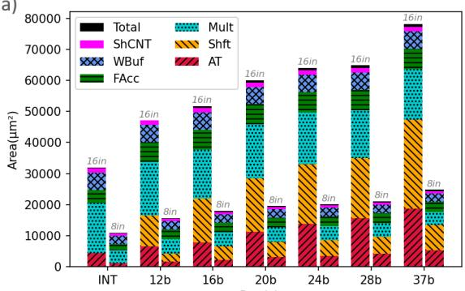

(b)  
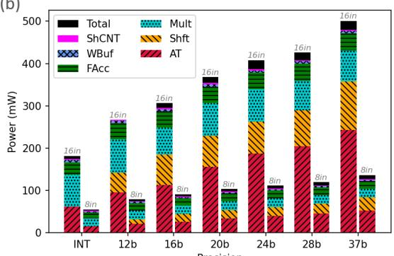  
精度 精度 图 7. 不同的基于 MC-IPU 的计算块的 (a) 面积和 (b) 功耗组成。各组件为累加器（FAcc）、权重缓冲区（WBuf）、EHU（ShCNT）、乘法器（MULT）、局部移位器（Shft）和加法树（AT）。

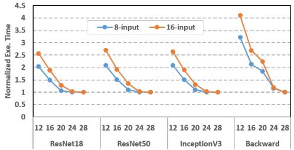

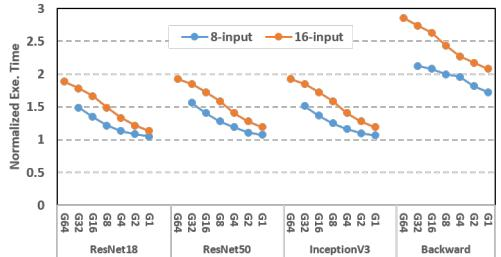  
图 8. (a) 不同精度对 MC-IPU 性能的影响。Backward 指 ResNet-18 中的反向传播误差。(b) 簇大小对 MC-IPU(16) 性能的影响。

## 4.3 性能结果

采用 FP16 累加的 FP16 运算：如第 3.1 节所示，FP16 累加不需要超过 16 位的精度。因此，采用 16b 或更大位宽加法树的 IPU 在每次半字节迭代中恰好需要一个周期。然而，MC-IPU(12) 可能需要执行多周期对齐，从而造成性能损失。使用 MC-IPU(12) 时，如果不对 IPU 进行分簇（第 3.3 节），与 Baseline1（Baseline2）相比，性能平均下降 47%（50%）。如果选择大小为 1 的簇（即各 MC-IPU 独立运行），与 Baseline1（Baseline2）相比，性能下降 26%（38%）。

采用 FP32 累加的 FP16 运算：如第 3.1 节所述，FP32 累加需要 28 位的 IPU 精度。因此，精度低于 28 位的 MC-IPU 可能需要多个周期，从而造成性能损失。图 8 展示了不同精度下 ResNet-18、ResNet-50 和 InceptionV3 前向路径以及 ResNet-18 反向路径的归一化执行时间。我们观察到，所有训练轮次的趋势几乎相同，因此仅报告第 11 轮的数据。在该图中，我们给出了两组数值：一组对应采用 8 输入 MC-IPU 的计算块，以 Baseline1 为基准进行归一化；另一组对应采用 16 输入 MC-IPU 的计算块，以 Baseline2 为基准进行归一化。

根据图 8 (a)，当使用较小的加法树且要求 28 位 IPU 精度时，执行时间可能大幅增加。对于反向传播（backprop）计算，使用 12b 加法树时，延迟可能增加到原来的 4× 以上。直观上，增大加法器位宽可以缩短执行时间。此外，由于 8 输入 MC-IPU 的乘积数量较少，因此其需要多个周期的可能性更低。因此，8 输入 MC-IPU（Baseline1）的性能优于 16 输入 MC-IPU（Baseline2）。我们还观察到，反向传播计算具有更大的动态范围，指数的变化也更大。

为了评估分簇的影响，我们将加法树位宽固定为 16 位，并改变每簇的 MC-IPU 数量。图 8 (b) 展示了 MC-IPU 分簇的效率，其中 x 轴表示簇大小，y 轴表示以 Baseline1（Baseline2）为基准归一化后的 8 输入（16 输入）MC-IPU(16) 的执行时间。根据该图，在使用 8 输入 MC-IPU 进行前向计算时，较小的簇可以显著减轻多周期执行造成的性能下降。然而，在 16 输入的情况下，即使簇大小为 1，性能损失仍至少为 12%。反向传播数据的变化更大，即使每簇只有一个 MC-IPU，执行时间仍至少增加 60%。这种现象的原因可以通过图 9 所示的 Resnet-18 前向和反向路径中 8 输入 MC-IPU 的指数差直方图来解释。如图所示，前向路径的指数差集中在零附近，只有 1% 的指数差大于八。另一方面，反向计算乘积的分布比前向计算更宽。

## 4.4 整体设计权衡

图 10(a,b) 分别展示了 INT 与 FP 模式的功耗效率和面积效率设计空间。在这些图中，对于 FP 吞吐量数值，我们采用仿真结果得到的平均有效吞吐量。部分设计点旁的数字表示由 MC-IPU 精度和簇大小构成的有序对。对于 8 输入（16 输入）设计，近似处理可将 INT 和 FP 模式的功耗效率提高 14%（17%），并将面积效率提高 17.8%（20%）。整体提升来自所有优化的组合。两个设计点 (12,1) 和 (16,1) 位于功耗效率的帕累托最优曲线上。例如，采用我们的 8 输入（16 输入）IPU 架构时，每簇包含一个 MC-IPU 且 IPU 精度为 12 位（16 位）的设计点，相比典型的混合精度实现，在面积效率方面，$\mathrm { T F L O P S } / m m ^ { 2 }$ 提高 14%（25%），TOPS/mm2 最高提高 46%（46%）；在功耗效率方面，TFLOPS/W 最高提高 63%（40%），TOPS/W 最高提高 74%（63%）。

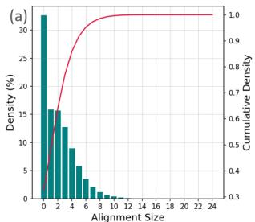

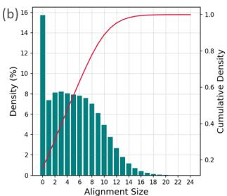  
图 9. ResNet-18 训练计算中指数差（$( M a x . e x p -$ exp，或对齐量）的分布。(a) 前向传播，(b) 反向传播。

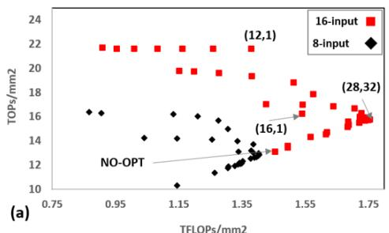

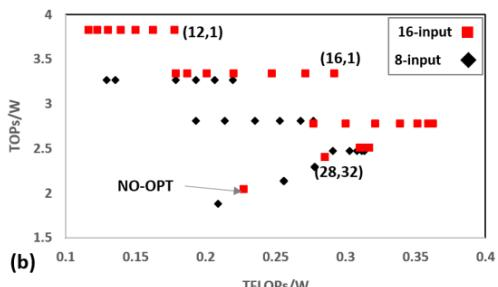  
图 10. (a) 面积效率和 (b) 功耗效率之间的权衡。每个设计点 (p,c) 表示采用 p 位加法树 MC-IPU、每簇包含 c 个 MC-IPU 的计算块（仅对 16 输入 MC-IPU 进行了标注）。NO-OPT 即 Baseline2。

## 4.5 敏感性分析

本文主要将 INT4 作为常见情况，但仍可针对不同的目标量化方案、数据类型、应用领域（即边缘端与云端）和 DNN，考虑以不同精度作为基线。因此，我们使用四种具有不同乘法器精度的设计来评估所提方法的性能。第一种设计（MC-SER）基于串行乘法器（即 12 × 1），与 Stripes（Judd et al., 2016）类似，但 MC-SER 利用所提出的优化支持 FP16。需要注意的是，使用 12 × 1 乘法器时，FP16 运算的每次内积计算至少需要 12 个周期。第二种设计（MC-IPU4）针对前文讨论的 INT4 进行优化，基于 4 × 4 乘法器。第三种设计（MC-IPU84）针对 INT8 激活值和 INT4 权重进行优化，基于 8 × 4 乘法器。第四种设计（MC-IPU8）针对 INT8 激活值和权重进行优化，基于 $8 \times 8$ 乘法器。我们还与其他混合精度设计进行了比较，包括：NVDLA、典型的 FP16 实现，以及不支持 FP16 的基于 INT 的混合精度设计。表 1 展示了这些设计在不同运算类型下的 TOPS/mm2 和 TOPS/W 比较。结果表明，在需要 FP16 时，MC-IPU 减轻了局部移位单元和加法树的开销。随着乘法器精度降低，这种开销变得相对更为显著；随着基线乘法器精度提高，优化收益则会降低。然而，采用高精度乘法器基线（例如 8 × 8）的设计会限制低位宽（例如 INT4）软件优化的收益。

## 5 相关工作

以往关于 CNN 加速器的研究在其 ALU/FPU 数据通路中采用了两种主要方法：基于 MAC 的方法（Jouppi et al., 2017; Chen et al., 2016; Gao et al., 2017; Lu et al., 2017; Kim et al., 2016; Venkataramani et al., 2017; Yazdanbakhsh et al., 2018）和基于内积的方法（Chen et al., 2014; NVD; Eth; Venkatesan et al., 2019; Shao et al., 2019; Liu et al., 2016; Kwon et al., 2018）。遗憾的是，这些方法大多采用基于 INT 的算术单元，并依靠量化将 DNN 从 FP 转换为 INT。

基于 INT 的算术单元也可以支持不同的位宽。基于 INT 的架构对多精度操作数的支持，已经通过空间分解和时间分解两种方式得到了研究。在空间分解方法中，一个大型算术单元被分解为多个更细粒度的单元（Sharma et al., 2018; Camus et al., 2019; Mei et al., 2019; Moons et al., 2017）。从 Pascal 架构开始，Nvidia GPU 通过 DP4A 和 DP2A 指令实现空间分解，将 INT32 单元分解为 4 输入 INT8 或 2 输入 INT16 内积运算。这种方法与我们的方法不同，因为我们支持 FP16，并使用内积单元而非 MAC 单元。另一方面，时间分解方法按时间顺序执行一系列细粒度运算，以模拟一次粗粒度运算。我们的方法与这种方法类似，以 4 位运算作为最细粒度。采用这种方法的其他工作倾向于使用更低的精度（Judd et al., 2016; Lee et al., 2019; Eckert et al., 2018; Sharify et al., 2018）。时间分解还被用于通过动态检测细粒度的零操作数并丢弃相应运算来避免无效运算（Delmas et al., 2018; Albericio et al., 2017; Sharify et al., 2019）。与我们的方法不同，这些方法不支持 FP16 操作数。此外，我们仅讨论稠密架构；不过，这种细粒度构建模块也可用于稀疏方法。我们将其留作未来的工作。

表 1. 不同乘法器（MUL）和加法树（ADT）精度下的 TOPs/W 和 $\mathrm { T O P s } / \mathrm { m m } ^ { 2 }$。A 和 W 分别为激活和权重的精度

<table><tr><td></td><td>MC-SER</td><td>MC-IPU4</td><td>MC-IPU84</td><td>MC-IPU8</td><td>NDVLA</td><td>FP16</td><td>INT8</td><td>INT4</td></tr><tr><td>ADT</td><td>16b</td><td>16b</td><td>20b</td><td>23b</td><td>36b</td><td>36b</td><td>16b</td><td>9b</td></tr><tr><td>MUL</td><td> $12 \times 1$ </td><td> $4 \times 4$ </td><td> $8 \times 4$ </td><td> $8 \times 8$ </td><td> $8 \times 8$ </td><td> $12 \times 12$ </td><td> $8 \times 8$ </td><td> $4 \times 4$ </td></tr><tr><td> $A \times W$ </td><td colspan="8">TOPS/ $mm^2$ 或 TFLOPS/ $mm^2$ </td></tr><tr><td> $4 \times 4$ </td><td>5.5</td><td>18.8</td><td>14.3</td><td>11.4</td><td>9.7</td><td>6.9</td><td>18.5</td><td>30.6</td></tr><tr><td> $8 \times 4$ </td><td>5.5</td><td>9.4</td><td>14.3</td><td>11.4</td><td>9.7</td><td>6.9</td><td>18.5</td><td>15.3</td></tr><tr><td> $8 \times 8$ </td><td>2.8</td><td>4.7</td><td>7.2</td><td>11.4</td><td>9.7</td><td>6.9</td><td>18.5</td><td>7.7</td></tr><tr><td> $FP16 \times FP16$ </td><td>0.9</td><td>1.6</td><td>1.8</td><td>5.4</td><td>4.9</td><td>6.9</td><td>-</td><td>-</td></tr><tr><td> $A \times W$ </td><td colspan="8">TOPS/W 或 TFLOPS/W</td></tr><tr><td> $4 \times 4$ </td><td>1.4</td><td>3.3</td><td>2.4</td><td>1.8</td><td>1.5</td><td>0.9</td><td>2.8</td><td>5.6</td></tr><tr><td> $8 \times 4$ </td><td>1.4</td><td>1.7</td><td>2.4</td><td>1.8</td><td>1.5</td><td>0.9</td><td>2.8</td><td>2.8</td></tr><tr><td> $8 \times 8$ </td><td>0.7</td><td>0.8</td><td>1.2</td><td>1.8</td><td>1.5</td><td>0.9</td><td>2.8</td><td>1.4</td></tr><tr><td> $FP16 \times FP16$ </td><td>0.2</td><td>0.3</td><td>0.3</td><td>0.8</td><td>0.7</td><td>0.9</td><td>-</td><td>-</td></tr></table>

上述方法依赖量化方案，将 FP32 DNN 转换为基于整数的 DNN（Krishnamoorthi, 2018; Lee et al., 2018; Nagel et al., 2019; Zhuang et al., 2018; Wang et al., 2018; Choi et al., 2018; Hubara et al., 2017）。这些方案被加入到 TensorFlow Lite 等 DNN 软件框架中。近期进展表明，8 位训练后量化（Jacob et al., 2018）和基于再训练的 4 位量化能够达到与 FP32 几乎相同的性能（Jung et al., 2019）。然而，对于包含二维卷积运算的浅层网络，实现高准确率并不容易（Howard et al., 2017; Sheng et al., 2018）。也有一些工作致力于在更低精度下实现高准确率（Zhu et al., 2016; Zhuang et al., 2019; Banner et al., 2019a; Choukroun et al., 2019; Courbariaux et al., 2015a; Zhou et al., 2016; Zhang et al., 2018; Rastegari et al., 2016）。（Wang et al., 2019; Dong et al., 2019; Cai et al., 2020）展示了一种为每一层确定合适精度的系统性方法。张量的动态多粒度也被视为一种节省计算的方法（Shen et al., 2020）。已有多种面向训练的量化方案被提出（Wu et al., 2018b; Banner et al., 2018; Das et al., 2018; De Sa et al., 2018; Park et al., 2018）。

近期的工业产品支持混合精度算术运算，包括 Intel 的 Spring Hill（Wechsler et al., 2019）、Huawei 的 DaVinci（Liao et al., 2019）、Nvidia 的 Tensor-Core（ten, 2017）、Google 的 TPU（Jouppi et al., 2017）以及 Nvidia 的 NVDLA（NVD）。尽管这些架构大多使用 FP16，但有些产品选择 BFloat16 和 TF32，以获得较大的数值范围（Abadi et al., 2016; tf3）。利用当前结构，我们的方法可以通过修改 EHU 以支持 8 位指数，并且仅使用四次半字节迭代，同时支持 BFloat16 和 TF32。与我们的方法类似，NVDLA 支持 FP-IP 运算。不同的是，它在空间上将一个 FP16 单元分解为两个 INT8 单元。此外，NVDLA 不允许使用不同类型的操作数执行 FP-IP 运算。它也不支持 INT4，并且为其加法树提供了较高的精度（38 位），而我们证明了这并不高效。我们提出的架构优化同样可以应用于空间分解，并且与分解方案（即时间分解、串行分解、空间分解）正交。

还有一些方案旨在优化 FP MAC 或 IPU 的微架构。LMA 是一种经过修改的 FP 单元，利用 Kulisch 累加来提高 FMA 的能效（Johnson, 2018）。（Brunie, 2017）提出了一种采用定点累加和延迟舍入的 FMA 单元。（Sohn & Swartzlander, 2016）提出了一种用于 FP32 的 4 输入内积运算。（Zhang et al., 2019）介绍了 FMA 的空间融合。最后，（Zhang et al., 2020）提出了一种支持 INT MAC 运算的混合精度 FMA。与本文提出的架构相比，这些工作大多不支持基于 INT 的运算，或者针对 FP 运算进行了优化，但其高开销会妨碍 INT 运算的性能。

## 6 结论

本文探索了基于内积的卷积计算块结构的设计空间，并明确了支持浮点计算所面临的挑战及其开销。此外，我们从软件角度研究了达到目标准确率的最低要求。我们提出了新的架构优化，降低浮点逻辑开销，从而提高基于 INT 的运算的单位面积计算能力。我们表明，对于基于低精度乘法器的 IPU，支持 FP 运算所引入的加法器和对齐逻辑开销相当可观。我们得出结论：乘积指数之间的差异通常小于 8 位，因此可以在 FPU 中使用更小的移位单元。

## REFERENCES

Synopsys design compiler. URL https://www. synopsys.com/.

Arm ethos n77. URL https://developer. arm.com/ip-products/processors/ machine-learning/arm-ethos-n/ ethos-n77.

Nvidia deep learning accelerator (nvdla). URL http:// nvdla.org/.

Amd radeon instinct™ mi50 accelerator. URL https: //www.amd.com/system/files/documents/ radeon-instinct-mi50-datasheet.pdf.

Nvidia a100 tensor core gpu architecture. URL https://www.nvidia.com/content/ dam/en-zz/Solutions/Data-Center/ nvidia-ampere-architecture-whitepaper. pdf.

NVIDIA TESLA V100 GPU ARCHITECTURE. Technical report, Nvidia, 08 2017.

Ieee standard for floating-point arithmetic. IEEE Std 754- 2019 (Revision of IEEE 754-2008), pp. 1–84, 2019.

Abadi, M., Agarwal, A., Barham, P., Brevdo, E., Chen, Z., Citro, C., Corrado, G. S., Davis, A., Dean, J., Devin, M., et al. Tensorflow: Large-scale machine learning on heterogeneous distributed systems. arXiv preprint arXiv:1603.04467, 2016.

Albericio, J., Delmas, A., Judd, P., Sharify, S., O’Leary, G.,´ Genov, R., and Moshovos, A. Bit-pragmatic deep neural network computing. In 2017 50th Annual IEEE/ACM International Symposium on Microarchitecture (MICRO), pp. 382–394, 2017.

Banner, R., Hubara, I., Hoffer, E., and Soudry, D. Scalable methods for 8-bit training of neural networks. In Advances in neural information processing systems, pp. 5145–5153, 2018.

Banner, R., Nahshan, Y., and Soudry, D. Post training 4-bit quantization of convolutional networks for rapiddeployment. In Wallach, H., Larochelle, H., Beygelzimer, A., d'Alche-Buc, F., Fox, E., and Garnett, R. (eds.),´ Advances in Neural Information Processing Systems 32, pp. 7950–7958. Curran Associates, Inc., 2019a.

Banner, R., Nahshan, Y., and Soudry, D. Post training 4-bit quantization of convolutional networks for rapiddeployment. In Advances in Neural Information Processing Systems, pp. 7950–7958, 2019b.

Brunie, N. Modified fused multiply and add for exact low precision product accumulation. In 2017 IEEE 24th Symposium on Computer Arithmetic (ARITH), pp. 106–113, 2017.

Cai, Y., Yao, Z., Dong, Z., Gholami, A., Mahoney, M. W., and Keutzer, K. Zeroq: A novel zero shot quantization framework. In Proceedings ofthe IEEE/CVF Conference on Computer Vision and Pattern Recognition, pp. 13169– 13178, 2020.

Cambier, L., Bhiwandiwalla, A., Gong, T., Nekuii, M., Elibol, O. H., and Tang, H. Shifted and squeezed 8-bit floating point format for low-precision training of deep neural networks, 2020.

Camus, V., Enz, C., and Verhelst, M. Survey of precisionscalable multiply-accumulate units for neural-network processing. In 2019 IEEE International Conference on Artificial Intelligence Circuits and Systems (AICAS), pp. 57–61, 2019.

Chen, Y., Luo, T., Liu, S., Zhang, S., He, L., Wang, J., Li, L., Chen, T., Xu, Z., Sun, N., et al. Dadiannao: A machinelearning supercomputer. In 2014 47th Annual IEEE/ACM International Symposium on Microarchitecture, pp. 609– 622. IEEE, 2014.

Chen, Y.-H., Emer, J., and Sze, V. Eyeriss: A spatial architecture for energy-efficient dataflow for convolutional neural networks. ACM SIGARCH Computer Architecture News, 44(3):367–379, 2016.

Choi, J., Wang, Z., Venkataramani, S., Chuang, P. I.-J., Srinivasan, V., and Gopalakrishnan, K. Pact: Parameterized clipping activation for quantized neural networks. arXiv preprint arXiv:1805.06085, 2018.

Choukroun, Y., Kravchik, E., Yang, F., and Kisilev, P. Lowbit quantization of neural networks for efficient inference. In 2019 IEEE/CVF International Conference on Computer Vision Workshop (ICCVW), pp. 3009–3018, 2019.

Chu, T., Luo, Q., Yang, J., and Huang, X. Mixed-precision quantized neural network with progressively decreasing bitwidth for image classification and object detection. arXiv preprint arXiv:1912.12656, 2019.

Courbariaux, M., Bengio, Y., and David, J.-P. Binaryconnect: Training deep neural networks with binary weights during propagations. In Cortes, C., Lawrence, N. D., Lee, D. D., Sugiyama, M., and Garnett, R. (eds.), Advances in Neural Information Processing Systems 28, pp. 3123–3131. Curran Associates, Inc., 2015a.

Courbariaux, M., Bengio, Y., and David, J.-P. Binaryconnect: Training deep neural networks with binary weights during propagations. In Advances in neural information processing systems, pp. 3123–3131, 2015b.

Das, D., Mellempudi, N., Mudigere, D., Kalamkar, D., Avancha, S., Banerjee, K., Sridharan, S., Vaidyanathan, K., Kaul, B., Georganas, E., et al. Mixed precision training of convolutional neural networks using integer operations. arXiv preprint arXiv:1802.00930, 2018.

De Sa, C., Leszczynski, M., Zhang, J., Marzoev, A., Aberger, C. R., Olukotun, K., and Re, C. High-accuracy´ low-precision training. arXiv preprint arXiv:1803.03383, 2018.

Delmas, A., Judd, P., Stuart, D. M., Poulos, Z., Mahmoud, M., Sharify, S., Nikolic, M., and Moshovos, A. Bittactical: Exploiting ineffectual computations in convolutional neural networks: Which, why, and how. arXiv preprint arXiv:1803.03688, 2018.

Deng, L., Li, G., Han, S., Shi, L., and Xie, Y. Model compression and hardware acceleration for neural networks: A comprehensive survey. Proceedings of the IEEE, 108 (4):485–532, 2020.

Dong, Z., Yao, Z., Gholami, A., Mahoney, M. W., and Keutzer, K. Hawq: Hessian aware quantization of neural networks with mixed-precision. In The IEEE International Conference on Computer Vision (ICCV), October 2019.

Drumond, M., Tao, L., Jaggi, M., and Falsafi, B. Training dnns with hybrid block floating point. In Advances in Neural Information Processing Systems, pp. 453–463, 2018.

Dumoulin, V. and Visin, F. A guide to convolution arithmetic for deep learning. arXiv preprint arXiv:1603.07285, 2016.

Eckert, C., Wang, X., Wang, J., Subramaniyan, A., Iyer, R., Sylvester, D., Blaaauw, D., and Das, R. Neural cache: Bitserial in-cache acceleration of deep neural networks. In 2018 ACM/IEEE 45th Annual International Symposium on Computer Architecture (ISCA), pp. 383–396. IEEE, 2018.

Fang, J., Shafiee, A., Abdel-Aziz, H., Thorsley, D., Georgiadis, G., and Hassoun, J. H. Post-training piecewise linear quantization for deep neural networks. In European Conference on Computer Vision, pp. 69–86. Springer, 2020.

Gao, M., Pu, J., Yang, X., Horowitz, M., and Kozyrakis, C. Tetris: Scalable and efficient neural network acceleration with 3d memory. In Proceedings ofthe Twenty-Second International Conference on Architectural Support for Programming Languages and Operating Systems, pp. 751–764, 2017.

Gustafson, J. L. and Yonemoto, I. T. Beating floating point at its own game: Posit arithmetic. Supercomputing Frontiers and Innovations, 4(2):71–86, 2017.

He, K., Zhang, X., Ren, S., and Sun, J. Deep residual learning for image recognition. In The IEEE Conference on Computer Vision and Pattern Recognition (CVPR), June 2016.

Hill, P., Jain, A., Hill, M., Zamirai, B., Hsu, C., Laurenzano, M. A., Mahlke, S., Tang, L., and Mars, J. Deftnn: Addressing bottlenecks for dnn execution on gpus via synapse vector elimination and near-compute data fission. In 2017 50th Annual IEEE/ACM International Symposium on Microarchitecture (MICRO), pp. 786–799, 2017.

Howard, A. G., Zhu, M., Chen, B., Kalenichenko, D., Wang, W., Weyand, T., Andreetto, M., and Adam, H. Mobilenets: Efficient convolutional neural networks for mobile vision applications. CoRR, abs/1704.04861, 2017. URL http: //arxiv.org/abs/1704.04861.

Hubara, I., Courbariaux, M., Soudry, D., El-Yaniv, R., and Bengio, Y. Quantized neural networks: Training neural networks with low precision weights and activations. The Journal ofMachine Learning Research, 18(1):6869–6898, 2017.

Jacob, B., Kligys, S., Chen, B., Zhu, M., Tang, M., Howard, A., Adam, H., and Kalenichenko, D. Quantization and training of neural networks for efficient integerarithmetic-only inference. In Proceedings of the IEEE Conference on Computer Vision and Pattern Recognition, pp. 2704–2713, 2018.

Jia, X., Song, S., He, W., Wang, Y., Rong, H., Zhou, F., Xie, L., Guo, Z., Yang, Y., Yu, L., et al. Highly scalable deep learning training system with mixed-precision: Training imagenet in four minutes. arXiv preprint arXiv:1807.11205, 2018.

Johnson, J. Rethinking floating point for deep learning, 2018.

Jouppi, N. P., Young, C., Patil, N., Patterson, D., Agrawal, G., Bajwa, R., Bates, S., Bhatia, S., Boden, N., Borchers, A., Boyle, R., Cantin, P., Chao, C., Clark, C., Coriell, J., Daley, M., Dau, M., Dean, J., Gelb, B., Ghaemmaghami, T. V., Gottipati, R., Gulland, W., Hagmann, R., Ho, C. R., Hogberg, D., Hu, J., Hundt, R., Hurt, D., Ibarz, J., Jaffey, A., Jaworski, A., Kaplan, A., Khaitan, H., Killebrew, D., Koch, A., Kumar, N., Lacy, S., Laudon, J., Law, J., Le, D., Leary, C., Liu, Z., Lucke, K., Lundin, A., MacKean, G., Maggiore, A., Mahony, M., Miller, K., Nagarajan, R., Narayanaswami, R., Ni, R., Nix, K., Norrie, T., Omernick, M., Penukonda, N., Phelps, A., Ross, J., Ross, M., Salek, A., Samadiani, E., Severn, C., Sizikov, G., Snelham, M.,

Souter, J., Steinberg, D., Swing, A., Tan, M., Thorson, G., Tian, B., Toma, H., Tuttle, E., Vasudevan, V., Walter, R., Wang, W., Wilcox, E., and Yoon, D. H. In-datacenter performance analysis of a tensor processing unit. In 2017 ACM/IEEE 44th Annual International Symposium on Computer Architecture (ISCA), pp. 1–12, 2017.

Judd, P., Albericio, J., Hetherington, T., Aamodt, T. M., and Moshovos, A. Stripes: Bit-serial deep neural network computing. In 2016 49th Annual IEEE/ACM International Symposium on Microarchitecture (MICRO), pp. 1–12. IEEE, 2016.

Jung, S., Son, C., Lee, S., Son, J., Han, J.-J., Kwak, Y., Hwang, S. J., and Choi, C. Learning to quantize deep networks by optimizing quantization intervals with task loss. In Proceedings of the IEEE Conference on Computer Vision and Pattern Recognition, pp. 4350–4359, 2019.

Kilgariff, E., Moreton, H., Stam, N., and Bell, B. Nvidia turing architecture in-depth. 2018.

Kim, D., Kung, J., Chai, S., Yalamanchili, S., and Mukhopadhyay, S. Neurocube: A programmable digital neuromorphic architecture with high-density 3d memory. SIGARCH Comput. Archit. News, 44(3): 380–392, June 2016. ISSN 0163-5964. doi: 10. 1145/3007787.3001178. URL https://doi.org/ 10.1145/3007787.3001178.

Koster, U., Webb, T., Wang, X., Nassar, M., Bansal, A. K.,¨ Constable, W., Elibol, O., Gray, S., Hall, S., Hornof, $\mathrm { L . , }$ et al. Flexpoint: An adaptive numerical format for efficient training of deep neural networks. In Advances in neural information processing systems, pp. 1742–1752, 2017.

Krishnamoorthi, R. Quantizing deep convolutional networks for efficient inference: A whitepaper. arXiv preprint arXiv:1806.08342, 2018.

Kwon, H., Samajdar, A., and Krishna, T. Maeri: Enabling flexible dataflow mapping over dnn accelerators via reconfigurable interconnects. ACM SIGPLAN Notices, 53 (2):461–475, 2018.

LeCun, Y., Bengio, Y., and Hinton, G. Deep learning. nature, 521(7553):436–444, 2015.

Lee, J., Kim, C., Kang, S., Shin, D., Kim, S., and Yoo, H. Unpu: An energy-efficient deep neural network accelerator with fully variable weight bit precision. IEEE Journal ofSolid-State Circuits, 54(1):173–185, 2019.

Lee, J. H., Ha, S., Choi, S., Lee, W.-J., and Lee, S. Quantization for rapid deployment of deep neural networks. arXiv preprint arXiv:1810.05488, 2018.

Liao, H., Tu, J., Xia, J., and Zhou, X. Davinci: A scalable architecture for neural network computing. In 2019 IEEE Hot Chips 31 Symposium (HCS), pp. 1–44. IEEE Computer Society, 2019.

Liu, S., Du, Z., Tao, J., Han, D., Luo, T., Xie, Y., Chen, Y., and Chen, T. Cambricon: An instruction set architecture for neural networks. In 2016 ACM/IEEE 43rd Annual International Symposium on Computer Architecture (ISCA), pp. 393–405. IEEE, 2016.

Lu, J., Lu, S., Wang, Z., Fang, C., Lin, J., Wang, Z., and Du, L. Training deep neural networks using posit number system. arXiv preprint arXiv:1909.03831, 2019.

Lu, W., Yan, G., Li, J., Gong, S., Han, Y., and Li, X. Flexflow: A flexible dataflow accelerator architecture for convolutional neural networks. In 2017 IEEE International Symposium on High Performance Computer Architecture (HPCA), pp. 553–564. IEEE, 2017.

Mei, L., Dandekar, M., Rodopoulos, D., Constantin, J., Debacker, P., Lauwereins, R., and Verhelst, M. Subword parallel precision-scalable mac engines for efficient embedded dnn inference. In 2019 IEEE International Conference on Artificial Intelligence Circuits and Systems (AICAS), pp. 6–10, 2019.

Micikevicius, P., Narang, S., Alben, J., Diamos, G., Elsen, E., Garcia, D., Ginsburg, B., Houston, M., Kuchaiev, O., Venkatesh, G., et al. Mixed precision training. arXiv preprint arXiv:1710.03740, 2017.

Moons, B., Uytterhoeven, R., Dehaene, W., and Verhelst, M. 14.5 envision: A 0.26-to-10tops/w subword-parallel dynamic-voltage-accuracy-frequency-scalable convolutional neural network processor in 28nm fdsoi. In 2017 IEEE International Solid-State Circuits Conference (ISSCC), pp. 246–247, 2017.

Nagel, M., Baalen, M. v., Blankevoort, T., and Welling, M. Data-free quantization through weight equalization and bias correction. In Proceedings of the IEEE International Conference on Computer Vision, pp. 1325–1334, 2019.

Nagel, M., Amjad, R. A., van Baalen, M., Louizos, C., and Blankevoort, T. Up or down? adaptive rounding for posttraining quantization. arXiv preprint arXiv:2004.10568, 2020.

Ott, M., Edunov, S., Baevski, A., Fan, A., Gross, S., Ng, N., Grangier, D., and Auli, M. fairseq: A fast, extensible toolkit for sequence modeling. arXiv preprint arXiv:1904.01038, 2019.

Park, E., Yoo, S., and Vajda, P. Value-aware quantization for training and inference of neural networks. In Proceedings of the European Conference on Computer Vision (ECCV), pp. 580–595, 2018.

Pedram, A., Richardson, S., Galal, S., Kvatinsky, S., and Horowitz, M. Dark memory and accelerator-rich system optimization in the dark silicon era. volume 34, pp. 39–50, 2017. doi: 10.1109/MDAT.2016.2573586.

Rastegari, M., Ordonez, V., Redmon, J., and Farhadi, A. Xnor-net: Imagenet classification using binary convolutional neural networks. In European conference on computer vision, pp. 525–542. Springer, 2016.

Reuther, A., Michaleas, P., Jones, M., Gadepally, V., Samsi, S., and Kepner, J. Survey and benchmarking of machine learning accelerators. arXiv preprint arXiv:1908.11348, 2019.

Shao, Y. S., Clemons, J., Venkatesan, R., Zimmer, B., Fojtik, M., Jiang, N., Keller, B., Klinefelter, A., Pinckney, N., Raina, P., et al. Simba: Scaling deep-learning inference with multi-chip-module-based architecture. In Proceedings of the 52nd Annual IEEE/ACM International Symposium on Microarchitecture, pp. 14–27, 2019.

Sharify, S., Lascorz, A. D., Siu, K., Judd, P., and Moshovos, A. Loom: Exploiting weight and activation precisions to accelerate convolutional neural networks. In 2018 55th ACM/ESDA/IEEE Design Automation Conference (DAC), pp. 1–6. IEEE, 2018.

Sharify, S., Lascorz, A. D., Mahmoud, M., Nikolic, M., Siu, K., Stuart, D. M., Poulos, Z., and Moshovos, A. Laconic deep learning inference acceleration. In Proceedings of the 46th International Symposium on Computer Architecture, pp. 304–317, 2019.

Sharma, H., Park, J., Suda, N., Lai, L., Chau, B., Chandra, V., and Esmaeilzadeh, H. Bit fusion: Bit-level dynamically composable architecture for accelerating deep neural network. In 2018 ACM/IEEE 45th Annual International Symposium on Computer Architecture (ISCA), pp. 764–775, 2018.

Shen, J., Fu, Y., Wang, Y., Xu, P., Wang, Z., and Lin, Y. Fractional skipping: Towards finer-grained dynamic cnn inference. arXiv preprint arXiv:2001.00705, 2020.

Sheng, T., Feng, C., Zhuo, S., Zhang, X., Shen, L., and Aleksic, M. A quantization-friendly separable convolution for mobilenets. In 2018 1st Workshop on Energy Efficient Machine Learning and Cognitive Computing for Embedded Applications (EMC2), pp. 14–18, 2018.

Sohn, J. and Swartzlander, E. E. A fused floating-point fourterm dot product unit. IEEE Transactions on Circuits and Systems I: Regular Papers, 63(3):370–378, 2016.

Song, Z., Fu, B., Wu, F., Jiang, Z., Jiang, L., Jing, N., and Liang, X. Drq: Dynamic region-based quantization for deep neural network acceleration. In 2020 ACM/IEEE

47th Annual International Symposium on Computer Architecture (ISCA), pp. 1010–1021. IEEE, 2020.

Szegedy, C., Vanhoucke, V., Ioffe, S., Shlens, J., and Wojna, Z. Rethinking the inception architecture for computer vision. In The IEEE Conference on Computer Vision and Pattern Recognition (CVPR), June 2016.

Tambe, T., Yang, E.-Y., Wan, Z., Deng, Y., Reddi, V. J., Rush, A., Brooks, D., and Wei, G.-Y. Adaptivfloat: A floating-point based data type for resilient deep learning inference. arXiv preprint arXiv:1909.13271, 2019.

Venkataramani, S., Ranjan, A., Banerjee, S., Das, D., Avancha, S., Jagannathan, A., Durg, A., Nagaraj, D., Kaul, B., Dubey, P., and Raghunathan, A. Scaledeep: A scalable compute architecture for learning and evaluating deep networks. In Proceedings of the 44th Annual International Symposium on Computer Architecture, ISCA ’17, pp. 13–26, New York, NY, USA, 2017. Association for Computing Machinery. ISBN 9781450348928. doi: 10.1145/3079856.3080244. URL https://doi. org/10.1145/3079856.3080244.

Venkatesan, R., Shao, Y. S., Zimmer, B., Clemons, J., Fojtik, M., Jiang, N., Keller, B., Klinefelter, A., Pinckney, N., Raina, P., Tell, S. G., Zhang, Y., Dally, W. J., Emer, J. S., Gray, C. T., Keckler, S. W., and Khailany, B. A 0.11 pj/op, 0.32-128 tops, scalable multi-chip-module-based deep neural network accelerator designed with a highproductivity vlsi methodology. In 2019 IEEE Hot Chips 31 Symposium (HCS), pp. 1–24, 2019.

Venkatesh, G., Nurvitadhi, E., and Marr, D. Accelerating deep convolutional networks using low-precision and sparsity. In 2017 IEEE International Conference on Acoustics, Speech and Signal Processing (ICASSP), pp. 2861–2865. IEEE, 2017.

Wang, K., Liu, Z., Lin, Y., Lin, J., and Han, S. Haq: Hardware-aware automated quantization with mixed precision. In The IEEE Conference on Computer Vision and Pattern Recognition (CVPR), June 2019.

Wang, P., Hu, Q., Zhang, Y., Zhang, C., Liu, Y., and Cheng, J. Two-step quantization for low-bit neural networks. In Proceedings of the IEEE Conference on computer vision and pattern recognition, pp. 4376–4384, 2018.

Wechsler, O., Behar, M., and Daga, B. Spring hill (nnp-i 1000) intel’s data center inference chip. In 2019 IEEE Hot Chips 31 Symposium (HCS), pp. 1–12, 2019.

Wu, B., Wang, Y., Zhang, P., Tian, Y., Vajda, P., and Keutzer, K. Mixed precision quantization of convnets via differentiable neural architecture search. arXiv preprint arXiv:1812.00090, 2018a.

Wu, S., Li, G., Chen, F., and Shi, L. Training and inference with integers in deep neural networks. arXiv preprint arXiv:1802.04680, 2018b.

Yazdanbakhsh, A., Samadi, K., Kim, N. S., and Esmaeilzadeh, H. Ganax: A unified mimd-simd acceleration for generative adversarial networks. In 2018 ACM/IEEE 45th Annual International Symposium on Computer Architecture (ISCA), pp. 650–661, 2018.

Zhang, D., Yang, J., Ye, D., and Hua, G. Lq-nets: Learned quantization for highly accurate and compact deep neural networks. In Proceedings ofthe European conference on computer vision (ECCV), pp. 365–382, 2018.

Zhang, H., Chen, D., and Ko, S. Efficient multiple-precision floating-point fused multiply-add with mixed-precision support. IEEE Transactions on Computers, 68(7):1035– 1048, 2019.

Zhang, H., Chen, D., and Ko, S. New flexible multipleprecision multiply-accumulate unit for deep neural network training and inference. IEEE Transactions on Computers, 69(1):26–38, 2020.

Zhou, S., Ni, Z., Zhou, X., Wen, H., Wu, Y., and Zou, Y. Dorefa-net: Training low bitwidth convolutional neural networks with low bitwidth gradients. CoRR, abs/1606.06160, 2016. URL http://arxiv.org/ abs/1606.06160.

Zhu, C., Han, S., Mao, H., and Dally, W. J. Trained ternary quantization. CoRR, abs/1612.01064, 2016. URL http: //arxiv.org/abs/1612.01064.

Zhuang, B., Shen, C., Tan, M., Liu, L., and Reid, I. Towards effective low-bitwidth convolutional neural networks. In Proceedings of the IEEE conference on computer vision and pattern recognition, pp. 7920–7928, 2018.

Zhuang, B., Shen, C., Tan, M., Liu, L., and Reid, I. Structured binary neural networks for accurate image classification and semantic segmentation. In The IEEE Conference on Computer Vision and Pattern Recognition (CVPR), June 2019.

Zhuang, B., Liu, L., Tan, M., Shen, C., and Reid, I. Training quantized neural networks with a full-precision auxiliary module. In Proceedings of the IEEE/CVF Conference on Computer Vision and Pattern Recognition, pp. 1488– 1497, 2020.

## A 背景

## A.1 卷积层运算

典型的卷积层（CL）以两个四维张量（输入特征图（IFM）张量和卷积核张量）作为输入，生成一个四维张量（输出特征图（OFM）张量）。IFM 和 OFM 中的元素称为像素或激活值，而卷积核中的元素称为权重。图 11 展示了卷积层的简化伪代码。OFM 的高度和宽度通常由 IFM 的高度和宽度、填充以及步幅决定。最内层的三个循环（第 5–7 行）计算一个输出像素，可以实现为一次或多次内积运算。其余四个循环相互独立，因此可以利用它们提高并行度。更多细节见 (Dumoulin & Visin, 2016)。全连接层可以视为卷积的一种特殊情况，其中 IFM、OFM 和卷积核的高度与宽度均为 1。全连接层常用于自然语言处理和卷积神经网络（CNN）的最后几层。

Convolution():
N = 批大小,    C = IFM 通道数
S = 滤波器高度,    R = 滤波器宽度
 $H_{i}$  = IFM 高度,    $W_{i}$  = IFM 宽度
 $H_{o}$  = OFM 高度,    $W_{o}$  = OFM 宽度
K = OFM 通道数
 $s_{x}$  = x 维的步幅,    $s_{y}$  = y 维的步幅
输入1: IFM[N][C][ $H_{i}$ ][ $W_{i}$ ]
输入2: Kernel[K][C][R][S]
输出: OFM[N][K][ $H_{o}$ ][ $W_{o}$ ]

1: for n in 0 to N - 1
2: for k in 0 to K - 1
3: for h in 0 to  $H_{o}$  - 1
4: for w in 0 to  $W_{o}$  - 1
5: for c in 0 to C - 1
6: for r in 0 to R - 1
7: for s in 0 to S - 1
8: OFM[n][k][ $H_{o}$ ][ $W_{o}$ ] += 
9: IFM[n][c] [ $s_{x} \times H_{o} + s$ ] [ $s_{y} \times W_{o} + r$ ] ×
10: Kernel[k][c][r][s]

图 11. 卷积层的伪代码。

## A.2 浮点表示

典型的浮点（FP）数采用 IEEE 标准来表示实数 (876, 2019)。DNN 利用浮点运算进行训练和高精度推理。一般而言，浮点数由三个部分表示：（符号、指数和尾数），对于 FP16、FP32、Google 的 BFloat（BFloat16）(Abadi et al., 2016) 和 Nvidia 的 TensorFloat32（TF32）(tf3)，这三个部分的位数分别为 (1,5,10)、(1,8,23)、(1,8,7) 和 (1,8,10)。

表 2. 不同类型的浮点数。(exp $\neq 0 , e x p \neq 1 . . . 1 )$ 对于 FP16（FP32），bias = 15(127)。

<table><tr><td>类型</td><td>(sgn, exp, man)</td><td>数值</td></tr><tr><td>零</td><td>(sgn, 0...0, 0...0)</td><td>零</td></tr><tr><td>INF</td><td>(sgn, 1...1, 0...0)</td><td>± 无穷大</td></tr><tr><td>NaN</td><td>(sgn, 1...1, man)</td><td>man ≠ 0，非数值</td></tr><tr><td>正规数</td><td>(sgn, exp, man)</td><td>(-1)s × 2exp-bias × 1.man</td></tr><tr><td>次正规数</td><td>(sgn, 0...0man)</td><td>(-1)s × 2-bias+1 × 0.man</td></tr></table>

对于 IEEE 标准浮点数，利用（符号、指数和尾数）这几个部分可解码出五种类型的浮点数，如表 2 所示。我们将次正规数的幅值定义为 0.mantissa，将正规数的幅值定义为 1.mantissa。当考虑带符号的数值时，我们也将其称为带符号幅值。

对于深度学习应用，内积运算可以通过两种方式实现：(1) 反复使用融合乘加（FMA）单元，即执行 $A \times B + C$；或 (2) 并行执行多次内积运算。在后一种情况下，输入为两个向量 $\langle a _ { 0 } , \ldots , a _ { n - 1 } \rangle$ 和 $\left. b _ { 0 } , \ldots , b _ { n - 1 } \right.$，运算产生一个标量输出。为了保留结果的最高有效部分，并保证计算误差的绝对界限，需要将所有乘积相对于指数最大的乘积对齐后求和。图 12 展示了所需的步骤，假设输入中既没有 INF，也没有 NaN。结果由两部分组成：指数部分，等于各乘积中的最大指数；以及带符号幅值部分，等于对齐后的乘积之和。

FP16 数的指数范围为 [-14,15]，因此，两个 FP16 数乘积的指数范围为 [-28,30]。乘积结果在规格化之前还具有最多 22 位尾数。这意味着，对此类数值进行精确求和需要 80 位宽的加法器（58+22=80）。不过，根据累加器的精度，位宽较小的加法器也可能足够。例如，FP32 累加器可能仅保留结果带符号幅值的 24 位。因此，80 位加法中的最低有效位极不可能对累加器的 24 位幅值产生影响，采用该运算的近似版本就已足够。我们将在第 3.1 节讨论近似程度。

## B 混合 DNN 与自定义 FP

基于 INT4 的时序分解使所提出的架构能够为 DNN 每一层中的每个操作数支持不同的数据类型和精度。当至少一个操作数为 FP 时，IPU 以 FP 模式运行。根据输入数据类型，卷积结果将累加到一个大位宽 INT 寄存器或非规格化 FP 寄存器中，随后应将其转换为下一层的精度（INT 或 FP16 类型）。转换单元不是 IPU 的组成部分，因此不在本文的讨论范围内。

FP 内积(A, B)

%输入1： $A = < a_{0}, \ldots, a_{n-1} >$ 

%输入2： $B = < b_{0}, \ldots, b_{n-1} >$ 

%  $\exp(a_{i}) = a_{i}\text{ 的阶码} - \text{偏置}$ 

%  $\exp(b_{i}) = b_{i}\text{ 的阶码} - \text{偏置}$ 

1:  $a'_{i} = signed magnitude(a_{i}) \% a'_{i}\text{ 有 12 位}$ 

2:  $b'_{i} = signed magnitude(b_{i}) \% b'_{i}\text{ 有 12 位}$ 

3: 对 i 从 0 到 n - 1 循环

4:  $c_{i} \leftarrow \exp(a_{i}) + \exp(b_{i}) \% - 28 \leq c_{i} \leq 30$ 

5:  $max \leftarrow maximum(c_{i}) \% 0 \leq i < n$ 

6: 对 i 从 0 到 n - 1 循环

7:  $d_{i} = a'_{i} \times b'_{i} \% d_{i}\text{ 有 23 位}$ 

8:  $d_{i} = d_{i} \ll 58 \% d_{i}\text{ 有 80 位}$ 

9:  $d_{i} = d_{i} \gg (max - c_{i}) \% 0 \leq (max - c_{i}) \leq 58$ 

8:  $sum = (d_{0} + \cdots + d_{n-1}) \% sum\text{ 有 }80 + \log(n)\text{ 位}$ 

9:  $\exp(result) = max$ 

10: signed magnitude(result) = sum

% 重新规格化为 FP

11: 返回 normalize(max, result)

图 12. FP-IP 运算（FP16）的伪代码。在硬件实现中，各循环将并行执行。注意，对于次正规数，$exp(x) = x\text{ 的阶码} - \text{偏置} + 1$，但为简便起见，我们将其省略。

所提出的架构还可以支持自定义 FP 格式。如我们在第 A.2 节中所述，BFloat16 和 TF32 具有 8 位阶码。通过两项修改，我们即可支持这些类型。(i) EHU 应支持 8 位阶码；(ii) 可能需要更大的移位单元和加法器。

除 FP16 和 BFloat16 外，还有一些工作致力于寻找适用于 DNN 应用的最精简数据类型。Flexpoint 是一种张量级数据类型，其中所有张量元素共享一个阶码，且均为二进制补码数（Koster¨ et al., 2017）。同样的概念也用于（Drumond et al., 2018; Cambier et al., 2020）。一些研究展示了如何使用共享阶码和 FP 进行训练。Deft-16 被提出用于降低 FP32 训练的内存带宽需求（Hill et al., 2017）。Posit 引入了一个称为 regime 的新字段，以扩大数值范围（Gustafson & Yonemoto, 2017; Lu et al., 2019）。其他研究展示了如何使用共享阶码和 FP 进行训练。Deft-16 被提出用于降低 FP32 训练的内存带宽需求（Hill et al., 2017）。

Posit 引入了一个称为 regime 的新字段，以扩大数值范围，并且在 DNN 训练中也表现出有效性（Gustafson & Yonemoto, 2017; Lu et al., 2019）。还有研究提出了自定义浮点表示，在压缩 Transformer 等权重分布较宽的 DNN 时，与 INT 量化相比，这些表示可能更有效（Tambe et al., 2019）。

> 来源与版本：按用户提供的 arXiv:2101.11748v1 全文翻译（含附录）。论文发表于 MLSys 2021；作者稿与正式会议摘要对 8-bit 对齐的措辞有差异，阅读和引用应注明版本，不静默合并。

> 本文根据用户提供的 PDF 经 MinerU 解析，由 Codex/GPT 翻译和解读，未调用 GLM 翻译 API。参考文献保留原文；技术总结、通俗讲解和图表说明属于解读。[原文入口](https://arxiv.org/abs/2101.11748)。
