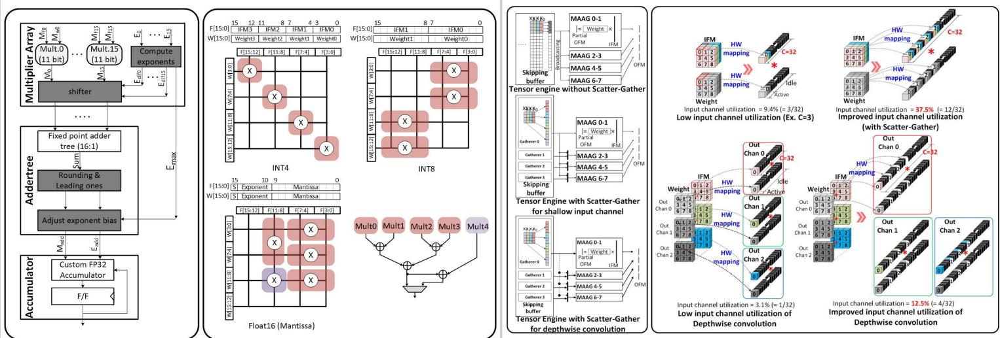
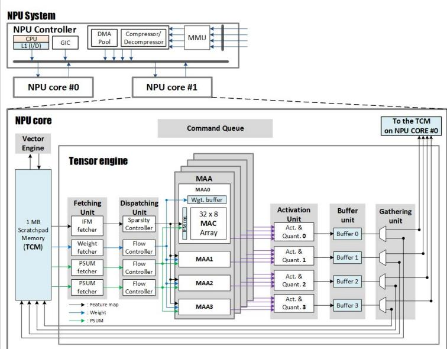
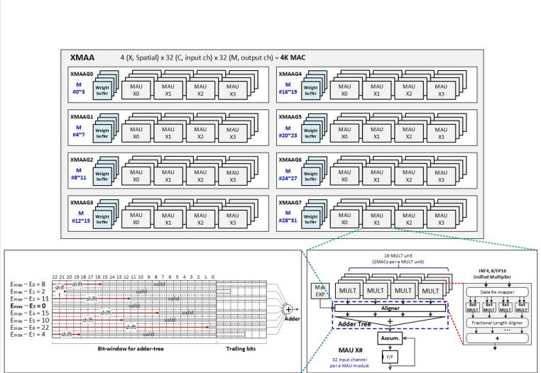
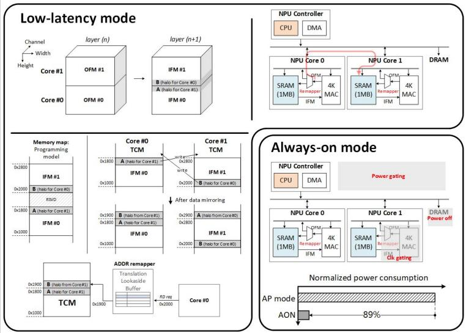
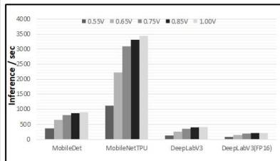
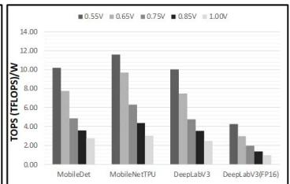

# A Multi-Mode 8K-MAC HW-Utilization-Aware Neural Processing Unit with a Unified Multi-Precision Datapath in 4nm Flagship Mobile SoC 图表详解

### 图像 1

该图拼合图15.1.3与15.1.4。左侧展示统一乘法器、移位器、16∶1加法树、自定义FP32累加器，以及整数和浮点尾数的分块映射。右侧展示跳过缓冲、gather、广播和槽位映射：三通道由3/32升至12/32，深度卷积由1/32升至4/32。它支持示例层的四倍通道利用率提升，未证明整网四倍加速；小字与个别连线模糊。

### 图像 2

图15.1.1展示系统及单核数据流。上方控制器连接两核，下方放大单核：1MB TCM经输入、权重和部分和取数器进入分发单元，再送往MAC阵列，结果经过激活/量化、缓冲和Gathering Unit回写。图例区分特征图、权重与部分和连线，右侧还有通往另一核TCM的路径。图可支持存储、计算与跨核搬运的结构解释，不能给出各路径实际带宽或拥塞程度。

### 图像 3

图15.1.2上部将单核展开为4个空间位置、32个输入通道、32个输出通道，共4K MAC；各输出通道组配置权重缓冲，并向空间方向共享。下右放大MAU及统一乘法器，显示乘法、对齐、加法树和累加路径。下左按最大指数差示意有效位窗口、移位与尾随位，属于机制图而非误差测量曲线。图支持解释并行度、共享和浮点归约，具体低位宽度因小字模糊不作推断。

### 图像 4

图15.1.5左上示意两核划分特征图及下一层所需halo，左下通过内存布局、复制前后位置和地址重映射说明逻辑连续访问。右上给出双核与片内SRAM的数据路径；右下常开模式标出电源门控、空闲计算模块时钟门控及DRAM关闭。底部横向归一化功耗条以AP模式作比较，标注节省89%。该图说明模式机制和相对功耗，未提供双核时延加速比或绝对常开功率。

### 图像 5

这是图15.1.6的吞吐柱状图。横轴依次为MobileDet、MobileNetTPU、DeepLabV3及其FP16版本，纵轴为每秒推理次数；五种灰度对应0.55、0.65、0.75、0.85、1.0V。吞吐随电压档位总体提高，分类网络最高，分割FP16低于整数版本。精确3433、408、211次/秒取自正文，MobileDet柱高不读精确值。图中简写MobileNetTPU对应正文所称MobileNetEdgeTPU。

### 图像 6

这是图15.1.6的能效柱状图。横轴为MobileDet、MobileNetTPU、DeepLabV3及其FP16版本，纵轴为TOPS/W，浮点组使用TFLOPS/W；灰度对应五档电压。各组低电压柱较高，表明所测工作点存在速度与能效取舍。正文给出0.55V时分类INT8为11.59TOPS/W、分割FP16为4.26TFLOPS/W。整数与浮点单位需分别理解，图中柱高不能直接当作每次推理耗能。

> 来源与版本：本页是所提供的 ISSCC 2022 三页会议材料，不是 JSSC 2023 的扩展版本；不得将该页码冒充期刊正文页码。

> 本文根据用户提供的 PDF 经 MinerU 解析，由 Codex/GPT 翻译和解读，未调用 GLM 翻译 API。参考文献保留原文；技术总结、通俗讲解和图表说明属于解读。[原文入口](https://doi.org/10.1109/ISSCC42614.2022.9731639)。
