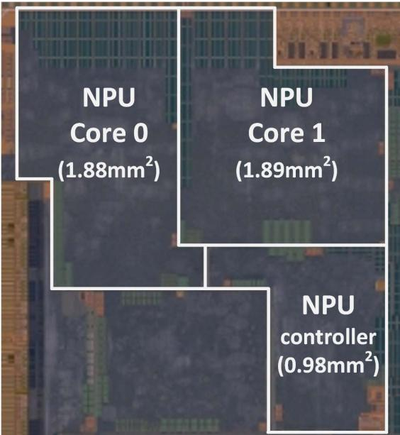

# A Multi-Mode 8K-MAC HW-Utilization-Aware Neural Processing Unit with a Unified Multi-Precision Datapath in 4nm Flagship Mobile SoC 原文翻译

# 15.1 一种用于 4nm 旗舰移动 SoC、具有统一多精度数据通路的多模式 8K-MAC 硬件利用率感知神经处理单元

Jun-Seok Park1, Changsoo Park1, Suknam Kwon1, Hyeong-Seok Kim1, Taeho Jeon1, Yesung Kang1, Heonsoo Lee1, Dongwoo Lee1, James Kim1, YoungJong Lee1, Sangkyu Park 1, Jun-Woo Jang2, SangHyuck Ha1, MinSeong Kim1, Jihoon Bang1, Suk Hwan Lim1, Inyup Kang

1三星电子，韩国华城

2三星先进技术研究院，韩国水原

近期关于神经网络加速器的研究主要着眼于获得高性能，以满足性能需求差异极大的实时应用的需要，包括高精度计算、针对各种深度学习（DL）层类型的高效率，以及运行始终开启应用所需的极低功耗。在这些不同场景中统一采用单一模式或数据类型，其效率不如根据不同运行场景采用不同运行模式。例如，超分辨率通常需要 FP16 精度以获得更高的图像质量，而用于人脸检测的神经网络只需 INT4 或 INT8 精度。对人脸检测使用高于 INT8 的精度会导致更高的功耗。因此，需要一种高度9 可编程的 NPU，能够覆盖现实世界中观察到的多样化工作负载6。本文介绍了一种经过优化73的神经处理单元（NPU），具有以下特性：i）可重构的数据预取和运算流程，用于2. 实现较高的计算利用率；ii）支持 INT4、INT8、INT16 和 float16 的多精度 MAC；iii）0 一种动态运行模式，用于满足极低功耗或低延迟要求。4. 这些特性提供了现实世界应用所需的灵活性，同时满足各类产品领域的功耗6限制。C4

该 NPU 包含两个 NPU 核，每个核包含 4096 个 8b MAC，如图 15.1.1 所示。IS每个核由一个张量引擎（TE）、一个命令队列（CMDQ）、一个向量引擎以及 1 MB 用作暂存存储器的紧耦合存储器（TCM）组成。1 每个 TE 都有权重／FM（特征图）／部分和（PSUM）提取器，以及一个包含 4096 个 MAC 的 MAC 阵列10。TE 每个周期可以计算四组 32 维OI向量的 32 元素点积。TCM 存储一层或一层中一个分块的全部权重、输入 FM（IFM）、输出 FM（OFM）、D以及 PSUM。NPU 主要旨在利用通道方向上的并行性E，通过基于加法树的点积 IE抑制累加器与触发器组合的频繁翻转，从而提高能量效率；这种频繁翻转2会消耗大量能量 [6]。TE 对包含 64 个 INT4、32 个 INT8、2或 16 个 FP16 元素的向量进行运算，并执行融合点积运算（即沿输入通道方向并行执行基于加法树0的点积）。由于典型层的通道深度较大1. 且具有许多通道，因此对于典型 DNN 模型，MAC 利用率较高。\$TE 在不同空间位置生成多个 OFM 向量，利用空间方向和输出通道方向上的并行性22。利用空间方向上的并行性可以提高 NPU 的面积效率，因为权重缓冲区可以在空间方向上共享。当通道深度较大但 IFM 中包含许多零值的稀疏层导致相当一部分 MAC 在运行期间空闲时，跳零可以显著提高计算效率。当在 FM 向量中发现零元素时，- 仅从搜索窗口中的候选值中选出一组非零值，用于8下一次运算。TE 中的提取单元（FU）可以从 TCM 读取相当于 MAAs 所消耗数据量 4× 的 IFM 9数据。C)

某些工作负载，例如逐通道卷积和浅层，具有较小的输入 ISS通道深度，导致计算利用率下降。为缓解这一问题，分散–聚集e（SG）方案从 TCM 取入的输入向量数量是 MAAs 所消耗en数量的数倍，并使用可重构引擎fe将它们组合成一个稠密输入向量，如图 15.1.4 所示。例如，对于采用 3×3 卷积的浅层（例如 3 个输入通道）o uits，配备 SG 的 NPU 会读取 4 个连续输入向量，其中包含 Ci 个有效元素，并在 MAAs 中一次性对这些值进行运算。通过这种方式，SG tat可将利用率提升至最高 4×，并且可扩展用于提高逐通道卷积层（具有一个输入通道）或 id 输出通道较少的层等运算的计算利用率。对于采用 FP16 精度的完整 DeepLabV3 模型，SG 将计算利用率从 37% 提高到 50%。此外，SG 通过减少累加所需的总计算量，有助于降低功耗So。由于组合后的向量会广播到多个 MAC，并在它们之间复用，因此 SG 额外消耗的能量得以分摊。

NPU 中基于 INT8 的 MAC 在大多数场景下能够提供可接受的推理精度，In但某些推理应用需要 FP16 或 INT4 等不同精度 [3]。E 一种设计选择是为所有支持的数据类型创建独立的数据通路，但这样会损害面积效率。另一种方案是构建多精度 MAC，通过统一的数据通路支持多种数值精度，如图 15.1.3 所示。MAC 单元（MAU）是 TE 中的融合点积数据通路，如图 15.1.4 所示。每个 MAU 一次执行包含 64 个 INT4、32 个 INT8 或 16 个

FP16 元素的点积运算。MAU 由 16 个统一乘法器、一棵 16 输入单输出加法树和一个累加器组成。加法树和累加器可以在各种精度之间复用，因为统一乘法器在 INT4、INT8 和 FP16 模式下分别执行 4 维点积、2 维点积和一次尾数乘法。

FP16 融合点积在数值上并不等同于将每个浮点乘法结果依次加到前一个部分和上所得到的结果。然而，在实际中，这些差异很小。串行点积需要对中间结果进行舍入和规格化，而融合点积消除了会引入舍入误差的舍入步骤。此外，通过在最低有效位位置添加尾随位，对统一乘法器产生的 16 个乘积进行位扩展，从而减小累加误差。融合点积的精度几乎与基于 GPU 的 FP32 数据通路相同。NPU 中的 FP16 数据通路在 DeepLabV3 上达到 0.553 的平均交并比（mIoU），而 GPU 中的 FP32 数据通路达到 0.552 mIoU。消除舍入步骤也有利于提高能量效率和面积效率，因为这进一步减少了用于舍入步骤的逻辑。实际上，与一系列双输入 FP16 加法器相比，FP16 融合点积节省了 48% 的面积和 39% 的功耗。

NPU 具有多种运行模式，包括优先考虑低延迟或常开功能低功耗的专用模式，如图 15.1.5 所示。在低延迟模式下，两个 NPU 核心共同处理一个网络，以最大限度地降低延迟。在这种情况下，每个核心计算 OFM 的一部分，并将其存储在各自的 TCM 中。当 NPU 以输出驻留方式运行时，TCM 中的大部分 OFM 会直接作为 IFM 复用，但其中称为晕区（halo）的部分 OFM 必须从另一个 NPU 核心的 TCM 中复制。位于 TE 流水线末端的 GU（汇集单元）将新生成的 OFM 中位于晕区的部分复制并存储到另一个 NPU 核心的 TCM 中。即使复制的晕区与核心自身的原生 OFM 位于 TCM 中不同的存储空间，由于 TE 与对应 TCM 之间设有地址转换后备缓冲器（TLB），NPU 核心仍可以读取这些值，如同复制的晕区与原生 OFM 在 TCM 中无缝结合在一起。传统的基于软件的控制方式需要在对 OFM 进行完全重排后，从外部存储器重新加载 OFM；与之相比，GU 有助于显著减少冗余数据传输，并简化控制。最终，这有助于显著降低延迟，同时减少时序开销。

NPU 的常开（AON）模式以极低的功耗运行语音唤醒等常开应用，即使 SoC 的其他部分进入休眠状态也能保持运行。AON 模式使用优先考虑低能耗的神经网络（例如 4b-INT 量化网络）监测数据流。为了延长使用天数（DOU），仅开启必要的模块（例如 NPU 及其 TCM），在不访问 DRAM 的情况下执行这些网络。因此，与处于标准模式的 NPU 相比，AON 模式可节省 89% 的功耗。图 15.1.6 展示了采用 4nm CMOS 工艺制造的 NPU 的测量结果。NPU 的占用面积为 4.74mm2，工作供电电压为 0.55 至 1.0V，时钟频率为 332 至 1196MHz。在运行 MLPerf（移动端）中定义的 MobileNetEdgeTPU [1]、DeepLabV3 [2]、MobileDet [8] 等多个网络时，通过改变电压和频率测量了性能与功耗。在 1196MHz 下，测得 MobileNetEdgeTPU（INT8）的总体推理吞吐量为 3433inferences/s。DeepLabV3 在 INT8 和 FP16 下测得的性能分别为 408 和 211inferences/s。MobileNetEdgeTPU 在 0.55V 下测得的峰值能效为 11.59TOPS/W，DeepLabV3（FP16）在 0.55V 下测得的峰值能效为 4.26TFLOPS/W。该 NPU 的能效比文献 [7] 高 2.3 倍，后者通过独立的数据通路支持 FP16 和 INT。通过在空间方向上的各个 MAA 之间共享权重缓冲区，以及采用经过优化的融合点积实现，面积效率达到 3.45TOPS/mm2 和 1.72 TFLOPS/mm2。所提出的 NPU 展现出具有竞争力的面积效率（比文献 [7] 高 2.60×，比文献 [6] 高 1.28×）。图 15.1.7 展示了芯片显微照片。

## 致谢:

作者衷心感谢 Insang Cho、Kihyoun Kwon、Jewoo Moon、Hyunju Go、Jungwook Hong 和 Jinook Song 的热情合作与宝贵支持。

## 参考文献:

[1] M. Tan et al., “EfficientNet: Rethinking Model Scaling for Convolutional Neural Networks,” ICML, pp. 6105-6114, 2019.

[2] L-C. Chen et al., “Encoder-Decoder with Atrous Seperable Convolution for Semantic Image Segmentation,” ECCV, pp. 833-851, 2018.

[3] N. Jouppi et al., “Ten Lessons from Three Generations Shaped Google’s TPUv4i,” ISCA, 2021.

[4] C-H. Lin et al., “A 3.4-to-13.3TOPS/W 3.6TOPS Dual-Core Deep-Learning Accelerator for Versatile AI Applications in 7nm 5G Smartphone SoC,” ISSCC, pp.134-135, 2020.

[5] Y. Jiao et al., “A 12nm Programmable Convolution-Efficient Neural-Processing-Unit Chip Achieving 825TOPS,” ISSCC, pp. 136-137, 2020.

  
图 15.1.1：可扩展神经处理单元的 NPU 架构。

  
图 15.1.2：支持包括 INT4、INT8、FL16 在内的多精度运算的融合点积。

多精度 MAC  
统一乘法器上的乘法运算  
图 15.1.3：多精度 MAC 中统一乘法运算的结构。  
图 15.1.4：分散-聚集方案有助于提高某些层的计算利用率，例如通道深度较浅的层和逐通道卷积层。  
  
图 15.1.5：支持各种运行模式的特性。

<table><tr><td></td><td>本工作</td><td>ISSCC 2020 [4]</td><td>ISSCC 2020 [5]</td><td>ISSCC 2021 [6]</td><td>ISSCC 2021 [7]</td></tr><tr><td>工艺 (nm)</td><td>4</td><td>7</td><td>12</td><td>5</td><td>7</td></tr><tr><td>面积 (m ${\widehat{R}}^{2}$ )</td><td>4.74</td><td>3.04</td><td>709</td><td>5.46</td><td>19.6</td></tr><tr><td>供电电压 (V)</td><td>0.55 - 1.0</td><td>0.575 - 0.825</td><td>-</td><td>0.55 - 0.9</td><td>0.55 – 0.75</td></tr><tr><td>工作频率 (MHz)</td><td>332 - 1196</td><td>290 - 880</td><td>475-700</td><td>332 - 1196</td><td>1,000 - 1,600</td></tr><tr><td>片上数据存储器 (kB)</td><td>2,048 (= 1,024 / 核)</td><td>2,176</td><td>196,608</td><td>3,072</td><td>8,192</td></tr><tr><td>位精度</td><td>INT 4,8, 16 / FP16</td><td>8, 16</td><td>8, 16</td><td>8, 16</td><td>INT4, 2 / FP8, 16, 32</td></tr><tr><td>乘法器数量</td><td>8,192(INT8) (= 4.096 / 核)</td><td>-</td><td>576K</td><td>6,144 (= 2,048 / 核)</td><td></td></tr><tr><td>峰值性能 (TOPS)</td><td>39.3 (4b), 19.7 (8b)9.8 TFLOPS (FP16)</td><td>3.6 (8b)</td><td>825</td><td>14.7 (8b) @ 不跳过29.4 (8b) @ 最大跳过</td><td>39.3 (4b), 19.7 (8b)9.8 TFLOPS (FP16)</td></tr><tr><td>功耗 (mW)</td><td>MobileNetTPUI(INT8): 381-5114DeepLabV3(FP16): 393-5133</td><td>173@0.575V1053 @ 0.825V</td><td>276000@性能108000@能效</td><td>327 @0.8V794 @0.9V</td><td>-</td></tr><tr><td>能效 (TOPS/W)</td><td>MobileNetTPUI(INT8): 11.59@0.55VDeepLabV3(FP16): 4.26@0.55V</td><td>Inception V3: 6.22MobileNet-V1: 6.55</td><td>ResNet-50:499 Img/Sec/Watt</td><td>InceptionV3: 13.5@0.6V</td><td>FP16: 0.98 - 1.8INT4: 8.9-16.5</td></tr><tr><td>每秒推理次数</td><td>MobileNetTPUI(INT8): 3433@1.0VDeepLabV3(FP16): 211@1.0V</td><td>-</td><td>ResNet-50: 69307InceptionV3: 37000</td><td>InceptionV3: 622.7@0.9V</td><td>-</td></tr><tr><td>面积效率 (峰值 TOPS/mm $^2$ )</td><td>INT4: 6.90INT8:3.45FP16:1.72</td><td>1.184</td><td>1.16</td><td>2.69</td><td>INT4:5.33INT8:1.33FP16:0.66</td></tr></table>

图 15.1.6：测量结果和性能对比表。

授权许可使用仅限于：清华大学。于 2026 年 10 月 19 日 09:15:25 UTC 从 IEEE Xplore 下载。使用受限。

## ISSCC 2022 论文续页

<table><tr><td></td><td>补充参考文献：[6] J-S. Park et al., “A 6K-MAC Feature-Map-Sparsity-Aware Neural Processing Unit in 5nm Flagship Mobile SoC,” /SSCC, pp.152-154, 2021.[7] A. Agrawal et al., “7nm 4-Core AI Chip with 25.6TFLOPS Hybrid FP8 Training, 102.4TOPS INT4 Inference and Workload-Aware Throttling,” /SSCC, pp. 144-146, 2021.[8] Y. Xiong et al., “MobileDets: Searching for Object Detection Architectures for Mobile Accelerators,” CVPR, 2021.</td></tr><tr><td>图 15.1.7：芯片显微照片。</td><td></td></tr><tr><td></td><td></td></tr></table>

978-1-6654-2800-2/22/\$31.00 ©2022 IEEE

> 来源与版本：本页是所提供的 ISSCC 2022 三页会议材料，不是 JSSC 2023 的扩展版本；不得将该页码冒充期刊正文页码。

> 本文根据用户提供的 PDF 经 MinerU 解析，由 Codex/GPT 翻译和解读，未调用 GLM 翻译 API。参考文献保留原文；技术总结、通俗讲解和图表说明属于解读。[原文入口](https://doi.org/10.1109/ISSCC42614.2022.9731639)。
