# Adaptive Multiply-Accumulate Unit with Scalable Critical Path for Aggressive Voltage Underscaling DNN Accelerators 原文翻译

# 面向激进降压 DNN 加速器的关键路径可伸缩自适应乘累加单元

Tongjing Wu1, Siting Liu2, Tong Li1, Hui Wang1, Zhigang Mao1, Jie Han3, Honglan Jiang1∗

1上海交通大学集成电路学院，中国上海

2上海科技大学信息科学与技术学院，中国上海

3阿尔伯塔大学电气与计算机工程系，加拿大阿尔伯塔省

{tongjing\_wu, tongli\_licu, ihuiwang, maozhigang, honglan}@sjtu.edu.cn

liust@shanghaitech.edu.cn, jhan8@ualberta.ca

## 摘要

面向高效推理的深度神经网络（DNN）加速器已得到广泛研究，其中，通常由乘累加（MAC）单元实现的矩阵乘法占据了主要功耗。降低 MAC 的供电电压可以有效降低 DNN 加速器的功耗，但也会引发时序错误，可能导致推理准确率下降。本文提出了一种面向激进降压条件下任意 MAC 单元的位宽调整电路（记为 ADA），该电路根据输入数据模式自适应地调整关键路径。在引入 16.1% 面积开销的情况下，所提出的 ADA 使 MAC 阵列在多层感知机（MLP）和卷积神经网络（CNN）推理中，分别在降压比为 0.71 和 0.72 时实现准确率零损失。在保持准确率的同时，与在标称电压下运行且未配备 ADA 的 MAC 阵列相比，配备 ADA 的 MAC 阵列可将功耗降低高达 50.89%。此外，我们提出了 ADA-Plus，专门针对输出驻留型脉动阵列中的 MAC 进行优化，其面积比 ADA 减少了 23%。与当前最先进的面向降压的容错电路设计相比，在达到相近准确率的情况下，所提出的自适应 MAC 实现了最高的降压比，使 MAC 阵列的功耗降低了 14.26%–48.44%。

## 关键词

DNN 加速器，乘累加（MAC）单元，降压，低功耗

## 1 引言

深度神经网络（DNN）已在计算机视觉 [19]、自然语言处理 [2] 和语音识别 [11] 等不同领域取得了显著成果。加速 DNN 推理正变得日益重要；因此，研究者开发了众多加速器，TPU 就是其中的代表性实例 [12]。由乘累加（MAC）单元组成的脉动阵列在 DNN 加速器的计算引擎中发挥着关键作用，能够为 DNN 工作负载提供高吞吐量的矩阵乘法，而矩阵乘法占据了主要功耗 [13]。

由于对 MAC 的需求巨大，研究者已广泛研究高能效 MAC 单元，以降低 DNN 加速器的总体功耗。为提升 MAC 单元的硬件效率，已有研究从不同角度探索了多种技术，包括对数域计算 [8]、量化 [7] 和降压 [4]。其中，降压对于降低功耗尤为有效，因为功耗随供电电压的降低呈平方关系下降。然而，当电压被大幅降低时，晶体管开关速度变慢会引发严重的时序错误，最终可能导致实际应用中的准确率灾难性下降。解决这一问题的一种主流技术是错误检测与纠正（EDaC），它在降压条件下检测并纠正时序错误。

许多先前研究表明，EDaC 及类似 EDaC 的电路能够有效恢复或缓解激进降压 DNN 加速器中的时序错误 [3, 5, 9, 10, 18, 20, 22]。这些电路通常可分为门级和晶体管级两类。门级 EDaC 电路易于实现，并且在不同设计之间具有很高的可移植性。文献 [22] 观察到，与传播错误的部分和相比，省略少量乘法结果对准确率造成的下降更小，因此将发生时序错误的处理单元（PE）的输出排除在累加过程之外。文献 [9] 则没有丢弃错误的乘法结果，而是使用延迟时钟，在半个时钟周期后采样正确结果。然而，门级设计中大量使用 Razor 触发器 [6] 和多路复用器（MUX），可能引入较大的面积开销。此外，这些设计通常需要插入缓冲器来填充短路径，从而产生可观的面积和功耗开销 [20]。另一方面，晶体管级 EDaC 电路引入的面积开销小得多。文献 [5] 提出了一种自校准的可调复制关键路径系统，该系统能够在 PVT 变化下动态跟踪实际路径延迟，从而实现准确的时序错误检测。与大多数 EDaC 电路跟踪并恢复时序错误的方式不同，文献 [20] 使用 MAC 单元的内部信号来预测时序错误，并将寄存器时钟切换为延迟时钟。这两种设计中用于检测和预测时序错误的跳变检测器（TD）均采用定制的晶体管级电路实现，从而显著降低了面积开销。然而，与完全使用门级标准单元实现的设计相比，采用定制晶体管级电路的设计在实现上更复杂，在芯片实现中的可移植性也更低。此外，门级和晶体管级 EDaC 电路都依赖延迟时钟来纠正时序错误，这在实际中可能引发许多时序问题。

本文提出了两种面向激进降压条件下 MAC 单元的位宽调整电路（称为 ADA 和 ADA-Plus）。它们从根本上缩短关键路径，从而避免低电压下的时序错误，无需像 EDaC 电路那样依赖延迟时钟或 Razor 触发器。具体而言，本工作的贡献如下。

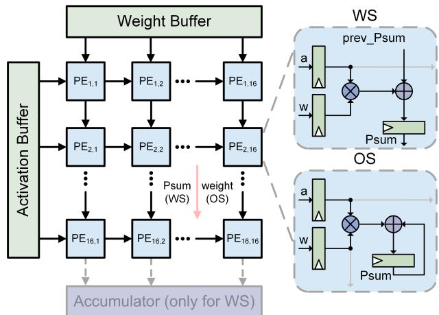  
图 1：脉动阵列及数据流示意图。

• 我们通过实验表明，在降压条件下，累加结果的符号翻转可能在综合后的 MAC 网表中产生较长的进位链，即使相应的输入模式从直观上看意味着较短的进位传播链。

• ADA 根据输入加数的前导 1 或 0 的位置，启用加法器所需的最小位宽，从而缩短关键路径并避免 MAC 单元中的时序错误。ADA 完全由门级标准单元实现，且不需要延迟时钟，其面积开销比其他门级 EDaC 设计低 30.3%–75.88%。

• 利用输出驻留型数据流的特点，我们提出了 ADA-Plus，它根据当前累加结果，为下一次 MAC 运算调整加法器的位宽。ADA-Plus 的面积比 ADA 小 23%，准确率表现相同或更高。

• 我们在不同的神经网络和数据集上评估了所提出的设计，达到了当前最先进水平的硬件效率和准确率。据我们所知，这是首次在工作于极低电压的 MAC 单元中实现自适应关键路径。

## 2 背景与动机

## 2.1 脉动阵列的数据流

脉动阵列由按规则网格排列的 PE 组成，这些 PE 以流水线和高度并行的方式执行 MAC 运算，如图 1 所示。在脉动阵列中，广泛采用两种典型的数据流方案：输出固定（OS）和权重固定（WS）。如图 1 所示，在 WS 数据流中，权重被预先加载到局部寄存器中，而输入激活值沿水平方向流动。部分和沿垂直方向传播，并在各个 PE 之间累加，同时最终结果从阵列的底行连续输出。在 OS 模式下，输入激活值和权重按平行四边形排列对齐，并在每个周期分别沿水平方向和垂直方向穿过阵列。每个 PE 将其激活值与权重相乘，同时将乘法结果与局部存储的部分和累加。

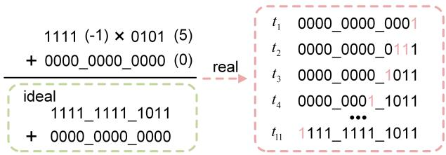

(a) 第一种情况。  
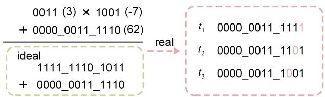  
(b) 第二种情况。  
图 2：包含 4 × 4 乘法和 12 位加法的综合后 MAC 单元中的进位链示意图。

## 2.2 综合后 MAC 单元中的进位链

在 MAC 单元中，关键路径通常由大位宽加法决定。为了研究进位链，我们在降压比例为 0.89 的条件下，对一个包含 4 × 4 乘法和 12 位加法的 MAC SPICE 网表进行 AMS 仿真。图 2 展示了两种具有代表性的进位传播行为。

在图 2a 所示的第一种情况下，理想的乘法输出为 -5，由于任何位上都不产生进位，加法器中的进位链应当较短。然而，由于综合工具将 MAC 网表展平，并将乘法器与加法器合并为一个进位传播结构以实现高度优化，实际的进位行为偏离了理想情况。仿真结果表明，高位上的零依次翻转，形成了长进位链。在图 2b 所示的第二种情况下，如果像理想 MAC 那样，在累加之前对乘积进行符号扩展，就会出现长进位链。然而，累加结果的六个有效位最初为零，此后也没有发生翻转。在这种情况下，累加结果在较短时间内便趋于稳定。

这两种情况表明，由于逻辑优化，综合后的网表在降压条件下可能表现出与理想 MAC 实现不同的进位链行为。一种直接的解决方法是减小累加结果的位宽，从而从根本上缩短关键路径。

## 2.3 动态位宽的必要性

我们在一个 16 × 16 脉动阵列上部署了用于 CIFAR-10 [14] 分类的六层 CNN，以评估 MAC 中累加结果所需位宽的分布。该分布在执行第一个卷积层时获得，其中记录了表示每次 MAC 运算的累加结果所需的位宽。同时，我们还记录了每种所需累加位宽下长进位链出现的频率。长进位链被定义为输出在一个时钟周期的四分之三之后才稳定的路径。如图 3 所示，当出现长进位链时，所需位宽最高可达 12 位。然而，总体而言，大多数累加结果需要超过 12 位。这一观察结果与第 2.2 节的分析一致，即较小的累加值伴随符号反转可能产生长进位链。然而，如果将该层的位宽固定为 12 位以缩短关键路径，就会导致大多数结果溢出。因此，动态位宽调整至关重要。

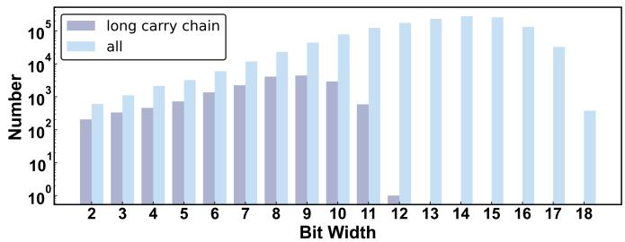  
图 3：一个卷积层中累加输出所需位宽的分布，以及每种位宽下长进位链出现的频率。

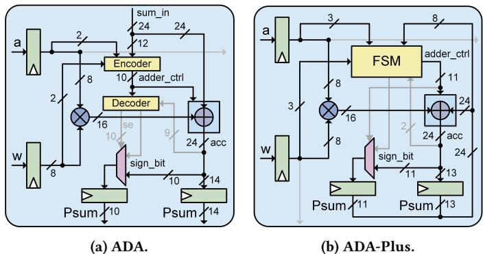  
图 4：ADA 和 ADA-Plus 概览。

## 3 ADA 和 ADA-Plus 设计

图 4 展示了配备 ADA 和 ADA-Plus 的 MAC 单元，其中乘法输入为 8 位，加数输入和输出为 24 位。

## 3.1 面向通用数据流的 ADA 设计

如图 4a 所示，ADA 由一个编码器和一个解码器组成。编码器检测输入的模式，包括加数“sum\_in”的前导 1 和前导 0，并为加法器生成控制信号“adder\_ctrl”。解码器生成累加结果选择信号 $" s e "$，以及用于累加结果的选定符号“sign\_bit”。

图 5 展示了 ADA 的设计细节。首先，在编码器中，对符号位（“sum\_in[23]”）与“sum $\underline { { \mathrm { i n } } } ^ { \ast }$”的第 $1 2 ^ { \mathrm { { t h } } }$ 至第 $2 2 ^ { \mathrm { n d } }$ 位（“sum\_in[22:12]”）执行逐位同或（XNOR）运算，当某一位与符号位相同时产生 1，否则产生 0。“sum\_in[22]”与符号位之间的 XNOR 结果记为“adder\_ctrl[10]”，而第 $1 4 ^ { \mathrm { { \dot { t h } } } }$ 至第 $2 1 ^ { \mathrm { s t } }$ 位的 XNOR 结果则记为信号“LOZ”的第 $0 ^ { \mathrm { t h } }$ 至第 $7 ^ { \mathrm { t h } }$ 位。随后，这些信号被送入前导零检测器（LZD）。在 LZD 内部，这些信号通过一系列与运算，从最高有效位到最低有效位依次级联。这种结构确保了：如果“sum\_in[22:14]”中存在前导 1 或前导 0，对应的 XNOR 结果就会使相关的与运算输出变为 0，并将所有后续与运算的输出强制置为 0。

LZD 的输出是一个 8 位的“adder\_ctrl”信号，用于控制全加器（FA）的启用和禁用。如图 $^ { 5 , }$ 所示，从第 $0 ^ { \mathrm { t h } }$ 至第 $1 3 ^ { \mathrm { t h } }$ 位的低 14 个 FA 始终开启，而从第 $1 4 ^ { \mathrm { t h } }$ 位起，每个 FA 都通过三个由相应“adder\_ctrl”信号控制的 PMOS 开关供电。例如，第 $1 4 ^ { \mathrm { t h } }$ 位 FA 由“adder\_ctrl[2:0]”控制，而第 $1 5 ^ { \mathrm { t h } }$ 位 FA 由“adder\_ctrl[3:1]”控制。只要相应的三个控制信号中任意一个为 0，相关 FA 就会正常工作。这确保了在检测到前导 1 或前导 0 时，

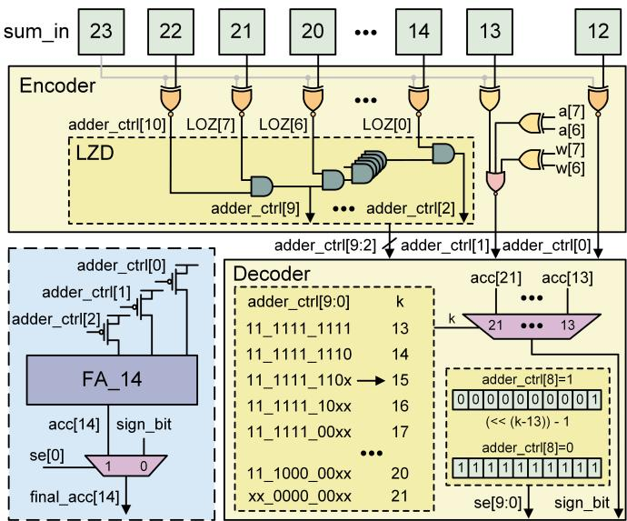  
图 5：ADA 的电路设计。

该位对应的 FA 会与其高两位的 FA 以及所有低位 FA 一同启用。这实际上为“sum $\underline { { \mathrm { i n } } } ^ { \dag }$”中的前导 1 或前导 0 预留了一个符号位，并额外扩展一位以容纳乘法输出，从而防止溢出。例如，当前导 1 出现在“sum ${ \underline { { \mathbf { i n } } } } , { \mathfrak { n } }$”的第 $1 4 ^ { \mathrm { t h } }$ 位时，LZD 会生成值为“1111\_1110”的“adder\_ctrl”信号。在这种情况下，第 $1 4 ^ { \mathrm { t h } }$ 至第 $1 6 ^ { \mathrm { t h } }$ 位的 FA 被启用，而高于第 $1 6 ^ { \mathrm { t h } }$ 位的 FA 保持禁用。具体而言，第 $2 3 ^ { \mathrm { r d } }$ 位 FA 与第 $2 2 ^ { \mathrm { n d } }$ 位 FA 共用相同的控制信号。这意味着，当前导 1 出现在“sum $\underline { { \mathrm { i n } } } ^ { \ast }$”的第 $2 0 ^ { \mathrm { t h } }$ 位或更高位时，所有 FA 都会被启用。

值得注意的是，“adder\_ctrl[1]”和“adder\_ctrl[0]”并非由 LZD 生成，而是通过对其对应的“sum\_in”位与符号位执行 XNOR 运算直接生成的。这意味着，当前导 1 或前导 0 出现在“sum\_in”的低 12 位内时，所有可控 FA 都会被禁用。

然而，当仅启用 14 个 FA 时，累加输出“acc”的有效范围为 [-8192, 8191]。由于推理网络通常采用对称量化，输入激活和权重的范围均为 [-127, 127]。因此，相应的乘法输出范围为 [-16129, 16129]，需要 15 个 FA 才能正确计算。因此，在生成“adder\_ctrl[1]”时加入了额外的逻辑，用于检查输入激活 $\mathbf { \vec { a } } ^ { \mathfrak { s } }$ 和权重 $\mathrm { ^ { 6 6 } w . } \mathrm { ^ { 3 } }$ 的两个最高有效位。当这两个位不同时，“adder\_ctrl[1]”被强制置为 0，从而启用 16 个 FA。在这种情况下，累加输出 $\mathrm { \ " { a c c } } ^ { \boldsymbol { \mathbf { \mathit { s } } } }$ 的有效范围变为 [-32768, 32767]，从而确保不会发生溢出。当不满足将“adder\_ctrl[1]”强制置为 0 的条件，且第 $1 4 ^ { \mathrm { t h } }$ 至第 $2 3 ^ { \mathrm { t h } }$ 位的所有 FA 均保持禁用时，乘法输出的范围和“sum $\underline { { \mathrm { i n } } } ^ { \ast }$”的范围分别为 [-4032, 4096] 和 [-4096, 4095]。由于此时 $\operatorname { \mathrm { ~ \# ~ } } _ { \operatorname { a c c } } \mathfrak { n }$ 的有效范围为 [-8192, 8191]，累加结果不会发生溢出。

随后，信号“adder\_ctrl[9:0]”被送入解码器，由解码器确定符号位选择信号 $^ { * } \mathrm { k } . ^ { \mathrm { * } }$。$^ { \ast } \mathrm { k } ^ { \ast }$ 的值从 13 递增至 21，对应第 $1 3 ^ { \mathrm { t h } }$ 至第 $2 1 ^ { \mathrm { s t } }$ 位 FA 的输出。解码器根据 $^ { \mathrm { * } } \mathrm { k } ^ { \mathrm { * } }$ 和“adder\_ctrl[8]”生成累加结果选择信号 $^ { * } s \mathrm { e } . ^ { * }$。“se[9:0]”对应最终累加结果“final\_acc”的选择信号。

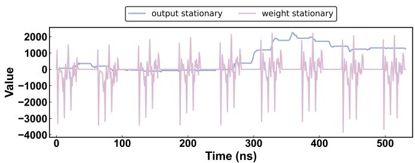  
图 6：WS 和 OS PE 中累加结果的变化趋势。

当 $\because \sec ^ { \mathrm { * } }$ 的某一位为 0 时，对应的“final\_acc”位被赋予“sign\_bit”的值。否则，对应的“final\_acc”位取自相关 FA。“se”的生成逻辑为：

$$
s e = \left\{ \begin{array}{l l} (0 0 \_ 0 0 0 0 \_ 0 0 0 1 <   <   (k - 1 3)) - 1 & \text { if   adder\_ctrl[8] = 1} \\ 1 1 \_ 1 1 1 1 \_ 1 1 1 1 & \text { if   adder\_ctrl[8] = 0} \end{array} \right.\tag{1}
$$

这确保了最高位已启用 FA 的输出被视为“sign\_bit”，其上方的所有累加位都直接被赋予该“sign\_bit”，而无需等待对应的 FA 产生有效结果，从而有效缩短关键路径。如图 5 所示，当所有可控 FA 都被禁用时，“sign\_bit”来自第 $1 3 ^ { \mathrm { t h } }$ 位 FA 的输出。

## 3.2 面向 OS 数据流的 ADA-Plus 设计

脉动阵列的数据流模式会影响累加输出的数据模式。图 6 记录了在 MNIST 数据集上执行三层 MLP 推理时，16×16 脉动阵列内部一个 PE 在 WS 和 OS 两种模式下的累加输出值变化趋势。在 WS 模式下，加数输入来自上方的 PE，因此这些输入之间的相关性较弱。由此，累加结果会出现明显波动。由于阵列会等待最底行的 PE 输出所有结果后才更新权重，因此在推理过程中，累加结果会周期性地降为零。在 OS 模式下，每个 PE 的加数输入来自其前一个时钟周期的累加结果，使部分和连续变化。这种连续性使得累加输出的位宽可以根据当前部分和“Psum”逐步调整，而无需像 ADA 那样在每个周期进行前导一或前导零检测。因此，我们提出了 ADA-Plus，在 MAC 单元中插入一个小型有限状态机（FSM）。

如图 4b 所示，ADA-Plus 中的“adder\_ctrl”和“sign\_bit”信号由 FSM 根据“a”、“w”、“acc”和“Psum”生成。在 ADA-Plus 中，第 $0 ^ { \mathrm { t h } }$ 至第 $1 2 ^ { \mathrm { t h } }$ 个 FA 始终开启，而随后的 11 个 FA 由“adder\_ctrl”门控。此外，所有“adder\_ctrl”信号都直接复用为第 $1 3 ^ { \mathrm { t h } }$ 至第 $2 3 ^ { \mathrm { r d } }$ 个 FA 中“final\_acc”的选择信号，从而无需使用 ADA 中的 $^ { * } s e ^ { * }$ 信号。

图 7a 展示了 ADA-Plus 中 FSM 的细节。它总共包含四种工作模式，其中初始模式仅启用第 $0 ^ { \mathrm { t h } }$ 至第 $1 2 ^ { \mathrm { { t h } } }$ 个 FA，记为工作模式 0。当寄存后的累加结果的两个比特“Psum[12]”和“Psum[11]”不同时，启用第 $0 ^ { \mathrm { t h } }$ 至第 $1 5 ^ { \mathrm { t h } }$ 个 FA。此外，为防止乘法结果过大导致溢出，当权重或激活值中任一个的幅值大于或等于 64（即最高两位不同），或两者的幅值均大于或等于 32（即最高三位为 110 或 001）时，在当前周期启用 16 个 FA。在这些情况下，FSM 在下一个周期转入工作模式 1。在工作模式 1 下，当“Psum[15]”和“Psum[14]”不同时，FSM 转入工作模式 2，将启用的 FA 范围扩展至第 $0 ^ { \mathrm { t h } }$ 至第 $1 7 ^ { \mathrm { t h } }$ 位。反之，在工作模式 1 下，当“Psum[11]”至“Psum[15]”全部相等时，FSM 返回工作模式 0，以尽可能缩短关键路径。在工作模式 2 下，状态转移条件遵循与工作模式 1 相同的原则。当“Psum[17]”和“Psum[16]”不同时，FSM 进入工作模式 3。反之，当“Psum[14]”至“Psum[17]”全部相等时，FSM 回退到工作模式 1。在工作模式 4 下，基于图 3 和图 6 所示的实验结果，我们假设，一旦“Psum”大到足以触发此模式，它就不会再减小到仅需较小位宽即可表示的数值。因此，工作模式 4 不会回退到较低模式，而是一直保持启用，直到累加完成并收到“Psum”的复位信号“rstnPsum”，随后 FSM 直接返回工作模式 0。

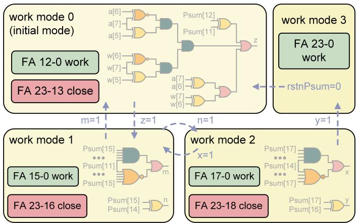

(a) FSM 的状态转移图。  
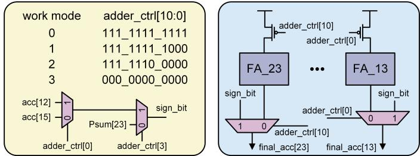  
(b) 加法器控制与符号位选择逻辑。图 7：ADA-Plus 的设计细节。

图 7b 展示了 ADA-Plus 中的“sign\_bit”选择逻辑和 FA 的电源控制逻辑。我们假设，当 FSM 运行于工作模式 2 或工作模式 3 时，“Psum”的符号位保持不变，因此在这些模式下，将“Psum[23]”直接赋给“sign\_bit”。相比之下，当 FSM 处于工作模式 0 或工作模式 1 时，根据“adder\_ctrl[0]”的值，从第 $1 2 ^ { \mathrm { t h } }$ 个或第 15th 个 FA 的输出获取“sign\_bit”。此外，在 ADA-Plus 中，每个可控 FA 都由其对应的“adder\_ctrl”信号驱动的 PMOS 开关进行门控。因此，可以直接使用“adder\_ctrl”来选择“final\_acc”，从而显著减小面积。

## 4 实验

本节分别在独立 MAC 单元和用于 DNN 加速的脉动阵列中评估 ADA 与 ADA-Plus。在第 4.1 节中，我们考察 FA 门控，并比较 ADA、ADA-Plus 以及其他 EDaC 设计的面积开销。在第 4.2 节中，我们评估电压欠缩放条件下基于不同 MAC 设计的脉动阵列，并考察其准确率、功耗和 PVT 鲁棒性。基线 MAC 单元采用 RTL 实现，具有一个 8 位有符号的 $\mathit { \Pi } ^ { * } \mathbf { a } , \mathit { \Pi } ^ { * }$、一个 8 位有符号的 $" \mathrm { { w } } ^ { \mathrm { { s } } }$ 和一个 24 位有符号的“Psum”。使用 Synopsys Design Compiler 和 CMOS 28 nm 标准单元库对其进行综合，该库的标称供电电压为 0.9 V。所有设计均由该基线 MAC 网表衍生而来。

表 1：基于所提出 MAC 的脉动阵列在各 PVT 角下的最低工作电压与功耗降低结果。

<table><tr><td rowspan="2">工艺角</td><td rowspan="2">温度</td><td colspan="3"> $V_{\text{min, proposed}}$  (V)</td><td colspan="2"> $V_{\text{min, origin}}$  (V)</td><td colspan="3">功耗降低 (%)</td></tr><tr><td>ADA (OS)</td><td>ADA-Plus (OS)</td><td>ADA (WS)</td><td>OS</td><td>WS</td><td>ADA (OS)</td><td>ADA-Plus (OS)</td><td>ADA (WS)</td></tr><tr><td rowspan="3">tt</td><td>-40°C</td><td>0.68</td><td>0.67</td><td>0.68</td><td>0.76</td><td>0.76</td><td>19.59</td><td>18.24</td><td>16.55</td></tr><tr><td>25°C</td><td>0.63</td><td>0.62</td><td>0.63</td><td>0.70</td><td>0.70</td><td>19.35</td><td>17.82</td><td>15.46</td></tr><tr><td>125°C</td><td>0.58</td><td>0.57</td><td>0.58</td><td>0.67</td><td>0.67</td><td>25.64</td><td>25.32</td><td>21.94</td></tr><tr><td rowspan="3">ss</td><td>-40°C</td><td>0.76</td><td>0.75</td><td>0.76</td><td>0.84</td><td>0.84</td><td>17.68</td><td>16.35</td><td>14.97</td></tr><tr><td>25°C</td><td>0.71</td><td>0.70</td><td>0.71</td><td>0.80</td><td>0.80</td><td>20.99</td><td>19.74</td><td>17.73</td></tr><tr><td>125°C</td><td>0.65</td><td>0.64</td><td>0.65</td><td>0.76</td><td>0.76</td><td>27.02</td><td>26.05</td><td>24.53</td></tr><tr><td rowspan="3">ff</td><td>-40°C</td><td>0.60</td><td>0.60</td><td>0.60</td><td>0.67</td><td>0.67</td><td>19.81</td><td>16.66</td><td>15.15</td></tr><tr><td>25°C</td><td>0.55</td><td>0.54</td><td>0.55</td><td>0.60</td><td>0.60</td><td>16.43</td><td>15.59</td><td>10.98</td></tr><tr><td>125°C</td><td>0.49</td><td>0.48</td><td>0.49</td><td>0.58</td><td>0.58</td><td>29.19</td><td>28.96</td><td>24.48</td></tr></table>

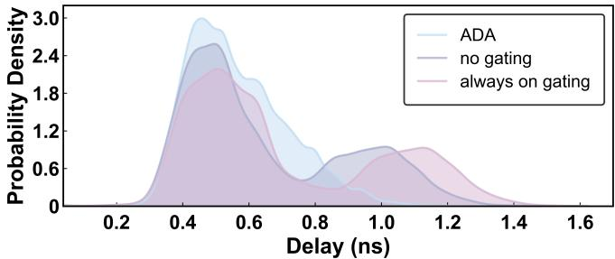  
图 8：MAC 输出延迟的 KDE 曲线。

## 4.1 ADA 和 ADA-Plus 的评估

为控制 ADA 和 ADA-Plus 中 FA 的激活，采用了 PMOS 电源门控开关。为验证这种门控是否会影响 FA 的延迟，并评估 ADA 的有效性，我们在电压欠缩放比为 0.72 的条件下，对基于 ADA 的 MAC spice 网表进行 AMS 仿真。向 MAC 施加总计 100,000 组随机输入组合，并记录每个周期内累加结果达到稳定所需的时间。随后，我们分析这些延迟的分布，并绘制其核密度估计（KDE）曲线，如图 8 所示。三条 KDE 曲线分别对应 ADA、无门控和门控始终开启，分别表示 ADA 的正常运行、未采用任何门控的原始设计，以及 PMOS 开关始终保持导通的基于 ADA 的电路。结果表明，当所有开关均处于导通状态时，采用 PMOS 开关会略微增加延迟。此外，ADA 有效缩短了关键路径，KDE 曲线中大延迟情况所占比例显著降低，印证了这一点。

为比较不同电压欠缩放 MAC 设计的面积开销，我们将其 RTL 实现综合为门级网表，并估算所得面积相对于基线 MAC 的大小。对于 STRIVE-TB [9] 和 ThVolt [22]，我们使用 Synopsys PrimeTime，在 1 GHz 的时序约束下插入缓冲器以进行短路径填充，然后估算其面积。对于 EPIC [20]，我们根据定制晶体管级电路中所用晶体管的尺寸，以及用于短路径填充的传输门来估算面积。如图 9 所示，由于大量使用 Razor 触发器和 MUX，STRIVE-TB 的防错电路面积显著大于其他设计。此外，尽管 STRIVE-TB 可以纠正完整的 24 位累加结果上的时序错误，但它需要大量缓冲器来避免保持时间违例，因此其面积比其他 EDaC 设计更大。ThVolt 仅保护累加结果的高

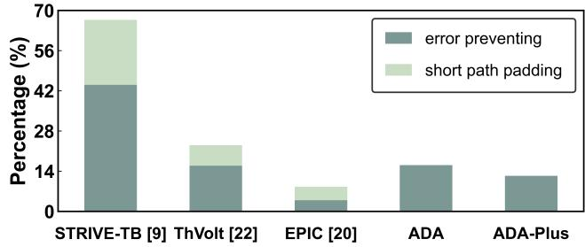  
图 9：电压欠缩放方案的面积开销。  
8 位，该配置在我们的评估中实现了最高的推理准确率。因此，其面积小于 STRIVE-TB。由于不需要进行短路径填充，ADA 的面积开销相比 STRIVE-TB 降低了 75.88%，相比 ThVolt 降低了 30.3%，而总面积开销仅为 16.1%。通过移除前导一和前导零检测逻辑，并简化符号位选择逻辑，ADA-Plus 的面积开销相比 ADA 降低了 23%，总面积开销为 12.4%。得益于定制晶体管级设计固有的面积优势，EPIC 在所有设计中的面积开销最小。

## 4.2 应用

为评估 DNN 推理中 MAC 在电压下调条件下的性能，本研究采用了 [20] 提出的评估方法。使用 Synopsys HSPICE 提取各标准单元在不同供电电压下的延迟，再将这些延迟引入 Synopsys VCS 进行后仿真，以获得最终计算结果。

我们首先使用 VCS\_XA 进行 AMS 仿真，评估 ADA 和 ADA-Plus 在不同 PVT 角点下的表现。由于 AMS 仿真明显慢于数字仿真，我们在一个 8 × 8 脉动阵列上部署了一个 784 × 16 × 16 × 10 的 MLP，对 MNIST 中的 8 张图像进行推理，以评估功耗。将推理过程中所有 PE 的功耗累加，得到最终功耗。使用前述方法，评估上述脉动阵列在不同 PVT 角点下的推理准确率。表 1 展示了基于所提出 MAC 的脉动阵列在各 PVT 角点下的最低工作电压和功耗降低结果。所提出的脉动阵列和原始脉动阵列的最低工作电压 $V _ { \mathrm { { m i n } , } }$ , proposed 和 $V _ { \mathrm { m i n , o r i g i n } } ,$ , 定义为在 MNIST 上准确率损失保持低于 1% 时的电压。表 1 表明，在 OS 和 WS 两种数据流中，配备 ADA 的脉动阵列在大幅下调电压的情况下仍能保持推理准确率。与原始设计相比，其功耗最多可降低 29.19%。对于 OS 数据流，ADA-Plus 在大多数 PVT 角点下的最低工作电压低于 ADA，功耗最多可降低 28.96%。还值得注意的是，由于温度反转效应，最低工作电压会随着温度升高而降低。

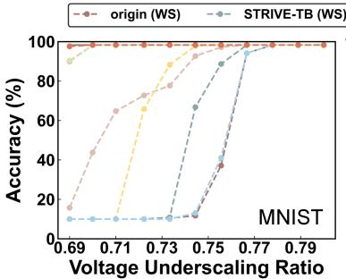

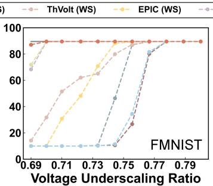

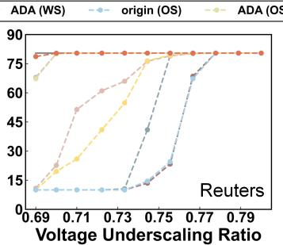

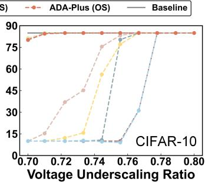  
图 10：电压缩放条件下脉动阵列在 DNN 基准测试上的推理准确率。

表 2：DNN 模型及其无错误时的准确率。

<table><tr><td colspan="3">基准测试</td><td rowspan="2">准确率(%)</td></tr><tr><td>数据集</td><td colspan="2">架构</td></tr><tr><td>MNIST [15]</td><td rowspan="3">MLP</td><td>784×256×256×10</td><td>98.30</td></tr><tr><td>FMNIST [21]</td><td>784×256×256×10</td><td>89.56</td></tr><tr><td>Reuters [1]</td><td>2048×256×256×46</td><td>80.45</td></tr><tr><td>CIFAR-10[14]</td><td>CNN</td><td>卷积: (32, 32, 32)×(32, 32, 32)卷积: (16, 16, 64)×(16,16, 64)卷积: (8, 8, 128)×(8, 8, 128)全连接: 2048×10</td><td>84.90</td></tr></table>

此外，我们在基于各种 MAC 设计的 16 × 16 脉动阵列上部署不同的神经网络，并评估它们在电压下调条件下的推理准确率，其中所有配备 EDaC 设计的脉动阵列均采用 WS 数据流运行。时钟频率固定为 1 GHz。模型配置及其无错误时的准确率汇总于表 2。在 CNN 实验中，未使用批归一化，因此量化后的准确率相对较低。此外，CNN 测试平台执行图像转列（im2col）操作，使脉动阵列仅计算矩阵乘法。由于 im2col 生成的数据量很大，对包含 10k 张图像的完整测试集执行推理需要超过一周的时间。因此，我们随机选择 1000 张图像进行评估，该子集在无错误时的准确率为 84.9%。如图 10 所示，在极低电压下，ADA-Plus 以及应用于两种数据流的 ADA 均显著优于其他设计。采用 ADA 和 ADA-Plus 后，脉动阵列能够在 MLP 的电压下调比为 0.71、CNN 的电压下调比为 0.72 时保持无错误推理。在 MLP 实验中，ADA-Plus 表现最佳，即使电压下调比为 0.69，准确率也几乎没有下降，而基于 EDaC 的设计此时已因准确率严重下降而完全无法使用。在 CNN 实验中，ADA-Plus 和 ADA 的表现相当，均达到 0.7 的最低电压下调比。相比之下，采用先前 EDaC 设计的脉动阵列只能在电压下调比最低为 0.76 时可靠运行。

随后，我们使用与 PVT 角点实验相同的方法评估这些设计的功耗。如图 11 所示，每条功耗曲线中的灰色阴影区域表示配备相应 MAC 设计的脉动阵列在 MNIST 数据集上准确率损失超过 1% 的电压范围，这意味着这些功耗是无效的。比较各设计的最低有效功耗，采用 ADA（OS）、ADA（WS）和 ADA-Plus（OS）的脉动阵列相对于原始脉动阵列分别降低了 19.35%、15.46% 和 17.82% 的功耗。与在标称供电电压下运行的原始脉动阵列相比，这三种设计分别节省了 50.89%、47.55% 和 49.96% 的功耗。此外，在各自的最低有效电压下，ADA 的功耗比 STRIVE-TB 和 ThVolt 分别低 48.44% 和 28.72%。通过支持更低的工作电压，ADA 使脉动阵列的功耗相对于 EPIC 降低了 14.26%。此外，为验证在低电压下于 MAC 中使用 ADA 优于直接采用高速 MAC，我们基于 Synopsys DesignWare[16, 17] 综合了一个采用高速乘法器和加法器的 MAC。相应脉动阵列达到的最低电压下调比为 0.76，功耗为 3.04 mW，比基于 ADA 的脉动阵列高 12.6%。

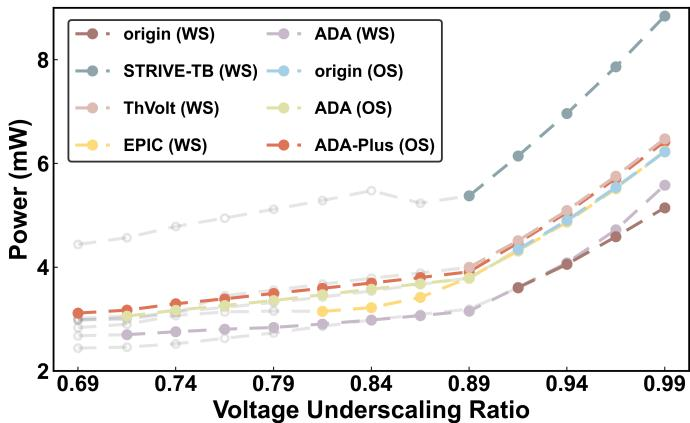  
图 11：由所考察的 MAC 设计构成的脉动阵列在不同电压下调比下的功耗。

## 5 结论

本研究提出了两种位宽调整电路，使 MAC 单元能够在大幅下调电压的情况下可靠运行。ADA 根据前导一或前导零的位置推断输入操作数的有效范围，并仅激活必要的 FA 位，从而仅使用标准单元就能缩短 MAC 单元的关键路径。与先前的门级 EDaC 方案相比，它将面积开销降低了 30.3%–75.88%，同时相对于基准 MAC 仅增加 16.1% 的面积。基于 ADA 的脉动阵列能够分别在电压下调比为 0.71 和 0.72 时保持 MLP 和 CNN 的无错误推理，与在标称供电电压下运行的原始设计相比，最多可节省 50.89% 的功耗。利用输出驻留数据流，ADA-Plus 进一步根据当前部分和预测所需位宽，在准确率相同或更高的情况下，将 ADA 的面积缩减了 23%。在多种网络和数据集上，配备自适应 MAC 的阵列实现了最低的电压下调比，与其他设计相比，阵列级功耗降低了 14.26%–48.44%。

## REFERENCES

[1] 2021. Reuters-21578 dataset. http://kdd.ics.uci.edu/databases/reuters21578/ reuters21578.html.

[2] Chengwei Dai, Kun Li, Wei Zhou, and Songlin Hu. 2025. Capture the key in reasoning to enhance CoT distillation generalization. In Proceedings ofthe 63rd Annual Meeting ofthe Association for Computational Linguistics (Volume 1: Long Papers). 441–465.

[3] Lishuo Deng, Junyi Qian, Zhengguo Shen, Cai Li, Jingchen Wang, Zhangrui Qian, Ziyu Li, Longning Qi, and Weiwei Shan. 2025. A Compound Timing Detection of Both Data Transition and Path Activation for Reliable In Situ Error Detection and Correction. IEEE Transactions on Very Large Scale Integration (VLSI) Systems 33, 10 (2025), 2772–2782. doi:10.1109/TVLSI.2025.3578426

[4] Ronald G Dreslinski, Michael Wieckowski, David Blaauw, Dennis Sylvester, and Trevor Mudge. 2010. Near-threshold computing: Reclaiming moore’s law through energy eficient integrated circuits. Proc. IEEE 98, 2 (2010), 253–266.

[5] Yuxuan Du, Junyi Qian, Zhengguo Shen, Chengjun Wu, Weiwei Shan, and Xi Wang. 2024. DSC-TRCP: Dynamically Self-Calibrating Tunable Replica Critical Paths Based Timing Monitoring for Variation Resilient Circuits. IEEE Journal ofSolid-State Circuits (2024).

[6] Dan Ernst, Nam Sung Kim, Shidhartha Das, Sanjay Pant, Rajeev Rao, Toan Pham, Conrad Ziesler, David Blaauw, Todd Austin, Krisztian Flautner, et al. 2003. Razor: A low-power pipeline based on circuit-level timing speculation. In Proceedings. 36th Annual IEEE/ACM International Symposium on Microarchitecture, 2003. MICRO-36. IEEE, 7–18.

[7] Xinkuang Geng, Siting Liu, Leibo Liu, Jie Han, and Honglan Jiang. 2024. QUQ: Quadruplet Uniform Quantization for Eficient Vision Transformer Inference. In Proceedings ofthe 61st ACM/IEEE Design Automation Conference (San Francisco, CA, USA) (DAC ’24). Association for Computing Machinery, New York, NY, USA, Article 272, 6 pages. doi:10.1145/3649329.3656516

[8] Xinkuang Geng, Yunjie Lu, Hui Wang, and Honglan Jiang. 2025. Segment-Wise Accu mulation: Low-Error Logarithmic Domain Computing for Eficient Large Language Model Inference. In 2025 Design, Automation & Test in Europe Conference (DATE). IEEE, 1–7.

[9] Noel Daniel Gundi, Zinnia Muntaha Mowri, Andrew Chamberlin, Sanghamitra Roy, and Koushik Chakraborty. 2023. STRIVE: Enabling Choke Point Detection and Timing Error Resilience in a Low-Power Tensor Processing Unit. In 2023 60th ACM/IEEE Design Automation Conference (DAC). 1–6. doi:10.1109/DAC56929.2023.10247879

[10] Sangsu Jeong, Huiwon Yun, Dongkwon Lee, Sunwoo Lee, Minyoung Kang, and Dong suk Jeon. 2025. An 83.16-TOPS/W Voltage-Scalable Time-Domain CNN Accelerator

with Full-Swing Delay Cell and Gray-Code TDC in 28-nm CMOS. In 2025 IEEE Custom Integrated Circuits Conference (CICC). 1–3. doi:10.1109/CICC63670.2025.10982877

[11] Ya Jiang, Hongbo Lan, Qing Wang, and Shutong Niu. 2025. Multi-modal Streaming ASR in Cross-talk Scenario for Smart Glasses. In ICASSP 2025-2025 IEEE International Conference on Acoustics, Speech and Signal Processing (ICASSP). IEEE, 1–5.

[12] Norman Jouppi, Clif Young, Nishant Patil, and David Patterson. 2018. Motivation for and Evaluation of the First Tensor Processing Unit. IEEE Micro 38, 3 (2018), 10–19. doi:10.1109/MM.2018.032271057

[13] Sehoon Kim, Coleman Hooper, Thanakul Wattanawong, Minwoo Kang, Ruohan Yan, Hasan Genc, Grace Dinh, Qijing Huang, Kurt Keutzer, Michael W. Mahoney, Yakun Sophia Shao, and Amir Gholami. 2023. Full Stack Optimization of Transformer Inference: a Survey. arXiv:2302.14017 [cs.CL] https://arxiv.org/abs/2302.14017

[14] Alex Krizhevsky, Geofrey Hinton, et al. 2009. Learning multiple layers of features from tiny images. (2009).

[15] Y. LeCun and C. Cortes. 2010. MNIST handwritten digit database. http://yann.lecun. com/exdb/mnist/.

[16] Synopsys. 2024. DesignWare DW01\_add. https://www.synopsys.com/dw/ipdir.php? c=DW01\_add.

[17] Synopsys. 2024. DesignWare DW02\_mult. https://www.synopsys.com/dw/ipdir. php?c=DW02\_mult

[18] Yamilka Toca-Díaz, Rubén Gran Tejero, and Alejandro Valero. 2024. Ensuring the Accuracy of CNN Accelerators Supplied at Ultra-Low Voltage. In 2024 IEEE 42nd International Conference on Computer Design (ICCD). 92–95. doi:10.1109/ICCD63220. 2024.00024

[19] Jianyuan Wang, Minghao Chen, Nikita Karaev, Andrea Vedaldi, Christian Rupprecht, and David Novotny. 2025. Vggt: Visual geometry grounded transformer. In Proceedings of the Computer Vision and Pattern Recognition Conference. 5294–5306.

[20] Tongjing Wu, Xiaolu Hu, Tong Li, Siting Liu, Hui Wang, Weifeng He, Zhigang Mao, and Honglan Jiang. 2025. EPIC: Error PredIction and Correction for Power-Eficient Voltage Underscaling Multiply-Accumulate Unit. In 2025 62nd ACM/IEEE Design Automation Conference (DAC). 1–7. doi:10.1109/DAC63849.2025.11132540

[21] Han Xiao, Kashif Rasul, and Roland Vollgraf. 2017. Fashion-mnist: a novel image dataset for benchmarking machine learning algorithms. arXiv preprint arXiv:1708.07747 (2017).

[22] Jef Zhang, Kartheek Rangineni, Zahra Ghodsi, and Siddharth Garg. 2018. Thundervolt: enabling aggressive voltage underscaling and timing error resilience for energy eficient deep learning accelerators. In Proceedings of the 55th Annual Design Automation Conference. 1–6.

> 中文翻译与解读由 Codex/GPT 根据所提供的论文 PDF 生成。PDF 使用 MinerU 解析，乱码数学符号已对照原文校正；参考文献保留原文。技术总结和通俗讲解属于解读，请与全文译文结合阅读。[原文 DOI](https://doi.org/10.1145/3770743.3804327)。
