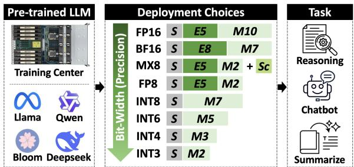
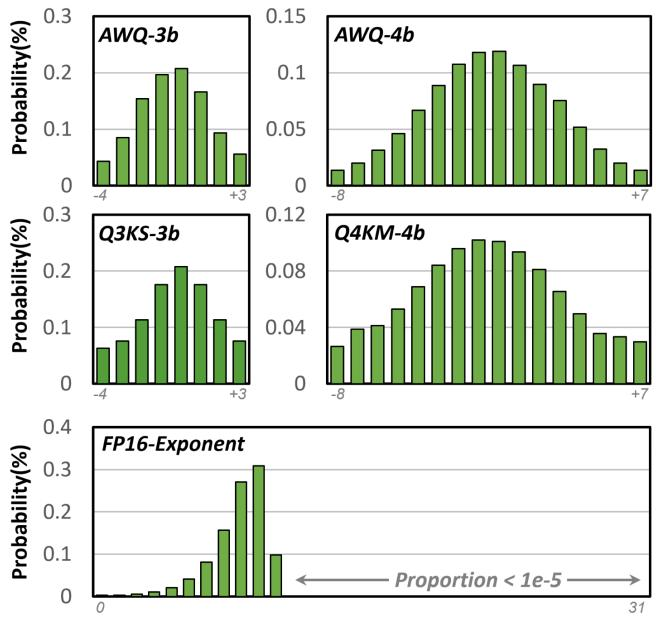
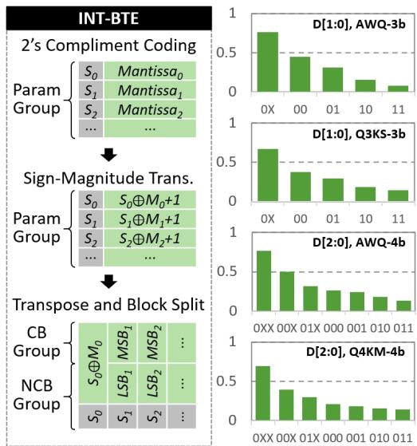
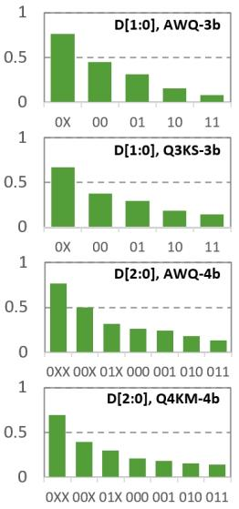
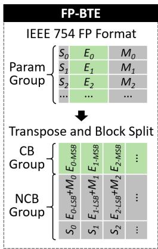
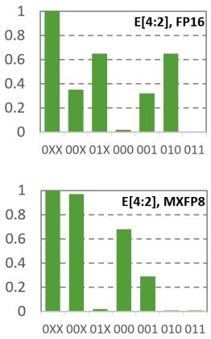
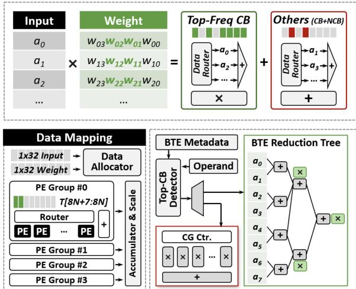
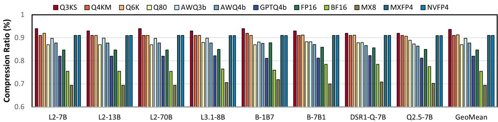
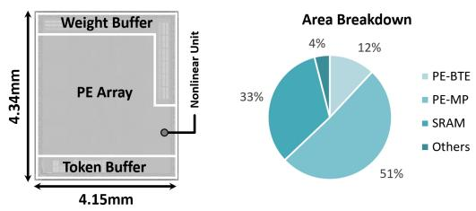
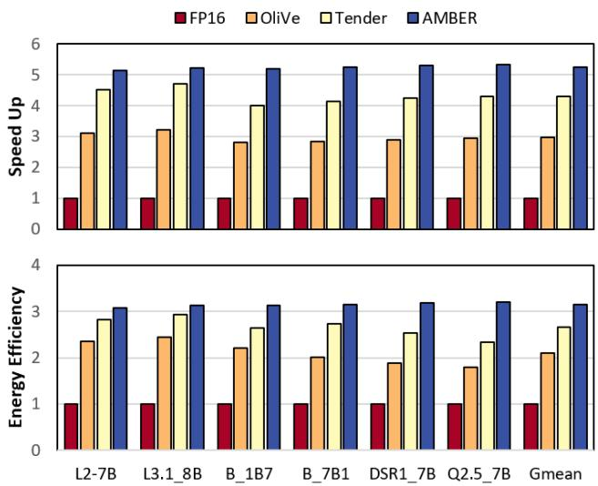

# AMBER: A Unified Accelerator for Multi-Precision LLM Inference Exploiting Bit-Level Redundancy and Reconfigurability 原文翻译

# AMBER：利用位级冗余与可重构性的统一多精度 LLM 推理加速器

Yubin Qin, Yang Wang, Zhiwei Lin, Yushu Zhao, Xiaolong Yang, Zhiheng Yue, Huiming Han,

Yang Hu, Shouyi Yin

清华大学

中国，北京

wangyang\_imec@mail.tsinghua.edu.cn,yinsy@tsinghua.edu.cn

## 摘要

现代 LLM 使用多种整数、浮点和微缩放（MX）精度，但大多数加速器仅针对少数格式进行了优化。我们提出 AMBER，这是一种通用 LLM 加速器，用于在云端和边缘端实现即插即用的多精度部署，以及权重和 KV 缓存压缩。AMBER 引入位转置编码，利用位级统计分布的集中性，对 INT、FP 和 MX 所有格式实现无损压缩。一种与精度无关、采用分级流水线的位串行 PE 进一步利用位级冗余，实现高效的多种精度计算。在 8 个 LLM 和 10 种格式上的评估表明，AMBER 将内存效率提升至 1.17×，将计算性能提升至 3.16×，在吞吐量和能耗方面优于 Olive 和 Tender。

## 关键词

大语言模型，加速器，量化

## ACM 参考文献格式：

Yubin Qin, Yang Wang, Zhiwei Lin, Yushu Zhao, Xiaolong Yang, Zhiheng Yue, Huiming Han,, Yang Hu, Shouyi Yin. 2026. AMBER: A Unified Acceler ator for Multi-Precision LLM Inference Exploiting Bit-Level Redundancy and Reconfigurability. In 63rd ACM/IEEE Design Automation Conference (DAC ’26), July 26–29, 2026, Long Beach, CA, USA. ACM, New York, NY, USA, 7 pages. https://doi.org/10.1145/3770743.3804004

## 1 引言

大语言模型（LLM）如今已大规模支撑编程、决策和创作等任务 [2, 3, 25]。强大开源模型 [1–3] 的迅速崛起扩大了其应用范围，但推理成本仍然高昂：运行 GPT 级别服务的成本可达 \$700,000/day。即便是更轻量的模型（例如 LLaMA 3 [1]），也需要高端 GPU 才能实现实时使用。这些成本源于不断增长的参数量（从 GPT-2 的 117M 增长至据报道 GPT-4 的万亿级）和持续膨胀的 KV 缓存；对于一个 7B 模型，采用 FP16 的 32K-token KV 缓存可能超过 32 GB，与模型权重的大小相当。

量化是一种切实可行的应对方法，通过用低位宽整数替代高位宽浮点数，减少内存占用和带宽需求。成熟的方法可将 FP16 压缩为 INT8 [4, 30]，甚至 INT4/INT3 [6, 7, 19, 20, 31]。将 KV 缓存量化为 INT8/INT4 或混合 INT/FP 格式，可进一步减少动态内存占用 [4, 9, 12, 20]。其他格式（例如 FP4 [21]、微缩放 [27]）也展现出潜力，许多流行的 LLM 都提供了量化版本 [1, 3]。

  
图 1：部署大语言模型的典型量化方法。

然而，在多样化量化配置下实现高效推理仍然困难。在实践中，INT/FP/MX 的位宽范围为 1–16 位，部署时往往会在不同层或不同 token 之间混用精度（例如 llama.cpp 的 Q4\_K\_M）[8]，或者对离群值、权重和 KV 缓存分别采用不同策略 [12, 19]。这种异构性给硬件带来了压力：权重、激活和 KV 缓存可能各自使用不同格式（例如 W4A8KV4、W6A8KV8），因而需要超越传统混合精度的多精度乘累加（MP-MAC）[23]。内存压力也依然存在：即便是 7B 模型，其 4 位权重也需要 ∼2 GB；70B 模型则超过 35 GB，超出了消费级 GPU 的容量。既有工作仅针对其中部分问题——专用格式 [9, 16, 26, 31]、压缩 [15]，或为 W4AF16 等固定组合定制的 PE [13, 23, 26]——但通常需要微调，或者仅支持范围有限的位宽集合。目前仍缺少能够统一处理异构计算与存储的通用加速器。

我们提出 AMBER，这是一种面向边缘端 LLM 多精度推理的统一加速器。AMBER 提供针对实际使用格式进行优化的即插即用架构，而非发明新的、面向特定任务或精度的格式。在存储方面，位转置编码（BTE）利用位级分布的偏向性，实现无损动态压缩，并融合解码与计算。在计算方面，频次感知的强度削减利用位级统计特性来提高吞吐量。最后，位级可重构 PE 流水线将 INT/FP/MX 运算分解为统一流程，使任意位宽下的高效 MP-MAC 成为可能。

本文的主要贡献如下：

• 我们提出一种位转置编码（BTE）方案，利用模型权重和 KV 缓存固有的位级统计冗余对其进行压缩。BTE 格式支持无损压缩，并引入解码与计算融合机制，以尽量降低运行时的解压缩开销。

• 我们进一步利用位级重复性，将共享乘数融合为一次操作，从而降低计算强度。

• 我们采用 28nm CMOS 工艺实现 AMBER，并使用 6 个典型 LLM 和 12 种常用量化配置进行评估，结果表明，相较于现有基线，平均加速比为 3.32×，压缩比为 85.8%。

## 2 背景与动机

## 2.1 大语言模型与量化

LLM 由多个 Transformer 层堆叠而成（包括注意力、线性、归一化和激活）。在自回归解码过程中，每个新 token 都经过 N 个解码器层；对于隐藏维度 d 和输出长度 l，权重访问量随 $l d ^ { 2 }$ 增长，KV 读取量随 l2d 增长。对于典型的 LLM 工作负载，在常见设置下，线性层主导内存访问和计算；批处理可通过权重复用带来收益，但主要体现在输出长度较长且批量较大的情况下，而这些情况在边缘设备上并不常见。因此，优化 QKV 和 FFN 线性层至关重要；KV 优化在小批量时最为重要。

量化通过用紧凑的整数或混合格式（INT8、INT4、INT2）替代 FP16/BF16 来降低成本 [5]。混合精度方案按重要性分配位数：针对权重的方案包括 Olive [9]、AWQ [19] 和 llama.cpp 的 Q4\_K\_M [8]；针对激活的方案包括 SmoothQuant [30] 和 QServe [20]；针对 KV 缓存的方案包括 KVQuant [12]、PM-KVQ [22] 和 Oaken [14]。FP4 和微缩放（MX）等新格式进一步减少了内存占用 [21, 27]。然而，低位宽模型在推理和算术任务上的表现可能下降 [18]。因此，实际部署需要对权重、激活和 KV 缓存提供从 INT2 到 FP16，以及 MX 等混合格式的灵活支持。

## 2.2 现有 LLM 加速器及其局限性

近期的加速器和协同设计框架通过压缩/量化 [9, 16, 26]、存储感知架构 [15] 以及定制的混合精度计算 [13, 23] 来改进 LLM 推理。表 1 总结了具有代表性的设计。然而，这些方案并不具备通用性。许多方案依赖校准、微调或重新训练来恢复压缩后的精度 [10]，这增加了部署成本，并削弱了即插即用的能力。另一些方案则通过专用布局或数值编码将精度固化，例如定制的矩阵格式或固定的 INT4/INT8/FP8 内核 [9, 10, 13]，使其难以支持异构位宽，以及在权重、激活和 KV 缓存之间实现真正的多精度执行。在低位宽、较简单工作负载（例如 INT3/INT4 语言建模）上表现良好的系统，往往无法针对推理和数学密集型任务所需的更高精度配置（FP8/FP16 或混合 MX）进行优化，或者无法在各组件之间提供一致的支持 [13, 19, 27]。最接近通用性目标的尝试是 All-Rounder [24]，它通过选定的指数、尾数与整数混合配置提供了部分可重构性，但仍无法满足现代 LLM 中数据类型多样性的需求，也未解决大规模场景下权重和 KV 带来的巨大内存负担。这些局限性促使我们提出

  
图 2：Llama-2-7B 模型在原始 FP16 格式下，以及使用 AWQ 和 llama.cpp 框架进行 3 位 / 4 位量化后的量化值分布。横轴表示量化后的数值：INT3 为 –4 至 +3，INT4 为 –8 至 +7；FP16 则为 5 位指数。

AMBER，这是一种即插即用的统一软硬件方案，可持续支持从 INT2 到 FP16 和 MX 的高效多精度推理，无需重新训练或针对特定精度重新设计。

表 1：AMBER 与最先进的 LLM 加速架构和框架的比较。

<table><tr><td>框架</td><td>支持的数据类型</td><td>是否需要训练</td><td>硬件设计</td><td>精度损失</td></tr><tr><td>ANT[10]</td><td>特定类型</td><td>是</td><td>复杂</td><td>有损</td></tr><tr><td>AWQ[19]</td><td>INT3/4</td><td>否</td><td>简单</td><td>尚可</td></tr><tr><td>Olive[9]</td><td>特定类型</td><td>否</td><td>复杂</td><td>有损</td></tr><tr><td>FIGNA[13]</td><td>INT4/8</td><td>否</td><td>简单</td><td>尚可</td></tr><tr><td>Tender[16]</td><td>INT4/8</td><td>否</td><td>简单</td><td>尚可</td></tr><tr><td>OmniQuant[28]</td><td>INT2/3/4/6</td><td>否</td><td>复杂</td><td>尚可</td></tr><tr><td>Microscaling[27]</td><td>MXINT8</td><td>是</td><td>简单</td><td>尚可</td></tr><tr><td>AMBER（本文方法）</td><td>INT, FP, MX</td><td>否</td><td>简单</td><td>无损</td></tr></table>

## 3 位转置编码方法

为了提高多种量化格式下的存储效率，我们提出了一种称为位转置编码（BTE）的无损压缩方案。BTE 沿位维度重组模型参数，识别分布存在偏斜的位，并仅对这些位应用变长熵编码。这使得 FP、MX 和 INT 格式能够采用统一的压缩策略，同时实现较高的内存利用率和较低的硬件开销。

  
图 3：用于分布分析的基于整数的位转置变换原理，以及使用 AWQ 和 llama.cpp 将 Llama-2-7B 模型量化为 3 位 / 4 位后的实验结果。

## 3.1 位级分布偏斜与 BTE 原理

LLM 的参数近似服从类高斯分布，即使经过低位宽量化，大多数值仍集中在零附近。图 2 展示了 LLaMA-2-7B 在 FP16 格式下，以及使用 AWQ [19] 和 llama.cpp [8] 量化为 3 位/4 位后的数值分布。超过 70% 的权重落在零附近（对于 INT）或 $\pm 2 ^ { - 1 }$ 附近（对于 FP）的狭窄范围内。与传统 CNN 相比，LLM 权重的集中程度较低 [10, 30]，这降低了 Deep Compression [11] 等以高度不均衡分布为前提的权重共享和聚类方案的有效性。

  
图 4：用于分布分析的基于浮点数的位转置变换原理，以及 Llama-2-7B 模型参数的实验结果。

BTE 利用量化权重的位级统计特征，而非直接对完整数值进行操作。我们用 D[x] 表示以符号-幅值形式表示的数值的第 x 位。图 3 和图 4 展示了位转置变换，以及 FP16、MXFP8、INT3 和 INT4 由此得到的位分布。对于 FP 格式，指数分布高度偏斜：在 FP16 中，−8 至 −5 附近的四个指数编码占出现次数的 80% 以上，而指数的最高有效位几乎总为零。对于 INT 格式，我们观察到幅值位中存在显著的前导零模式。例如，在 INT3 中，约 70% 的数值的第二位（D[1]）为零，并且在不同量化设置下，约一半权重中会出现联合模式 D[1]D[0] = 00。在 INT4 中，大多数数值的幅值最高有效位中会出现一个或多个前导零。相比之下，符号位和最低有效位的 0/1 分布近乎均匀，因此难以压缩。

这些观察揭示了部分位中的冗余，并促使我们提出一种逐位压缩方案。BTE 首先对每个张量应用位转置变换，将所有数值的第 x 位归为一组（图 3 和图 4）。随后，它将各个位划分为两组：

• 压缩位（CB）：分布具有明显偏斜的位，例如 INT 格式中幅值的最高有效位，或 FP/MX 格式中的指数位。

• 非压缩位（NCB）：分布近乎均匀的位，包括最低有效位（LSB）、尾数位和符号位。

BTE 仅对 CB 应用变长熵编码（动态霍夫曼编码），并以定长形式存储 NCB。通过这种方式，BTE 在保留无损重构能力的同时，避免了压缩无结构位所产生的开销。

对于每个张量，BTE 会 (i) 转置各个位，(ii) 分析逐位直方图，以选择 CB 的数量（第 III.B 节），以及 (iii) 对 CB 组进行熵编码，同时直接存储 NCB 组。压缩数据和未压缩数据存储在彼此分离的连续区域中，但遵循原始量化粒度（例如，在我们的设计中，INT 为 128，MXFP 为 32，FP16 为 128）。CB 和 NCB 数据块（MXFP 通常为 32 × n，其他格式通常为 128 × n，其中 n 为平均压缩位宽）与 DRAM 突发传输大小对齐，避免了额外的调度开销。BTE 以 32 个数值为一个操作单元，与第 4.1 节中的计算单元组织方式一致，从而简化了地址生成并提高了硬件效率。

压缩在模型准备阶段离线执行。推理时，仅加载压缩后的参数以及少量码本/元数据，由易于硬件实现的解码器即时重构 CB，从而实现对原始量化权重的低延迟访问。

## 3.2 最优压缩位选择

传统的变长压缩方案（如 Deep Compression [11]）对完整数值进行操作。相比之下，BTE 仅压缩部分比特（CB），其余比特保持未压缩状态。这种选择性压缩使统一的硬件设计成为可能，既能支持多种数据精度，又能保持较小的码本和简单的解码器。

为了确定每种数据类型应压缩多少个比特，我们分析了 CB 数量对整体压缩比的影响。表 2 给出了 LLaMA-2-7B 在各种 FP、

表 2：LLaMA-2-7B 上各种数据类型在不同压缩位（CB）数量下的 BTE 压缩比（压缩后大小/原始大小）。

<table><tr><td>数据类型</td><td colspan="5">压缩比</td></tr><tr><td></td><td>CB6</td><td>CB5</td><td>CB4</td><td>CB3</td><td>CB2</td></tr><tr><td>FP16-EXP</td><td>-</td><td>84.9%</td><td>85.2%</td><td>86.3%</td><td>94.1%</td></tr><tr><td>BF16-EXP</td><td>73.0%</td><td>75.3%</td><td>84.1%</td><td>87.9%</td><td>94.2%</td></tr><tr><td>MX8-E5M2</td><td>-</td><td>67.2%</td><td>68.3%</td><td>87.8%</td><td>92.1%</td></tr><tr><td>FP4-E2M1</td><td>-</td><td>-</td><td>91.1%</td><td>91.4%</td><td>92.9%</td></tr><tr><td>INT8</td><td>88.1%</td><td>88.1%</td><td>88.1%</td><td>89.3%</td><td>92.6%</td></tr><tr><td>INT6</td><td>-</td><td>90.2%</td><td>90.2%</td><td>91.7%</td><td>93.1%</td></tr><tr><td>INT4</td><td>-</td><td>-</td><td>91.4%</td><td>91.6%</td><td>93.3%</td></tr><tr><td>INT3</td><td>-</td><td>-</td><td>-</td><td>93.4%</td><td>93.4%</td></tr></table>

MX 和 INT 格式以及不同 CB 数量下的压缩比（压缩后大小除以原始大小）。对于 FP 格式（FP16、BF16），BTE 压缩指数位，这些比特具有较强的稀疏性，非常适合熵编码。对于 INT 格式（INT3–INT8），BTE 压缩所有幅值位，仅保留符号位不压缩，因为符号通常接近均匀分布。增加 CB 数量通常能改善压缩效果，但也会增加编码/解码成本和元数据大小。

通过对不同模型、数据类型和任务的分析（第 5.1 节），我们发现，适中的 CB 设置能实现最佳权衡。对于 FP16、BF16 和 MX8，分别压缩 3、4 和 4 个比特，可以在开销较低的情况下获得接近最优的压缩效果。对于 INT3、INT4、INT6 和 INT8，分别使用 2、2、4 和 4 个 CB 的效果最佳。我们观察到，CB 与压缩比之间的定性关系在不同模型和规模下保持稳定，因此可以使用校准集离线确定最优 CB 数量。在实践中，许多广泛使用的格式（例如 FP16、FP4、INT8、INT6、INT4）在 CB= 4 时就已能实现出色的压缩效果，而某些格式则可以从 CB= 5 或更高的设置中获益。因此，我们的硬件针对 CB= 4 这一常见情况进行优化，同时保留可重配置能力，以便在需要时高效支持其他 CB 配置。

## 4 AMBER 加速器的硬件设计 4.1 总体架构

AMBER 是一种支持 BTE 的加速器，能够基于压缩权重端到端地执行 Transformer 层。该芯片由以下部分组成：带有指令缓存和解码器的轻量级控制核心、用于存储激活值的词元缓冲区、用于存储 BTE 压缩参数和 KV 缓存的权重缓冲区、支持 BTE 的 PE 簇阵列，以及用于执行 softmax、归一化和激活函数的非线性引擎。

运行时，AMBER 以 BTE 压缩形式从片外 DDR 流式传输模型权重和 KV 缓存。静态权重的压缩在模型准备阶段离线完成，而 KV 张量则使用预先选定的 BTE 配置进行在线压缩。控制器通过向 PE 阵列发出微操作，协调 QKV 投影、注意力和 MLP 层的执行。每个 PE 簇接收一个激活值和压缩权重分块，仅即时解码 CB，并执行矩阵–向量或矩阵–矩阵运算。这种组织方式使压缩收益直接体现在计算结构中，同时保留标准的 Transformer 工作流程，并允许通过常规的张量并行和流水线并行实现多芯片扩展。

  
图 5：用于计算强度削减的 BTE 解码器和 PE 单元的设计细节。

## 4.2 BTE 解码器与计算强度削减

图 5 展示了 BTE 解码器与 PE 阵列的集成方式。每个 PE 阵列每周期处理 32 个输入通道，并划分为 4 个 PE 组，每组包含多精度 PE 和一个本地 BTE 解码器。对于给定的量化权重分块，BTE 将所有数值中最高有效的幅值位（CB）分组，并使用变长码对其进行编码，如第 3 节所述。在推理时，解码器重建这些 CB，并将其与相应的激活值一起送入专用的归约数据通路。

MAC 计算经过重新组织，以利用高频 CB 模式的高复用性。经过符号–幅值转换后，少数 CB 模式在分布中占据主导地位，例如 INT4 中的 00、01 和 10。AMBER 首先累加具有相同 CB 模式的激活值，然后将累加和与共享的 CB 值相乘一次，以此取代将每个激活值与其权重独立相乘的方式。利用乘法和加法的结合律，这种变换将大量 MAC 操作化为少量加法，以及每种模式对应的一次乘法，从而降低计算强度和能耗。

离线 BTE 分析生成的元数据记录了哪些 CB 模式被视为高频模式。这些元数据存储在每个 PE 阵列内部的小型寄存器文件中。执行期间，路由网络利用这些元数据，将高频 CB 模式对应的操作数送入 BTE 归约树，同时将其余低频 CB 和 NCB 转发至常规 MAC 单元。归约树通过紧凑的加法树聚合每种选定 CB 模式对应的激活值，然后使用共享乘法器进行运算。归约数据通路和常规 MAC 通路的输出经过累加，生成 PE 输出。通过这种方式，与相同 CB 的重复乘法被成本更低的加法取代，同时仍能保证所有权重（包括罕见模式）的计算正确性。

为保持硬件精简，AMBER 针对每种数据类型仅处理频率最高的一种或两种 CB 模式，这些模式已占整数格式中大多数非零 CB 的出现次数。在处理 FP 或 MX 格式时，有用的 CB 模式仅出现在指数位中，能够提供的归约机会有限，因此 BTE 归约树通过时钟门控完全关闭。这种选择性启用机制确保 BTE 专用逻辑能够带来切实的节省，同时不降低基准 MAC 效率。

## 4.3 多精度 PE 支持

AMBER 中的 PE 使用一条较短的共享流水线，支持整数、浮点和 MX 格式，无需为其分别配置独立的数据通路。位串行乘法器处理不同精度的尾数乘积或整数乘积，轻量级指数/缩放通路仅在处理 FP 和 MX 格式时启用，而公共累加树则合并来自 BTE 归约通路和常规 MAC 通路的部分和。最后的归一化和可选的再量化根据层配置，将结果转换为 FP 或低比特 INT 输出。

与传统的异构 PE 设计相比，这种统一的 PE 结构使多精度支持带来的额外成本保持较低水平。结合 BTE 解码器和计算强度削减，它使 AMBER 能够在同一硬件上执行多种量化和浮点 LLM 工作负载，同时实现 BTE 带来的压缩和计算收益。

## 5 评估结果

本节在具有代表性的 LLM 和量化格式上评估基于 BTE 的压缩方法和 AMBER 加速器。我们报告压缩率、相较于 FP16 基线加速器的计算效率和能效提升，以及与最先进的 LLM 加速器相比的性能。

## 5.1 实验设置

我们在 LLaMA-2-7B/13B/70B、LLaMA-3.1-8B、Bloom-1B7/7B1、DeepSeek-R1-Qwen-7B 和 Qwen-2.5-7B 上评估 AMBER。每个模型均在 FP16 格式以及常见量化方案下进行测试，包括 AWQ-3b/4b、GPTQ-4b、llama.cpp Q3\_K\_S、Q4\_K\_M、Q6\_K、Q8\_0、MX8、NVFP4 和 MXFP4。我们使用来自 Hugging Face、AWQ、GPTQ 和 llama.cpp 的公开模型及量化实现 [7, 8, 29]。通过在 Wikitext-2 和 GSM8K 上运行 LLaMA-2 模型来收集 KV 缓存，并使用 LLM.int8() [4] 进行量化。由于 BTE 在数学上是无损的，所有量化模型的精度均与其开源版本完全相同，因此我们重点关注存储效率和能效。

AMBER 使用 Verilog RTL 实现，并使用 Synopsys Design Compiler 在台积电 28 nm 工艺下进行综合。使用 ICC2 完成布局布线，并使用 VCS 和 PrimeTime PX 评估时序和功耗。使用 DRAMSim3 [17] 对 DDR4 片外存储器行为进行建模。作为基线，我们构建了 FP16 和 INT4 加速器，它们与 AMBER 采用相同的存储层次结构和控制架构，但使用常规 PE。此外，我们还使用 Olive 和 Tender 所报告的配置，与这两款最先进的量化 LLM 加速器进行比较。

## 5.2 使用 BTE 进行模型压缩

图 6 汇总了 BTE 在 8 个 LLM 和 10 种量化格式下的压缩率。对于整数量化模型，BTE 压缩后的大小约为原始大小的 81% 至 94%；较低位宽格式由于数值范围已经较为紧凑，通常可进一步压缩的空间较小。在 3–8 位 llama.cpp 格式中，3、4、6 和 8 位权重的平均压缩率分别约为 93.6%、91.0%、91.3% 和 87.0%。AWQ-3b、AWQ-4b 和 GPTQ-4b 表现出更强的位级局部性，从 BTE 中获益更多，平均压缩率分别达到 89.8%、87.7% 和 82.0%。

浮点和 MX 格式的可压缩性更高，因为指数位的利用率很低。对于 FP16、BF16 和 MXFP8，压缩后的大小平均分别约为原始大小的 84.6%、75.5% 和 69.3%。KV 缓存也表现出类似的逐位聚集特征；BTE 在 FP16 下可将其压缩至原始大小的约 85%，使用 LLM.int8() 量化时则可获得略好的压缩率。总体而言，这些结果证实，采用 CB = 4 的单一配置，便能在不同模型、不同精度以及权重和 KV 缓存上实现稳健的压缩。

## 5.3 硬件性能与能效

在 800 MHz 和 1.0 V 下，布局布线后的结果显示，AMBER 的面积为 18.03 mm2，功耗约为 0.65 W。PE 阵列在这两项指标中均占主导地位，而 BTE 相关逻辑（解码器和计算强度削减模块）给 PE 阵列带来的面积开销低于 10%，并且得益于积极的时钟门控，其动态能耗仅占 PE 阵列动态能耗的一小部分。与直接在压缩权重上执行计算所获得的收益相比，这一开销较小。

我们测试了 AMBER 在各种量化格式下相较于 FP16 基线的计算能效提升。对于 Q3\_K\_S 和 AWQ-3b 等 3 位模型，AMBER 将低位宽数据通路与针对常见 CB 模式的计算强度削减相结合，计算效率分别提升约 5.7× 和 6.0×。GPTQ-4b 以及 llama.cpp 的 4、6 和 8 位格式分别获得约 5.2×、4.7×、3.2× 和 2.6× 的提升。FP16 和 BF16 模型仍能获益，但提升幅度较小（约 1.1×），主要是因为与基于 E8M10 的基线相比，数据通路更窄且缓冲更高效。MXFP8 通过利用共享缩放和位串行 MAC，实现了约 2.3× 的效率提升。

这些收益来自存储器流量的减少和运算强度的降低。在代表性模型的典型 FP16 运行中，基于 BTE 的权重和 KV 缓存压缩使存储器能耗降低约 1.8×，而感知 BTE 的计算强度削减在计算侧又带来约 1.3× 的提升。统一的多精度 PE 设计相较于常规可重配置 PE 额外带来约 ∼1.3× 的提升，使得相较于 FP16 基线加速器的综合端到端增益约为 3.3×。

## 5.4 与最先进的 LLM 加速器比较

为评估系统级性能，我们使用 GPTQ-4b 模型，将 AMBER 与 Olive 和 Tender 进行比较，与这些设计采用的 4 位设置保持一致。图 8 展示了不同系列和规模的 8 个 LLM 的吞吐量和能效。平均而言，

  
图 6：在各种量化方法下，将 BTE 应用于典型 LLM 模型所获得的压缩率。模型包括 LLaMA-2（L2）、LLaMA-3.1（L3.1）、Bloom（B）、DeepSeek-R1-Qwen（DSR1-Q）和 Qwen-2.5（Q2.5）。

  
图 7：基于 28nm CMOS 工艺的 AMBER 加速器的布局布线后结果及面积构成分析。

AMBER 的吞吐量达到 Olive 的 1.73× 和 Tender 的 1.20×。能效分别提升至 1.46× 和 1.17×。

这些收益源于直接在 BTE 压缩的权重上执行计算、利用 CB 稀疏性和位级重复性降低 MAC 运算强度，以及针对整数和浮点格式复用统一的多精度 PE 流水线。Olive 和 Tender 专门针对特定的低位宽 INT 设置，而 AMBER 在提供相当或更高效率的同时，支持范围显著更广的精度格式，包括 FP16/BF16 和 MXFP 格式。

## 6 结论

本工作提出了 AMBER，这是一款面向 LLM 推理的统一加速器，旨在解决 INT、FP 和 MX 精度格式下的存储和计算低效问题。在存储器层面，AMBER 引入了位转置编码（BTE），利用权重和 KV 缓存中有偏的位级分布，通过单一且硬件友好的配置实现无损压缩。在计算层面，AMBER 将 BTE 解码与多精度 PE 流水线紧密集成，并对常见 CB 模式应用计算强度削减，以减少冗余的 MAC 运算。

在 8 个代表性 LLM 和 12 种精度格式上，BTE 压缩后的大小平均约为原始大小的 85%，AMBER 的计算能效约为 FP16 基线加速器的 3.3×。运行 4 位量化模型时，相较于最先进的 LLM 加速器，AMBER 的吞吐量和能效分别最高提升至 1.73× 和 1.46×。据我们所知，AMBER 是首款即插即用加速器，能够在广泛的标准量化和精度格式下提供通用、无损且高效的 LLM 推理。

  
图 8：在 GPTQ-4b 量化下，AMBER 与最先进的加速器 Olive 和 Tender 的加速比及能效比较。

## 致谢

本工作得到了以下项目和机构的部分支持：国家自然科学基金，资助编号为 62304121、62125403 和 92164301；国家重点研发项目，资助编号为 2023YFB4403100；国家科技重大专项，资助编号为 2022ZD0115201；国家重点研发计划，资助编号为 2021ZD0114400；北京市科技项目 Z221100007722023；北京信息科学与技术国家研究中心；以及北京集成电路高精尖创新中心。

## References

[1] Meta AI. 2024. The Llama 3 Herd of Models. arXiv:2407.21783 [cs.AI] https: //arxiv.org/abs/2407.21783

[2] Alibaba Cloud. 2025. Qwen3 Technical Report. arXiv:2505.09388 [cs.CL] https: //arxiv.org/abs/2505.09388

[3] DeepSeek-AI. 2025. DeepSeek-V3 Technical Report. arXiv:2412.19437 [cs.CL] https://arxiv.org/abs/2412.19437

[4] Tim Dettmers, Mike Lewis, Younes Belkada, and Luke Zettlemoyer. 2022. LLM.int8(): 8-bit matrix multiplication for transformers at scale. In Proceedings of the 36th International Conference on Neural Information Processing Systems (New Orleans, LA, USA) (NIPS ’22). Curran Associates Inc., Red Hook, NY, USA, Article 2198, 15 pages.

[5] Tim Dettmers, Mike Lewis, Sam Shleifer, and Luke Zettlemoyer. 2022. 8-bit Optimizers via Block-wise Quantization. arXiv:2110.02861 [cs.LG] https://arxiv. org/abs/2110.02861

[6] Tim Dettmers, Ruslan Svirschevski, Vage Egiazarian, Denis Kuznedelev, Elias Frantar, Saleh Ashkboos, Alexander Borzunov, Torsten Hoefler, and Dan Alistarh. 2024. SpQR: A Sparse-Quantized Representation for Near-Lossless LLM Weight Compression. In The Twelfth International Conference on Learning Representations, ICLR 2024, Vienna, Austria, May 7-11, 2024. OpenReview.net.

[7] Elias Frantar, Saleh Ashkboos, Torsten Hoefler, and Dan Alistarh. 2022. GPTQ: Accurate Post-Training Quantization for Generative Pre-trained Transformers. CoRR abs/2210.17323 (2022). arXiv:2210.17323 doi:10.48550/ARXIV.2210.17323

[8] ggml org. [n. d.]. llama.cpp. https://github.com/ggml-org/llama.cpp

[9] Cong Guo, Jiaming Tang, Weiming Hu, Jingwen Leng, Chen Zhang, Fan Yang, Yunxin Liu, Minyi Guo, and Yuhao Zhu. 2023. OliVe: Accelerating Large Language Models via Hardware-friendly Outlier-Victim Pair Quantization. In Proceedings ofthe 50th Annual International Symposium on Computer Architecture, ISCA 2023, Orlando, FL, USA, June 17-21, 2023, Yan Solihin and Mark A. Heinrich (Eds.). ACM, 3:1–3:15. doi:10.1145/3579371.3589038

[10] Cong Guo, Chen Zhang, Jingwen Leng, Zihan Liu, Fan Yang, Yun-Bo Liu, Minyi Guo, and Yuhao Zhu. 2022. ANT: Exploiting Adaptive Numerical Data Type for Low-bit Deep Neural Network Quantization. 2022 55th IEEE/ACM International Symposium on Microarchitecture (MICRO) (2022), 1414–1433. https: //api.semanticscholar.org/CorpusID:251928917

[11] Song Han, Huizi Mao, and William J. Dally. 2016. Deep Compression: Compress ing Deep Neural Networks with Pruning, Trained Quantization and Hufman Coding. arXiv:1510.00149 [cs.CV] https://arxiv.org/abs/1510.00149

[12] Coleman Hooper, Sehoon Kim, Hiva Mohammadzadeh, Michael W Mahoney, Yakun Sophia Shao, Kurt Keutzer, and Amir Gholami. 2024. KVQuant: Towards 10 Million Context Length LLM Inference with KV Cache Quantization. arXiv preprint arXiv:2401.18079 (2024).

[13] Jaeyong Jang, Yulhwa Kim, Juheun Lee, and Jae-Joon Kim. 2024. FIGNA: Inte ger Unit-Based Accelerator Design for FP-INT GEMM Preserving Numerical Accuracy. In 2024 IEEE International Symposium on High-Performance Computer Architecture (HPCA). 760–773. doi:10.1109/HPCA57654.2024.00064

[14] Minsu Kim, Seongmin Hong, RyeoWook Ko, Soongyu Choi, Hunjong Lee, Junsoo Kim, Joo-Young Kim, and Jongse Park. 2025. Oaken: Fast and Eficient LLM Serving with Online-Ofline Hybrid KV Cache Quantization. arXiv preprint arXiv:2503.18599 (2025).

[15] Sehoon Kim, Karttikeya Mangalam, Suhong Moon, Jitendra Malik, Michael W. Mahoney, Amir Gholami, and Kurt Keutzer. 2023. Speculative Decoding with Big Little Decoder. arXiv:2302.07863 [cs.CL] https://arxiv.org/abs/2302.07863

[16] Jungi Lee, Wonbeom Lee, and Jaewoong Sim. 2024. Tender: Accelerating Large Language Models via Tensor Decomposition and Runtime Requantization. In Proceedings of the 51st Annual International Symposium on Computer Architecture.

[17] Shang Li, Zhiyuan Yang, Dhiraj Reddy, Ankur Srivastava, and Bruce Jacob. 2020. DRAMsim3: A Cycle-Accurate, Thermal-Capable DRAM Simulator. IEEE Comput. Archit. Lett. 19, 2 (July 2020), 106–109. doi:10.1109/LCA.2020.2973991

[18] Zhen Li, Yupeng Su, Runming Yang, Congkai Xie, Zheng Wang, Zhongwei Xie, Ngai Wong, and Hongxia Yang. 2025. Quantization Meets Reasoning: Ex ploring LLM Low-Bit Quantization Degradation for Mathematical Reasoning. arXiv:2501.03035 [cs.CL] https://arxiv.org/abs/2501.03035

[19] Ji Lin, Jiaming Tang, Haotian Tang, Shang Yang, Wei-Ming Chen, Wei-Chen Wang, Guangxuan Xiao, Xingyu Dang, Chuang Gan, and Song Han. 2024. AWQ: Activation-aware Weight Quantization for On-Device LLM Compression and Acceleration. In Proceedings ofthe Seventh Annual Conference on Machine Learning and Systems, MLSys 2024, Santa Clara, CA, USA, May 13-16, 2024, Phillip B. Gibbons, Gennady Pekhimenko, and Christopher De Sa (Eds.). mlsys.org.

[20] Yujun Lin, Haotian Tang, Shang Yang, Zhekai Zhang, Guangxuan Xiao, Chuang Gan, and Song Han. 2024. QServe: W4A8KV4 Quantization and System Co design for Eficient LLM Serving. CoRR abs/2405.04532 (2024). arXiv:2405.04532 doi:10.48550/ARXIV.2405.04532

[21] Shih-Yang Liu, Zechun Liu, Xijie Huang, Pingcheng Dong, and Kwang-Ting Cheng. 2023. LLM-FP4: 4-Bit Floating-Point Quantized Transformers. In Proceedings of the 2023 Conference on Empirical Methods in Natural Language Processing, EMNLP 2023, Singapore, December 6-10, 2023, Houda Bouamor, Juan Pino, and Kalika Bali (Eds.). Association for Computational Linguistics, 592–605. doi:10.18653/V1/2023.EMNLP-MAIN.39

[22] Tengxuan Liu, Shiyao Li, Jiayi Yang, Tianchen Zhao, Feng Zhou, Xiaohu Song, Guohao Dai, Shengen Yan, Huazhong Yang, and Yu Wang. 2025. PM KVQ: Progressive Mixed-precision KV Cache Quantization for Long-CoT LLMs. arXiv:2505.18610 [cs.CL] https://arxiv.org/abs/2505.18610

[23] Zhiwen Mo, Lei Wang, Jianyu Wei, Zhichen Zeng, Shijie Cao, Lingxiao Ma, Naifeng Jing, Ting Cao, Jilong Xue, Fan Yang, and Mao Yang. 2024. LUT Tensor Core: Lookup Table Enables Eficient Low-Bit LLM Inference Acceleration. arXiv:2408.06003 [cs.AR] https://arxiv.org/abs/2408.06003

[24] Seock-Hwan Noh, Seungpyo Lee, Banseok Shin, Sehun Park, Yongjoo Jang, and Jaeha Kung. 2025. All-Rounder: A Flexible AI Accelerator With Diverse Data Format Support and Morphable Structure for Multi-DNN Processing. IEEE Trans. Very Large Scale Integr. Syst. 33, 5 (Feb. 2025), 1264–1277. doi:10.1109/TVLSI.2025. 3540346

[25] OpenAI. 2024. GPT-4 Technical Report. arXiv:2303.08774 [cs.CL] https://arxiv. org/abs/2303.08774

[26] Yubin Qin, Yang Wang,Jiachen Wang, Zhiwei Lin, Yushu Zhao, Shaojun Wei, Yang Hu, and Shouyi Yin. 2025. 23.8 An 88.36TOPS/W Bit-Level-Weight-Compressed Large-Language-Model Accelerator with Cluster-Aligned INT-FP-GEMM and Bi-Dimensional Workflow Reformulation. In 2025 IEEE International Solid-State Circuits Conference (ISSCC), Vol. 68. 420–422. doi:10.1109/ISSCC49661.2025.10904774

[27] Bita Darvish Rouhani, Ritchie Zhao, Ankit More, Mathew Hall, Alireza Khodamoradi, Summer Deng, Dhruv Choudhary, Marius Cornea, Eric Dellinger, Kristof Denolf, Stosic Dusan, Venmugil Elango, Maximilian Golub, Alexander Heinecke, Phil James-Roxby, Dharmesh Jani, Gaurav Kolhe, Martin Langhammer, Ada Li, Levi Melnick, Maral Mesmakhosroshahi, Andres Rodriguez, Michae Schulte, Rasoul Shafipour, Lei Shao, Michael Siu, Pradeep Dubey, Paulius Micikevicius, Maxim Naumov, Colin Verrilli, Ralph Wittig, Doug Burger, and Eric Chung. 2023. Microscaling Data Formats for Deep Learning. arXiv:2310.10537 [cs.LG] https://arxiv.org/abs/2310.10537

[28] Wenqi Shao, Mengzhao Chen, Zhaoyang Zhang, Peng Xu, Lirui Zhao, Zhiqian Li, Kaipeng Zhang, Peng Gao, Yu Qiao, and Ping Luo. 2024. Omni-Quant: Omnidirectionally Calibrated Quantization for Large Language Models. arXiv:2308.13137 [cs.LG] https://arxiv.org/abs/2308.1313

[29] Thomas Wolf, Lysandre Debut, Victor Sanh,Julien Chaumond, Clement Delangue, Anthony Moi, Pierric Cistac, Tim Rault, Rémi Louf, Morgan Funtowicz, Joe Davison, Sam Shleifer, Patrick von Platen, Clara Ma, Yacine Jernite, Julien Plu, Canwen Xu, Teven Le Scao, Sylvain Gugger, Mariama Drame, Quentin Lhoest, and Alexander M. Rush. 2020. HuggingFace’s Transformers: State-of-the-art Natural Language Processing. arXiv:1910.03771 [cs.CL] https://arxiv.org/abs/1910.03771

[30] Guangxuan Xiao, Ji Lin, Mickael Seznec, Hao Wu, Julien Demouth, and Song Han. 2023. SmoothQuant: accurate and eficient post-training quantization for large language models. In Proceedings of the 40th International Conference on Machine Learning (Honolulu, Hawaii, USA) (ICML’23). JMLR.org, Article 1585, 13 pages.

[31] Ali Hadi Zadeh, Isak Edo, Omar Mohamed Awad, and Andreas Moshovos. 2020. GOBO: Quantizing Attention-Based NLP Models for Low Latency and Energy Eficient Inference. In 2020 53rd Annual IEEE/ACM International Symposium on Microarchitecture (MICRO). IEEE, 811–824. doi:10.1109/micro50266.2020.0007

Received 20 February 2007; revised 12 March 2009; accepted 5 June 2009

> 中文翻译与解读由 Codex/GPT 根据所提供的论文 PDF 生成。PDF 使用 MinerU 解析，乱码数学符号已对照原文校正；参考文献保留原文。技术总结和通俗讲解属于解读，请与全文译文结合阅读。[原文 DOI](https://doi.org/10.1145/3770743.3804004)。
