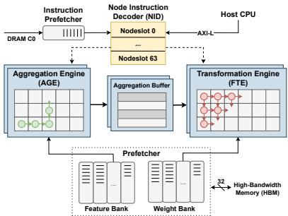
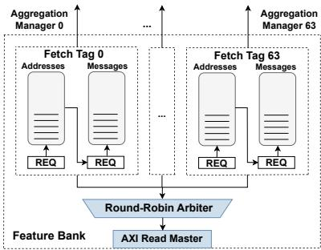
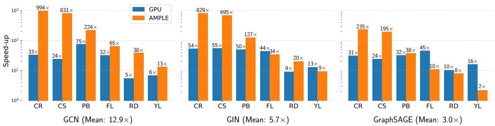
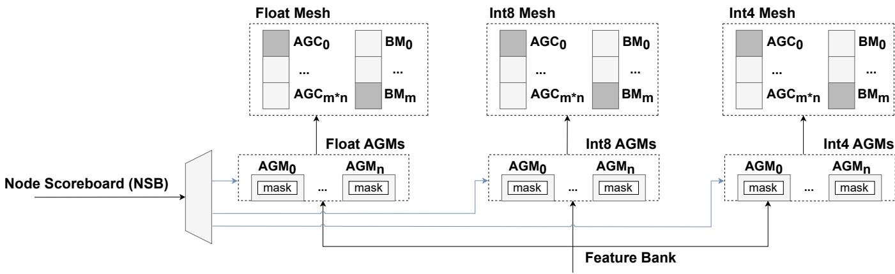

# AMPLE: Event-Driven Accelerator for Mixed-Precision Inference of Graph Neural Networks 论文解析

## 0. 论文基本信息

**作者 (Authors)**: Pedro Gimenes, Aaron Zhao, George Constantinides

**发表期刊/会议 (Journal/Conference)**: EuroMLSys

**发表年份 (Publication Year)**: 2025

**研究机构 (Affiliations)**: Imperial College London

---

## 1. 摘要

**目的**

- 解决现有 GNN FPGA 加速器（如 **HyGCN**、**GenGNN**）的三大短板：
  - **Double buffering 静态流水**机制无法适应图数据中**非均匀的节点度分布**，低度节点被迫等待高度节点，产生大量流水线空泡（pipeline gaps）。
  - 缺乏对**模型量化**的硬件支持，无法利用节点级混合精度降低资源与内存开销。
  - 现有加速器要求整个输入图的 node embedding 全部缓存于片上，难以处理大规模图（>10⁵ 节点）。
- 提出 **AMPLE（Accelerated Message Passing Logic Engine）**，一个事件驱动、支持混合精度、面向大图的 GNN 推理 FPGA 加速器。

---

**方法**

- **事件驱动编程流**
  - 引入 **Node Instruction Decoder（NID）**：内存映射寄存器组，含可配置数量的 **nodeslot**，每个 nodeslot 记录节点 ID、精度、状态机、邻接表指针及更新特征指针。
  - Host 与加速器**并发运行**：主机异步编程 nodeslot，加速器完成后独立撤销 mask 信号并触发中断，nodeslot 可立即被重新编程，实现节点级独立资源分配与调度。
- **混合精度架构**
  - Aggregation Engine 采用 **Network-on-Chip（NoC）** 架构，由**异构多精度处理单元**组成子网络，不同精度（float / int8 / int4）PE 相互隔离以减少 packet 拥塞。
  - 基于 **Degree-Quant** 算法按节点度随机分配精度：高度节点以浮点保护，低度节点量化为定点，按 DegreeQuant 比例用公式推导各精度 nodeslot 数量 $N_p$ 以最大化节点并行度。
- **大图处理与预取**
  - **Feature Bank** 中为每个 nodeslot 配置 **Fetch Tag**，与 Alveo U280 的 32 个 HBM bank 绑定，实现并发访存。
  - **部分响应机制**：高度节点无需一次性载入全部邻居，Fetch Tag 先填满 Message Queue 即解锁 AGE 开始聚合，同时后台继续取数，隐藏访存延迟，降低单 nodeslot 存储需求、提升节点并行深度。
- **整体流水**
  - NID 驱动 Prefetcher → Aggregation Engine（AGE）→ Aggregation Buffer（ABF）→ Feature Transformation Engine（FTE，脉动阵列）的 7 步 dataflow。

 *Fig. 1. AMPLE Top Level Diagram. Packets propagate through dimensionorder routing in the Aggregation Engine’s Network-on-Chip (shown in green), and are driven diagonally into the Transformation Engine’s systolic array (shown in red). Dashed lines represent control flow interfaces, while solid lines represent data flow between units. Node embeddings are fetched through HBM, while instructions are stored in DRAM.*

 *Fig. 3. Fetch Tags in the Feature Bank make concurrent memory access requests in a two-stage process; First, the list of neighbouring node IDs is stored in the Address Queue, and these are then used as pointers for the neighbouring feature embeddings, which are stored in the Message Queue.*

---

**结果**

- 在 6 个数据集（Cora、CiteSeer、PubMed、Flickr、Reddit、Yelp，规模 **2K–700K 节点**）上评测 **GCN、GIN、GraphSAGE** 三种模型。
- DegreeQuant 保护节点比例均低于 **3%**，通常单个 float nodeslot 即可满足精度需求。
- GPU（RTX A6000）相对 CPU（Intel Xeon）平均加速 **29.8×/37.8×/26.7×**（GCN/GIN/GraphSAGE）；AMPLE 对应加速达 **361.3×/285.8×/81.7×**。
- 整体平均：相对 CPU 加速 **243×**，相对 GPU 加速 **7.2×**（200MHz 仿真，Modelsim 19.2 + Vivado 23.1，Alveo U280）。
- GCN 单层推理详细数据：

| 数据集 | CPU 延迟 | GPU 延迟 | AMPLE 延迟 | AMPLE 吞吐 | 加速 |
|---|---|---|---|---|---|
| Cora | 244.4 [ms] | 7.2 [ms] | 0.246 [ms] | 11,022 [nodes/ms] | 994.8× / 29.3× |
| CiteSeer | 244.3 [ms] | 10.1 [ms] | 0.294 [ms] | 11,318.6 | 831.2× / 34.3× |
| PubMed | 362.4 [ms] | 4.8 [ms] | 1.617 [ms] | 12,193.2 | 224.1× / 3.0× |
| Flickr | 475.4 [ms] | 14.5 [ms] | 7.227 [ms] | 12,350.0 | 65.8× / 2.0× |
| Reddit | 953.3 [ms] | 171.0 [ms] | 24.6 [ms] | 9,463.6 | 38.7× / 6.9× |
| Yelp | 760.8 [ms] | 110.9 [ms] | 57.5 [ms] | 12,471.7 | 13.2× / 1.9× |

---

**结论**

- AMPLE 通过**事件驱动编程流**与 NoC 动态资源分配，消除了节点度非均匀分布下的流水线空泡瓶颈。
- **节点级粒度量化**为 GNN 推理提供了首个支持任意混合精度的加速平台，实现最优资源映射，以极小的精度代价换取最大节点并行度。
- 节点级 prefetcher 摆脱了片上缓存全图 embedding 的限制，使 GNN 加速可扩展至社交网络级大规模图数据。
- 综合性能：平均 **243×**（vs CPU）与 **7.2×**（vs GPU）加速，验证了事件驱动 + 混合精度 + 预取三项设计协同的有效性。

---

## 2. 背景知识与核心贡献

**研究背景**

- **Graph Neural Networks (GNNs)** 在处理**非欧几里得数据**方面表现优异，广泛应用于社交网络、生物交互分析和推荐系统等领域。
- GNN 推理可分为两个计算阶段：
  - **Aggregation（聚合）**：对邻居节点的 feature embedding 施加置换不变函数（如求和/均值），但因图数据的稀疏性，产生大量**不规则的内存访问**。
  - **Transformation（变换）**：由全连接层生成更新的节点 embedding，计算模式规则、易于并行。
- 节点度数呈现**高度非均匀分布**，导致聚合延迟随节点不同而差异巨大。

**动机**

现有硬件平台（CPU、GPU 及已有专用加速器）存在以下不足：

- **CPU 局限**：
  - 图数据的稀疏结构使传统 cache 系统失效，节点聚合需频繁访问**非连续内存区域**。
  - 多核并行度有限。
- **GPU 局限**：
  - 受限于**高延迟的内存管理机制**。
  - 缺乏**阶段间流水线（inter-phase pipelining）**支持，聚合结果必须先写回片外存储器再重新读取进行变换。
  - 对**低精度数值格式**的计算支持有限。
- **现有 GNN 加速器（如 HyGCN、GenGNN）的缺陷**：
  - **Double buffering 机制不适配图计算**：节点度数分布不均导致低度数节点必须等待高度数节点，造成大量 pipeline gaps。
  - **缺乏量化硬件支持**：已有研究表明 GNN 的量化误差主要源自聚合阶段且与节点度数相关，节点级混合精度可降低资源占用，但现有加速器均不支持。
  - **片上缓存需求过高**：要求整个输入图的 node embedding 全部缓存于片上，无法处理**大规模图（>100K 节点）**的推理。

**核心贡献**

- **事件驱动的编程模型**：主机通过 memory-mapped registers 异步编程节点，节点独立分配资源与调度，消除 double buffering 引发的流水线空隙。
- **混合精度架构**：
  - 通过 Network-on-Chip (NoC) 连接**异构多精度 Aggregation Cores**，依据节点度数与精度动态分配。
  - 基于 **Degree-Quant** 算法实现**节点级粒度**的量化，将低度数节点映射至低精度格式（如 int8/int4），高度数节点保留 float 精度。
- **节点级预取机制**：实现数据与指令的 prefetcher，隐藏片外内存访问延迟，支持无需片上缓存全图 embedding 的大图推理，最大化节点并行度。
- **性能验证**：在 2K 至 700K 节点的 citation 与 social media 数据集上评估，相对 CPU 平均加速 **243×**，相对 GPU 平均加速 **7.2×**。

 *Fig. 1. AMPLE Top Level Diagram. Packets propagate through dimensionorder routing in the Aggregation Engine’s Network-on-Chip (shown in green), and are driven diagonally into the Transformation Engine’s systolic array (shown in red). Dashed lines represent control flow interfaces, while solid lines represent data flow between units. Node embeddings are fetched through HBM, while instructions are stored in DRAM.*

---

## 3. 核心技术和实现细节

### 0. 技术架构概览

**整体定位**

AMPLE (Accelerated Message Passing Logic Engine) 是一款面向 **GNN 推理**的 FPGA 加速器，部署于 **Alveo U280** 卡，运行频率 **200MHz**。其核心设计目标是解决传统 GNN 加速器的三大缺陷：**double buffering 导致的流水线空泡**、**缺乏量化硬件支持**、以及**无法处理超大图 (>100K 节点) 的片上存储瓶颈**。为此，架构整体围绕 **事件驱动** 的节点调度、**节点级混合精度** 计算和**节点中心预取** 三大机制展开。

 *Fig. 1. AMPLE Top Level Diagram. Packets propagate through dimensionorder routing in the Aggregation Engine’s Network-on-Chip (shown in green), and are driven diagonally into the Transformation Engine’s systolic array (shown in red). Dashed lines represent control flow interfaces, while solid lines represent data flow between units. Node embeddings are fetched through HBM, while instructions are stored in DRAM.*

---

**顶层功能单元**

AMPLE 由五个核心功能单元构成，形成从取数、聚合到变换的完整数据通路：

- **Node Instruction Decoder (NID)**：与主机通信的核心控制单元，本质是一组内存映射的 **nodeslot 寄存器组**。主机通过异步写入 nodeslot 编程节点任务，加速器独立完成计算后清除 mask 并发出中断，实现节点粒度的 **event-driven** 控制流。
- **Prefetcher**：负责将层权重和邻居特征 embedding 预取到片上 **Weight Bank** 与 **Feature Bank**，隐藏片外访存延迟。
- **Aggregation Engine (AGE)**：通过 **Network-on-Chip (NoC)** 架构对节点所有邻居执行置换不变聚合函数。
- **Aggregation Buffer (ABF)**：存储 AGE 产生的聚合后特征 embedding。
- **Feature Transformation Engine (FTE)**：以脉动阵列 执行聚合结果与层权重的矩阵乘法，生成更新后的节点特征并写回 DRAM。

---

**事件驱动编程流 (NID 机制)**

- 每个 **nodeslot** 维护一个条目，包含 Node ID、精度类型、状态机、邻居数、邻接表指针和更新特征写入指针，运行时节点处于 **Prefetch / Aggregation / Transformation** 等不同状态。
- 主机与加速器**并发运行**：主机持续监测 `available_nodeslots` mask，一旦有空闲 nodeslot 立即编程下一个节点，无需等待整批节点完成，彻底避免低度数节点被高度数节点阻塞。
- NID 按 **Table 3** 所示的七步序列驱动各单元：Prefetcher 取邻接表与特征 → AGE 聚合 → 结果存入 ABF → FTE 做变换 → 从 Weight Bank 取权重 → 结果写回 DRAM → 向 NID 返回完成信号。节点完成后 nodeslot 可被立即复用。
- 共享资源访问采用 **round-robin 仲裁**。

---

**混合精度计算架构 (AGE + FTE)**

 *Fig. 2. Microarchitecture of AGE configured with three supported precisions. NID requests drive the Aggregation Managers (AGMs), which receive fetched embeddings from the Feature Bank (See Figure 1). These are then transferred to the Aggregation Cores (AGCs) through the network. Aggregation results are then bufered by the Bufering Managers (BMs).*

- **精度分配依据**：基于 **DegreeQuant** 算法——GNN 量化误差主要源于聚合阶段且与节点度正相关，因此低度数节点可安全映射至 **int8**，高度数节点保留 **float** 保护精度。
- **AGE 微架构**：由 **Aggregation Managers (AGMs)** 接收来自 Feature Bank 的特征数据，通过 NoC 路由至异构网格中的 **Aggregation Cores (AGCs)**，聚合结果由 **Buffering Managers (BMs)** 缓存。
- **处理单元特性**：
  - 每个计算单元 (PE) 本地仅支持单一数值精度，不同精度 PE 间的比例在**编译期**根据应用需求配置。
  - 不同精度的 PE 置于**相互隔离的子网络**中，避免包拥塞。
  - NoC 中每个数据包由 **head flit**（路由信息）、若干 **body flit**（数据）和 **tail flit** 组成，采用 **dimension-order routing**。
- **资源映射**：各精度的 nodeslot 数量按 DegreeQuant 保护比例，在 LUT/FF/BRAM/DSP 资源预算下最大化节点并行度（公式 6），实验发现通常**单个 float nodeslot 即可满足精度需求**。
- **FTE**：聚合结果经 NoC 对角注入 systolic array，与 Weight Bank 中的权重完成变换计算。

---

**大图处理机制 (Feature Bank 预取)**

 *Fig. 3. Fetch Tags in the Feature Bank make concurrent memory access requests in a two-stage process; First, the list of neighbouring node IDs is stored in the Address Queue, and these are then used as pointers for the neighbouring feature embeddings, which are stored in the Message Queue.*

- 每一个 nodeslot 在 Feature Bank 中对应一个 **Fetch Tag**，Fetch Tag 按组耦合至 Alveo U280 的各个 **HBM bank**（最多 **32 个并发访存**），组内以 round-robin 仲裁访问，缓解稀疏图数据的访存瓶颈。
- 两级队列机制：先通过 **Address Queue** 取邻居节点 ID 列表，再以这些 ID 为指针取邻居特征 embedding，存入 **Message Queue**。
- **Partial response 机制**：对度数超过 Fetch Tag 容量的节点，Fetch Tag 填满 Message Queue 后立即放行 AGE 开始聚合，同时自身继续预取剩余邻居，将访存延迟与计算重叠。该机制降低单 nodeslot 的存储需求，从而支持更深层的节点并行度，使 Yelp（716K 节点）级别的大图推理无需将全部 embedding 缓存于片上。

---

**架构对比**

| 硬件平台 | 并行化 | Event-Driven | 节点预取 | 多精度 |
|---|---|---|---|---|
| CPU (Intel Xeon) | ✗ | ✓ | ✗ | ✗ |
| GPU (RTX A6000) | ✓ | ✓ | ✗ | ✗ |
| HyGCN | ✓ | ✗ | ✗ | ✗ |
| GenGNN | ✓ | ✗ | ✓ | ✗ |
| **AMPLE** | ✓ | ✓ | ✓ | ✓ |

**核心结论**：AMPLE 通过 NID 的 nodeslot 机制将调度粒度细化到单节点、通过 NoC 动态分配异构精度计算资源、通过 HBM 多 Fetch Tag 并行预取消除片上存储限制，三者协同实现了对非均匀度分布图数据的免批处理加速，在 GCN 推理上取得对 CPU 平均 **361×**、对 GPU 平均 **12.9×** 的延迟增益。

### 1. 基于节点指令解码器（NID）的事件驱动编程模型

**核心定位**

**节点指令解码器（Node Instruction Decoder, NID）** 是 AMPLE 加速器与主机（Host）之间唯一的通信枢纽，其本质是一组**内存映射寄存器（Memory-Mapped Registers）**，每个寄存器槽位对应一个 **nodeslot**。整个设计绕开了传统 FPGA 加速器依赖的 **double buffering** 机制，转而以**单节点为粒度**异步下发任务，构成了论文宣称的 **event-driven programming model** 的软件接口层。

 *Fig. 1. AMPLE Top Level Diagram. Packets propagate through dimensionorder routing in the Aggregation Engine’s Network-on-Chip (shown in green), and are driven diagonally into the Transformation Engine’s systolic array (shown in red). Dashed lines represent control flow interfaces, while solid lines represent data flow between units. Node embeddings are fetched through HBM, while instructions are stored in DRAM.*

---

**为什么需要事件驱动：现有机制的缺陷**

- **HyGCN 等加速器采用 double buffering**：一批节点（batch）必须整体等待前一批释放资源后才能进入流水线，而图数据的**节点度（node degree）分布高度不均匀**。
- **低度节点被迫等待高度节点**：高度节点的 Aggregation 耗时长，导致大量 **pipeline gaps**，硬件资源利用率骤降。
- **事件驱动的本质转变**：节点不再以 batch 为单位被“推进”，而是**独立申请资源、独立被调度**，任何 nodeslot 一旦完成计算，主机即可立即填充下一个节点，形成无气泡的节点级流水。

---

**NID 的数据结构与状态机**

每个 nodeslot 是一个结构化的寄存器组，论文 Table 2 给出了运行时示例：

| 字段 | 含义 | 示例值 |
|---|---|---|
| Node ID | 待计算节点的标识 | 267 / 330 |
| Precision | 该节点使用的数值格式（决定分配哪类计算核心） | float / int4 |
| State | 节点当前所处流水阶段 | Transformation / Aggregation / Prefetch |
| Neighbors | 邻居数量（度），影响调度与资源分配 | 32 / 8 / 1 |
| Adjacency List Pointer | 邻居 ID 列表在片外的起始地址 | 0x3BC90188 |
| Updated Feature Pointer | 更新后特征 embedding 的写回地址 | 0x4FE8B774 |

- **Precision 字段是混合精度架构的调度入口**：主机依据 DegreeQuant 算法给出的节点级量化映射结果，将节点写入对应 precision 的 nodeslot，硬件据此分配 float 或 int8 的 Aggregation Core。
- **State 字段构成每节点独立状态机**：Prefetch → Aggregation → Transformation → 写回 → 释放，状态转移由 NID 内部驱动，无需主机轮询干预。

---

**主机侧编程流程（Algorithm 1 剖析）**

- **初始化阶段**：
  - 主机向 NID 写入**全局参数**（节点数、特征维度、聚合函数类型）与 **layer-wise 配置**；
  - 调用 `prefetch_layer_weights()` 触发 Prefetcher 预取该层权重至 **Weight Bank**；
  - `available_nodeslots` 掩码（mask）置为全 `'1`，表示所有 nodeslot 空闲。
- **异步编程循环**：
  - 主机在 `while V ≠ ∅` 循环中持续检查空闲掩码，只要存在可用 nodeslot，就 `V.pop_head()` 取出下一节点写入；
  - 每写入一个节点，对应掩码位清零，标记占用；
  - **关键点：主机循环与加速器计算并发执行**，主机编程新节点的同时，加速器正在处理先前已编程的节点。
- **完成与复用**：
  - 加速器**独立地**将完成计算的 nodeslot 的掩码位重新置位（deassert）；
  - 主机观察到该事件后即可复用该槽位，并通过 **interrupt** 机制获得通知。

**设计含义**：nodeslot 内节点的编程顺序**不隐含任何优先级或时间相关性**——这正是事件驱动区别于静态调度的核心，节点执行时间方差（由度和精度决定）不再引发同步等待。

---

**加速器侧硬件驱动的数据流序列**

节点编程完成后，NID 接管控制权，按 Table 3 的固定序列驱动各功能单元：

- NID → **Prefetcher**：请求取回该节点的 adjacency list 及邻居特征 embedding 至 **Feature Bank**；
- NID → **AGE (Aggregation Engine)**：对邻居特征执行 permutation-invariant 聚合（sum 或 mean，取决于模型）；
- AGE → **ABF (Aggregation Buffer)**：聚合结果写入缓冲；
- NID → **FTE (Feature Transformation Engine)**：以 ABF 中的聚合结果与 Weight Bank 中的权重执行矩阵乘法，生成更新后的特征 embedding；
- FTE → **DRAM**：变换完成后将新特征写回片外存储；
- FTE → NID：返回完成信号，触发该 nodeslot 释放并通知主机。

**控制流与数据流分离**：论文 Figure 1 中以虚线表示控制流（NID 驱动），实线表示数据流，二者解耦使得各单元可独立流水。

---

**资源仲裁与并行调度**

- **Round-Robin 仲裁**：多个 nodeslot 并发运行时，NID 内部以轮转方式授予对 AGE 与 FTE 共享资源的访问权，保证无饥饿。
- **动态资源分配**：在 AGE 的 Network-on-Chip 中，处理单元（PE）按节点的**特征数与精度**动态分配，节点完成后资源**立即可回收**——这与 HyGCN 的静态批处理形成本质对比。
- **隔离子网络**：不同 precision 的 PE 被放置在相互隔离的子网络中（见 Figure 2），避免异构 packet 在 NoC 内相互干扰、降低拥塞。

 *Fig. 2. Microarchitecture of AGE configured with three supported precisions. NID requests drive the Aggregation Managers (AGMs), which receive fetched embeddings from the Feature Bank (See Figure 1). These are then transferred to the Aggregation Cores (AGCs) through the network. Aggregation results are then bufered by the Bufering Managers (BMs).*

---

**输入输出关系与整体作用**

- **输入**：
  - 来自主机的全局参数、层配置、nodeslot 寄存器写入（Node ID、precision、指针、度数）；
  - 来自 FTE 的完成响应信号。
- **输出**：
  - 发往 Prefetcher / AGE / FTE 的控制请求（Table 3 序列）；
  - 发往主机的中断与掩码更新事件。
- **在整体架构中的作用**：
  - NID 是 AMPLE 三大创新点的**控制平面粘合剂**：它将事件驱动编程、**节点粒度混合精度**（通过 Precision 字段）、以及大规模图处理（通过驱动 Prefetcher 的 Fetch Tag 机制）三者串联为统一调度框架；
  - 它使加速器摆脱了对整图 embedding 片上驻留的依赖，支撑了 Yelp（716,847 节点）级别的图推理，最终贡献于论文报告的 **CPU 243× / GPU 7.2× 平均加速**。

---

**技术权衡与局限**

- **主机参与度要求高**：事件驱动模型要求主机必须与加速器**并发运行**、持续监控掩码状态并驱动新任务，对主机软件的实时响应能力提出要求。
- **nodeslot 数量受资源约束**：寄存器组规模决定了最大节点并行度，论文中示例为 64 槽（Slot 0–63），实际数量由 Equation 6 依据 DegreeQuant 的精度比率与 FPGA 资源预算（LUT/FF/BRAM/DSP）推导得出。
- **度数极端不均时的收益最显著**：该模型的收益根源在于消除 batch 内同步等待，因此在 Reddit（平均度 99.6）这类高方差图上，相比静态流水线的优势最为突出。

### 2. NoC互联的异构混合精度聚合引擎与节点级动态资源分配

**核心定位**

AMPLE 的聚合引擎是整个加速器的核心创新模块，它通过 **Network-on-Chip (NoC)** 将一组**异构多精度 Aggregation Cores** 互联起来，并以 **node-level 粒度**进行动态资源分配。该设计直接针对传统 GNN 加速器（如 HyGCN）采用 **double buffering** 静态流水线时，因图中节点度数分布高度不均匀而导致的 **pipeline gaps** 问题——低度数节点被迫等待高度数节点释放资源，造成计算单元大量空转。

 *Fig. 1. AMPLE Top Level Diagram. Packets propagate through dimensionorder routing in the Aggregation Engine’s Network-on-Chip (shown in green), and are driven diagonally into the Transformation Engine’s systolic array (shown in red). Dashed lines represent control flow interfaces, while solid lines represent data flow between units. Node embeddings are fetched through HBM, while instructions are stored in DRAM.*

---

**一、异构混合精度架构的原理**

**1. 精度异构的理论依据**

- 依据 **Degree-Quant**（Tailor et al. 2020）的核心发现：GNN 推理中量化误差的**主要来源是 aggregation 阶段**，且误差幅度与节点的 in-degree 正相关。
- 原因在于：聚合结果的绝对幅值随邻居数量增长，高度数节点的聚合结果成为分布中的 **outlier**，拉大了量化区间 $[q_{min}, q_{max}]$，从而压缩了整体量化分辨率。
- 因此设计策略为：**低度数节点**映射到低精度定点格式（如 **int8/int4**），**高度数节点**通过保护机制保留 **float** 精度，以极小的精度代价换取显著更低的资源开销与更高吞吐。

**2. AGE 内部的硬件组织**

 *Fig. 2. Microarchitecture of AGE configured with three supported precisions. NID requests drive the Aggregation Managers (AGMs), which receive fetched embeddings from the Feature Bank (See Figure 1). These are then transferred to the Aggregation Cores (AGCs) through the network. Aggregation results are then bufered by the Bufering Managers (BMs).*

- 计算单元（PE）在 AGE 和 FTE 内部**局部同构**：每个 processing element 仅支持**单一数值精度**。
- AGE 采用 **NoC 架构**组织为一张**异构处理单元网格**，其中分配给每种精度的 PE 比例可以在**编译期按应用需求配置**（例如 Figure 2 中展示了支持三种精度的配置）。
- 每个 PE 耦合一个 **router**，负责在网络中转发 packet。
- **Packet 结构**：
  - **head flit**：携带路由 payload；
  - 任意数量的 **body flit**：承载数据；
  - **tail flit**：标志包结束。
- **子网络隔离设计**：由于不同精度的 PE 之间**无需通信**，它们被放置在**相互隔离的子网络**中（图 2 所示），这一设计有效**降低 packet congestion**（路由争用），简化路由逻辑并避免跨精度数据流的干扰。

**3. 微架构中的功能角色划分**

- **Aggregation Manager (AGM)**：接收来自 NID 的请求驱动，并从 **Feature Bank**（Prefetcher 中的存储单元，见图 1）接收已取回的邻接 embedding。
- **Aggregation Core (AGC)**：执行实际的 permutation-invariant 聚合运算（sum/mean），经由 NoC 接收数据。
- **Buffering Manager (BM)**：缓存聚合结果，随后送入 **Aggregation Buffer (ABF)** 供 FTE 消费。
- 数据流路径为：**NID → AGM → (NoC) → AGC → BM → ABF → FTE**。

---

**二、节点级动态资源分配机制**

**1. 事件驱动的调度基础**

- 分配的触发单位是 **nodeslot**——NID 中的内存映射寄存器槽位（Table 2 所示），每个 nodeslot 持有以下字段：
  - **Node ID** 与 **Precision**（float / int8 / int4 等）；
  - **State**（状态机：Prefetch → Aggregation → Transformation）；
  - **Neighbors**（度数）；
  - **Adjacency List Pointer**（邻接表地址）与 **Updated Feature Pointer**（写回地址）。
- 每当一个 nodeslot 完成计算，硬件立即发出中断/解除 `available_nodeslots` 掩码中的对应位，host 即可**立即重新编程**该槽位，填入下一个节点——节点之间**不存在批次同步屏障**。

**2. 动态分配的具体实现**

- AGE 依据节点的 **feature count 与 precision**，在**每个聚合子网络内部**动态分配 processing element。
- 关键特性：
  - nodeslot 的资源分配**独立于任何其他正在进行的 workload**——即不依赖 double buffering 的批级同步；
  - 资源在节点计算完成后**立即可复用**，无需等待同批次其他节点；
  - NID 内部对并发节点采用 **round-robin 仲裁**，授予对 AGE 与 FTE 共享资源的访问权。
- 这正是论文所称 **event-driven programming model** 在硬件层面的落地：调度的粒度从“批次”下沉到“单个节点”，从根本上消除了度数方差导致的流水线气泡。

**3. 与传统方案的对比**

| 特性维度 | HyGCN (double buffering) | AMPLE (NoC + 动态分配) |
| --- | --- | --- |
| 调度粒度 | 批级，静态流水 | **节点级，事件驱动** |
| 度数不均影响 | 低度数节点空等高度数节点，产生 **pipeline gaps** | 节点独立分配资源，**无批内同步** |
| 精度支持 | 单一精度 | **多精度异构核（float / int8 / int4）** |
| 互联方式 | SIMD 核阵列 | **NoC（隔离子网络 + dimension-order routing）** |
| 资源复用 | 需等批处理完成 | **完成即释放，立即可复用** |

---

**三、精度配置的量化算法与参数推导**

**1. Degree-Quant 的节点精度映射**

- 训练时，每层按 **Bernoulli 分布**随机施加保护掩码：
  - 受保护节点以 **floating-point** 计算；
  - 未保护节点以 **fixed-point** 计算；
  - 保护概率是节点度数的函数，在可参数化区间 $[p_{min}, p_{max}]$ 内插值——度数最小/最大的节点分别取边界概率。

**2. 硬件资源预算映射（Equation 6）**

- 给定两组节点，分别为 float 与 int8 精度，为每组分配资源预算 $R_p^{max,r}$，其中 $p \in \{\text{float}, \text{int8}\}$，$r \in \{\text{LUT, FF, BRAM, DSP}\}$，比例由 DegreeQuant 输出的 DQ Ratio 决定。
- 分别综合单精度变体，估算每种精度下每个 nodeslot 的资源消耗 $C_p^r$。
- 各精度的 nodeslot 数量由下式确定（向上取整）：

$$N_p = \left\lceil \min_r \frac{R_p^{max,r}}{C_p^r} \right\rceil$$

- **取 min 的含义**：nodeslot 数量受限于最先耗尽的资源类型（短板效应），保证综合可行。

**3. 实测配置经验与 DQ Ratio 数据**

| Dataset | Nodes | Mean Degree | DQ Ratio (float 保护比例) |
| --- | --- | --- | --- |
| Cora | 2,708 | 3.9 | 2.1% |
| CiteSeer | 3,327 | 2.7 | 2.7% |
| PubMed | 19,717 | 4.5 | 2.9% |
| Flickr | 89,250 | 10.0 | 0.2% |
| Reddit | 232,965 | 99.6 | 2.7% |
| Yelp | 716,847 | 19.5 | 0.4% |

- 所有数据集的保护比例均**低于 3%**，说明硬件侧仅需极少的 float 核即可满足任务精度需求。
- 论文的关键实践结论：**分配单个 float nodeslot 通常即足以满足任务精度要求，同时最大化硬件节点并行度**——因为定点核的资源占用远低于浮点核，节省的资源可转化为更多的 int8 nodeslot。

---

**四、与 Prefetcher 的协同：支撑动态调度的数据通路**

 *Fig. 3. Fetch Tags in the Feature Bank make concurrent memory access requests in a two-stage process; First, the list of neighbouring node IDs is stored in the Address Queue, and these are then used as pointers for the neighbouring feature embeddings, which are stored in the Message Queue.*

- AGE 的动态分配若要真正生效，数据供给必须与计算解耦——这由 Prefetcher 的 **Feature Bank** 承担：
  - 每个 nodeslot 对应一个 **Fetch Tag**，若干 Fetch Tag 分组耦合到 Alveo U280 的各 **HBM bank**，最多 **32 个 Fetch Tag 可并发访存**，缓解稀疏图数据固有的 memory boundedness；
  - 两级队列结构：**Address Queue** 先存邻居 Node ID 列表，再作为指针取出邻居 feature embedding 存入 **Message Queue**。
- **Partial response 机制**（处理高度数节点）：
  - 当节点度数超过 Fetch Tag 容量时，Fetch Tag 先填满 Message Queue 即**直接解锁 AGE 开始聚合**；
  - 聚合进行的同时，Fetch Tag 重新启用、继续取回剩余邻居，实现**访存延迟隐藏**；
  - 该机制降低了单 nodeslot 的存储需求，从而允许 Feature Bank 中容纳**更多 Fetch Tag**，即更深的 **node parallelism**。
- 这与 AGE 的动态分配形成闭环：**计算单元不等数据、数据通路不等计算**，节点一就绪即刻被调度。

---

**五、输入输出关系与在整体架构中的作用**

**输入**：

- 来自 **NID** 的调度请求（依据 nodeslot 中的 precision 与 degree 字段）；
- 来自 **Feature Bank** 的邻居 feature embedding（float 或定点格式，取决于节点的保护状态）；
- 节点级聚合函数配置（sum 用于 GCN/GIN，mean 用于 GraphSAGE）。

**输出**：

- 聚合结果 $m_i = \mathcal{A}_{j \in N(i)} \phi(x_j)$，经 **BM 缓存 → ABF**，供 FTE 执行 $W \cdot m_i$ 的 Transformation 计算。

**在整体中的作用**：

- AGE 是 GNN 推理两阶段中**不规则性最强**阶段的承接者：它把由稀疏图结构导致的**随机访存与不均匀计算负载**，通过 NoC 互联 + 动态 PE 分配转化为**可重叠、可并行的节点级流水**；
- 其多精度异构设计使 AMPLE 成为**首个支持 node-granularity 量化图加速的硬件平台**，将 Degree-Quant 的算法洞察（度数决定量化敏感度）直接映射到电路级资源配置；
- 最终性能体现为：在 200MHz 仿真下，对 CPU（Intel Xeon）与 GPU（RTX A6000）基线的平均加速分别达 **243×** 与 **7.2×**，GCN 模型下全数据集平均节点吞吐达 **11,469.9 nodes/ms**。

---

**关键设计权衡总结**

- **编译期 vs 运行期配置的分层**：精度子网络的比例（PE 配比）在编译期由 DQ Ratio 确定，而单个节点到具体 PE 的映射在运行期动态完成——兼顾了综合可行性与调度灵活性。
- **隔离子网络换路由简洁性**：牺牲跨精度数据交换能力（本就用不到），换取更低的 packet congestion 与更简单的路由逻辑。
- **少量 float 核换最大并行度**：利用聚合量化误差与度数的相关性，以 < 3% 的浮点资源覆盖，将绝大部分预算投入定点核与 Fetch Tag，实现精度—吞吐的最优折中。

### 3. 节点中心的两级预取与部分响应机制（支持大规模图）

**核心观点**

AMPLE 通过 Prefetcher 中 Feature Bank 的 **Fetch Tag** 机制，将节点邻居数据获取拆解为**两级流水（邻接表指针获取 → 邻居 Embedding 获取）**，并引入 **Partial Response（部分响应）机制**：当节点度超过 Fetch Tag 容量时，先填满 Message Queue 即刻释放 AGE 开始聚合，剩余邻居在聚合进行的同时后台继续预取，从而**隐藏 off-chip memory 访问延迟**、摆脱“全图 Embedding 必须驻留片上”的限制，支撑百万级节点（Yelp 716,847 节点）的 GNN inference。

---

**实现原理与架构定位**

- 在 AMPLE 的整体架构中，Prefetcher 是 NID 与计算引擎之间的桥梁：NID 在 nodeslot 编程完成后向 Prefetcher 发起请求（表 3 步骤 1），由其从 **HBM** 取回该节点的邻接表与邻居 Feature Embedding，送入本地 **Feature Bank**，随后交给 Aggregation Engine (AGE) 消费。
- Prefetcher 内部包含两个存储单元：**Weight Bank**（缓存层权重，供 FTE 使用）与 **Feature Bank**（缓存邻居 Embedding，供 AGE 使用）。大规模图处理的关键设计全部落在 Feature Bank 上。
- **Fetch Tag** 是 Feature Bank 中与 NID nodeslot 一一对应的存储/控制单元，每个 Fetch Tag 负责一个 in-flight 节点的数据搬运。

 *Fig. 1. AMPLE Top Level Diagram. Packets propagate through dimensionorder routing in the Aggregation Engine’s Network-on-Chip (shown in green), and are driven diagonally into the Transformation Engine’s systolic array (shown in red). Dashed lines represent control flow interfaces, while solid lines represent data flow between units. Node embeddings are fetched through HBM, while instructions are stored in DRAM.*

---

**两级预取流程（Two-Stage Fetch）**

Fetch Tag 的取数过程分为两个阶段，形成指针解引用式的两级流水：

- **第一级（指针获取）**：Fetch Tag 根据 nodeslot 中的 **Adjacency List Pointer**（如 Table 2 中的 0x3BC90188）从 off-chip memory 读取该节点的邻居 ID 列表，存入 **Address Queue**。
- **第二级（数据获取）**：Address Queue 中的每个邻居 ID 被用作地址指针，去 HBM 中索引对应的邻居 Feature Embedding，取回的 Embedding 压入 **Message Queue**。
- 两级结构的本质是**图数据的间接寻址**：图 1 记录的是邻居的“位置”，图 2 才是真正的数据本体，两级之间天然可流水，隐藏了一跳指针追踪延迟。

 *Fig. 3. Fetch Tags in the Feature Bank make concurrent memory access requests in a two-stage process; First, the list of neighbouring node IDs is stored in the Address Queue, and these are then used as pointers for the neighbouring feature embeddings, which are stored in the Message Queue.*

- **并发访问设计**：
  - Fetch Tag 按组划分，每组绑定到 Alveo U280 上的一路 **HBM bank**，最多 **32 个 Fetch Tag** 并行发起内存请求，缓解稀疏图数据固有的 memory-boundedness。
  - 组内对 HBM bank 的访问采用 **Round-Robin 仲裁**。
  - 数量可参数化，设计者可在 Fetch Tag 数量（节点并行度）与单节点缓存深度之间权衡。

---

**Partial Response 机制（高节点度的处理）**

- **问题背景**：若要求 Fetch Tag 一次性装下某节点的全部邻居 Embedding 才能启动聚合，则高节点度节点会占用巨大的片上存储（Reddit 平均度 99.6，尾部分布远高于此），既限制 Fetch Tag 数量，又造成长尾等待。
- **触发条件**：当节点的 degree **超过 Fetch Tag 容量**时，Partial Response 机制启动。
- **流程拆解**：
  - Fill 阶段：Fetch Tag 将 Message Queue 填满至容量上限；
  - Unblock 阶段：Fetch Tag **直接释放 AGE**，让聚合流水线立刻开始消费已就绪的邻居 Embedding；
  - Overlap 阶段：一旦 AGE 开始聚合，Fetch Tag **被重新使能**，继续从 HBM 取回剩余邻居，新数据持续追加进 Message Queue，与聚合计算**时间重叠**；
  - 只要内存带宽供给速率与 AGE 消费速率匹配，聚合过程就不会 stall。
- **本质**：这是一种 **producer-consumer 流水线**——Fetch Tag 为 producer，AGE 为 consumer，Message Queue 为环形缓冲，消费速率掩盖了生产端的访存延迟。

---

**输入输出关系与在整体中的作用**

- **输入**：
  - 来自 NID nodeslot 的调度请求，携带 Adjacency List Pointer、Feature Pointer、精度标志；
  - 来自 off-chip HBM/DRAM 的邻居 ID 列表与 Feature Embedding 数据流。
- **输出**：
  - 向 AGE 的 Aggregation Manager (AGM) 持续供给邻居 Embedding，驱动 NoC 内的 Aggregation Core 完成聚合；
  - 向 FTE 供给 Weight Bank 中的层权重。
- **对整体架构的三大作用**：
  - **突破片上存储瓶颈**：无需将全图 Embedding 缓存于片上，仅缓存“在飞节点的部分邻居”，使 70 万节点级的 Yelp 数据集推理成为可能，解决了现有加速器对 >100K 节点图不可用的问题；
  - **提升节点并行度**：Partial Response 使每个 nodeslot 的存储需求从 O(max_degree) 降为 O(Fetch Tag capacity)，同面积下可部署更多 Fetch Tag，即**更深的节点并行**；
  - **维持事件驱动范式**：预取完全由 NID 状态机驱动（Table 3 的步骤 1），host 仅负责编程 nodeslot，预取-聚合-变换三阶段无需 host 干预，与整个 event-driven 编程流闭环。

 *Fig. 2. Microarchitecture of AGE configured with three supported precisions. NID requests drive the Aggregation Managers (AGMs), which receive fetched embeddings from the Feature Bank (See Figure 1). These are then transferred to the Aggregation Cores (AGCs) through the network. Aggregation results are then bufered by the Bufering Managers (BMs).*

---

**性能表现验证**

该机制在大规模数据集上的效果直接体现在吞吐数据（GCN 单层，@200MHz）：

| Dataset | 节点数 | AMPLE 吞吐 | CPU 加速比 | GPU 加速比 |
|---|---|---|---|---|
| Cora | 2,708 | 11,022 | 994.8× | 29.3× |
| Flickr | 89,250 | 12,350 | 65.8× | 2.0× |
| Reddit | 232,965 | 9,463.6 | 38.7× | 6.9× |
| Yelp | 716,847 | 12,471.7 | 13.2× | 1.9× |

- 关键观察：从 2K 节点到 700K 节点，AMPLE 的节点吞吐始终维持在 **9K–12.5K nodes/ms** 的窄带内，证明预取机制有效掩盖了随图规模增长的访存延迟，吞吐几乎不随节点数退化；
- 相比之下，GPU 吞吐随数据集变化剧烈，体现其缺乏 node-centric prefetch 与 phase 间流水能力；
- 在 GPU 占优的 PubMed/Flickr（高吞吐 GPU 场景）上，AMPLE 仍有 2–3× 加速；在对访存敏感的 Reddit 场景，加速比达 6.9×。

---

**总结**

- Fetch Tag 两级预取 = **指针级流水**（Address Queue → Message Queue），将图的间接寻址延迟并行化；
- Partial Response = **计算与访存重叠**，用有限片上缓冲支撑任意节点度，是 AMPLE 区别于 HyGCN/GenGNN 的关键能力；
- 32 路 HBM bank 并发 + Round-Robin 仲裁解决稀疏访存的带宽发散问题；
- 三者共同将“大图推理”的约束从“片上容量”转化为“HBM 带宽”，以约 11.5K nodes/ms 的稳定吞吐在 700K 节点图上取得对 GPU 平均 7.2×、对 CPU 平均 243× 的加速。

---

## 4. 实验方法与实验结果

---

**一、实验设置分析**

**1. 被测模型 (Model Suite)**

论文选取三种基础 GNN 架构，覆盖了不同 Aggregation 与 Transformation 的组合方式，保证了结论的模型无关性：

| Model | Aggregation | Residual Connection | Normalization |
|---|---|---|---|
| **GCN** | sum | 无 | aggregation 阶段 |
| **GIN** | sum | aggregation 阶段 | 无 |
| **GraphSAGE** | mean | transformation 阶段 | transformation 阶段 |

**2. 数据集配置**

- 共 **6 个数据集**，规模跨度从 **2K 到 700K+ 节点**，分两类：
  - 小规模引用网络：**Cora (2,708 节点)**、**CiteSeer (3,327)**、**PubMed (19,717)**
  - 大规模社交媒体图：**Flickr (89,250)**、**Reddit (232,965)**、**Yelp (716,847)**
- **Mean Degree** 作为稀疏度指标：Reddit 平均度高达 **99.6**（重聚合负载），CiteSeer 仅 **2.7**（极稀疏），测试了加速器在度分布高度不均场景下的鲁棒性。
- **DQ Ratio**（DegreeQuant 分配到 float 精度的节点比例）均低于 **3%**，最低为 Flickr 的 **0.2%**，直接驱动了硬件资源分配策略。

**3. 基线与测试环境**

| 平台 | 角色 | 关键细节 |
|---|---|---|
| **Intel Xeon CPU** | 基线一 | 串行/多线程基线 |
| **RTX A6000 GPU** | 基线二 | 推理前**清空 GPU cache**，确保延迟统计包含片外访存；排除 warm-up 时间 |
| **AMPLE** | 被测加速器 | Alveo U280，**Vivado 23.1 工具流**，**Modelsim 19.2 仿真**获取延迟，频率 **200 MHz** |

**4. 测量方法**

- 输入使用**随机初始化**的节点特征与权重（聚焦性能而非精度指标）。
- 每组实验取 **100 次试验的均值**，以消除非确定性进程导致的运行时抖动。
- 关键限制：AMPLE 结果来自**RTL 仿真**而非实际板级部署，端到端 PCIe/HBM 传输开销可能未完全覆盖。

---

**二、结果数据分析**

**1. 总体加速比**

- 全数据集平均：对 **CPU 加速 243×**，对 **GPU 加速 7.2×**。
- 按模型细分的 GPU 加速比：**GCN 361.3×、GIN 285.8×、GraphSAGE 81.7×**（相对 CPU）；GPU 自身相对 CPU 为 29.8×、37.8×、26.7×，即 AMPLE 相对 GPU 的实际倍率分别约为 **12×、7.6×、3.1×**。

**2. GCN 详细延迟数据**

| Dataset | AMPLE 延迟 | AMPLE 吞吐 | vs CPU | vs GPU |
|---|---|---|---|---|
| Cora | 0.246 ms | 11,022 nodes/ms | 994.8× | 29.3× |
| CiteSeer | 0.294 ms | 11,318.6 | 831.2× | 34.3× |
| PubMed | 1.617 ms | 12,193.2 | 224.1× | 3.0× |
| Flickr | 7.227 ms | 12,350.0 | 65.8× | 2.0× |
| Reddit | 24.6 ms | 9,463.6 | 38.7× | 6.9× |
| Yelp | 57.5 ms | 12,471.7 | 13.2× | 1.9× |
| **平均** | **15.2 ms** | **11,469.9** | **361.1×** | **12.9×** |

**3. 数据揭示的规律**

- **吞吐稳定性是核心亮点**：除 Reddit 外，AMPLE 吞吐稳定在 **9,400–12,500 nodes/ms** 区间，与图规模基本无关，验证了 **Prefetcher + Fetch Tag 并行访存**机制有效隐藏了 HBM 延迟。
- **Reddit 是异常点**：吞吐降至 9,463.6，原因在于其 **Mean Degree 99.6** 远超其他数据集，Aggregation 阶段计算量主导，AGE 子网络的 NoC 带宽成为瓶颈。
- **加速比随图规模递减**：Cora 上对 CPU 近 **1000×**，Yelp 上仅 **13.2×**；这并非 AMPLE 退化，而是 CPU/GPU 在大图上摊薄了固定开销。相对 GPU 的增益也从小图的 **~30×** 收敛到大图的 **~2×**，说明 GPU 在 memory-bound 的大图场景已接近硬件极限。
- **PubMed 的 GPU 反常**：GPU 在 PubMed 上延迟（4.8 ms）反而低于 Cora/CiteSeer（7.2/10.1 ms），因为 PubMed 特征维度仅 500 且节点度相近，对 GPU 更友好；而 AMPLE 仍维持稳定性能。
- **对 GPU 优势的本质**：GPU 无 inter-phase pipelining，aggregation 结果必须写回片外再重新读取；AMPLE 的 ABF 直连 FTE 消除了该往返，同时 200 MHz 下仍胜出，说明优势来自**架构（事件驱动 + 流水）**而非频率。

---

**三、消融/设计空间探索分析**

论文未提供严格的逐组件消融实验，但 Section 4.1 的**混合精度资源配置研究**承担了类似功能，即验证“按 DQ Ratio 比例分配硬件资源”这一设计决策：

**1. 资源分配方法论**

- 对 float 和 int8 两组各分配资源预算 **R_p^{max,r}**（r ∈ [LUT, FF, BRAM, DSP]）。
- 分别综合单精度变体，估计每个 nodeslot 的资源消耗 **C_p^r**。
- 各精度 nodeslot 数量由公式 6 决定：**N_p = ⌈min_r (R_p^{max,r} / C_p^r)⌉**，即受最紧缺资源类型约束（短板效应）。

**2. 关键发现**

- 由于固定点算术核心（int8/int4）资源消耗远低于 float，**低保护比例 → 更多 nodeslots → 更深节点并行度**，形成精度与并行度的直接 trade-off。
- 实证结论：**分配单个 float nodeslot 通常即足以满足任务精度要求**，其余资源全部投入 int8 节点并行，实现了资源利用率最大化。
- 这间接消融了“float 核心占比”这一变量：1 个 float slot 对应 <3% 的 DQ Ratio，二者匹配，说明硬件资源映射与算法层量化需求对齐。

**3. 缺失的消融维度（局限）**

- 未报告**不同 Fetch Tag 数量**对吞吐的影响，无法量化 Prefetcher 部分响应机制的独立贡献。
- 未对比**事件驱动调度 vs 双缓冲** 的直接消融，仅通过引用 HyGCN 的 pipeline gap 问题进行论证。
- 未提供 **FPGA 资源利用率表**（LUT/DSP/BRAM 占用），也没有 int4 实际部署的量化精度结果（Table 2 中 nodeslot 63 出现 int4，但实验仅验证 float+int8）。
- 无精度损失数据：仅引用 Degree-Quant 原文结论，未报告本平台混合精度推理的 accuracy 数字。

---

**四、总体评价**

- 实验覆盖面较广（3 模型 × 6 数据集 × 3 平台），**大图场景（Reddit/Yelp）是相对现有 FPGA 工作的核心差异化验证**。
- 243×/7.2× 的 headline 数字需注意两点：(1) CPU 基线未指明线程配置，243× 的可比性存疑；(2) 大图上对 GPU 实际增益仅 **1.9–6.9×**，优势幅度随规模收窄。
- 消融环节薄弱是主要短板：核心机制（事件驱动、partial response prefetch、混合精度 NoC）均无独立贡献的量化拆解，资源配置探索也止步于 float/int8 两档，未系统扫描精度比例—吞吐曲线。

---

