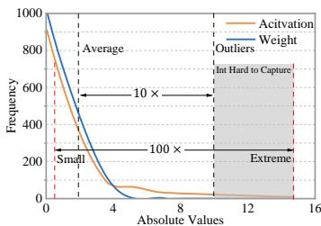
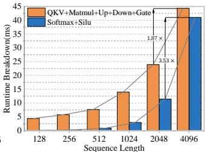
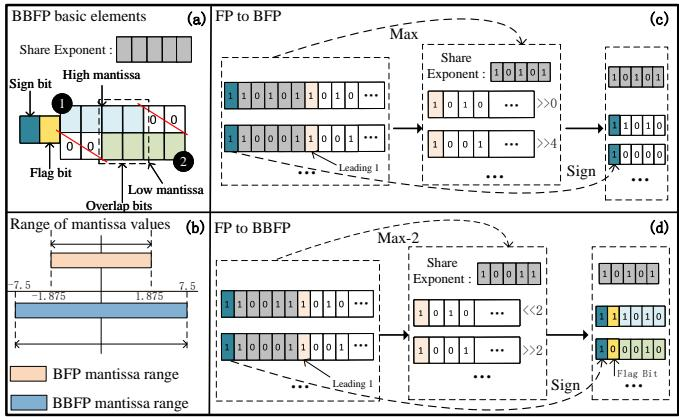
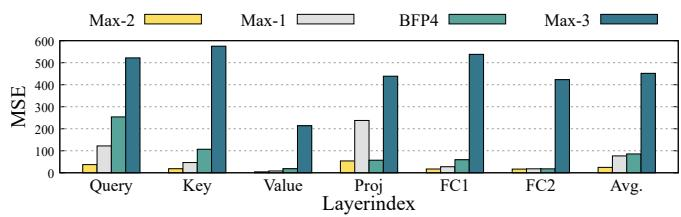
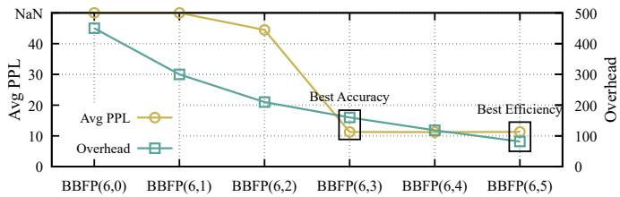
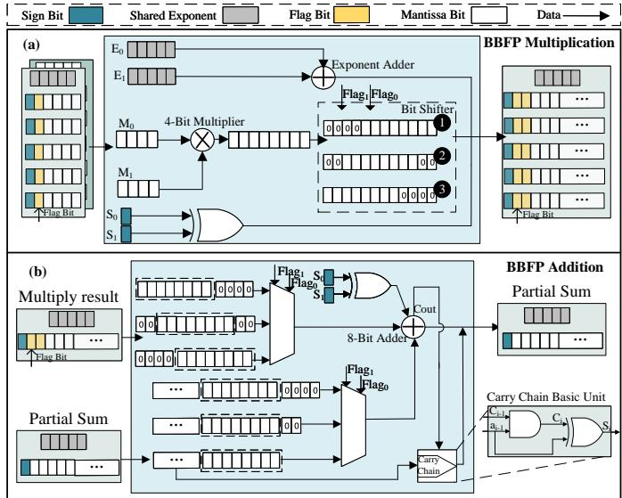
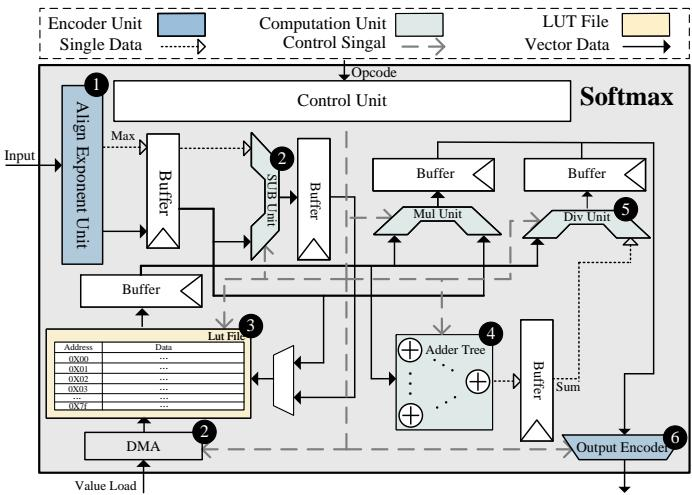
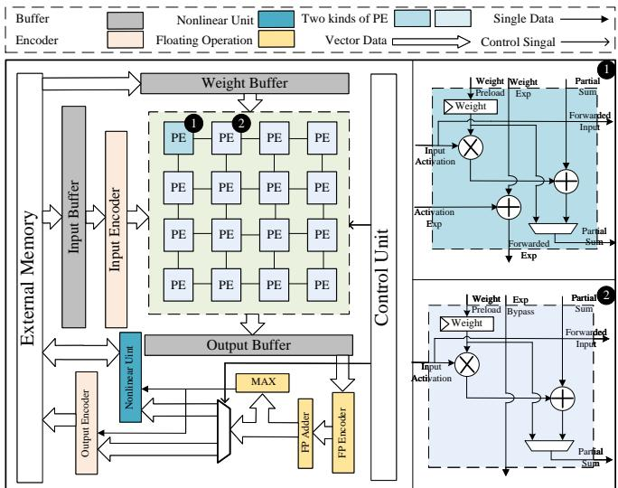
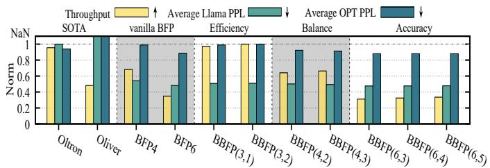
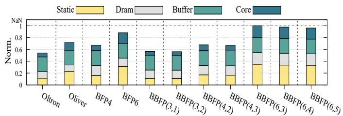

# BBAL: A Bidirectional Block Floating Point-Based Quantisation Accelerator for Large Language Models 原文翻译

# BBAL：一种面向大语言模型的基于双向块浮点的量化加速器

Xiaomeng Han1∗, Yuan Cheng2,3∗†, Jing Wang1, Junyang Lu1, Hui Wang1, X.x. Zhang4, Ning Xu1, Dawei Yang2B, Zhe Jiang1B

1东南大学集成电路学院，国家集成电路设计自动化技术创新中心。2后摩智能。

3南京大学。4吉林师范大学。

mingzhihan7@gmail.com, yuancheng@smail.nju.edu.cn, nick585108@163.com, 2972462961@qq.com,

whmio0115@seu.edu.cn, 3255594256@qq.com, xning@seu.edu.cn, dawei.yang@houmo.ai, zhejiang.uk@gmail.com

摘要——大语言模型（LLM）拥有数十亿参数，给边缘设备上的部署带来了巨大挑战，对存储容量和计算资源都造成了沉重负担。块浮点（BFP）量化通过将高开销的浮点运算转换为低比特定点运算，降低存储和计算开销。然而，BFP 要求将所有数据对齐到最大指数，这会造成小值和中等值的损失，从而引入量化误差并导致 LLM 的准确率下降。为解决这一问题，我们提出了一种双向块浮点（BBFP）数据格式，它降低了将最大指数选为共享指数的概率，从而减小量化误差。利用 BBFP 的特性，我们提出了一种面向 LLM 的全栈双向块浮点量化加速器（BBAL），主要由基于 BBFP 的处理单元阵列以及我们提出的低开销非线性计算单元组成。实验结果表明，在效率相近的情况下，BBAL 相较于离群值感知加速器的准确率提升了 22%；在准确率相近的情况下，相较于基于 BFP 的加速器，其效率提升了 40%。

## I. 引言

LLM [1] 已在文本生成 [2]、文本理解 [3] 和语言翻译 [4] 等方面取得了显著成功。然而，这些模型庞大的规模和高昂的计算成本限制了它们在边缘设备上的部署。例如，部署一个 Llama-70B [5] 模型至少需要使用两块 80GB A100 GPU。随着模型规模不断增长，在边缘设备上部署模型会带来更高的开销。因此，降低计算成本和存储需求已成为亟待解决的关键挑战 [6]、[7]。

为了实现 LLM 的高效部署，研究人员已经探索了多种技术 [8]。其中，量化 [9]–[11] 是降低推理成本最有效的方法之一。尤其是，已有研究证明，与浮点相比，INT 量化能够显著降低存储需求和计算成本。然而，由于 INT 表示范围的限制以及 LLM 中离群值的存在（见图 1 (a)），INT 量化通常面临显著的准确率下降。例如，INT8 [12] 量化会使困惑度（PPL）增加超过 20%。

为解决这一问题，研究人员提出了多种具有更宽动态范围的数据格式，以捕获离群值，例如 BF16 [13]、FP8 [14] 等。其中，块浮点（BFP）作为一种很有前景的量化方法脱颖而出 [15]–[18]，能够在性能和硬件开销之间实现良好的权衡。通过强制一组定点数共享同一个指数，BFP 有效地将浮点运算转换为定点计算。目前关于 BFP 的研究主要集中于加速线性层计算 [19]–[21]，而非线性层则被完全忽略。然而，基于 Transformer 的模型 [22] 包含大量非线性运算，包括 Softmax 和 SILU，这些运算通常涉及超越函数计算，且鲁棒性较低，因此通常需要更宽的表示范围、高精度以及开销更高的浮点计算。

  
(a) 权重和激活值分布

  
(b) 线性与非线性运算运行时间分解  
图 1：(a) OPT-6.7B 中激活值和权重值的分布。(b) Llama-7B 解码阶段的线性与非线性运算运行时间。

如图 1 (b) 所示，非线性算子所需的计算时间随输入序列长度的增长而增加，逐渐成为性能瓶颈 [23]。由于 BFP 提供了与浮点相近的表示范围，同时具有更高的计算效率，因此它具有简化非线性层运算的潜力。然而，BFP 将所有数据对齐到最大指数的策略会引入中等程度的量化误差。这限制了其在线性层中实现更低比特 BFP 量化的能力，也阻碍了它在非线性计算中的应用。例如，将 BFP4 [15] 量化直接应用于 OPT [24] 模型的线性层，会导致 PPL 增加超过 40%。同样，如表 IV 所示，在非线性层中使用 BFP 进行计算会导致 PPL 增加 5 倍。

贡献：为减小 BFP 对齐策略引起的量化误差，并探索其在非线性层中的潜在应用，我们提出了一种基于块的数据格式——双向块浮点（BBFP）。通过采用一个 1-bit 标志来区分高位尾数和低位尾数，并非所有数据都需要对齐到最大指数，从而降低了将较大指数选为共享指数的概率。这使 BBFP 能够在捕获离群值的同时，尽可能减小中等值和小值的量化误差。最后，基于 BBFP，我们提出了 BBAL，主要由经过优化的基于 BBFP 的 PE 阵列以及我们提出的低开销非线性计算单元组成。实验结果表明，在效率相近的情况下，BBAL 相较于离群值感知加速器的准确率提升了 22%；在准确率相近的情况下，相较于基于原始 BFP 的加速器，其效率提升了 40%。本文的主要贡献如下：

• 数据格式：我们提出 BBFP，以减小 BFP 的量化误差。我们还探索了不同共享指数选择和重叠位配置对 BBFP 量化误差的影响。最后，基于 BBFP 的特性，我们设计了一种高效的基本计算单元。

• 非线性单元：利用 BBFP 量化误差低和采用定点计算的特性，我们提出了一种基于 BBFP 的高效非线性计算单元。此外，得益于 BBFP 的共享指数特性，我们引入了一种基于指数的分段查找表方法，提高了兼容性并降低了资源消耗。

  
图 2：(a) BBFP(4,2) 的基本组成部分；(b) BBFP 与 BFP 的尾数表示范围比较；(c) FP 转换为 BFP 的过程；(d) FP 转换为 BBFP 的过程。

• LLM 加速器：最后，我们提出了 BBAL，主要由经过优化的基于 BBFP 的 PE 阵列组成，用于高效的线性计算，并配备我们提出的低开销非线性计算单元，以降低资源消耗和延迟。

## II. 背景

## A. 量化

目前，量化数据格式主要关注低位宽格式，例如浮点格式 FP4 [25] 和定点格式 INT4 [26]，两者均具有较高的存储效率。然而，由于浮点运算的算术密度较低，研究人员更倾向于使用定点格式进行量化。SmoothQuant [27] 和 GPTQ [28] 等方法已有效地利用定点格式进行量化。尽管如此，整数表示的固有限制以及对离群值的敏感性，使低位宽定点量化在实现高性能方面面临重大挑战。

量化方法通常可分为两类：训练后量化（PTQ）[29] 和量化感知训练（QAT）[30]。虽然 QAT 能够在相同数据位宽下保持更高的精度，但 LLM 庞大的模型规模会带来显著的训练成本，因此 PTQ 成为一种简洁有效的量化方法。在本工作中，我们采用 PTQ，并提出 BBFP，以实现无需校准的权重与激活量化。

## B. 块浮点

在 IEEE-754 标准中，每个单精度浮点数由三部分组成：1 位符号 s、8 位指数 $e ,$ 和 23 位尾数 $m .$ 浮点数所表示的实际数值可概括为：$v = ( - 1 ) ^ { s } \times 1 . m \times 2 ^ { e - e _ { b i a s } }$ 因此，对于一个元素向量，其浮点表示为：

$$
[ (- 1) ^ {s _ {0}} 2 ^ {e _ {0}} m _ {0}, (- 1) ^ {s _ {1}} 2 ^ {e _ {1}} m _ {1}, \dots , (- 1) ^ {s _ {n - 1}} 2 ^ {e _ {n - 1}} m _ {n - 1} ]\tag{1}
$$

块浮点（BFP）是一种用于优化性能和提高存储密度的格式。如图 2 (c) 所示，BFP 通过移位尾数，使一个块内的数据共享最大指数，可表示如下：

$$
2 ^ {e _ {m}} \left[ (- 1) ^ {s _ {0}} m _ {0} ^ {\prime}, (- 1) ^ {s _ {1}} m _ {1} ^ {\prime}, \dots , (- 1) ^ {s _ {N - 1}} m _ {N - 1} ^ {\prime} \right]\tag{2}
$$

  
图 3：采用 BBFP(4,2) 时，不同共享指数选择对激活量化误差影响的比较。

其中，$2 ^ { e _ { m } }$ 是一个数据块内的最大指数，$m _ { i } ^ { \prime }$ 是移位后的尾数。因此，两个 BFP 格式向量的点积可表示如下：

$$
2 ^ {e _ {m _ {1}} + e _ {m _ {2}}} \sum_ {i = 0} ^ {N - 1} ((- 1) ^ {s _ {1, i} \oplus s _ {2, i}} m _ {1, i} \cdot m _ {2, i})\tag{3}
$$

其中，$e _ { m _ { 1 } }$ 和 $e _ { m _ { 2 } }$ 是两个 BFP 向量的共享指数，⊕ 表示异或运算。

通过将复杂的浮点点积运算转换为等效的定点运算，BFP 显著提高了计算效率。然而，这种改进以降低小数值和中等数值的精度为代价，导致在量化 LLM 时准确率略有下降。

## III. 所提出的数据格式

## A. BBFP 数据格式

BBFP 定义：为减少 BFP 计算中小数值和中等数值的精度损失，我们提出了一种名为 BBFP 的数据格式。图 2 (a) 展示了所提出的 BBFP 数据格式，其由一个符号位、一个标志位、e 位共享指数、m 位尾数和 o 位重叠位组成。在本文中，我们将 BBFP 的不同配置记为 BBFP(m,o)，将具有不同尾数位宽的 BFP 记为 BFPm，其中 $m , o \in \mathbb { N }$。在所有配置中，共享指数的位宽均固定为 5 位。

在 BBFP 中，1 位标志用于指示对齐时尾数应左移还是右移，而 o 位重叠位用于减少左移时截断引入的误差。将具有 11 位尾数和隐含前导 1 的 FP16 转换为 BBFP(4,2) 的过程可概括如下：

$$
x _ {\mathrm{BBFP} (4, 2)} = \left\{ \begin{array}{l} C l i p (x <   <   n) _ {1 3, 1 0}, \text {Flag} = 1 \\ C l i p (x > > n) _ {1 1, 8}, \text {Flag} = 0 \end{array} \right.\tag{4}
$$

其中，$C l i p ( \cdot ) _ { 1 3 , 1 0 }$ 和 $C l i p ( \cdot ) _ { 1 1 , 8 }$ 分别表示将原始尾数截取为第 13 位至第 10 位以及第 11 位至第 8 位。n 表示移位次数，Flag 表示 BBFP 中的 1 位标志。由于存在 2 位重叠位，截断并非从第 12 位开始以区分左移（高位）尾数和右移（低位）尾数，而是从第 10 位开始。无论尾数左移还是右移，都会被截断为 4 位并存储在内存中。例如，将 FP16 转换为不含重叠位的 BBFP 时，原始尾数的最高有效位存储在高位尾数组中，其余位则被截断并丢弃。然而，加入两个重叠位后，截断从原始尾数的第 10 位开始，保留了 3 位信息，从而减少量化误差。

图 2 (d) 详细展示了 FP 转换为 BBFP 的过程，该过程与图 $\mathrm { F i g . ~ } 2 \ \mathrm { ~ ( c ) ~ }$ 所示的 FP 转换为 BFP 的过程类似。首先，确定共享指数，这里以 $M a x - 2$ 指数为例。接着，将原始指数与共享指数进行比较，并对原始尾数进行移位。如果原始浮点指数大于共享指数，则将标志设为 1，并将尾数左移。当浮点指数小于或等于共享指数时，将标志设为 0，尾数右移或保持不变。最后，将移位后的尾数截断为四位。因此，BBFP 所表示的数值可概括为以下公式：

  
图 4：位宽为 6 的 BBFP 在不同重叠位宽下的 PPL 和硬件开销。

$$
2 ^ {e _ {s}} [ (- 1) ^ {s _ {0}} m _ {0} ^ {\prime} \times f, (- 1) ^ {s _ {1}} m _ {1} ^ {\prime} \times f,..., (- 1) ^ {s _ {N - 1}} m _ {N - 1} ^ {\prime} \times f ]\tag{5}
$$

$$
f = \left\{ \begin{array}{l l} 1, & \text {Flag} = 0 \\ 2 ^ {m - o}, & \text {Flag} = 1 \end{array} \right.\tag{6}
$$

其中，$e _ { s }$ 表示共享指数，$m _ { i } ^ { \prime }$ 表示移位后的尾数，Flag 表示标志位，m 表示尾数位宽，o 表示重叠位宽。由上述公式可知，在尾数位宽相同的情况下，BBFP 相较于 BFP 提供了更强的尾数表示能力，如图 2 (b) 所示。

BBFP 点积：两个 BBFP 格式向量的点积可表示如下：

$$
2 ^ {e _ {s _ {1}} + e _ {s _ {2}}} \sum_ {i = 0} ^ {N - 1} \left(\left(- 1\right) ^ {s _ {1, i} \oplus s _ {2, i}} m _ {1, i} f _ {1, i} \cdot m _ {2, i} f _ {2, i}\right)\tag{7}
$$

上述表达式表明，BBFP 保留了 BFP 将浮点运算转换为定点运算的特性。通过引入多路选择器和移位模块，尾数的表示范围扩大至 4 倍。

## B. 量化误差分析

为了与 BFP 的量化误差进行比较，我们分析了块浮点量化中的误差来源。对于采用舍入到最近值方案的块浮点格式，其量化误差的均值为零，方差 $\sigma ^ { 2 }$ 可表示如下 [31]：

$$
\sigma^ {2} = \frac {2 ^ {- 2 L _ {m}}}{1 2} \sum_ {i = 1} ^ {N _ {\gamma}} p _ {\gamma_ {i}} 2 ^ {2 \gamma_ {i}}\tag{8}
$$

其中，$L _ { m }$ 表示尾数长度，$p _ { \gamma _ { i } }$ 表示块指数的概率质量函数。$\bar { N _ { \gamma } } = 2 ^ { L _ { E } }$ 为可用块指数级别的数量。当 BFP 和 BBFP 的 $L _ { m }$ 相同时，影响量化误差的唯一因素是 $p _ { \gamma _ { i } }$。与 BFP 中对齐到最大指数的操作相比，BBFP 允许对齐到非最大指数，从而降低量化误差的方差。

## C. 共享指数的选择

如式 (4) 所述，将 FP16 转换为 BBFP 涉及尾数的移位和截断。直观上，数据的高位更为重要，因此在移位和截断过程中保护这些高位可以减少量化误差。然而，如式 (8) 所示，降低选择最大共享指数的概率，可以使右移和截断引起的量化误差最小化。因此，基于上述两个因素，我们提出的共享指数选择方法如下：

$$
E _ {\text { shared }} = \operatorname{Max} (E) - (m - o)\tag{9}
$$

其中，Max 表示取最大值，m 表示尾数的位宽，o 表示重叠位的位宽。图 3 比较了采用 4 位尾数和不同共享指数的 BBFP 与 BFP4 的量化误差。max − 3 对齐策略定义为 $m a x - ( m - o ) - 1$，由于最高有效位左移至截断范围之外，该策略会导致显著误差。相比之下，max − 1 对齐策略定义为 $m a x - ( m - o ) + 1$，与 $m a x - ( m - o )$ 对齐策略相比，它更有可能选择较大的值作为共享指数，从而导致更大的误差。

## D. 重叠位宽的选择

当共享指数选择策略确定后，增加重叠位的位宽可以减少左移导致的截断误差。然而，根据式 (9)，更宽的重叠会增加遇到最大共享指数的概率，从而使中等数值和小数值遭受更大的损失。此外，由于不同 LLM 的数据分布和对数值误差的敏感性各不相同，且不同的重叠位宽会带来不同的硬件成本，因此我们提出算法 1 来确定重叠位宽。

通过调整算法 1 中的开销权重，我们可以平衡精度和硬件成本的优先级。图 4 展示了位宽为 6 的 BBFP 的重叠位宽优化过程。

## IV. 数据格式驱动的硬件设计

## A. 线性计算单元

乘加（MAC）模块是 LLM 中的基本计算单元，主要涉及块间乘法和部分和相加。鉴于所提出的数据格式在计算过程中呈现出结构化的位级稀疏性，我们对 MAC 模块进行了优化，以提高计算密度。

块内乘法：如图 5 (a) 所示，BBFP 中的块间矩阵乘法可以分为共享指数相加和块尾数相乘。尾数乘法可表示如下：

$$
m _ {0} = \left\{ \begin{array}{l} m _ {1} \times m _ {2}, \text {Flag} _ {1} \& \text {Flag} _ {2} = 0 \\ m _ {1} \times m _ {2} <   <   2, \text {Flag} _ {1} \oplus \text {Flag} _ {2} = 1 \\ m _ {1} \times m _ {2} <   <   4, \text {Flag} _ {1} \& \text {Flag} _ {2} = 1 \end{array} \right.\tag{10}
$$

其中，$F _ { 1 } , F _ { 2 }$ 表示两个标志位。对于 BBFP(4,2)，两个 4 位尾数的乘法可以使用一个 4 位乘法器完成，随后通过移位操作得到一个 12 位尾数，如图 5 (a) 所示，其中有四个位恒为零。为了提高存储密度，我们移除这些零位，并使用一个 2 位标志来表示这些零元素。例如，如图 5 (a) 所示，标志 00 对应于 1，而 01 或 10 对应于 2，11 对应于 3。因此，最终输出是由 2 位标志、1 位符号和 8 位尾数组成的 BBFP。

    算法 1 重叠位宽的选择
    输入：LLM 模型、开销权重 w、尾数位宽 m。
    输出：最优重叠位数 o。
    1: 函数 Select_Best_Width(Model, w, m)
    2: 对于 i = 0 到 m - 1 执行
    3:    PPL[i] = Calculate_PPL(model,BBFP(m,i))
    4:    Overhead[i] = Calculate_Overhead(BBFP(m,i))
    5: 结束循环
    6: 对于 j = 0 到 m - 1 执行 ▷ #最大值归一化并计算评分
    7:    PPL[j] = PPL[j]/Max(PPL)
    8:    Overhead[j] = Overhead[j]/Max(Overhead)
    9:    score[j] = w × Overhead[j] + (1 - w) × PPL[j]
    10: 结束循环
    11: o = Min(score).index
    12: 返回 o
    13: 函数结束

  
图 5：(a) 两个 BBFP 块之间的乘法运算；(b) 使用 BBFP 和进位链模块的部分和运算。

部分和相加：在 MAC 模块中，完成块间乘法后，需要进行部分和相加。我们观察到，块间乘法产生的数据块呈现出规则的位级稀疏模式。因此，我们采用稀疏加法来减小加法器位宽并降低资源消耗。图 5 (b) 展示了三种典型的稀疏加法器。使用一个 8 位加法器结合一个 n 位进位链，替代一个 12 + n 位加法器。全加器的表达式如下：

$$
S = C I \oplus a _ {i} \oplus b _ {i}\tag{11}
$$

$$
C = a _ {i} b _ {i} + C _ {i} (a _ {i} \oplus b _ {i})\tag{12}
$$

其中，$a _ { i }$ 和 $b _ { i }$ 分别表示部分和与乘法结果的第 i 位。如图 5 (b) 所示，$a _ { i }$ 并非总为零，而 $b _ { i }$ 在特定模式下变为零。因此，加法器可以简化如下：

$$
S _ {c} = C _ {i} \oplus a _ {i}\tag{13}
$$

$$
C _ {c o} = C _ {c i} a _ {i}\tag{14}
$$

将式 (14) 和式 (13) 与式 (12) 和式 (11) 比较可知，相比全加器模块，进位链模块减少了一个与门和两个异或门。例如，通过用一个 8 位加法器和一个 4 位进位链替代 12 位加法器，加法器单元的资源消耗降低了 15%。此外，随着 BBFP 位宽增大、重叠位数减少，优化效果愈加显著。

MAC 效率：表 I 展示了不同格式下 MAC 单元的面积和存储效率。与 BFP 相比，BBFP 由于将高位和低位尾数分组分离，面积有所增加。这使得乘法和部分和相加所需的位宽都更大，从而导致更高的面积开销。此外，由于 BBFP 引入了额外的 1 位标志位，其存储效率略低。然而，BBFP(6,3) 的表示能力高于 BFP8，同时占用的面积和存储空间更少。这表明，我们的新格式具有更强的表示能力和更低的计算开销。

表 I：各种数据类型下 MAC 单元的存储效率与面积。

<table><tr><td>数据类型</td><td>块大小</td><td>面积</td><td>等效位宽</td><td>存储效率</td></tr><tr><td>FP 16</td><td>1</td><td>39599</td><td>16</td><td>1×</td></tr><tr><td>INT 8</td><td>1</td><td>9257</td><td>8</td><td>2×</td></tr><tr><td>BFP 8</td><td>32</td><td>9371</td><td>9.16</td><td>1.75×</td></tr><tr><td>BFP 6</td><td>32</td><td>5633</td><td>7.16</td><td>2.24×</td></tr><tr><td>BBFP(8,4)</td><td>32</td><td>9806</td><td>10.16</td><td>1.58×</td></tr><tr><td>BBFP(6,3)</td><td>32</td><td>5764</td><td>8.16</td><td>1.96×</td></tr></table>

## B. 所提出的非线性计算单元

## 分段查找表：

FP32 中的每个数据值都有一个指数域，而 BBFP 为一组数据分配一个共享指数域。因此，我们提出了一种分段方法，根据共享指数加载 LUT，并根据尾数执行查表。首先，我们根据不同的指数将函数值划分为若干段，并将这些分段存储在外部存储器中。例如，当指数位数为五位时，函数被划分为 $2 ^ { 5 } \times 2$ 个子表。其次，在对齐阶段计算出共享指数后，即可加载相应的子表。最后，与需要额外映射的浮点 LUT 不同，BBFP 直接使用尾数作为查表地址。

流水线设计：为了提高硬件吞吐量并隐藏从外部存储器加载 LUT 所需的时间，整个非线性计算单元采用了流水线架构。每个模块都配备了缓冲区。此外，该计算单元能够计算不同的超越函数。然而，不同函数可能需要不同的计算顺序和计算单元。为此，该计算单元支持可调整的计算顺序，并配备了冗余单元。

为了说明计算 sigmoid 函数时的数据流调整方式，sigmoid 函数的公式如下：

$$
S i g m o i d (x) = 1 / (1 + e ^ {- x})\tag{15}
$$

首先，离线计算 $( 1 + e ^ { - x } )$ 的值，并将结果存储在外部存储器中。随后，控制单元配置流水线中的数据流，使其从指数对齐单元流向 LUT 文件，接着流向除法单元，最后流向输出编码器。同样，非线性计算单元也能够计算 SILU 和 GELU 等函数。

INT 计算：数据通过指数对齐模块后，会从 FP16 转换为 BBFP，以进行查找表计算。通过离线调整表中的数据格式，可以将子表中的每个条目从 FP16 转换为 BBFP。这确保了数据通过 LUT 文件后，仍保持 BBFP 格式，以进行下一步计算。

基本单元：基于上述方法，我们提出了图 6 所示的非线性单元。该非线性单元主要由指数对齐单元、减法单元、乘法单元、加法树、除法单元和 LUT 文件组成。图 6 以 softmax 计算为例，展示了非线性单元的流程。

## C. LLM 加速器

总体架构：BBAL 如图 7 所示，其核心是一个权重驻留的 PE 阵列和所提出的非线性计算单元，并配有输入编码器、输入缓冲区、权重缓冲区、输出缓冲区、输出编码器、最大值单元、FP 编码器、FP 加法器和控制单元。对两个

  
图 6：以 Softmax 为例展示所提出的非线性单元，图中的数字表示计算顺序。

BFP 数进行乘法运算只需要一次指数相加。因此，对 PE 计算单元进行了部分修改，以适应块浮点运算，形成了两个版本：1 增加了一个共享指数加法器，2 包含一个共享指数旁路单元。

计算流程：处理矩阵乘法时，每组 4×4 个元素被编码为 BBFP，并发送到 PE 阵列进行计算。计算完成后，数据流经 FP 编码器，在此被编码为 FP 格式并发送到 FP 加法器，等待执行加法。执行加法后，数据流经最大值单元和数据选择器。最大值单元输出的值可供非线性单元或输出编码器使用，从而无需额外的比较器。最后，控制单元决定浮点加法器的输出是否经过非线性计算单元。

## V. 评估

## A. 配置

非线性配置：我们使用 BBFP(10,5) 对非线性层进行量化，每个 LUT 的地址位宽为 7 位。考虑到 Softmax 值趋近于零的特点，我们设计了 18 个子表，而 SILU 则有 24 个子表。我们替换了 Llama-7B [5]、Llama2-7B [34] 和 Llama3-8B [35] 中的非线性层，并在 WikiText2 [36] 上评估了其性能。为验证我们非线性量化策略的准确性，我们以基于 FP32 的非线性单元为基线，并将其与 BBFP(10,5) 和 BFP10 进行比较。此外，为评估我们量化策略的效率，我们从 EDP、ADP 和效率（Throughput/(Area×Power)）三个方面将其与当前最先进的方法进行了比较。线性配置：我们修改了 BBFP 的实现，以评估其对 LLM 的影响。本实验使用的数据集为 WikiText2。为验证量化方法的准确性，我们以 FP16 为基线，将尾数位宽为 3、4 和 6 位的 BBFP 与 BFP4、BFP6 以及当前最先进的方法进行了比较，包括 OmniQuant [37]、Oltron [38] 和 Olive [39]，这些方法均对权重和激活进行量化。为评估量化策略的效率，我们从面积、能耗和吞吐量三个维度将其与其他方法进行了比较。

实现：我们使用 Chisel [40] 分别实现了采用 BBFP 和 BFP 的设计，并在台积电 28nm 工艺下进行了评估。我们使用了 Design Compiler [41]，并使用 CACTI [42] 估算片上存储器的面积和功耗。我们基于 DnnWeaver [43] 开发了一个周期级模拟器，以估算性能。

  
图 7：基于 BBFP 的计算加速器，包含两种针对 BBFP 运算进行优化的 PE。

## B. 结果分析：

非线性运算准确率分析：表 IV 比较了 BBFP(10,5) 与 BFP10 的 PPL。实验结果表明，我们的非线性量化策略在三个模型上引起的 PPL 增量最大仅为 0.44，而 BFP10 则导致 PPL 出现至少 3× 的增长。这表明，BBFP(10,5) 弥合了 BFP 与其在非线性运算中应用之间的差距。非线性运算效率分析：表 V 将我们提出的非线性单元与其他最先进的方法进行了比较。与低精度近似算法 [32] 相比，我们的设计在 ADP 和 EDP 方面表现较差。这是因为我们为 LLM 提出的非线性计算单元需要全精度、高位宽的整数乘法器和除法器，以尽量减小数值误差，这增加了面积和功耗。此外，为增强兼容性，设计中包含了若干冗余单元；例如，向量乘法模块在 softmax 计算期间处于空闲状态，进一步增加了面积需求和静态功耗。然而，采用分段指数动态查找策略，使该设计能够利用成本更低的片外存储器来减少昂贵的片上存储器用量，从而实现高兼容性和高效率。此外，由于 BBFP 保留了定点运算的计算效率，因此能够显著节省计算资源。实验结果表明，与高精度方法 [33] 相比，我们的设计实现了近 30× 的效率提升。

线性运算面积分析：表 III 给出了不同方法下单个 PE 的面积。PE 面积由乘法器和加法器两部分组成，其中乘法器占据大部分面积。因此，在尾数位宽相同的情况下，BFP、Olive、Oltron 和 BBFP 的面积相近。线性运算准确率与吞吐量分析：表 II 展示了未经任何校准时，BBFP 量化对线性层的影响。实验结果表明，与 BFP 相比，BBFP 的准确率更高。具体而言，BBFP(3,1) 相比 BFP4 提升了 6%，而 BBFP(4,2) 的平均 PPL 仅比 BFP6 高 4%。此外，与 Oltron 相比，BBFP(4,2) 的 PPL 降低了 30%；与 OmniQuant 相比，降低了 33%。

通过分析不同模型的激活值分布，我们观察到，各模型中异常值的比例和幅度有所不同。因此，捕获固定比例异常值的异常值感知量化方法，在 Llama（异常值较多）上表现较差，但在 OPT（异常值较少）上取得了更好的结果，如图 8 所示。BBFP 能够捕获任意比例的异常值，从而确保在不同模型上具有稳定的准确率基线。

表 II：量化模型在 Wikitext2 上的困惑度结果（越低越好）。

<table><tr><td>模型</td><td>Llama-1B</td><td>Llama-3B</td><td>Llama-7B</td><td>Llama-13B</td><td>Llama-30B</td><td>Llama-65B</td><td>OPT-1.3B</td><td>OPT-2.7B</td><td>OPT-6.7B</td><td>OPT-13B</td><td>OPT-30B</td><td>OPT-66B</td></tr><tr><td>FP16</td><td>9.88</td><td>7.87</td><td>5.47</td><td>5.09</td><td>4.10</td><td>3.53</td><td>14.62</td><td>12.47</td><td>10.86</td><td>10.12</td><td>9.56</td><td>9.34</td></tr><tr><td>Oltron</td><td>N/A</td><td>N/A</td><td>14.67</td><td>9.48</td><td>7.51</td><td>6.69</td><td>N/A</td><td>N/A</td><td>11.99</td><td>11.65</td><td>10.60</td><td>10.29</td></tr><tr><td>Olive</td><td>N/A</td><td>N/A</td><td>144.78</td><td>42.24</td><td>36.55</td><td>NaN</td><td>N/A</td><td>N/A</td><td>107.15</td><td>416.57</td><td>334.7</td><td>4058.83</td></tr><tr><td>Omniquant</td><td>N/A</td><td>N/A</td><td>11.26</td><td>10.87</td><td>10.33</td><td>9.17</td><td>N/A</td><td>N/A</td><td>12.24</td><td>11.65</td><td>10.6</td><td>10.29</td></tr><tr><td>BFP6(6m)</td><td>10.06</td><td>7.95</td><td>5.61</td><td>5.13</td><td>4.12</td><td>3.61</td><td>15.57</td><td>12.5</td><td>10.91</td><td>10.22</td><td>9.62</td><td>9.48</td></tr><tr><td>BFP4(4m)</td><td>13.45</td><td>9.44</td><td>5.83</td><td>5.72</td><td>5.05</td><td>4.12</td><td>27.21</td><td>18.98</td><td>12.24</td><td>11.56</td><td>10.50</td><td>10.10</td></tr><tr><td>BBFP(3,1)</td><td>12.35</td><td>9.00</td><td>5.66</td><td>5.33</td><td>4.46</td><td>4.01</td><td>23.12</td><td>15.29</td><td>14.07</td><td>10.85</td><td>10.45</td><td>10.27</td></tr><tr><td>BBFP(4,2)</td><td>10.41</td><td>8.13</td><td>5.80</td><td>5.39</td><td>4.37</td><td>3.65</td><td>17.06</td><td>13.36</td><td>12.03</td><td>10.39</td><td>9.63</td><td>9.87</td></tr><tr><td>BBFP(4,3)</td><td>10.65</td><td>8.20</td><td>5.80</td><td>5.20</td><td>4.26</td><td>3.69</td><td>17.52</td><td>13.89</td><td>11.54</td><td>10.38</td><td>9.61</td><td>9.93</td></tr><tr><td>BBFP(6,3)</td><td>9.93</td><td>7.89</td><td>5.48</td><td>5.09</td><td>4.10</td><td>3.59</td><td>15.16</td><td>12.49</td><td>10.89</td><td>10.12</td><td>9.55</td><td>9.38</td></tr><tr><td>BBFP(6,4)</td><td>9.93</td><td>7.9</td><td>5.48</td><td>5.09</td><td>4.10</td><td>3.59</td><td>15.00</td><td>12.47</td><td>10.89</td><td>10.14</td><td>9.55</td><td>9.36</td></tr></table>

表 III：不同量化策略下的 PE 面积 $( \mu m ^ { 2 } )$ 比较（以最大的 BBFP(6,3) PE 面积归一化）。

<table><tr><td></td><td>Oltron</td><td>Olive</td><td>BFP4</td><td>BFP6</td><td>BBFP(3,1)</td><td>BBFP(3,2)</td><td>BBFP(4,2)</td><td>BBFP(4,3)</td><td>BBFP(6,3)</td><td>BBFP(6,4)</td><td>BBFP(6,5)</td></tr><tr><td>面积</td><td>78.50</td><td>156.47</td><td>215.23</td><td>110.24</td><td>77.69</td><td>75.51</td><td>117.11</td><td>113.31</td><td>241.01</td><td>231.14</td><td>224.70</td></tr><tr><td>归一化值</td><td>0.33</td><td>0.65</td><td>0.46</td><td>0.90</td><td>0.32</td><td>0.31</td><td>0.49</td><td>0.47</td><td>1.00</td><td>0.96</td><td>0.93</td></tr></table>

表 IV：采用非线性单元的不同方案下 Llama 的 PPL。

<table><tr><td>数据格式</td><td>非线性运算</td><td>LLama-7B</td><td>Llama2-7B</td><td>Llama3-8B</td></tr><tr><td>FP32</td><td>全部</td><td>5.68</td><td>5.47</td><td>6.14</td></tr><tr><td rowspan="3">BBFP(10,5)</td><td>仅 Softmax</td><td>5.74</td><td>5.62</td><td>6.24</td></tr><tr><td>仅 SILU</td><td>5.71</td><td>5.53</td><td>6.21</td></tr><tr><td>全部</td><td>5.81</td><td>5.91</td><td>6.34</td></tr><tr><td rowspan="3">BFP10</td><td>仅 Softmax</td><td>67.31</td><td>32.72</td><td>69.95</td></tr><tr><td>仅 SILU</td><td>33.21</td><td>17.54</td><td>31.30</td></tr><tr><td>全部</td><td>99.28</td><td>50.21</td><td>102.35</td></tr></table>

表 V：ADP、EDP、效率和兼容性比较。

<table><tr><td>方法</td><td>数量</td><td>格式</td><td>ADP↓</td><td>EDP↓</td><td>效率↑</td><td>兼容性</td></tr><tr><td>[32]</td><td>10</td><td>Int8</td><td>~4.33</td><td>~79.58</td><td>~85.98</td><td>-</td></tr><tr><td>[33]</td><td>8</td><td>Int 27</td><td>~299.13</td><td>~18691.24</td><td>3.31</td><td>-</td></tr><tr><td>本文方法</td><td>16</td><td>BBFP(10,5,5)</td><td>32.64</td><td>1040.40</td><td>98.03</td><td>SILU 等</td></tr></table>

图 8 展示了各种量化策略在相同 PE 面积条件下的准确率和吞吐量表现。由于 BBFP(3,1)、BBFP(3,2) 和 Oltron 均使用 3 位乘法器和低位宽加法器，因此在相同面积下，它们的吞吐量相近。然而，由于 BBFP 具有更出色的异常值保护能力，与 Oltron 相比，BBFP(3,1) 在所有任务上的准确率平均提高了 22%。此外，与 BFP4 相比，BBFP(3,1) 和 BBFP(3,2) 在保持相近准确率的同时，吞吐量提高了 40%。

与 Oltron 相比，位宽为 4 的 BBFP 的吞吐量下降了 30%，但其 PPL 降低了 30%。

能耗分析：图 9 展示了各种方法在 PE 数量和缓冲区大小相同的条件下执行任务时的平均能耗。与 BFP4 相比，位宽为 3 的 BBFP 将能耗降低了 13%，这主要归因于静态能耗和核心能耗的降低。与尾数位宽相同的 BFP 相比，BBFP 的能耗增幅在 5% 以内。这一增长主要是由于更大的面积导致了更高的静态和动态功耗，以及 BBFP 中额外的 1 位标志使 DRAM 功耗略有增加。

## VI. 结论

本文提出了在 BFP 基础上优化的 BBFP，以降低量化误差并推动 BFP 的进一步应用。其关键思路是降低以最大指数作为共享指数进行对齐的概率，从而在捕获离群值的同时尽量减小量化误差。由于 BBFP 的量化误差较低，我们提出了一种基于 BBFP 的高效非线性计算单元，拓展了 BFP 的应用潜力。实验结果表明，所提出的非线性计算单元相较于高精度非线性计算单元实现了 30× 的效率提升，且几乎没有精度损失。最后，我们提出了 BBAL，其主要由基于 BBFP 优化的 PE 阵列与所提出的非线性计算单元组成。实验结果表明，在硬件开销相近的情况下，BBAL 相较于离群值感知加速器的精度提高了 22%；在精度相近的情况下，相较于 BFP4 的吞吐量提高了 40%。

  
图 8：在 PE 面积相等的条件下，比较各种量化方法的 Llama/OPT 平均 PPL（越低越好）和吞吐量。

  
图 9：在 PE 数量和缓冲区大小相同的条件下的平均归一化能耗（不包括非线性单元）。

## VII. 致谢

感谢审稿人提供的有益反馈。本工作得到了国家重点研发计划（资助编号：2024YFB4405600）、国家自然科学基金（资助编号：62472086）、江苏省基础研究计划（资助编号：BK20243042）、江苏省科技重大专项计划（编号：BG2024010）以及东南大学科研启动基金（资助编号：RF1028624005）的支持。

[1] B. Mann, N. Ryder, M. Subbiah, J. Kaplan, P. Dhariwal, A. Neelakantan, P. Shyam, G. Sastry, A. Askell, S. Agarwal et al., “Language models are few-shot learners,” arXiv preprint arXiv:2005.14165, vol. 1, 2020.

[2] C. Saharia, W. Chan, S. Saxena, L. Li, J. Whang, E. L. Denton, K. Ghasemipour, R. Gontijo Lopes, B. Karagol Ayan, T. Salimans et al., “Photorealistic text-to-image diffusion models with deep language understanding,” Advances in neural information processing systems, vol. 35, pp. 36 479–36 494, 2022.

[3] J. Kil, S. Changpinyo, X. Chen, H. Hu, S. Goodman, W.-L. Chao, and R. Soricut, “Prestu: Pre-training for scene-text understanding,” in Proceedings of the IEEE/CVF International Conference on Computer Vision, 2023, pp. 15 270–15 280.

[4] C. Lyu, J. Xu, and L. Wang, “New trends in machine translation using large language models: Case examples with chatgpt,” arXiv preprint arXiv:2305.01181, 2023.

[5] H. Touvron, T. Lavril, G. Izacard, X. Martinet, M.-A. Lachaux, T. Lacroix, B. Roziere, N. Goyal, E. Hambro, F. Azhar\` et al., “Llama: Open and efficient foundation language models,” arXiv preprint arXiv:2302.13971, 2023.

[6] Z. Zhou, X. Ning, K. Hong, T. Fu, J. Xu, S. Li, Y. Lou, L. Wang, Z. Yuan, X. Li et al., “A survey on efficient inference for large language models,” arXiv preprint arXiv:2404.14294, 2024.

[7] N. Koilia and C. Kachris, “Hardware acceleration of llms: A comprehensive survey and comparison,” arXiv preprint arXiv:2409.03384, 2024.

[8] S. Han, H. Mao, and W. J. Dally, “Deep compression: Compressing deep neural networks with pruning, trained quantization and huffman coding,” arXiv preprint arXiv:1510.00149, 2015.

[9] W. Huang, Y. Liu, H. Qin, Y. Li, S. Zhang, X. Liu, M. Magno, and X. Qi, “Billm: Pushing the limit of post-training quantization for llms,” arXiv preprint arXiv:2402.04291, 2024.

[10] T. Dettmers, M. Lewis, Y. Belkada, and L. Zettlemoyer, “Gpt3. int8 (): 8-bit matrix multiplication for transformers at scale,” Advances in Neural Information Processing Systems, vol. 35, pp. 30 318–30 332, 2022.

[11] Z. Yuan, L. Niu, J. Liu, W. Liu, X. Wang, Y. Shang, G. Sun, Q. Wu, J. Wu, and B. Wu, “Rptq: Reorder-based post-training quantization for large language models,” arXiv preprint arXiv:2304.01089, 2023.

[12] J. Achiam, S. Adler, S. Agarwal, L. Ahmad, I. Akkaya, F. L. Aleman, D. Almeida, J. Altenschmidt, S. Altman, S. Anadkat et al., “Gpt-4 technical report,” arXiv preprint arXiv:2303.08774, 2023.

[13] N. Burgess, J. Milanovic, N. Stephens, K. Monachopoulos, and D. Mansell, “Bfloat16 processing for neural networks,” in 2019 IEEE 26th Symposium on Computer Arithmetic (ARITH). IEEE, 2019, pp. 88–91.

[14] P. Micikevicius, D. Stosic, N. Burgess, M. Cornea, P. Dubey, R. Grisenthwaite, S. Ha, A. Heinecke, P. Judd, J. Kamalu et al., “Fp8 formats for deep learning,” arXiv preprint arXiv:2209.05433, 2022.

[15] C. Zhang, J. Cheng, I. Shumailov, G. A. Constantinides, and Y. Zhao, “Revisiting block-based quantisation: What is important for sub-8-bit llm inference?” arXiv preprint arXiv:2310.05079, 2023.

[16] T. Yeh, M. Sterner, Z. Lai, B. Chuang, and A. Ihler, “Be like water: Adaptive floating point for machine learning,” in International Conference on Machine Learning. PMLR, 2022, pp. 25 490–25 500.

[17] S. Fox, S. Rasoulinezhad, J. Faraone, P. Leong et al., “A block minifloat representation for training deep neural networks,” in International Conference on Learning Representations, 2020.

[18] L. Zou, W. Zhao, S. Yin, C. Bai, Q. Sun, and B. Yu, “Bie: Bi-exponent block floating-point for large language models quantization,” in Fortyfirst International Conference on Machine Learning, 2024.

[19] M. Cho and Y. Kim, “Fpga-based convolutional neural network accelerator with resource-optimized approximate multiply-accumulate unit,” Electronics, vol. 10, no. 22, p. 2859, 2021.

[20] H. Fan, S. Liu, Z. Que, X. Niu, and W. Luk, “High-performance acceleration of 2-d and 3-d cnns on fpgas using static block floating point,” IEEE Transactions on Neural Networks and Learning Systems, vol. 34, no. 8, pp. 4473–4487, 2021.

[21] Z. Song, Z. Liu, and D. Wang, “Computation error analysis of block floating point arithmetic oriented convolution neural network accelerator design,” in Proceedings of the AAAI Conference on Artificial Intelligence, vol. 32, no. 1, 2018.

[22] A. Vaswani, N. Shazeer, N. Parmar, J. Uszkoreit, L. Jones, A. N. Gomez, Ł. Kaiser, and I. Polosukhin, “Attention is all you need. advances in neural information processing systems,” Advances in neural information processing systems, vol. 30, no. 2017, 2017.

[23] J. R. Stevens, R. Venkatesan, S. Dai, B. Khailany, and A. Raghunathan, “Softermax: Hardware/software co-design of an efficient softmax for

transformers,” in 2021 58th ACM/IEEE Design Automation Conference (DAC). IEEE, 2021, pp. 469–474.

[24] S. Zhang, S. Roller, N. Goyal, M. Artetxe, M. Chen, S. Chen, C. Dewan, M. Diab, X. Li, X. V. Lin et al., “Opt: Open pre-trained transformer language models,” arXiv preprint arXiv:2205.01068, 2022.

[25] S.-y. Liu, Z. Liu, X. Huang, P. Dong, and K.-T. Cheng, “Llm-fp4: 4-bit floating-point quantized transformers,” arXiv preprint arXiv:2310.16836, 2023.

[26] X. Hu, Y. Cheng, D. Yang, Z. Yuan, J. Yu, C. Xu, and S. Zhou, “Illm: Efficient integer-only inference for fully-quantized low-bit large language models,” arXiv preprint arXiv:2405.17849, 2024.

[27] G. Xiao, J. Lin, M. Seznec, H. Wu, J. Demouth, and S. Han, “Smoothquant: Accurate and efficient post-training quantization for large language models,” in International Conference on Machine Learning. PMLR, 2023, pp. 38 087–38 099.

[28] E. Frantar, S. Ashkboos, T. Hoefler, and D. Alistarh, “Gptq: Accurate post-training quantization for generative pre-trained transformers,” arXiv preprint arXiv:2210.17323, 2022.

[29] Z. Liu, Y. Wang, K. Han, W. Zhang, S. Ma, and W. Gao, “Post-training quantization for vision transformer,” Advances in Neural Information Processing Systems, vol. 34, pp. 28 092–28 103, 2021.

[30] O. Zafrir, G. Boudoukh, P. Izsak, and M. Wasserblat, “Q8bert: Quantized 8bit bert,” in 2019 Fifth Workshop on Energy Efficient Machine Learning and Cognitive Computing-NeurIPS Edition (EMC2-NIPS). IEEE, 2019, pp. 36–39.

[31] K. Kalliojarvi and J. Astola, “Roundoff errors in block-floating-point systems,” IEEE transactions on signal processing, vol. 44, no. 4, pp. 783–790, 1996.

[32] G. C. Cardarilli, L. Di Nunzio, R. Fazzolari, D. Giardino, A. Nannarelli, M. Re, and S. Spano, “A pseudo-softmax function for hardware-based\` high speed image classification,” Scientific reports, vol. 11, no. 1, p. 15307, 2021.

[33] Y. Zhang, L. Peng, L. Quan, Y. Zhang, S. Zheng, and H. Chen, “Highprecision method and architecture for base-2 softmax function in dnn training,” IEEE Transactions on Circuits and Systems I: Regular Papers, vol. 70, no. 8, pp. 3268–3279, 2023.

[34] H. Touvron, L. Martin, K. Stone, P. Albert, A. Almahairi, Y. Babaei, N. Bashlykov, S. Batra, P. Bhargava, S. Bhosale et al., “Llama 2: Open foundation and fine-tuned chat models,” arXiv preprint arXiv:2307.09288, 2023.

[35] Meta, “Meta llama 3: Advancing generative ai responsibly,” https://ai. meta.com/blog/meta-llama-3/, 2024.

[36] S. Merity, C. Xiong, J. Bradbury, and R. Socher, “Pointer sentinel mixture models,” arXiv preprint arXiv:1609.07843, 2016.

[37] W. Shao, M. Chen, Z. Zhang, P. Xu, L. Zhao, Z. Li, K. Zhang, P. Gao, Y. Qiao, and P. Luo, “Omniquant: Omnidirectionally calibrated quantization for large language models,” arXiv preprint arXiv:2308.13137, 2023.

[38] C. Xue, C. Zhang, X. Jiang, Z. Gao, Y. Lin, and G. Sun, “Oltron: Algorithm-hardware co-design for outlier-aware quantization of llms with inter-/intra-layer adaptation,” in Proceedings of the 61st ACM/IEEE Design Automation Conference, 2024, pp. 1–6.

[39] C. Guo, J. Tang, W. Hu, J. Leng, C. Zhang, F. Yang, Y. Liu, M. Guo, and Y. Zhu, “Olive: Accelerating large language models via hardwarefriendly outlier-victim pair quantization,” in Proceedings of the 50th Annual International Symposium on Computer Architecture, 2023, pp. 1–15.

[40] J. Bachrach, H. Vo, B. Richards, Y. Lee, A. Waterman, R. Avizienis,ˇ J. Wawrzynek, and K. Asanovic, “Chisel: constructing hardware in a´ scala embedded language,” in Proceedings of the 49th Annual Design Automation Conference, 2012, pp. 1216–1225.

[41] P. Kurup and T. Abbasi, Logic synthesis using Synopsys®. Springer Science & Business Media, 1997.

[42] N. Muralimanohar, R. Balasubramonian, and N. P. Jouppi, “Cacti 6.0: A tool to model large caches,” HP laboratories, vol. 27, p. 28, 2009.

[43] H. Sharma, J. Park, E. Amaro, B. Thwaites, P. Kotha, A. Gupta, J. K. Kim, A. Mishra, and H. Esmaeilzadeh, “Dnnweaver: From high-level deep network models to fpga acceleration,” in the Workshop on Cognitive Architectures, 2016.

> 本文由 Codex/GPT 根据论文 PDF 生成中文译文与解读；PDF 由 MinerU 解析。全文译文保留原始参考文献，解读与原文结论请结合阅读。
