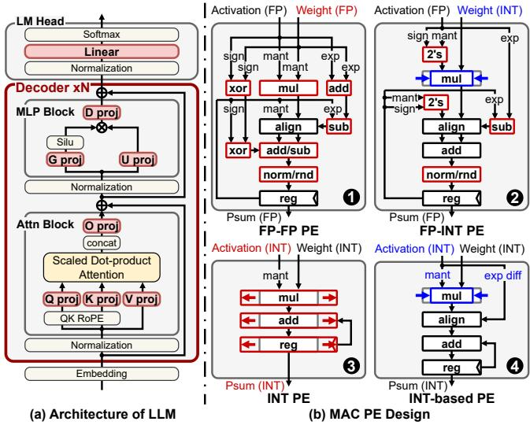
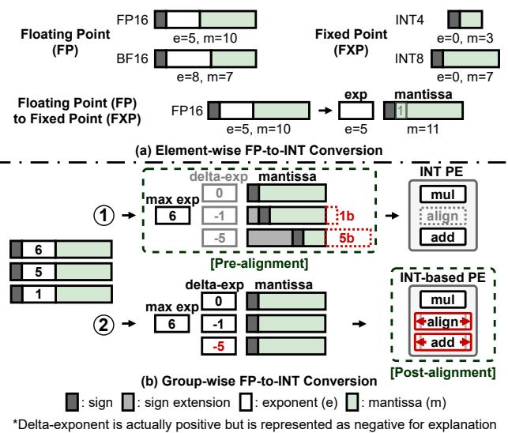
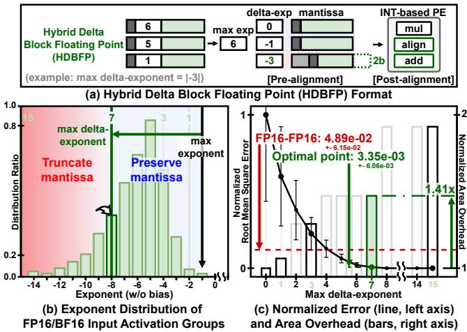
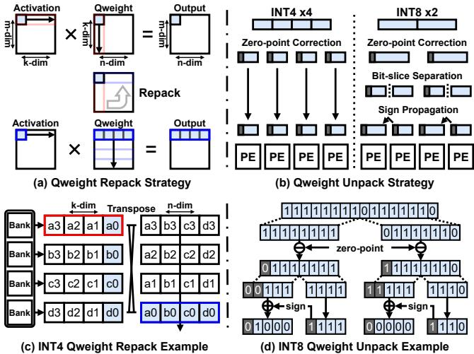
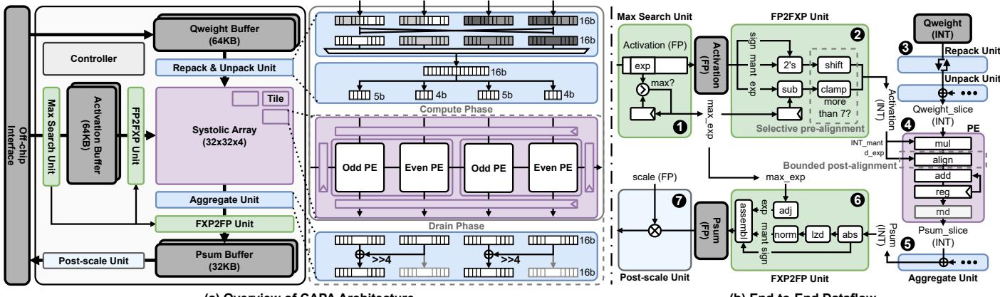
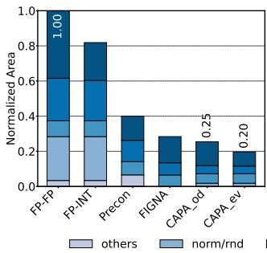
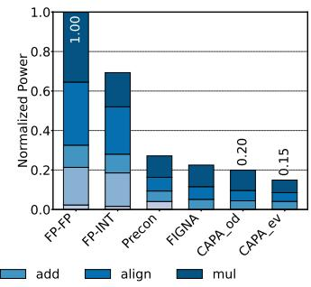
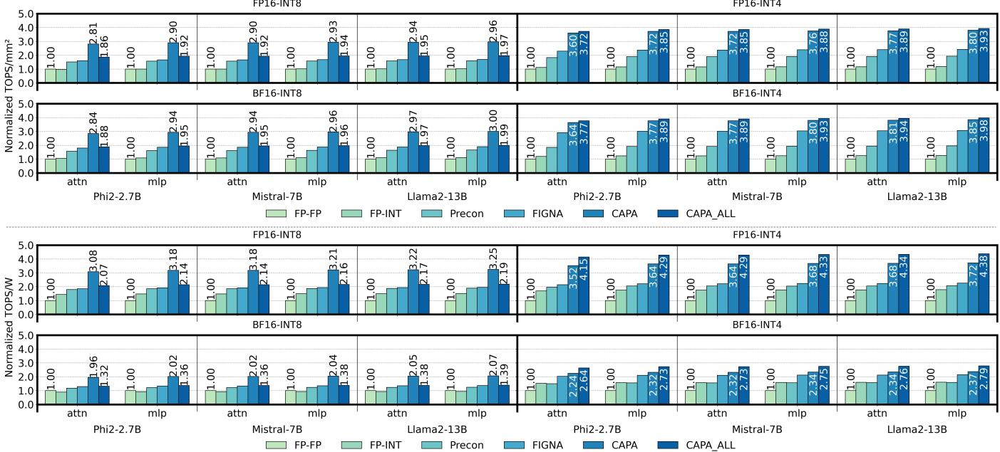

# CAPA: Convertibility-Aware Mixed-Precision Accelerator for Asymmetric GEMM in Weight-Only Quantized LLMs 图表详解

### 图像 1

这是无论文图号的CC BY许可标识，不是架构图或实验子图。左侧圆圈内为CC字样，右侧圆圈内是人物符号，下方标注BY，表达署名许可的识别信息。图片没有横纵轴、数据流、模型名称或性能数值，因此不能用于支持CAPA的准确率、面积或能效结论。它在正文中的作用是出版与授权信息提示；图内没有显示具体协议版本、完整许可条款或适用对象，不能仅凭这一小标识补出这些细节。阅读网站应将它作为许可图标说明，避免把它计入技术图编号。

### 图像 2

图1(a)展示LLM解码器结构，数据由嵌入层向上经过注意力、MLP和语言模型头；红框突出Q/K/V、输出及门控等线性投影，说明论文关注的GEMM位置。图1(b)并列四类MAC PE：FP–FP、FP–INT、纯INT及带整数对齐的INT-based。箭头表示符号、尾数、指数与部分和的处理路径，没有数值坐标。普通FP–INT虽缩小乘法路径，仍保留对齐、规格化和舍入；CAPA目标路径保留整数域对齐。该图支持设计动机与模块差异，不能单独证明各模块成本占比。

### 图像 3

图2(a)用位域说明FP16、BF16和INT格式，并展示浮点数拆为独立指数与整数尾数的转换；灰、白、绿等区域分别对应符号、指数、尾数及符号扩展。图2(b)比较组内预对齐和后对齐：指数6、5、1以6为最大值，预对齐分别涉及0、1、5位移动，红色虚线突出低位截断；后对齐保留尾数，但把移位需求带入PE。图中为位域与数据流示意，没有统计坐标。它揭示精度损失与累加硬件范围的取舍，尾数位数标注也不应直接等同于整个有符号整数通路宽度。

### 图像 4

图3(a)以最大指数差3说明HDBFP：差值5的元素只预对齐超出的2位，其余交给有界后对齐。(b)横轴为无偏置指数，纵轴为分布比例；着色区分提前截断与保留尾数的范围，阈值按相对组最大指数定义。(c)横轴为允许的最大指数差，黑线及误差棒对应左轴归一化均方根误差，柱形对应右轴归一化面积开销。阈值7处标出3.35×10⁻³，FP16–FP16参照为4.89×10⁻²，并有约1.41倍面积比较标记。图支持经验折中点；误差参照及面积归一化细节有限，不能外推为所有数据的最优阈值。

### 图像 5

图4(a)展示权重打包由k维改为n维，使一个激活产生多个输出列贡献；(c)给出多bank中的具体重排，红框沿a3至a0组织，蓝框改为a0、b0、c0、d0共享激活。(b)说明四个INT4权重可直接分发到四PE，两个INT8权重则先零点修正，再切成四片，并传播低片符号。(d)展示INT8解包的位级算例，关键关系是127=8×16−1，高片因此需要扩为5位。各箭头表示布局变换或算术修正，没有性能坐标。它支持共享输入及统一通道的机制，实际吞吐还需结合缓存与阵列执行。

### 图像 6

图5左侧为总体架构：64KB激活缓存、64KB权重缓存、32KB部分和缓存围绕32×32×4阵列布置，控制器协调转换、聚合与输出。中部放大奇偶PE及计算、排空阶段，可见5位和4位切片通道。右侧按①至⑦依次标出最大指数搜索、FP2FXP、权重重排解包、PE、聚合、FXP2FP和后缩放，箭头追踪整数尾数、指数差及尺度信息。该图解释格式适配如何移到外围，并展示统一核心路径；它不是逐周期性能实测。给定图片底部标题有裁切，子图归属以正文图5及相应章节核对，不补读模糊小字。

### 图像 7

这是图6的面积子图。横轴依次为FP–FP、FP–INT、Precon、FIGNA、CAPA奇PE和偶PE，纵轴为相对FP–FP的归一化面积，基线为1。堆叠颜色区分乘法、对齐、加法、规格化/舍入及其他开销，完整图例分布在两张子图下方。CAPA奇、偶PE柱顶分别标约0.25和0.20；正文据更精确数据报告平均面积降低77.5%。该比较针对FP16–INT4单MAC综合，支持局部逻辑成本下降，不能直接当作整个阵列面积缩减。其余未标数值柱段宜作近似或定性读取。

### 图像 8

这是图6的功率子图，与面积子图使用相同PE顺序。纵轴为相对FP–FP的归一化功率，FP–FP为1；堆叠颜色表示各算术功能的功率贡献。CAPA奇、偶PE约为0.20和0.15，正文平均功率降低82.6%，与图中舍入后的标值对应。该图表明缩小乘法、对齐及累加路径，并减少浮点处理逻辑后，单MAC功率估计显著下降。它使用综合后的功率分析口径，既不是芯片实测，也不是每token能耗；与图7的TOPS/W相比，还缺少吞吐因素及整机其他模块成本。

### 图像 9

图7上半部纵轴为归一化TOPS/mm²，下半部为归一化TOPS/W；每半部按FP16/BF16激活和INT8/INT4权重分成四种配置。横轴在三个模型下分别列出注意力与MLP，六种颜色对应FP–FP、FP–INT、Precon、FIGNA、CAPA和固定四PE的CAPA_ALL，各工作点FP–FP为1。CAPA_ALL在INT4下优势最明显，但INT8下低于按精度配置的CAPA。最高面积效率3.98倍位于BF16–INT4的Llama2 MLP，最高功率效率4.38倍位于FP16–INT4的同类工作负载。图支持精度相关的整体效率比较，不提供绝对TOPS、时延或GPU速度比。

> 中文翻译与解读由 Codex/GPT 根据所提供的论文 PDF 生成。PDF 使用 MinerU 解析，乱码数学符号已对照原文校正；参考文献保留原文。技术总结和通俗讲解属于解读，请与全文译文结合阅读。[原文 DOI](https://doi.org/10.1145/3770743.3804335)。
