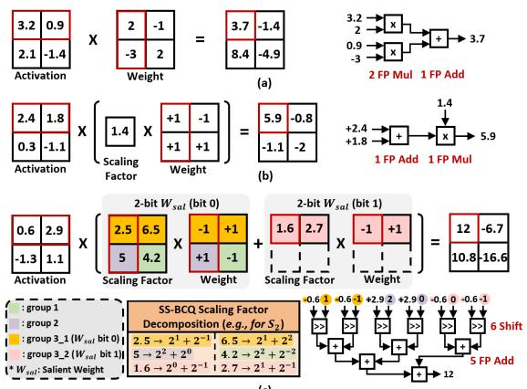
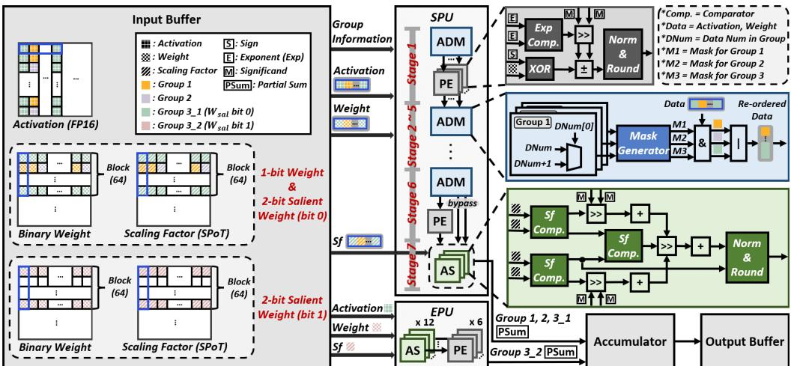
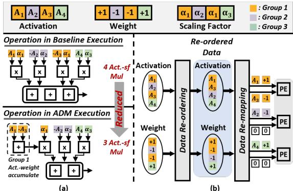
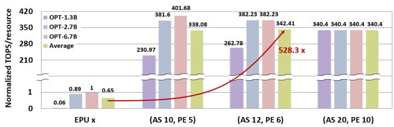

# CORE: Compact, Optimized, and Resource-Efficient Compute Engine for FP-INT GEMM Acceleration with Binary Coding Quantization 原文翻译

# CORE：面向采用二进制编码量化的 FP-INT GEMM 加速的紧凑、优化且资源高效的计算引擎

Chaewon Park, Inseong Hwang, Beomjin Kang, and Hyun Kim 首尔国立科学技术大学，韩国首尔 {chaewon00,ish9707,beomjin,hyunkim}@seoultech.ac.kr

## 摘要

大型语言模型（LLM）的最新进展推动了参数规模的快速增长，加剧了内存和计算瓶颈。仅权重量化减轻了存储开销，但仍保留浮点（FP）激活值，导致代价高昂的 FP 运算。二进制编码量化（BCQ）通过将大量 FP 乘法替换为加法来缓解这一问题，但仍依赖 FP 缩放运算，并且表示能力有限，造成了不可忽视的精度损失。为克服这些局限，我们提出了基于二次幂之和缩放因子的 BCQ（SS-BCQ），使用少量二次幂项来近似 FP 缩放因子，通过移位与加法运算消除 FP 乘法，同时保持精度。为高效支持 SS-BCQ，我们引入了 CORE，这是一种全流水线化的 FP–INT GEMM 引擎，具有以下特性：（i）采用自适应分块激活值缩放以减少缩放开销；（ii）采用轻量级处理单元，以选择性地保留高重要性权重。在 OPT-6.7B 上，与先前的 BCQ 方法相比，SS-BCQ 将困惑度降低了 3.14。与 CORE 集成后，我们的方法实现的面积效率（TOPS/mm2）和能效（TOPS/W）分别最高达到最先进的 FP–INT 加速器的 1.41× 和 2.18×，为设备端 LLM 提供了一条高效的低精度执行路径。

## CCS 概念

• 硬件 → 硬件加速器；算术与数据通路电路；• 计算机系统组织 → 神经网络。

## 关键词

FP–INT GEMM 加速器，资源高效处理单元，二进制编码量化，二次幂缩放，设备端 LLM

## ACM 参考文献格式：

Chaewon Park, Inseong Hwang, Beomjin Kang, and Hyun Kim. 2026. CORE: Compact, Optimized, and Resource-Eficient Compute Engine for FP-INT GEMM Acceleration with Binary Coding Quantization. In 63rd ACM/IEEE Design Automation Conference (DAC ’26), July 26–29, 2026, Long Beach, CA, USA. ACM, New York, NY, USA, 7 pages. https://doi.org/10.1145/3770743. 3804211

## 1 引言

近年来，高性能计算硬件（HW）（如 GPU、NPU）的进步推动了参数量快速增长的大语言模型（LLM）的发展，并取得了显著的性能提升 [18, 23, 31, 35, 48]。然而，随之增长的模型规模和内存需求给包括嵌入式系统在内的边缘平台部署带来了重大挑战。为解决这一问题，各种模型压缩技术（如线性注意力、剪枝、量化）得到了广泛研究 [3, 4, 17, 27–29, 34, 40]。作为最具代表性的模型压缩技术之一，量化将激活值或权重从标准的 32 位浮点（FP）格式转换为较低精度的整数（INT）格式，在保留原始模型架构的同时，以极小的精度损失实现大幅压缩。然而，在 LLM 中，由于激活值仅占整体内存占用的一小部分，因此激活值量化对主导端到端延迟的内存瓶颈只能起到有限的缓解作用 [20]。此外，由于激活值具有重尾离群值分布，在 Llama-7B 上采用 4 位 RTN 量化时，其精度下降幅度约为权重的 6.88×，这使得仅权重量化成为当前 LLM 部署中更为实用的选择 [5, 22, 38, 44]。在硬件上部署仅权重量化模型时，激活值（即 FP）与权重（即 INT）之间的数据格式不匹配，需要额外的转换器。这些模块对于使用仅支持单一格式的传统处理单元至关重要，但也会引入额外延迟 [1, 10]。此外，先前工作 [13, 16, 37] 表明，与 FP16 加法和 INT16 运算相比，FP16 乘法消耗的能量分别约为其 2.75× 和 22×，面积开销分别为其 1.21× 和 24.48×。这凸显出，在相同位宽下，FP 单元的面积、功耗和延迟均显著高于 INT 单元，其中 FP 乘法（FP mul）是代价最高的基本运算。因此，尽管仅权重量化缩小了模型规模并简化了部署，但其对 FP 单元和格式转换路径的持续依赖仍然带来了沉重的计算负担 [7, 24]。

为解决这些问题，近期研究着重通过将所有 FP 运算替换为基于 INT 的运算，或仅尽可能减少计算成本最高的 FP 乘法，来降低硬件部署开销 [15, 19, 33]。然而，将 FP 运算替换为 INT 运算仍需预先对齐 FP 有效数，并使用额外的转换器将 INT 值转换回 FP，这限制了其效率。因此，近期研究积极探索了二进制编码量化（BCQ）等旨在尽可能减少 FP 乘法的方法 [43]。具体而言，BCQ 使用二进制矩阵和 FP 格式的缩放因子（sf）来近似原始权重。这种表示允许将 FP 乘法替换为 FP 加法，从而简化计算。虽然与 INT4 或 INT8 仅权重量化相比，BCQ 进一步缩小了模型规模，但其有限的表示能力往往导致严重的精度下降，这仍然是该方法面临的一项关键挑战。为克服这一问题，近期工作提出，通过增加分配给每个二进制矩阵的 sf 数量，或采用根据权重重要性分配不同位宽的混合精度量化，来改进权重近似 [14, 46]。然而，为提高精度而增加 sf 或二进制矩阵数量的 BCQ 方法，不可避免地会使整体计算量随矩阵规模成比例增加，其中包括激活值与 sf 之间的 FP 乘法，从而违背了 BCQ 降低计算开销的初衷 [12]。总之，尽管为实现硬件高效的 LLM 量化已付出了大量努力，基于 BCQ 的方法仍面临若干关键挑战。

挑战 1（C1）：BCQ 中残留的 FP 乘法仍然带来显著的硬件开销。

挑战 2（C2）：增强 BCQ 有限的表示能力会引入大量激活值与 sf 之间的运算。

挑战 3（C3）：现有硬件缺乏对混合精度 BCQ 所引入的动态计算模式的高效支持。

本文通过硬件与软件（SW）协同优化来应对上述挑战。在软件层面，我们提出了面向 LLM 的软件解决方案 SS-BCQ，这是一种基于二的幂之和（SPoT）缩放的混合精度 BCQ，它（i）通过将 FP 乘法替换为移位和加法运算来消除 FP 乘法（→ C1）。为高效执行 SS-BCQ 引入的细粒度缩放和不规则计算模式，我们进一步提出了 CORE，这是一种 FP–INT GEMM 引擎，配备自适应数据映射（ADM）模块，（ii）通过数据重排显著减少激活值与 sf 之间的运算（→ C2）；同时配备额外处理单元（EPU），（iii）以极少的资源占用处理混合精度量化引入的动态分布的重要权重（→ C3）。本文的贡献如下：

• 无乘法 BCQ 算法：我们提出了 SS-BCQ，这是一种平均精度为 1.1 位的混合精度 BCQ 解决方案。通过采用逐层自适应的 SPoT sf，SS-BCQ 在 OPT-6.7B 上相较于传统 BCQ 将困惑度降低了 3.14，同时大幅降低了计算成本。

• 支持 SS-BCQ 的高效硬件模块：为减少 SS-BCQ 中激活值与 sf 之间引入的额外 FP 加法和移位运算，我们设计了优化的数据流和 ADM 模块，使这些运算减少了 95.31%。此外，为以较高的硬件效率处理混合精度 BCQ 的不规则计算模式，我们提出了专用 EPU 模块。

• 硬件与软件协同优化架构：我们提出了 CORE，这是一种 FP-INT GEMM 引擎，通过对共享处理单元（SPU）和 EPU 进行完全流水线化来实现高吞吐量。与最先进的（SOTA）FP-INT 引擎 FIGLUT [33] 相比，CORE 的 TOPS/W 提升了 2.18×，TOPS/mm2 提升了 1.41×，展示了其实现硬件高效的 FP-INT 计算的能力。

  
图 1：使用量化数据的 GEMM 运算过程。（a）仅权重量化，（b）BCQ，以及（c）SS-BCQ

## 2 背景与相关工作

## 2.1 仅权重量化与 FP 开销

量化通过使用较低精度的表示来近似高精度值，从而缩小模型规模。在各种量化方法中，仅权重量化近来受到广泛关注，因为它能够大幅压缩通常占据主要内存消耗的权重，同时在很大程度上保持模型精度 [6, 25, 39, 45]。GPTQ [9] 利用 Hessian 信息进行一次性权重量化，无需微调即可实现较高精度。AWQ [26] 则通过应用感知激活值的逐通道缩放来识别重要的权重通道，进一步降低 LLM 等大型模型的量化误差。然而，即使权重已转换为 INT 格式，由于激活值仍保持 FP 格式，LLM 推理仍然需要 FP–INT GEMM。在不原生支持混合格式的硬件上，此类 GEMM 必须使用 FP 算术进行模拟，涉及四个阶段：符号比较、指数对齐、有效数计算以及规格化/舍入 [2, 11, 32]。这些阶段需要异或门、移位器、加法器和乘法器等逻辑组件，从而增加资源占用、延迟和能耗。如图 1（a）所示，仅权重量化模型中的每个权重元素仍然需要一次 FP 乘法，由此产生显著的硬件开销。

## 2.2 二进制编码量化（BCQ）

最近，为解决上述 FP 运算增加所造成的 HW 开销，近期研究提出了基于 BCQ 的方法，以尽量减少代价高昂的 FP 乘法。传统的仅权重量化将权重转换为 INT 格式，而 BCQ 使用取值为 {+1, −1} 的二进制矩阵及相应的缩放因子 sfs 对权重进行量化 [36, 43]。图 1(b) 展示了 BCQ 的计算过程。如图所示，由于权重表示为二进制矩阵，不同格式的激活值与权重之间的 FP 乘法可以替换为 FP 加法。因此，传统的基于 INT 的仅权重量化所需的 FP 乘法次数等于权重矩阵的元素数量，而 BCQ 对权重矩阵的每一行仅需执行一次 FP 乘法，从而提高了计算效率。然而，由于 BCQ 仅使用二进制值和 FP 格式的 sfs 表示 FP 权重，其表示能力显著降低，导致相比基于 INT 的量化出现更大的精度下降。为缓解这一局限，已有工作尝试仅通过增加位宽来增强表示能力。然而，这种方法会使二进制矩阵和 $s f s ,$ 的数量成比例增加，进而提高整体计算复杂度和延迟。这些缺点凸显了混合精度 BCQ 的必要性：仅为关键数据分配更高的位宽，从而在保持精度的同时尽量减少计算开销。

## 2.3 混合精度 BCQ

BiLLM [14] 是一种混合精度 BCQ 方法，根据权重重要性分配位宽，以仅 1.1 比特的平均精度实现了高准确率。为减小量化误差，BiLLM 将每个权重矩阵划分为多个块，并根据权重重要性将每个块进一步划分为三个组。每个组共享一个缩放因子 $( s f )$，从而形成两级细粒度量化方案。具体而言，包含最重要权重的显著组使用 2 比特二进制矩阵和 sf 表示，而其余组使用 1 比特表示。尽管这种设计提高了量化后的准确率，但其使用 FP 格式的 $s f s$，且组大小动态变化，引入了额外的 FP 乘法和不规则工作负载，导致在固定资源预算下的 HW 执行效率低下。ShiftAddLLM [46] 通过将权重分解为二进制矩阵和采用 PoT 格式表示的分组 $s f s$，将 BCQ 应用于预训练的 LLM。它还采用了感知层敏感性的比特分配方式，以减少精度损失。然而，超过 2 比特的量化所需的计算量增加，加之各层之间位宽不同，显著降低了 HW 利用率。

## 2.4 FP-INT GEMM 硬件设计

iFPU [19] 提出了一种计算单元，通过有效数预对齐，将 BCQ 引入的 FP 加法替换为成本更低的 INT 运算。然而，由于 iFPU 采用高精度 BCQ，其计算单元开销显著，并且需要 INT 到 FP 转换器等额外模块，导致大量 HW 资源开销。FIGNA [15] 引入了一种 FP-INT 架构，使用共享指数对 FP 激活值和量化后的 INT 权重进行预对齐，使所有运算都能在 INT 计算单元上执行。然而，INT 乘法的计算复杂度高于加法，加之预对齐工作量随矩阵规模增大而增加，带来了明显的局限。FIGLUT [33] 提出了一种 FP-INT 计算架构，将 BCQ 下的 FP-INT GEMM 运算替换为基于查找表（LUT）的读取并累加操作，从而避免使用专用乘法器。然而，由于 LUT 大小随量化位宽增加而迅速增大，其可扩展性受到限制。

## 3 基于 2 的幂之和缩放因子的二进制编码量化

本文对 BiLLM [14] 进行了扩展，通过使用 2 的幂（PoT）近似缩放因子 sf，以便更好地进行硬件部署，从而将 sf 计算中的浮点（FP）乘法替换为硬件友好的移位操作。然而，由于精度有限，使用单个 PoT 项近似 sf 会引入显著误差。为解决这一问题，我们提出了 SS-BCQ，使用多个 PoT 项之和（SPoT）表示 $s f s$，以尽可能减小近似误差并完全消除 FP 乘法。SPoT 缩放因子 $s f ,$ $\alpha ,$ 表示如下：

$$
\alpha = 2 ^ {\mu_ {1}} + 2 ^ {\mu_ {2}} + 2 ^ {\mu_ {3}} + \ldots + 2 ^ {\mu_ {k}}\tag{1}
$$

其中，k 表示 PoT 项的数量。增大 k 通常能使 $\alpha$ 更准确地近似原始 FP 格式的 sf，但也会增加计算成本，其增幅与权重矩阵的大小成正比。为处理这一权衡，SS- $B C Q$ 自适应地调整每层的 PoT 项数，而非对所有层采用相同的 k，从而尽可能减少不必要的开销。为在严格的硬件预算下兼顾准确性与效率，我们通过系统性的权衡研究，将每层的 PoT 项数限定为两项或四项，这一选择还能最大限度地提高目标数据通路的硬件利用率。对于每一层，我们分别评估 2 项和 4 项配置下的量化误差，并选择误差较小的配置。用于这一比较的逐层量化误差计算公式如下：

$$
\delta^ {(u)} = E _ {4} ^ {(u)} - E _ {2} ^ {(u)} = \left\| W ^ {(u)} - S _ {4} B ^ {(u)} \right\| ^ {2} - \left\| W ^ {(u)} - S _ {2} B ^ {(u)} \right\| ^ {2}\tag{2}
$$

其中，$E ^ { ( u ) } i$ 表示第 u 层使用 i 个 PoT 项时的量化误差。它定义为原始权重 W 与二值权重 $B ^ { ( u ) }$ 和缩放因子 $S _ { i }$ 的乘积之间的差异，其中 $S _ { i }$ 由 i 个 PoT 项组成。在此基础上，$\delta ^ { ( u ) }$ 表示采用 $S _ { 4 }$ 与 $S _ { 2 } ,$ 时的量化误差之差，用于自适应地确定各层的 PoT 项数。如果 $\delta ^ { ( u ) } < 0 ;$，则采用 $S _ { 4 }$ 时的量化误差较小，因此为该层选择 $S _ { 4 }$；否则，当 $\delta ^ { ( u ) } > 0 ;$ 时，该层采用 $S _ { 2 } .$。这一过程在各层间迭代执行，为每层分配误差较小的 $s f$，从而确定各层的最优 PoT 项数。具体而言，我们对 LLM 中的注意力层和全连接层等子层计算 $\delta ^ { ( u ) }$，累积量化误差，并为每层分配误差较小的 SPoT 缩放因子。

如图 1(c) 所示，SS-BCQ 中的 SPoT 缩放因子使用 PoT 分量表示（例如，2.5 被分解为 $2 ^ { - 1 }$ 和 $2 ^ { 1 } )$。这种表示将 FP 乘法替换为简单的移位操作以及对激活值的 FP 加法，随后再根据权重值执行一次额外的 FP 加法，从而实现硬件友好的计算。SPoT 缩放因子以 5 位 INT 格式存储其 PoT 分量的指数，在消除硬件执行效率低下的操作的同时，相较于 BiLLM，仅在 OPT-6.7B 上引入 9.4% 的内存开销。然而，由于 $S S { \mathrm { - } } B C Q$ 采用基于重要性的混合精度量化，平均精度为 1.1 位，因此约 10% 的高重要性权重被分配 2 位，而非 1 位。与标准的 1 位 BCQ 相比，这部分精度更高的权重引入了额外的矩阵运算，如图 1(c) 中的黄色和粉色矩阵所示。高重要性权重被称为显著权重，其获取过程与 BiLLM [14] 相同。引入这些矩阵会增加不同权重元素之间的计算异构性，导致其在传统 FP GEMM 单元上执行时出现显著的硬件效率低下问题。为克服这一局限，第 4 节介绍了 CORE，这是一种专用硬件架构，通过处理不同位宽的权重，高效支持混合精度 SS-BCQ。

  
图 2：CORE 架构概览

## 4 提出的 FP-INT GEMM 引擎：CORE

## 4.1 CORE 概览

图 2 展示了 CORE 的整体架构，并说明了其主要组件的必要性和工作方式，包括 SPU 内的 PE、ADM 模块和激活移位（AS）模块，以及 EPU。CORE 采用双 PU 架构，并行处理 SS-BCQ 产生的 1 位权重和 2 位显著权重矩阵的混合精度量化计算，且不会损失吞吐量。在图 2 中，SPU 接收权重和 sf 的第一个矩阵，而 EPU 仅处理以粉色突出显示的权重和 sf 的第二个矩阵。各模块的作用如下。PE 是负责 FP 加法的基本计算单元，FP 加法是 SS-BCQ 的核心运算。ADM 模块从输入缓冲区提取分组信息，为每个组生成掩码以重新排列数据，并将重排后的数据映射到合适的 PE，确保同一组的数据能够一起处理。AS 模块支持 SPoT 缩放因子的计算，使激活值与缩放因子之间能够通过移位和加法完成运算，无需 FP 乘法。这降低了硬件成本，与以往的 BCQ 方法相比，面积减少了 6.53%，功耗降低了 14.48%。SPU 由 PE、ADM 和 AS 模块组成，采用 7 级流水线运行。由于 SS-BCQ 使用的块大小为 64，因此 SPU 并行处理 64 个数据元素。这些元素以二叉树结构进行累加，每一级将数据数量减半，最多需要 log 64 = 6 级即可为每组生成一个输出。随后，额外的一级通过 AS 模块，将每组输出与其对应的 sf 相结合，总共计算出三个输出。在前六级中，PE 和 ADM 模块被反复应用，以累加每组内的激活值和权重；在最后一级中，AS 模块使用缩放因子执行移位和加法操作。相比之下，EPU 仅由 PE 和 AS 模块组成，负责处理第二个显著权重矩阵中数量动态变化的权重。为尽可能减少资源浪费，它首先在 AS 模块中执行激活值与 sf 的运算，随后在 PE 中执行权重运算。结果被传递给累加器，并在其中与 SPU 的输出合并。最后，累加器将 SPU 和

EPU 的部分结果相加，形成完整的输出矩阵，并将其存储在输出缓冲区中。CORE 中的所有模块均采用全流水线设计。经过 42 个周期的初始化延迟以填满 SPU 流水线后，ADM 可确保输入重映射过程中不发生停顿，使系统每个周期生成一个输出，实现高吞吐量。

## 4.2 自适应数据映射与共享处理单元

ADM 模块旨在利用 SS-BCQ 的两级细粒度量化特性，其中每个块包含三个权重组，每组内的权重共享相同的 sf。通过对数据重新排序，ADM 能够实现按组计算和运算融合。图 3(a) 对比了 SS-BCQ 的基线实现与采用 ADM 时的执行方式。在基线方案中，尽管组内权重共享相同的 sf，但每个激活值都先乘以其二值权重，再乘以 sf，因此每个激活值都需要执行一次 sf 乘法。相比之下，ADM 通过重新安排计算顺序来减少这些 sf 乘法：先通过浮点加法累加共享相同 sf 的激活值与权重的乘积，再统一乘以一次 sf。这使激活值与 sf 的乘法次数减少至矩阵中 sf 的数量。图 3(b) 概述了 ADM 模块的数据映射过程。具体而言，ADM 根据输入激活值和权重所属的组对其重新排序，使共享相同 sf 的元素映射到一起。重新排序后，数据依次配对并送入 PE。如果重新排序后的数据总数为奇数，则将剩余元素与零配对，以确保计算正确。例如，如图 3(b) 所示，如果 ADM 的第 1 阶段从三个组中分别接收到 2、1 和 1 个元素，则会对元素数量为奇数的第二组和第三组补零，使其能够映射到 PE，而不影响结果。通过这一机制，与基线执行方式相比，ADM 将激活值与 sf 之间的移位和浮点加法次数最多减少了 95.31%，从而也降低了 AS 模块所需的硬件资源。总之，与第 2.4 节讨论的先前工作不同，ADM 模块结合数据重新排序与重新映射，最大限度地减少了 BCQ 实现中过多的计算资源使用和额外的模块开销，从而有效缓解了硬件资源开销。

  
图 3：在经 SS-BCQ 量化的 GEMM 中采用 ADM 的运算差异与处理流程：(a) SS-BCQ 的基线执行方式与基于 ADM 的执行方式对比，(b) ADM 模块中的数据重新排序与映射

SPU 集成了 ADM、PE 和 AS 模块，是负责处理权重矩阵的核心模块。它采用 7 级流水线结构，在保持硬件效率的同时实现高吞吐量。假设最坏情况下每个组的输入数量均为奇数，SPU 需要 72 个 PE、6 个 ADM 和 3 个 AS 模块来计算 SPoT sf。每一级均配备专用的流水线寄存器，用于存储中间结果，从而实现无停顿的全流水线运行，并在每个周期生成结果。

## 4.3 额外处理单元

SS-BCQ 基于显著权重的混合精度方案根据权重重要性，以块为单位自适应地选择采用 2 比特的权重矩阵，从而最大限度地减少量化后的精度损失。然而，这种动态选择使各计算单元的计算工作量难以预测。如果计算单元按能够处理最大数量显著权重的要求设计，就会出现严重的硬件利用不足。例如，即使为应对最大工作量配置了 50 个 PE，实际中通常也只使用约 6–7 个，导致近 86% 的资源处于空闲状态。

为解决这一问题，我们提出了由 PE 和 AS 模块组成的 EPU，用于高效处理动态分布的显著权重。如图 2 所示，SS-BCQ 中的显著权重按行选择，因此在块内呈现动态分布，但在各列之间呈现静态特性，即每列包含相同数量的显著权重。利用这一特性，EPU 按列而非按块执行运算，从而能够使用固定数量的资源，并最大限度地减少硬件利用不足。此外，为避免流水线停顿，EPU 配置了处理最小输入规模所需的最少数量的 PE 和 AS 模块。这一最小输入规模记为 $x ,$，定义如下：

$$
x > N U M _ {s a l i e n t} / (C L K _ {S P U} - C L K _ {E P U})\tag{3}
$$

其中，$C L K _ { S P U }$ 和 $C L K _ { E P U }$ 分别表示 SPU 和 EPU 产生一个输出所需的周期数，而

$N U M _ { s a l i e n t }$ 表示对于给定模型，权重矩阵单列中静态显著权重的最大数量。

例如，在 OPT-2.7B 中，权重矩阵的一列最多可包含 1,185 个显著权重。在这一工作量下，SPU 和 EPU 产生一个输出分别需要 113 和 13 个周期。由此可知，x 必须大于 11.85，满足此条件的最小值为 12。由于每个 AS 模块处理一个数据元素及其 sf，而每个 PE 接收两个输入，因此同时处理 12 个输入需要 12 个 AS 模块和 6 个 PE 模块。据此，我们为 EPU 配置了 12 个 AS 模块和 6 个 PE 模块，仅带来可忽略的资源开销。第 5.4 节提供了这一配置的更多细节，并通过实验验证了其设计依据。因此，EPU 与 SPU 并行处理权重矩阵，维持 CORE 的流水线运行，并按列执行运算，从而显著提高硬件利用率。

## 5 评估

## 5.1 评估设置

我们使用 OPT [47] 和 LLaMA 模型系列 [41, 42] 评估 SS-BCQ 的性能，并在 WikiText-2 数据集 [30] 上测量其困惑度。我们将 CORE 的性能与原始 RTN 以及五种最先进的 LLM 量化方法进行了比较，包括 BiLLM [14]、FIGLUT [33]、OPTQ [8]、AWQ [26] 和 GPTQ [9]。所有实验均在 NVIDIA RTX 3090 GPU 上进行。CORE 针对 OPT 模型系列 [47] 实现。我们使用 Xilinx Vivado Design Suite 2023.1 和 Synopsys Design Compiler 进行综合，以评估吞吐量、面积和功耗。GEMM 的矩阵形状与各模型的序列长度和隐藏维度相匹配。我们将 CORE 与四种 FP-INT GEMM 引擎进行了比较：FPU、FIGLUT [33]、iFPU [19] 和 FIGNA [15]。其中，FPU 作为基线，使用朴素的浮点乘法和浮点加法执行乘加运算。

## 5.2 精度评估

如表 1 所示，在所有被评估的模型上，CORE 的精度均优于先前方法。具体而言，在 OPT-6.7B 上，CORE 的困惑度为 24.73，而 BiLLM 为 27.87，困惑度降低了 3.14。在 LLaMA2-7B 上，CORE 的困惑度为 14.73，而 BiLLM 为 15.13。与采用 4 比特 BCQ 的 FIGLUT 相比，CORE 始终取得更优的性能。具体而言，在 OPT-1.3B 上，CORE 将困惑度从 67.95 降至 45.44，实现了 1.5× 的提升。尽管在 OPT-6.7B 上 FIGLUT 的困惑度略低于 CORE，但一旦考虑到精度位宽差距，这一差距便可忽略不计，因为 CORE 的平均精度为 1.1 比特，实现了更优的准确率与效率权衡。总之，通过利用 SPoT sf 缓解 PoT 表示中的信息损失，CORE 不仅保持了比 BiLLM 更高的精度，还消除了浮点乘法的计算负担，从而成为一种有效的解决方案。

## 5.3 硬件评估

表 2 总结了现有 GEMM 引擎的硬件设计特性、TOPS/W 和 TOPS/mm2。为进行公平比较，TOPS/W 和 TOPS/mm2 均在相同的 TOPS 配置下测量，并以 FPU 的数值为基准进行归一化。在能效（TOPS/W）方面，FPU 和 iFPU 的数值都较低，因为它们执行能耗很高的 FP 乘累加运算。FIGNA 和 FIGLUT 通过消除功耗最高的 FP 乘法运算来提高能效，但与处理 1.1 位量化数据的 CORE 不同，它们处理的是 4 位量化数据，因此需要更多计算。因此，CORE 实现了最先进的 3.48 TOPS/W，分别是 FIGNA 和 FIGLUT 所达到的 1.12 和 1.6 TOPS/W 的 3.11 倍和 2.18 倍。在面积效率（TOPS/mm2）方面，FIGNA 的效率低于 FIGLUT 和 CORE，因为其较高位宽的量化需要较大的计算面积。尽管 iFPU 由于采用 FP 乘累加运算而仍具有相对较大的计算面积，但它通过预对齐过程将部分 FP 加法替换为 INT 运算，使面积效率达到 FPU 的 1.16 倍。CORE 达到 4.17 TOPS/mm2，是 FIGLUT 的 1.41 倍。这一提升源于 FIGLUT 的预对齐模块需要大量额外面积，该模块将 FP 值转换为 INT，以执行基于 LUT 的运算。通过有效减少激活值与 sf 之间的运算，并在各阶段采用全流水线结构，CORE 在所有参与评估的 FP-INT GEMM 硬件引擎中实现了最高的面积效率。尽管 CORE 需要 EPU 来处理显著权重引入的额外计算，但 EPU 仅占 CORE 总资源的约 10%，因此开销很小，并保持了较高的面积效率。

表 1：CORE、BiLLM、FIGLUT、OPTQ、RTN、GPTQ 和 AWQ 在 OPT 和 Llama 模型上的困惑度结果

<table><tr><td></td><td>位数</td><td>OPT-1.3B</td><td>OPT-2.7B</td><td>OPT-6.7B</td><td>Llama-7B</td><td>Llama2-7B</td></tr><tr><td>CORE</td><td>1.1</td><td>45.44</td><td>34.56</td><td>24.73</td><td>15.9</td><td>14.73</td></tr><tr><td>BiLLM [14]</td><td>1.1</td><td>47.13</td><td>37.4</td><td>27.87</td><td>16.28</td><td>15.13</td></tr><tr><td>FIGLUT [33]</td><td>4</td><td>67.95</td><td>35.46</td><td>24.13</td><td>-</td><td>-</td></tr><tr><td>OPTQ [8]</td><td>2</td><td>4737.05</td><td>6294.68</td><td>442.63</td><td>68.60</td><td>19.92</td></tr><tr><td>AWQ [26]</td><td>2</td><td>9472.81</td><td> ${2.29}\mathrm{e} + {04}$ </td><td>8168.30</td><td> ${2.6}\mathrm{e} + {05}$ </td><td> ${2.2}\mathrm{e} + {05}$ </td></tr><tr><td rowspan="2">RTN</td><td>2</td><td> ${1.13}\mathrm{e} + {04}$ </td><td>9505.76</td><td> ${2.84}\mathrm{e} + {04}$ </td><td> ${1.07}\mathrm{e} + {05}$ </td><td> ${1.78}\mathrm{e} + {04}$ </td></tr><tr><td>1</td><td> ${1.72}\mathrm{e} + {04}$ </td><td> ${3.65}\mathrm{e} + {04}$ </td><td> ${1.16}\mathrm{e} + {04}$ </td><td> ${1.68}\mathrm{e} + {05}$ </td><td> ${1.57}\mathrm{e} + {05}$ </td></tr><tr><td rowspan="2">GPTQ [9]</td><td>2</td><td>115.17</td><td>61.59</td><td>50.19</td><td>152.31</td><td>60.45</td></tr><tr><td>1</td><td> ${1.49}\mathrm{e} + {04}$ </td><td> ${1.41}\mathrm{e} + {04}$ </td><td> ${1.06}\mathrm{e} + {04}$ </td><td> ${2.67}\mathrm{e} + {05}$ </td><td> ${1.16}\mathrm{e} + {05}$ </td></tr></table>

表 2：FP GEMM 硬件设计比较

<table><tr><td></td><td>CORE</td><td>FPU [21]</td><td>iFPU [19]</td><td>FIGNA [15]</td><td>FIGLUT [33]</td></tr><tr><td>量化</td><td>BCQ 1.1 位</td><td>-</td><td>BCQ 4 位</td><td>PTQ 4/8 位</td><td>BCQ 4 位</td></tr><tr><td>运算</td><td>FP 加法</td><td>FP 乘累加</td><td>FP 乘累加</td><td>INT 乘累加</td><td>FP 加法</td></tr><tr><td>缩放因子</td><td>SPoT</td><td>-</td><td>FP</td><td>-</td><td>PoT</td></tr><tr><td>归一化 TOPS/W</td><td>3.48</td><td>1</td><td>0.7</td><td>1.12</td><td>1.6</td></tr><tr><td>归一化 TOPS/ $mm^2$ </td><td>4.17</td><td>1</td><td>1.16</td><td>2.17</td><td>2.95</td></tr></table>

## 5.4 消融研究

如第 4.3 节所述，我们通过实验分析验证了 EPU 的必要性，并确定了 AS 模块和 PE 的最优数量。资源使用量通过对 LUT 和触发器数量求和来衡量。图 4 展示了包含和不包含 EPU 模块的配置的归一化 TOPS/resource，其中各数值均以 OPT-6.7B 上仅使用 SPU 的情况为基准进行归一化。在整个 OPT 系列中，与仅使用 SPU 执行相比，应用 EPU 使平均 TOPS/resource 提高了 528.3 倍。这一增益源于仅使用 12 个 AS 模块和 6 个 PE 模块计算额外的显著权重矩阵，同时保持 SPU 的吞吐量。我们进一步测试了三种代表性配置：(AS 10, PE 5)、(AS 12, PE 6) 和 (AS 20, PE 10)，其中 (AS 2i, PE i) 表示 2i 个 AS 模块和 i 个 PE 模块。(AS 10, PE 5) 配置以增加计算延迟为代价减少了资源使用量，导致 OPT-1.3B 和 OPT-2.7B 的 TOPS/resource 降低。(AS 20, PE 10) 配置能够维持较高的 TOPS。然而，由于其资源需求较大，它仅达到 340.4 TOPS/resource，略低于 (AS 12, PE 6) 所达到的 342.41。(AS 12, PE 6) 配置在资源使用量与吞吐量之间实现了最佳平衡，因为它所需的资源相对较少，同时在除 OPT-1.3B 以外的所有模型上均保持较高的 TOPS。因此，CORE 中的 EPU 模块采用 12 个 AS 模块和 6 个 PE 实现，以确保在各模型上获得最优性能。

  
图 4：EPU 中资源与吞吐量之间的权衡

## 6 结论

本文提出了 SS-BCQ 算法，通过将 FP 缩放因子替换为 SPoT 缩放因子，消除仅权重量化 LLM 中低效的 FP 乘法，从而降低计算成本。SS-BCQ 通过将乘法替换为移位和加法运算，实现了 1.1 位的平均精度。此外，通过应用层自适应 SPoT 缩放因子，与传统 BCQ 相比，其困惑度降低了 3.14。为在硬件上高效执行该算法，我们提出了 FP-INT GEMM 引擎 CORE。CORE 包含一个 ADM 模块，通过数据重排序减少激活值与缩放因子之间的计算；还包含一个 EPU，以极小的硬件资源使用开销处理混合精度量化导致的动态变化的显著权重。因此，CORE 的 TOPS/W 和 TOPS/mm2 分别达到现有 FP-INT 加速器的 2.18 倍和 1.41 倍。这些结果表明，LLM 可以在保持准确率的同时得到有效压缩，从而即使在资源受限的环境中也能实现高效推理。

## 致谢

本研究的部分工作获得了韩国 MSIT（科学技术信息通信部）的 ITRC（信息技术研究中心）支持计划（IITP-2026-RS-2022-00156295）的资助，该计划由 IITP（信息通信技术规划与评估院）监督管理；同时还获得了韩国贸易、产业与能源部（MOTIE，韩国）资助的 K-CHIPS（韩国前瞻性半导体研究合作与高技术计划）（2410000620, RS-2024-00405946, 24052-15TC）的支持。EDA 工具由韩国 IC 设计教育中心（IDEC）提供支持。Hyun Kim 为通信作者。

## References

[1] Michael J Beauchamp, Scott Hauck, Keith D Underwood, and K Scott Hem mert. 2006. Embedded floating-point units in FPGAs. In Proceedings ofthe 2006 ACM/SIGDA international symposium on Field programmable gate arrays. 12–20.

[2] Parhami Behrooz. 2000. Computer arithmetic: Algorithms and hardware designs. Oxford University Press 19 (2000), 512583–512585.

[3] Dahun Choi and Hyun Kim. 2025. GradQ-ViT: Robust and Eficient Gradient Quantization for Vision Transformers. In Proceedings ofthe AAAI Conference on Artificial Intelligence, Vol. 39. 16019–16027.

[4] Dahun Choi, Juntae Park, and Hyun Kim. 2024. HLQ: Hardware-Friendly Loga rithmic Quantization Aware Training for Power-Eficient Low-Precision CNN Models. IEEE Access (2024).

[5] Tim Dettmers, Mike Lewis, Younes Belkada, and Luke Zettlemoyer. 2022. Gpt3. int8 (): 8-bit matrix multiplication for transformers at scale. Advances in neural information processing systems 35 (2022), 30318–30332.

[6] Tim Dettmers, Ruslan Svirschevski, Vage Egiazarian, Denis Kuznedelev, Elias Frantar, Saleh Ashkboos, Alexander Borzunov, Torsten Hoefler, and Dan Alistarh. 2023. Spqr: A sparse-quantized representation for near-lossless llm weight compression. arXiv preprint arXiv:2306.03078 (2023).

[7] Chao Fang, Man Shi, Robin Geens, Arne Symons, Zhongfeng Wang, and Marian Verhelst. 2025. Anda: Unlocking Eficient LLM Inference with a Variable-Length Grouped Activation Data Format. In 2025 IEEE International Symposium on High Performance Computer Architecture (HPCA). IEEE, 1467–1481.

[8] E Frantar, S Ashkboos, T Hoefler, and D Alistarh. [n. d.]. OPTQ: Accurate Quan tization for Generative Pre-trained Transformers. 2023. In URL https://openreview. net/forum.

[9] Elias Frantar, Saleh Ashkboos, Torsten Hoefler, and Dan Alistarh. 2022. Gptq: Accurate post-training quantization for generative pre-trained transformers. arXiv preprint arXiv:2210.17323 (2022).

[10] Sameh Galal and Mark Horowitz. 2010. Energy-eficient floating-point unit design. IEEE Transactions on computers 60, 7 (2010), 913–922.

[11] David Goldberg. 1991. What every computer scientist should know about floating point arithmetic. ACM computing surveys (CSUR) 23, 1 (1991), 5–48.

[12] Yiwen Guo, Anbang Yao, Hao Zhao, and Yurong Chen. 2017. Network sketching: Exploiting binary structure in deep cnns. In Proceedings ofthe IEEE Conference on Computer Vision and Pattern Recognition. 5955–5963.

[13] Mark Horowitz. 2014. 1.1 computing’s energy problem (and what we can do about it). In 2014 IEEE international solid-state circuits conference digest oftechnical papers (ISSCC). IEEE, 10–14.

[14] Wei Huang, Yangdong Liu, Haotong Qin, Ying Li, Shiming Zhang, Xianglong Liu, Michele Magno, and Xiaojuan Qi. 2024. Billm: Pushing the limit of post-training quantization for llms. arXiv preprint arXiv:2402.04291 (2024).

[15] Jaeyong Jang, Yulhwa Kim, Juheun Lee, and Jae-Joon Kim. 2024. Figna: Integer unit-based accelerator design for fp-int gemm preserving numerical accuracy. In 2024 IEEE International Symposium on High-Performance Computer Architecture (HPCA). IEEE, 760–773.

[16] William Kahan. 1996. IEEE standard 754 for binary floating-point arithmetic. Lecture Notes on the Status ofIEEE 754, 94720-1776 (1996), 11.

[17] Beom Jin Kang, NamJoon Kim, and Hyun Kim. [n. d.]. LRA-QViT: Integrating Low-Rank Approximation and Quantization for Robust and Eficient Vision Transformers. In Forty-second International Conference on Machine Learning.

[18] Beom Jin Kang, Hae In Lee, Seok Kyu Yoon, Young Chan Kim, Sang Beom Jeong, Hyun Kim, et al. 2024. A survey of FPGA and ASIC designs for transformer inference acceleration and optimization. Journal of Systems Architecture 155 (2024), 103247.

[19] Yulhwa Kim, Jaeyong Jang, Jehun Lee, Jihoon Park, Jeonghoon Kim, Byeongwook Kim, Se Jung Kwon, Dongsoo Lee, et al. 2023. Winning both the accuracy of floating point activation and the simplicity of integer arithmetic. In The Eleventh International Conference on Learning Representations.

[20] Young Jin Kim, Rawn Henry, Rafy Fahim, and Hany Hassan Awadalla. 2023. Finequant: Unlocking eficiency with fine-grained weight-only quantization for llms. arXiv preprint arXiv:2308.09723 (2023).

[21] Israel Koren. 2018. Computer arithmetic algorithms. AK Peters/CRC Press.

[22] Changhun Lee, Jungyu Jin, Taesu Kim, Hyungjun Kim, and Eunhyeok Park. 2024. Owq: Outlier-aware weight quantization for eficient fine-tuning and inference of large language models. In Proceedings of the AAAI Conference on Artificial Intelligence, Vol. 38. 13355–13364

[23] Jinhao Li, Jiaming Xu, Shan Huang, Yonghua Chen, Wen Li, Jun Liu, Yaoxiu Lian, Jiayi Pan, Li Ding, Hao Zhou, et al. 2024. Large language model inference accel eration: A comprehensive hardware perspective. arXiv preprint arXiv:2410.04466 (2024).

[24] Qingyuan Li, Yifan Zhang, Liang Li, Peng Yao, Bo Zhang, Xiangxiang Chu, Yerui Sun, Li Du, and Yuchen Xie. 2023. Fptq: Fine-grained post-training quantization for large language models. arXiv preprint arXiv:2308.15987 (2023).

[25] Shiyao Li, Yingchun Hu, Xuefei Ning, Xihui Liu, Ke Hong, Xiaotao Jia, Xiuhong Li, Yaqi Yan, Pei Ran, Guohao Dai, et al. 2025. Mbq: Modality-balanced quantization for large vision-language models. In Proceedings of the Computer Vision and

Pattern Recognition Conference. 4167–4177.

[26] Ji Lin, Jiaming Tang, Haotian Tang, Shang Yang, Wei-Ming Chen, Wei-Chen Wang, Guangxuan Xiao, Xingyu Dang, Chuang Gan, and Song Han. 2024. Awq: Activation-aware weight quantization for on-device llm compression and accel eration. Proceedings of machine learning and systems 6 (2024), 87–100.

[27] Shuming Ma, Hongyu Wang, Lingxiao Ma, Lei Wang, Wenhui Wang, Shaohan Huang, Lifeng Dong, Ruiping Wang, Jilong Xue, and Furu Wei. 2024. The era of 1- bit llms: All large language models are in 1.58 bits. arXiv preprint arXiv:2402.17764 1, 4 (2024).

[28] Xinyin Ma, Gongfan Fang, and Xinchao Wang. 2023. Llm-pruner: On the struc tural pruning of large language models. Advances in neural information processing systems 36 (2023), 21702–21720.

[29] Luke McDermott, Robert W Heath Jr, and Rahul Parhi. 2025. LoLA: Low-Rank Linear Attention With Sparse Caching. arXiv preprint arXiv:2505.23666 (2025).

[30] Stephen Merity, Caiming Xiong, James Bradbury, and Richard Socher. 2016. Pointer sentinel mixture models. arXiv preprint arXiv:1609.07843 (2016).

[31] Shervin Minaee, Tomas Mikolov, Narjes Nikzad, Meysam Chenaghlu, Richard Socher, Xavier Amatriain, and Jianfeng Gao. 2024. Large language models: A survey. arXiv preprint arXiv:2402.06196 (2024).

[32] Jean-Michel Muller, Nicolas Brisebarre, Florent De Dinechin, Claude-Pierre Jeannerod, Vincent Lefevre, Guillaume Melquiond, Nathalie Revol, Damien Stehlé, Serge Torres, et al. 2018. Handbook offloating-point arithmetic. Vol. 1. Springer.

[33] Gunho Park, Hyeokjun Kwon, Jiwoo Kim, Jeongin Bae, Baeseong Park, Dongsoo Lee, and Youngjoo Lee. 2025. FIGLUT: An Energy-Eficient Accelerator Design for FP-INT GEMM Using Look-Up Tables. In 2025 IEEE International Symposium on High Performance Computer Architecture (HPCA). IEEE, 1098–1111

[34] Zhen Qin, Weigao Sun, Dong Li, Xuyang Shen, Weixuan Sun, and Yiran Zhong. 2024. Lightning attention-2: A free lunch for handling unlimited sequence lengths in large language models. arXiv preprint arXiv:2401.04658 (2024).

[35] Alec Radford, Jefrey Wu, Rewon Child, David Luan, Dario Amodei, Ilya Sutskever, et al. 2019. Language models are unsupervised multitask learners. OpenAI blog 1, 8 (2019), 9.

[36] Mohammad Rastegari, Vicente Ordonez, Joseph Redmon, and Ali Farhadi. 2016. Xnor-net: Imagenet classification using binary convolutional neural networks. In European conference on computer vision. Springer, 525–542.

[37] Olivier Sentieys. 2021. Approximate Computing for DNN. In CSW 2021-HiPEAC Computing Systems Week.

[38] Wenqi Shao, Mengzhao Chen, Zhaoyang Zhang, Peng Xu, Lirui Zhao, Zhiqian Li, Kaipeng Zhang, Peng Gao, Yu Qiao, and Ping Luo. 2023. Omniquant: Omni directionally calibrated quantization for large language models. arXiv preprint arXiv:2308.13137 (2023).

[39] Wenqi Shao, Mengzhao Chen, Zhaoyang Zhang, Peng Xu, Lirui Zhao, Zhiqian Li, Kaipeng Zhang, Peng Gao, Yu Qiao, and Ping Luo. 2023. Omniquant: Omni directionally calibrated quantization for large language models. arXiv preprint arXiv:2308.13137 (2023).

[40] Mingjie Sun, Zhuang Liu, Anna Bair, and J Zico Kolter. 2023. A simple and efective pruning approach for large language models. arXiv preprint arXiv:2306.11695 (2023).

[41] Hugo Touvron, Thibaut Lavril, Gautier Izacard, Xavier Martinet, Marie-Anne Lachaux, Timothée Lacroix, Baptiste Rozière, Naman Goyal, Eric Hambro, Faisal Azhar, et al. 2023. Llama: Open and eficient foundation language models. arXiv preprint arXiv:2302.13971 (2023).

[42] Hugo Touvron, Louis Martin, Kevin Stone, Peter Albert, Amjad Almahairi, Yasmine Babaei, Nikolay Bashlykov, Soumya Batra, Prajjwal Bhargava, Shruti Bhosale, et al. 2023. Llama 2: Open foundation and fine-tuned chat models. arXiv preprint arXiv:2307.09288 (2023).

[43] Chen Xu, Jianqiang Yao, Zhouchen Lin, Wenwu Ou, Yuanbin Cao, Zhirong Wang, and Hongbin Zha. 2018. Alternating multi-bit quantization for recurrent neural networks. arXiv preprint arXiv:1802.00150 (2018).

[44] Yuzhuang Xu, Xu Han, Zonghan Yang, Shuo Wang, Qingfu Zhu, Zhiyuan Liu, Weidong Liu, and Wanxiang Che. 2024. Onebit: Towards extremely low-bit large language models. Advances in Neural Information Processing Systems 37 (2024), 66357–66382.

[45] Yuzhuang Xu, Xu Han, Zonghan Yang, Shuo Wang, Qingfu Zhu, Zhiyuan Liu, Weidong Liu, and Wanxiang Che. 2024. Onebit: Towards extremely low-bit large language models. Advances in Neural Information Processing Systems 37 (2024), 66357–66382.

[46] Haoran You, Yipin Guo, Yichao Fu, Wei Zhou, Huihong Shi, Xiaofan Zhang, Souvik Kundu, Amir Yazdanbakhsh, and Yingyan Celine Lin. 2024. Shiftaddllm: Accelerating pretrained llms via post-training multiplication-less reparameteriza tion. Advances in Neural Information Processing Systems 37 (2024), 24822–24848.

[47] Susan Zhang, Stephen Roller, Naman Goyal, Mikel Artetxe, Moya Chen, Shuohui Chen, Christopher Dewan, Mona Diab, Xian Li, Xi Victoria Lin, et al. 2022. Opt: Open pre-trained transformer language models. arXiv preprint arXiv:2205.01068 (2022).

[48] Wayne Xin Zhao, Kun Zhou, Junyi Li, Tianyi Tang, Xiaolei Wang, Yupeng Hou, Yingqian Min, Beichen Zhang, Junjie Zhang, Zican Dong, et al. 2023. A survey of large language models. arXiv preprint arXiv:2303.18223 1, 2 (2023).

> 中文翻译与解读由 Codex/GPT 根据所提供的论文 PDF 生成。PDF 使用 MinerU 解析，乱码数学符号已对照原文校正；参考文献保留原文。技术总结和通俗讲解属于解读，请与全文译文结合阅读。[原文 DOI](https://doi.org/10.1145/3770743.3804211)。
