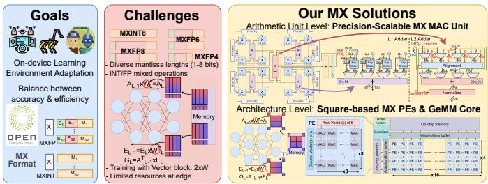
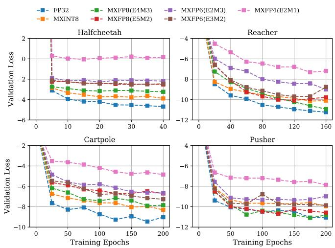
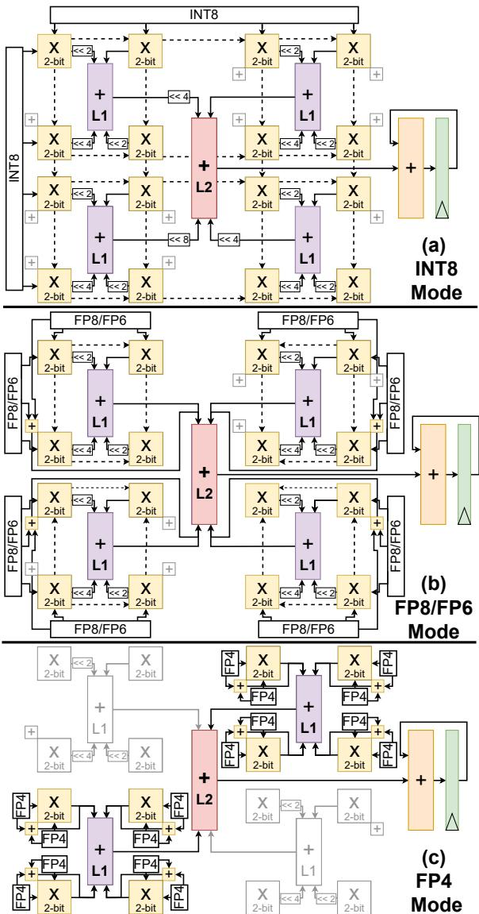
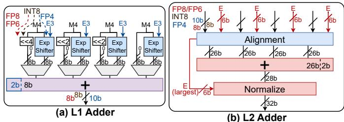
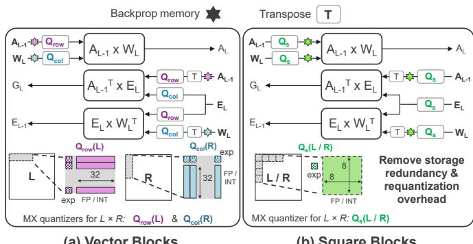
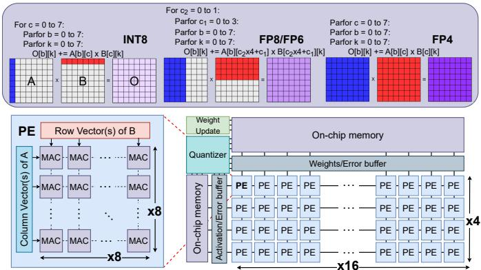
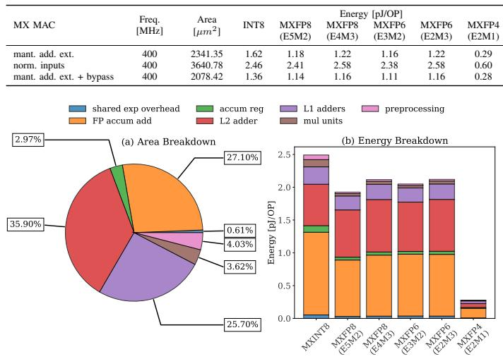
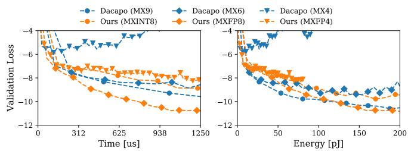

# Efficient Precision-Scalable Hardware for Microscaling (MX) Processing in Robotics Learning 原文翻译

# 面向机器人学习的高效精度可扩展 Microscaling (MX) 处理硬件

Stef Cuyckens†, Xiaoling Yi†, Nitish Satya Murthy†, Chao Fang†,‡,∗, Marian Verhelst†

†比利时鲁汶大学 ‡中国南京大学

Email: {stef.cuyckens, xiaoling.yi, nitish.satyamurthy, chao.fang, marian.verhelst}@esat.kuleuven.be

摘要——自主机器人需要高效的设备端学习（on-device learning）能力，以便在不依赖云端的情况下适应新环境。对于这种边缘训练，Microscaling (MX) 数据类型提供了一种颇具前景的解决方案：它将整数与浮点表示相结合并共享指数，在保持精度的同时降低了能耗。然而，最先进的持续学习处理器 Dacapo 存在局限性：它仅支持 MXINT，并且在反向传播中采用低效的基于向量的分组方式。在本文中，据我们所知，我们提出了首个针对这些局限性的解决方案，包含两项关键创新：(1) 一种精度可扩展的算术单元，通过利用子字并行（sub-word parallelism）以及统一的整数与浮点处理，支持全部六种 MX 数据类型；(2) 支持方形共享指数分组，从而在反向传播中实现高效的权重处理，消除存储冗余和量化开销。

我们在 TSMC 16nm FinFET 工艺、400MHz、等峰值吞吐量（iso-peak-throughput）条件下，在四个机器人工作负载上将我们的设计与 Dacapo 进行了对比评估，实现了 51% 更低的内存占用以及 4× 更高的有效训练吞吐量，同时获得了相当的能效，为边缘侧的高效机器人持续学习奠定了基础。

## I. 引言

自主机器人在导航、灾难救援和人机协作等任务中，面对陌生环境时需要具备自适应学习能力 [1]–[3]。传统的云端学习要求持续的网络连接，同时在适应意外情况时会损害数据隐私与实时响应能力 [4], [5]。相比之下，边缘训练通过持续的设备端学习，使机器人能够自主感知、学习并实时调整行为，从而解决了这些挑战 [6]–[10]。

现代边缘机器人系统日益依赖神经网络（NN）来获得学习能力 [11]–[14]，但其面临一个关键的性能挑战。虽然推理任务可以使用 8 位整数（INT）等整数格式高效运行，但训练 NN 模型需要浮点（FP）精度来准确捕获梯度更新 [15]–[17]。这在边缘机器人领域造成了根本性矛盾：既需要 FP 精度，又要满足最小化位宽的能耗约束。最近提出的 Microscaling (MX) 格式 [18], [19] 已获得开放计算项目（Open Compute Project）中众多大型商业公司的广泛关注 [18]，它通过结合 INT 与 FP 特性提供了一种颇具前景的解决方案。如表 I 所示，MX 以 32 元素为一组共享指数来表示数据，其实现形式涵盖从 MXINT8（纯整数）到具有不同指数-尾数配置的多种 MXFP 变体（E5M2、E4M3、E3M4、E2M5、E2M1）。这些格式相比仅窄位宽整数量化能获得更高的训练精度，同时相比全 FP 格式保持了更低的内存需求 [20]–[23]，这对于资源有限、需要适应新环境的边缘机器人系统至关重要。MX 格式的多样性提供了精度-准确度权衡，即更低的精度可降低每次操作的能耗。

图 1. 目标、挑战与我们的贡献概览：(1) 支持全部六种 MX 格式、结合 INT 与 FP 运算的精度可扩展 MX MAC 单元；(2) 用于边缘训练的 64 元素方形 MX 分组，以及基于方块的 MX PE 阵列的 GeMM 核设计。

然而，如图 1 所示，在机器人处理硬件中高效支持全部 6 种 MX 数据类型变体，在算术单元和架构两个层面都带来了挑战。

在算术单元层面，例如，最先进（SotA）的 MX 持续学习处理器 Dacapo [24] 实现了标准化 MX 格式 [19] 的前身 [25]，但仅支持 MXINT 而不具备 MXFP 能力。这一局限性既限制了与新一代 MX 标准 [19] 的兼容性，也妨碍了那些本可受益于 FP 精度的工作负载的训练效率。除 Dacapo 之外，其他现有的 MX 硬件实现 [21], [26] 要么 a.) 缺乏多样化机器人训练应用所需的精度可扩展能力，要么 b.) 将数据通路拆分为 1 位处理单元 [27]，导致设计在能耗或面积上低效。MX 数据类型中 1、2、3 和 8 位不等的尾码长度，加上整数与浮点格式的混合，使得在高效支持所有格式时产生巨大的设计复杂度。此外，所有现有解决方案均实现了精确加法 [21], [28]，这对于两种 MXFP8 格式而言变得极其低效。由于其较大的指数位宽，MXFP8 的 E5M2 格式在 [21] 中需要 78 位加法。另外，整数与浮点运算之间的切换会引入进一步的复杂性 [24], [29], [30]，因为在同一硬件框架内必须 accommodate 不同的算术行为。

在架构层面，MX 格式的基于向量的分组方式 [18] 在 NN 训练硬件加速器中造成低效。这种被 SotA 的 Dacapo [24] 也采用的方式在反向传播中尤其成问题：反向传播需要以原始形式和转置形式两种方式使用权重矩阵，以分别进行行方向和列方向的点积运算，如图 1 所示。共享指数分组无论是按行组织还是按列组织，都无法在所有训练阶段中保持高效，这迫使架构设计要么 a.) 像 [31], [32] 那样维护两个分别量化、具有不同共享指数的权重版本，使存储需求翻倍；要么 b.) 存储未量化的权重并进行反复量化，如 [33] 那样增加计算开销和能耗。然而，这两种解决方案对于资源稀缺的边缘处理效率而言都是不利的。

为了解决上述挑战，据我们所知，本工作提出了首个高效的支持全部六种 MX 数据类型的精度可扩展乘累加（MAC）单元，并将其嵌入到一个针对基于方块的 MX 分组优化的处理阵列中，从而解决现有 MX 实现的全部存储低效问题。我们的关键贡献包括：

• 在算术单元层面，提出一种精度可扩展 MAC，以 2 位乘法器作为基本计算单元高效处理所有 MX 格式，在单一设计中统一整数与浮点运算，同时将精度扩展中多出的乘法器重新用于部分积累加。

• 在架构层面，提出一种新颖的基于方块的 MX 处理元（PE）阵列和支持学习的 MX 通用矩阵乘法（GeMM）核心，以 64 元素（8×8）方块取代传统的 32 元素基于向量的分组，在各训练过程间实现无需重量化的对称运算，同时显著减少权重存储。

• 对我们的实现与 Dacapo [24] 进行了全面对比评估，在相近能效下实现了 51% 的内存占用缩减以及 4× 更高的有效训练吞吐量。两个系统均在 TSMC 16nm FinFET、400MHz、等峰值吞吐量条件下进行评估。

## II. 背景与动机

## A. MX 格式

如表 I 所示，最新的 MX 标准 [18] 旨在通过在用 8 位或更少位数表示操作数时最小化精度损失，来实现高效的神经网络（NN）实现。为此，数据元素以 32 的块大小进行分组，这些元素共享一个联合缩放因子（在图 1 中记为 X）。该缩放因子本身被限制为"E8M0"格式（8 位指数、0 位尾数），这将其约束为 2 的幂。根据该标准，缩放因子被设置为块中最大的 2 的幂除以元素格式中可表示的最大 2 的幂所得的商。

TABLE I
[18]、[19] 中规定的具体 MX 格式
<table><tr><td>MX 名称</td><td>MXINT8</td><td colspan="2">MXFP8</td><td colspan="2">MXFP6</td><td>MXFP4</td></tr><tr><td>元素格式</td><td>INT8</td><td>E5M2</td><td>E4M3</td><td>E3M2</td><td>E2M3</td><td>E2M1</td></tr><tr><td>位数</td><td>8</td><td>8</td><td>8</td><td>6</td><td>6</td><td>4</td></tr></table>

块大小为 32 个元素。共享指数为 8 位。

  
Fig. 2. 具体 MX 数据类型在 4 个机器人训练工作负载上的验证损失曲线，与 FP32 基线相比，表明 FP32 可以被低位宽的 MX 类型替代以用于机器人学习。

如表 I 所示，块内单个元素的数据格式可以是多种符合 MX 规范的格式之一，包括 MXFP8 E5M2、MXFP8 E4M3、MXFP6 E3M2、MXFP6 E2M3 和 MXFP4 E2M1。在这种记法中，第一个数字表示总位宽，随后是元素特定的指数位和尾数位。例如，MXFP8 E5M2 将 5 位分配给指数，2 位分配给尾数，加上符号位共同构成 8 位表示，以牺牲精度为代价换取更宽的动态范围。

## B. MX 在机器人学习中的机遇

机器人技术日益需要设备端学习的能力，以便在没有云连接的情况下适应动态环境 [4]–[8]。对于这些受约束的场景，MX 格式为 FP32/FP16/BF16 等高精度格式提供了一种极佳的替代方案，在显著降低内存占用和能耗的同时，为基于梯度的学习保持足够的精度。MX 独特的基于块的指数共享方案，使其能够以总体少得多的位数捕获表示梯度所需的动态范围 [20]–[23]。

  
Fig. 3. 3 种缩放模式下的精度可扩展 MAC 单元：(a) INT8、(b) FP8/FP6 和 (c) FP4。乘法部分以黄色标示，L1 加法器以紫色标示，L2 加法器以红色标示，FP 累加加法以橙色标示，累加寄存器以绿色标示。

图 2 总结了我们在多个任务和多种 MX 精度设置下，对机器人学习中 MX 处理的实验评估 [14]。这些任务涉及训练神经网络来预测来自文献 [14] 的连续控制机器人系统的系统动力学。实验揭示了一个关键发现：不同的机器人学习工作负载受益于不同的精度配置。具体而言，MXFP8 E4M3 在训练 pusher 和 reacher 任务（与机器人-物体交互相关 [3]）中表现出卓越的效率。相反，MXINT8 在 cartpole 和 halfcheetah 工作负载（代表平衡任务 [34]）中取得了最高性能。

## III. 算术单元创新

## A. 精度可扩展的 MX MAC 单元

机器人学习需要高效的精度可扩展计算，以平衡训练吞吐量和推理效率。我们的精度可扩展 MX MAC 单元满足了这一需求，可支持所有 MX 数据格式（如表 I 所示），并针对每种格式进行了优化。

图 3 展示了我们的精度可扩展 MX MAC 单元在其三种工作模式下的架构。这一灵活 MAC 单元的架构由 16 个基本的 2 位乘法单元组成，这些单元通过灵活互连来高效支持所有 MX 格式，同时与由 1 位处理模块组成的设计 [27] 相比，降低了加法器开销。我们的架构在各精度级别间最大化硬件复用，同时在每个模式下保持最优性能。

该 MAC 灵活地在三种不同的工作模式下运行：INT8、FP8/FP6 和 FP4，并在这些精度模式之间进行动态硬件重配置。如图 3(a) 所示，在 INT8 模式下，全部十六个 2 位乘法器协同工作，计算 INT8×INT8 乘法的单个 16 位结果，此时指数加法器保持非激活状态。

对于图 3(b) 所示的 FP8/FP6 模式，相同的硬件同时处理四个并行的 FP8/6×FP8/6 乘积，每个乘积利用四个 2 位乘法器进行尾数乘法，并配有一个专用的 5 位指数加法器。

最后，在图 3(c) 的 FP4 模式下，每个激活的 2 位乘法器与一个 2 位指数加法器配对，构成一个完整的 FP4 处理单元。该模式并未利用其全部计算并行性，而是由于带宽限制将并行度限制为八个并行的 FP4×FP4 结果。在该配置中，带宽（BW）保持与 FP8/6 模式相等，同时仍然并行计算 8 个结果，并在一个 8×8 的共享指数块中相加。这一设计选择及其在阵列层面的影响将在第 IV 节中更详细地讨论。

这种配置使各精度级别之间保持一致的吞吐量，同时在较低精度下提升计算密度。

为了在较低精度模式下高效地对多个并行乘积进行求和归约，我们开发了一种具有两级加法器架构的分层 MX 累加器。该方法实现了一种 Sum-Together 方案 [35]，根据所选精度模式重新调配内部加法器：在 INT8 模式下累加部分积，在 FP8/FP6 和 FP4 模式下对并行的 FP 结果求和。通过让每个 MAC 处理单元无论精度如何都只生成单个输出，我们简化了阵列级数据通路 [36]，同时高效管理混合精度累加。接下来，我们将详细阐述分层两级累加器的设计及其关键路径优化。

## B. 面积高效的多级 MX 累加器

如图 4 所示，多级累加器架构采用一级（L1）和二级（L2）加法器，在最大化硬件复用的同时高效处理不同的 MX 精度模式。该设计解决了三个关键挑战：管理各种依赖精度的加法运算、保证计算精度，以及在各精度模式间平衡关键路径。

Fig. 4. L1 和 L2 加法器，INT8 路径以棕色标示，FP8/FP6 以红色标示，FP4 以蓝色标示。

 图 5. 采用 MX 向量块和方块量化器的训练计算图。通过支持存储块量化参数以用于反向传播，方块可带来计算与内存占用方面的增益。

L1 加法器。如图 4(a) 所示。对于 INT8/FP8/FP6 运算，L1 加法器对 4 位整数部分积进行适当移位后累加（如图 3(a) 和 所示），以形成 8 位输出。对于 FP4 运算，它通过对四个不同的完整 E3M4 乘法结果的尾数直接按其指数进行移位来求和，从而避免了先寻找最大指数的需要。这一简化利用了 E3M4 指数范围的有限性（0-4），并实现了显著的硬件复用，因为同一个整数加法器可服务于所有精度模式，仅需为 FP4 模式扩展 2 位。

L2 加法器。如图 4(b) 所示，L2 加法器在不同精度模式下面临不同的需求。在 FP8/FP6 模式下，若对 INT 累加采用直接移位方法，由于其指数范围过大（FP8 E5M2 为 ±30），将需要一个不切实际的 78 位整数加法器；而我们的实现采用 FP32 加法，仅需一个更适中的 26 位尾数加法器。针对窄 FP 格式中次正规数（subnormal numbers）普遍存在的问题，我们仅将内部尾数位宽扩展 2 位，而非实现成本高昂的规格化电路。该解决方案即使在输入未规格化的情况下也能保证 FP32 精度的加法，同时将硬件开销降至最低。

关键路径优化。我们实现了针对特定精度的旁路，以平衡不同模式间的延迟路径。INT8 模式和 FP4 模式在 L1 加法器中的关键路径都较长，INT8 是由于其符号-数值（sign-magnitude）转换，FP4 则是由于需要可变移位器。然而，这两种模式都可以旁路 L2 加法器中的对齐逻辑，因为该逻辑仅在 FP8/FP6 模式下需要。这种模式特定的旁路策略平衡了各模式间的关键路径长度，并由综合工具实现。

## IV. 架构创新

## A. 基于方块的 MX PE 阵列

传统 MX 架构采用 32 元素向量块 [19]，这在神经网络训练期间会产生显著的低效问题。如图 5(a) 所示，训练图涉及以原始形式和转置形式对激活值、权重和反向传播误差进行 GeMM 计算。由于对原始矩阵和转置矩阵执行相同的向量量化（按行块或列块）会产生不同的结果，因此需要维护两个独立的版本。这使内存需求翻倍，对资源受限的边缘设备 [37]、[38] 构成了严峻挑战。

我们提出采用具有共享指数的 64 元素方块（8×8）来解决这些局限性。如图 5(b) 所示，我们的方块能够实现对称运算，使同一量化表示可以无需重量化即可服务于两个方向的计算。该实现为每个块内的全部 64 个元素使用一个共享指数，从而在不同精度需求下实现高效缩放。我们选择 8 × 8 的配置是为了在粒度与效率之间取得平衡，同时保持与将组定义为 32 元素倍数的 MX 标准的兼容性。此处两个 32 元素块共享同一个指数。

我们的设计通过 PE 阵列处理这些方块，如图 6 所示，该阵列由 64 个所提出的柔性 MAC 单元组成，每个单元支持多种精度模式（INT8、FP8/FP6、FP4）。两个 8 × 8 块的 GeMM 需要为 64 个输出中的每一个累加 8 个乘法结果。我们的 PE 阵列通过使用第 III 节所述的精度可扩展 MAC 单元来提高 FP 模式的吞吐量，在 INT8 模式下以 8 个后续时钟周期处理一次块乘法，在 FP8/FP6 模式下为 2 个周期，在 FP4 模式下为 1 个周期。图 6 通过标示每种精度模式下在一个周期内处理输入块的哪些部分，展示了这种吞吐量的提升。

由于采用了具有共享指数的方块，该架构避免了反向传播步骤中代价高昂的重量化，并与最先进的 MX 训练硬件 Dacapo [24] 相比，将权重存储减少了近 50%，同时在各训练阶段保持了计算效率。这使其非常适合内存约束尤为严苛的端侧学习应用。

## B. 支持学习的 MX GeMM 核

64-MAC 的 MX PE 阵列以 4 × 16 的网格排列，构成我们支持学习的 MX GeMM 核，如图 6 所示。该网格配置针对边缘设备训练约束进行了优化，其维度是根据典型工作负载特征精心选择的。高度维度 4 对应于批大小 32 除以我们的 8 × 8 方块维度，而宽度 16 则在带宽效率与计算并行度之间实现了最佳平衡。这种矩形配置解决了边缘设备固有的内存限制，因为在反向传播过程中需要存储激活值，所以更倾向于采用较小的批大小。

 Fig. 6. PE 阵列处理两个 64 元素方块的乘法，INT8 模式下需 8 个周期执行，FP8/FP6 需 2 个周期，FP4 需 1 个周期。该 PE 阵列是我们 4x16 PE 阵列 GeMM 核的组成部分。

MX GeMM 核实现了输出驻留数据流，其中部分结果在每个 PE 内部进行本地累加，以尽量减少 FP32 中间数据的传输。这要求将共享指数集成到每个算术单元的 FP 累加器中以进行正确的对齐。为此，输入块的共享指数在 PE 层级先相加，随后应用于每个 MAC 的 L2 加法器输出。

MX GeMM 核在各训练阶段表现出不同的执行模式：在前向传播期间，该网格以高利用率处理矩阵乘法。反向传播本质上是前向传播的逆序镜像，具有相似的利用率模式。权重梯度计算阶段带来了独特的挑战，因为累加发生在较小的批维度 32 上，需要更频繁的内存写入，并大幅降低了阵列利用率。GeMM 核的最大内存带宽为 5280 位/周期（约 264GB/s），在 FP8 和 FP4 运算期间被完全利用。在停顿周期（尤其是在权重梯度计算阶段），该带宽专门用于写回 FP32 输出，随后这些输出被传输到量化器，如图 6 所示。对于权重更新，梯度与权重的实际相加在一个单独的加速器模块中进行，使我们的 GeMM 核能够专注于矩阵乘法运算，同时在资源受限的边缘设备上保持高效流水线。

## V. 实验结果

本节首先介绍对第 III 节中提出的 MX 可扩展 MAC 单元的评估，随后对第 IV-A 节中所述的支持共享指数的 PE 阵列进行评估。最后，将我们的基于学习的 MX GeMM 核与 Dacapo 处理器（一种 SotA 的 MX 持续学习处理器 [24]）进行性能对比。所有实验结果均基于 TSMC 16nm FinFET 工艺的综合得到。开关活动标注的功耗与能耗分析通过 Synopsys PrimeTime PX 获得。

TABLE II 精度可扩展 MX MAC 的不同实现变体对比
<table><tr><td rowspan="2">MX MAC</td><td rowspan="2">频率 [MHz]</td><td rowspan="2">面积 [µm2]</td><td rowspan="2">MXFP8</td><td colspan="5">能耗 [pJ/OP]</td></tr><tr><td>(E5M2)</td><td>MXFP8 (E4M3)</td><td>MXFP6 (E3M2)</td><td>MXFP6 (E2M3)</td><td>MXFP4 (E2M1)</td></tr><tr><td>尾数加法器扩展</td><td>400</td><td>2341.35</td><td>1.62</td><td>1.18</td><td>1.22</td><td>1.16</td><td>1.22</td><td>0.29</td></tr><tr><td>输入归一化</td><td>400</td><td>3640.78</td><td>2.46</td><td>2.41</td><td>2.58</td><td>2.38</td><td>2.58</td><td>0.60</td></tr><tr><td>尾数加法器扩展 + 旁路</td><td>400</td><td>2078.42</td><td>1.36</td><td>1.14</td><td>1.16</td><td>1.11</td><td>1.16</td><td>0.28</td></tr></table>

  
Fig. 7. PE 阵列的面积与能耗/OP（乘法）分解。

## A. 精度可扩展 MX MAC 单元的评估

本节对第 III 节中介绍的精度可扩展 MX MAC 的不同设计选择进行分析。每种变体均独立综合，并在使用随机生成输入数据的 500 个周期上提取每次乘法操作（OP）的平均能耗。该评估旨在量化第 III 节中所述算术单元优化的收益。表 II 对处理 L2 处非归一化输入的两种 proposed 方法进行了评估： 扩展尾数加法器两比特，或 对 L2 处的输入进行归一化。结果清楚地表明，相对于对每个输入进行归一化操作，扩展尾数加法器宽度的优势。此外，还考察了引入旁路逻辑以平衡不同模式间关键路径的影响。结果表明了明显的优势，因为可以对 L2 加法器中较大的 FP8/FP6 路径最小化延迟优化，从而带来面积的缩减。这一显著的缩减归因于关键时序如今更容易被工具满足，从而减少了大驱动强度单元和缓冲单元的使用。该评估尚未包含共享指数逻辑。

## B. PE 阵列的评估

本节对 PE 阵列的面积与能耗分解进行了详细分析，如图 7 所示。该分析深入揭示了一个实际阵列实现中资源占用最密集的组成部分。该阵列使用在 L2 加法器中带旁路的 MAC 单元。能耗分解所用的平均功耗是在具有随机输入数据的 100 次块乘法上计算得到的。对于图 7 中所示的能耗分解，总能耗除以共计 51,200 次乘法 OP。

能耗分解表明，FP 累加加法是该架构中能耗最密集的组成部分。此外，结果显示共享指数所带来的开销可以忽略不计。

TABLE III  
我们的方法与 DACAPO 在 MXINT8/MX9 下以及未量化的 FP32 基线的内存占用对比
<table><tr><td rowspan="2">Batch Size</td><td rowspan="2">方法</td><td colspan="2">推理 [KB] A</td><td colspan="2">训练 [KB]</td><td rowspan="2">E (列)</td><td rowspan="2">总计 [KB]</td></tr><tr><td>W</td><td> $W ^ { T }$ </td><td> $A ^ { T }$ </td><td>E (行)</td></tr><tr><td rowspan="4">16</td><td>FP32</td><td>576.0</td><td>0.0</td><td>50.0</td><td>16.0</td><td>0.0</td><td>642.0 (1.00×)</td></tr><tr><td>Dacapo [24]</td><td>0.0 162.0 4.5</td><td>162.0</td><td>14.1</td><td>复用 A</td><td>4.5</td><td>347.1 (1.85×)</td></tr><tr><td>我们的方法</td><td>146.3</td><td>0.0</td><td>0.0 12.7</td><td>4.1</td><td>0.0</td><td>163.1 (3.94×)</td></tr><tr><td>FP32</td><td>576.0</td><td>0.0 9.0</td><td>0.0</td><td>100.0</td><td>0.0</td><td>708.0 (1.00×)</td></tr><tr><td rowspan="3">32</td><td>Dacapo [24]</td><td>162.0</td><td>162.0</td><td>28.1</td><td>32.0 复用 A</td><td>9.0</td><td>370.1 (1.91×)</td></tr><tr><td>我们的方法</td><td>146.3</td><td>0.0</td><td>25.4</td><td>8.1</td><td>0.0</td><td>179.8 (3.94×)</td></tr><tr><td>FP32</td><td>0.0 576.0</td><td>0.0</td><td>200.0</td><td>64.0</td><td>0.0</td><td>840.0 (1.00×)</td></tr><tr><td rowspan="3">64</td><td>Dacapo [24]</td><td>162.0</td><td>0.0 18.0</td><td>162.0 56.3</td><td>复用 A</td><td>18.0</td><td>416.3 (2.02×)</td></tr><tr><td>我们的方法</td><td>146.3</td><td>0.0</td><td>0.0</td><td>16.3</td><td>0.0</td><td>213.4 (3.94×)</td></tr><tr><td></td><td></td><td></td><td></td><td>50.8</td><td></td><td></td></tr></table>

TABLE IV

我们的方法与 SOTA DACAPO [24] 的全面对比
<table><tr><td colspan="2">规格</td><td>我们的方法</td><td>Dacapo [24]</td></tr><tr><td colspan="2">频率 [MHz] 面积 [mm2]</td><td>400</td><td>400</td></tr><tr><td colspan="2"></td><td>8.92</td><td>8.52</td></tr><tr><td colspan="2">最大带宽 [GB/s]</td><td>264</td><td>512</td></tr><tr><td colspan="2">内存 [KB] MAC 数量</td><td>179.78</td><td>370.13</td></tr><tr><td colspan="2"></td><td>4096</td><td>4096</td></tr><tr><td rowspan="3">E/op [pJ]</td><td>MXINT8 vs. MX9</td><td>2.43</td><td>2.68</td></tr><tr><td>MXFP8/FP6 vs. MX6</td><td>1.92 - 2.12</td><td>1.46</td></tr><tr><td>MXFP4 vs. MX4</td><td>0.278</td><td>0.358</td></tr><tr><td colspan="2">Batch Size</td><td>32</td><td>32</td></tr><tr><td rowspan="3">训练延迟/Batch [µs]</td><td>MXINT8 vs. MX9</td><td>13.575</td><td>50.5</td></tr><tr><td>MXFP8/FP6 vs. MX6</td><td>6.03</td><td>30.7</td></tr><tr><td>MXFP4 vs. MX4</td><td>4.7625</td><td>25.75</td></tr></table>

相比之下，面积分解表明 L1 与 L2 加法器占据了总面积的最大部分。面积与能耗之间的这种不对称性源于 L1 与 L2 加法器包含模式特定的组件，从而导致面积利用率的增加。

## C. GeMM 核心与 SotA 的对比评估

我们将图 6 所示的复杂 MX 处理器核心与参考的类 MX SotA 训练处理器 Dacapo [24] 进行了比较。两者均在 TSMC 16nm FinFET 工艺下以 400MHz 时钟频率综合，并且两个处理器使用相同总数的精度可扩展 MAC，以实现等峰值吞吐量。Dacapo 的精度可扩展 MAC 单元支持 INT8、INT4 和 INT2 格式的单个元素。它们使用由 16 个元素组成的向量块，共享一个 8 位指数。此外，它们还使用了第二级共享指数，即每个由 2 个元素组成的子组额外享有 1 位指数。该数据格式在文献 [25] 中提出，是后来 [19] 中定义的 MX 标准的前身。Dacapo 的数据格式被称为 MX9、MX6 和 MX4，但因此并不符合更新近的 MX 标准。表 III 针对图 2 中的 pusher 工作负载，比较了 Dacapo 和我们的 GeMM 加速器相对于 FP32 基线的内存占用。pusher 工作负载使用一个 4 层全连接神经网络，输入和输出维度为 32，隐藏层维度为 256。Dacapo 的向量块量化比我们的方形块方法需要 2.06× 的内存占用。

  
图 8. 在分别给定 1250 µs 时间预算和 200 pJ 能量预算的条件下，Dacapo 与我们的 MX GeMM 核心在 pusher 任务验证损失曲线上的比较。

为了比较我们的设计与 Dacapo 的每 OP（乘法）能耗，我们在 51,200 次乘法 OP（使用随机生成的输入数据）上评估了我们的一个 PE 阵列与 Dacapo 的一个 8×8 脉动阵列。表 IV 的结果显示，在 MXINT8 模式下我们的每 OP 能耗降低 10%，在 MXFP4 模式下降低 29%，但在 MXFP8 模式下开销更大，其能耗为 Dacapo 在相应精度模式下的 1.32× 至 1.45×。表 IV 的其余部分将我们由 4x16 PE 阵列组成的处理器核心与 MAC 数量相同的 Dacapo 脉动阵列进行了比较。我们的设计需要 1.05× 的面积、1.94× 更少的带宽（BW）以及 2.06× 更少的内存。我们还比较了 pusher 工作负载中全连接神经网络一次训练循环的延迟，其中 Dacapo 的延迟数据由 [24] 计算。在等峰值吞吐量下，我们设计的训练延迟显著低于 Dacapo，这是因为 Dacapo 在其脉动阵列中脉动式移入和移出数据带来了开销。

我们还比较了我们的加速器与 Dacapo 的训练性能。图 8（左）展示了 pusher 工作负载在各自处理器上的验证损失与训练时间的关系，结果表明在我们的加速器上，MXFP8 是在 pusher 任务上实现快速且精确训练的明确赢家。图 8（右）展示了训练的能效，其中 MXFP8 的性能与 MX9 相当，因为 MXFP8 需要更多的训练轮次（epoch）。

## VI. 结论

这项工作通过针对 Microscaling (MX) 数据类型处理的两项关键创新，解决了自主机器人设备端学习的挑战：(1) 一种精度可扩展的算术单元，可动态适应不同的尾数精度，同时统一整数和浮点处理；(2) 一种兼容方形共享指数块的 64 元素 PE 阵列，以简化反向传播过程中的权重处理。我们的方法在等峰值吞吐量条件下，将多个机器人学习任务的有效训练吞吐量提升 4×，相较于最先进的 MX 实现将内存占用减少 51%，同时实现相近的能效，并支持 MX 标准中描述的全部六种 MX 数据格式。这些进展为机器人应用在边缘侧实现高效的持续学习提供了可能，使自主机器人能够在不依赖云的情况下适应新环境。

[1] B. Liu et al., “A lifelong learning approach to mobile robot navigation,” IEEE Robotics and Automation Letters (RAL), vol. 6, no. 2, pp. 1090– 1096, 2021.

[2] M. Wołczyk et al., “Continual world: A robotic benchmark for continual reinforcement learning,” Advances in Neural Information Processing Systems (NeurIPS), vol. 34, pp. 28 496–28 510, 2021.

[3] F. Pique´ et al., “Controlling soft robotic arms using continual learning,” IEEE Robotics and Automation Letters (RAL), vol. 7, no. 2, pp. 5469– 5476, 2022.

[4] P. Huang et al., “Edge robotics: Edge-computing-accelerated multirobot simultaneous localization and mapping,” IEEE Internet of Things Journal (IOTJ), vol. 9, no. 15, pp. 14 087–14 102, 2022.

[5] M. Risso et al., “Precision-aware latency and energy balancing on multiaccelerator platforms for dnn inference,” in 2023 IEEE/ACM International Symposium on Low Power Electronics and Design (ISLPED). IEEE, 2023, pp. 1–6.

[6] S. Zhu et al., “On-device training: A first overview on existing systems,” ACM Transactions on Sensor Networks (TOSN), vol. 20, no. 6, pp. 1–39, 2024.

[7] L. Huang et al., “A precision-scalable risc-v dnn processor with ondevice learning capability at the extreme edge,” in 2024 29th Asia and South Pacific Design Automation Conference (ASP-DAC). IEEE, 2024, pp. 927–932.

[8] C. Ogbogu et al., “Energy-efficient machine learning acceleration: from technologies to circuits and systems,” in 2023 IEEE/ACM International Symposium on Low Power Electronics and Design (ISLPED). IEEE, 2023, pp. 1–8.

[9] R. Bhardwaj et al., “Ekya: Continuous learning of video analytics models on edge compute servers,” in 19th USENIX Symposium on Networked Systems Design and Implementation (NSDI). Renton, WA: USENIX Association, Apr. 2022, pp. 119–135.

[10] Y. Kong et al., “Edge-assisted on-device model update for video analytics in adverse environments,” in Proceedings of the 31st ACM International Conference on Multimedia (MM), 2023, pp. 9051–9060.

[11] Z.-S. Fu et al., “Dectrain: Deciding when to train a monocular depth dnn online,” IEEE Robotics and Automation Letters (RAL), vol. 10, no. 3, pp. 2822–2829, 2025.

[12] S. Li et al., “Deep neural network-based jacobian control of robot manipulators: Offline regression and online adaptation,” IEEE/ASME Transactions on Mechatronics (TMech), pp. 1–12, 2025.

[13] H. Sim et al., “Spartann: Sparse training accelerator for neural networks with threshold-based sparsification,” in Proceedings of the ACM/IEEE International Symposium on Low Power Electronics and Design (ISLPED), 2020, pp. 211–216.

[14] K. Chua et al., “Deep reinforcement learning in a handful of trials using probabilistic dynamics models,” Advances in neural information processing systems (NeurIPS), vol. 31, 2018.

[15] M. Rusci et al., “On-device customization of tiny deep learning models for keyword spotting with few examples,” IEEE Micro, vol. 43, no. 6, pp. 50–57, 2023.

[16] C. Fang et al., “Efficient N:M sparse dnn training using algorithm, architecture, and dataflow co-design,” IEEE Transactions on Computer-Aided Design of Integrated Circuits and Systems (TCAD), vol. 43, no. 2, pp. 506–519, 2023.

[17] J. Lu et al., “Evaluations on deep neural networks training using posit number system,” IEEE Transactions on Computers (TC), vol. 70, no. 2, pp. 174–187, 2020.

[18] B. D. Rouhani et al., “Ocp microscaling formats (mx) specification,” Open Compute Project, 2023, accessed: March 12, 2025. [Online]. Available: https://www.opencompute.org/documents/ ocp-microscaling-formats-mx-v1-0-spec-final-pdf

[19] B. D. Rouhani et al., “Microscaling data formats for deep learning,” arXiv preprint arXiv:2310.10537, 2023.

[20] S. Sharify et al., “Post training quantization of large language models with microscaling formats,” in NeurIPS Efficient Natural Language and Speech Processing Workshop. PMLR, 2024, pp. 241–258.

[21] E. Samson et al., “Exploring fpga designs for mx and beyond,” in 2024 34th International Conference on Field-Programmable Logic and Applications (FPL), 2024, pp. 304–310.

[22] A. Tseng et al., “Training llms with mxfp4,” arXiv preprint arXiv:2502.20586, 2025.

[23] Y. Chen et al., “Oscillation-reduced mxfp4 training for vision transformers,” arXiv preprint arXiv:2502.20853, 2025.

[24] Y. Kim et al., “Dacapo: Accelerating continuous learning in autonomous systems for video analytics,” in 2024 ACM/IEEE 51st Annual International Symposium on Computer Architecture (ISCA). IEEE, 2024, pp. 1246–1261.

[25] B. Darvish Rouhani et al., “With shared microexponents, a little shifting goes a long way,” in Proceedings of the 50th Annual International Symposium on Computer Architecture (ISCA). New York, NY, USA: ACM, 2023, pp. 1–13.

[26] Y. Lin et al., “Qserve: W4a8kv4 quantization and system co-design for efficient llm serving,” arXiv preprint arXiv:2405.04532, 2024.

[27] F. Tahmasebi et al., “Flexibit: Fully flexible precision bit-parallel accelerator architecture for arbitrary mixed precision ai,” arXiv preprint arXiv:2411.18065, 2024.

[28] W. Zhou et al., “Fpga-based block minifloat training accelerator for a time series prediction network,” ACM Transactions on Reconfigurable Technology and Systems (TRETS), vol. 18, no. 2, pp. 1–23, 2025.

[29] C. Fang et al., “Anda: Unlocking efficient llm inference with a variablelength grouped activation data format,” in 2025 IEEE International Symposium on High-Performance Computer Architecture (HPCA). IEEE, 2025, pp. 1467–1481.

[30] F. Liu et al., “Inspire: Accelerating deep neural networks via hardwarefriendly index-pair encoding,” in Proceedings of the 61st ACM/IEEE Design Automation Conference (DAC), 2024, pp. 1–6.

[31] S.-H. Noh et al., “Flexblock: A flexible dnn training accelerator with multi-mode block floating point support,” IEEE Transactions on Computers (TC), vol. 72, no. 9, pp. 2522–2535, 2023.

[32] S. Qian Zhang et al., “Fast: Dnn training under variable precision block floating point with stochastic rounding,” in 2022 IEEE International Symposium on High-Performance Computer Architecture (HPCA), 2022, pp. 846–860.

[33] N. S. Murthy et al., “Adaptive block-scaled gemms on vector processors for dnn training at the edge,” in 2024 IFIP/IEEE 32nd International Conference on Very Large Scale Integration (VLSI-SoC), 2024, pp. 1–6.

[34] S. Wang et al., “Balance control of a novel wheel-legged robot: Design and experiments,” in 2021 IEEE International Conference on Robotics and Automation (ICRA). IEEE, 2021, pp. 6782–6788.

[35] V. Camus et al., “Review and benchmarking of precision-scalable multiply-accumulate unit architectures for embedded neural-network processing,” IEEE Journal on Emerging and Selected Topics in Circuits and Systems (JETCAS), vol. 9, no. 4, pp. 697–711, 2019.

[36] E. M. Ibrahim et al., “Taxonomy and benchmarking of precisionscalable mac arrays under enhanced dnn dataflow representation,” IEEE Transactions on Circuits and Systems I: Regular Papers (TCAS-I), vol. 69, no. 5, pp. 2013–2024, 2022.

[37] K. Siu et al., “Memory requirements for convolutional neural network hardware accelerators,” in 2018 IEEE International Symposium on Workload Characterization (IISWC), 2018, pp. 111–121.

[38] K. Ahmed et al., “tinycare: A tinyml-based low-cost continuous blood pressure estimation on the extreme edge,” in 2022 IEEE 10th International Conference on Healthcare Informatics (ICHI), 2022, pp. 264–275.