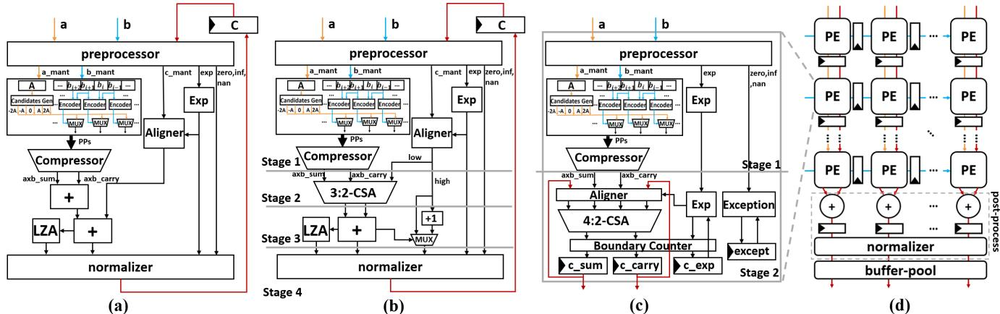
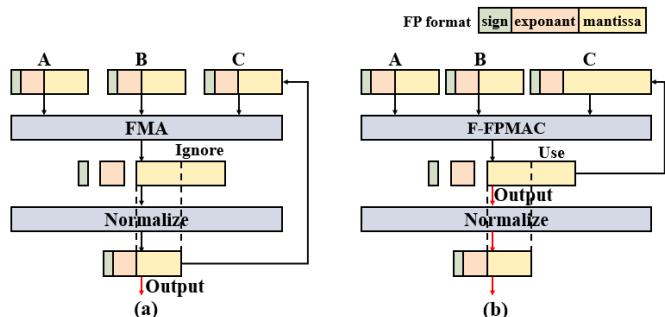
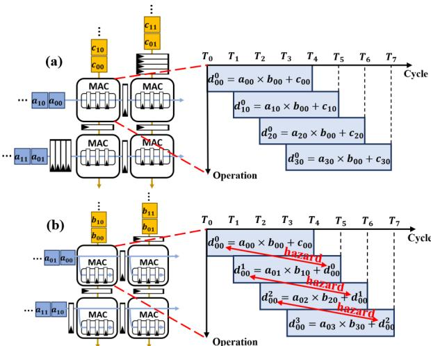
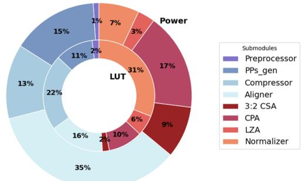
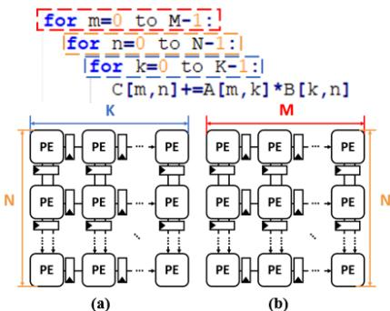
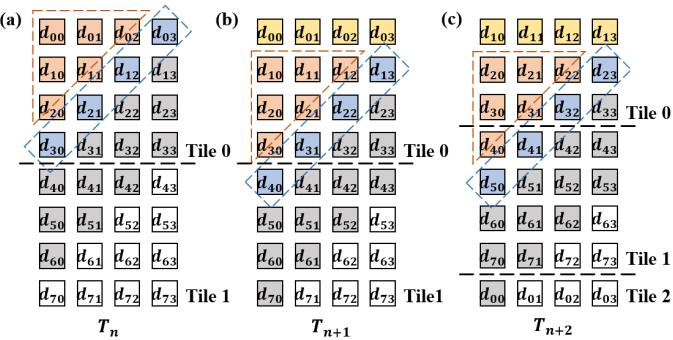
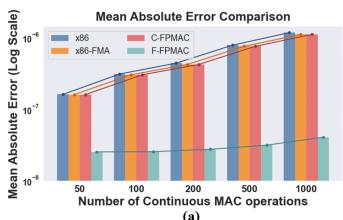
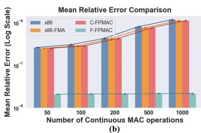
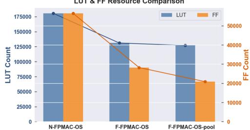

# Factored Floating-Point MAC: Eliminating Redundant Normalization for Energy-Efficient Systolic Arrays 图表详解

### 图像 1

图1包含四个相关子图，不能当成四次独立评测。(a)N-FPMAC用两个“+”先合并乘积再累加；(b)C-FPMAC用3:2 CSA减少一次进位传播，并标出四级流水；(c)F-FPMAC把乘积与反馈都保留为sum/carry，经对齐器和4:2 CSA更新，输出c_sum、c_carry、c_exp及异常信息，划为两级；(d)展示PE网格与底部CPA、规范化器、缓冲池。红线突出累加反馈，橙蓝输入对应a、b。该图支持计算与后处理分离的结构解释，不能仅凭框图推出具体功耗或时延降幅。

### 图像 2

图2比较连续累加时尾数位的使用方式，顶部图例将浮点字段分为符号、指数和尾数。(a)常规FMA每次输出先规范化，再把标准宽度结果反馈为C，图中Ignore标出未保留的尾数区域；(b)F-FPMAC将更宽的中间尾数用于后续反馈，最终输出才经过规范化。虚线和箭头表示精度截取位置与反馈路线，没有数值横纵轴。它说明减少中间舍入为何可能改善精度，但不是精确累加或所有输入误差更小的证明；对齐与保护右移仍可能舍弃低位。

### 图像 3

图3左侧为PE及数据运动，右侧横轴是T₀至T₇周期，纵向列出不同运算。(a)WS示例依次计算不同输出，如d₀₀、d₁₀，使用各自输入部分和，流水任务可以重叠；(b)OS反复更新同一d₀₀，下一项显式依赖上一项结果，红色hazard箭头指出读后写相关。长矩形表示一次流水运算跨越多个周期，不能把重叠直接理解成依赖已经解决。图支持“OS需要重排反馈路径或增加相关处理”的动机，本身没有给出完整GEMM实测时延。

### 图像 4

图4是C-FPMAC子模块的双环占比图：内环为LUT，外环为功耗，颜色对应预处理、部分积生成、压缩树、对齐器、3:2 CSA、CPA、LZA及规范化器。规范化器内环31%、外环7%，说明其逻辑资源占比明显高于功耗占比；对齐器约占16% LUT、35%功耗，体现移位对齐同样昂贵。部分积生成约为11% LUT、15%功耗。此图支持共享规范化及协同优化的动机，不能把31%解释成总功耗节省，也不能直接换算ASIC面积比例。

### 图像 5

图5上方用三重循环表达C[m,n]+=A[m,k]×B[k,n]，颜色连接循环维度与阵列空间映射。下方(a)WS阵列横向标K、纵向标N；(b)OS阵列横向标M、纵向标N，K通过时间上的连续累加执行。这里的M、N、K是矩阵维度和映射标识，不是性能曲线坐标。图说明OS可以在固定物理阵列上延长一次输出的累加链。解读：WS单轮映射的K受物理维度约束，但仍可通过分块处理更大K，不能据此认定WS无法支持长点积。

### 图像 6

图6的(a)、(b)、(c)分别对应Tₙ、Tₙ₊₁、Tₙ₊₂，方块dᵢⱼ表示输出位置，横向虚线划分相邻tile。黄色顶行是当前有效输出，蓝色斜带为本拍完成的结果，橙色三角为已经完成但等待排出的结果，灰色仍在计算。随周期推进，波前跨越tile边界，前一tile的排出与后续计算交叠。图支持只为橙色等待区设置共享暂存的思路；它是调度示意，没有给出通用容量、端口数或带宽，不能单凭方块数量确定任意阵列的实际存储成本。

### 图像 7

这张图片是图7(a)，展示平均绝对误差。横轴为连续MAC次数50、100、200、500、1000，纵轴为对数尺度，刻度覆盖约10⁻⁸至10⁻⁶；四组颜色分别对应x86、x86-FMA、C-FPMAC、F-FPMAC。前三者随链长增长明显，F的绿色柱保持在数乘10⁻⁸附近、增长较缓。图支持延迟中间舍入改善这些样本精度的结论。柱高只能估读，不能生成精确逐点误差；作者“近两个数量级”也不表示每个点都达到100倍，细线的统计含义未在正文说明。

### 图像 8

这张图片是图7(b)，与前图共同组成图7，纵轴改为平均相对误差并采用对数尺度，横轴仍为50至1000次连续MAC。x86-FMA与C-FPMAC接近，随累加次数由数乘10⁻⁷升至约10⁻⁶；F-FPMAC约处于数乘10⁻⁸并基本平缓。它说明对FP64参考值归一化后的误差增长受到抑制，不能直接解释为模型准确率提升。图中没有逐点数表，正文也未交代参考结果接近零时相对误差如何处理，因此不宜补造精确比值或统计显著性。

### 图像 9

图8比较8×8阵列的三种配置，横轴依次为N-FPMAC-OS、F-FPMAC-OS、F-FPMAC-OS-pool；左轴是LUT数量，右轴是FF数量，蓝橙柱及对应连线展示同一资源数据。按柱高估读，三者LUT约18万、13万、12.7万，FF约5.6万、2.8万、2.1万，没有精确标值。F方案同时减少逻辑和寄存器，共享池进一步主要降低FF。第一组是双CPA的N基线，与表2的单CPA C基线不同；该图支持资源节省趋势，不提供吞吐、功耗或ASIC面积实测结论。

> 中文翻译与解读由 Codex/GPT 根据所提供的论文 PDF 生成。PDF 使用 MinerU 解析，乱码数学符号已对照原文校正；参考文献保留原文。技术总结和通俗讲解属于解读，请与全文译文结合阅读。[原文 DOI](https://doi.org/10.1145/3770743.3804226)。
