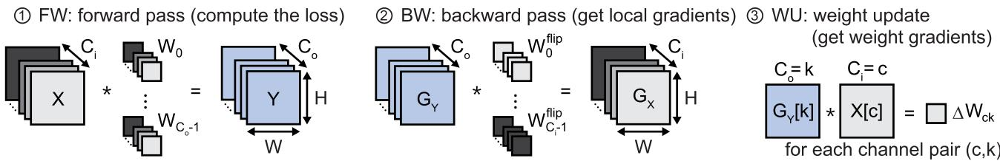
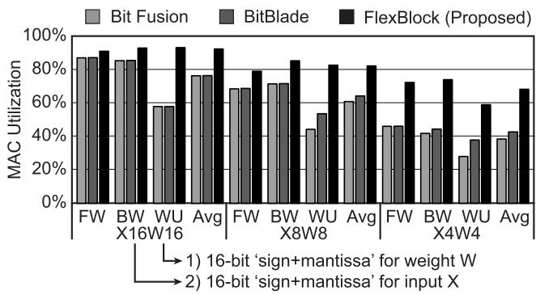
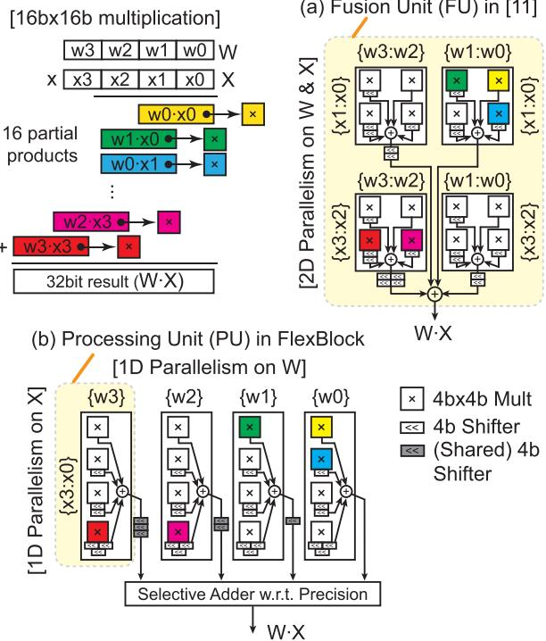
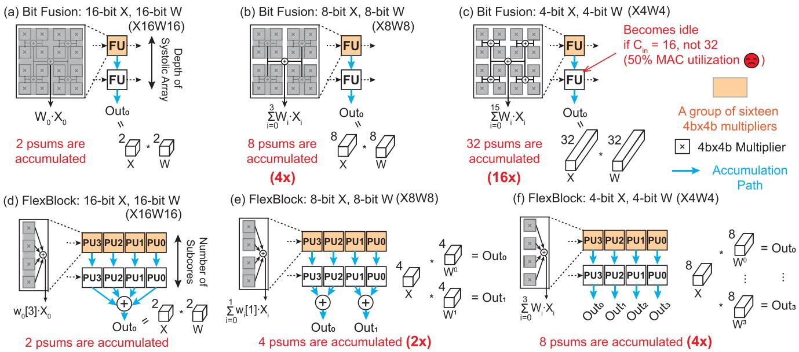
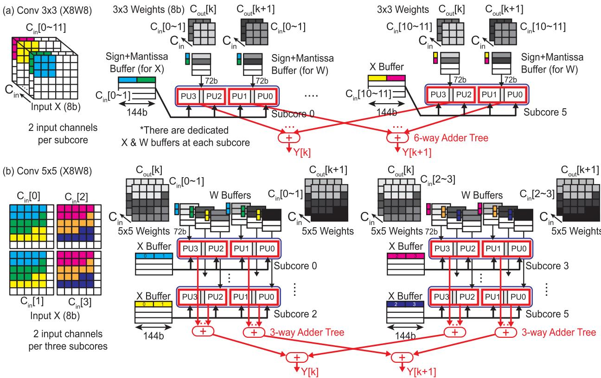
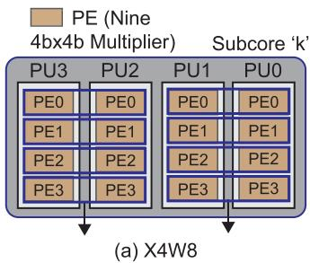
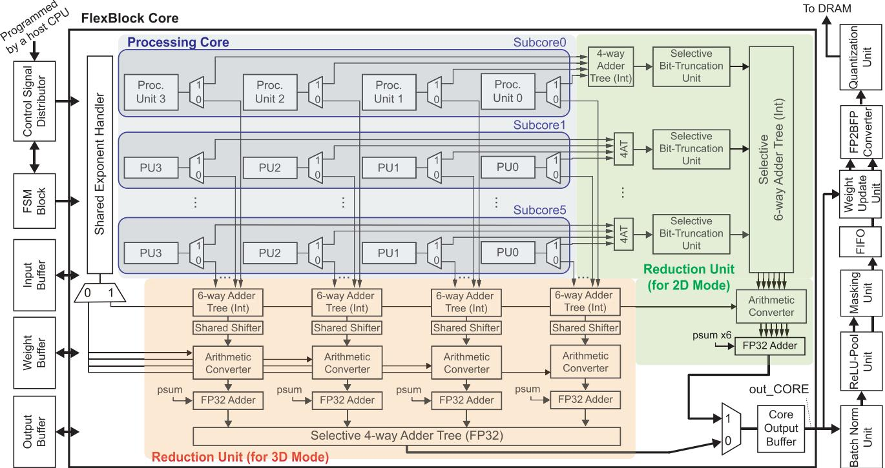
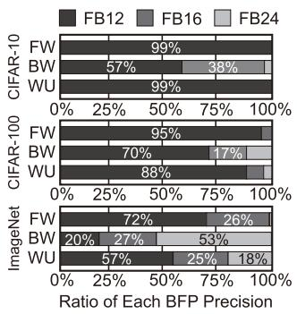
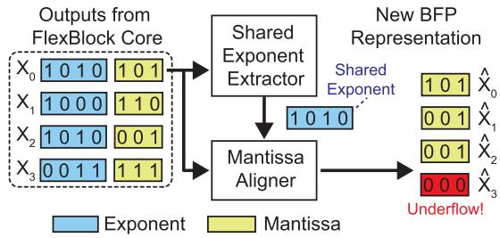

# FlexBlock: A Flexible DNN Training Accelerator With Multi-Mode Block Floating Point Support 通俗讲解

### 0. 整体创新点通俗解读

**痛点直击**

这篇论文要解决的，本质上是 **DNN 训练加速器“精度死板”** 的问题。咱们把场景拆开看：

- **背景**：训练大模型用 FP32 太贵了。BFP（Block Floating Point）是个好东西——一组数共享一个 exponent，乘加就可以用便宜的定点算术做，又能保留浮点的动态范围。
- **难受的地方在哪？** 现有的 BFP 加速器，**出厂时精度就焊死了**。比如设计成 8-bit 就是 8-bit，4-bit 就是 4-bit。但训练里不同 tensor、不同阶段的“抗噪能力”完全不一样：
  - **Weight gradient** 对精度极其敏感，砍狠了训练直接崩；
  - **Feature map 计算**却能扛住很低的精度。
- **更隐蔽的坑**：就算你把一个“可变精度”的推理芯片（如 Bit Fusion）直接搬来训练，会发现**根本跑不到理论加速比**。原因是：精度一降（比如 16→8 bit），乘法器省下来一半，但每个 MAC 要累加的 partial sum 数量**翻倍**，数据流结构对不上，大量乘法器只能闲着。论文实测 Bit Fusion 在 4-bit 模式下利用率再掉 22%。**硬件在那里，活儿分不下去**——这就是“顾头不顾尾”。
- 还有一个训练特有的痛点：**Weight Update（WU）步骤全是 depthwise convolution**，通道之间没有累加，传统阵列只用到一小撮 MAC，利用率惨不忍睹。

---

**通俗比方**

你可以把一个 MAC 阵列想象成一家**餐厅后厨**：

- **传统做法（Bit Fusion）**：一个灶台（FU）必须由四位厨师**合作炒完一整桌菜**才能出餐。菜谱简单（低精度、短向量）的时候，四位厨师挤在一道菜上互相等，其他桌子干瞪眼。
- **FlexBlock 的做法**：把厨师分成几个**独立小组（PU）**。菜难做（16-bit），几个组合并协作；菜简单（4-bit），**直接拆散，每个小组各炒各的**，一桌变四桌，火力全开。
- **多精度 BFP** 就像允许**不同食材用不同火候**：主菜（local gradient）必须精工细作，配菜（feature map、weight gradient）大火快炒——而不是像以前，整家店所有菜统一用一个火候，要么浪费要么烧糊。
- **动态精度控制**则是店长看监控：哪桌菜老是被退（**underflow 计数高**），说明那桌的厨师火候不够，下个班次就给它升级配置；做得游刃有余的，继续降配省成本。

 *Fig. 2. Three important computational steps involved during the training of a convolutional layer. Each box represents activation maps $( X / Y ) ,$ weight parameters (W), or gradients $\overset { \cdot } { ( } G _ { X } / G _ { Y } )$ ). The W/H represents the width/height of a feature map, and $C _ { i } / \dot { C } _ { o }$ represents the number of input/output channels.*

---

**关键一招**

论文最巧的一步，是把 **2D sub-word parallelism 拆成两层 1D**，外加一套**双通道累加**：

- **结构扭转**：作者没有沿用 Bit Fusion 那种“FU 内部把 4×4 个小乘法器的结果全部加完再输出”的设计，而是：
  - 一个 **PE** 聚 9 个乘法器，专门吃 spatial 维度；
  - 一个 **PU** 由 4 个 PE 组成，在 **X（输入）维度做 sub-word 并行**——精度降一半，就广播两个 input channel 进来，硬件不空转；
  - 一个 **subcore** 由 4 个 PU 组成，在 **W（权重）维度做 sub-word 并行**——16-bit 时四个 PU 的部分和由 selective adder tree 汇总，**8-bit 时直接两两分组、绕过加法树，产出两个独立输出**；4-bit 时四路全 bypass。
- **效果**：精度从 16 砍到 8，累加需求不再翻 4 倍，只翻 2 倍，**多条独立累加路径把 MAC 利用率钉在高水位**。这就是从“一个后厨全包”变成“灵活分桌”。
- **针对 depthwise 的补刀**：单独放一个 **2D reduction unit**（开销仅约 4% 面积、4% 功耗），让 depthwise conv 不必经过为 3D 运算设计的那套深累加树——**WU 步骤的利用率问题一招解决**。
- **软件侧配合**：
  - 三种精度 **FB12 / FB16 / FB24**（4/8/16-bit mantissa + 8-bit 共享 exponent），激活、权重、梯度三者可独立组合，共 27 种配置；
  - FP2BFP 转换器里埋一个 **underflow 计数器 + hysteresis 控制器**，按 epoch 统计各 tensor 的下溢比例，自动升降精度——敏感的张量（如 ImageNet 上的 local gradient）自动回退到 FB24，不敏感的压在 FB12 跑。

**成果一句话**：不用重造任何算术单元，只是**重排了乘法器的“分组拓扑” + 加了一条 depthwise 专用归约路径 + 一个轻量反馈控制器**，就换来相对其他训练加速器 **1.5–5.3× 训练加速**、**2.4–7.0× 能效提升**，且精度几乎无损。这就是“结构对了，便宜算力自然挤得出来”的典型范例。

### 1. 层级化一维子字并行架构（1D Sub-Word Parallelism Split）

**痛点直击 (The "Why")**

先看老祖宗 **Bit Fusion** 的做法。它把一个 16b×16b 的乘法拆成 16 个 4b×4b 的小乘法，散布在一个 **Fusion Unit (FU)** 里的 4×4 乘法器网格上——这就是所谓的 **2D sub-word parallelism**（X 和 W 两个方向同时拆）。

问题出在哪？精度一降，麻烦呈**平方级**增长：

- X 和 W 各降 2 倍精度（16b→8b），一个 partial sum (psum) 需要累加的项数不是翻倍，而是**翻 4 倍**（2×2）。
- 降到 4-bit？累加数量**翻 16 倍**。
- 更要命的是，**FU 内部所有累加必须全部完成**，才能把结果传给下一个 FU。这意味着降精度后，大量乘法器被“锁死”在等待累加的流水线里，硬件利用率不升反降。

论文里给了实测数据（MobileNetV1 训练）：从 X16W16 降到 X8W8，利用率掉 **13.8%**；再降到 X4W4，再掉 **22.0%**。理论上升 4 倍/16 倍吞吐，实际被利用率漏洞吃掉一大截。而训练场景下这尤其痛——**weight update (WU) 步骤全是 depthwise convolution**，本身累加链就短，浪费更严重。

---

**通俗比方 (The Analogy)**

把 Bit Fusion 想象成一个**厨房**：16 个小工位（4×4 乘法器），每个人切一小块菜。

- **2D 并行** = 所有人必须把切好的菜**全部汇到同一口锅里炒熟**，才能端给下一桌客人。
- 你为了接更多桌客人（降精度、多路输出），本想让工位独立干各自的桌——但不行，锅只有一口，每个 psum 都得等凑齐 16 份原料才能出菜。

**FlexBlock 的做法**相当于把厨房改造成**两级灶台**：

- 4 个小队（**PU**），每队内部先把自己那份菜炒个半成品（X 方向的 **1D 并行**，队内解决）。
- 4 个队的半成品**要不要合锅**，看情况——16-bit 模式，四队合炒一桌菜；8-bit 模式，两两合炒，同时出**两桌**菜；4-bit 模式，各炒各的，直接上桌，**四桌菜并行出**。

关键差别：**合锅这一步从“强制”变成了“可选”**。累加的压力被摊到了层级之间，而不是压死在 FU 内部。

 *(a) Fusion Unit (FU) in [11] Fig. 3. An illustration of performing a 16b 16b multiplication using two precision-scalable multipliers: (a) a fusion unit (FU) in Bit Fusion [11] and (b) a processing unit (PU) in the proposed FlexBlock. Four PUs in FlexBlock split the 2D sub-word parallelism into two 1D sub-word parallelisms.*

---

**关键一招 (The "How")**

作者没有发明新的乘法器，而是把**一个 2D 的拆分，扭转成两个嵌套的 1D 拆分**：

- **层级一（PU 内部，拆 X）**：4 个 **PE**（各含 9 个 4b×4b 乘法器）分掉输入 X 的四个 4-bit sub-word (x3, x2, x1, x0)。X 方向的并行在 PU 内部闭环，不外溢。
- **层级二（PU 之间，拆 W）**：4 个 PU 分掉权重 W 的四个 sub-word (w3, w2, w1, w0)。W 方向的并行**延迟到最后一步**才合并。

 *Fig. 4. A motivational example explaining the rate of increase in the number of accumulations at a reduced precision: (a-c) Bit Fusion and (d-f) FlexBlock. Al accumulations within an FU in Bit Fusion need to be completed prior to passing the partial sum. However, only a subset of accumulations are completed at each PU in FlexBlock and the remaining accumulations, if required, happen at the end. In addition, FlexBlock provides a better input data reuse requiring less number of new operands.*

然后，他们在流程末端插了一个**Selective Adder Tree（可选加法树）**，这是整个设计的“阀门”：

| 精度模式 | Selective Adder Tree 行为 | 输出通路数 | 等效效果 |
|---|---|---|---|
| 16-bit (FB24) | 累加全部 4 个 PU 的 psum | 1 | 单个 16b×16b 乘法 |
| 8-bit (FB16) | 两两累加 | 2 | 双输出，吞吐 ×2 |
| 4-bit (FB12) | **完全 bypass**，psum 直写输出 buffer | 4 | 四输出，吞吐 ×4 |

对比一下累加数量的增长规律，这就是“顿悟点”：

- **Bit Fusion**：精度每降 2×（双操作数），累加项数 **×4**（平方增长）。
- **FlexBlock**：精度每降 2×（双操作数），累加项数只 **×2**（线性增长）。

直觉解释：2D 拆分把“乘法拆碎”和“结果合并”**绑死在一个单元里**；而 FlexBlock 通过层级化，让 X 方向的合并在 PU 内部完成、W 方向的合并**推迟到末端且可旁路**。降精度时，省下来的不是“更少的乘法”，而是**更短的累加链 + 更多的独立输出通道**——多出来的通路直接去算不同的 output channel (C_out)，硬件利用率由此拉满。

一句话总结：**作者没有重造乘法器，而是把“必须合锅”改成了“看菜量决定合不合锅”，用两级 1D 替代一级 2D，让精度缩减的红利真正落到吞吐上，而不是被累加瓶颈吞掉。**

### 2. 层类型可重构的张量维度映射

**痛点直击 (The "Why")**

你要先理解一个硬件事实：FlexBlock 的一个 core 就是 **54 个 MAC 槽位**，物理上排成 **6 个 subcore × 每个 9 个 INT16 MAC**（对应 9 个 PE 内的 9 个 4b×4b multiplier）。这 54 个槽位是焊死的，动不了。

但问题是，不同 layer 对“**一个输出到底要累加多少个乘积**”的要求天差地别：

- **Conv1 / FC**：累加维度是 $C_{in}$，可以任意长，越长越好 → 54 个槽位全用上，皆大欢喜。
- **Conv3**：一个输出只需要 3×3 = **9 次累加**。如果硬件只会“所有槽位合作算一个输出”，那 45 个 MAC 直接空转。
- **Conv5 / Conv7**：分别需要 **25 / 49** 次累加，单个 subcore 的 9 个槽位根本装不下。
- **DW-Conv（2D 操作）**：更惨，它压根**不做跨 channel 累加**，每个输出只需要 3×3 次累加，如果还套用 3D 的映射套路，绝大部分 MAC 就是纯摆设——而 WU 步骤全是这种 depthwise 操作，这正是传统 precision-scalable 加速器（如 Bit Fusion）训练场景下 **MAC 利用率暴跌 13.8%~22%** 的元凶。

一句话：硬件是**固定的棋盘**，但每种 layer 想下的棋**形状不一样**。之前的架构是“一种棋盘只下一 种棋”，换棋就浪费。

---

**通俗比方**

想象一个宴会厅：**6 张桌子，每桌 9 个座位**，总共 54 个座位，装修好了改不了。

现在来客了：

- **Conv1/FC 的客人**是一个 54 人的大团，必须**所有人合力干同一件事**（跨 $C_{in}$ 大累加）→ 6 张桌子全拼起来，一个空位都不剩。
- **Conv3 的客人**是一个 **9 人小团**（3×3 卷积核）→ 正好一桌，剩下 5 张桌子怎么办？**接待下一批 9 人小团**（即映射不同的 input channel / output channel），各干各的活。
- **Conv5 的客人**是 25 人 → 一桌坐不下，那就**拼 3 张桌子**（27 座，只空 2 座，利用率 25/27 = **93%**）。
- **Conv7 的客人**是 49 人 → **整个宴会厅全拼起来**（54 座，空 5 座，利用率 49/54 = **91%**）。
- **DW-Conv 的客人**最特殊：他们不聚餐，是 6 桌客人**各自独立开小灶**，每桌产出一道菜（一个 $C_{out}$），最后由一个**专门的传菜口**（2D reduction unit）分别收走。

注意桌子的物理结构**从头到尾没变**，变的只是“**这一场怎么拼桌、哪一桌负责谁**”——这就是“层类型可重构”的本质：**重构的不是硬件，是张量维度到硬件层级的分配方案**。

---

**关键一招**

作者没有给每种 layer 设计专用的硬件通路，而是做了一次干净的**职责互换**：让硬件层级和 Tensor 维度之间的绑定关系**变成一个可编译的查表项**（论文 Table II），核心逻辑是“**谁需要长累加，谁就去占长的物理层级；谁不需要，谁就横向铺开换并行度**”。

- **层级重新分配**：
  - **Conv1/FC**：$C_{in}$ 铺满整个 core（subcore + PE + multiplier 全吃掉累加维度）。
  - **Conv3**：把 **W/H（3×3）压缩到最底层的 9 个 multiplier**（一个 PE 正好装下 3×3），于是 subcore 和 PU 这两级被**释放出来去铺 $C_{in}$**——通道维度获得 54/9 = 6 倍的并行输出。
  - **Conv5/Conv7**：kernel 太宽塞不进一个 PE，那就**向上借层级**——把 3 个（或全部 6 个）subcore **cluster 成一个编队**，让 5×5=25（或 7×7=49）个元素整建制住进去。
  - **DW-Conv（2D 模式）**：因为不存在跨 channel 累加，作者干脆把映射方向**扭转 90 度**——让 $C_{out}$（而不是 $C_{in}$）去占 subcore 那一级，同时启用一条**独立的 2D reduction unit**，让每个 subcore 的输出横向分流、并行收账，而不是硬挤进 3D 的竖向大累加树。

- **为什么利用率能压到 93% / 91% 这么高**：这里藏着一点数字上的巧思。硬件粒度是 **9 / 27 / 54** 这条阶梯，而卷积需求是 **9 / 25 / 49**——9 精确命中，25 和 49 都被阶梯“刚好兜住”，浪费只有 2 和 5 个槽位。这不是巧合，是 6 个 subcore 的设计选择让 cluster 粒度和常见 kernel 尺寸高度咬合。

- **和低精度联动的红利**：当 BFP 精度降到 FB16/FB12 时，同一个物理阵列能塞 **2×/4× 的 $C_{in}$**——而 $C_{in}$ 恰好是映射在 subcore/PU 这一级的，所以降精度直接换来**更多条独立的累加通路**（多条“拼桌”同时开席），这正是 FlexBlock 能逼近 4×/16× 理论加速上限的前提。若维度映射是死的，降了精度也只是让更多 MAC 空转。

**一句话总结**：作者把“张量哪个维度放到硬件哪一级”从一个**硬连线常量**改造成了一个**随 layer type 查表切换的变量**，硬件纹丝不动，映射方案随菜下单——这本质上是把“空间换适配”的传统思路，替换成了“**重排逻辑拓扑去适配固定物理拓扑**”。

### 3. 面向深度wise操作的专用2D归约单元（双路径归约）

**痛点直击**

- 先把场景摆出来：DNN 训练有三个阶段——**FW（前向）、BW（反向）、WU（权重更新）**。问题出在 WU 阶段。
- 计算 weight gradient 本质上是做 **depthwise full convolution**——每个通道各算各的，**跨通道之间完全没有累加**。这在论文里被归类为 **2D 操作**。
- 而之前所有 precision-scalable MAC 阵列（Bit Fusion、BitBlade 这一票工作）都是为**推理**设计的，它们的 reduction unit 假设你永远在做跨通道累加（3D 操作）。
- 结果就是：WU 阶段一个 partial sum 只需要**少量乘法结果的累加**，但庞大的加法树却是按“几十路输入一起归约”设计的——**大量加法器和 MAC 空转**，核心利用率骤降。
- 更扎心的是，训练里 WU 是**每个 iteration 必跑**的步骤，这个利用率黑洞是持续性的，不是偶尔出现。推理加速器直接搬过来训练，就是典型的“顾头不顾尾”。

---

**通俗比方**

- 想象一条**工厂流水线末端的质检台**：它被设计成 4 个工人合力检查一件超大行李箱（3D 操作，大量 partial sum 汇入一个输出）。
- 现在来了新业务：一大堆**小信封**（2D/depthwise 操作，每个输出只需要少量累加）。流水线还傻乎乎地派 4 个工人围着一封信转——3 个人站着看，1 个人干活。
- 作者的解法简单粗暴但精准：**在主流水线旁边再放一个小型分拣台**。信封类业务全部走小台子，快速分拣；行李箱类业务照旧走大质检台。**两条路，各干各的**。
- 而且这个“小分拣台”便宜得惊人——面积开销仅 **4.16%**，功耗仅 **3.89%**。用不到 4% 的硬件，换回整个 WU 阶段的利用率，这笔账怎么算都划算。

---

**关键一招**

- 作者没有去魔改加法树本身，而是在架构层面做了**分流（dual-path reduction）**。具体来说，处理核心（processing core）的输出有两条出口：
  - **3D reduction unit**（默认路径）：处理 General Conv、Pointwise Conv、FC——这些操作的 partial sum 沿 $C_{in}$ 方向垂直汇入，走原有的选择性加法树。
  - **2D reduction unit**（专用路径）：处理 depthwise conv、dilated conv、up conv——输出从每个 subcore **水平**流向一个独立的 4-way 加法树，各 subcore 各自算各的输出通道 $C_{out}$，互不干扰。

- 配合整体微架构看，两条归约路径都挂在 processing core 后面，谁需要谁干活：

 *Fig. 12. The overall microarchitecture of FlexBlock accelerator. There are two reduction units where each unit is dedicated to either 2D or 3D operation mode Our FlexBlock core is capable of processing various block floating point numbers with 8-bit shared exponents (e.g., FB12, FB16 and FB24). The ‘out\_CORE goes to a weight update or a batch normalization unit. Before storing the data to DRAM, we extract shared exponents of sub-tensors at a FP2BFP converter for computing the next layer.*

- 关键的逻辑转换在于：**WU 不再被迫把 depthwise 计算硬塞进 3D 模式**。每个 subcore 可以直接独立产出一个输出通道的 partial sum，MAC 阵列里的乘法器全部有活干。
- 代价与收益的对比一目了然：

| 维度 | 数值 |
|---|---|
| 2D 归约单元面积开销 | **4.16%** |
| 2D 归约单元功耗开销 | **3.89%** |
| 换取效果 | WU 阶段核心利用率大幅提升 |

---

**一句话总结**

- 之前的架构是“一把锤子敲所有钉子”——WU 的 depthwise 操作在大加法树面前严重空转。FlexBlock 的做法是承认 **2D 和 3D 是两类天生不同的归约模式**，用不到 4% 的硬件代价加了一条旁路，让 weight update 这个训练必经步骤不再被推理时代的架构遗产拖后腿。这就是典型的“与其改造旧路径，不如为特殊流量开一条新车道”的工程智慧。

### 4. 多模式BFP低精度训练方案（按训练步骤/张量差异化精度）

**痛点直击**

低精度训练这条路上，大家一直被一个尴尬的现实卡着脖子：

- **全低精度会崩**：如果把整个训练流水线（FW、BW、WU 三步）全部压到 4-bit（FB12），精度掉得惨不忍睹——论文里 CIFAR 平均掉 6.21%，ImageNet 直接掉 11.46%。梯度稍微一量化，训练就发散了。
- **全高精度又亏**：老老实实全程用 16-bit（FB24）或 bfloat16，训练是稳了，但你在为那些**根本不需要高精度的地方**白白付钱。卷积算特征图这种操作，4-bit 足够了，你却按 16-bit 的价格供养它。
- **硬件更是死脑筋**：之前的 BFP 加速器（比如 Bit Fusion 那一脉）都是**为单一精度定制的**——设计成 8-bit 就是 8-bit，想换精度？换芯片。这就像一辆只有固定档位的车，上高速和进小区都只能用一个档。
- **更隐蔽的坑**：即便硬件支持多精度，降低精度后 MAC 阵列反而**吃不饱**。因为精度减半意味着一个 MAC 能拆成多个小 MAC，但原有架构的累加路径没变，多出来的算力只能闲置——Bit Fusion 在 X4W4 模式下利用率比 X16W16 平均掉 22%。

一句话总结痛点：**精度需求在整个训练流程里根本不是均匀的，但现有的硬件和训练方案却把它当成均匀的来对待**。

---

**通俗比方**

把 DNN 训练想象成一家餐厅的三个后厨环节：

- **FW（前向）**是“做菜”——切菜、颠勺，火候差点没关系，客人（Loss 函数）尝不出大差别。**4-bit 够用**。
- **WU（算权重梯度）**是“记账”——把今天的食材消耗汇总，记个大概数就行。**4-bit 够用**。
- **BW（算 local gradient，反向传播）**是“复盘调整”——分析今天哪道菜咸了、明天盐要少放几克。这一步的判断要**代代相传**：今天的误差判断会层层往前传，每一层的偏差都会被指数放大。菜谱的传家宝，差一个字，几代之后菜就变味了。**这一步必须 16-bit 或 24-bit 精雕细琢**。

之前所有餐厅的规矩是：全店统一用一个天平——要么全用高精度的（贵、慢），要么全用粗糙的（BW 崩盘）。FlexBlock 的做法是：**给每个后厨环节配自己的天平**。做菜的用粗天平，复盘的用精密天平。天平本身还能现场调档（4/8/16-bit 三个模式）。

---

**关键一招**

作者的巧妙之处不在“发明新数学”，而在**两个层面的解耦**：

**第一层：把精度配置从“全局参数”变成“逐张量、逐步骤的独立旋钮”**

- FB12、FB16、FB24 这三种基础格式可以**任意混搭**——激活、权重、梯度三个张量各自独立设置精度，一共 **27 种组合**。
- 关键发现：**BW 步骤（算 local gradient）是整个训练里唯一对精度极度敏感的环节**。于是出现了杀手级配置 **FB12+BW16 / FB12+BW24**：
  - FW 和 WU 用 4-bit（X4W4）狂奔
  - 只有 BW 升回 8-bit 或 16-bit
- 结果：精度几乎追平 FP32 基线，但大部分算力都在 4-bit 模式下跑，速度提升立竿见影。

**第二层：硬件上把“降精度=拆 MAC”做成了架构原生能力**

- 传统做法（Bit Fusion 的 Fusion Unit）是**2D 子字并行**：X 和 W 的 4-bit 子字在一个单元内交叉相乘再全部累加。精度一降，需要累加的 partial sum 数量**翻 4 倍**，MAC 阵列吃不饱。
- 作者没有重造 MAC，而是在**中间层次切了一刀**：把 2D 并行拆成两级 **1D 并行**——
  - PE 内部：4 个 PE 分摊 X 的四个 4-bit 子字
  - PU 之间：4 个 PU 分摊 W 的四个子字
  - 每条累加路径独立算**不同输出通道**，而不是全挤在一条通道上做超长向量累加
- 8-bit 模式下提供 **2 条累加路径**，4-bit 模式下提供 **4 条**——MAC 利用率在低精度下依然顶格，把理论 4×/16× 加速真正落袋。

**第三层（点睛之笔）：动态精度控制——让硬件自己决定每层用什么精度**

- 作者没有让人肉去试哪层该用几 bit，而是**在 FP2BFP 转换器里埋了个“下溢计数器”**：
  - 每个 epoch 统计每个张量的 mantissa 对齐时的**下溢次数**
  - 下溢太多 → 说明 4-bit 不够用，这一层这一步下个 epoch 自动升档到 8/16-bit
  - 下溢很少 → 说明精度富余，自动降档，继续省
- 配一个带**迟滞（hysteresis）的双阈值控制器**防止精度来回抖动，硬件开销只占一个 core 的 **0.5% 功耗、0.3% 面积**——用一根温度计的价格，换来了比静态配置再快 **13.1%** 的训练速度，且精度无损。

---

**一针见血**

这篇论文的核心洞见就一句话：**训练流程里对精度的“需求分布”是极度倾斜的——90% 的计算可以用粗粮喂饱，只有 local gradient 那一小口必须吃细粮。** 硬件设计者的任务不是造一个更快的通用高精度引擎，而是造一个**能按需分粮的引擎**：架构上让精度旋钮拧起来不漏算力（分层累加路径 + 双 reduction unit），策略上让旋钮自己会拧（下溢计数 + 迟滞控制）。前者是架构功夫，后者是系统智慧，两者合起来才把“理论上限”变成了实测的 **1.5–5.3× 加速、2.4–7.0× 能效**。

### 5. 基于下溢计数的动态精度控制（迟滞控制器）

**痛点直击**

- 先搞清楚矛盾在哪：FlexBlock 支持三档 BFP 精度（FB12 / FB16 / FB24），精度越低算得越快（FB12 理论上吞吐量是 FB16 的 4 倍）。
- 但精度是个“玄学”——不同模型、不同数据集、甚至**同一网络的不同层**，对精度的容忍度完全不一样：
  - ResNet-18 在 CIFAR-10 上用 FB12+BW16 就能不掉点；
  - 同样是 ResNet-18，换到 ImageNet 上，BW 步骤必须升到 FB24，否则准确率崩掉 10 个点。
- 这就导致一个很尴尬的局面：**没有人能提前告诉你每个 tensor 该用几 bit**。工程师只能做大量离线实验去“手调”精度组合，费时费力，而且换数据集就得重调一遍。
- 更麻烦的是，训练是**动态过程**——训练初期梯度剧烈，可能需要高精度；后期收敛了梯度变小，低精度就够了。静态设定一个精度，等于全程都在为“最坏情况”买单。

---

**通俗比方**

这其实就是**恒温器逻辑，而不是温度计逻辑**。

- 温度计：看到温度 26°C 就开空调，26.1°C 就关——温度在阈值附近抖动时，空调会**疯狂开关**，机器很快就坏了。
- 恒温器：设一个“舒适区间”，比如 24–27°C。只有温度**冲出这个区间**，才真正改变空调状态。中间的小波动，一概不理。
- 这篇论文做的事就是给 BFP 精度装了个恒温器：
  - “温度” = 当前 epoch 中 FP2BFP 转换时的**下溢次数比例**；
  - “空调档位” = 该 tensor 下一轮训练用的精度档（FB12 / FB16 / FB24）；
  - “舒适区间” = $(th_{Down}, th_{Up})$ 两个阈值之间。
- 为什么下溢是好的“温度计”？直觉很简单：BFP 块内的数要**对齐到共享指数**，小数值就得右移，移着移着尾数就被移没了——**下溢多，说明这一块的数据动态范围拉得很开，4-bit mantissa 已经装不下了，是“精度不够”的直接物理信号**。这个信号不需要任何额外计算，硬件数一数就出来。

 *Fig. 16. Illustration of the process performed by the FP2BFP converter. The number of underflows are used to determine the precision of each tensor at runtime.*

---

**关键一招**

作者没有去做任何梯度分析、损失监控之类的“软件侧”精度预测，而是做了一个非常硬件友好的转换：**把“精度够不够”这个问题，转化为“下溢计数超没超阈值”这个可数的事件**。

具体流程拆开看：

- **信号采集（免费搭车）**：FP2BFP converter 本来就在训练流水线里，负责把 FP32 数据切块、提取共享指数、对齐 mantissa。作者只是顺手在它的移位操作旁边放了一个 **32-bit 下溢计数器**，把“隐式的数值错误”变成“显式的计数信号”。
- **决策点前移到 epoch 边界**：不是每个 batch 都切精度，而是**统计当前整个 epoch 的下溢比例，在 epoch 结束时决定下一轮的精度档**。粒度粗，但足够稳定。
- **迟滞控制防抖动**：单阈值会导致精度在 FB12 和 FB16 之间反复横跳。所以用双阈值：
  - 下溢比例 $> th_{Up}$（如 0.35）→ 说明 4-bit 装不下了，**升级精度**；
  - 下溢比例 $< th_{Down}$（如 0.15）→ 说明数据很“乖”，**降级精度**去换速度；
  - 落在中间 → **保持不动**，避免抖动。
- **硬件成本几乎为零**：一个 32-bit 计数器加两个 32-bit 比较器，面积和功耗分别只占一个 FlexBlock core 的 **0.3%** 和 **0.5%**——这基本等于白送。

效果上的“顿悟点”在于：

- 它把之前 Table IV 里那些需要人肉实验得出的结论（比如“BW 步骤最敏感、需要 FB24，FW 和 WU 可以降到 FB12”），变成了**硬件自己在线学出来**的东西——Fig. 17(b) 显示控制器确实自动给敏感层升了精度、给迟钝层（如 L15）保持最低档。
- 对比静态最优配置（FB12+BW16 / FB12+BW24），动态控制再白赚 **13.1% 平均加速**，且不掉准确率；对比全程 FB16，CIFAR 上提速 **22.5%**。
- Table VI 还给了个工程层面的实用结论：阈值对 **weight 和 activation tensor 不敏感**（怎么调都不掉点），但对 **local gradient 敏感**（阈值放宽到 0.55 会掉 1.88%）——所以梯度张量的阈值要保守，其他的可以激进。

一句话总结：**与其猜精度，不如让移位器自己“告状”；与其精确控制，不如用双阈值迟滞给系统一点“定力”。**
