# FlexBlock: A Flexible DNN Training Accelerator With Multi-Mode Block Floating Point Support 原文翻译

# FlexBlock：一种支持多模式块浮点数的灵活 DNN 训练加速器

Seock-Hwan Noh, Student Member, IEEE, Jahyun Koo, Student Member, IEEE,

Seunghyun Lee, Student Member, IEEE, Jongse Park , Member, IEEE, and Jaeha Kung , Member, IEEE

摘要——在训练深度神经网络（DNN）时，GPU 或定制的神经处理单元（NPU）中使用的是昂贵的浮点算术单元。为了降低浮点运算的负担，业界已开始探索使用更高效的数据表示方法，例如块浮点数（block floating point, BFP）。BFP 格式允许一组数值共享一个指数，从而有效减少内存占用，并使乘累加（MAC）运算可以采用更廉价的定点算术。然而，现有的基于 BFP 的 DNN 加速器通常针对特定精度设计，导致其通用性较差。本文提出 FlexBlock，一种支持三种 BFP 模式的 DNN 训练加速器，且激活值、权重和梯度张量可以采用互不相同的 BFP 模式。通过将 FlexBlock 配置为更低的 BFP 精度，相比 16-bit 模式，核心可处理的 MAC 数量在 8-bit 模式下最多提升 4 倍，在 4-bit 模式下最多提升 16 倍。为了达到这一理论上限，FlexBlock 在各种精度级别和层类型下最大化核心利用率，并允许动态精度控制，在不牺牲训练精度的前提下保持吞吐量处于峰值。我们使用 CIFAR、ImageNet 和 WMT14 数据集上的代表性 DNN 评估了 FlexBlock 的有效性。结果表明，与其他训练加速器相比，在 FlexBlock 上进行训练显著提升了训练速度（1.5 5.3 倍）和能效（2.4 7.0 倍）。

索引词——块浮点数、DNN 训练加速器、低精度训练、精度可扩展性。

## I. 引言

随着高性能计算系统和日益增长的开放源数据集的发展，深度学习已经取得了非常迅猛的进展。得益于其精度提升，许多应用开始利用深度学习，包括计算机视觉、语言建模、自动驾驶，甚至芯片设计 [1], [2], [3], [4]。

一般来说，深度神经网络（DNN）在 CPU/GPU 上训练时采用 IEEE 单精度格式（即 FP32），以尽量减少训练过程中的精度损失。为了在训练期间提高有效算术密度和内存带宽，可以降低表示激活值、权重和/或梯度的精度 [5], [6]。Micikevicius 等人提出了混合精度训练 [5]，即利用 NVIDIA GPU 中的 Tensor Cores，将两个输入以 IEEE 半精度（FP16）相乘，而以 FP32 累加结果。该方法使有效内存带宽翻倍，在 DNN 训练中实现高达 2 4 倍的加速。另一种做法是保留 FP32 的指数位（8-bit），但截断尾数位以形成 16-bit，即 bfloat16。目前已有若干商用 DNN 训练加速器利用 bfloat16 来支持更宽的数值表示范围 [6], [7]。

考虑到近期开发的 DNN 规模庞大，例如 AmoebaNet-A 拥有 469 M 个参数 [8]，GPT-3 拥有 175B 个参数 [2]，将所有张量都保持浮点表示将需要巨大的内存占用和可观的训练时间。近来，块浮点数（BFP）表示方法被重新发掘并应用于 DNN 训练，以提升性能和能效 [9], [10]。然而，以往基于 BFP 的 DNN 加速器工作都依赖于特定的 BFP 表示，能够带来的性能与效率提升机会有限。在本工作中，我们提出了一种灵活的 DNN 训练硬件，即 FlexBlock，它支持多种 BFP 精度模式（图 1(a)），并且激活值、权重和梯度张量可以采用互不相同的模式，从而最大化训练性能（图 1(b) 和 (c)）。正如先前工作 [11], [12] 在推理任务中所展示的那样（但仅限于推理），如果我们设计能够灵活重新配置精度模式的算术单元，从 16-bit 运算转向 8-bit（或 4-bit）运算可以将吞吐量提升 4 倍（或 16 倍）。然而，以往关于精度可扩展加速器的工作在降低精度时以及针对深度可分离（depthwise）运算时，由于硬件利用率不足的问题，无法完全提供这种加速（参见图 1(c) 和第四节）。

我们的 FlexBlock 被设计为支持 4-bit、8-bit 和 16-bit 的“符号+尾数”，并配以 8-bit 共享指数1。为了在低精度或混合精度 DNN 训练中最大化乘累加（MAC）单元的利用率，我们提出了两项重要的设计技术（高 MAC 利用率；见第五节）。第一，我们在降低精度模式下提供多条累加路径，即 8-bit 模式下两条、4-bit 模式下四条，从而在各种运行条件下尽可能保持较高的硬件利用率。第二，我们为深度可分离运算提供一个独立的归约单元，可并行收集更多的输出。对于 DNN 训练而言，提升深度可分离运算的硬件利用率非常重要，因为权重更新步骤仅由深度可分离卷积构成。借助这种硬件支持，我们展示了即使在计算特征图和权重梯度时使用 4-bit 算术（FB12）训练 DNN 的可能性，同时在计算局部梯度时允许使用 8-bit/16-bit 算术（FB16/FB24）（低精度训练；见第七节）。这种 DNN 训练期间的激进精度缩放带来了相比 bfloat16 训练最高 5.3 倍的加速，且精度损失可忽略不计。为了在训练过程中自动设置 BFP 模式，我们还提出了一种动态精度控制方法（见第七节 C），该方法在保持原有训练精度的同时将精度推向最低。

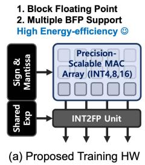

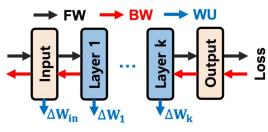

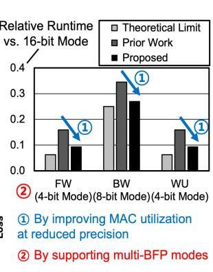  
(b) DNN 训练步骤  
(c) FlexBlock 的收益  
图 1. (a) 所提出的 FlexBlock 概览。(b) 每次训练迭代中的三个 DNN 训练步骤。(c) FlexBlock 通过在降低精度时最大化硬件利用率，以及在每个训练步骤设置不同的 BFP 模式，实现性能提升。

主要贡献可总结如下：

1) 多模式 BFP 支持：我们开发了一种支持多种 BFP 精度的基于 BFP 的 DNN 训练加速器。借助这一支持，用户可以为每个张量配置其所需的最低精度，从而加速训练。

2) 高核心利用率：我们在所有运行条件下最大化核心利用率，具体包括：i) 高效地对乘法器进行分组，以便在降低精度时生成多个输出；ii) 为深度可分离运算设置独立的归约单元。

3) 低精度训练：我们展示了 FlexBlock 的用例，即通过为每个张量动态选择所需的最低精度来最大化训练性能。

## II. 相关工作

## A. 面向DNN训练的加速器

由于训练DNN比推理需要更高的内存带宽和更多的计算资源，许多先前的工作提出了针对训练优化的加速器 [13]、[14]、[15] 或系统 [16]、[17]。在 ScaleDeep [14] 中，利用异构处理单元（tile）来映射不同类型的DNN层，以实现高效的训练。在 DeepTrain [13] 中，作者提出了使用3D堆叠内存的近存计算（near-memory computing）实现的时间异构张量映射。Gist [15] 对前向传播过程中计算得到的特征图进行编码，以便在后向传播中再次使用时高效地存储它们。此外，许多研究关注DNN模型的分布式（或流水线式）训练 [16]、[17]，以实现最佳的训练性能。

近期，稀疏DNN加速器被提出用于利用每个张量可能存在的稀疏性来提升训练DNN的吞吐量 [18]、[19]。SIGMA [18] 提出了一种训练加速器，通过使用 Benes 网络进行高效的工作负载分配，以处理GEMM操作中的稀疏性和不规则结构。[19] 的作者提出了一种名为 Procrustes 的稀疏DNN训练加速器，它在前向传播、后向传播或权重更新过程中利用单一稀疏来源（激活值或权重）。Procrustes 在执行涉及稀疏张量的算术运算时，利用小批量（mini-batch）维度（即一个稠密张量维度）来实现均衡的工作负载分配。

## B. DNN训练中的低精度表示

为了最大化训练加速器的算术密度，可以在DNN训练过程中使用定点（fixed-point）逻辑 [9]、[10]、[20]。在 [20] 中，使用随机舍入（stochastic rounding）以INT16进行DNN训练，以最小化预期的数值误差。然而，该工作仅在相对简单的任务上评估了所提出的方法，即使用MNIST和CIFAR-10对10个不同的图像类别进行分类。其他先前的工作在训练期间激进地降低精度，但付出了明显的精度下降的代价 [21]、[22]、[23]。为了克服定点表示的有限动态范围，Flexpoint [9] 为每个张量提取一个5位的共享指数（粗粒度），并在每个mini-batch中调整两次指数以防止溢出。为了执行原位（in-place）指数提取，而非周期性地检查溢出，[10] 提出了一种混合块浮点（hybrid block floating point）加速器，其在定点逻辑上执行乘累加（multiply-and-accumulate）操作，而其余操作则以FP32完成。与 [9]、[10] 相比，FlexBlock 支持对子张量进行更细粒度的分块，从而支持可变精度以加速训练过程（第VII-B节）。最近一项关于基于BFP训练的工作通过使用较小的块大小（即八）和随机舍入来最小化尾数位宽 [24]。然而，由于块大小较小，需要大量的FP32加法器来累加多个浮点部分和。在近期关于低精度训练的工作 [25]、[26]、[27]、[28] 中，8位浮点数（FP8或HFP8）已被用于在各种基准测试上以极小的精度损失训练DNN。然而，与FP8训练相关的硬件为了实现其最大能效而使用特定的尾数和指数位数，缺乏灵活性。

  
Fig. 2. 卷积层训练过程中涉及的三个重要计算步骤。每个方框表示激活图 $( X / Y ) ,$ 权重参数（W）或梯度 $( G _ { X } / G _ { Y } )$。W/H 表示特征图的宽/高，$C _ { i } / \dot { C } _ { o }$ 表示输入/输出通道的数量。

## III. 背景

## A. 训练深度神经网络

训练DNN模型需要三个重要的计算步骤：i) 计算训练损失（前向传播；FW），ii) 计算局部梯度（后向传播；BW），以及 iii) 计算权重梯度（权重更新；WU）。作为示例，图2展示了卷积（Conv）层的这些步骤。我们可以类似地将该分析扩展到全连接（FC）层。在前向传播过程中，$C _ { i }$ 个输入特征图（fmap）与一组权重卷积核进行卷积，以生成 $C _ { o }$ 个输出fmap。前向传播完成后，计算给定mini-batch的总损失（$\mathcal { L }$）。随后，后向传播开始将 $\mathcal { L }$ 反向传播到网络中的每一层。在反向传播中，执行相同的卷积操作，其中输入变为第 $l$ 层的局部梯度 $G _ { Y } = \partial \mathcal { L } / \partial Y$，且权重卷积核经过转置和翻转。该操作的输出即为第 $l - 1$ 层的局部梯度 $G _ { X } = \partial \mathcal { L } / \partial X$。在每一层，权重梯度 $\partial \mathcal { L } / \partial W _ { c k }$ 通过在局部梯度 $G _ { Y } [ k ]$ 和输入fmap X[c] 之间执行逐对（且逐深度，depthwise）的全卷积（full convolution）来计算。随后，将权重梯度乘以学习率用于更新权重。

## B. 块浮点

如第I节所述，DNN通常使用FP32进行训练。浮点表示中的数值 $x _ { i }$ 表示为

$$
x _ { i } = ( - 1 ) ^ { s _ { i } } \cdot m _ { i } \cdot 2 ^ { e _ { i } } ,\tag{1}
$$

其中 $s _ { i }$ 是符号，$m _ { i }$ 是尾数，$e _ { i }$ 是数值 $x _ { i }$ 的指数。块浮点（Block floating point，BFP）是浮点表示的一种特殊形式，其中由N个数组成的一个块共享一个与幅值最大的数相对应的指数 [10]、[29]。于是，块内的数变为

$$
{ \vec { x } } = [ x _ { 1 } , x _ { 2 } , \ldots , x _ { N } ] = [ { \hat { x _ { 1 } } } , { \hat { x _ { 2 } } } , \ldots , { \hat { x _ { N } } } ] \cdot 2 ^ { e _ { s } } = { \vec { \hat { x } } } \cdot 2 ^ { e _ { s } } ,\tag{2}
$$

其中 $e _ { s } = \lfloor \log _ { 2 } ( \operatorname* { m a x } ( | x _ { 1 } | , \dots , | x _ { N } | ) ) \rfloor$ 是该块的共享指数，而 $\hat { x _ { i } } = x _ { i } \cdot 2 ^ { - e _ { s } }$ 是仅由“符号+尾数”表示的对齐后的数。因此，采用BFP表示，我们可以在不进行中间结果原位对齐（硬件开销更低）的情况下，以定点算术执行点积。向量 w 和 x 之间的内积可以通过下式计算

$$
\langle \vec { w } , \vec { x } \rangle = \Big ( \Big \langle \vec { \hat { w } } , \vec { \hat { x } } \Big \rangle \Big ) \cdot 2 ^ { e _ { w } + e _ { x } } ,\tag{3}
$$

其中 $e _ { w }$ 和 $e _ { x }$ 分别是向量 w 和 x 的共享指数。本工作的目标之一是设计支持多种精度级别计算 $\langle \vec { \hat { w } } , \vec { \hat { x } } \rangle$ 的硬件加速器，以实现高效的DNN训练。

## C. 精度可扩展的 MAC 阵列

近年来，已有许多研究致力于设计支持端侧 DNN 推理的精度可扩展 MAC 阵列 [11]、[12]、[30]、[31]、[32]、[33]。早期的工作采用简单的数据门控方案，将操作数置零以最小化 MAC 阵列消耗的动态功耗 [30]、[31]。有研究提出了在权重张量上进行比特串行数据读取，以实现完全可变的权重精度（时间可扩展性）[31]。这种时间可扩展性随后被扩展到两个操作数，即输入张量和权重张量，以简化计算逻辑 [32]。然而，比特串行方法所消耗的时钟周期数取决于精度级别，并且需要更复杂的控制逻辑。另一方面，Shin 等人提出在权重张量上利用子字并行性 [30]。一个全精度乘法器由多个始终处于激活状态的子乘法器构建而成（空间可扩展性）。为了在两个操作数上都提供子字并行性（2D 并行性），已有研究提出了一种脉动阵列，其中每个处理引擎由十六个乘法器组成 [11]。正如 Camus 等人 [33] 所指出的，在设计精度可扩展 MAC 阵列时，2D 子字并行性展现出最佳的能效。因此，我们也采用了这种空间可扩展的 MAC 阵列设计。

## IV. 研究动机

本文旨在为 DNN 训练设计一种支持多精度的加速器架构。虽然现有的多精度架构均专为推理而设计，但人们可能认为对这类架构进行简单直接的适配便足以支撑训练。因此，我们首先深入剖析先前的工作，识别出我们所要优化的现有架构的局限性。

局限性：精度可扩展 MAC 阵列的代表性工作之一是 Bit Fusion [11]。图 3(a) 展示了 [11] 中采用 2D 子字并行性的融合单元（FU）。16b 16b 乘法中的每个部分积都由一个专用的 4b 4b 乘法器计算（部分以颜色标出）。由于 FU 内的所有累加必须完成后才能将结果传递给下一个 FU，当两个操作数（X 和 W）的精度均降低 $2 \times$ 时，需要累加的部分和数量将增至四倍。图 4(a)、和(c) 中给出了关于此问题的一个简单动机示例。

(a) Bit Fusion [11] 中的融合单元（FU）  
  
Fig. 3. 使用两种精度可扩展乘法器执行 16b  16b 乘法的示意图： Bit Fusion [11] 中的融合单元（FU），以及 所提出的 FlexBlock 中的处理单元（PU）。FlexBlock 中的四个 PU 将 2D 子字并行性拆分为两个 1D 子字并行性。

这可能导致 MAC 的利用率不足，从而限制了精度缩放所带来的预期加速。此外，Bit Fusion 需要大量的移位器，例如，64 64 阵列需要 98 k 个 4 位移位器。为了提升能效，BitBlade [12] 将具有相同移位长度的乘法器聚簇，与 Bit Fusion 相比减少了 93.8% 的移位器数量。然而，随着精度缩放，其累加次数的增长速率与 Bit Fusion 相同。

解决方案：为了缓解这一问题，我们将一组乘法器分组为处理单元（PU），以在 X 上实现 1D 子字并行性（图 3(b)）。在多个 PU 之间（FlexBlock 中为四个），则实现在 W 上的 1D 子字并行性，此时来自各 PU 的部分和会根据精度模式在末端进行累加。例如，图 3 中的选择性加法树在 16 位模式下会累加全部四个部分和。在 8 位模式下，两个部分和被累加在一起，生成两个独立的输出。在 4 位模式下，来自四个 PU 的部分和绕过选择性加法树，输出被直接存入输出缓冲区。通过观察图 4(d)、和(f) 中所示的示例，可以更清楚地看出拆分 2D 并行性的优势：每条累加路径不再被强制要求以很长的向量维度执行相同的向量乘法，而是可以被分配去计算不同的输出通道。借助这种分层子字并行性，当 X 和 W 的精度均降低 $2 \times$ 时，累加的部分和数量仅翻倍（图 4(d)、和(f)）。

分析：为了定量地考察这种架构差异的影响，我们在改变输入和权重张量精度的条件下，分析了 Bit Fusion、BitBlade 以及我们的 FlexBlock 架构在 FW、BW 和 WU 步骤上的 MAC 利用率。在分析中，我们假设 Bit Fusion 和 BitBlade 的训练变体架构在 MAC 阵列末端附接了必要的 FP32 累加器和 BFP 模块。图 5 的结果显示，在训练 MobileNetV1 [34] 时，当输入（X）和权重（W）张量均为 16 位（记作 X16W16）时，Bit Fusion 和 BitBlade 的 MAC 利用率均为 76.5%。当我们将精度降至 8 位（X8W8）时，利用率平均下降 13.8%。若进一步将精度从 8 位降至 4 位（X4W4），利用率平均再下降 22.0%。这是因为为了避免浪费计算资源，在较低精度下需要执行更多次数的累加。

TABLE I  
FLEXBLOCK 支持的二维和三维运算示例
<table><tr><td rowspan=1 colspan=1>模式</td><td rowspan=1 colspan=1>运算</td></tr><tr><td rowspan=1 colspan=1>2D</td><td rowspan=1 colspan=1>计算 ∂L/∂W、Depthwise Conv、Dilated Conv、Up Conv</td></tr><tr><td rowspan=1 colspan=1>3D</td><td rowspan=1 colspan=1>General Conv、Pointwise Conv、FC（前向与反向传播）</td></tr></table>

当考虑权重梯度计算（即 WU 步骤）时，MAC 利用率不足的问题会进一步加剧，因为 WU 包含大量的深度卷积运算，这些运算只需少量的累加，因而仅能利用 MAC 单元的一小部分。由于深度卷积运算不涉及跨多个通道的计算，我们在本文中将其归类为 2D 运算。表 I 总结了 FlexBlock 核心所支持的 2D 与 3D DNN 运算。

## V. FLEXBLOCK 核心的设计

## A. FlexBlock 的层次化设计

为了根据精度模式和层类型对硬件模块进行细粒度控制，我们将 FlexBlock 的处理核设计为层次化结构，即乘法器—处理单元—处理部件—子核（图 6）。FlexBlock 中的乘法器与 [11] 类似，可同时接受有符号和无符号操作数。使用一个全局符号位来指示输入/权重张量采用的是有符号还是无符号表示。随后，将九个乘法器聚集成簇构成一个处理单元，以高效地映射并计算 2D 卷积2。在 FlexBlock 中，输入张量 X 的子字并行性是通过一个处理部件内的四个处理单元来实现的。对于 16 位输入张量 X，每个 4 位子字（x3、x2、x1 或 x0）被映射到对应的处理单元上。然后由四个处理单元聚集成簇构成一个处理部件。注意，为了便于简单说明，图 3(b) 中的处理部件只画出了一个包含单个乘法器的处理单元。另一种针对权重张量 W 的子字并行性则是通过一个子核内的四个处理部件来实现的。对于 16 位权重张量，假设输入张量的精度为 16 位，则只有一个 4 位子字（w3）被映射到 PU3，并广播传送到该处理部件内的所有处理单元。其余三个子字，即 w2、w1 和 w0，则分别分配给其余的处理部件。

  
Fig. 4. A motivational example explaining the rate of increase in the number of accumulations at a reduced precision: (a-c) Bit Fusion and (d-f) FlexBlock. Al accumulations within an FU in Bit Fusion need to be completed prior to passing the partial sum. However, only a subset of accumulations are completed at each PU in FlexBlock and the remaining accumulations, if required, happen at the end. In addition, FlexBlock provides a better input data reuse requiring less number of new operands.

  
Fig. 5. Comparison ofthe MAC utilization during the training ofMobileNetV1 with mini-batch size of 16 using various precision-scalable MAC arrays (Bit Fusion [11], BitBlade [12] and the proposed FlexBlock).

4bx4b Multiplier 9Processing Element (PE)  
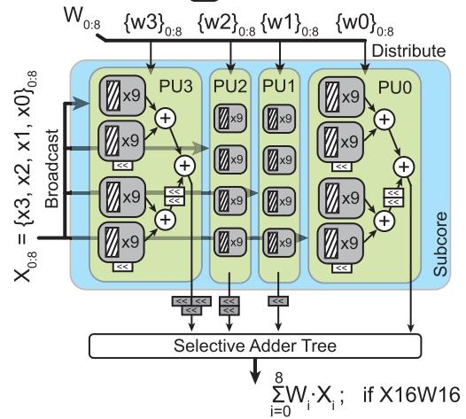  
Fig. 6. Hierarchical structure of hardware modules in Flex-Block. Four PUs form a subcore in FlexBlock.

对于权重更新（WU）步骤，输入张量变为第 'l' 层的局部梯度，而权重张量变为第 'l 1' 层的输入特征图。

## B. 位宽可重构性

在 FlexBlock 中，我们为 Conv 操作或通用矩阵乘法（GEMM）中每个张量的“符号+尾数”提供三个精度级别，即 4 位、8 位和 16 位。对于所有三个精度级别，我们都使用相同的 8 位共享指数。在本工作中，我们定义了三种基本的 FlexBlock 格式：FB12（X4W4）、FB16（X8W8）和 FB24（X16W16）。我们还可以对相关张量的尾数位宽进行混合搭配，例如 8 位输入、4 位权重和 16 位梯度，从而得到 33 = 27 种组合。

X 上的子字并行性：图 7 展示了输入激活值（前向传播）或局部梯度（反向传播）是如何被传送到 Conv3 层的处理单元和处理部件的。3 在 16 位模式（X16）下，每个特征图元素由四个 4 位子字组成。因此，每个子字都会映射到对应处理单元中具有匹配灰色颜色的 4b  4b 乘法器上。注意，输入操作数是广播到各处理部件，而不是将不同的输入通道映射到每个处理部件。在 8 位模式（X8）下，每个特征图元素由两个 4 位子字组成。在这种情况下，我们可以在相同的互连带宽下向各处理部件广播两个输入通道。类似地，在 4 位模式（X4）下，我们向各处理部件广播四个输入通道。在这种情况下，每个输入通道被映射到处理部件中的一个处理单元上。

W 上的子字并行性：图 8 同样展示了权重参数是如何被传送到 Conv3 层的各处理部件的。在 16 位模式（W16）下，每个权重参数的一个 4 位子字被传送到对应的处理部件。其余三个子字则被分配到子核中其余的处理部件上。在这种模式下，所有处理部件的输出由选择式加法树进行累加。在 8 位模式（W8）下，我们将处理部件划分为两个簇，并将 $C _ { o u t }$ 维度分配到各簇上。因此，PU2-3 和 PU0-1 分别为 $C _ { o u t } = k$ 和 $C _ { o u t } = k + 1$ 提供部分和。归约单元末端的选择式 4 路加法树产生这两个部分和。在 4 位模式（W4）下，四个输出通道被分配给四个处理部件。在这种情况下，每个处理部件绕过选择式加法树，为所分配的输出通道产生部分和。

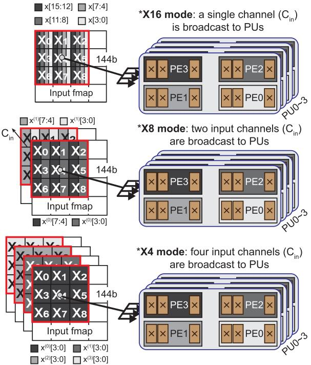

Fig. 7. Examples on distributing input data to PEs in each PU depending on the input tensor precision (feature maps or local gradients). Inputs are broadcast to PUs in a single cycle.  
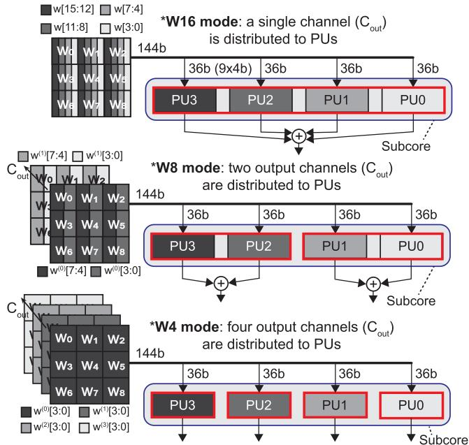  
Fig. 8. Examples on distributing weight data to processing units in a subcore depending on the precision of the weight. In this example, 16-bit inputs are assumed (thus, a single input fmap is shared across multiple weight kernels).

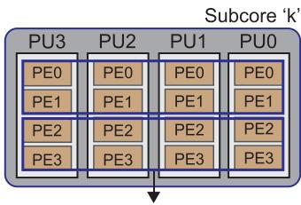  
 Fig. 9. Examples of PE grouping when two operands, i.e., X and W, have different mantissa bit-widths.

TABLE II  
TENSOR DIMENSIONS MAPPED TO EACH FLEXBLOCK MODULE DEPENDING ON LAYER TYPES
<table><tr><td rowspan=1 colspan=1>FlexBlock Module</td><td rowspan=1 colspan=1>Mapped Tensor Dimension</td></tr><tr><td rowspan=1 colspan=1>Subcore</td><td rowspan=1 colspan=1> $\overline { { \mathbf { C } _ { \mathrm { i n } } } }$ (Conv1/FC, Conv3), Cout (2D Mode),W/H (Conv5, Conv7)</td></tr><tr><td rowspan=1 colspan=1>Processing Unit</td><td rowspan=1 colspan=1> $\overline { { \mathbf { C } _ { \mathrm { { o u t } } } } }$ (determined by the precision of weights)</td></tr><tr><td rowspan=1 colspan=1>Processing Element</td><td rowspan=1 colspan=1> $\overline { { \mathbf { C } _ { \mathrm { i n } } } }$ (determined by the precision of inputs)</td></tr><tr><td rowspan=1 colspan=1>Multiplier</td><td rowspan=1 colspan=1>Cin (Conv1/FC),W/H (Conv3, Conv5, Conv7, 2D Mode)</td></tr></table>

结合上述 X 和 W 上的子字并行性，我们可以对处理单元/处理部件进行分组，以支持输入和权重操作数的多种位宽组合。图 9(a) 展示了一个 X4W8 的示例，即将 1  2 个处理单元分为一组，每组处理每个子核 72 次 MAC 运算。图 9(b) 展示了一个 X8W16 的示例，即将 2  4 个处理单元分为一组，每组处理每个子核 18 次 MAC 运算。

## C. 层可重构性

3D 操作的映射：在本小节中，我们介绍各种 DNN 层的输入/权重张量如何被映射到一个 FlexBlock 核心上。FlexBlock 中的计算模块采用分层设计，因此可以根据层类型将不同的张量维度轻松编译并映射到这些模块，如 Table II 所总结的那样。图 10 展示了 FlexBlock 在处理 Conv3 和 Conv5 层时如何对 subcore 或 PU 进行聚类的若干示例。我们在此处的图示中假设 FB16 (X8W8) 为精度级别。对于 Conv1 或 FC 层，需要累加的部分和 simply 位于维度 $C _ { i n }$ 上。因此，跨维度 $C _ { i n }$ 的输入元素和相应的权重参数被映射到 subcore、PE 和乘法器上。Subcore0 负责前 18 个输入通道 $( C _ { i n } = 0 { \sim } 1 7 )$，Subcore1 负责计算接下来的 18 个输入通道 $( C _ { i n } ~ = ~ 1 8 { \sim } 3 5 )$，依此类推。对于 Conv3 层，与 Conv1 情况的唯一区别在于操作数向乘法器的映射（图 10(a)）。映射到乘法器的维度变为 fmap 的宽度/高度 (W/H)。对于更大的权重卷积核，例如 Conv5 或 Conv7 层，我们将多个 subcore 聚类，以在 W/H 维度上分配所有大小与权重卷积核相同的输入元素（图 10(b)）。为了在各种层类型上最大化核心利用率，我们在 FlexBlock 中放置了六个 subcore，即每个核心 $9 \times 6 = 5 4$ 个 INT16 MAC。对于 Conv5 层，我们构造两个各含三个 subcore 的聚类。此时核心利用率变为 $( 5 \times 5 ) / ( 3 \times 9 ) = 0 . 9 3$（即，在三个 subcore 的 27 个 INT16 MAC 中有 $5 \times 5 = 2 5$ 个 INT16 MAC 处于活跃状态）。对于 Conv7 层，我们将全部六个 subcore 构成一个聚类，核心利用率为 $( 7 \times 7 ) / ( 6 \times 9 ) = 0 . 9 1$（即，六个 subcore 的 54 个 MAC 中有 $7 \times 7 = 4 9$ 个 MAC 被使用）。

  
Fig. 10. FlexBlock 根据层类型对 subcore 进行分组，并为 (a) Conv3 和 (b) Conv5 层分配输入/权重张量的示例。每个 subcore 中都有专用于 'sign+mantissa' 的输入 (X) 缓冲区和权重 (W) 缓冲区。注意，对于 Conv5 层，将三个 subcore 分为一组以处理两个输入通道，从而最大化 MAC 利用率。由于 FlexBlock 中有六个 subcore，在 8-bit BFP 模式 (FB16) 下，我们可以将两个后续的输入通道映射到 subcore 3 5。

2D 操作的映射：到目前为止，我们解释了 3D 操作的映射策略，其中在 3D 模式下，来自 PU 的输出由归约单元进行垂直累加。FlexBlock 为 2D 操作配备了一个单独的归约单元，以最大化核心利用率。这个独立的归约单元生成单个部分和所需的累加次数更少，从而提升了 2D 操作的 PE 利用率。深度可分离卷积 (DW-Conv) 层是 2D 操作的一个很好的例子。在图 11 中，我们展示了 DW-Conv3 层向 FlexBlock subcore 的映射。此时，每个 subcore 的所有 PU 输出由 2D 归约单元中的 4 路 加法树进行累加。对于 DW-Conv3，来自 subcore 的每个输出对应一个输出通道 $C _ { o u t } .$ 对于更大的权重卷积核，例如 DW-Conv5（三个 subcore）或 DW-Conv7（六个 subcore），我们对 subcore 进行聚类，这与在 3D 模式下扩展卷积核尺寸的做法类似（图 10(b)）。

## VI. 整体架构

FlexBlock 的详细微架构如图 12 所示。FlexBlock 核心设计包含三个主要模块：i) 一个处理核心，ii) 一个用于 2D 操作的归约单元，以及 iii) 一个用于 3D 操作的归约单元。处理核心负责子张量之间的卷积或 GEMM 操作，即仅处理 'sign+mantissas'（符号+尾数）。随后，归约单元在考虑精度级别和层类型的情况下累加部分和。共享指数由放置在归约单元中的算术转换器（INT2FP）处理。

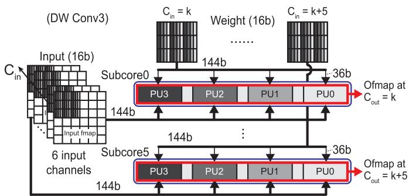  
图 11. 将 2D 操作映射到 FlexBlock 子核心的示例。在此，我们选取广泛使用的 depthwise Conv3 作为示例。注意，每个子核心的输出沿水平方向传送至 2D 模式的归约单元。

处理核心：每个处理核心由六个子核心组成，以在各种 DNN 层上最大化核心利用率。输入张量和权重张量的 'sign+mantissas'（符号+尾数）被映射到这些子核心上，乘法结果由整数加法器累加在一起，即 $\langle \vec { \hat { w } } , \vec { \hat { x } } \rangle = \hat { w _ { 1 } } \cdot \hat { x _ { 1 } } + \cdot \cdot \cdot + \hat { w _ { N } } .$

  
图 12. FlexBlock 加速器的整体微架构。共有两个归约单元，每个单元分别专用于 2D 或 3D 操作模式。我们的 FlexBlock 核心能够处理具有 8 位共享指数的各种块浮点数（例如 FB12、FB16 和 FB24）。'out\_CORE 输出至权重更新单元或批归一化（batch normalization）单元。在将数据存储到 DRAM 之前，我们在 FP2BFP 转换器处提取子张量的共享指数，用于计算下一层。

TABLE III  
每种 FlexBlock 格式在各种层类型下共享指数的输入张量最小块大小
<table><tr><td rowspan=1 colspan=1>层类型</td><td rowspan=1 colspan=1>格式</td><td rowspan=1 colspan=1>块大小</td><td rowspan=1 colspan=1>层类型</td><td rowspan=1 colspan=1>格式</td><td rowspan=1 colspan=1>块大小</td></tr><tr><td rowspan=3 colspan=1>CONV1/FC</td><td rowspan=1 colspan=1>FB12</td><td rowspan=1 colspan=1>1×1×216</td><td rowspan=3 colspan=1>CONV5</td><td rowspan=1 colspan=1>FB12</td><td rowspan=1 colspan=1>5×5×8</td></tr><tr><td rowspan=1 colspan=1>FB16</td><td rowspan=1 colspan=1>1×1×108</td><td rowspan=1 colspan=1>FB16</td><td rowspan=1 colspan=1>5×5×4</td></tr><tr><td rowspan=1 colspan=1>FB24</td><td rowspan=1 colspan=1>1×1×54</td><td rowspan=1 colspan=1>FB24</td><td rowspan=1 colspan=1>5×5×2</td></tr><tr><td rowspan=3 colspan=1>COVN3</td><td rowspan=1 colspan=1>FB12</td><td rowspan=1 colspan=1>3×3×24</td><td rowspan=3 colspan=1>CONV7</td><td rowspan=1 colspan=1>FB12</td><td rowspan=1 colspan=1>7×7×4</td></tr><tr><td rowspan=1 colspan=1>FB16</td><td rowspan=1 colspan=1>3×3×12</td><td rowspan=1 colspan=1>FB16</td><td rowspan=1 colspan=1>7×7×2</td></tr><tr><td rowspan=1 colspan=1>FB24</td><td rowspan=1 colspan=1>3×3×6</td><td rowspan=1 colspan=1>FB24</td><td rowspan=1 colspan=1>7×7×1</td></tr></table>

若它们的共享指数被预先提取，则如公式 (3) 中的 xˆ 所示。根据精度（FB12、FB16 或 FB24）的不同，我们对每个共享同一指数的子张量进行不同的分块。换言之，由一个 FlexBlock 核心处理的最小块大小由计算一个部分和所需的 MAC 数量决定。例如，在 FB24 模式下，$9 \times 6$ = 54 个 MAC 协同工作以生成一个部分和。表 III 总结了在考虑六个子核心的情况下，每种 FlexBlock 格式在各种 DNN 层上的最小块大小，该值可能有所变化。随着精度降低，映射到处理核心的输入通道数量相比 FB24 增加一倍（FB16）或三倍（FB12）（参见图 4 和图 7）。此外，随着权重卷积核尺寸的增大，按块分组的输入通道数量会减少，从而在给定的 BFP 精度下保持总 MAC 数量不变。这种对块大小的细粒度控制能够在各种精度和 DNN 层下充分利用处理核心中所有可用的乘法器，即实现高核心利用率。

归约单元：此前关于精度可伸缩 MAC 阵列设计的工作 [11]、[12]、[32]、[33] 存在两大局限：i) 不支持 DNN 训练，ii) 2D 操作的核心利用率低。前者通过在 FlexBlock 中支持块浮点算术来解决，包括一个共享指数处理器、置于 FP32 累加单元之前的算术转换器，以及一个 FP2BFP 转换器（图 12）。后者通过为 2D 操作设置专用归约单元以及为 3D 操作保留默认归约单元（双路径归约单元）来解决。2D 操作的核心利用率对于 DNN 训练而言变得至关重要，因为权重梯度 $( \Delta \mathbf { W } _ { c k } ^ { l } )$ 的计算涉及局部梯度 $( \mathbf { G } _ { \mathbf { Y } _ { k } } l + 1 ) )$ 和输入 fmap $( \mathbf { X } _ { c } ^ { l } )$ 每一对之间的 depthwise 全卷积。由于逐通道计算的特性，仅需累加少量的乘法结果，这在先前的工作中显著降低了核心利用率（第 IV 节）。然而，在计算 2D 或 3D 操作时，两个归约单元中的一个会处于空闲状态。增加 2D 归约单元在面积和功耗方面的开销相当小，分别为 4.16% 和 3.89%。

## VII. 实验结果

## A. 多种 BFP 格式支持下的训练精度

1) 基准测试：为了评估 DNN 在各种 BFP 格式下训练的算法稳定性，我们选择了四个数据集，即 CIFAR-10、CIFAR-100 [35]、ImageNet [36] 和 WMT14 [37]。注意，FlexBlock 能够为激活值、权重和局部梯度分别设置尾数位宽，从而在能耗方面实现最小的训练成本。首先，我们在简单的 CIFAR 数据集上广泛研究了五种代表性 CNN 的训练，即 AlexNet [38]、VGG16 [39]、ResNet-18 [40]、MobileNetV1 [34] 和 DenseNet-121 [41]。然后，我们以多种 BFP 格式在 ImageNet 上训练 ResNet-18、在 WMT14 上训练 Transformer [42]，以检验它们在更复杂任务上的可扩展性。

表 IV
在四个知名数据集上使用多种精度训练 DNN 所达到的最终精度
<table><tr><td rowspan=1 colspan=1>精度</td><td rowspan=1 colspan=1>FP32</td><td rowspan=1 colspan=1>FP16+FP32</td><td rowspan=1 colspan=1>FB24</td><td rowspan=1 colspan=1>FB16</td><td rowspan=1 colspan=1>FB12</td><td rowspan=1 colspan=1>FB12+BW16*</td></tr><tr><td rowspan=1 colspan=1>数据集</td><td rowspan=1 colspan=1></td><td rowspan=1 colspan=1>CIFA</td><td rowspan=1 colspan=1>R-10 (To</td><td rowspan=1 colspan=1>p-1 Accur</td><td rowspan=1 colspan=1>acy)</td><td rowspan=1 colspan=1></td></tr><tr><td rowspan=1 colspan=1>AlexNet</td><td rowspan=1 colspan=1>87.12</td><td rowspan=1 colspan=1>86.96</td><td rowspan=1 colspan=1>87.06</td><td rowspan=1 colspan=1>86.68</td><td rowspan=1 colspan=1>85.11</td><td rowspan=1 colspan=1>86.41</td></tr><tr><td rowspan=1 colspan=1>VGG16</td><td rowspan=1 colspan=1>92.83</td><td rowspan=1 colspan=1>92.90</td><td rowspan=1 colspan=1>92.93</td><td rowspan=1 colspan=1>92.97</td><td rowspan=1 colspan=1>87.43</td><td rowspan=1 colspan=1>92.71</td></tr><tr><td rowspan=1 colspan=1>ResNet-18</td><td rowspan=1 colspan=1>93.37</td><td rowspan=1 colspan=1>93.68</td><td rowspan=1 colspan=1>93.79</td><td rowspan=1 colspan=1>93.75</td><td rowspan=1 colspan=1>90.36</td><td rowspan=1 colspan=1>93.50</td></tr><tr><td rowspan=1 colspan=1>MobileNetV1</td><td rowspan=1 colspan=1>87.07</td><td rowspan=1 colspan=1>86.85</td><td rowspan=1 colspan=1>85.98</td><td rowspan=1 colspan=1>86.67</td><td rowspan=1 colspan=1>79.80</td><td rowspan=1 colspan=1>87.22</td></tr><tr><td rowspan=1 colspan=1>DenseNet-121</td><td rowspan=1 colspan=1>93.37</td><td rowspan=1 colspan=1>93.61</td><td rowspan=1 colspan=1>93.06</td><td rowspan=1 colspan=1>93.32</td><td rowspan=1 colspan=1>89.42</td><td rowspan=1 colspan=1>93.01</td></tr><tr><td rowspan=1 colspan=1>数据集</td><td rowspan=1 colspan=1></td><td rowspan=1 colspan=1>CIFAR</td><td rowspan=1 colspan=1>-100 (To</td><td rowspan=1 colspan=1>p-1 Accu</td><td rowspan=1 colspan=1>racy)</td><td rowspan=1 colspan=1></td></tr><tr><td rowspan=1 colspan=1>AlexNet</td><td rowspan=1 colspan=1>59.52</td><td rowspan=1 colspan=1>59.21</td><td rowspan=1 colspan=1>59.39</td><td rowspan=1 colspan=1>59.77</td><td rowspan=1 colspan=1>57.03</td><td rowspan=1 colspan=1>59.66</td></tr><tr><td rowspan=1 colspan=1>VGG16</td><td rowspan=1 colspan=1>73.35</td><td rowspan=1 colspan=1>73.16</td><td rowspan=1 colspan=1>73.06</td><td rowspan=1 colspan=1>73.20</td><td rowspan=1 colspan=1>62.51</td><td rowspan=1 colspan=1>72.35</td></tr><tr><td rowspan=1 colspan=1>ResNet-18</td><td rowspan=1 colspan=1>77.26</td><td rowspan=1 colspan=1>76.88</td><td rowspan=1 colspan=1>77.45</td><td rowspan=1 colspan=1>77.23</td><td rowspan=1 colspan=1>66.69</td><td rowspan=1 colspan=1>76.45</td></tr><tr><td rowspan=1 colspan=1>MobileNetV1</td><td rowspan=1 colspan=1>67.40</td><td rowspan=1 colspan=1>66.80</td><td rowspan=1 colspan=1>66.95</td><td rowspan=1 colspan=1>67.60</td><td rowspan=1 colspan=1>57.11</td><td rowspan=1 colspan=1>67.06</td></tr><tr><td rowspan=1 colspan=1>DenseNet-121</td><td rowspan=1 colspan=1>77.24</td><td rowspan=1 colspan=1>77.57</td><td rowspan=1 colspan=1>77.68</td><td rowspan=1 colspan=1>77.05</td><td rowspan=1 colspan=1>70.53</td><td rowspan=1 colspan=1>74.93</td></tr><tr><td rowspan=1 colspan=1>数据集</td><td rowspan=1 colspan=1></td><td rowspan=1 colspan=1>Image</td><td rowspan=1 colspan=1>Net (To</td><td rowspan=1 colspan=1>p-1 Accur</td><td rowspan=1 colspan=1>acy)</td><td rowspan=1 colspan=1></td></tr><tr><td rowspan=1 colspan=1>ResNet-18</td><td rowspan=1 colspan=1>69.95</td><td rowspan=1 colspan=1>69.23</td><td rowspan=1 colspan=1>69.92</td><td rowspan=1 colspan=1>61.20</td><td rowspan=1 colspan=1>58.49</td><td rowspan=1 colspan=1>68.20t</td></tr><tr><td rowspan=1 colspan=1>数据集</td><td rowspan=1 colspan=1></td><td rowspan=1 colspan=1>WMT1</td><td rowspan=1 colspan=1>4 En-De (</td><td rowspan=1 colspan=1>Perplex</td><td rowspan=1 colspan=1>ity)</td><td rowspan=1 colspan=1></td></tr><tr><td rowspan=1 colspan=1>Transformer-base</td><td rowspan=1 colspan=1>3.87</td><td rowspan=1 colspan=1>3.92</td><td rowspan=1 colspan=1>4.33</td><td rowspan=1 colspan=1>4.29</td><td rowspan=1 colspan=1>4.26</td><td rowspan=1 colspan=1>4.27</td></tr></table>

\*FB12+BW16 表示 BW 步骤使用 FB16，而其他步骤（FW 和 WU）以 FB12 计算。
+对于 ImageNet 数据集，使用 FB12+BW24 训练可获得与基线相近的精度。使用 FB12+BW16 训练可获得 59.11% 的最终精度。

我们对 BFP 训练采用了与 FP32 模型训练相同的超参数，以验证其在不改变任何训练设置情况下的适用性。我们使用 CIFAR-10（或 CIFAR-100）数据集对所有基准模型训练 200 个 epoch，batch size 为 128，采用初始学习率为 0.1 的 SGD。SGD 的动量设为 0.9，权重衰减设为 0.0005 用于正则化。此外，我们使用了余弦退火学习率调度器。为了在 ImageNet 上训练 ResNet-18，我们使用了与 CIFAR 数据集相同的 SGD 优化器，训练 90 个 epoch，但采用了不同的学习率控制器，即每 30 个 epoch 将学习率衰减 0.1。对于 Transformer 的训练，我们使用 batch size 为 64 并训练 10 个 epoch。我们使用 Adam 优化器，权重衰减为 0.01。初始学习率设为 0.001，并以 0.95 的速率衰减。

所有基准模型训练后的测试精度汇总于表 IV 中。作为参考，图 13 展示了部分基准模型在各种精度格式下的训练曲线。为了使用多种 BFP 格式训练 DNN，我们实现了自己的 PyTorch 框架4，将现有的卷积层和线性层替换为自定义的 BFP 模块。为了利用 GPU 进行将 FP32 张量转换为 BFP 张量的数据操作，我们使用了 Numba，它提供了与 CUDA 的无缝接口，使代码能够在 GPU 上运行。

2) 基本BFP 格式：作为基线，我们以 FP32 训练了所有基准模型。作为另一个基线，我们使用 NVIDIA RTX3090 中 Tensor Cores 所支持的混合精度训练了这些基准模型。在混合精度训练中，乘法以 FP16 执行，累加以 FP32 完成，即表 IV 中的“FP16+FP32”。首先，我们在所有三个训练步骤（FW、BW、WU）中以基本 BFP 格式（即 FB24、FB16 或 FB12）训练了所有基准模型。在基本 BFP 格式中，所有张量的“符号+尾数”位宽均设置为相同，例如 FB16 中激活、权重和梯度张量均为 8 位。在整个实验过程中，我们沿用表 III 中给出的块大小来评估使用 FlexBlock 进行 DNN 训练的精度。如果查看表 IV 中的精度对比，FB24 或 FB16 下的测试精度与基线相近（ImageNet 上仅 FB24 表现良好）。然而，当我们以 FB12 训练模型时，测试精度显著低于基线（CIFAR 数据集上平均低 6.21%，ImageNet 上低 11.46%）。对于在 WMT14 数据集上训练的 Transformer，FB12 仍能提供与其他高精度数据格式相近的困惑度。

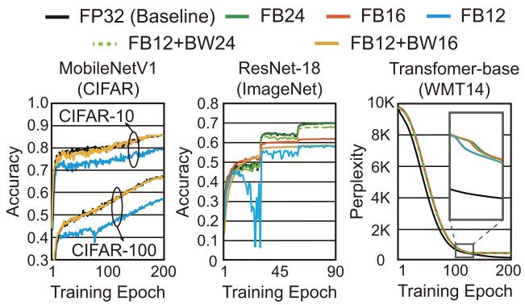  
Fig. 13. 在 CIFAR、ImageNet 和 WMT14 数据集上不同精度格式的训练曲线对比。

3) BFP 变体：FB12 的精度下降归因于仅使用 4 位"符号+尾数"所带来的有限精度。请注意，所有 FlexBlock 格式均使用 8 位共享指数，即与 FP32 和 bfloat16 相同，这使得 FB12 的动态范围足以训练 DNN。正如先前工作所强调的，梯度计算过程中的精度和/或动态范围对于可靠的 DNN 训练极为重要 [5], [9], [10], [27]。因此，在使用 FB12 训练时，我们可以在 BW 步骤中将精度提升至 FB16/FB24。例如，除计算局部梯度外，所有计算均使用 4 位（记为 FB12+BW16）。在 FlexBlock 中使用 FB12+BW16 时，CIFAR 数据集上的测试精度基本上与 FP32 基线一致。如图 13 所示，使用 FB12+BW24 训练时，在 ImageNet 上训练 ResNet-18 是成功的。FB12+BW24 表示 FW 和 WU 步骤使用 FB12，而计算局部梯度（即 BW 步骤）则使用 FB24。若以 FB12+BW16 训练，与 FP32 训练的模型相比，分类精度会下降 10.84%。根据我们的分析，这是因为在 ImageNet 上训练时，局部梯度呈现出更宽的分布，需要更多的尾数位。这一系列实验表明，支持多模式 BFP 算术可以最大化 DNN 训练的效率。然而，事先很难确定针对不同基准测试的各个训练步骤应使用何种精度。为此，我们在第七章 C 节提出了一种动态精度控制方法，可自动为每个训练步骤选择逐层精度。

TABLE V  
TPU 类脉动阵列、BitFusion 类 BFP 加速器与 FlexBlock 核心在面积、功耗和能效方面的架构对比
<table><tr><td rowspan=1 colspan=1>训练硬件</td><td rowspan=1 colspan=1>TPU 类脉动阵列 (SA)</td><td rowspan=1 colspan=1>基于 BitFusion 的 BFP 加速器 (BF) [11]</td><td rowspan=1 colspan=1>FlexBlock 核心（本文提出；FB）</td></tr><tr><td rowspan=1 colspan=1>工艺</td><td rowspan=1 colspan=1>65nm</td><td rowspan=1 colspan=1>65nm</td><td rowspan=1 colspan=1>65nm</td></tr><tr><td rowspan=1 colspan=1>支持的精度</td><td rowspan=1 colspan=1>bfloat16</td><td rowspan=1 colspan=1>FB12, FB16, FB24</td><td rowspan=1 colspan=1>FB12,FB16,FB24</td></tr><tr><td rowspan=1 colspan=1>阵列规模</td><td rowspan=1 colspan=1>128×128</td><td rowspan=1 colspan=1>64×64 (for FB24)</td><td rowspan=1 colspan=1>54×64 (for FB24)</td></tr><tr><td rowspan=1 colspan=1>乘法器数量</td><td rowspan=1 colspan=1>128×128</td><td rowspan=1 colspan=1>256×256 (FB12) / 128×128 (FB16) / 64×64 (FB24)</td><td rowspan=1 colspan=1>216×256 (FB12) / 108×128 (FB16) / 54×64 (FB24)</td></tr><tr><td rowspan=1 colspan=1>面积 [mm²</td><td rowspan=1 colspan=1>74.38</td><td rowspan=1 colspan=1>40.22</td><td rowspan=1 colspan=1>33.82</td></tr><tr><td rowspan=1 colspan=1>功耗 [W]</td><td rowspan=1 colspan=1>9.19</td><td rowspan=1 colspan=1>17.15 (FB12) / 16.50 (FB16) / 15.47 (FB24)</td><td rowspan=1 colspan=1>8.18 (FB12) / 7.64 (FB16) / 7.25 (FB24)</td></tr><tr><td rowspan=1 colspan=1>时钟频率</td><td rowspan=1 colspan=1>333MHz</td><td rowspan=1 colspan=1>333MHz</td><td rowspan=1 colspan=1>333MHz</td></tr><tr><td rowspan=1 colspan=1>吞吐量 [TFLOPS]</td><td rowspan=1 colspan=1>1.77</td><td rowspan=1 colspan=1>2.82 (FB12) / 1.77 (FB16)0.66 (FB24)</td><td rowspan=1 colspan=1>8.78 (FB12) /3.35 (FB16) / 0.95 (FB24)</td></tr><tr><td rowspan=1 colspan=1>能效 [GFLOPS/W]</td><td rowspan=1 colspan=1>192.60</td><td rowspan=1 colspan=1>164.43 (FB12)107.27 (FB16)/ 42.66 (FB24)</td><td rowspan=1 colspan=1>1,073.30 (FB12)438.48 (FB16) / 131.03 (FB24)</td></tr></table>

<table><tr><td rowspan=1 colspan=1></td><td rowspan=1 colspan=1>面积 (μm²)</td><td rowspan=1 colspan=1>功耗 (mW)</td><td rowspan=14 colspan=1>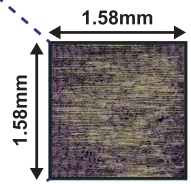布局后面积：2.5 mm²</td></tr><tr><td rowspan=1 colspan=1>FlexBlock Core</td><td rowspan=1 colspan=1>528,425.89 (35.77%)</td><td rowspan=1 colspan=1>120.65 (40.82%)</td></tr><tr><td rowspan=1 colspan=1>BN Unit (FP)</td><td rowspan=1 colspan=1>128,141.44 (8.68%)</td><td rowspan=1 colspan=1>28.43 (9.62%)</td></tr><tr><td rowspan=1 colspan=1>BN Unit (BP)</td><td rowspan=1 colspan=1>201,315.20 (13.63%)</td><td rowspan=1 colspan=1>46.59 (15.76%)</td></tr><tr><td rowspan=1 colspan=1>ReLU Unit (FP)</td><td rowspan=1 colspan=1>17,061.12 (1.16%)</td><td rowspan=1 colspan=1>5.00 (1.69%)</td></tr><tr><td rowspan=1 colspan=1>Pool Unit (FP)</td><td rowspan=1 colspan=1>38,855.04 (2.63%)</td><td rowspan=1 colspan=1>1.35 (0.46%)</td></tr><tr><td rowspan=1 colspan=1>ReLU_Pool Unit (BP)</td><td rowspan=1 colspan=1>92,922.72 (6.29%)</td><td rowspan=1 colspan=1>22.73 (7.69%)</td></tr><tr><td rowspan=1 colspan=1>FIFOs</td><td rowspan=1 colspan=1>11,157.12 (0.76%)</td><td rowspan=1 colspan=1>2.24 (0.76%)</td></tr><tr><td rowspan=1 colspan=1>Masking Unit</td><td rowspan=1 colspan=1>195.84 (0.01%)</td><td rowspan=1 colspan=1>0.05 (0.02%)</td></tr><tr><td rowspan=1 colspan=1>WU Unit</td><td rowspan=1 colspan=1>126,527.68 (8.57%)</td><td rowspan=1 colspan=1>32.32 (10.93%)</td></tr><tr><td rowspan=1 colspan=1>FP2BFP Converter</td><td rowspan=1 colspan=1>11,354.88 (0.77%)</td><td rowspan=1 colspan=1>3.93 (1.33%)</td></tr><tr><td rowspan=1 colspan=1>Quantization Unit</td><td rowspan=1 colspan=1>15,895.68 (1.08%)</td><td rowspan=1 colspan=1>4.90 (1.66%)</td></tr><tr><td rowspan=1 colspan=1>Buffers per Core</td><td rowspan=1 colspan=1>305,260.31 (20.67%)</td><td rowspan=1 colspan=1>27.40 (9.27%)</td></tr><tr><td rowspan=1 colspan=1>总计</td><td rowspan=1 colspan=1>1,477,112.92</td><td rowspan=1 colspan=1>295.59</td></tr></table>

Fig. 14. FlexBlock 核心及用于 BFP 训练的硬件模块的面积与功耗分解。

## B. 面积与能耗分析

为了详细评估所提出的 FlexBlock 硬件，我们对图 12 中所示的所有构建模块（SRAM 除外）实现了 RTL。随后，使用 Synopsys Design Compiler [43] 在 65 nm CMOS 工艺下以 333 MHz 频率对其进行综合。为了提取更精确的面积估计，使用 Synopsys IC Compiler [44] 获得了布局后（post-PnR）面积。在功耗分析方面，我们在针对各种 BFP 模式和层类型固定控制信号后，向 FlexBlock 输入测试激励（testbench），从而提取了开关活动互换格式（SAIF）文件。随后，这些提取的 SAIF 文件被用于 Synopsys PrimePower 中，以在每种 BFP 模式下利用更符合实际的开关概率来估计 FlexBlock 的功耗。访问 SRAM 的能耗与周期时间则使用 CACTI [45]、[46] 在 65 nm 工艺下进行估计。FlexBlock 加速器拥有 512 KB 输入缓冲区、512 KB 权重缓冲区和 256 KB 输出缓冲区，它们均采用双缓冲以隐藏 DRAM 访问延迟。作为 DRAM 模块，我们假设使用双通道 DDR4-2133。所报告的面积与功耗如图 14 所示。核心约占面积的 36% 和功耗的 41%。

为了进行更符合实际的分析，我们将 FlexBlock 加速器扩展为 64 个核心，其在 FB24 模式下可容纳 54 64 个全精度（即 16b 16b）乘法器。两个基线的 RTL 被设计出来并在表 V 中与 FlexBlock 进行比较：i) 使用 bfloat16 的脉动阵列（systolic array，简称为 SA），以及 ii) 使用 Bit Fusion 架构的基于 BFP 的训练加速器（简称为 BF）。对于 BF，其阵列规模被设置为 FB24 模式下的 64  64。FlexBlock 和 BF 均支持多精度模式，例如 FB12、FB16 和 FB24。SA 的阵列规模被设置为 128 128，以使其乘法器数量与 BF 或 FlexBlock 在 FB16 模式下的数量相匹配（即 8 位尾数 + 8 位共享指数；bfloat16 的 BFP 版本）。64 个 FlexBlock 核心的面积（33.82mm2）分别比 SA 和 BF 小 2.2 倍和 1.2 倍。64 个 FlexBlock 核心的功耗（即平均 7.69 W）分别比 SA 和 BF 低 1.2 倍和 2.1 倍。

为了比较三种训练加速器的性能，我们实现了一个周期近似（cycle-approxate）模拟器，用于计算三种训练步骤下每个 DNN 层的执行时间。我们的模拟器在估计内存访问延迟方面与 SCALE-Sim [47] 类似。SCALE-Sim 与我们的模拟器的主要区别在于，处理单元的计算周期是通过对各种 DNN 层和 BFP 精度下的张量分块（tensor tile）运行 RTL 仿真获得的。其中，每个张量分块对应于可存储在每个核心中的数据量。每个 DNN 层的执行时间由下式估计：

$$
\operatorname* { m a x } ( T _ { D R A M } , ( T _ { W \_ L O A D } + T _ { C O M P } ) \cdot N _ { T I L E } ) ,\tag{4}
$$

其中 $T _ { D R A M }$ 是 DRAM 访问延迟，$T _ { W \_ L O A D }$ 是权重加载延迟，$T _ { C O M P }$ 是每个张量分块的计算时间，而 $N _ { T I L E }$ 是给定 DNN 层的张量分块数量。$T _ { D R A M }$ 由 DRAM 带宽和给定 DNN 层所需的张量规模决定。得益于双缓冲，对于大多数 DNN 层，$T _ { D R A M }$ 是被隐藏的，而 MobileNetV1 中的 DW-Conv 层则受到 DRAM 带宽的瓶颈限制。$T _ { W \_ L O A D }$ 是在核心中准备权重所需的时钟周期数。在我们分析的所有训练加速器中，均采用权重固定（weight stationary）数据流。因此，每当需要新的权重张量分块时，就会加上 $T _ { W \_ L O A D }$。在权重数据就绪后，输入/梯度数据会被流式输入以进行卷积或矩阵乘法。为了获得精确的 $T _ { C O M P } ,$ 我们针对各种 DNN 层类型和精度对每个张量分块进行了 RTL 仿真。

我们没有使用小型的 CIFAR 数据集作为 CNN 基准，而是对所有 CNN 模型使用了 ImageNet（mini-batch 大小为 128），以在性能与能耗方面对三种架构进行比较。对于 Transformer 模型，我们同样使用了 128 的 mini-batch 大小。利用估计的时钟周期数和每个加速器的提取功耗，我们在图 15 中报告并比较了性能与能耗。处于相同精度水平的训练加速器被放在一起比较，例如，使用 bfloat16 的 SA 与处于 FB16 模式的 BF 和 FlexBlock 进行比较。结果表明，与 BF 相比，FlexBlock 在 FB24、FB16 和 FB12 模式下平均降低了 65.3%、68.2% 和 79.3% 的能耗（训练时间分别缩短 32.0%、47.5% 和 68.4%）。与 SA 相比，FlexBlock 平均分别降低了 44.3% 的能耗和 52.7% 的训练时间。

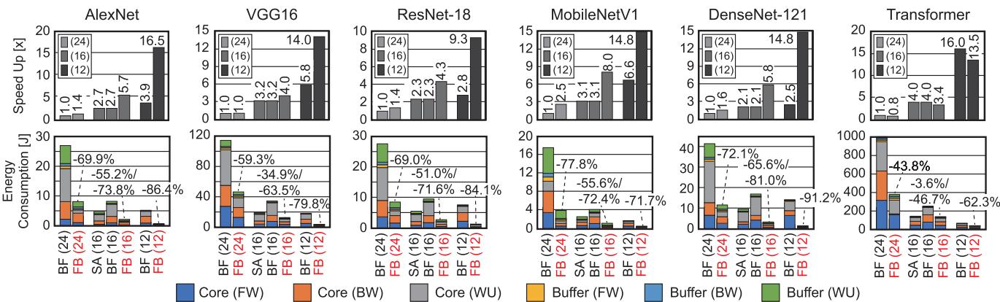

SA：脉动阵列（bfloat16） | BF：基于 BitFusion 的加速器 | FB：FlexBlock（本文提出）

图 15. 脉动阵列（SA）、基于 BitFusion 的 BFP 加速器（BF）与本文提出的 FlexBlock（红色 FB）的性能与能耗比较。性能和能耗分析采用 ImageNet 上的五个 CNN 基准，以及 WMT14 En-De 上的 Transformer-base 模型。

分析支持多种 BFP 精度所带来的硬件开销也很重要。为了分析这一硬件开销，我们实现了一个仅支持 FB24（即 X16W16 模式）的 FlexBlock 核心并实现了相同数量的 MAC，即每核心 54 个 MAC，并对其进行综合以比较面积/功耗/延迟。结果表明，多精度支持带来的面积开销为 30.2%（528,426 μm 2 对比 406,002 μ $\mathrm { m } ^ { 2 }$），功耗开销为 41.8%（120.7 mW 对比 85.1 mW）。由于两种设计的关键路径都位于对不同子张量块的 partial sum 进行累加的 FP32 加法器上，因此不存在延迟开销。由于在不支持多精度的情况下可以多容纳 1.3 倍的 MAC 单元，FB16 和 FB12 模式下训练的有效加速比平均分别略微降低至 2.8 倍和 7.3 倍。

## C. 动态精度控制

到目前为止，我们研究了为每个张量静态分配不同 BFP 精度以实现高效 DNN 训练的好处。然而，如果能够在训练 DNN 模型时于运行时自动调整每个张量的精度，将极其有用。为实现这一目标，我们统计 FP2BFP 转换器（图 16）中由于移位操作导致的下溢（underflow）次数。FP2BFP 转换器位于权重更新单元之后，用于为下一层的计算准备输入/梯度张量和权重张量。该单元根据下一层的精度和层类型，按照表 III 中总结的预定义块大小对每个子张量进行分块。它包含一个共享指数提取器和尾数对齐器，使 FlexBlock 的处理核心只需处理定点计算。

随后，我们跟踪每个张量在当前 epoch 的下溢次数，并通过将下溢比例与预定义阈值进行比较来确定下一个训练 epoch 的精度。我们利用迟滞控制器（hysteresis controller）来缓慢改变 BFP 精度（图 17(a)）。例如，如果下溢比例过大，则意味着尾数位宽不足以训练该模型。该迟滞控制器由一个 32 位下溢计数器和两个 32 位比较器实现。它将下溢比例与上下阈值（即图 17(a) 中的 $t h _ { D o w n }$ 和 $t h _ { U p }$）进行比较。引入这个简单控制器带来的功耗和面积开销分别仅为 FlexBlock 核心的 0.5%（0.57 mW）和 0.3%（1,614.72 μm2）。

  
Fig. 16. FP2BFP 转换器所执行过程的示意图。下溢次数被用于在运行时确定每个张量的精度。

为了验证动态精度控制的可行性，我们分别对每个训练步骤（FW、BW 或 WU）单独改变其 BFP 精度。例如，当 BW 步骤的 BFP 精度设置为 FB16 时，局部梯度和权重的“符号+尾数”位均设置为 8 位。我们在 ResNet-18 上使用 CIFAR-10、CIFAR-100 和 ImageNet 数据集对所提出的控制机制进行了测试。图 17(b) 展示了在所选基准测试上，所提出的控制方法如何对 BW 步骤进行逐层精度自适应。在本例中，为简单起见，我们将其他训练步骤（FW 和 WU）的 BFP 精度固定为 FB12。请注意，所提出的动态精度控制为敏感度较低的层设置了最小 BFP 精度，例如 CIFAR-10 数据集上 ResNet-18 的 L15 层。图 18(a) 展示了当所有训练步骤均应用动态精度控制时，三个基准测试上每个训练步骤所选 BFP 精度的比例。如表 IV 所示，BW 步骤是对精度最敏感的步骤，其大部分计算以 FB16 或 FB24 完成。得益于将 BFP 精度大部分保持在 FB12，在 CIFAR 数据集上使用动态精度控制使训练速度相比 FB16 平均提升 22.5%，且无精度损失（图 18(b)）。在 ImageNet 上，将 FB12+BW24 与 FB16 训练相比，训练时间增加了 51.8%，训练精度提高了 7.0%。然而，采用动态精度控制后，训练时间仅比 FB16 情况高 17%，但训练精度提高了 6.7%。这一极小的性能下降表明，动态调整 BFP 精度有助于在保证成功且快速训练的同时，将所需精度保持在最低水平。与静态 BFP 模式选择（即 CIFAR 采用 FB12+BW16、ImageNet 采用 FB12+BW24）相比，平均可观察到 13.1% 的加速。这一显著的性能提升是在不牺牲模型精度的前提下实现的，如图 18(b) 右侧所示。

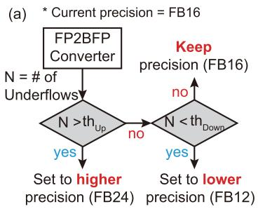

  
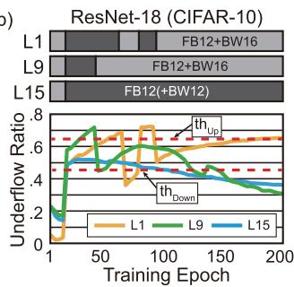

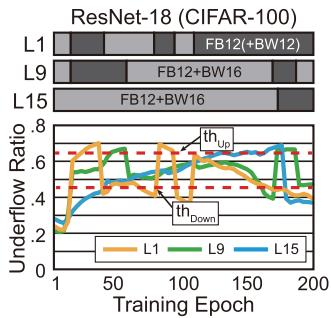

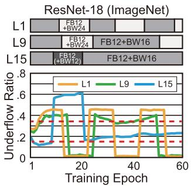  
Fig. 17. ResNet-18 上的动态精度控制：(a) 为下一个训练 epoch 确定张量精度的控制机制，(b) 逐层精度自适应的一个示例。

  

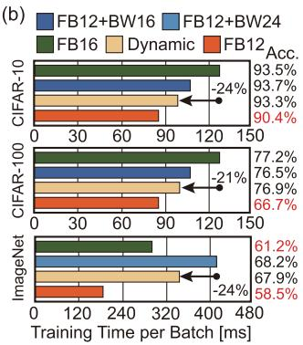  
Fig. 18. 动态精度控制分析： FW、BW 和 WU 步骤所选 BFP 精度的比例，以及 不同 BFP 精度下的训练时间。

然而，为了能够在不逐一测试所有不同阈值组合（这非常耗时）的情况下应用动态精度控制，阈值取值对训练精度的敏感度应当较小。为了检验阈值对训练精度的敏感度，我们在 ResNet-18 上使用 ImageNet 进行了一组实验。改变某一种张量类型（例如激活值）的阈值，而将另外两种张量的阈值固定为默认值，即 $( t h _ { D o w n } , t h _ { U p } ) = ( 0 . 1 5 , 0 . 3 5 )$。我们允许三组阈值取值，即 (0.15, 0.35)、(0.35, 0.55) 和 (0.55, 0.75)。每个阈值下的训练精度如表 VI 所示。对于权重张量和激活值张量，即使在 (0.55, 0.75) 下精度损失也可忽略不计。然而，对于局部梯度，当分别选择 (0.35, 0.55) 和 (0.55, 0.75) 作为阈值时，训练精度分别下降了 1.65% 和 1.88%。这组实验表明，为了稳定的 DNN 训练，我们需要为局部梯度保持较低的阈值取值，而权重和激活值张量的阈值则不那么敏感（更容易设置阈值）。

TABLE VI  
动态精度控制阈值的敏感度测试
<table><tr><td rowspan=1 colspan=4>其他两种张量的默认阈值：(.15, .35)</td></tr><tr><td rowspan=1 colspan=1> $\overline { { ( \mathrm { { t h } _ { D o w n } , \mathrm { { t h } _ { U p } ) } } } }$ </td><td rowspan=1 colspan=1>(.15, .35)</td><td rowspan=1 colspan=1>(.35, .55)</td><td rowspan=1 colspan=1>(.55, .75)</td></tr><tr><td rowspan=1 colspan=1>权重</td><td rowspan=1 colspan=1>67.89</td><td rowspan=1 colspan=1>67.82 (-0.07)</td><td rowspan=1 colspan=1>67.76 (-0.13)</td></tr><tr><td rowspan=1 colspan=1>激活值</td><td rowspan=1 colspan=1>67.89</td><td rowspan=1 colspan=1>67.68 (-0.21)</td><td rowspan=1 colspan=1>67.73 (-0.16)</td></tr><tr><td rowspan=1 colspan=1>局部梯度</td><td rowspan=1 colspan=1>67.89</td><td rowspan=1 colspan=1>66.24 (-1.65)</td><td rowspan=1 colspan=1>66.01 (-1.88)</td></tr></table>

## VIII. 结论

在本工作中，我们提出了支持多精度块浮点算术的 DNN 训练加速器 FlexBlock。这种多模式 BFP 支持具有两大优势：i) 使用户能够以期望的精度水平训练 DNN，ii) 缩短训练时间以实现更快的 DNN 探索。我们识别了先前精度可扩展 MAC 阵列的固有局限性，并将张量维度层次化地分配给 FlexBlock 中的计算单元，从而获得 1.5 5.3 倍的更优性能。此外，我们证明了可以通过所提出的控制机制动态设置最小 BFP 精度，在无精度损失的情况下进一步将训练速度提升 13%。随着 DNN 训练所涉及的计算量迅速增长，本工作将鼓励开发采用各种 BFP 格式、具有更好灵活性和更高能效的训练硬件。

## REFERENCES

[1] J. Redmon, S. Divvala, R. Girshick, and A. Farhadi, “You only look once: Unified, real-time object detection,” 2016, arXiv:1506.02640.

[2] T. B. Brown et al., “Language models are few-shot learners,” in Proc. Adv. Neural Inf. Process. Syst., 2020, pp. 1877–1901.

[3] S.-C. Lin et al., “The architectural implications of autonomous driving: Constraints and acceleration,” in Proc. Int. Conf. Architectural Support Program. Lang. Operating Syst., 2018, pp. 751–766.

[4] A. Mirhoseini et al., “A graph placement methodology for fast chip design,” Nature, vol. 594, pp. 207–212, Jun. 2021. [Online]. Available: https://doi.org/10.1038/s41586--021-03544-w

[5] P. Micikevicius et al., “Mixed precision training,” 2017. [Online]. Available: http://arxiv.org/abs/1710.03740

[6] Google Cloud, “BFloat16: The secret to high performance on cloud TPUs,” 2019. Accessed: Jun. 07, 2021. [Online]. Available: https://cloud.google.com/blog/products/ai-machine-learning/bfloat16- the-secret-to-high-performance-on-cloud-tpus

[7] B. Hickmann, J. Chen, M. Rotzin, A. Yang, M. Urbanski, and S. Avancha, “Intel Nervana neural network processor-t (NNP-T) fused floating point many-term dot product,” in Proc. IEEE Symp. Comput. Arithmetic, 2020, pp. 133–136.

[8] E. Real, A. Aggarwal, Y. Huang, and Q. V. Le, “Regularized evolution for image classifier architecture search,” 2018. [Online]. Available: http: //arxiv.org/abs/1802.01548

[9] U. Köster et al., “FlexPoint: An adaptive numerical format for efficient training of deep neural networks,” in Proc. Int. Conf. Neural Inf. Process. Syst., 2017, pp. 1740–1750.

[10] M. Drumond, T. Lin, M. Jaggi, and B. Falsafi, “Training DNNs with hybrid block floating point,” in Proc. Adv. Neural Inf. Process. Syst., 2018, pp. 451–461.

[11] H. Sharma et al., “Bit Fusion: Bit-level dynamically composable architecture for accelerating deep neural network,” in Proc. IEEE/ACM Int. Symp. Comput. Archit., 2018, pp. 764–775.

[12] S. Ryu, H. Kim, W. Yi, and J.-J. Kim, “BitBlade: Area and energy-efficient precision-scalable neural network accelerator with bitwise summation,” in Proc. IEEE/ACM Des. Automat. Conf., 2019, pp. 1–6.

[13] D. Kim, T. Na, S. Yalamanchili, and S. Mukhopadhyay, “DeepTrain: A programmable embedded platform for training deep neural networks,” IEEE Trans. Comput.-Aided Des. Integr. Circuits Syst., vol. 37, no. 11, pp. 2360–2370, Nov. 2018.

[14] S. Venkataramani et al., “SCALEDEEP: A scalable compute architecture for learning and evaluating deep networks,” in Proc. ACM/IEEE 44th Int. Symp. Comput. Archit., 2017, pp. 13–26.

[15] A. Jain, A. Phanishayee, J. Mars, L. Tang, and G. Pekhimenko, “Gist: Efficient data encoding for deep neural network training,” in Proc. IEEE/ACM Int. Symp. Comput. Archit., 2018, pp. 776–789.

[16] T. Geng et al., “FPDeep: Acceleration and load balancing of CNN training on FPGA clusters,” in Proc. IEEE 26th Int. Symp. Field-Programmable Custom Comput. Mach., 2018, pp. 81–84.

[17] Y. Huang et al., “GPipe: Efficient training of giant neural networks using pipeline parallelism,” 2018. [Online]. Available: http://arxiv.org/abs/1811. 06965

[18] E. Qin et al., “SIGMA: A sparse and irregular GEMM accelerator with flexible interconnects for DNN training,” in Proc. IEEE Int. Symp. High Perform. Comput. Archit., 2020, pp. 58–70.

[19] D. Yang, A. Ghasemazar, X. Ren, M. Golub, G. Lemieux, and M. Lis, “Procrustes: A dataflow and accelerator for sparse deep neural network training,” in Proc. IEEE/ACM 53rd Annu. Int. Symp. Microarchit., 2020, pp. 711–724.

[20] S. Gupta, A. Agrawal, K. Gopalakrishnan, and P. Narayanan, “Deep learning with limited numerical precision,” in Proc. Int. Conf. Mach. Learn., 2015, pp. 1737–1746.

[21] D. D. Lin, S. S. Talathi, and V. S. Annapureddy, “Fixed point quantization of deep convolutional networks,” in Proc. Int. Conf. Mach. Learn., 2016, pp. 2849–2858.

[22] I. Hubara, M. Courbariaux, D. Soudry, R. El-Yaniv, and Y. Bengio, “Quantized neural networks: Training neural networks with low precision weights and activations,” J. Mach. Learn. Res., vol. 18, no. 187, pp. 1–30, 2018.

[23] X. Sun et al., “Ultra-low precision 4-bit training of deep neural networks,” in Proc. Adv. Neural Inf. Process. Syst., 2020, pp. 1796–1807.

[24] S. Q. Zhang, B. McDanel, and H. T. Kung, “FAST: DNN training under variable precision block floating point with stochastic rounding,” in Proc. IEEE Int. Symp. High-Perform. Comput. Archit., 2022, pp. 846–860.

[25] N. Wang, J. Choi, D. Brand, C.-Y. Chen, and K. Gopalakrishnan, “Training deep neural networks with 8-bit floating point numbers,” in Proc. Adv. Neural Inf. Process. Syst., 2018, pp. 7686–7695.

[26] J. Park, S. Lee, and D. Jeon, “A 40nm 4.81TFLOPS/W 8b floating-point training processor for non-sparse neural networks using shared exponent bias and 24-way fused multiply-add tree,” in Proc. IEEE Int. Solid-Statist. Circuits Conf., 2021, pp. 1–3.

[27] X. Sun et al., “Hybrid 8-bit floating point (HFP8) training and inference for deep neural networks,” in Proc. Adv. Neural Inf. Process. Syst., H. Wallach, H. Larochelle, A. Beygelzimer, F. d’Alché-Buc, E. Fox, and R. Garnett, Eds., 2019, pp. 4900–4909.

[28] S. Venkataramani et al., “RaPiD: AI accelerator for ultra-low precision training and inference,” in Proc. IEEE/ACM 48th Int. Symp. Comput. Archit., 2021, pp. 153–166.

[29] K. Kalliojarvi and J. Astola, “Roundoff errors in block-floating-point systems,” IEEE Trans. Signal Process., vol. 44, no. 4, pp. 783–790, Apr. 1996.

[30] D. Shin, J. Lee, J. Lee, and H.-J. Yoo, “DNPU: An 8.1TOPS/W reconfigurable CNN-RNN processor for general-purpose deep neural networks,” in Proc. IEEE Int. Solid-Statist. Circuits Conf., 2017, pp. 240–241.

[31] J. Lee, C. Kim, S. Kang, D. Shin, S. Kim, and H.-J. Yoo, “UNPU: A 50.6TOPS/W unified deep neural network accelerator with 1b-to-16b fully-variable weight bit-precision,” in Proc. IEEE Int. Solid-Statist. Circuits Conf., 2018, pp. 218–220.

[32] S. Sharify, A. D. Lascorz, K. Siu, P. Judd, and A. Moshovos, “Loom: Exploiting weight and activation precisions to accelerate convolutional neural networks,” in Proc. IEEE/ACM/ESDA 55th Des. Automat. Conf., 2018, pp. 1–6.

[33] V. Camus, L. Mei, C. Enz, and M. Verhelst, “Review and benchmarking ofprecision-scalable multiply-accumulate unit architectures for embedded neural-network processing,” IEEE J. Emerg. Sel. Top. Circuits Syst., vol. 9, no. 4, pp. 697–711, Dec. 2019.

[34] A. G. Howard et al., “MobileNets: Efficient convolutional neural networks for mobile vision applications,” 2017, arXiv: 1704.04861.

[35] A. Krizhevsky, V. Nair, and G. Hinton, “CIFAR-10 and CIFAR-100 dataset,” 2010. Accessed: Jul. 20, 2021. [Online]. Available: https://www. cs.toronto.edu/kriz/cifar.html

[36] J. Deng, W. Dong, R. Socher, L.-J. Li, K. Li, and L. Fei-Fei, “ImageNet: A large-scale hierarchical image database,” in Proc. IEEE Conf. Comput. Vis. Pattern Recognit., 2009, pp. 248–255.

[37] O. Bojar et al., “Findings ofthe 2014 workshop on statistical machine translation,” in Proc. 9th Workshop Statist. Mach. Transl., Baltimore, MD, USA, 2014, pp. 12–58. [Online]. Available: https://aclanthology.org/W14--3302

[38] A. Krizhevsky, I. Sutskever, and G. E. Hinton, “Imagenet classification with deep convolutional neural networks,” in Proc. Adv. Neural Inf. Process. Syst., 2012, pp. 1097–1105.

[39] K. Simonyan and A. Zisserman, “Very deep convolutional networks for large-scale image recognition,” 2014, arXiv:1409.1556.

[40] K. He, X. Zhang, S. Ren, and J. Sun, “Deep residual learning for image recognition,” in Proc. IEEE Conf. Comput. Vis. Pattern Recognit., 2016, pp. 770–778.

[41] G. Huang, Z. Liu, G. Pleiss, L. Van Der Maaten, and K. Weinberger, “Convolutional networks with dense connectivity,” IEEE Trans. Pattern Anal. Mach. Intell., vol. 44, no. 12, pp. 8704–8716, Dec. 2022.

[42] A. Vaswani et al., “Attention is all you need,” in Proc. Adv. Neural Inf. Process. Syst., 2017, pp. 6000–6010.

[43] Synopsys, “Design compiler user guide: Version N-2017.09,” 2017.

[44] Synopsys, “IC compiler II implementation user guide: Version L-2016.03,” 2016.

[45] S. Wilton and N. Jouppi, “CACTI: An enhanced cache access and cycle time model,” IEEE J. Solid-Statist. Circuits, vol. 31, no. 5, pp. 677–688, May 1996.

[46] S. Li, K. Chen, J. H. Ahn, J. B. Brockman, and N. P. Jouppi, “CACTI-P: Architecture-level modeling for SRAM-based structures with advanced leakage reduction techniques,” in Proc. IEEE/ACM Int. Conf. Comput.- Aided Des., 2011, pp. 694–701.

[47] A. Samajdar, Y. Zhu, P. Whatmough, M. Mattina, and T. Krishna, “Scalesim: Systolic CNN accelerator simulator,” 2018, arXiv: 1811.02883.

Seock-Hwan Noh（学生会员，IEEE）于 2019 年在韩国蔚山科学技术院（UNIST）获得电气工程学士学位。他目前在韩国大邱庆北科学技术院（DGIST）攻读电气工程与计算机科学硕博连读学位。他目前的研究兴趣包括深度学习训练加速器和安全电路设计。

Jahyun Koo（学生会员，IEEE）于 2020 年在韩国大邱庆北大学获得学士学位。他目前在韩国大邱庆北科学技术院（DGIST）攻读电气工程与计算机科学硕博连读学位。他目前的研究兴趣包括面向深度学习的能效硬件加速器。

Jongse Park（会员，IEEE）于 2018 年在美国佐治亚理工学院计算机科学系获得博士学位。他是韩国科学技术院（KAIST）计算学院的助理教授，同时共同领导计算机体系结构与系统实验室（CASYS）。他的研究专注于为新兴算法与应用构建软硬件协同设计的系统。

Seunghyun Lee（学生会员，IEEE）于 2020 年在韩国大邱庆北科学技术院（DGIST）获得学士学位。他目前正在韩国大邱庆北科学技术院（DGIST）攻读电气工程与计算机科学硕博连读学位。他目前的研究兴趣包括深度学习中的块浮点优化和神经架构搜索。

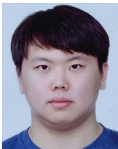

新兴应用、高效 AI、面向人工智能的系统设计、近似计算以及低功耗 VLSI 设计。他还曾担任 IEEE DAC、IEEE/ACM ISLPED、IEEE ISCAS 和 IEEE AICAS 的技术程序委员会成员。

Jaeha Kung（会员，IEEE）于 2010 年在韩国首尔高丽大学获得电气工程学士学位，2012 年在韩国大田韩国科学技术院（KAIST）获得电气工程硕士学位，2017 年在美国佐治亚理工学院获得电气与计算机工程博士学位。他目前是高丽大学电气工程学院的副教授。他目前的研究兴趣包括面向以下方向的数字加速器：