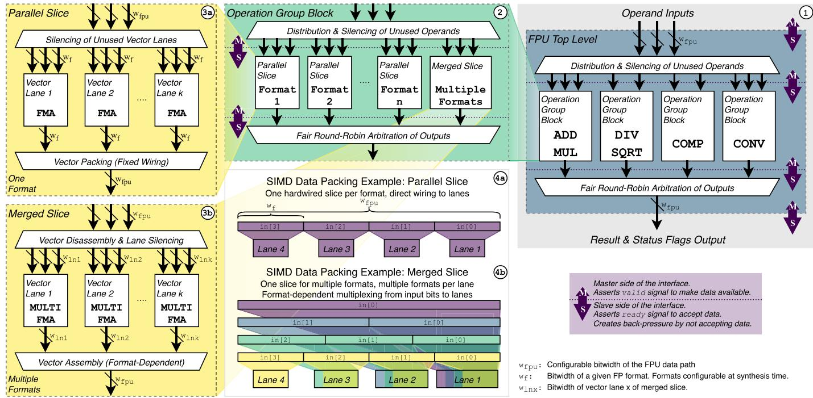
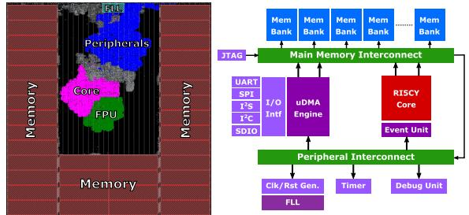
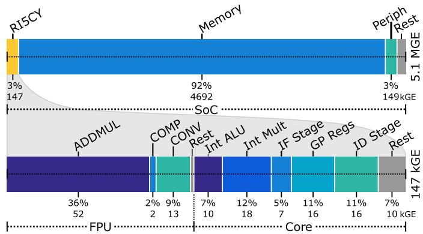
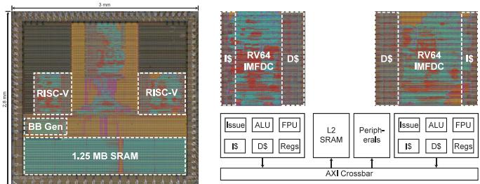
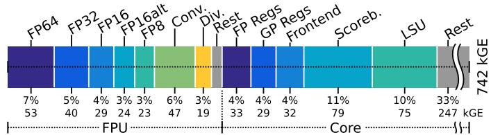
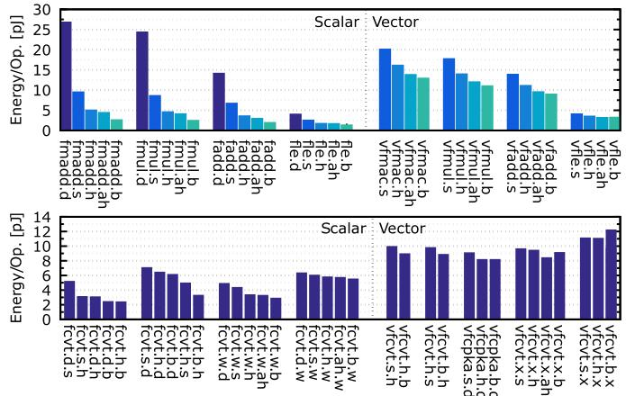
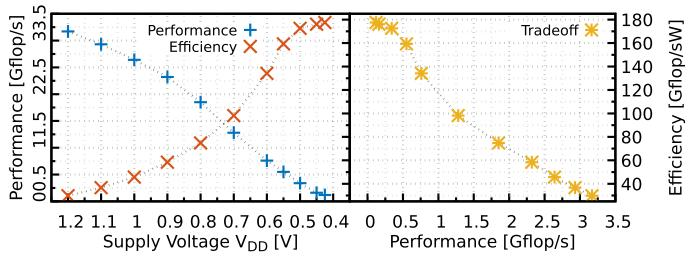
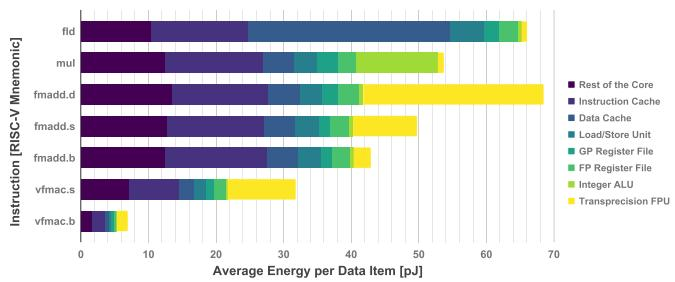
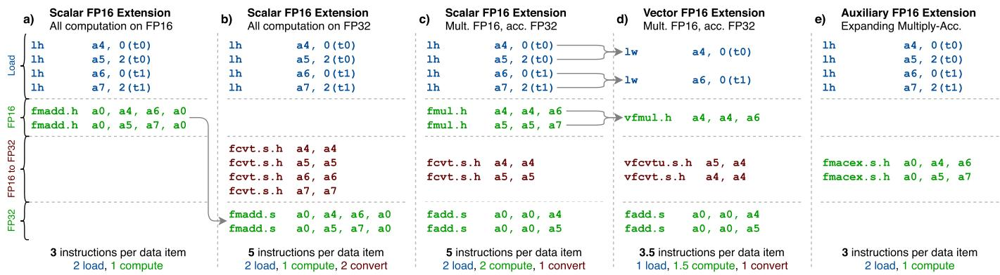

# FPnew: An Open-Source Multiformat Floating-Point Unit Architecture for Energy-Proportional Transprecision Computing 图表详解

### Fig. 2. Datapath block diagram of the TP-FPU with its underlying levels of hierarchy. It supports multiple FP formats, and the datapath width is configurable.

- **架构总览与层次结构**
    - 图 2 展示了 **TP-FPU (Transprecision Floating-Point Unit)** 的完整数据通路块图，采用**三层层次化设计**，支持多浮点格式且数据通路宽度 (**w_fpu**) 可配置。
    - 整体架构从右至左依次为：**FPU Top Level (顶层)** → **Operation Group Block (操作组块)** → **Format Slices (格式切片)**。
    - 核心设计理念是通过**并行切片 (Parallel Slice)** 与**合并切片 (Merged Slice)** 的混合使用，在硬件面积、能量效率与灵活性之间取得平衡。

- **第一层：FPU Top Level (标记①，右侧蓝色区域)**
    - **接口定义**：
      - 输入端接收最多 **3 个操作数 (Operand Inputs)**，位宽为 **w_fpu**。
      - 输出端产生 **Result & Status Flags Output**，同样为 **w_fpu** 位宽。
      - 采用 **Master-Slave 握手协议**：Master 端断言 **valid** 信号表示数据有效；Slave 端断言 **ready** 信号表示接受数据，并通过不接收数据产生**背压 (back-pressure)**。
    - **内部组成**：
      - 包含 **4 个独立的 Operation Group Blocks**，分别负责不同运算类别：
        | 操作组块 | 功能 | 英文标识 |
        |---------|------|---------|
        | 加法/乘法组 | 加法、乘法、融合乘加 (FMA) | **ADD MUL** |
        | 除法/开方组 | 除法、平方根运算 | **DIV SQRT** |
        | 比较组 | 浮点比较、分类、位操作 | **COMP** |
        | 转换组 | 格式间转换、整数与浮点互转 | **CONV** |
      - **Distribution & Silencing of Unused Operands** 模块负责将输入分发至对应组块，并**静默未使用的操作数**以降低动态功耗。
      - 输出端采用 **Fair Round-Robin Arbitration (公平轮询仲裁)** 合并各组的计算结果。

- **第二层：Operation Group Block (标记②，中间绿色区域)**
    - 作为中间调度层，将 Top Level 下发的操作路由至具体的 **Format Slices**。
    - 支持两种切片组织方式：
      - **Parallel Slices**：为每种支持的 FP 格式 (Format 1, Format 2, ..., Format n) 配置**独立的并行切片**。
      - **Merged Slice**：一个切片支持 **Multiple Formats (多格式合并)**。
    - 同样具备 **Distribution & Silencing** 机制和 **Round-Robin 仲裁** 输出。

- **第三层：Format Slices (标记③，左侧黄色区域)**
    - 这是执行实际运算的底层单元，分为两种实现策略：

    - **③a. Parallel Slice (并行切片) - 针对单一格式**
      - **适用场景**：**One Format (单格式)** 高效处理。
      - **内部结构**：
        1. **Silencing of Unused Vector Lanes**：静默未激活的 SIMD 向量通道。
        2. **Vector Lanes (k 个通道)**：每个通道包含独立的 **FMA (Fused Multiply-Add)** 单元，位宽固定为 **w_f**。
        3. **Vector Packing (Fixed Wiring)**：通过**固定连线**将各通道结果打包成 **w_fpu** 宽度的输出。
      - **优势**：每种格式可独立优化流水线深度和时序；未使用的格式切片可完全**时钟门控 (clock-gating)** 关闭，实现极佳的**能量比例性 (energy proportionality)**。

    - **③b. Merged Slice (合并切片) - 针对多格式**
      - **适用场景**：**Multiple Formats (多格式)** 共享硬件以节省面积。
      - **内部结构**：
        1. **Vector Disassembly & Lane Silencing**：向量拆解并根据当前操作格式选择性地激活通道。
        2. **Vector Lanes (k 个通道)**：每个通道包含 **MULTI FMA (多格式融合乘加)** 单元，支持不同位宽 (**w_ln1, w_ln2, ..., w_lnk**) 的输入/输出。
        3. **Vector Assembly (Format-Dependent)**：根据目标格式**依赖性地组装**向量结果。
      - **权衡**：节省面积，但窄格式可能复用过度设计的宽格式数据通路，导致能量和延迟开销略高于并行方案。

- **SIMD 数据打包机制详解 (标记④，底部紫色示例)**
    - **④a. Parallel Slice 打包示例**：
      - 策略：**One hardwired slice per format, direct wiring to lanes** (每格式一个硬连线切片，直接连至通道)。
      - 实现方式：输入 **in[3:0]** 通过固定连线分别映射至 **Lane 4 至 Lane 1**，无额外多路选择器开销。
      - 特点：**简单、低延迟、高能效**，但缺乏格式间灵活性。

    - **④b. Merged Slice 打包示例**：
      - 策略：**One slice for multiple formats, multiple formats per lane** (一切片服务多格式，每通道支持多格式)。
      - 实现方式：采用 **Format-dependent multiplexing (格式依赖的多路选择)**，图中用不同颜色区分不同 FP 格式如何复用同一组 Lane (Lane 1-4)。
      - 特点：**高度灵活**，支持运行时动态切换格式，但引入了多路选择器的面积和延迟开销。

- **关键设计参数与可配置性**
    | 参数符号 | 定义 | 说明 |
    |---------|------|------|
    | **w_fpu** | FPU 数据通路位宽 | 顶层可配置，决定最大数据处理宽度 (如 32-bit 或 64-bit) |
    | **w_f** | 给定 FP 格式的位宽 | 如 FP32 为 32 位，FP16 为 16 位，FP8 为 8 位 |
    | **w_lnx** | 合并切片中向量通道 x 的位宽 | 在 Merged Slice 中，不同通道可支持不同宽度 |

- **架构核心创新点总结**
    - **能量比例性设计**：通过细粒度的 **Silencing (静默)** 机制和 **Clock Gating (时钟门控)**，确保窄精度操作 (如 FP8) 的能耗显著低于宽精度 (如 FP64)，实测 FP8 FMA 能耗仅为 FP64 的约 **5%** (见论文 Fig. 7 数据)。
    - **双模切片协同**：Parallel Slice 保证关键路径格式的极致性能与能效；Merged Slice 提供非标准或低频格式的低成本支持。
    - **原生 SIMD 向量化**：在切片层面直接支持 **Lane-level 并行**，无需外部重复实例化整个 FPU，且向量打包逻辑内置于切片内部，减少数据搬运开销。
    - **完全参数化**：所有格式支持、流水线深度、SIMD 通道数均通过 SystemVerilog 参数在**综合时 (synthesis time)** 配置，无需修改 RTL 代码即可生成不同规格的 FPU 实例。

### Fig. 3. Floorplan and block diagram of the PULPissimo SoC (without pad frame) using RI5CY Core with TP-FPU.

- **图像整体构成与定位**
    - 该图为 **Fig. 3**，展示 **PULPissimo SoC** 的双重视图：左侧为**硅片物理布局**，右侧为**系统架构块图**。
    - 此 SoC 基于 **RI5CY**（32位 RISC-V 核心）集成 **TP-FPU**（Transprecision Floating-Point Unit），目标应用为**超低功耗嵌入式与 IoT 场景**。
    - 制造工艺采用 **GLOBALFOUNDRIES 22FDX**（22nm FD-SOI 技术），系统包含 **512 kB** 片上内存。

- **左侧：物理布局 分析**
    - **空间拓扑**：呈现典型的“内存包围核心”结构，四周为 **Memory** 宏单元（深红色区域），中心为逻辑电路区。
    - **核心模块物理分布**：
        - **FPU**（浮点运算单元）：位于布局顶部偏左，呈不规则形状，与核心紧邻以缩短数据通路。
        - **Peripherals**（外设模块群）：位于 FPU 下方，蓝色区域，集中布置以优化布线。
        - **Core**（RI5CY 处理器核心）：粉色/洋红色区域，位于布局中央偏下，是计算密集区。
        - **FPU**（重复标注或子模块）：在 Core 右侧可见另一 FPU 区域标识，可能代表 **TP-FPU 的特定功能切片**（如 ADDMUL 或 CONV 单元）的物理分离实现。
    - **面积占比洞察**：根据论文数据，整个 RI5CY 核心含 TP-FPU 面积为 **147 kGE**，其中 FPU 占 **69 kGE (47%)**；在整个 SoC（5.1 MGE）中，核心及 FPU 仅占约 **2.9%**，凸显**存储器主导面积**的特征（Memory 占 92%）。

- **右侧：系统架构块图 解析**
    - **存储子系统**：
        - 顶部并列多个 **Mem Bank**（存储器组），通过 **Main Memory Interconnect**（主存互连总线）连接，支持高带宽并行访问。
        - 互连结构采用典型的**交叉开关或总线矩阵**设计，确保核心与多 Bank 间的低延迟通信。
    - **处理核心与加速器**：
        - **RI5CY Core**：32位 RISC-V RV32IMFC 处理器，作为系统唯一主控核心，执行标量指令。
        - **TP-FPU 集成位置**：虽在块图中未单独绘出，但物理上紧密耦合于 Core 内部（见左图），通过专用接口接收浮点运算指令。
        - **Event Unit**（事件单元）：用于硬件循环控制及低功耗唤醒机制，是 PULP 平台能效优化的关键组件。
    - **外设与 DMA 子系统**：
        - **低速外设集群**：包括 **UART**（串口）、**SPI**、**I²C**、**I/O Int**（IO 中断）、**GPIO**，挂载于 **Peripheral Interconnect**（外设总线）。
        - **uDMA Engine**（通用 DMA 引擎）：独立于核心的数据搬运引擎，支持外设与内存间的**零开销数据传输**，降低核心唤醒频率。
    - **时钟、调试与电源管理**：
        - **Clk/Rst Gen.**（时钟/复位生成器）、**Timer**（定时器）、**Debug Unit**（调试单元，支持 JTAG 接口）、**FLL**（锁频环，用于时钟合成）构成基础支撑设施。

- **关键设计特征与性能映射**
    - **能效优化路径**：TP-FPU 采用**合并切片**配置（见表 I），FP32/FP16/FP16alt 共享 ADDMUL 数据通路，在 0.65V 下可达 **370 MHz**，FP32 FMA 能耗仅 **3.9 pJ/op**。
    - **面积-功耗权衡**：相比仅支持 FP32 的标准 RI5CY 核心，集成 TP-FPU 后**核心面积增加 29%**，静态能耗增加 37%，但系统级影响微乎其微（系统面积仅增 0.7%），证明**在存储器主导的 SoC 中增加浮点精度灵活性代价极低**。
    - **可扩展性启示**：此布局模式（核心+FPU 紧耦合+大容量片上存储）已成为后续 **GAP9** 等商业 IoT 处理器的蓝本，验证了**超精度计算**在边缘 AI 推理中的实用价值。

- **总结性技术评价**
    - 该图清晰揭示了**同构多精度浮点单元**在资源受限嵌入式平台中的**物理实现可行性**：通过将 TP-FPU 作为核心协处理器而非独立加速器，实现了**指令级透明度**（编译器可直接生成 FP16/FP16alt 指令）与**能效比例性**（窄位宽运算能耗近似线性下降）的统一。
    - 布局中 FPU 与 Core 的**空间邻近性**直接转化为**数据通路短延时**，配合 PULP 平台的**硬件循环**与 **DMA** 机制，共同构成了面向信号处理与轻量级机器学习推理的**完整能效优化栈**。

### Fig. 4. Area distribution of the PULPissimo SoC and the RI5CY core (in kGE, $1 \mathrm { G E } \approx 0 . 1 9 9 \mu \mathrm { m } ^ { 2 } )$

- **图表类型与主题**
  - 该图为 **Fig. 4**，采用双层堆叠条形图形式展示 **PULPissimo SoC** 及其内部 **RI5CY 核心**的面积分布情况
  - 面积单位为 **kGE**（千门等效），其中 $1 \text{ GE} \approx 0.199 \mu m^2$
  - 数据基于 GLOBALFOUNDRIES 22FDX 工艺的物理实现结果

- **SoC 级别面积分布（总规模：5.1 MGE = 5100 kGE）**

| 模块 | 面积 (kGE) | 占比 (%) |
|------|-----------|---------|
| **Memory** | **4692** | **92%** |
| **Periph Rest** (外设其余) | 149 | 3% |
| **RI5CY Core** | **147** | **3%** |

- **核心发现**：**存储器（Memory）占据 SoC 绝对主导地位**，达 92% 面积；RI5CY 处理器核心仅占 3%，体现典型 IoT/嵌入式 SoC 的"存储密集型"特征

- **RI5CY 核心内部面积分布（总规模：147 kGE）**

| 子模块 | 面积 (kGE) | 占核心比 (%) | 占 FPU 比 (%) |
|--------|-----------|-------------|--------------|
| **FPU 总计** | **52** | **35.4%** | 100% |
| &nbsp;&nbsp;├─ ADDMUL (加法/乘法/FMA) | 36 | 24.5% | 69.2% |
| &nbsp;&nbsp;├─ CONV (格式转换) | 9 | 6.1% | 17.3% |
| &nbsp;&nbsp;├─ COMP (比较/分类) | 2 | 1.4% | 3.8% |
| &nbsp;&nbsp;└─ Rest (其他) | 5 | 3.4% | 9.6% |
| **Int ALU** (整数算术逻辑单元) | **18** | **12.2%** | - |
| **GP Regs** (通用寄存器文件) | **16** | **10.9%** | - |
| **ID Stage** (指令译码阶段) | **11** | **7.5%** | - |
| **Rest** (其余核心逻辑) | **10** | **6.8%** | - |
| **Int Mult** (整数乘法器) | **7** | **4.8%** | - |
| **IF Stage** (指令取指阶段) | **5** | **3.4%** | - |

- **关键架构洞察**

  - **FPU 面积占比显著**：TP-FPU 占据核心总面积的 **35.4%**（52/147 kGE），成为除整数 ALU 外最大的单一功能单元，表明 **transprecision 浮点能力**是此设计的核心投资
  
  - **ADDMUL 单元主导 FPU 内部结构**：加法/乘法/融合乘加（FMA）单元消耗 **69.2%** 的 FPU 面积（36/52 kGE），这与 FPnew 架构中采用 **并行切片（parallel slices）** 支持多格式（FP32/FP16/FP16alt）的设计选择直接相关——多格式支持需要复制或扩展数据通路
  
  - **转换模块（CONV）成本不容忽视**：多格式转换逻辑占用 FPU **17.3%** 面积（9 kGE），验证了 **transprecision 计算中动态精度调整**的硬件开销
  
  - **与标准 FPU 的对比含义**：相比仅支持 FP32 的标准 RI5CY FPU，此 TP-FPU 实现增加了对 FP16、FP16alt 及 SIMD 向量的支持，面积增长体现了 **灵活性-效率** 的设计权衡

- **系统能耗影响关联**
  
  - 论文指出：尽管 FPU 使核心面积增加 **29%**、静态能耗增加 **37%**，但在 SoC 级别（含 512kB 存储器），这些增量分别被稀释至 **0.7%** 和 **0.9%**
  - 此分布图直观解释了为何 **存储器主导的嵌入式场景** 中，引入复杂 FPU 的面积/功耗代价是可接受的——FPU 仅占系统总面积的约 **1%**（52/5100）

- **设计方法论启示**
  
  - 图表揭示了 **PULP 平台**的设计哲学：在存储器占绝对主体的 SoC 中，处理器核心可承担较高的功能密度（如多格式 FPU）而不显著影响芯片整体成本
  - **ADDMUL:CONV:COMP ≈ 18:4.5:1** 的面积比例可为类似 transprecision FPU 的预算分配提供参考基准

### Fig. 5. Die micrograph and block diagram of entire Kosmodrom chip showing the placement of the two Ariane core macros with TP-FPU.

- **图像基本信息**
  - 图像标识：Fig. 5，Kosmodrom 芯片的 **Die micrograph**（裸片显微照片）与 **block diagram**（结构框图）
  - 核心内容：展示集成 **TP-FPU**（Transprecision Floating-Point Unit）的 **Ariane** RISC-V 处理器核心在硅片上的物理布局与系统级架构

- **左侧：裸片显微照片分析**
  - **物理尺寸**：芯片整体尺寸约为 **3 mm × 2.5 mm**
  - **宏观布局**：采用对称式双核设计，主要功能模块清晰可辨
  - **关键模块位置标注**：
    - **RISC-V**（×2）：两个 Ariane 处理器核心宏，分别位于芯片上部左右两侧
    - **BB Gen**：位于左下角，可能为 **Body Bias Generator**（体偏置电压生成器），用于 22FDX 工艺的 adaptive body biasing 技术
    - **1.25 MB SRAM**：占据芯片下半部分大面积区域，作为共享的 **L2 Cache**（二级缓存）

- **右侧：系统架构框图解析**
  - **双核对称结构**：图中展示两个完全相同的 **RV64**（64位 RISC-V）处理器核心
  - **单核内部组成**（每个 RISC-V 核心包含）：
    - **Issue**：指令发射单元
    - **ALU**：整数算术逻辑单元
    - **FPU**：浮点运算单元（即本文提出的 **TP-FPU**，支持多格式浮点运算）
    - **I$/D$**：独立的指令缓存和数据缓存
    - **Regs**：寄存器堆
    - **RV64 IMFDC**：RISC-V 64 位指令取指/译码/执行流水线核心
  - **共享资源与互连**：
    - **L2 SRAM**：1.25 MB 二级缓存，双核共享
    - **Peripherals**：外设接口模块
    - **AXI Crossbar**：基于 **AXI** 协议的交叉开关互连结构，连接双核与共享存储/外设

- **设计特征与技术要点**
  - **工艺节点**：**GLOBALFOUNDRIES 22FDX**（22nm FD-SOI 工艺），支持 **body biasing** 技术以实现宽范围电压调节（0.45V–1.2V）
  - **核心配置**：每个 Ariane 核心为 **6 级流水线、部分乱序执行** 的 64 位应用级处理器，集成完整 **TP-FPU** 支持 FP64/FP32/FP16/FP16alt/FP8 五种格式及 SIMD 向量运算
  - **测试芯片目的**：用于验证 TP-FPU 在实际硅片上的 **energy proportionality**（能量比例性）和 **energy efficiency**（能效），实测达到 **178 Gflop/sW**（FP64）至 **2.95 Tflop/sW**（FP8 SIMD）的领先能效水平

- **布局优化观察**
  - **存储器主导**：L2 SRAM 占据芯片面积的主要部分（约 60% 以上），符合现代处理器 "memory wall" 特征
  - **计算核心紧凑**：双核及 FPU 位于芯片上部，便于散热和信号完整性控制
  - **对称性设计**：双核镜像布局有利于 **clock tree synthesis**（时钟树综合）和 **power distribution network**（电源分配网络）的平衡

- **与论文实验数据的关联**
  - 该芯片是论文 **Section IV-B** 中硅片测量数据（Fig. 7, Fig. 8, Fig. 9）的物理载体
  - 通过该芯片验证了 **voltage scaling**（电压缩放）对性能和能效的影响（Fig. 8）
  - 实测了不同 FP 格式（scalar 和 vector）的 **per-instruction energy cost**（每指令能耗）（Fig. 7）
  - 验证了 TP-FPU 相比标准 FPU 仅增加 **9.3% 面积** 和 **11.1% 静态功耗**，但获得最高 **16.6×** 的能效提升（FP8 vector vs FP64 scalar）

### b8de613683eb42b1c9317afc0db8f813fd63de2c8e39b10b4772271f14cc6114.jpg

*   **图表类型与主题**：
    *   该图为 **Ariane RISC-V 处理器核心**（**不含缓存存储器**）的 **面积分布堆叠条形图**。
    *   面积单位为 **kGE**（千门等效，1 GE ≈ 0.199 µm²）。
    *   核心总面积为 **742 kGE**。

*   **宏观结构划分**：
    *   图表将核心面积主要划分为两大模块：**FPU（浮点运算单元）** 和 **Core（处理器核心其他逻辑）**。
    *   **FPU 总面积**：约 **247 kGE**，占核心总面积的 **33.3%**。
    *   **Core 其他逻辑总面积**：约 **495 kGE**，占核心总面积的 **66.7%**。

*   **详细面积分解数据表**：

| 模块分类 | 子模块名称 | 面积 (kGE) | 占比 (%) | 备注 |
| :--- | :--- | :--- | :--- | :--- |
| **FPU** | **FP64** (双精度) | **53** | **7%** | 面积最大的单一格式FMA单元 |
| | **FP32** (单精度) | **40** | **5%** | |
| | **FP16** (半精度) | **29** | **4%** | |
| | **FP16alt** (BFloat16) | **24** | **3%** | 自定义格式，因尾数较短(7位)，面积小于标准FP16 |
| | **FP8** (8位迷你浮点) | **23** | **3%** | 最窄格式，面积最小 |
| | **Conv.** (转换单元) | **47** | **6%** | 负责多格式间的类型转换与打包 |
| | **Div.** (除法/开方单元) | **19** | **3%** | 迭代式除法器，面积占比相对较小 |
| **Core** | **Rest** (其余逻辑) | **247** | **33%** | 包含解码、执行、写回等控制路径逻辑 |
| | **Scoreboard** (记分板) | **79** | **11%** | 用于指令调度和依赖检测 |
| | **LSU** (加载/存储单元) | **75** | **10%** | 负责数据内存访问 |
| | **FP Regs** (浮点寄存器堆) | **33** | **4%** | 64位宽浮点寄存器文件 |
| | **GP Regs** (整数寄存器堆) | **29** | **4%** | 通用目的寄存器文件 |
| | **Frontend** (前端) | **32** | **4%** | 取指、译码等前端逻辑 |

*   **关键洞察与架构分析**：
    *   **Transprecision FPU 的面积代价**：尽管支持了 **5种不同的浮点格式**（FP64, FP32, FP16, FP16alt, FP8）以及 **SIMD 向量化**能力，FPU 仅占核心总面积的约 **1/3**。相比仅支持标量 FP32/FP64 的基础 Ariane 核心，面积增加约 **9.3%**（如论文所述），这表明通过 **并行切片（Parallel Slices）** 架构实现多格式支持在先进工艺下是面积高效的。
    *   **能量比例性（Energy Proportionality）的硬件基础**：图中清晰展示了不同精度格式的 FMA 单元拥有独立的硬件切片（FP64 占 53kGE vs FP8 仅占 23kGE）。这种 **非共享数据通路** 的设计使得在执行低精度运算时，可以 **时钟门控（Clock Gating）** 掉高精度的大面积切片，从而实现了论文强调的 **超比例能效提升**（FP8 运算的能效可达 FP64 的 16.6 倍以上）。
    *   **FPU 内部构成**：根据论文文字描述，FPU 的 247 kGE 中，**各类 FMA 单元合计占据约 160 kGE**（对应图中前五项之和 169 kGE，略有差异可能源于取整或包含比较逻辑），是绝对的面积主体；**转换单元（47 kGE）** 占比显著，反映了多格式计算系统中动态精度调整（Casting & Packing）硬件的重要性。
    *   **核心瓶颈**：**"Rest"（其余逻辑）** 占据了核心 **33%** 的面积，这通常包括复杂的乱序/顺序控制逻辑、多级流水线寄存器等，说明在应用级处理器中，控制通路的复杂度依然不容忽视。

### abb01a4121dcc57ed75b45d837b40a5b5cbf247d589ab31e7213a7a78cf7898b.jpg

*   **图表核心主题**：该图为 **Fig. 7**，详细展示了 **TP-FPU (Transprecision Floating-Point Unit)** 在不同浮点格式和操作类型下的**每指令平均能耗**（Energy Cost per Instruction）。

*   **图表结构解析**：
    *   图表由 **四个子图** 组成，呈 2x2 布局。
    *   **左上角 (Top-Left)**：**标量算术运算 (Scalar Operations)** 能耗分布。
    *   **右上角 (Top-Right)**：**向量/SIMD运算 (Vectorial Operations)** 能耗分布。
    *   **左下角 (Bottom-Left)**：**标量转换运算 (Scalar Conversions)** 能耗分布。
    *   **右下角 (Bottom-Right)**：**向量转换运算 (Vectorial Conversions)** 能耗分布。
    *   **纵轴 (Y-axis)**：单位为 **pJ (picojoules)**，表示每次操作消耗的能量。
    *   **横轴 (X-axis)**：列出了具体的 RISC-V 指令助记符（如 `fmadd.d`, `vfmac.s` 等）。

*   **关键数据与趋势分析 - 算术运算 (ADDMUL/COMP)**：
    *   **显著的能量比例性 (Energy Proportionality)**：随着浮点数据位宽的减小，能耗呈现**超线性下降**趋势。
    *   **标量 FMA (Fused Multiply-Add) 能耗对比**：

| 指令 | 格式 | 位宽 | 近似能耗 (pJ) | 相对于 FP64 的能效提升 |
| :--- | :--- | :--- | :--- | :--- |
| `fmadd.d` | FP64 | 64-bit | **~26.7** | 基准 (1.0×) |
| `fmadd.s` | FP32 | 32-bit | ~9.3 | **~2.8×** |
| `fmadd.h` | FP16 | 16-bit | ~4.8 | **~5.6×** |
| `fmadd.b` (FP16alt) | BF16 | 16-bit | ~4.2 | **~6.4×** |
| `fmadd.b` (FP8) | FP8 | 8-bit | **~1.3** | **~20.5×** |

    *   **BF16 vs FP16**：`fmadd.b` (BF16) 比 `fmadd.h` (标准 FP16) 节省约 **12%** 的能量，这是因为 BF16 的尾数位数较少（7位 vs 10位），简化了乘法器逻辑。
    *   **向量运算的超比例优势**：尽管 SIMD 指令充分利用了 64-bit 数据通路，但使用更窄格式的向量指令（如 `vfmac.h`, `vfmac.b`）仍能获得显著的每数据项 (per-datum) 能量节省。例如，FP8 向量 FMA 的单数据项能耗远低于 FP32 向量 FMA。

*   **关键数据与趋势分析 - 转换运算 (CONV)**：
    *   **能量比例性较弱**：由于转换单元 (CONV block) 采用了 **合并切片 (Merged Slice)** 设计（多格式共享硬件），其能量缩放效果不如采用**并行切片 (Parallel Slices)** 的算术单元明显。
    *   **转换方向的影响**：
        *   **向上转换 (Widening/Cast to larger format)**：通常更节能，因为输入数据通路部分触发，且输出高位通常填充常数零。
        *   **向下转换 (Narrowing/Cast to smaller format)**：相对更耗能，因为需要处理完整的宽输入数据并产生动态切换活动。
    *   **特殊指令效率**：**Cast-and-Pack**（转换并打包）指令（如 `vfcvt.b.x`）表现出极高的效率，仅需比单次标量转换多约 **30%** 的能量即可完成两个操作数的转换与打包。

*   **架构设计启示**：
    *   **并行切片策略的有效性**：图表证实了 TP-FPU 采用**格式专用并行 datapath** 的决策是正确的。通过独立的物理通路，空闲的低精度切片可以被彻底**时钟门控 (Clock-gated)**，从而实现了极高的能量比例性。
    *   **Transprecision 计算的价值**：在不需要高精度的场景（如机器学习推理、某些信号处理）中，动态切换到 FP8 或 FP16 格式，可以在保持算法精度的前提下，将 FPU 运算能耗降低一个数量级。

*   **总结**：该图是论证 **FPnew** 架构在**能效比 (Energy Efficiency)** 和**精度灵活性**方面处于业界领先地位的核心证据。它直观地证明了“越窄的格式越省电”这一 transprecision 计算的基本公理在该硬件实现中得到了极致的体现。

### 301c1670dd641475fb49613bb18dc1e69f93629aa971752c0f930b99ddae1d71.jpg

- **图表类型与主题**
    - 该图为 **Fig. 8**，包含左右两个子图，主题为 **FP64 FMA 操作的电压缩放影响**。
    - 数据来源为 **GLOBALFOUNDRIES 22FDX 工艺制造的硅片实际测量结果**。

- **左图：电压-性能-能效关系**
    - **X 轴**：Supply Voltage $V_{DD}$ [V]，范围 **0.4 V – 1.2 V**。
    - **左 Y 轴**：Performance [Gflop/s]（蓝色 + 号），表示计算性能。
    - **右 Y 轴**：Efficiency [Gflop/sW]（红色 × 号），表示能量效率。
    - **关键趋势**：
        - 随着供电电压从 **1.2 V 降低至 0.45 V**，性能从峰值 **~3.2 Gflop/s 单调下降至接近 0**。
        - 与此同时，能量效率呈现**相反趋势**，在低电压区间达到更高值（尽管图中显示效率曲线随电压降低先升后降或持续变化，需结合右图理解最优工作点）。
        - 这体现了 **Dynamic Voltage and Frequency Scaling (DVFS)** 的核心权衡：**以性能换取能效**。

- **右图：性能-能效帕累托前沿 (Tradeoff)**
    - **X 轴**：Performance [Gflop/s]。
    - **Y 轴**：Efficiency [Gflop/sW]（黄色 * 号）。
    - **物理意义**：该图揭示了通过调节电压和频率可达成的 **性能-能效设计空间**。
    - **数据特征**：形成一条向右下方倾斜的曲线，表明在当前硬件实现下，**无法同时最大化性能和能效**，系统设计者可根据应用需求（如实时性 vs. 电池寿命）选择最佳工作点。

- **关键测量数据提取 (FP64 FMA)**
    
    | 指标 | 峰值性能点 | 高能效点 (推测低电压) |
    | :--- | :--- | :--- |
    | **电压 (V)** | ~1.2 V | ~0.45 V |
    | **频率 (MHz)** | ~960 MHz (最坏情况) / 更高 (标称) | 显著降低 |
    | **性能 (Gflop/s)** | **3.17** | < 1.0 (显著下降) |
    | **能效 (Gflop/sW)** | **178** | **>178** (理论提升) |

- **工程意义与 transprecision 结合**
    - **电压缩放作为额外旋钮**：除了切换 FP 格式（如从 FP64 切换到 FP8 获得 16.6x 能效提升，见表 IV），**降低电压是第二层能效优化手段**。
    - **超比例收益**：论文指出，结合窄格式（如 FP8）与低压运行，可获得 **超过 2.3 倍的额外能效增益**，即总收益远超简单的 2:1 精度-面积 tradeoff。
    - **宽工作范围验证**：硅片在 **0.45 V 至 1.2 V** 的宽电压范围内稳定工作，证明了 FPnew 架构在 **近阈值 (Near-Threshold)** 甚至 **亚阈值 (Sub-Threshold)** 区域的鲁棒性，这对 IoT 和边缘计算场景至关重要。

- **图表结论**
    - 该图实证了 FPnew TP-FPU 具备优秀的 **能量比例性 (Energy Proportionality)**。
    - 硬件不仅支持通过**数据格式宽度**动态调整能效，还支持通过**电压/频率**进行细粒度的功耗-性能调优，为 **transprecision computing** 提供了完整的硬件级能效控制手段。

### cc4906d526440f24318c651b9600898cd2931531d51a6042c60b5c6adef3509f.jpg

- **图表类型与核心主题**: 该图为堆叠条形图，展示了 **Ariane RISC-V 核心** 在执行不同浮点相关指令时，**每个数据项的平均能耗分布**。横轴为能耗（单位：pJ），纵轴为具体指令助记符。

- **能耗构成分解（图例）**: 图表将核心级总能耗细分为八个硬件模块的贡献：
  - **Rest of the Core**（深紫）：核心控制逻辑及其他杂项开销。
  - **Instruction Cache**（靛蓝）：取指带来的指令缓存功耗。
  - **Data Cache**（蓝色）：数据访问引发的数据缓存动态功耗。
  - **Load/Store Unit**（青色）：访存单元的地址计算与数据搬运能耗。
  - **GP Register File**（浅绿）：通用寄存器文件的读写能耗。
  - **FP Register File**（绿松石）：浮点寄存器文件的读写能耗。
  - **Integer ALU**（黄绿）：整数算术逻辑单元的运算能耗（主要见于 `mul` 指令）。
  - **Transprecision FPU**（黄色）：**跨精度浮点运算单元**本身的运算能耗，这是本研究的核心关注点。

- **各指令详细能耗数据分析**:

| 指令 | 含义 | 总能耗 (约) | FPU 占比 | 关键特征 |
| :--- | :--- | :--- | :--- | :--- |
| `fld` | 加载双精度 (FP64) | ~65 pJ | 极低 | 能耗主要由 **Data Cache** 和 **Load/Store Unit** 主导，属于访存密集型操作。 |
| `mul` | 整数乘法 | ~52 pJ | 无 | **Integer ALU**（黄绿色段）占据显著比例，体现整数运算路径的功耗特征。 |
| `fmadd.d` | 双精度融合乘加 (FP64) | **~68 pJ** | **~39% (~26.7 pJ)** | **全图最高能耗点**。FPU（黄色）贡献巨大，同时缓存和寄存器文件开销也极高。 |
| `fmadd.s` | 单精度融合乘加 (FP32) | ~48 pJ | 较高 | 相比 FP64，总能耗下降约 **29%**，FPU 部分能耗显著缩减，体现了**精度缩放的能效收益**。 |
| `fmadd.b` | 8位迷你浮点融合乘加 (FP8) | ~42 pJ | 中等 | 进一步降低精度后，FPU 黄色段继续缩短，但系统固定开销（缓存、寄存器）占比相对上升。 |
| `vfmac.s` | 单精度向量融合乘加 | ~32 pJ | 中等 | 引入 **SIMD 向量化** 后，尽管利用了完整数据通路，但**分摊到每个数据项**的总能耗反而低于标量 `fmadd.s`，证明了向量化对掩盖系统开销的有效性。 |
| `vfmac.b` | 8位向量融合乘加 | **~6-7 pJ** | 存在 | **全图最低能耗**。结合了**低精度 (FP8)** 与 **SIMD 向量化** 的双重优势，实现了极致的能效优化。 |

- **关键工程洞察与结论**:
  - **非理想的比例性**: 论文指出，虽然 FP8 标量 FMA 的 FPU 内部能耗比 FP64 降低了 **10.5 倍**，但由于缓存、译码、寄存器文件等**系统固定开销**的存在，整个核心的总能耗仅降低了约 **38%**。这意味着在高性能核心中，单纯降低运算精度带来的收益会被外围电路“稀释”。
  - **向量化是必要的倍增器**: 对比 `fmadd.b` (标量, ~42 pJ) 与 `vfmac.b` (向量, ~7 pJ)，向量化将每数据项能耗进一步压低了约 **6 倍**。这表明在应用级核心中，**必须配合 SIMD 技术才能充分释放跨精度计算的节能潜力**。
  - **内存墙的影响**: `fld` 等访存指令的高能耗（~65 pJ）甚至接近复杂的 FP64 运算，凸显了在现代处理器中，**数据搬运的能耗成本已可与复杂计算相提并论**，这对数据布局和局部性优化提出了更高要求。
  - **设计权衡验证**: 该图直观验证了 FPnew 架构的设计哲学——通过**并行切片** 为不同精度提供独立通路，并结合精细的时钟门控，使得窄格式运算在 FPU 内部实现了超比例的能效提升（如 FP8 相对 FP64 超过 10 倍的 FPU 内部能效比）。

### Fig. 11. RISC-V assembly implementations of two iterations of the loop body in Fig. 10 (gray).

- **图像核心内容解析**
  - 该图（Fig. 11）展示了**同一计算内核在RISC-V架构下的五种不同汇编实现方案**（标记为a至e），对应图10中C代码循环体的两次迭代。
  - 计算任务为：对两个输入流（a和b）执行**逐元素乘积并累加**（MAC操作），这是信号处理、SVM、深度学习中的典型模式。
  - 图像按**数据通路宽度**和**精度策略**分为五个对比列，每列底部标注了**每数据项的平均指令数**及指令类型分解。

- **分方案技术细节剖析**

  **方案 a) 标量FP16全精度计算**
  - **指令序列**：使用 `lh`（加载半字）读取FP16数据，直接调用 `fmadd.h`（半精度融合乘加）。
  - **特征**：**纯标量FP16路径**，无格式转换开销。
  - **性能指标**：**3条指令/数据项**（2次Load + 1次Compute）。
  - **精度代价**：仅获得**9位有效精度**（见表III），因FP16累加导致严重舍入误差累积。

  **方案 b) 标量FP32全精度计算（基线）**
  - **指令序列**：`lh` 加载FP16 → `fcvt.s.h` 转换为FP32（4条转换指令）→ `fmadd.s`（单精度FMA）。
  - **特征**：**提升精度标准做法**，将窄格式数据提升至宽格式后再计算。
  - **性能指标**：**5条指令/数据项**（2 Load + 1 Compute + 2 Convert）。
  - **精度收益**：达到**22位有效精度**，但**系统能耗增加59%**（相对方案a），成为能耗基线（1.0）。

  **方案 c) 混合精度：FP16乘法 + FP32累加**
  - **指令序列**：`lh` 加载 → `fmul.h`（FP16乘法）→ `fcvt.s.h` 转换乘积 → `fadd.s`（FP32加法累加）。
  - **特征**：尝试优化，将计算量最大的乘法保持在FP16，仅累加提升至FP32。
  - **性能指标**：**5条指令/数据项**（2 Load + 2 Compute + 1 Convert）。
  - **效果评估**：精度19位，但**核心能耗反升16%**（相对b），因FP16乘法+转换的开销超过了节省。

  **方案 d) 向量化SIMD实现**
  - **指令序列**：`lw`（一次加载两个字/32位）→ `vfmul.h`（向量FP16乘法）→ `vfcvtu.s.h`/`vfcvt.s.h`（向量转换）→ `fadd.s` 累加。
  - **特征**：利用**SIMD打包**，一条指令处理多个FP16数据，减少内存访问次数。
  - **性能指标**：**3.5条指令/数据项**（1 Load + 1.5 Compute + 1 Convert），**吞吐量显著提升**。
  - **系统级优势**：尽管FPU能耗略增（0.97），但**系统能耗降至0.75**（相对b），主要得益于**内存访问量减半**。

  **方案 e) 扩展指令：扩展型融合乘加（Expanding FMA）**
  - **指令序列**：`lh` 加载 → `fmacex.s.h`（**自定义扩展指令**）。
  - **特征**：**硬件级混合精度原子操作**——单条指令完成"FP16乘法 + 结果扩展至FP32 + FP32累加"，消除中间转换步骤。
  - **性能指标**：**3条指令/数据项**（2 Load + 1 Compute），**与纯FP16方案a同速**。
  - **综合表现**：
    - 精度达**19位**（接近方案b的22位，远超方案a的9位）；
    - **核心能耗仅为FP32基线的63%，系统能耗为63%**；
    - 实现了**精度-性能-能效的最优帕累托前沿**。

- **关键设计洞察与数据对比**

  | 实现方案 | 指令数/数据 | Load | Compute | Convert | 有效精度(位) | 相对核心能耗 | 相对系统能耗 |
  |:-------:|:----------:|:----:|:-------:|:-------:|:-----------:|:-----------:|:-----------:|
  | a) FP16标量 | 3.0 | 2 | 1 | 0 | 9 | **0.60** | **0.63** |
  | b) FP32标量 | 5.0 | 2 | 1 | 2 | 22 | 1.00 | 1.00 |
  | c) 混合标量 | 5.0 | 2 | 2 | 1 | 19 | 1.16 | 1.03 |
  | d) SIMD向量 | 3.5 | 1 | 1.5 | 1 | 19 | 0.97 | **0.75** |
  | **e) 扩展FMA** | **3.0** | **2** | **1** | **0** | **19** | **0.63** | **0.63** |

- **架构意义总结**
  - **Transprecision Computing的核心价值**：该图实证了**动态精度调节**的必要性——固定使用高精度（b）浪费能量，固定使用低精度（a）损失精度，而**智能混合精度（e）** 可兼得两者之利。
  - **ISA扩展的杠杆效应**：方案e仅需添加一条**语义明确的扩展指令**（`fmacex`），即可避免软件层面的多次转换与中间寄存器压力，将5条指令压缩为1条计算指令。
  - **SIMD与Transprecision的协同**：方案d表明，即使不使用特殊扩展指令，**向量化**本身也能通过减少存储子系统能耗带来显著收益（25%系统节能），而方案e则进一步证明**定制化数据通路**的极致效率。
  - **编译器与程序员接口**：图中灰色部分暗示了从高级语言（Fig. 10c的intrinsic调用）到这些高效汇编模式的自动/手动映射路径，体现了软硬件协同设计的完整性。

### cea415a07275f54a58bd01a3bbf2b5a1b617af3a9adc53690ddbdc53d3f65296.jpg

- **图像基本信息**
  - **图像类型**：人物肖像照（专业学术头像）
  - **拍摄风格**：正式商务/学术摄影风格
  - **背景特征**：深色（黑色或深灰色）纯色背景，突出主体人物

- **人物外观特征**
  - **性别**：男性
  - **年龄范围**：青年至中年（约25-35岁）
  - **发型**：短发，棕色或深褐色，发型整齐，略带蓬松感，侧分造型
  - **面部特征**：
    - 肤色白皙
    - 眉毛浓密且整齐
    - 眼睛为浅色（蓝色或灰绿色），眼神直视镜头
    - 鼻梁挺直
    - 嘴角上扬，呈现自然微笑表情
    - 下颌线条清晰
  - **着装**：
    - 上身穿着**白色正装衬衫**（dress shirt）
    - 佩戴**条纹领带**（striped tie），颜色为深色调（深蓝或灰色系）带有斜向条纹图案
    - 外套为**深色西装外套**（suit jacket），可见肩部和领口部分

- **图像技术参数**
  - **构图方式**：胸部以上半身像（bust shot），采用中心构图
  - **光线运用**：专业影棚布光，主光源位于正面偏左位置，面部受光均匀，右侧有柔和阴影增加立体感
  - **焦距效果**：中等焦距镜头拍摄，背景虚化程度适中，人物清晰锐利
  - **色彩处理**：整体色调偏冷，肤色还原自然，对比度适中

- **身份识别与关联信息**
  - **对应人物**：**Stefan Mach**（根据论文作者简介部分确认）
  - **学术身份**：
    - 所属机构：**Swiss Federal Institute of Technology Zürich (ETHZ)**，瑞士苏黎世联邦理工学院
    - 当前职位：博士研究生（Ph.D. candidate）
    - 部门：**Integrated Systems Laboratory**（集成系统实验室）
    - 研究方向：**transprecision computing**（跨精度计算）、**computer arithmetics**（计算机算术）、**energy-efficient processor architectures**（能效处理器架构）
  - **教育背景**：
    - 本科（B.Sc.）和硕士（M.Sc.）学位均毕业于 ETHZ
    - 自2017年起担任研究助理

- **论文贡献角色**
  - 作为本文**第一作者**，主导了 **FPnew**（开源多格式浮点运算单元架构）的设计与实现工作
  - 主要负责：
    - TP-FPU（Transprecision Floating-Point Unit）的**高度可配置架构设计**
    - RISC-V ISA 扩展指令集的定义与实现
    - 在 RI5CY（32位嵌入式核心）和 Ariane（64位应用级核心）中的集成工作
    - GLOBALFOUNDRIES 22FDX 工艺下的硅片实现与能效测试

- **图像用途分析**
  - **使用场景**：学术论文作者简介、会议演讲者介绍、学术机构官网个人主页、专业社交平台（如 LinkedIn、Google Scholar）头像
  - **专业性评估**：符合国际顶级学术期刊/会议（如 IEEE Transactions）的作者照片标准，展现专业、可信的学术形象

- **视觉设计评价**
  - **优点**：表情亲和力强，着装规范得体，光线专业，背景简洁不分散注意力
  - **适用性**：适用于多种学术及职业场合，具有较长的使用时效性

### a79224de0c61dce9d10946ed410162f8b8027b56d12d793efb9feaf87a8f60a3.jpg

- **图像基本信息**
  - 图像类型：**人物肖像照（Author Photo）**
  - 对应人物：**Fabian Schuiki**（本文第二作者）
  - 图像特征：正面半身照，背景为木质纹理墙面，着深色毛衣/针织衫

- **人物学术背景**
  - 教育经历：
    
    | 学位 | 获得时间 | 院校 |
    |------|----------|------|
    | B.Sc. | 2014年 | ETH Zürich（瑞士联邦理工学院苏黎世分校） |
    | M.Sc. | 2016年 | ETH Zürich |
    | Ph.D. | 在读 | ETH Zürich（Digital Circuits and Systems Group） |
  
  - 导师：**Luca Benini**（IEEE Fellow，本文通讯作者）

- **研究方向**
  - **Transprecision computing**（跨精度计算）
  - **Near- and in-memory processing**（近存/存内计算）

- **在本论文中的贡献**
  - 作为核心团队成员参与 **FPnew** 架构的设计与实现
  - 参与 RISC-V 处理器核（Ariane）的 TP-FPU 集成工作
  - 参与 GLOBALFOUNDRIES 22FDX 工艺下的硅片实现（Kosmodrom 芯片）
  - 研究重点包括多格式浮点运算单元的能效优化与精度自适应机制

- **图像在论文中的作用**
  - 位于论文末尾 **Authors' Biography** 部分
  - 用于标识作者身份，符合 IEEE 期刊/会议论文的标准格式要求
  - 配合文字简介展示研究团队构成

### 9576b2daf1ece0f94fe8b8e4c9fa2b04ad79b1d793040b07563ff14cbaf903e0.jpg

- **图像基本信息**
    - 图像类型：**人物肖像照/专业学术照片**
    - 拍摄对象：**Florian Zaruba**（本文第三作者）
    - 视觉特征：男性，佩戴黑框眼镜，棕色短发，身着浅蓝色衬衫配黑色领带，背景为纯白色

- **人物身份与学术背景**（基于论文信息）
    - 当前身份：**IEEE研究生会员 (Graduate Student Member, IEEE)**
    - 教育经历：
        
        | 学位 | 获得年份 | 院校 |
        |------|----------|------|
        | B.Sc. (学士学位) | 2014 | TU Wien (维也纳工业大学) |
        | M.Sc. (硕士学位) | 2017 | ETHZ (瑞士联邦理工学院苏黎世分校) |
        | Ph.D. (博士在读) | 进行中 | ETHZ - Integrated Systems Laboratory |
    
    - **研究兴趣领域**：
        - **超大规模集成电路设计 (VLSI Design)**
        - **高性能计算机架构 (High-Performance Computer Architectures)**

- **在本文中的贡献角色**
    - 作为核心作者之一，参与了 **FPnew** 开源多格式浮点运算单元架构的设计工作
    - 负责 **Ariane** 64位RISC-V处理器核的集成与流片实现（GlobalFoundries 22FDX工艺）
    - 参与了硅片实测、能效评估及电压频率缩放分析等关键实验环节
    - 在相关工作中还负责 **Snitch** 处理器等低功耗浮点密集型计算架构的设计

- **图像功能定位**
    - 该图像为标准的**学术论文作者头像**，用于：
        - 论文作者简介部分的身份识别
        - 学术数据库（如IEEE Xplore、DBLP）的个人资料展示
        - 研究团队网页或机构主页的成员介绍
    - 拍摄风格符合**学术界专业形象规范**：正式着装、中性表情、高清晰度正面照

### 0bf2ba435cd8dbcee1a70439fcae486a1870e842b3abd673a54145f7ea56c355.jpg

*   **图像主体识别**：该图像为 **Luca Benini** 的专业肖像照片。
*   **人物身份**：
    *   **学术职称**：**Fellow, IEEE**；瑞士联邦理工学院（**ETHZ**）数字电路与系统讲席教授；意大利博洛尼亚大学（**Universita di Bologna**）全职教授。
    *   **学术成就**：发表或合著超过 **1000篇** 同行评审文章及 **5本** 专著；**ACM Fellow**；欧洲科学院（**Academia Europaea**）成员。
    *   **荣誉奖项**：2016年 **IEEE CAS Mac Van Valkenburg Award** 获得者；2020年 **EDAA Achievement Award** 获得者。
*   **研究专长**：
    *   核心领域聚焦于 **energy-efficient computing systems design**（节能计算系统设计）。
    *   研究覆盖范围广泛，从 **embedded**（嵌入式）系统延伸至 **high-performance**（高性能）计算架构。
*   **在本文中的角色**：
    *   作为 **FPnew** 架构论文的通讯作者及资深研究者，为该 **transprecision floating-point unit (TP-FPU)** 的设计提供了顶层指导。
    *   其在低功耗微处理器架构（如 **RISC-V** 核心 **Ariane** 和 **RI5CY**）方面的深厚积累是本项目的重要理论基础。
*   **视觉特征分析**：
    *   **着装**：身着深色西装外套与白色正装衬衫，呈现典型的学术界/工业界高级专家形象。
    *   **构图**：标准半身像（**Headshot**），背景简洁，突出人物面部特征，常用于学术论文、会议演讲或机构官网介绍。

