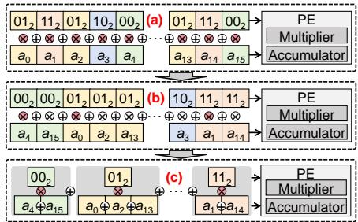
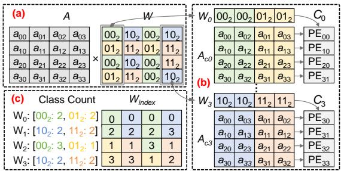
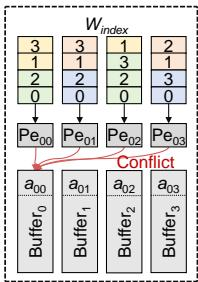
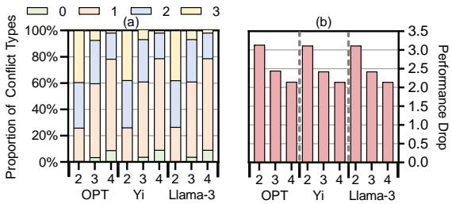
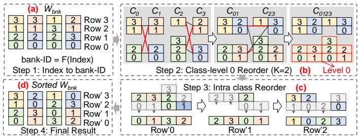
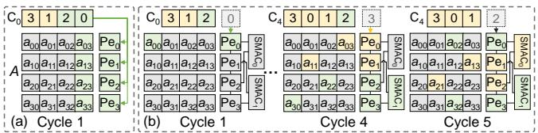
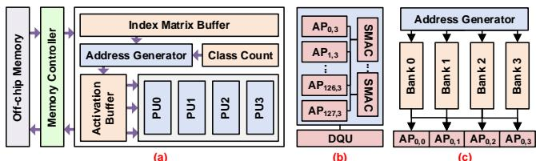
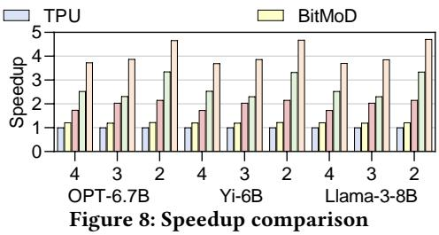
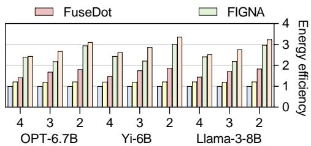
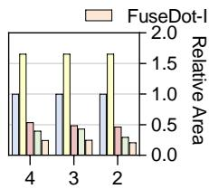

# FuseDot: A Multiplication-Fused Dot Product Accelerator for Efficient LLM Inference 原文翻译

# FuseDot：面向高效 LLM 推理的乘法融合点积加速器

Wenju Zhao1, Jianhui Yue2, Pengcheng Yao∗1, Yujia Cui1, Qinggang Wang1, Yufei Sun1, Jiaqi Zhai1, Hai Jin1, Xiaofei Liao1

1华中科技大学大数据技术与系统国家工程研究中心/服务计算技术与系统实验室/集群与网格计算实验室，中国武汉 2密歇根理工大学，美国霍顿 wjzh@hust.edu.cn,jyue@mtu.edu,{pcyao,cuiyj,qgwang,yfsun,jqzhai,hjin,xfliao}@hust.edu.cn

## 摘要

权重量化能够实现高效的 LLM 推理，但需要执行混合精度计算（例如 FP16×INT4），而通用处理器执行此类计算的效率较低。现有加速器集成了定制的混合精度算术单元，但仍遵循点积范式，需要执行大量乘法。本工作挖掘低位宽量化中的乘法融合机会，并引入 MFDP，这是一种新颖的点积范式，可将权重相同的多次乘法融合为一次运算。基于 MFDP，我们提出了 FuseDot 加速器，通过引入索引驱动的广义矩阵乘法和分层双阶段重排序算法来优化融合过程。此外，采用半乘法器方案的跨 PE 乘法器共享架构进一步将乘法器成本分摊到多个 PE 上。相较于最先进的加速器，本工作实现了 1.51–1.98× 的性能加速和 1.19–1.51× 的能效提升。

## ACM 参考文献格式：

Wenju Zhao, Jianhui Yue, Pengcheng Yao, Yujia Cui, Qinggang Wang, Yufei Sun, Jiaqi Zhai, Hai Jin, Xiaofei Liao. 2026. FuseDot: A Multiplication-Fused Dot Product Accelerator for Eficient LLM Inference. In 63rd ACM/IEEE Design Automation Conference (DAC ’26), July 26–29, 2026, Long Beach, CA, USA. ACM, New York, NY, USA, 7 pages. https://doi.org/10.1145/3770743. 3804105

## 1 引言

大语言模型（LLM）推动了自然语言理解与生成领域的重大进展 [4, 6, 29, 32, 36]。然而，其庞大的参数规模带来了沉重的计算和存储需求 [10, 18, 38, 39]。模型参数被反复从片外存储器中取出，并通过大规模通用矩阵乘法（GEMMs）进行处理，这些运算主导了推理性能和能耗 [16, 40]。

为提高推理效率，近期研究日益关注 LLM 量化。由于动态范围和离群值的存在，激活值（中间特征）量化仍然困难，因此权重（模型参数）量化成为主流方法 [2, 9, 11, 23, 40]。已有工作将权重压缩为低位宽格式（例如 INT4），同时保持激活值的较高精度（例如 FP16），以极小的精度损失大幅降低了计算和存储成本 [2, 16, 18, 40]。

然而，权重量化依赖于通用处理器（例如 GPU）并不原生支持的混合精度计算（例如 INT4×FP16）。因此，现有系统（例如 NVIDIA CUTLASS [17]）必须在计算前对低位宽权重进行反量化，从而削弱了量化带来的收益 [9, 16, 23]。近期工作通过能够原生执行混合精度算术运算的量化加速器来解决这一问题，使低位宽权重能够直接与高精度激活值一起参与计算，并实现了高得多的计算效率和能效 [2, 16, 40]。

量化加速器降低了反量化开销，但成本高昂的乘法仍是其瓶颈。现有设计遵循点积（DP）范式，要求每个处理单元（PE）都集成一个乘累加（MAC）单元，导致乘法器占据 PE 面积的主要部分。例如，在 FIGNA [16] 和 BitMoD [2] 等最先进的加速器中，乘法器分别占 PE 面积的 72.48% 和 59.14%，凸显了降低乘法器开销的迫切性。

本工作探索低位宽量化下 DP 范式中的乘法融合，以大幅减少乘法器的使用。由于低位宽权重仅有少量不同取值（例如，2 位权重有 22 种取值），因此可以通过结合律将权重相同的乘法合并。基于这一洞察，我们提出了乘法融合点积（MFDP），将权重相同的多次乘法合并为一次运算。对于一个采用 4 位量化的 2048 维向量，MFDP 最多可减少 99.22% 的乘法运算。然而，MFDP 带来了两个挑战：（1）不同权重向量的取值分布各异，导致激活值融合模式不一致；（2）MFDP 产生了不均衡且具有突发性的乘法器需求，增加了乘法器共享的复杂性。

本文提出了 FuseDot，这是一款基于 MFDP、面向高效 LLM 推理的加速器。为应对第一个挑战，FuseDot 引入了索引驱动的广义矩阵乘法（IndexMM），通过索引矩阵统一不同权重向量的多样化融合模式，消除了复杂的融合控制。分层双阶段重排序（DualReorder）算法进一步优化索引矩阵，以减少访问冲突。为应对第二个挑战，FuseDot 采用跨 PE 的按列乘法器共享（CoShare）架构，使多个 PE 能够共享一个乘法器，同时通过优化的数据流、布局和缓冲维持无冲突执行。此外，FuseDot 还引入了半乘法器（SymHalf）方案，利用量化的对称性进一步提高硬件效率。

总而言之，本文作出了以下贡献：

• 我们识别出低位宽量化 DP 计算中不必要的乘法运算，并提出 MFDP 计算范式来高效消除这些运算。

• 我们设计了基于 MFDP 的 FuseDot 加速器，通过 IndexMM 和 DualReorder 统一融合模式，并通过 CoShare 和 SymHalf 提高硬件效率。

• 我们使用 RTL 实现了本工作，并在多个 LLM 上进行了评估，相较于最先进的加速器，实现了 1.51–1.98 × 的加速和 1.19–1.51× 的能效提升。

## 2 背景与动机

## 2.1 大语言模型与量化

2.1.1 大语言模型。大语言模型由堆叠的 Transformer 层组成，这些层将自注意力与线性变换模块相结合。尽管这种架构赋予了大语言模型强大的表示能力，但其庞大的参数规模在推理过程中带来了巨大的计算和内存开销，这些开销主要来自以 GEMM 实现的稠密线性变换 [16, 28, 40]。

2.1.2 量化。量化通过将高比特张量压缩为低比特表示，降低大语言模型的推理成本 [15, 19, 30, 31, 34]。式 (1) 给出了一种整数量化方案：

$$
V _ {q} = R o u n d (\frac {V - Z _ {0}}{s}); V _ {d q} = V _ {q} \cdot s + Z _ {0}\tag{1}
$$

其中，V 表示一个张量，$V _ { q }$ 和 $V _ { d q }$ 分别是其量化形式和反量化形式，s 和 $Z _ { 0 }$ 分别是缩放因子和零点。根据 s 和 $Z _ { 0 }$ 的共享范围，量化可以采用逐张量、逐通道或逐组的粒度 [2, 23]。我们采用逐组量化，因为其精度损失较小 [14, 33]。

在大语言模型推理过程中，对激活进行激进量化往往会导致显著的精度下降，因为激活依赖于输入且具有动态性 [20, 40]。相比之下，权重是静态的，可以使用逐组量化和 K-means 聚类等先进量化方案进行离线量化，从而以极小的精度损失大幅降低比特宽度 [14]。因此，低比特权重（例如，≤4 比特）与较高比特激活（例如，FP8 或 FP16）相结合，已成为学术研究和工业实践中的主流设计，并被现代 AI 加速器（例如，GPU 和 TPU）广泛采用 [2, 9, 11, 23, 27]。

## 2.2 现有工作的局限

尽管权重量化具有诸多优势，但它最终仍受限于硬件支持。由于通用处理器无法直接执行混合精度计算，低比特数据必须在执行前进行反量化，从而带来不可忽视的开销 [9, 23]。为解决这一低效问题，研究人员提出了配备混合精度算术单元的专用加速器，用于大语言模型推理 [2, 16, 40]。例如，FIGNA [16] 引入了 FP–INT 单元，而 BitMoD [2] 则采用比特串行混合精度计算。

表 1：按组件类型划分的 PE 面积占比

<table><tr><td></td><td>乘法器</td><td>累加器</td><td>其他</td></tr><tr><td>TPU [27]</td><td>57.93%</td><td>42.07%</td><td>0.00%</td></tr><tr><td>FIGNA [16]</td><td>72.48%</td><td>27.52%</td><td>0.00%</td></tr><tr><td>BitMoD [2]</td><td>59.14%</td><td>28.23%</td><td>12.63%</td></tr></table>

然而，现有加速器 [2, 16, 22, 24, 27] 仍然受制于成本高昂的乘法运算，因为它们通常遵循传统的点积（DP）范式，依次执行乘累加运算，如式 (2) 所示：

$$
\mathrm{DP} (\mathbf {a}, \mathbf {w}) = \sum_ {i = 1} ^ {K} (a _ {i} \times w _ {i})\tag{2}
$$

其中，a $\in \mathbb { R } ^ { 1 \times K }$ 和 $\mathbf { w } \in \mathbb { R } ^ { K \times 1 }$ 表示向量。这一范式要求每个 PE 同时包含一个乘法器和一个累加器。由于乘法器占用的硅面积大得多，PE 阵列的面积主要由乘法器占据，限制了面积效率。我们对 TPU、FIGNA 和 BitMoD 的分析表明，乘法器占 PE 面积的 57.93%–72.48%，使其成为主要瓶颈。

## 2.3 动机与挑战

针对上述问题，我们认为，低比特推理中的许多乘法运算是不必要的。由于低比特量化将权重限制在一个较小的取值集合内，同一个权重会与不同的激活相乘。如图 1 (a) 所示，2 比特量化仅产生 $2 ^ { 2 } = 4$ 个不同的值。因此，$0 0 _ { 2 } \times a _ { 4 }$ 和 $0 0 _ { 2 } \times a _ { 1 5 }$ 等运算共享相同的乘法 $0 0 _ { 2 } \times .$。实验结果表明，在 4 比特逐通道量化（通道维度为 2048）下，这些冗余乘法占所有乘法运算的比例高达 99.22%。减少这些运算可以显著降低对乘法器的需求和面积开销。

这种冗余促使我们融合具有相同权重的乘法运算，以提高计算密度。然而，相同权重是随机分布的（图 1 (a)），这使得融合变得困难。我们的核心思路是利用加法交换律对点积进行重排。对权重–激活对进行排序，可将具有相同权重的激活放在一起，从而实现乘法融合（图 1 (b)）。重排后得到的激活序列称为激活排列。重排后，共享 $0 0 _ { 2 }$ 的 $a _ { 4 }$ 和 $a _ { 1 5 }$ 等激活构成一个激活类（图 1 (c)），先对它们进行累加，再与共享权重相乘一次。通过减少成本高昂的乘法运算，这种方法显著提高了计算密度。

基于上述洞察，我们提出了一种新的计算范式——乘法融合点积（MFDP），以消除不必要的乘法运算，如式 (3) 所示：

$$
\operatorname{MFDP} (\mathbf {a}, \mathbf {w}) = \sum_ {j = 1} ^ {2 ^ {b}} \left(\left(\sum_ {i \in C _ {j}} a _ {i}\right) \times w _ {j}\right)\tag{3}
$$

其中，b 是量化比特宽度，$C _ { j }$ 是共享同一量化权重 $w _ { j } .$ 的激活的索引集合。在式 (3) 中，内层求和执行类内累加，为每个激活类生成一个类和，外层求和则将这些类和与其对应权重相乘。这将乘法复杂度从 $O ( K )$ 降低至 $O ( 2 ^ { b } )$。现代量化方案通常使用 4、3 甚至 2 比特 [2, 23, 40]。即使采用激进的分组量化方案（例如，将 128 个权重分为一组），我们的方法也能将乘法次数从 128 次减少至 $2 ^ { 4 }$、

  
图 1：减少冗余；(a) DP；(b) 重排后的计算；(c) MFDP

  
图 2：(a) GEMM；(b) 排序后的 GeMV；(c) 索引矩阵 Windex 和类计数

  
图 3：访问冲突

23 或 22 次，减少幅度分别达到 87.5%、93.75% 和 96.88%。采用逐通道量化 [12, 13] 时，节省幅度更大。

2 挑战。然而，在现有加速器上实现 MFDP 面临挑战。首先，权重矩阵的不同列会使同一组激活产生不同的激活排列，导致各列的激活类集合不一致，使 GEMM 的类管理复杂化。其次，同一列内及不同列之间的类大小各不相同，导致类内累加在不规则且往往难以预测的时刻完成。这会造成突发性的乘法器需求，使乘法器共享变得困难，并阻碍乘法器数量的直接削减。

## 3 FuseDot 架构

## 3.1 索引驱动的矩阵乘法

第 2.3 节中的第一个挑战源于不同权重向量的不同值分布所导致的激活值排列顺序不一致。在输出驻留数据流中，激活行向量 $A _ { i }$ 按照与权重列向量 $W _ { j }$ 相同的顺序流式输入，以计算点积 [2, 22, 27, 37]。相比之下，MFDP 逐类别流式输入 $A _ { i }$，以进行按类别累加。由于类别划分取决于 $W _ { j }$ 的值分布，不同的权重列会产生不同的类别划分。因此，必须针对不同的 $W _ { j }$ 分别对 $A _ { i }$ 重新排序，从而产生多个重排后的副本。例如，如图 2 所示，W 中的四个权重向量生成了 A 的四个重排副本，分别记为 $A _ { c 0 } , A _ { c 1 } , A _ { c 2 }$ 和 $A _ { c 3 }$。这种复制增加了激活值的存储需求。

为解决这一问题，我们提出了索引驱动的广义矩阵乘法（IndexMM），它对每个权重列对应的激活值类别归属进行编码，而无需复制激活矩阵。每个 IndexMM 向量存储属于各个类别的激活元素的索引，从而能够直接访问共享的激活矩阵。如图 2 (c) 所示，$W _ { 0 } = \left[ 0 0 _ { 2 } , 0 1 _ { 2 } , 0 0 _ { 2 } , 0 1 _ { 2 } \right]$ 形成两个激活值类别，对应的 IndexMM 向量为 [0, 2, 1, 3]。使用索引 [0, 2]，$\mathrm { P E } _ { 0 0 }$ 可以获取激活值 $[ a _ { 0 0 } , a _ { 0 2 } ]$。类别计数结构进一步记录每个类别的大小，以确定何时触发 MFDP 中的乘法；对于 $W _ { 0 }$，该结构为 $\left\{ 0 0 _ { 2 } : 2 , 0 1 _ { 2 } : 2 \right\}$。索引矩阵离线生成，不会产生运行时开销。

在计算过程中，每个 PE 根据索引矩阵从 A 中获取激活值，使同一类别内的激活值能够在时间上连续处理，从而满足融合乘法的条件。一旦计数达到类别计数结构中记录的阈值，就会触发乘法，并重置累加器。总体而言，这种基于索引的表示统一了不同权重列的激活值访问模式，并消除了冗余激活值副本带来的开销。

## 3.2 分层双阶段重排

在硬件中高效实现 IndexMM 具有挑战性，因为同一 PE 行内的多个 PE 可能同时访问同一个缓冲区存储体，造成严重的存储体冲突。如图 3 所示，索引矩阵的各列以流式方式输入四个 PE，每个索引用于获取其对应的激活值。在第一个周期，索引行（例如 [0, 0, 0, 0]）被加载到四个 PE 中。由于所有索引都访问缓冲区存储体 0，PE 会同时发出读取请求，导致存储体冲突和流水线停顿。

为量化这一瓶颈，我们在 4、3 和 2 比特量化下评估了三个具有代表性的 LLM——OPT-6.7B、Yi-6B 和 LLaMA-3-8B。如图 4 (a) 所示，在使用四个 PE 和四个激活值缓冲区时，大多数索引行会发生 1–3 次访问冲突，而无冲突行仅占 0.39%–8.99%。图 4 (b) 所示的进一步性能分析表明，这些冲突使 FuseDot 的吞吐量降低 2.14×–3.13×，显著削弱了 MFDP 带来的性能提升。

在本工作中，我们观察到，无论是激活类别之间还是每个类别内部，计算顺序都不会影响最终结果。例如，$0 0 _ { 2 } \times \left( a _ { 0 0 } + a _ { 0 2 } \right) +$ 可以通过类间重排变为 ${ \bf \Pi } + { \bf \Pi } 0 0 _ { 2 } \times \left( a _ { 0 0 } + a _ { 0 2 } \right)$。类内顺序也可以调整，得到 $0 1 _ { 2 } \times \left( a _ { 0 3 } + a _ { 0 1 } \right)$ ${ \bf \Pi } + { \bf \Pi } 0 { \bf 0 } _ { 2 } \times \left( a _ { 0 2 } + a _ { 0 0 } \right)$。这种不变性源于公式 (3) 中外层求和与内层求和的交换律，因此可以灵活重排而不影响正确性。

基于这一观察，我们提出 DualReorder，这是一种分层双阶段重排算法，首先对每个权重向量中的激活类别进行类间重排，然后在每个类别内部执行类内重排，以减少存储体冲突。如算法 1 和图 5 (a) 所示，通过在存储体 ID 矩阵 $W _ { b n k }$ 上操作，可以简化重排问题，其中每个索引通过预定义函数映射为其存储体 ID（第 1 行）。由于 $W _ { i n d e x }$ 与 $W _ { b n k }$ 一一对应，相同的重排也适用于 $W _ { i n d e x }$ 和类别计数，因此不再赘述。随后，DualReorder 执行两个阶段的重排：

在类别重排阶段，目标是通过逐层重新组织激活类别，平衡累积的存储体 ID 分布。这里，类别层级 i 定义为由索引矩阵每一列的第 i 个激活类别组成的类别集合。如图 5 (a) 所示，$W _ { b n k }$ 的类别层级 0 包括 [0, 2]、[0, 2]、[0, 2, 3] 和 [0, 3]。将它们合并后，得到偏斜的存储体 ID 分布——对存储体 0–3 的访问次数分别为 4、0、3 和 2——表现出明显的不均衡。由于存储体 ID 1 从未出现，而其他存储体被大量使用，因此访问冲突不可避免。一种朴素的解决方案是枚举各列所有类别集合的笛卡尔积，然后逐层选择存储体 ID 分布方差最小的元组。然而，这种穷举搜索的开销会随列数呈指数增长。

  
图 4：(a) 2–4 比特量化下一次、两次和三次访问冲突的分布；(b) 访问冲突导致的吞吐量下降

为降低计算成本，我们通过限制每次笛卡尔积涉及的列数来缩小搜索空间。在确定一个类别层级时（第 2 行），算法从 $W _ { b n k } ,$ 的每一列中收集尚未选中的类别，记为 $W_{remain}$，将其放入 Wl（第 3 行），形成一个队列，其中每个元素对应一列尚未选中的类别集合。随后，算法迭代地从队列中弹出两个元素（第 5 行），对每一对元素获取其笛卡尔积产生的所有元组（第 6 行），并计算每个元组的累积存储体 ID 分布的方差（第 7 行）。最均衡的前 K 个元组组成一个新元素，并被追加到队列中（第 8 行），其中每个元组被视为一个类别，参与下一阶段的配对，使算法能够逐步纳入全局分布信息。这一过程持续进行，直到只剩一个元素（第 4 行），从而得到存储体 ID 分布方差最小的最优类别元组（第 9 行）。该元组包含当前层级从每一列中选出的类别，这些类别随后从 $W _ { r e m a i n }$ 中移除，不再参与后续层级。如图 5 (b) 所示，元素进行配对 $( \mathrm { e . g . } , C _ { 2 } \mathrm { - } C _ { 3 } )$，并评估其笛卡尔积中的所有元组。最均衡的前 2 个元组——例如由红色连线突出显示的 {[0, 2, 3], [1, 2]} 和 {[1], [0, 3]}——被合并为一个新元素（例如 C23）。随后，这个新元素与 $C _ { 0 1 }$ 配对，形成 C0123，得到最优的层级 0 类别元组。这种分层配对将复杂度从指数级降低到对数级，使均衡过程具备可扩展性。

在类内重排阶段，采用两级贪心策略处理每一行，为不同索引列分配互异的存储体 ID，并尽量减少访问冲突（第 10–15 行）。首先，按照优先级升序（第 11 行），处理该行索引所对应的激活类别（第 12–15 行），优先处理较小的类别，因为它们可选择的存储体 ID 更少。其次，在每个类别内部（第 12–15 行），排除先前类别已使用的存储体 ID，并选择出现频率最高的存储体 ID，以增加后续行无冲突复用的机会（第 13 行）。如果没有剩余的存储体 ID（第 14 行），则将该行标记为无解，并通过打破死锁机制分配一个已使用过的存储体 ID（第 15 行），不过这种情况很少发生。例如，在图 5 (c) 中，Row’2 按优先级顺序处理其类别（例如，$C _ { 2 }$ 中的类别先于 $, C _ { 1 } , C _ { 3 } ) .$ 中的类别处理）。此外，对于列 $C _ { 2 } ,$ 中的类别，候选存储体 ID 在存储体 0–3 上的分布分别为 0、0、1 和 0，因此选择存储体 ID 2，因为它在所有候选项中出现次数最多。这种两级优先级策略先分配较小的类别，再在每个类别内选择计数最高的存储体 ID，为后续行保留灵活性。图 5 (d) 展示了最终重排后的矩阵，其存储体 ID 在全局上达到均衡。

  
图 5：(a) 索引到存储体 ID 的映射；(b) 类别层级 0 的重排；(c) 类内重排：包含更少存储体 ID 的类别和出现频率更高的 ID 优先；(d) 排序后的存储体 ID 矩阵

算法 1：分层双阶段重排

输入：索引矩阵  $W_{index}$，存储体 ID 映射函数  $F(\cdot)$ 

输出：重排后的存储体 ID 矩阵  $W_{ID}$ 

1 计算存储体 ID： $W_{bnk} = F(W_{index})$ ;

2 对 Level = 1 到 Num(Class) 执行

3 初始化队列  $W_l = W_{remain}$ ;

4 当  $|W_l| > 1$  时执行

5 从  $W_l$  弹出  $C_a$ ; 从  $W_l$  弹出  $C_b$ ;

6 获取  $C_a$  与  $C_b$  之间的笛卡尔积元组 ;

7 评估  $C_{ab}$  中每个元组的存储体 ID 方差 ;

8 将前 K 个元组作为一个新元素插入  $W_l$ ;

9 从  $W_l \cdot pop()$  中选择最优元组 ;

10 对  $ID_{row} = 1$  到 Num(Row) 执行

11 按优先级对类别排序;

12 对每个类别执行

13 SelectedbankID ← argmax_ID∉Used Count(ID);

14 如果 SelectedbankID 为空，则

15 触发打破死锁机制;

16 返回重排后的存储体 ID 矩阵  $W_{ID}$

## 3.3 跨 PE 乘法器共享

第 2.3 节中的第二个挑战是在 MFDP 的不规则需求下，减少乘法器数量而不降低效率。由于 MFDP 消除了大多数乘法运算，传统 MAC 设计中的许多乘法器会闲置，因此可以共享乘法器。对于二维 PE 阵列，通常有两种共享策略——按行共享和按列共享——即每一行或每一列中的 PE（在本小节中特指累加器）共享一个乘法器。在按行共享中，来自不同 PE 列的乘法运算会在不规则的时刻到达——例如，图 3 中的四个 PE 分别在周期 2、2、3 和 2 发出请求——从而导致需求高度不规则。

因此，我们采用按列共享方案。然而，按列共享存在三种乘法器冲突，使高效共享变得复杂：1）类内冲突，即来自同一类的乘法运算同时到达；2）类间冲突，即不同类在不规则的时刻完成；以及 3）

  
图 6：（a）向所有 PE 广播索引；（b）自上而下的脉动式权重流与跨行乘法器布局

列间冲突，即不同权重列产生的乘法器请求在时间上不对齐。

类内冲突。朴素的按列共享方案会使同一列中的所有 PE 同时完成每个激活值类的处理。如图 6（a）所示，在处理一个权重列时，所有 PE 都会在同一周期完成类 [0, 2] 的处理，集中发出一批乘法请求。为解决这一问题，我们沿 PE 列传播索引，从而错开这些请求。如图 6（b）所示，权重索引 $^ { * } 0 ^ { * }$ 在周期 1 进入 $\mathrm { P E } _ { 0 }$，并在后续周期转发至 $\mathrm { P E } _ { 1 } { \mathrm { - P E } } _ { 3 }$。这种错开的索引传递方式使同一列中的 PE 能够在不同周期为同一类生成部分和，从而避免争用共享乘法器。

类间冲突。尽管同一类的请求已经错开，但激活值类的大小差异很大，导致来自不同类的乘法运算在时间上聚集。例如，对于 128 个 PE 和 16 个类，如果每 8 个相邻行共享 1 个乘法器，当前 15 个类各自仅包含 1 个元素，而最后一个类包含 113 个元素时，每个周期可能会向同一个共享乘法器同时发出多达 8 个请求，造成流水线停顿。

为解决这一问题，我们提出模循环乘法器共享（MCMS），当这些 PE 共享 $2 ^ { b }$ 个乘法器时，允许第 i 个 PE 访问第 (i mod $2 ^ { b } )$ 个乘法器。随着索引向量沿 PE 传播，共享同一个乘法器的 PE 每隔 $2^{b}$ 个 PE 分布一次。因此，在任意 $2 ^ { b }$ 个周期内，一个索引向量中的所有相关元素都会经过这些 PE，为共享乘法器生成至多 $2 ^ { b }$ 个乘法请求。一个包含 $2 ^ { b } .$ 个条目的缓冲区即可实现无冲突的流水线执行。乘法运算完成后，使用共享乘加（SMAC）单元累加结果，以执行公式 3 中的外层求和。图 6（b）展示了每个向量包含两个类 $( b = 1 )$ 的情况，其中 PE1 和 $\mathrm { P E } _ { 3 }$ 共享一个 SMAC。在周期 4 和 5，向量 $C _ { 0 }$ 中的元素 [0, 2] 和 [1, 3] 分别送入 $\mathrm { P E } _ { 3 }$ 和 $\mathrm { P E } _ { 1 }$。随后，这些元素流经连接到 SMAC1 的 PE，生成至多 $2 ^ { 1 }$ 次连续的乘法运算，由 SMAC1 在接下来的 $2 ^ { 1 }$ 个周期内执行。

列间冲突。当两个索引列连续进入 PE 时（例如，列 $C _ { 0 }$ 后立即跟随 $C _ { 4 } ) _ { }$），上述 MCMS 可能在一个 $2^{b}$ 周期窗口内生成超过 $2 ^ { b }$ 次乘法运算，从而可能使 SMAC 缓冲区溢出。例如，在周期 4–5，不同权重列之间的类大小差异导致 $\mathrm { P E } _ { 0 }$ 和 $\mathrm { P E } _ { 2 }$ 分别发出两个和一个乘法请求，超出了 SMAC 的缓冲区容量。为缓解这一问题，我们将每个 SMAC 的缓冲区大小加倍，使其在两个权重列流经 PE 时能够容纳至多 $2 \times 2 ^ { b }$ 次乘法运算。

综上所述，错开请求、MCMS 和缓冲机制共同消除了类内、类间和列间冲突，实现了稳定的数据流，并大幅减少了乘法器数量。

  
图 7：整体架构

## 3.4 乘法器数量优化

我们进一步利用量化权重的对称性来减少乘法器。例如，2 位量化会产生四种可能的值 $\{ 0 0 _ { 2 } , 0 1 _ { 2 } , 1 0 _ { 2 } , 1 1 _ { 2 } \}$，其中最高位表示符号，它们对应于 $\{ + 0 , + 1 , - 0 , - 1 \}$。因此，表达式 $0 0 _ { 2 } \times a _ { 0 } + 0 1 _ { 2 } \times a _ { 1 } + 1 0 _ { 2 } \times a _ { 2 } + 1 1 _ { 2 } \times a _ { 3 }$ 可以改写为 $0 0 _ { 2 } \times a _ { 0 } + 0 1 _ { 2 } \times a _ { 1 } - 0 0 _ { 2 } \times a _ { 2 } - 0 1 _ { 2 } \times a _ { 3 } = 0 0 _ { 2 } \times ( a _ { 0 } - a _ { 2 } ) + 0 1 _ { 2 } \times ( a _ { 1 } - a _ { 3 } )$。按符号对各项进行分组，可以将乘法运算次数减半，从而减少所需的乘法器。这一优化与第 3.2 节和第 3.3 节讨论的技术正交，不会引入任何新的冲突。为支持这一优化，我们使用符号位控制累加器中的加法器执行加法或减法。

## 3.5 整体架构

图 7（a）展示了 FuseDot 的整体架构，其中包含四个处理单元（PU）。每个 PU 集成 128 个累加单元（AP）、2b 个 SMAC 单元和一个反量化单元（DQU）。该加速器还包括激活值缓冲区、索引缓冲区、类计数缓冲区、地址生成器、存储器控制器和片外存储器。每一行激活值分散存储在四个独立的存储体中，以支持多个 AP 并行访问。

如图 7（c）所示，地址生成器每个周期从一个 128 × 4 的索引矩阵分块中读取四个条目，并为缓存在 4 个激活值存储体中的激活值生成相应地址。这些地址以脉动方式逐行经过激活值缓冲区，实现流式激活值读取。随后，读取到的激活值及其类信息通过多路复用器转发至同一行的 4 个 AP 进行累加。当一个类的累加完成后，其类 ID 和结果会被转发至图 7（b）所示的 SMAC。累加器和乘法器在 FP16 的基础上额外增加 7 个指数位，以防止累加大量激活值时发生溢出。当一个 SMAC 完成某个索引列的所有类乘法运算后，结果会被转发至 DQU。由于各 AP 异步完成其类乘法运算（公式 (3) 中的外层求和），因此一个 PU 共享单个 DQU。

## 4 评估

## 4.1 实验设置

加速器设置。我们实现了一个加速器，配备四个 PU（每个包含 128 个 AP）、一个 SMAC 阵列、四个 DQU、一个地址生成器、512 KB 激活值/权重缓冲区、一个 20 KB 类别计数缓冲区，以及带宽为 32 GB/s 的 8 GB DRAM。周期精确模拟器对采用同步流水线的寄存器级微架构进行建模，并与 DRAMSim3 [21] 联合仿真，以模拟片外内存访问行为。为评估功耗、面积和时序，该设计采用 Verilog 实现，使用 Yosys [7] 进行综合，并使用 OpenROAD [1] 基于 Nangate 45 nm 标准单元库进行布局布线。所有实验均在 1GHz 下运行，报告的关键路径延迟为 0.9 ns。片上缓冲区的面积和功耗使用 CACTI 6.0 [26] 进行估算。

  
图 9：能效

  
图 10：PE 面积

模型与基准测试设置。我们在 WikiText2 [25] 和 C4 [8] 等标准语言建模基准上评估了三个具有代表性的大语言模型——OPT-6.7B [35]、Yi-6B [3] 和 Llama-3-8B [5]。我们评估了采用 FP16 激活值的 4 位、3 位和 2 位权重量化，其中位宽决定了 AP 与 SMAC 的共享比例。所有模型均采用逐组量化，组大小为 128，批大小为 128，输入和输出长度均设为 256。生成质量通过困惑度（PPL）衡量，PPL 越低表示性能越好。

加速器基线。为进行性能比较，我们采用两种最先进的混合精度大语言模型量化加速器 FIGNA [16] 和 BitMoD [2] 作为基线。采用 FP16×FP16 乘加单元的脉动阵列 TPU [27] 作为全精度参考。为使比较更加完整，我们还将 FIGNA 的预对齐技术集成到 FuseDot 中，记为 FuseDot-I。所有架构均配置与 FuseDot 相同的片上存储和 HBM 容量，并在相同的计算单元面积预算下进行评估。在这一约束下，更小的 PE 可以构成更大的 PE 阵列。

## 4.2 总体性能

精度评估。我们在 WikiText 和 C4 上，分别使用 GPU 和 FuseDot 对采用 4 位量化的 OPT-6.7B、Yi-6B 和 Llama-3-8B 进行评估。如表 2 所示，FuseDot 的困惑度与基于 GPU 的低比特量化相同，证明了其可靠性。这是因为 MFDP 是无损的，并且通过在累加器中分配额外的指数位，避免了潜在的累加溢出。因此，FuseDot 与现有的先进量化算法保持完全兼容。

总体性能。图 8 展示了 FuseDot 在不同量化设置下的总体性能。与 TPU [27] 和 BitMoD [2] 相比，FuseDot 分别实现了平均 1.98× 和 1.63× 的加速比；相对于 FIGNA [16]，FuseDot-I 进一步实现了 1.51× 的加速比。这些性能提升主要来自 MFDP 范式，它显著减少了乘法器的数量，从而降低了整体硬件成本，使得在相同的芯片面积预算下可以实例化更多 PE，最终提高吞吐量。我们还在 4 位、3 位和 2 位量化设置下评估了 FuseDot，相对于 BitMoD 分别实现了 1.43×、1.70× 和 1.76× 的加速比。在更低位宽下优势不断增大，这源于两个因素：（1）更小的位宽减小了 SMAC 阵列的规模；（2）更细的粒度提高了重排成功率，减少了访问冲突。第 4.3 节对这一现象进行了分析。

表 2：困惑度对比。

<table><tr><td rowspan="2">方法</td><td colspan="2">OPT-6.7B</td><td colspan="2">Yi-6B</td><td colspan="2">Llama-3-8B</td></tr><tr><td>Wiki</td><td>C4</td><td>Wiki</td><td>C4</td><td>Wiki</td><td>C4</td></tr><tr><td>FP16</td><td>10.86</td><td>11.74</td><td>5.84</td><td>8.9</td><td>6.14</td><td>8.88</td></tr><tr><td>GPU</td><td>11.22</td><td>12.38</td><td>6.32</td><td>9.69</td><td>6.84</td><td>9.80</td></tr><tr><td>FuseDot</td><td>11.22</td><td>12.38</td><td>6.32</td><td>9.69</td><td>6.84</td><td>9.80</td></tr></table>

能耗。图 9 表明，FuseDot 的能效分别达到 TPU 和 BitMoD 的 1.67× 和 1.38×，此外，FuseDot-I 的能效达到 FIGNA 的 1.13×。这些收益主要源于 MFDP 范式，它大幅减少了乘法运算，而乘法运算是能耗的主要来源。在 4 位、3 位和 2 位量化下，FuseDot 的能效分别达到 BitMoD 的 1.19×、1.43× 和 1.51×。更低的位宽进一步减少了 SMAC 的数量，从而节省更多能量。

面积效率。图 10 给出了所有设计的面积效率，其中芯片面积以 TPU 的面积为基准进行归一化。在这一归一化方式下，FuseDot 的每个 PE 的面积——包括 AP、分摊的 SMAC 面积以及所有其他 PE 级组件——仅为 TPU 的 49.66% 和 BitMoD 的 29.97%。尽管单个 BitMoD PE 的吞吐量是 FuseDot 单个 PE 的两倍，FuseDot 仍实现了最高的总体性能。相对于 FIGNA，FuseDot-I 的每个 PE 的面积仅为其对应 PE 的 62.99%。总体而言，本工作的每个 PE 的面积最小，使得在相同的芯片面积预算内能够容纳更多 PE，从而提供更高的计算吞吐量。

## 4.3 重排有效性

我们进一步展示了 DualReorder 技术带来的性能收益。在 2 位、3 位和 4 位量化下，DualReorder 分别将无冲突行的比例从 0.48%、3.69% 和 8.96% 提高至 99.99%、98.6% 和 91.7%，实现了近乎无冲突的片上存储访问，并提高了访问效率。尽管并非全局最优，DualReorder 所采用的贪心策略在实践中被证明十分有效。由此带来的冲突减少充分释放了 FuseDot 流水线架构的潜力，提高了整体系统效率。

## 5 结论

本文提出了 FuseDot，这是一种用于高效低比特大语言模型推理的量化加速器。为利用低比特权重与激活值乘法中的冗余，本文引入了 MFDP，这是一种将具有相同权重的乘积进行累加以消除冗余乘法的计算范式。FuseDot 进一步集成了 IndexMM、DualReorder、CoShare 和 SymHalf，以提高吞吐量并降低乘法器开销。在多个大语言模型上的实验表明，FuseDot 的性能和能效均优于最先进的加速器。

## References

[1] Tutu Ajayi, Vidya A. Chhabria, Mateus Fogaça, Soheil Hashemi, Abdelrahman Hosny, Andrew B. Kahng, Minsoo Kim, Jeongsup Lee, Uday Mallappa, Marina Neseem, Geraldo Pradipta, Sherief Reda, Mehdi Saligane, Sachin S. Sapatnekar, Carl Sechen, Mohamed Shalan, William Swartz, Lutong Wang, Zhehong Wang, Mingyu Woo, and Bangqi Xu. 2019. Toward an open-source digital flow: First learnings from the openroad project. In Proceedings of the Design Automation Conference (DAC). Article 76, 4 pages.

[2] Yuzong Chen, Ahmed F AbouElhamayed, Xilai Dai, Yang Wang, Marta Andronic, George A Constantinides, and Mohamed S Abdelfattah. 2025. Bitmod: Bit-serial mixture-of-datatype llm acceleration. In Proceedings of the International Symposium on High Performance Computer Architecture (HPCA). 1082–1097.

[3] 01-AI Contributors. 2024. Yi. https://huggingface.co/01-ai/Yi-6B

[4] ChatGPT Contributors. 2026. ChatGPT. https://chatgpt.com

[5] Llama 3 Contributors. 2024. Llama 3. https://github.com/meta-llama/llama3

[6] Qwen Contributors. 2026. Qwen. https://www.qianwen.com

[7] Yosys Contributors. 2016. Yosys open synthesis suite. https://github.com YosysHQ/yosys

[8] Jesse Dodge, Maarten Sap, Ana Marasović, William Agnew, Gabriel Ilharco, Dirk Groeneveld, Margaret Mitchell, and Matt Gardner. 2021. Documenting large webtext corpora: A case study on the colossal clean crawled corpus. In Proceedings of the Conference on Empirical Methods in Natural Language Processing (EMNLP). 1286–1305.

[9] Elias Frantar, Saleh Ashkboos, Torsten Hoefler, and Dan Alistarh. 2022. Gptq: Accurate post-training quantization for generative pre-trained transformers. arXiv preprint arXiv:2210.17323 (2022).

[10] Ruihao Gong, Yifu Ding, Zining Wang, Chengtao Lv, Xingyu Zheng, Jinyang Du, Haotong Qin, Jinyang Guo, Michele Magno, and Xianglong Liu. 2025. A survey of low-bit large language models: Basics, systems, and algorithms. Neural Networks 38, 1 (2025), 107856.

[11] Ziyi Guan, Hantao Huang, Yupeng Su, Hong Huang, Ngai Wong, and Hao Yu. 2024. Aptq: Attention-aware post-training mixed-precision quantization for large language models. In Proceedings ofthe Design Automation Conference (DAC). Article 107, 6 pages.

[12] Cong Guo, Jiaming Tang, Weiming Hu, Jingwen Leng, Chen Zhang, Fan Yang, Yunxin Liu, Minyi Guo, and Yuhao Zhu. 2023. Olive: Accelerating large language models via hardware-friendly outlier-victim pair quantization. In Proceedings of the International Symposium on Computer Architecture (ISCA). Article 3, 15 pages.

[13] Cong Guo, Chen Zhang, Jingwen Leng, Zihan Liu, Fan Yang, Yunxin Liu, Minyi Guo, and Yuhao Zhu. 2022. Ant: Exploiting adaptive numerical data type for low-bit deep neural network quantization. In Proceedings ofthe International Symposium on Microarchitecture (MICRO). 1414–1433.

[14] Weiming Hu, Haoyan Zhang, Cong Guo, Yu Feng, Renyang Guan, Zhendong Hua, Zihan Liu, Yue Guan, Minyi Guo, and Jingwen Leng. 2025. M-ant: Eficient low-bit group quantization for llms via mathematically adaptive numerical type. In Proceedings ofthe International Symposium on High Performance Computer Architecture (HPCA). 1112–1126.

[15] Wei Huang, Haotong Qin, Yangdong Liu, Yawei Li, Qinshuo Liu, Xianglong Liu, Luca Benini, Michele Magno, Shiming Zhang, and Xiaojuan Qi. 2024. Slim-llm: Salience-driven mixed-precision quantization for large language models. arXiv preprint arXiv:2405.14917 (2024).

[16] Jaeyong Jang, Yulhwa Kim, Juheun Lee, and Jae-Joon Kim. 2024. Figna: Integer unit-based accelerator design for fp-int gemm preserving numerical accuracy. In Proceedings of the International Symposium on High-Performance Computer Architecture (HPCA). 760–773.

[17] Young Jin Kim, Rawn Henry, Rafy Fahim, and Hany Hassan Awadalla. 2022. Who says elephants can’t run: Bringing large scale moe models into cloud scale pro duction. In Proceedings ofthe Workshop on Simple and Eficient Natural Language Processing (SENLP). 36–43.

[18] Jiedong Lang, Zhehao Guo, and Shuyu Huang. 2024. A comprehensive study on quantization techniques for large language models. In Proceedings of the International Conference on Artificial Intelligence, Robotics, and Communication (ICAIRC). 224–231.

[19] Changhun Lee, Jungyu Jin, Taesu Kim, Hyungjun Kim, and Eunhyeok Park. 2024. Owq: Outlier-aware weight quantization for eficient fine-tuning and inference of large language models. In Proceedings of the AAAI Conference on Artificial Intelligence (AAAI). 13355–13364.

[20] Shiyao Li, Xuefei Ning, Luning Wang, Tengxuan Liu, Xiangsheng Shi, Shengen Yan, Guohao Dai, Huazhong Yang, and Yu Wang. 2024. Evaluating quantized large language models. arXiv preprint arXiv:2402.18158 (2024).

[21] Shang Li, Zhiyuan Yang, Dhiraj Reddy, Ankur Srivastava, and Bruce Jacob. 2020. Dramsim3: A cycle-accurate, thermal-capable dram simulator. IEEE Computer Architecture Letters 19, 2 (2020), 106–109.

[22] Xiaofei Liao, Wenju Zhao, Hai Jin, Pengcheng Yao, Yu Huang, Qinggang Wang, Jin Zhao, Long Zheng, Yu Zhang, and Zhiyuan Shao. 2024. Towards high performance graph processing: From a hardware/software co-design perspective. Journal ofComputer Science and Technology 39, 2 (2024), 245–266

[23] Ji Lin, Jiaming Tang, Haotian Tang, Shang Yang, Wei-Ming Chen, Wei-Chen Wang, Guangxuan Xiao, Xingyu Dang, Chuang Gan, and Song Han. 2024. Awq: Activation-aware weight quantization for on-device llm compression and acceleration. In Proceedings ofMachine Learning and Systems (MLSys). 87–100.

[24] Zhongtian Long, Yu Zhang, Yutao Fu, Qiyuan Niu, Shunsen Lu:, Jiaqi Zhai, Wenju Zhao, Yingqi Zhao, Jin Zhao, and Hai Jin. 2026. A high-eficiency 3Dstacked accelerator for deep graph neural network inference. SCIENTIA SINICA Informationis 56, 1 (2026), 1–18.

[25] Stephen Merity, Caiming Xiong, James Bradbury, and Richard Socher. 2016. Pointer sentinel mixture models. arXiv preprint arXiv:1609.07843 (2016).

[26] Naveen Muralimanohar, Rajeev Balasubramonian, and Norman P Jouppi. 2009. Cacti 6.0: A tool to model large caches. HP Laboratories 27 (2009), 28.

[27] Thomas Norrie, Nishant Patil, Doe Hyun Yoon, George Kurian, Sheng Li, James Laudon, Clif Young, Norman Jouppi, and David Patterson. 2021. The design process for Google’s training chips: TPUv2 and TPUv3. IEEE Micro 41, 2 (2021), 56–63.

[28] Gunho Park, Hyeokjun Kwon, Jiwoo Kim, Jeongin Bae, Baeseong Park, Dongsoo Lee, and Youngjoo Lee. 2025. Figlut: An energy-eficient accelerator design for fp-int gemm using look-up tables. In Proceedings ofthe International Symposium on High Performance Computer Architecture (HPCA). 1098–1111.

[29] Ruoyu Qin, Zheming Li, Weiran He, Jialei Cui, Heyi Tang, Feng Ren, Teng Ma, Shangming Cai, Yineng Zhang, Mingxing Zhang, Yongwei Wu, Weimin Zheng, and Xinran Xu. 2024. Mooncake: A kvcache-centric disaggregated architecture for llm serving. ACM Transactions on Storage 21, 1 (2024), 1–26.

[30] Wenqi Shao, Mengzhao Chen, Zhaoyang Zhang, Peng Xu, Lirui Zhao, Zhiqian Li, Kaipeng Zhang, Peng Gao, Yu Qiao, and Ping Luo. 2023. Omniquant: Omnidirectionally calibrated quantization for large language models. arXiv preprint arXiv:2308.13137 (2023).

[31] Yihua Shao, Yan Gu, Siyu Chen, Haiyang Liu, Zixian Zhu, Zijian Ling, Minxi Yan, Ziyang Yan, Chenyu Zhang, Michele Magno, Haotong Qin, Yan Wang, Jingcai Guo, Ling Shao, and Hao Tang. 2024. Gwq: Gradient-aware weight quantization for large language models. arXiv preprint arXiv:2411.00850 (2024).

[32] Ashish Vaswani, Noam Shazeer, Niki Parmar, Jakob Uszkoreit, Llion Jones, Aidan N Gomez, Łukasz Kaiser, and Illia Polosukhin. 2017. Attention is all you need. Advances in Neural Information Processing Systems 30, 1 (2017), 5998–6008.

[33] Xilong Xie, Liang Wang, Limin Xiao, Meng Han, Lei Liu, Xiangrong Xu, Jinquan Wang, Zhen Song, and Xiaojian Liao. 2025. Amove: Accelerating llms through mitigating outliers and salient points via fine-grained grouped vectorized data type. In Proceedings ofthe International Symposium on Microarchitecture (MICRO). 854–868.

[34] Jiaqi Zhai, Xuanhua Shi, Kaiyi Huang, Chencheng Ye, Weifang Hu, Bingsheng He, and Hai Jin. 2025. AccelES: Accelerating top-k spmv for embedding similar ity via low-bit pruning. In Proceedings of the International Symposium on High Performance Computer Architecture (HPCA). 977–990.

[35] Susan Zhang, Stephen Roller, Naman Goyal, Mikel Artetxe, Moya Chen, Shuohui Chen, Christopher Dewan, Mona Diab, Xian Li, Xi Victoria Lin, Todor Mihaylov, Myle Ott, Sam Shleifer, Kurt Shuster, Daniel Simig, Punit Singh Koura, Anjali Sridhar, Tianlu Wang, and Luke Zettlemoyer. 2022. Opt: Open pre-trained transformer language models. arXiv preprint arXiv:2205.01068 (2022).

[36] Chenggang Zhao, Chengqi Deng, Chong Ruan, Damai Dai, Huazuo Gao, Jiashi Li, Liyue Zhang, Panpan Huang, Shangyan Zhou, Shirong Ma, Wenfeng Liang, Ying He, Yuqing Wang, Yuxuan Liu, and Y.X. Wei. 2025. Insights into deepseek-v3: Scaling challenges and reflections on hardware for ai architectures. In Proceedings ofthe International Symposium on Computer Architecture (ISCA). 1731–1745.

[37] Wenju Zhao, Pengcheng Yao, Dan Chen, Long Zheng, Xiaofei Liao, Qinggang Wang, Shaobo Ma, Yu Li, Haifeng Liu, Wenjing Xiao, Yufei Sun, Bing Zhu, Hai Jin, and Jingling Xue. 2025. MeHyper: Accelerating hypergraph neural networks by exploring implicit dataflows. In Proceedings ofthe International Symposium on High Performance Computer Architecture (HPCA). 920–933.

[38] Zixuan Zhou, Xuefei Ning, Ke Hong, Tianyu Fu, Jiaming Xu, Shiyao Li, Yuming Lou, Luning Wang, Zhihang Yuan, Xiuhong Li, Shengen Yan, Guohao Dai, Xiao-Ping Zhang, Yuhan Dong, and Yu Wang. 2024. A survey on eficient inference for large language models. arXiv preprint arXiv:2404.14294 (2024).

[39] Xunyu Zhu, Jian Li, Yong Liu, Can Ma, and Weiping Wang. 2024. A survey on model compression for large language models. Transactions ofthe Association for Computational Linguistics 12, 1 (2024), 1556–1577.

[40] Jiaxiang Zou, Yonghao Chen, Xingyu Chen, Chenxi Xu, and Xinyu Chen. 2025. Axcore: A quantization-aware approximate gemm unit for llm inference. In Proceedings of the International Symposium on Microarchitecture (MICRO). 839– 853.

> 中文翻译与解读由 Codex/GPT 根据所提供的论文 PDF 生成。PDF 使用 MinerU 解析，乱码数学符号已对照原文校正；参考文献保留原文。技术总结和通俗讲解属于解读，请与全文译文结合阅读。[原文 DOI](https://doi.org/10.1145/3770743.3804105)。
