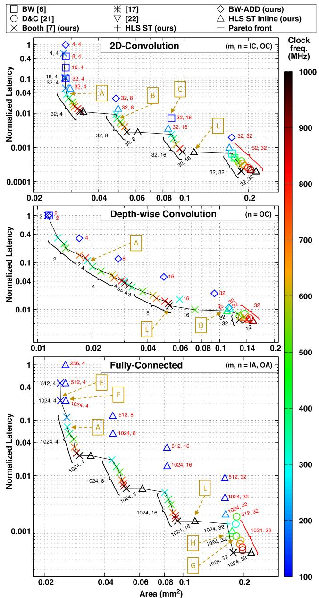
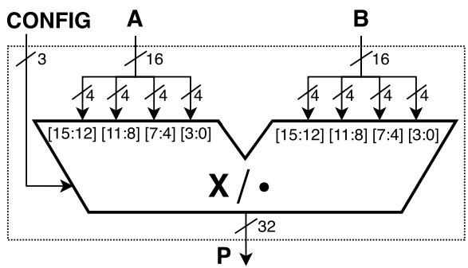
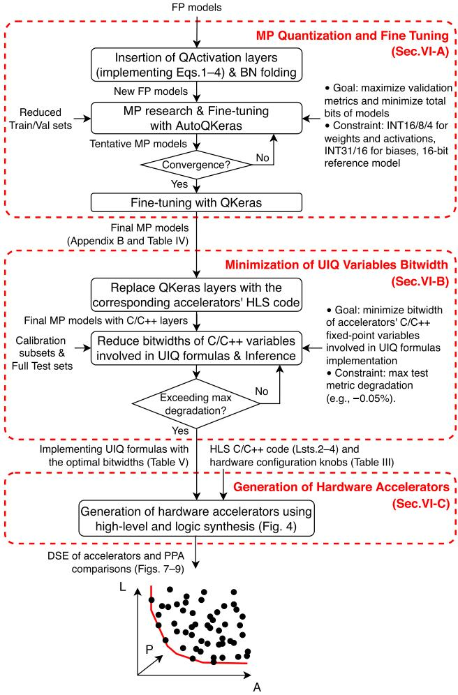
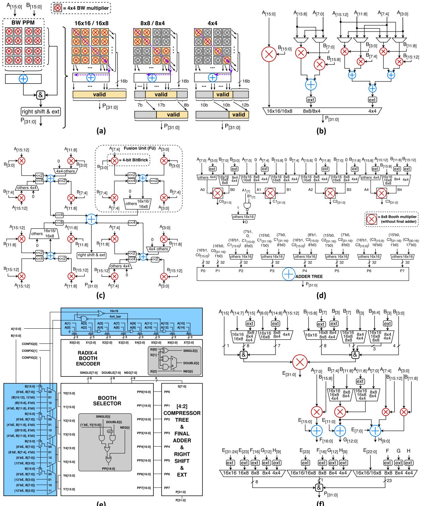
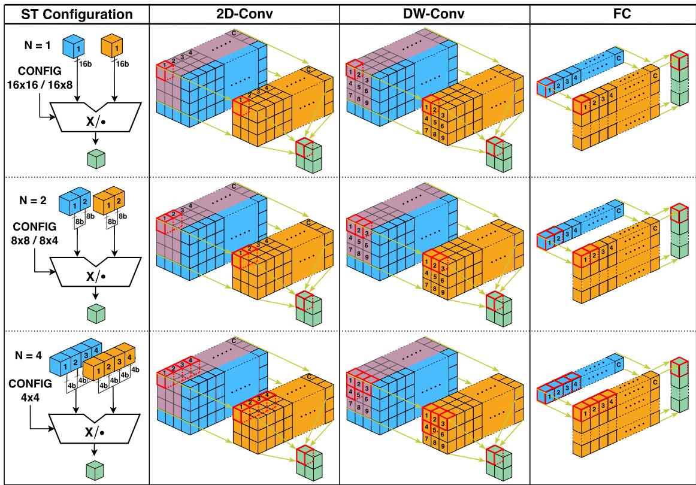
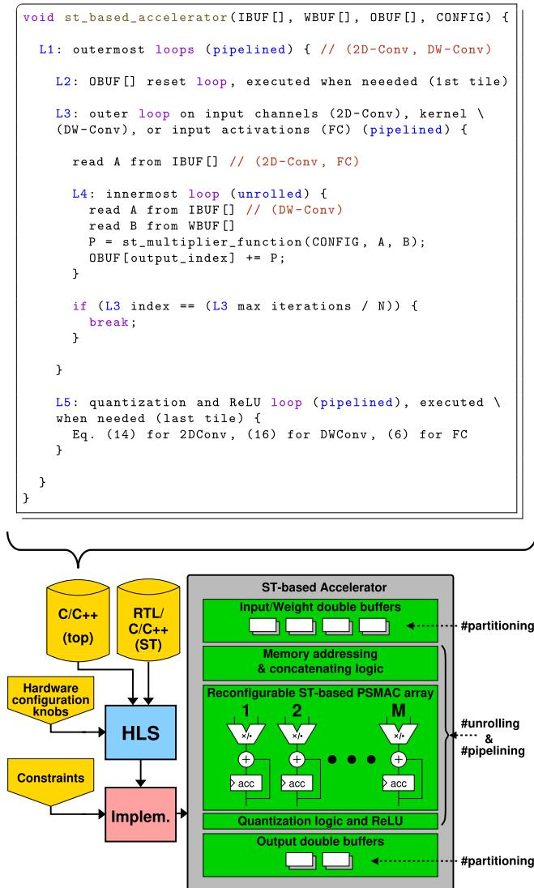
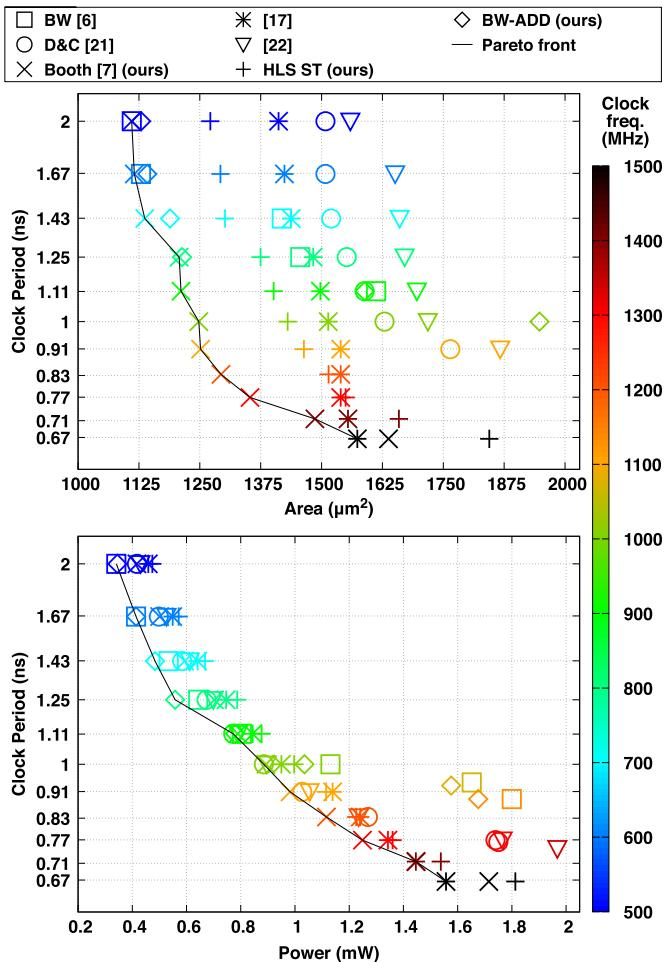
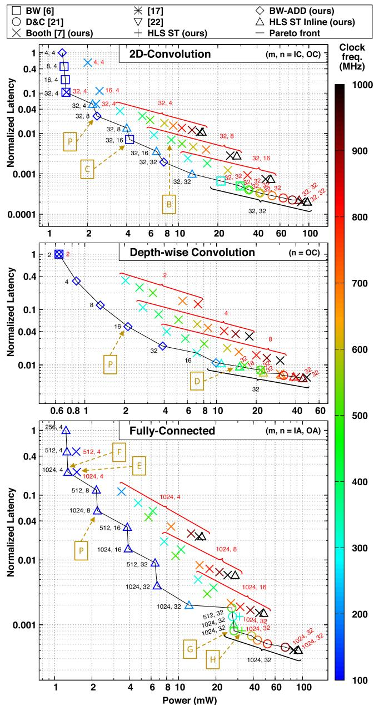
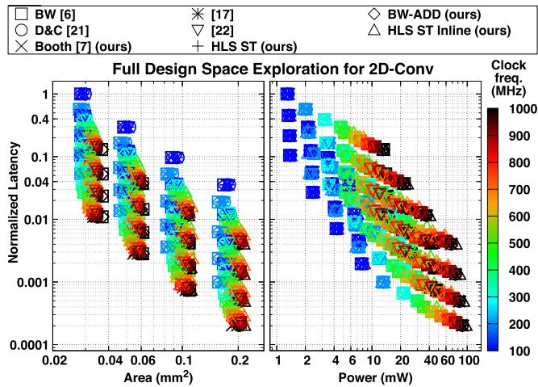

# High-Level Design of Precision-Scalable DNN Accelerators Based on Sum-Together Multipliers 论文解析

## 0. 论文基本信息

**作者 (Authors)**: Luca Urbinati, Mario R. Casu

**发表期刊/会议 (Journal/Conference)**: IEEE Access

**发表年份 (Publication Year)**: 2024

**研究机构 (Affiliations)**: Department of Electronics and Telecommunications, Politecnico di Torino

---

## 1. 摘要

**目的**

- 针对**边缘端深度学习**场景中**混合精度量化 (Mixed-Precision Quantization, MPQ)** 日益增长的需求，研究基于 **Sum-Together (ST) 乘法器**的**精度可扩展 DNN 加速器**的高层次设计方法。
- ST 乘法器是一类 **subword-parallel** 可重构乘法器：全精度时执行单次标准乘法（如 16-bit），低精度时并行执行 N 个低精度操作数的 **dot-product** 并在乘法器内部直接求和，MAC 周期数理论上可缩减至 **C/N**。
- 具体目标包括：丰富 SoA ST 乘法器的 PPA 对比、扩展 ST 加速器架构与设计流程、实现**均匀整数量化 (Uniform Integer Quantization, UIQ)** 硬件支持、开展广泛的 HLS 驱动**设计空间探索 (DSE)**，以及在 SoC 集成场景下验证相对固定精度 16-bit 乘法器加速器的优势。

---

**方法**

- **新增两类 ST 乘法器设计**：
  - **BW-ADD**：改进 Baugh-Wooley 乘法器，将原 Ripple Carry Adder (RCA) 替换为逻辑综合器自动选择的最优最终加法器，缩短关键路径。
  - **HLS ST**：由高层次 C/C++ 描述经 HLS 工具自动生成 RTL，验证 HLS 生成 ST 乘法器与手工 RTL 的竞争力。
- **ST 乘法器 PPA 基准测试**：在 28-nm CMOS、0.9V 工艺下，对 7 种 ST 乘法器（[6]、[7]、[17]、[21]、[22]、BW-ADD、HLS ST）在 0.5–1.5 GHz 时钟范围内进行面积与功耗对比。
- **三类 ST 加速器架构**（2D-Conv、DW-Conv、FC），通过 HLS（Siemens Catapult）从 C/C++ 描述生成 RTL，关键设计要点：
  - 内部 buffer 划分为 4-bit memory bank（IBUF_A/B/C/D、WBUF_A/B/C/D），配合 DMA 与 double buffering 支持不同精度配置下的数据打包。
  - PSMAC 阵列并行度 M 通过 `unroll` 指令实现，memory bank 划分通过 `interleave` 指令实现。
  - UIQ 公式硬件化：将除法转为乘以逆缩放因子，通过 ablation study 最小化定点变量位宽。
- **三步设计流程**：
  - **Step A**：基于定制版 **QKeras + AutoQKeras**（贝叶斯优化）对 **MLPerf Tiny** 四个模型（MobileNetV1Tiny、ResNetV1Tiny、DS-CNN、FC-AutoEncoder）进行 16/8/4-bit MP 量化与微调。
  - **Step B**：迭代缩减 UIQ 公式 C/C++ 变量位宽，设定性能退化阈值 0.5%。
  - **Step C**：HLS 驱动 DSE，扫描硬件配置旋钮（IC/IA、OC/OA、时钟频率 100–1000 MHz、ST 乘法器类型、IP/Inline 模式），经 DC 逻辑综合获取面积、功耗、延迟。
- **SoC 级评估**：在 low-area（<0.03 mm²）、low-power（<3 mW）、low-latency（<0.12 mm²）三种约束场景下，对比 ST 加速器 SoC 与采用标准 16-bit 乘法器的等价 SoC，运行 MP 量化 MLPerf Tiny 推理。

---

**结果**

- **ST 乘法器 PPA 对比**：
  - 无单一全胜者，最优选择取决于 PPA 约束；采用**单一可重构高精度乘法器**的架构（[6]、BW-ADD、[7]）逻辑门利用率高于**各精度专用乘法器互斥**的架构（[17]、[22]、HLS ST）。
  - **Radix-4 Booth [7]** 在 600–1400 MHz 区间面积最优；**BW 类架构** ([6]、BW-ADD) 在 400–800 MHz 功耗最优；高频段 **[17]** 功耗最优。
- **加速器 DSE 结果**：Pareto 前沿上大量解（2D-Conv 75%、DW-Conv 93%、FC 80%）采用 **Booth [7]** 乘法器，与乘法器级基准排名强相关；**HLS ST Inline** 模式的加速器亦出现在 Pareto 前沿（尤其在 Latency vs Power 空间）。
- **MP 量化模型质量**：四个模型相对 FP 版本精度损失约 1–2%，均满足 MLPerf Tiny Quality Target，总比特数相对 16-bit flat 参考减少 52–71%。
- **SoC 级推理对比**（对比标准 16-bit 乘法器加速器）：

| 场景 | 平均延迟加速比 | 平均能耗变化 | SoC 面积开销 |
|---|---|---|---|
| Low-area | **1.46x** | −23.19% | +0.9% |
| Low-power | **1.33x** | −15.87% | +2.5% |
| Low-latency | **1.29x** | +3.10% | +8.0% |

- **DW-Conv 的局限**：实际加速比与理论值差距在 MobileNetV1Tiny 与 DS-CNN 上最显著，因 3×3 kernel 尺寸（K²=9）非 N 的整数倍，最后一次迭代导致 ST 硬件利用率不足；low-latency 场景下 DW-Conv 复杂重配置逻辑复制导致能耗反超标准加速器。
- **位宽优化**（ablation study 关键结果）：累加项 ΣXqWq 为 28.0 位整数，ν3q,k 为 34.6 位定点，ν2q,k 为 33.6 位定点。

---

**结论**

- ST 乘法器适合集成于 **MPQ 支持的 DNN 加速器 MAC 单元**，在低面积与低功耗场景下能以极小的面积开销（<3%）换取 1.3–1.46x 延迟加速与显著能耗降低。
- ST 方案对 **2D-Conv 与 FC 层**收益明确，但对 **DW-Conv 层**存在结构性低效——ST 的“求和”特性与 DW-Conv 无通道维累加的算法不匹配，作者计划采用 **Sum-Apart (SA) 乘法器**重新设计 DW-Conv 加速器以解决该问题。
- HLS 流程被证明可行且具竞争力：HLS 生成的 ST 乘法器（Inline 模式）可进入 Pareto 前沿，整个加速器设计流程（C/C++ → HLS → DC）实现了从量化、位宽优化到硬件生成的自动化 HW-SW co-design。
- 工作为 SoC 设计者提供了依据 PPA 约束（低面积/低功耗/低延迟）选择 ST 乘法器类型与硬件参数的系统性参考，配套开源了定制版 QKeras 工具链。

---

## 2. 背景知识与核心贡献

**研究背景**

- **边缘端深度学习 (DL at the edge)** 场景中，**量化 (Quantization)** 是降低 DNN 内存占用、带宽、能耗并加速推理的成熟手段。
- **混合精度量化 (Mixed-Precision Quantization, MPQ)** 正成为学术界与工业界的研究热点，其利用各 DNN 层对量化敏感度的差异，逐层搜索最优的 activation 与 weight 位宽，实现精度-延迟、精度-能耗的灵活权衡。
- 为支撑 MPQ，近年来涌现出多种 **Precision-Scalable (PS) multipliers**、**MAC units** 与 DNN accelerators。
- 本文聚焦 **Sum-Together (ST)** 类 PS 乘法器：
  - 属于 **subword-parallel multipliers**，可执行全精度标准乘法，或对低精度操作数并行执行 **dot-product**。
  - 全精度时执行 N=1 的 16-bit 乘法；低精度时执行 N=2 (8-bit) 或 N=4 (4-bit) 的并行点积，操作数位宽与 N 成反比 (16/N bits)。
  - “求和”特性使其在乘法器内部即完成部分积累加，相比传统 MAC 单元节省 N−1 次加法。
  - 适用于 2D-Conv、DW-Conv、FC 等 layer-specific 硬件加速器，可提供最高 N 倍的层计算加速。

 *FIGURE 1. Reference ST multiplier, modified from [7]. The 16-bit inputs (A and B) are partitioned in 4-bit chunks to enable multiple operations, as defined by the 3-bit configuration input (CONFIG) and shown in Table 1. The X/· symbol indicates that the multiplier is capable of multiplication and dot-product operations, depending on the configuration.*

**研究动机**

- 现有 ST 乘法器缺乏统一、公平的 **PPA (Power-Performance-Area)** 对比分析。
- 已有 ST-based 加速器缺少对 **uniform integer quantization (UIQ)** 输出量化公式的硬件支持，此前相关工作未见提及。
- 缺少基于 **High-Level Synthesis (HLS)** 的 ST 加速器系统性 **design space exploration (DSE)**，尤其是将“ST 乘法器类型”作为探索维度的方案。
- ST 加速器集成到 **System-on-Chip (SoC)** 后，在完整 MP 量化 DNN 推理上的延迟、能耗、面积收益缺乏端到端评估。

**核心贡献**

- **新增两种 ST 乘法器设计**：
  - **BW-ADD**：改进的 Baugh-Wooley 乘法器，用优化 final adder 替代原 Ripple Carry Adder (RCA)，缩短关键路径，改善高频下的面积。
  - **HLS ST**：由 HLS 工具从 C/C++ 高层描述自动生成的 ST 乘法器，用于评估 HLS 相比手工 RTL 的竞争力。
- **扩展并系统化 ST-based 加速器架构与设计流程**：
  - 针对 **2D-Convolution**、**Depth-wise Convolution (DW-Conv)**、**Fully-Connected (FC)** 三类层，详细阐述 HLS 驱动的从 C/C++ 到 RTL 的完整设计流程。
- **硬件化 UIQ 公式**：
  - 将均匀整数量化方程 (含 ReLU layer fusion、BN folding) 实现于硬件，用于输出 activation 量化。
  - 通过 ablation study 最小化 UIQ 公式中 C/C++ 定点变量的位宽。
- **大规模 HLS 驱动的 DSE**：
  - 探索维度包括 PSMAC array 并行度、时钟频率 (100–1000 MHz)、内部 buffer partitioning、unroll/pipeline 指令，以及 ST 乘法器类型 (7 种 RTL IP 或 Inline 模式)。
- **SoC 级端到端评估**：
  - 将加速器集成到 SoC，在 **low-area、low-power、low-latency** 三种约束场景下，运行 MP 量化的 **MLPerf Tiny** 四个模型作为案例研究。

 *FIGURE 5. Accelerators design flow.*

**关键实验结果**

| 评估场景 | 平均延迟加速比 | 平均能耗变化 | SoC 面积开销 |
|---|---|---|---|
| Low-area (< 0.03 mm²) | **1.46x** | 多数情况降低 (均值 −23.19%) | **+0.9%** |
| Low-power (< 3 mW) | **1.33x** | 多数情况降低 (均值 −15.87%) | **+2.5%** |
| Low-latency (< 0.12 mm²) | **1.29x** | 部分情况能耗上升 (均值 +3.10%) | **+8.0%** |

- ST 乘法器层面结论：
  - 采用单一可重配置高精度乘法器的设计 (如 [6]、BW-ADD、[7]) 比为每种精度配置配备专用乘法器的设计 (如 [17]、[22]、HLS ST) **面积效率更高**。
  - 不存在全场景最优解：**[7] (radix-4 Booth)** 在多数频率下 area 表现最佳；**[6] 与 BW-ADD** 在低频下功耗最优；**[7] 与 [17]** 在高频下 area/power 兼优。
- 加速器层面结论：
  - Pareto 前沿上大量最优解 (2D-Conv 75%、DW-Conv 93%、FC 80%) 采用 [7] Booth ST 乘法器。
  - HLS 生成 (HLS ST / HLS ST Inline) 的乘法器也能进入 Pareto 前沿，证明 HLS 流程具备实用竞争力。
- 局限性发现：
  - ST 乘法器适合 **2D-Conv 与 FC**，但在 **DW-Conv** 上因 kernel 尺寸 (如 3×3) 非 N 的整数倍导致硬件利用率不足，理论加速比与实际差距明显；作者提出未来采用 **Sum-Apart (SA)** 乘法器的新方案予以解决。

---

## 3. 核心技术和实现细节

### 0. 技术架构概览

本文构建了一个从**底层可重构乘法器**到**顶层 SoC 集成**的完整技术栈，核心目标是利用 **Sum-Together (ST) 类 Precision-Scalable (PS) 乘法器**支撑 Mixed-Precision Quantization (MPQ) 在边缘端的 DNN 推理加速。整体架构可自底向上分为四个层次。

---

**一、底层：ST 乘法器 IP 层**

ST 乘法器是一种 **subword-parallel 可重构乘法器**，通过 3-bit 的 **CONFIG** 信号切换工作模式：全精度时执行 1 次 16-bit 标准乘法，低精度时在乘法器内部直接完成 2 或 4 路低精度操作数的 **dot-product**（省去外部 N−1 次 MAC 加法）。

 *FIGURE 1. Reference ST multiplier, modified from [7]. The 16-bit inputs (A and B) are partitioned in 4-bit chunks to enable multiple operations, as defined by the 3-bit configuration input (CONFIG) and shown in Table 1. The X/· symbol indicates that the multiplier is capable of multiplication and dot-product operations, depending on the configuration.*

支持的精度配置如下：

| CONFIG | 输出行为 |
|---|---|
| 16×16 | 1 次 16-bit 标准乘法 |
| 16×8 | 1 次非对称 16×8 乘法 |
| 8×8 | 2 路 8-bit 乘法求和（dot-product） |
| 8×4 | 2 路 8×4 非对称 dot-product |
| 4×4 | 4 路 4-bit dot-product |

本文比较了多种 SoA ST 乘法器（BW [6]、RI5CY [17]、D&C [21]、可重构定点乘法器 [22]、radix-4 Booth [7]），并提出两个新设计：

- **BW-ADD**：改进 Baugh-Wooley 结构，将原始 RCA 终端加法器替换为由逻辑综合器自动选择的最优加法器，缩短高频下的关键路径；
- **HLS ST**：直接从 C/C++ 高层描述经 HLS 工具自动生成 RTL，包含 1 个 16-bit、2 个 8-bit、2 个 4-bit 乘法器及加法器/多路选择器网络，用于评估 HLS 生成乘法器与手工 RTL 的 PPA 竞争力。

 *(e) FIGURE 2. (a) Our version of BW ST [6]: architecture overview (left), PPM reconfiguration (right). (b) Our version of ST multiplier [17]: 16-bit high-precision multiplier (left), 8-bit and 4-bit low-precision dot-product units (middle, right). (c) Our version of D&C ST [21]: four FUs with four 4-bit BitBricks each, interconnected by shift-and-add logics. (d) Our version of ST multiplier [22]: four 8-bit Booth multipliers interconnected by muxes ending with an adder tree. (e) Radix-4 Booth ST (as in [7]): reconfiguration logic (blue), 16-bit Booth multiplier (white and gray). (f) HLS ST derived from HLS (proposed in this paper): four multipliers and three adders interconnected by a network of muxes and concatenations.*

---

**二、中层：三种层专用 ST 加速器**

针对 DNN 三类核心层分别设计了 **2D-Conv、DW-Conv、FC** 加速器，其工作原理差异在于低精度数据打包方式：

 *FIGURE 3. Working principle of our ST-based DNN accelerators: 2D-Convolution (2D-Conv), Depth-wise Convolution (DW-Conv) and Fully-Connected (FC).*

- **2D-Conv**：ST 乘法器沿**输入通道维**打包 N 对激活/权重，MAC 周期数按 C/N 缩放，延迟按 1/N 缩放；
- **DW-Conv**：因无通道维累加，改为沿**感受野（kernel）维**累加部分积；由于 K² 通常不是 N 的倍数，需 ⌈K²/N⌉ 次迭代且最后一轮补零，造成利用率损失（3×3 kernel 时尤为明显）；
- **FC**：对输入激活向量与权重矩阵行做 dot-product，每个 MAC 单元（受 [6] 启发）内含**两个 ST 乘法器**并行处理两对激活/权重，MAC 周期同样按 C/N 缩放。

三者共享统一的硬件架构，由四大模块构成：

 *FIGURE 4. General architecture of the ST-based accelerators (bottom right), HLS flow (bottom left), and pseudo-code of the high-level C/C++ description (top) that produces the general architecture.*

- **内部缓冲区**：IBUF/WBUF 组织为四个 4-bit bank（A/B/C/D），支持按 CONFIG 灵活打包低精度数据；OBUF 为 28-bit bank 匹配累加器位宽；均采用 **double buffering** 保证不间断运行；DW-Conv 的部分 bank 需多读端口，采用 latch-based memory 实现；
- **内存寻址与拼接逻辑**：生成正确的 bank 访问地址，并通过 shift-and-mask 操作将 4-bit 数据块拼装为 ST 乘法器的 16-bit 输入；DW-Conv 额外使用离线预计算的 LUT 索引；
- **可重构 ST-based PSMAC 阵列**：M 个并行 MAC 单元（M = OC 或 OA，由 HLS `unroll` 指令展开内层循环实现），配合 `interleave` 指令对缓冲区分 bank，实现并行无冲突访问；
- **量化与 ReLU 模块**：在硬件中实现 **Uniform Integer Quantization (UIQ)** 公式（整数-only 推理，含零点、scale 及 clip/round），并支持 **Layer Fusion**（UIQ + ReLU），采用 output-stationary 数据流避免中间数据回写外部存储。

---

**三、设计流程层：HLS 驱动的 HW-SW 协同设计**

 *FIGURE 5. Accelerators design flow.*

设计流程为三步：

- **MP 量化与微调**：基于改造版 **QKeras**（新增 QActivation 层实现 affine UIQ）+ **AutoQKeras**（贝叶斯优化逐层搜索 16/8/4-bit 混合精度），对 MLPerf Tiny 四模型量化并微调，平均精度损失约 1%；
- **UIQ 变量位宽最小化**：通过 ablation study 迭代缩减 C/C++ 定点变量（含中间变量 v1/v2/v3）的整数/小数位宽，以 0.5% 精度退化阈值为界，确定硬件最优位宽（如累加项 28.0、v3 为 34.6 等）；
- **硬件生成**：Siemens **Catapult HLS** 综合高层 C/C++ 描述生成 RTL，ST 乘法器可选 **IP mode**（`map_to_operator` 映射 7 种 RTL 乘法器之一）或 **Inline mode**（内联综合）；随后由 Synopsys Design Compiler 完成 28-nm 逻辑综合；**DSE 探索维度**包括 IC/IA、OC/OA、时钟频率（100–1000 MHz）、HLS 指令及 ST 乘法器类型。

---

**四、顶层：SoC 集成场景**

- 假设的 SoC 由**嵌入式处理器（Zero-Riscy）+ 全局 SRAM buffer + DMA + 三种加速器**构成；处理器负责层调度、池化层计算及 CONFIG 精度配置，DMA 通过双缓冲实现 tile 传输与计算的流水重叠；
- 加速器以 **tensor tiling** 方式处理全局 buffer 中的 tile（2D-Conv tile 尺寸 18×18，DW-Conv 22×22，kernel 最大 7×7/5×5）；
- 针对三种 PPA 约束场景（**low-area < 0.03 mm²、low-power < 3 mW、low-latency < 0.12 mm²**）从 Pareto 前沿选取加速器组合，在四个 MP 量化 MLPerf Tiny 模型上实测：平均延迟加速 **1.46x / 1.33x / 1.29x**，面积开销仅 **0.9% / 2.5% / 8.0%**，能耗在多数情况下降低（low-latency 场景因 DW-Conv 重配置逻辑复制可能出现能耗反超）。

---

**总体评价**

该架构的核心思想是以**单一可重构乘法器**复用硬件资源换取精度弹性：单高精度乘法器以 subword-parallel 方式工作（如 [6]、[7]）比每精度配置一套独立乘法器（如 [17]、[22]、HLS ST）面积效率更高；DSE 结果表明不存在单一赢家，而是依 PPA 约束形成 **Pareto 解集**，且乘法器层面的优劣排名在加速器层面基本保持一致。体系的主要已知短板是 **DW-Conv 加速器**（kernel 尺寸非 N 倍数导致的利用率损失与重配置开销），作者计划以 **Sum-Apart (SA) 乘法器**的新型加速器加以解决。

### 1. 两种新型Sum-Together乘法器设计（BW-ADD与HLS ST）及SoA ST乘法器PPA基准对比

**核心定位**

- 本文在 Sum-Together (ST) 类 precision-scalable (PS) 乘法器领域做出两项硬件创新：**BW-ADD**（改进型 Baugh-Wooley 乘法器，替换最终加法器）与 **HLS ST**（由 High-Level Synthesis 从 C/C++ 描述自动生成的 ST 乘法器），并对五种 SoA ST 乘法器与两项新设计进行了统一的 PPA (Power-Performance-Area) 基准对比。
- 该对比是全文加速器设计空间探索 (DSE) 的基础：乘法器层面的 Pareto 排名在加速器层面得到强相关印证（2D-Conv/DW-Conv/FC 加速器的 Pareto 前沿上分别有 75%/93%/80% 的点采用文献 [7] 的 Booth ST）。

---

**一、统一接口：参考 ST 乘法器**

所有被对比的 ST 乘法器均被重实现为相同的 I/O 行为规范，以保证公平比较：

 *FIGURE 1. Reference ST multiplier, modified from [7]. The 16-bit inputs (A and B) are partitioned in 4-bit chunks to enable multiple operations, as defined by the 3-bit configuration input (CONFIG) and shown in Table 1. The X/· symbol indicates that the multiplier is capable of multiplication and dot-product operations, depending on the configuration.*

- **输入**：两个 16-bit 有符号操作数 A、B（低精度操作数打包在内），以及 3-bit 的 CONFIG 配置信号。
- **输出**：32-bit 结果 P；低精度配置下仅部分位有效，需右移至 LSB 位置并符号扩展至 32-bit。
- **五种精度配置**：

| CONFIG | 输出表达式 | 说明 |
|---|---|---|
| 16×16 (000b) | P[31:0] = A[15:0] × B[15:0] | 全精度标准乘法，N=1 |
| 16×8 (100b) | P[31:0] = A[15:0] × B[7:0] | 非对称配置 |
| 8×8 (010b) | P[16:0] = A[15:8]×B[7:0] + A[7:0]×B[15:8] | 双路 dot-product，N=2 |
| 8×4 (011b) | P[16:0] = A[15:8]×B[3:0] + A[7:0]×B[11:8] | 非对称 dot-product |
| 4×4 (001b) | P[9:0] = 四组 4-bit 交叉乘积之和 | 四路 dot-product，N=4 |

- **精度选择依据**：16-bit 用于安全关键场景（如自动驾驶雾天图像分割）；8-bit 是避免精度退化的默认选择；4-bit 是模型压缩与性能的可行折中；低于 4-bit 的 extreme low-bit 量化仍存在严重精度损失，故不纳入。
- **非对称配置 (16×8, 8×4) 的动机**：允许低精度操作数（如 weights）高效打包，而不牺牲另一侧操作数（如 activations）的精度，从而降低 ML 模型内存占用。

---

**二、SoA ST 乘法器架构剖析与重实现修正**

 *(e) FIGURE 2. (a) Our version of BW ST [6]: architecture overview (left), PPM reconfiguration (right). (b) Our version of ST multiplier [17]: 16-bit high-precision multiplier (left), 8-bit and 4-bit low-precision dot-product units (middle, right). (c) Our version of D&C ST [21]: four FUs with four 4-bit BitBricks each, interconnected by shift-and-add logics. (d) Our version of ST multiplier [22]: four 8-bit Booth multipliers interconnected by muxes ending with an adder tree. (e) Radix-4 Booth ST (as in [7]): reconfiguration logic (blue), 16-bit Booth multiplier (white and gray). (f) HLS ST derived from HLS (proposed in this paper): four multipliers and three adders interconnected by a network of muxes and concatenations.*

*文献 [6]：subword-parallel Baugh-Wooley (BW)*

- **架构**：可重构 partial product matrix (PPM) + 最终 Ripple Carry Adder (RCA)；PPM 主构建块为 4×4 BW 乘法器。
- **重构机制**：16×16 与 16×8 模式下全部 partial products 参与运算；低精度模式下仅 PPM 左-右对角线上的部分积保持有效，等价于两个 8×8 或四个 4×4 BW 乘法器并行，其余 partial products 经 AND 门门控 (gated) 产生无效输出位。
- **重实现修正**：移除原版 2-bit 支持以对齐 4–16 bit 精度范围；低精度输出经 right shift & ext 模块对齐至 LSB 并符号扩展至 32-bit。

*文献 [17]：RI5CY SIMD 乘法单元*

- **原架构**：32-bit 整数乘法器 + 32-bit 定点乘法器 + 两个 dot-product 单元（两路 17-bit 或四路 9-bit 乘法器 + compression tree）。
- **重实现策略**：将高精度定点乘法器与两个低精度 dot-product 单元实现为**三条互斥数据通路**，精度缩放至 16/8/4-bit；采用 **behavioral RTL 描述**，赋予逻辑综合器最大优化自由度。
- **综合器启发式效应**：时序约束宽松时综合器过早停止优化；约束收紧时逐步发现更 area-efficient 的解——这解释了 [17] 仅在 1500 MHz 处成为面积 Pareto 点的现象。

*文献 [21]：D&C (divide-and-conquer) 内积处理器*

- **架构**：四个 Fusion Unit，每个含四个 4-bit **BitBrick**，经 shift-and-add 逻辑互联。
- **重实现选型理由**：相比 [12]/[19]/[20] 等在低精度下存在 **memory bandwidth 爆炸**问题的 D&C 架构，[21] 保持固定输入位宽，确保不同配置下带宽恒定，实现公平比较。
- 同样加入输出 right shift & ext 对齐逻辑。

*文献 [22]：可重构定点乘法器*

- **原架构**：四个 16-bit Booth 乘法器（无最终加法器）+ 可配置部分积压缩阵列 + 三个可配置 33-bit 加法器，支持饱和、减法等 DSP 特性。
- **重实现修正**：剥离饱和与减法逻辑；重排 dot-product 操作数映射（如 8×8 配置下将 A[15:8]×B[15:8] 交叉为 A[15:8]×B[7:0]），以匹配参考 ST 规范；精度范围缩至 16–4 bit。
- **重实现结果**：四个 8-bit Booth 乘法器经多路复用器网络连接至 adder tree。

*文献 [7]：radix-4 Booth ST（作者前期工作）*

- **架构**：两输入操作数之间的**轻量级重构逻辑**（图中蓝色部分）+ 标准 16-bit Booth 乘法器。
- **乘法器内部**：Wallace reduction tree（采用 4:2 compressor）+ 带 Prefix Network 的 Carry Propagate Adder。
- 采用 structural RTL 描述，原生支持全部五种配置，无需额外修正。

*公共修正：sign-extension 逻辑*

- 对 [6]、[17]、[21] 这三种原生不支持 16×8 与 8×4 非对称配置的设计，统一在乘法前对低精度操作数 B 进行符号扩展（至 16 或 8-bit），确保所有配置下输入并行度被完全利用，避免 zero-padding。
- 所有 SoA ST 乘法器均实现为 signed 乘法器。

---

**三、BW-ADD：改进最终加法器的 Baugh-Wooley ST**

**设计动机**

- 前期工作 [7][8] 的观察：BW ST [6] 在 **< 600 MHz** 时特别 area-efficient，但更高频率下出现显著面积恶化。

**瓶颈定位**

- BW 阵列的长对角线关键路径 + 最终 16-bit **RCA 的进位链**（Fig. 2(a) 中紫色虚线标注）构成双重关键路径；为满足严格时序约束，逻辑综合器被迫推断大规模逻辑门，导致面积膨胀。

**解决方案**

- 不再强制使用 RCA，而是**让逻辑综合器自主选择满足时序约束且面积最小的最终加法器实现**（如 prefix adder 类结构）。

**预期效果与实测验证**

- 低频段：面积基本不变（原 RCA 在宽松时序下本就足够）。
- 高频段：面积显著降低——实测 BW-ADD 在 **700–800 MHz (1.43–1.25 ns)** 区间位列面积第二优，比原始 BW [6] 更贴近 Pareto front。
- **根本局限**：即便换用更快加法器，BW PPM 固有的长关键路径仍使其不适合更高频率，这一结论被 PPA 曲线证实。

---

**四、HLS ST：由 HLS 自动生成的 ST 乘法器**

**设计动机**

- 验证 HLS 工具能否从高层 C/C++ 描述生成 PPA 竞争力接近手工 RTL 的 ST 乘法器，同时服务于加速器流程中 **Inline mode**（乘法器随加速器整体综合）这一新探索的 DSE 旋钮。

**源码实现**

- 使用 Siemens Catapult 的 C++ 库 **ac_int.h**，通过 `slc<n>(offset)` 方法提取整型位域（如 `A.slc<4>(12)` 取 A 的 bit 15→12 共 4-bit）。
- 代码结构为基于 CONFIG 的多分支 switch：各分支分别展开 16×16、8×8、8×4、4×4 的乘法/点积表达式，全精度分支退化为 `P = A*B`。

**生成的 RTL 结构**

- 由 HLS 工具自动推断，包含：
  - **一个 16-bit、两个 8-bit、两个 4-bit 乘法器**；
  - **三个加法器**（位宽分别为 8/12/16-bit）；
  - 一个由 mux 与拼接块 (&) 组成的网络，负责解包 16-bit 输入、分发至各乘法器、并将低精度结果合并为最终 32-bit 输出。
- 低精度配置的结果**已自动对齐至最右侧 LSB 位置**，无需额外移位逻辑。

**结构性代价**

- 属于"为每种精度配置配备专用乘法器"的架构类别，不同模式的内部乘法器**互斥工作**、逻辑门无法跨模式共享，导致面积效率低于单一可重构高精度乘法器方案。

---

**五、PPA 基准测试方法**

- **工艺与工具**：28-nm CMOS、0.9 V 供电，Synopsys Design Compiler 综合，综合前添加 I/O 寄存器。
- **扫描范围**：目标时钟频率 0.5–1.5 GHz，十个步进点。
- **功耗激励**：随机输入位（0/1 均匀分布）；虽不完全代表真实 ML 工作负载，但可支撑有效的横向对比。
- **Pareto 判定**：给定目标时钟周期下面积或功率最低的解为 Pareto-optimal 点，实线连接构成 Pareto front；图中剔除最右侧离群点以避免压缩主要解的显示。

---

**六、PPA 对比结果**

**面积 vs 时钟周期**

- **Booth ST [7]**：与 [6] 在 500 MHz (2 ns) 并列最优；从 **600 MHz 到 1400 MHz (1.67–0.71 ns)** 全面领先，得益于相对标准 Booth 乘法器极低的重构开销。
- **BW-ADD（本文新设计）**：低频段表现优异，**700–800 MHz 区间位列第二**，验证了改进最终加法器策略的有效性。
- **[17]**：仅在 1500 MHz (0.67 ns) 成为面积 Pareto 点，原因是 behavioral 描述下综合器启发式仅在紧约束下持续深挖优化。
- **专用乘法器类设计 ([17]、[22]、HLS ST)**：面积低效——内部乘法器按模式互斥工作，冗余逻辑门无法共享。
- **单一高精度乘法器以 subword-parallel 方式工作 ([6]、BW-ADD、[7])**：逻辑门利用率高，时序不苛刻时面积优势明显。
- **D&C [21]**：面积倒数第二，主要受 shift-and-add 互联逻辑拖累。

**功率 vs 时钟周期**

- 各设计整体贴近，分层结论如下：
  - **400–800 MHz**：BW 架构类 ([6]、BW-ADD) 功率最优；
  - **1000–1300 MHz**：Booth ST [7] 逐步压制 [21] 与 [22]；
  - **最高频段**：[17] 功率效率最佳。

**结论汇总表**

| 频段/维度 | 最优 ST 乘法器 | 依据 |
|---|---|---|
| 面积 @ 500 MHz | [6] 与 [7] 并列 | BW 阵列低频面积效率 + Booth 低重构开销 |
| 面积 @ 600–1400 MHz | Booth [7] | 轻量重构逻辑 + Wallace tree + prefix adder |
| 面积 @ 700–800 MHz 第二名 | **BW-ADD（本文）** | 可自由选型的最终加法器缩短关键路径 |
| 功率 @ 400–800 MHz | [6]、BW-ADD | BW 架构低频功耗特性 |
| 功率 @ 1000–1300 MHz | Booth [7] | 高频重构开销低 |
| 功率 @ 最高频 | [17] | behavioral 描述下综合器深度优化 |

- **核心洞见**：不存在满足所有 PPA 场景的唯一赢家，而是**一组取决于具体 PPA 约束的 optimal ST 乘法器集合**；架构上，采用单一可重构乘法器（subword-parallel）的设计在面积上系统优于多专用乘法器方案。

---

**七、乘法器 PPA 排名向加速器层面的映射**

- 尽管 HLS ST、[21]、[22] 等在乘法器层面表现次优，作者仍将其全部纳入加速器 DSE，以验证排名的一致性：

- **LA (Latency vs Area) 空间的强相关**：Pareto 前沿上 75%（2D-Conv）、93%（DW-Conv）、80%（FC）的加速器点采用 Booth ST [7]；其余少数点基于 BW-ADD 与 HLS ST（二者在乘法器层面贴近 Pareto front）。
- **反向验证**：在乘法器层面严重次优的 [17]、[21]、[22] 在 Fig. 7 中**没有任何 Pareto-optimal 加速器**采用。
- **LP (Latency vs Power) 空间的异质性**：由于各乘法器功率曲线彼此接近，功率最优加速器的 ST 类型分布更分散，IP 选择依赖设计者的实际 PPA 约束。
- **HLS 价值印证**：存在采用 HLS ST（LA 空间）与 **HLS ST Inline**（LP 空间大量出现）的 Pareto 加速器，证明手工 RTL 并非总是最优选择——综合器优化启发式偶尔能在 HLS 生成的结构上取得更优结果。
- **集成方式**：加速器流程中 ST 乘法器可通过 Catapult 的 **map_to_operator** 指令以 CCORE IP 形式例化（提升设计规整性、共享 mux 逻辑），或以 Inline 模式与加速器整体综合（允许算子跨边界共享）——两种模式均在 DSE 中探索。

---

**八、局限与延伸**

- **DW-Conv 天然失配**：ST 的"求和"特性适配 2D-Conv/FC 的通道维累加，但 DW-Conv 沿 kernel 维累加时 K² 非 N 的倍数导致末次迭代硬件欠利用——这构成 ST 架构的固有低效，作者计划以 **Sum-Apart (SA)** 乘法器重构 DW-Conv 加速器。
- **功耗评估局限**：随机输入激励与真实 ML 张量分布存在偏差，对比结论的绝对值需谨慎解读。
- **未来自动化方向**：UIQ 变量位宽目前由 ablation study 手工确定，计划通过 hardware-aware training 实现自动搜索。

### 2. 支持硬件UIQ与ReLU层融合的ST可扩展精度DNN加速器架构（2D-Conv/DW-Conv/FC）

**核心定位**

本文提出的 **ST (Sum-Together) 可扩展精度 DNN 加速器架构**，是一套覆盖 **2D-Conv、DW-Conv、FC** 三类层专用硬件的统一加速器框架。其核心创新点在于：在先前仅支持 MAC 计算的 ST 加速器基础上，首次引入 **UIQ (Uniform Integer Quantization) 硬件支持**，并实现 **UIQ 公式与 ReLU 激活函数的层融合 (Layer Fusion)**，使量化后的输出激活可直接在片上完成 requantize 操作，避免数据在片外反复搬运。

---

**一、ST 乘法器与加速器工作原理**

**1. ST 乘法器的基本机制**

- ST 乘法器属于 **subword-parallel（子字并行）可重配置乘法器**，通过 3-bit 的 **CONFIG** 信号选择工作模式。
- 在全精度模式下执行 **N=1** 的标准乘法（如 16×16）；在低精度模式下，将打包在 16-bit 输入 A/B 中的低精度操作数并行处理，并在乘法器**内部**完成点积求和（无需外部加法器）。
- 操作数位宽与并行度 N 成反比（**16/N bits**），例如 4-bit 操作数对应 N=4。

| CONFIG 配置 | 输出表达式 | 并行度 N |
|---|---|---|
| 16×16 (000b) | P[31:0] = A[15:0] × B[15:0] | 1 |
| 16×8 (100b) | P[31:0] = A[15:0] × B[7:0] | 1 |
| 8×8 (010b) | P[16:0] = A[15:8]×B[7:0] + A[7:0]×B[15:8] | 2 |
| 8×4 (011b) | P[16:0] = A[15:8]×B[3:0] + A[7:0]×B[11:8] | 2 |
| 4×4 (001b) | P[9:0] = 四个 4-bit 分量乘积之和 | 4 |

 *FIGURE 1. Reference ST multiplier, modified from [7]. The 16-bit inputs (A and B) are partitioned in 4-bit chunks to enable multiple operations, as defined by the 3-bit configuration input (CONFIG) and shown in Table 1. The X/· symbol indicates that the multiplier is capable of multiplication and dot-product operations, depending on the configuration.*

- **不对称配置（16×8、8×4）** 的意义：允许低精度操作数（如权重）打包进 16-bit 输入，而不牺牲另一侧操作数（如激活）的精度，从而**减少 ML 模型内存占用**，与 TFLite Micro 等商用框架的做法一致。

**2. 三类层加速器的差异化工作原理**

 *FIGURE 3. Working principle of our ST-based DNN accelerators: 2D-Convolution (2D-Conv), Depth-wise Convolution (DW-Conv) and Fully-Connected (FC).*

- **2D-Conv 加速器**：
  - 利用 ST 乘法器沿**输入通道维度**打包数据：N=2 时每次送入 2 个通道的激活/权重对，N=4 时送入 4 对。
  - MAC 周期数按 **C/N** 缩放，理想延迟按 **1/N** 缩放。
- **DW-Conv 加速器**：
  - 沿**感受野（receptive field）内的输入/权重对**进行累加，而非通道维度。
  - 由于累加次数为核尺寸平方 **K²**，不一定是 N 的倍数（如 3×3 核 = 9 次），最后一次迭代需补零，导致 **ST 硬件利用率不足**。MAC 周期为 **⌈K²/N⌉**，实际加速比 **⌈K²/N⌉/K²** 大于理想值 1/N，且随 K 增大而改善。
- **FC 加速器**：
  - 对输入激活数组与权重矩阵行做点积，与 2D-Conv 类似沿输入激活维度打包。
  - MAC 周期数与延迟同样按 **C/N** 与 **1/N** 缩放。每个 MAC 单元包含**两个 ST 乘法器**并行处理两对激活/权重，进一步提升吞吐。

---

**二、加速器整体架构**

**1. 架构四大组成模块**

 *FIGURE 4. General architecture of the ST-based accelerators (bottom right), HLS flow (bottom left), and pseudo-code of the high-level C/C++ description (top) that produces the general architecture.*

- **内部缓冲区**：
  - IBUF（输入）、WBUF（权重）、OBUF（输出）三级内部 buffer，均采用**双缓冲 (double buffering)**，确保 DMA 预取下一 tile 数据时加速器不间断运行。
  - IBUF/WBUF 组织为 **4-bit 分 bank（IBUF_A/B/C/D、WBUF_A/B/C/D）**，以匹配 ST 乘法器的数据打包访问模式；OBUF 为 **28-bit bank**，对应 PSMAC 阵列累加器位宽。
  - DW-Conv 场景下 IBUF_A/WBUF_D 需 4 个读端口，采用 **latch-based memory** 实现（SRAM 多端口在 ASIC 工艺下代价过高）。
- **内存寻址与拼接逻辑**：
  - 负责生成 IBUF/WBUF 的访问地址，并通过 **shift-and-mask 操作**将 4-bit 数据块拼装成 ST 乘法器的 16-bit 输入操作数。
  - DW-Conv 需额外一对 **LUT**（基于 CONFIG 和核内循环计数 k 索引），预计算离线索引；最后一次核迭代需将缺失低精度操作数的 2 或 3 个 4-bit chunk 填零。
- **可重配置 ST-based PSMAC 阵列**：
  - 包含 **M 个 MAC 单元**，M = OC（2D/DW-Conv）或 OA（FC），由 HLS `unroll` 指令全展开内层循环生成。
  - 通过 `interleave` 指令将内部 buffer 划分为 M 个 bank，保证 M 个 PSMAC 单元**并行无冲突访问**各自通道/激活数据。
  - 每单元构成：2D/DW-Conv 为 1 个 16-bit ST 乘法器 + 1 个 28-bit 加法器 + 1 个 28-bit 累加寄存器；FC 为 2 个 ST 乘法器 + 2 个 28-bit 加法器 + 1 个累加寄存器（对应 Lst. 4 中 P1_plus_P2 结构）。
- **量化与 ReLU 块**：
  - 硬件实现 UIQ 公式（FC 用 Eq. 6，2D-Conv 用 Eq. 14，DW-Conv 用 Eq. 16），并在最后输出 tile 时执行 requantize。
  - 实现与 ReLU 的层融合，当配置需要时在硬件中直接完成激活。

**2. 关键参数规格**

| 参数 | 2D-Conv | DW-Conv | FC |
|---|---|---|---|
| 输入 tile 高/宽 (IH/IW) | 18 | 22 | — |
| 权重 tile 高/宽 (KH/KW) | 7 | 5 | — |
| 输出 tile 高/宽 (OH/OW) | 18 | 22 | — |
| IC / IA 探索值 | {4, 8, 16, 32} | — | {256, 512, 1024} |
| OC / OA 探索值 | {4, 8, 16, 32} | {2, 4, 8, 16, 32} | {8, 16, 32} |
| PSMAC 并行度 M | OC | OC | OA |
| 目标频率 | 100–1000 MHz（10 步） | 同左 | 同左 |

---

**三、UIQ 与 ReLU 层融合的实现机制**

**1. UIQ 数学基础**

- UIQ 将实数 x ∈ [α, β] 映射到 b-bit 整数域 [αq, βq]，量化公式：**xq = clip(round(x/s + z), αq, βq)**，其中 s 为 scaling factor，z 为 zero-point。
- 反量化：**x̂ = s·(xq − z)**。当 z=0 且范围对称时退化为 **scale/symmetric 量化**；s 为 per-layer 标量或 per-channel 向量（本文支持激活 per-layer、权重 per-layer/per-channel）。

**2. 整数-only 核的推导（以 FC 为例）**

- 将反量化式代入 FC 表达式 **Yk = bk + Σ Xc·Wc,k**，整理得量化后的 FC 核（Eq. 6），其中：
  - **项**：离线常量，可预计算。
  - **项**：整数点积，即 MAC 阵列累加的结果，对应 OBUF 中累积的值。
  - **项**：在线开销项，依赖运行时才已知的 Xq，必须在线计算。
  - 本文采用**权重 scale 量化 + 激活 affine 量化**的常见假设（zW = 0, zb = 0），使项 简化并消除项。
- 2D-Conv（Eq. 14）与 DW-Conv（Eq. 16）的推导同理，区别仅在三重/二重求和结构与常数项（IC·K² 与 K²）。

**3. ReLU 融合**

- 对 FP 输出 Yk 施加 ReLU 得 Rk，重复量化推导得 **FC-ReLU 融合层的分段表达式 (Eq. 8a/8b)**：
  - Rq,k = zR（若 T<0）；Rq,k = zR + sR·T（若 T≥0）。
  - 其中 T 为包含整数点积与常量的中间实数量。
- 硬件实现时对结果执行 **round-and-clip** 以拟合 ReLU 层的量化输出范围。
- **输入输出关系**：PSMAC 阵列的 28-bit 累加结果（对应项）进入量化块，与离线传入的 s、z 等参数结合，输出最终量化激活值，直接供下一层使用——**无需软件介入或片外往返**。

**4. UIQ 变量位宽最小化**

- 设计流程第二步为**消融实验**：先用校准子集统计各变量整数的最大/最小值确定整数位下限，再逐个迭代缩减每个 C/C++ 定点变量的整数/小数位，在 Perf test set 上评估精度损失，以 **0.5% 退化阈值**为停止条件。
- 得到的最优位宽（integer.fractional 格式）：

| 变量 | ΣXqWq | zX·ΣWq | sXsW | sB·bq | 1/sY | zY | v1 | v2 | v3 |
|---|---|---|---|---|---|---|---|---|---|
| 位宽 | 28.0 | 28.0 | 4.24 | 3.6 | 18.0 | 18.0 | 29.0 | 33.6 | 34.6 |

- 其中 UIQ 公式被分解为 v1 → v2 → v3 的三步中间变量（Eq. 9–12），v3 最终经 clip(round(zY + sY⁻¹·v3)) 输出。
- 位宽优化后的精度影响（vs FP 模型）：MobileNetV1Tiny 无额外损失，ResNetV1Tiny 无额外损失，DS-CNN 反而 +0.4%，仅 FC-AutoEncoder 额外 −0.38%。

---

**四、HLS 设计流程与硬件生成**

**1. 三步设计流**

 *FIGURE 5. Accelerators design flow.*

- **步骤 A：MP 量化与微调**
  - 基于改造版 QKeras（新增实现 affine UIQ 的 **QActivation** 层），用 AutoQKeras 的**贝叶斯优化**搜索每层的 16/8/4-bit 组合。
  - 权重/激活限 INT16/INT8/INT4，bias 限 INT31 或 INT16；BN 参数通过 **BN folding** 离线折入相邻卷积权重（QConv2DBatchnorm / QDepthwiseConv2DBatchnorm），避免折叠后权重超出支持位宽。
- **步骤 B：UIQ 变量位宽最小化**（即上文消融实验）。
- **步骤 C：硬件加速器生成**
  - HLS 工具：**Siemens Catapult**；逻辑综合：**Synopsys Design Compiler**（28-nm CMOS，0.9 V）。
  - HLS 输入三要素：加速器顶层 C/C++ 描述（Lsts. 2–4）、ST 乘法器描述（RTL IP 或 inline C/C++）、硬件配置旋钮（Table 3）。

**2. 关键 HLS 指令**

- **`unroll`**：全展开内层循环（因子 = OC/OA），实例化 M 个并行 PSMAC 单元。
- **`interleave`**：将 IBUF/WBUF/OBUF 划分为 OC/OA 个 bank，支撑并行访问。
- **`pipeline_init_interval 1`**：所有循环 II=1 流水化；当 HLS 无法满足时序约束时，逐层关闭最外层循环（oh、ow、k 等，见 Table 6）的流水化。
- **`map_to_operator`**：将 `st_multiplier_function` 映射为 RTL IP（CCORE 方式，IP mode）；或注释掉该指令让函数 inline（Inline mode）。CCORE 有利于设计规整性和多路选择器共享逻辑，但内部操作符无法与外部同类型操作符共享——因此两种模式均在 DSE 中探索。
- **`Clock Overhead` 50%**：将目标时钟周期减半作为 HLS 约束，预留后续布线延迟，促使 Catapult 插入更多控制步、缩短生成 RTL 的关键路径。

**3. 伪代码结构共性（Lsts. 2–4）**

- 外层循环 L1–L3（oh/ow/oc 或 oa）→ 读 IBUF 组装操作数 A → 内层循环 L4 读 WBUF 组装操作数 B → 调用 ST 乘法器（受 CONFIG 控制）→ 累加至 OBUF。
- 低精度配置下 L3 提前终止（ic_lim/k_lim/ia_lim = L3max/N），**跳过**未使用的 IBUF/WBUF 读取，无需向 buffer 填零。
- RESET 信号在层执行首对 tile 时清零 OBUF；仅最后一个输出 tile 完成后触发 UIQ requantize + ReLU。
- **Output-stationary dataflow**：部分和保留在 OBUF 内跨 tile 累加，避免片外数据搬运。

---

**五、在整体系统中的作用与实测收益**

**1. SoC 集成场景**

- 假设 SoC 含：全局 on-chip buffer（容量 ≥ 2× 双缓冲的输入/权重/输出三 tensor tile）+ 嵌入式处理器（Zero-Riscy）+ 三类 ST 加速器。
- 处理器负责 tile 划分编排、DMA 初始化、CONFIG 精度配置、中断响应及 **average pooling 等软件层**；双缓冲保证相邻 tile 无缝衔接。

**2. 三种 PPA 约束场景下的端到端推理结果（MLPerf Tiny，MP 量化模型）**

| 场景 | 约束 | 实际延迟加速（调和平均） | 平均能耗变化 | SoC 面积开销 |
|---|---|---|---|---|
| **Low-area** | < 0.03 mm² | **1.46×** | −23.19% | **+0.9%** |
| **Low-power** | < 3 mW | **1.33×** | −15.87% | +2.5% |
| **Low-latency** | < 0.12 mm² | **1.29×** | +3.10% | +8.0% |

- **理论 vs 实际加速差距**主要源于 DW-Conv 加速器：MobileNetV1Tiny 与 DS-CNN（均含 3×3 DW-Conv 层）的理论/实际差距最明显，因为 **⌈K²/N⌉ 的取整开销**在 K=3 时最严重。
- **Low-latency 场景能耗反而略增**的原因：该场景选中大 OC 的加速器（unroll 复制了更多重配置逻辑），其中 **DW-Conv 加速器的重配置逻辑最复杂**，导致 ST 相对标准乘法器的面积/功耗开销被放大。
- 结论性判断：**ST 乘法器适合 2D-Conv 与 FC，但不适合 DW-Conv**——作者计划以 **SA (Sum-Apart) 乘法器**重构 DW-Conv 加速器：SA 不在乘法器内部求和，而是保持低精度乘积并列输出，天然契合 DW-Conv 无通道累加的算法结构。

**3. ST 乘法器选型与加速器 Pareto 前沿的强相关性**

- 乘法器级 Pareto 分析（Fig. 6）显示：**radix-4 Booth ST [7]** 在 600–1400 MHz 区间面积最优；**[6]/BW-ADD** 在 400–800 MHz 功耗最优；**[17]** 在 1500 MHz 面积/功耗双优。
- 加速器级 DSE（Figs. 7–8）呈现一致趋势：LA 空间中 **75%（2D-Conv）/ 93%（DW-Conv）/ 80%（FC）** 的 Pareto 前沿加速器采用 Booth ST [7]；**[17]、[21]、[22]** 等乘法器级大面积劣势的设计未出现在加速器 Pareto 前沿。
- 值得注意的例外：**HLS 生成或 inline 的 ST 乘法器**（HLS ST / HLS ST Inline）虽乘法器级非最优，但仍占据部分 Pareto 点（尤其 LP 空间），说明**手动 RTL 并非必然最优**，HLS 路线在特定功耗约束下具备竞争力。

---

**总结**

该架构的技术本质是：以 **ST 乘法器的子字并行点积能力** 为计算引擎，通过 **4-bit 分 bank 的数据打包布局** 与 **循环级 unroll/interleave** 构建 M 路并行 PSMAC 阵列，再以**硬件化 UIQ + ReLU 融合块**闭环量化推理链路。其价值在于将 MPQ 的算法红利（位宽降低 → 并行度提升）完整传导至硬件延迟与能耗收益，同时通过 HLS 驱动的 DSE 为 SoC 设计者提供 low-area / low-power / low-latency 三档可裁剪的 Pareto 解集，且面积代价被控制在 **0.9%–8.0%** 的边际范围内。

### 3. 基于硬件-软件协同设计的UIQ变量位宽最小化消融方法

---

**核心定位：硬件-软件协同设计的位宽消融方法**

该方法位于加速器设计三段式流程（**MP Quantization and Fine Tuning → Minimization of UIQ Variables Bitwidth → Generation of Hardware Accelerators**）的第二步，是连接量化模型（软件侧）与硬件加速器 RTL（硬件侧）的关键桥梁。其本质是在**数值精度、硬件面积、模型精度损失**三者之间寻找可行折中点，避免因 UIQ 公式位宽无限传播导致 HLS 工具无法生成可行解或加速器面积爆炸。

 *FIGURE 5. Accelerators design flow.*

---

**一、实现原理：为什么必须做位宽最小化**

- **零误差约束不可行**：若要求 UIQ 公式（式 (6)、(14)、(16)）的数学运算（乘法、加法、乘累加）**零计算误差**，操作数位宽会随精度传播而急剧膨胀。推导表明累加器等变量需要极宽的位宽，直接后果是：
  - 加速器面积不可接受地庞大；
  - HLS 工具（Siemens Catapult）甚至可能无法调度出满足时序的可行 RTL。
- **软件代理执行**：作者将低层 TensorFlow 例程替换为描述加速器行为的 HLS C/C++ 代码，即在 QKeras 的 **QConv2DBatchnorm**、**QDepthwiseConv2DBatchnorm**、**QDense** 层内部直接调用 C/C++ 加速器描述，使得**消融实验在软件域即可仿真硬件行为**，无需反复综合 RTL。
- **理论依据**：式 (6) 在 $z_W=0$、$z_b=0$ 的假设下被分解为四步链式计算，消融对象即围绕这些变量展开：

$$
\nu 1_{q,k} = \sum_{c=1}^{C} X_{q,c} W_{q,c,k} - z_X \sum_{c=1}^{C} W_{q,c,k}
$$

$$
\nu 2_{q,k} = s_X s_W \cdot \nu 1_{q,k}
$$

$$
\nu 3_{q,k} = s_b b_{q,k} + \nu 2_{q,k}
$$

$$
Y_{q,k} = clip(round(z_Y + s_Y^{-1} \nu 3_{q,k}), \alpha_q, \beta_q)
$$

---

**二、消融对象：九个 C/C++ 固定点变量**

| 变量类别 | 变量 | 最终位宽 |
|---|---|---|
| 输入项 | $\sum X_{q,c} W_{q,c,k}$（整数点积项，即 term (c)） | **28.0** |
| 输入项 | $z_X \sum W_{q,c,k}$（term (d) 开销项） | **28.0** |
| 缩放因子 | $s_X s_W$ | **4.24** |
| 偏置项 | $s_b b_{q,k}$ | **3.6** |
| 反缩放 | $1/s_Y$ | **18.0** |
| 零点 | $z_Y$ | **18.0** |
| 中间结果 | $\nu 1_{q,k}$ | **29.0** |
| 中间结果 | $\nu 2_{q,k}$ | **33.6** |
| 中间结果 | $\nu 3_{q,k}$ | **34.6** |

- 位宽格式为 `<integer bits>.<fractional bits>`，即整数部分与小数部分分别指定，属于定点数表示。
- **观测要点**：
  - 点积项与 term (d) 为**纯整数**（0 位小数），因为 $X_q$、$W_q$ 均为整数操作数；
  - $\nu 3$ 达到最宽的 **34.6**，因为它同时容纳 $\nu 2$ 的小数位数（24）与偏置的小数位数（6），是硬件加法器/累加器位宽的直接驱动者；
  - 前六个是 UIQ 公式中的显式变量，后三个是分解后的**中间变量**，同样参与消融。

---

**三、算法流程（两阶段迭代）**

**阶段一：整数位宽的统计初始化**

- 运行 MP 量化模型（来自流程第一步 AutoQKeras 产物）的推理，数据来源为从测试集中抽取的**小型校准子集**；
- 统计每个变量在推理中的**最大/最小值**，据此确定各定点变量整数部分所需的最少位数；
- 判定标准：保留 MP 模型的最大性能（FC-AutoEncoder 用 **AUC**，其余三个 MLPerf Tiny 模型用 **Top-1 Accuracy**）。

**阶段二：逐变量递减式位宽探索**

- 以阶段一结果为起点，对每个 C/C++ 变量（含 $\nu 1$、$\nu 2$、$\nu 3$）执行：
  - **一次只削减一个变量**的整数位和/或小数位；
  - 每次削减后，在**完整测试集**（MLPerf Tiny 模型用 Perf test set）上推理并评估指标；
  - 若精度退化超过阈值则停止，否则继续削减。
- **终止条件**：无法在不触发“至少一个 DNN 性能退化超过阈值”的前提下进一步降低精度。
- **阈值设置**：相对 MP 量化模型指标（表 4 第 5 列）的 **0.5%** 退化容限。

---

**四、参数设置与实验边界**

- **目标模型**：MLPerf Tiny 四个网络——**MobileNetV1Tiny**（VWW）、**ResNetV1Tiny**（CIFAR-10）、**DS-CNN**（Speech Commands v2）、**FC-AutoEncoder**（ToyADMOS）；
- **消融同步约束**：探索需保证**所有四个模型**同时满足阈值，即位宽取全局可行解而非单模型最优；
- **硬件侧联动**：所得最优位宽直接馈入第三步 HLS 综合。其中 **28 位**的点积项位宽解释了 Lsts. 2–4 中累加寄存器 `ac_int<28, true>` 的取值，即 PSMAC 阵列中加法器与累加寄存器的位宽由本消融结果**直接决定**。

---

**五、输入-输出关系与在整体流程中的作用**

**输入**

- 第一步产出的 MP 量化模型（激活/权重限定 INT16/INT8/INT4，偏置 INT31/INT16，BN 已预折叠进权重）；
- 各层 UIQ 参数（$s_X, s_W, s_b, s_Y, z_X, z_Y$ 等，均离线计算）；
- 用户定义的精度退化阈值（0.5%）。

**输出**

- 表 5 所示的最小定点位宽组合；
- 该组合被写入加速器 C/C++ 高层描述中的变量声明，交给 Catapult HLS 生成 RTL，最终经 Synopsys Design Compiler 在 **28 nm CMOS** 工艺下综合。

**作用**

- **面积收敛**：28 位点积、34.6 位 $\nu 3$ 等结果使累加器、加法器、多路选择器位宽最小化，直接压缩 PSMAC 阵列面积——这是后续 DSE（表 3 探索 OC/OA 最大 32 并行度）在可行面积预算内展开的前提；
- **精度验证闭环**：表 4 第 6 列给出使用最优位宽后的端到端指标：

| 模型 | FP 基线 | MP（vs FP） | MP + 最优 C/C++ 位宽 |
|---|---|---|---|
| MobileNetV1Tiny | 86.00 | 85.00 (−1.00) | 85.00 (−1.00) |
| ResNetV1Tiny | 88.50 | 87.50 (−1.00) | 87.50 (−1.00) |
| DS-CNN | 92.10 | 90.00 (−2.10) | 90.40 (−1.70) |
| FC-AutoEncoder | 88.71 | 87.51 (−1.20) | 87.13 (−1.58) |

  - MobileNetV1Tiny 与 ResNetV1Tiny **零额外损失**；
  - DS-CNN 反而提升 0.4%（量化过程的偶发正向副作用）；
  - FC-AutoEncoder 额外损失 0.38%，但所有模型均满足 **MLPerf Tiny Quality Target**（80.00 / 85.00 / 90.00 / 85.00）。

---

**六、方法学评述与局限**

- **协同设计属性**：该方法并非纯软件仿真——通过在 QKeras 层内嵌 C/C++ 加速器代码，位宽削减的效果在模型推理层面即反映了**硬件截断/舍入行为**，属于典型的 hardware-software co-design 迭代闭环；
- **搜索策略保守**：逐变量、单方向（递减）探索避免了组合爆炸，但无法保证全局最优；作者也承认未来计划用 **hardware-aware training** 自动寻找最优位宽，替代当前手工消融；
- **DW-Conv 局限传导**：位宽最小化只解决 UIQ 公式内部的位宽问题，并不改善 DW-Conv 加速器因核尺寸 $K^2$ 非 N 的倍数导致的 ST 乘法器利用率损失（3×3 核在 N=4 时最后一轮仅 1 个输入对有效），这是该方法作用域之外的固有低效；
- **通用性**：方法对层数据流（2D-Conv、DW-Conv、FC 的 UIQ 式 (14)、(16)、(6)）均适用，消融变量集合共享同一分解结构，具备向其他 uniform quantization 框架迁移的潜力。

### 4. 以ST乘法器类型为配置旋钮的HLS驱动加速器设计空间探索（IP模式与Inline模式）

**核心定位**

以 **ST乘法器类型** 作为DSE（Design Space Exploration）配置旋钮，是本文相对于先前工作 [8] 的核心创新点之一。传统DSE仅变化并行度、时钟频率等常规参数，而本文将 **七种ST乘法器实现**（含两种新提出的设计）作为独立的硬件配置维度纳入HLS驱动的探索流程，并额外引入 **IP模式与Inline模式** 两种乘法器集成方式，构成“乘法器架构 × 集成模式 × 常规硬件参数”的三维设计空间。

---

**一、配置旋钮的技术定义**

根据论文 Table 3，该旋钮通过 HLS directive `map_to_operator <component name (X)>` 实现，具体形式为：

| 配置维度 | 取值范围 | 实现机制 |
|---|---|---|
| **ST乘法器类型（IP模式）** | X = {[6], [7], [17], [21], [22], **BW-ADD**, **HLS ST**} | `map_to_operator` 指令将 C/C++ 函数 `st_multiplier_function` 映射为 RTL IP（CCORE） |
| **ST乘法器类型（Inline模式）** | 仅 **HLS ST Inline** | 注释掉 `map_to_operator`，函数被内联并与加速器整体共同综合 |

- **IP模式原理**：ST乘法器作为 Catapult 的 **CCORE（Catapult C Optimized Reusable Entity）** 实例化于生成的RTL中，乘法器代码不参与HLS过程，而是作为黑盒组件直接例化。
- **Inline模式原理**：ST乘法器的 C/C++ 描述被内联进顶层设计，与加速器其余逻辑统一调度和综合，允许工具进行 **跨函数边界的算子共享与重定时优化**。

 *FIGURE 4. General architecture of the ST-based accelerators (bottom right), HLS flow (bottom left), and pseudo-code of the high-level C/C++ description (top) that produces the general architecture.*

上图（论文 Fig. 4）展示了加速器通用架构（右下）、HLS流程（左下）与高层 C/C++ 伪代码（顶部）。`st_multiplier_function`（第3行伪代码中 `#pragma map_to_operator "x"`）正是IP模式与Inline模式的切换点——它决定了PSMAC阵列中每个MAC单元的核心运算单元来源。

---

**二、七种候选ST乘法器架构对比**

参与DSE的乘法器覆盖了两大架构流派：

| 乘法器 | 架构流派 | 关键特征 |
|---|---|---|
| **[6] BW ST** | 子字并行（subword-parallel） | 可重构PPM + 最终RCA；低频面积高效，高频时因长对角临界路径退化 |
| **BW-ADD**（本文新提出） | 子字并行 | 改进版Baugh-Wooley，最终加法器交由综合器自动选择（替代固定RCA），缩短临界路径 |
| **[7] Radix-4 Booth ST** | 子字并行 | 轻量级重构逻辑 + 标准16-bit Booth乘法器（Wallace树 + Prefix Network CPA），重构开销极低 |
| **[17] RI5CY ST** | 专用多路复用 | 高精度乘法器与低精度dot-product单元构成三个互斥数据通路，行为级RTL描述 |
| **[21] D&C ST** | Divide-and-Conquer | 四个FU（各含四个4-bit BitBrick）通过shift-and-add互联；固定操作数位宽避免带宽爆炸 |
| **[22] 可重构定点乘法器** | 专用多路复用 | 四个8-bit Booth乘法器 + mux网络 + 加法树（去除饱和/减法逻辑后） |
| **HLS ST**（本文新提出） | HLS自动生成 | 由 Listing 1 的 C/C++ 描述经 Catapult 综合生成 |

**HLS ST 的生成原理**（Listing 1 与 Fig. 2(f)）：

- 使用 Catapult C++ 库 `ac_int.h` 的 `slc` 方法进行位域切片（如 `A.slc<4>(12)` 取信号A的第15至12位）。
- 生成的RTL结构包含：**一个16-bit、两个8-bit、两个4-bit乘法器**，三个8/12/16-bit加法器，以及mux与拼接（concatenation）网络。
- 低精度结果已自动对齐至LSB位置，无需额外移位逻辑。

上图（论文 Fig. 6）为乘法器级PPA预筛选结果，是加速器级DSE的先验依据：

- **面积维度**：[7] Booth 在 600–1400 MHz 区间占优；[6]/BW-ADD 在低频（≤800 MHz）Pareto前沿；采用每精度配置专用乘法器的设计（[17], [22], HLS ST）因逻辑门冗余（互斥工作模式无法共享）而面积低效。
- **功耗维度**：400–800 MHz 由 BW 架构主导；1000–1300 MHz 由 [7] 逐步压制 [21]/[22]；最高频段 [17] 最优。
- **核心洞察**：单一可重构的高精度乘法器（[6], BW-ADD, [7]）逻辑利用率更高，优于专用多乘法器方案。

---

**三、DSE完整流程与参数设置**

 *FIGURE 5. Accelerators design flow.*

上图（论文 Fig. 5）为三步设计流程。第三步“生成硬件加速器”即DSE所在环节，具体流程：

- **输入**：加速器顶层 C/C++（对应 Lsts. 2–4）、ST乘法器描述（RTL IP 或内联C/C++）、采样自 Table 3 的硬件配置旋钮。
- **HLS约束**：时钟频率 100–1000 MHz（十步扫描）；`Clock Overhead` 指令设置 **50% 时钟不确定度**，强制 Catapult 插入额外控制步以压缩关键路径，降低下游逻辑综合（Synopsys DC，28 nm CMOS @ 0.9 V）的压力。
- **关键HLS指令**：
  - `unroll`（展开因子 = OC/OA）：完全展开最内层循环，实例化 M 个并行PSMAC单元。
  - `interleave`（参数 = OC/OA）：将IBUF/WBUF/OBUF分区为M个存储bank，保证PSMAC阵列并行数据访问。
  - 其余循环 `pipeline II=1`；若HLS无法满足时序约束，则按 Table 6 规则从最外层循环逐步禁用流水线（例如2D-Conv在 ≥200 MHz 时对所有OC值禁用 oh/ow 循环的流水线；DW-Conv在OC=32时 ≥500 MHz 禁用 oh/ow/k 循环）。

**延迟评估方法论**：

- 每个DSE点的延迟 = 处理单个tile的执行时间 × 参考DNN层的总tile数。
- 参考层选取：
  - 2D-Conv：(16×16×256, 3×3×256×256) —— 边缘设备DNN中最频繁的层形状
  - DW-Conv：(112×112×32, 3×3×32) —— MobileNetV1 首个depth-wise层
  - FC：(1024, 1000×1024) —— FC层形状网络间差异大，故取代表性尺寸
- 结果归一化处理，使DSE趋势 **层无关**（layer-independent），可推广至任意DNN层。

上图（论文 Fig. 9）展示了2D-Conv加速器的完整DSE散点分布，揭示了探索空间的全谱系覆盖。

---

**四、DSE核心发现：乘法器级排名与加速器级Pareto前沿的强相关性**

以上两图（论文 Figs. 7–8）分别为 Latency vs Area（LA）与 Latency vs Power（LP）空间的Pareto前沿投影。黑标签为LA-optimal点，红标签为LP-optimal点。

**LA空间的强一致性**：

- 位于Pareto前沿的加速器中，采用 **[7] Booth ST乘法器** 的占比分别达到 **75%（2D-Conv）、93%（DW-Conv）、80%（FC）**，与 Fig. 6 中 [7] 在 Clock Period vs Area 子图的主导地位完全吻合。
- **零个** LA-Pareto加速器基于在乘法器级面积严重次优的 [17]、[21]、[22]。
- 少量Pareto点基于 **BW-ADD** 与 **HLS ST**（IP模式），二者虽非乘法器级最优，但贴近前沿——原因是逻辑综合器的优化启发式偶尔能在特定约束组合下获得略优结果。

**LP空间的异质性**：

- 由于 Fig. 6 功耗维度上各乘法器普遍贴近前沿，LP-Pareto加速器的乘法器类型分布更为分散，最优IP的选择高度依赖设计者的实际PPA约束。

**典型设计权衡案例**：

- **LA与LP的冲突**：2D-Conv设计中，面积预算 0.06 mm² 时，方案B（(32, 8)通道对，400 MHz，IP [7]）延迟归一化0.007；同延迟下功耗最优解却是方案C（(32, 16)通道对，100 MHz，IP [6]）——C面积多出1.6×，但B功耗约为C的2.5×。
- **双优解**：DW-Conv方案D（OC=32，400 MHz，**HLS ST Inline**）在LA与LP两空间同时Pareto-optimal，证明HLS生成乘法器在Inline模式下可达到手工RTL水准。
- **近前沿折中**：FC方案E（(1024, 4)激活对，IP [7]，100 MHz）为LA-optimal，距LP-Pareto点F（HLS ST Inline）仅18%功耗开销；反向地，LP-optimal方案G（(1024, 32)，IP [21]）距最近LA-Pareto点H（HLS ST IP）仅8%面积开销。

**HLS产物的竞争力验证**：

- 人工RTL乘法器并非必然最优——部分 **HLS ST**（IP模式）设计点进入LA前沿，大量 **HLS ST Inline** 设计点进入LP前沿。
- 这直接验证了论文的一个核心目标：**评估HLS生成有竞争力ST乘法器的能力**，答案为肯定。

---

**五、DSE结果的系统级落地（SoC三场景）**

DSE产出的Pareto解被用于构建三类约束场景的SoC（含Zero-Riscy处理器 + 全局SRAM buffer + 三种加速器），执行MP量化的 MLPerf Tiny 模型推理：

| 场景 | PPA约束 | 加速器选取标记 | 平均实际延迟加速比 | 平均能耗降低 | SoC面积开销 |
|---|---|---|---|---|---|
| **Low-area** | 面积 < 0.03 mm² | A | **1.46×** | −23.19% | **+0.9%** |
| **Low-power** | 功耗 < 3 mW | P | **1.33×** | −15.87% | +2.5% |
| **Low-latency** | 面积 < 0.12 mm² | L | **1.29×** | +3.10%（个别不利） | +8.0% |

- **对比基线**：采用相同配置旋钮（相同并行度、频率、存储分区）但替换为 **标准16-bit定点乘法器** 的等价加速器，保证两者在 16×16 最高精度配置下时钟周期数一致，实现公平对照。
- **加速比理论vs实际差距**：理论加速比（假设全执行被N倍加速）与实际值之差源于非加速循环的开销——仅输入通道循环（2D-Conv）、kernel循环（DW-Conv）、输入激活循环（FC）被N倍加速。MobileNetV1Tiny与DS-CNN因依赖DW-Conv且kernel恒为3×3（K²=9非N的倍数导致尾迭代填充零、硬件利用率不足），差距最为显著。
- **Low-latency场景的能耗反噬**：该场景选取的加速器通过深度unroll并行处理大量输出通道，导致ST乘法器的 **重构逻辑被复制**，面积与功耗开销叠加；其中ST-based DW-Conv加速器重构逻辑最复杂，故MobileNetV1Tiny（+14.20%）与DS-CNN（+7.32%）出现能耗上升。这一发现直接推动了作者后续基于 **Sum-Apart（SA）乘法器** 的新DW-Conv加速器研发方向。

---

**输入输出关系与整体作用总结**

- **输入侧**：MP量化模型（AutoQKeras贝叶斯搜索产出16/8/4-bit混合精度）、UIQ变量最优位宽（Table 5消融研究结果）、硬件配置旋钮组合（Table 3）。
- **输出侧**：每个(加速器类型 × 乘法器类型 × 集成模式 × 参数组合)DSE点的完整RTL，及其在LA/LP二维空间的Pareto分类；最终收敛为三套面向不同PPA目标的SoC级加速器配置。
- **在整体研究中的作用**：该旋钮机制将“乘法器微架构选型”从人工决策转化为 **可自动化扫描的设计维度**，建立了从乘法器级PPA特性到加速器级Pareto前沿的量化映射关系，为SoC设计者提供了依据面积/功耗/延迟约束直接选取最优ST乘法器类型与配置的工程化路径。

### 5. ST加速器SoC集成在三种PPA场景下运行MP量化MLPerf Tiny模型的优势评估

**核心结论**

该实验环节是整篇论文的**端到端验证闭环**：将 HLS 生成的三类 **ST-based 加速器**（2D-Conv、DW-Conv、FC）集成进假设性 SoC，在 **low-area**、**low-power**、**low-latency** 三种 PPA 约束场景下，运行 **MP 量化** 的四个 MLPerf Tiny 模型（MobileNetV1Tiny、ResNetV1Tiny、DS-CNN、FC-AutoEncoder），并与使用 **fixed-precision 16-bit 乘法器**的**标准加速器（standard accelerators）**基线对比。核心指标结论：三种场景下平均**实际 latency speedup** 分别为 **1.46x、1.33x、1.29x**，多数情况下能耗降低（low-area 场景平均 **-23.19%**，low-power 场景平均 **-15.87%**，low-latency 场景反而平均 **+3.10%**），SoC 级**面积开销**仅为 **0.9%、2.5%、8.0%**。

---

**评估方法论：SoC 构成与基线设置**

- **SoC 组成**：
  - 三个 ST-based 加速器（各含内部 IBUF/WBUF/OBUF 双缓冲）
  - 一个小型嵌入式处理器（**Zero-Riscy**，含 cache），负责编排各层顺序执行、通过 **CONFIG 信号**配置精度、初始化 DMA、接收中断
  - 共享的全局 SRAM **global buffer**，存储 input/weight/output 三类 tensor 的至少两个 tile（用于 double buffering）
  - DMA 引擎在加速器计算当前 tile 时，并行预取下一 tile 数据，实现**无缝同步**
- **基线加速器构造原则**：使用与所选 ST-based 加速器**完全相同的 hardware configuration knobs**（时钟频率、OC/OA、unroll/interleave 等，参照 Table 3），唯一区别是将 ST 乘法器替换为标准 16-bit 乘法器，并对低精度数据做 16-bit 符号扩展。这样保证两者在最高精度配置（16×16）下**时钟周期数完全相同**，从而隔离出 ST 特性带来的增益。
- **场景约束与加速器选择**：
  - 从 DSE 的 Pareto 前沿（Fig. 7–8）中，每个场景选取一组（2D-Conv + DW-Conv + FC）加速器，满足约束条件下 latency 最低；三个加速器**同一场景内时钟频率一致**，但跨场景可不同
  - 加速器在 Fig. 7–8 中分别以 **A、P、L** 标注

---

**实现原理：ST 乘法器如何将 MP 量化转化为延迟收益**

- **ST 乘法器配置**：一个 16-bit 输入乘法器，通过 3-bit **CONFIG** 信号切换五种模式（16×16、16×8、8×8、8×4、4×4）。低精度模式下将打包在输入中的 N=2 或 4 个低精度操作数并行相乘**并在乘法器内部求和**，省去 N−1 次外部 MAC 加法。
- **逐层加速机理**（按层类型不同）：
  - **2D-Conv**：沿 channel 维度打包激活/权重对，MAC cycles 按 **C/N** 缩放，latency 理想上按 **1/N** 缩放
  - **FC**：沿 input activation 数组打包，同样 **C/N** / **1/N** 缩放
  - **DW-Conv**：无 channel 累加，改为沿 receptive field 打包，MAC cycles 为 **⌈K²/N⌉**。由于 K² 通常不是 N 的倍数（如 3×3 核在 N=2 时需 5 次迭代，最后一轮需零填充缺失操作数），存在**硬件利用率不足**的固有开销，实际加速比劣于 1/N
- **逐层动态配置**：处理器在每层执行开始时，依据该层的 MP 量化位宽（16/8/4-bit，见 Appendix B Tables 8–11）设置 CONFIG，同一网络内不同层可使用不同精度。

 *FIGURE 3. Working principle of our ST-based DNN accelerators: 2D-Convolution (2D-Conv), Depth-wise Convolution (DW-Conv) and Fully-Connected (FC).*

---

**延迟与能耗的计算模型**

- **模型级 latency**：各加速层（2D-Conv/DW-Conv/FC）的执行延迟之和，软件层（如 AveragePooling，由处理器执行）的耗时**忽略不计**
- **层延迟** = 该层划分的 tile 数量 × 加速器处理单个 tile 的延迟
- **实际 speedup** = 标准加速器执行 MP 模型的延迟 ÷ ST-based 加速器执行同一模型的延迟
- **理论 speedup** = 标准加速器延迟 ÷ 理想 ST 加速器延迟（理想定义为**全部执行延迟**均被加速 N 倍）；实际加速器中仅部分 for 循环（input channels / kernel / input activations 循环）被加速 N 倍，其余循环构成**计算开销**。理论值与实际值的差距即量化了该开销
- **能耗估算**：各加速层执行延迟 × 对应加速器平均功率，逐层求和。功率来自 DC 在 28-nm 工艺下的仿真结果

---

**三种场景的量化结果**

| 场景 / 约束 | 选用加速器标注 | 平均理论 Speedup | 平均实际 Speedup | 平均能耗变化 | SoC 面积开销 |
|---|---|---|---|---|---|
| **Low-area**（面积 < 0.03 mm²） | A | 1.72x | **1.46x** | **-23.19%** | **0.9%** |
| **Low-power**（功耗 < 3 mW） | P | 1.68x | **1.33x** | **-15.87%** | **2.5%** |
| **Low-latency**（面积 < 0.12 mm²） | L | 1.66x | **1.29x** | **+3.10%** | **8.0%** |

分模型详细数据（Table 7 摘录）：

| 模型 | Low-area 实际 Speedup / 能耗 | Low-power 实际 Speedup / 能耗 | Low-latency 实际 Speedup / 能耗 |
|---|---|---|---|
| MobileNetV1Tiny | 1.28x / -15.79% | 1.17x / -9.27% | 1.16x / **+14.20%** |
| ResNetV1Tiny | 1.51x / -25.59% | 1.43x / -11.47% | 1.39x / -2.33% |
| DS-CNN | 1.61x / -30.14% | 1.34x / -11.35% | 1.30x / **+7.32%** |
| FC-AutoEncoder | 1.48x / -21.25% | 1.43x / -31.38% | 1.34x / -6.81% |

注：speedup 平均采用**调和平均**（harmonic mean），能耗平均采用**算术平均**。

---

**结果深度解读**

- **DW-Conv 是理论-实际差距的主因**：
  - 差距在 MobileNetV1Tiny 和 DS-CNN 上最显著，因为它们是仅有的使用 DW-Conv 加速器的两个模型
  - 其 3×3 核导致 K²=9 无法被 N=2/4 整除，末次迭代需零填充，硬件利用率不足
  - 核尺寸越大，此开销占比越小，加速比越接近 1/N
- **Low-latency 场景能耗反超的原因**：
  - 该场景选用的 ST 加速器（L）通过大 unroll 因子并行处理大量输出通道，**重配置逻辑（reconfiguration logic）被复制 M 次**，面积与功率开销相对无重配置逻辑的标准加速器被放大
  - ST-based DW-Conv 加速器的重配置逻辑是三者中最复杂的（含 LUT_i/LUT_j 索引查找与零填充逻辑），因此恰好是 MobileNetV1Tiny 与 DS-CNN 这两个使用 DW-Conv 的模型出现了能耗增加（+14.20% 与 +7.32%）
- **面积开销随场景递增的规律**（0.9% → 2.5% → 8.0%）：约束放松 → 允许更高并行度（更大 OC/OA 与 unroll）→ ST 重配置逻辑和附加数据通路被复制更多份 → 相对开销放大。但即便在最激进的 low-latency 场景，SoC 级开销仍控制在 8% 以内（SoC 总面积含处理器与全局 buffer，摊薄了加速器的相对增量）
- **能效最优区间**：ST 加速器最适合 **2D-Conv 与 FC** 层；对 **DW-Conv** 层效率受限——作者已提出基于 **Sum-Apart (SA) 乘法器**的新型 DW-Conv 加速器路线：SA 乘法器保持低精度乘积**并列分离**而非求和，更契合 DW-Conv 无 channel 累加的算法结构

---

**输入输出关系与在整体研究中的作用**

- **输入**：
  - 硬件侧：DSE 产出的 Pareto 前沿加速器集合（由 C/C++ 经 **Siemens Catapult HLS** 生成 RTL，再经 **Synopsys Design Compiler** 在 28-nm CMOS、0.9 V 下综合），乘法器类型可选 RTL IP 模式（[6][7][17][21][22]、BW-ADD）或 HLS ST Inline 模式
  - 软件侧：AutoQKeras（贝叶斯优化）搜索的逐层 MP 位宽组合（INT16/8/4，bias 为 INT31/16），配合自定义 **QKeras**（新增支持 affine 量化激活的 QActivation 层）进行 quantization-aware training，MP 模型相对 FP 精度损失约 1%，总 bit 数缩减 52%–70%
- **输出**：三场景下的 latency speedup、能耗变化、SoC 面积开销三组可对比指标，构成 ST-based 加速器在**真实系统级上下文**（SoC + 全网络推理，而非孤立层）中的 PPA 完整画像
- **作用**：
  - 验证了从乘法器级 PPA 排名（Fig. 6）到加速器级 DSE（Fig. 7–8）再到系统级推理的全链路一致性——例如低面积/低功耗场景多数 Pareto 加速器采用其 radix-4 **Booth ST** [7]
  - 明确界定了 ST 技术的适用边界（利好 2D-Conv/FC，掣肘于 DW-Conv 的核尺寸整除问题与 low-latency 高并行度下的重配置逻辑复制）
  - 为 SoC 设计者提供了按约束查表选型的工程依据：相同延迟目标下，LA 最优与 LP 最优解可能差异巨大（如 2D-Conv 场景中解 B 与解 C 功耗差 2.5 倍、面积差 1.6 倍）

---

## 4. 实验方法与实验结果

**实验设置总览**

本文实验体系分为三大部分：**ST multiplier 的 PPA 对比**、**ST-based 加速器的 HLS 驱动 DSE**、以及**MLPerf Tiny 混合精度模型推理验证**。整体技术栈与工具链如下：

- **工艺节点**：28 nm CMOS，电压 0.9 V
- **逻辑综合**：Synopsys Design Compiler (DC)，综合前添加 I/O registers 以保证时序闭合的公平性
- **高层综合**：Siemens Catapult HLS，配以 50% Clock Overhead（时钟不确定性约束）以预留后续布局布线的时序余量
- **量化框架**：基于 QKeras 的定制版本（开源），新增 QActivation 层实现 affine uniform quantization；使用 **AutoQKeras**（Bayesian Optimization）进行逐层 bitwidth 搜索
- **加速器类型**：2D-Conv、DW-Conv、FC 三种 layer-specific 加速器，均集成 reconfigurable ST-based PSMAC array
- **支持的精度配置**：16×16、16×8、8×8、8×4、4×4，对应 N = 1/2/4 的并行度

---

**实验一：ST Multiplier 的 PPA 对比**

- **实验方法**：将 7 种 ST multiplier（[6] BW、[7] radix-4 Booth、[17]、[21] D&C、[22]、**BW-ADD**（新增）、**HLS ST**（新增））的 RTL 在 0.5–1.5 GHz 之间以十个频点综合，评估面积与功耗
- **功耗估计方法**：随机输入 bit（0/1 均匀分布），作者承认此方法未必代表真实 ML workload，但足以支撑横向对比

**核心结论**：

- **[7] Booth ST** 在 600–1400 MHz 区间面积最优，得益于其轻量级 reconfiguration logic；500 MHz 处与 [6] 并列最优
- **[17]** 仅在 1500 MHz 达到面积 Pareto front——原因是其 behavioral RTL 描述给综合器最大的优化自由度，时序约束收紧时才能逐步挖出更优解
- **BW-ADD**（本文新增，改进 final adder 替换 RCA）在 700–800 MHz 区间为次优，优于原版 BW [6]，验证了“让综合器自选 final adder”策略在高频段有效；但 BW 架构本身 PPM 长对角 critical path 决定了其在高频段仍不占优
- **架构规律**：采用每档精度独立 multiplier 的方案（[17]、[22]、HLS ST）面积效率低，因为各模式间逻辑门互斥、无法共享；单一高精度 multiplier 以 subword-parallel 方式工作的方案（[6]、BW-ADD、[7]）逻辑利用率更高
- **[21] D&C** 面积倒数第二，归因于 shift-and-add 互连逻辑的开销
- **功耗维度**：400–800 MHz 区间 BW 架构（[6]、BW-ADD）功耗最优；1000–1300 MHz 区间 [7] 占优；最高频段 [17] 最省电
- **总结论**：不存在全频段通吃的单一最优解，**最优 ST multiplier 的选择取决于具体 PPA 约束**

---

**实验二：加速器的 HLS 驱动 DSE**

**DSE 探索旋钮**（对应 Table 3）：

- **IC/IA**：2D-Conv 取 {4, 8, 16, 32}；FC 取 {256, 512, 1024}
- **OC/OA**：2D-Conv 取 {4, 8, 16, 32}；DW-Conv 取 {2, 4, 8, 16, 32}；FC 取 {8, 16, 32}
- **时钟频率**：100–1000 MHz，十档（1000 MHz 为所有加速器可达上限）
- **ST multiplier 接入模式**：IP mode（`map_to_operator` 指令将 RTL IP 实例化为 CCORE）vs. Inline mode（C/C++ 函数内联后与加速器整体综合）
- **HLS 指令**：`unroll`（PSMAC 并行度 M = OC 或 OA）、`interleave`（内部 buffer 分 bank）、`pipeline_init_interval 1`
- **时序失败降级策略**：当 Catapult 无法满足目标频率时，逐层关闭外层循环的 pipeline（Table 6 列出具体关闭组合，如 DW-Conv 在 OC=32 且 ≥500 MHz 时关闭 oh/ow/k 循环的流水）

**延迟评估方法**：以三个参考 layer shape（2D-Conv: 16×16×256 / 3×3×256×256；DW-Conv: 112×112×32 / 3×3×32；FC: 1024 / 1000×1024）计算单 tile 执行时间 × tile 总数，结果做归一化处理以保证 layer 无关性。

**DSE 核心发现**：

- **OC/OA 是最敏感变量**：增大 PSMAC 并行度会增加 MAC 单元数与 WBUF/OBUF 容量，面积功耗上升，但延迟显著下降
- **频率选择规律**：≤200 MHz 适合低面积/低功耗目标；中高频段用于追求性能
- **大 IC/IA 值主导 Pareto front**：增大 tile 尺寸减少 tile 数量 N_T，虽然单 tile 延迟增加但增幅低于比例，总延迟随之下降——不依赖 IC/IA 的循环开销被摊薄
- **ST multiplier 层级与加速器层级强相关**：LA 空间 Pareto front 上 **75% (2D-Conv)、93% (DW-Conv)、80% (FC)** 的加速器采用 [7] Booth ST；完全无 Pareto 点基于 [17]、[21]、[22] 这些在 multiplier 级大幅落后的方案
- **HLS 生成方案具备竞争力**：HLS ST（IP mode）出现在 LA Pareto front，HLS ST Inline 在 LP 空间大量出现——证明 HLS 自动生成的 multiplier 并非总是劣于手工 RTL
- **典型权衡案例**：同为 0.06 mm² 预算的 2D-Conv 方案 (B)（32,8 通道，400 MHz，IP [7]）在延迟上与方案 (C)（32,16 通道，100 MHz，IP [6]）相当，但 (C) 面积是 (B) 的 1.6 倍，(B) 功耗是 (C) 的约 2.5 倍——LA 最优与 LP 最优点大多互不重合

---

**实验三：MLPerf Tiny 混合精度推理验证**

**三个 PPA 受限场景**（每个场景选一组 2D-Conv + DW-Conv + FC 加速器，同场景内同频）：

| 场景 | 约束 | 面积开销 |
|---|---|---|
| Low-area (A) | < 0.03 mm² | +0.9% |
| Low-power (P) | < 3 mW | +2.5% |
| Low-latency (L) | < 0.12 mm² | +8.0% |

**对比基线**：使用标准 16-bit 固定精度 multiplier 的同构加速器，且在 16×16 配置下与 ST 方案周期数一致，保证公平。

**延迟加速与能耗结果**（Table 7）：

| 场景 | 理论加速（均值） | 实际加速（均值，调和平均） | 平均能耗变化 |
|---|---|---|---|
| Low-area | 1.72x | **1.46x** | −23.19% |
| Low-power | 1.68x | **1.33x** | −15.87% |
| Low-latency | 1.66x | **1.29x** | **+3.10%**（反而恶化） |

**分模型细节数据**：

| 模型 | Low-area 加速 / 能耗 | Low-power 加速 / 能耗 | Low-latency 加速 / 能耗 |
|---|---|---|---|
| MobileNetV1Tiny | 1.28x / −15.79% | 1.17x / −9.27% | 1.16x / **+14.20%** |
| ResNetV1Tiny | 1.51x / −25.59% | 1.43x / −11.47% | 1.39x / −2.33% |
| DS-CNN | 1.61x / −30.14% | 1.34x / −11.35% | 1.30x / **+7.32%** |
| FC-AutoEncoder | 1.48x / −21.25% | 1.43x / −31.38% | 1.34x / −6.81% |

**关键现象解读**：

- **理论与实际加速的差距**主要来自 MobileNetV1Tiny 与 DS-CNN——两者是唯一使用 DW-Conv 加速器的网络；DW-Conv 的累加次数为 K²，3×3 kernel 下 K²=9 不是 N 的整数倍，最后一次迭代只能填充零导致 **ST 硬件利用率不足**，实际加速比仅约 ⌈K²/N⌉/K²
- **Low-latency 场景能耗反超**的原因：该场景选中的加速器并行度 M 很大，ST 的 reconfiguration logic 被 M 倍复制，面积与功耗开销放大；其中 DW-Conv 加速器的重配置逻辑最复杂，故 MobileNetV1Tiny 与 DS-CNN 两模型的能耗劣化最为明显
- **作者结论**：ST multiplier 适合 2D-Conv 与 FC，不适合 DW-Conv；后续工作拟采用 **Sum-Apart (SA) multiplier** 重构 DW-Conv 加速器，保留低精度乘积分离输出而非求和

---

**消融实验：UIQ 变量位宽最小化**

这是论文设计流程的第二步（流程图如下），本质是**硬件-软件协同的迭代式位宽裁剪**。

 *FIGURE 5. Accelerators design flow.*

- **动机**：UIQ 公式若要求零计算误差，则乘法器/加法器位宽需过度膨胀，导致加速器面积不可行或 HLS 无法收敛；因此必须系统性地裁剪 C/C++ 定点变量位宽
- **前置步骤**：将 QKeras 中 QConv2DBatchnorm / QDepthwiseConv2DBatchnorm / QDense 层内部对 TensorFlow 例程的调用，替换为对 HLS C/C++ 加速器代码的调用，实现软硬件联合仿真
- **流程**：
  - 第一步：在 MP 模型上运行校准子集推理，统计各变量的最大/最小值，确定每个定点变量整数部分的最少位数
  - 第二步：以该位数为起点，**逐变量、迭代式地**削减整数位和/或小数位，每次削减后在完整测试集（Perf test set）上评估模型指标
  - **终止条件**：任一 DNN 的性能指标下降超过 **0.5% 阈值**（相对 Table 4 第 5 列的 MP 基线）
- **结果**（Table 5，最优位宽，格式为 `<整数位>.<小数位>`）：

| UIQ 变量 | 位宽 | UIQ 变量 | 位宽 |
|---|---|---|---|
| Σ X_q,c · W_q,c,k | 28.0 | z_Y | 18.0 |
| z_X · Σ W_q,c,k | 28.0 | ν1_q,k | 29.0 |
| s_X·s_W | 4.24 | ν2_q,k | 33.6 |
| s_b·b_q,k | 3.6 | ν3_q,k | 34.6 |
| 1/s_Y | 18.0 | — | — |

- **位宽裁剪对模型精度的影响**（Table 4 第 6 列 vs 第 5 列）：
  - MobileNetV1Tiny、ResNetV1Tiny：**零额外精度损失**
  - DS-CNN：反而提升 0.40%（85.00→90.00 变为 90.40），作者归因于量化过程偶发的正向副作用
  - FC-AutoEncoder：额外损失 0.38%（87.51→87.13），仍满足 MLPerf Tiny Quality Target
- **未来工作**：作者计划以 hardware-aware training 实现该位宽搜索的自动化

---

**补充数据：MP 量化本身的消融基线**

Table 4 同时给出了 MP 量化（相对 FP 模型）与 16-bit flat 量化的对比，构成整个实验的证据链：

| 模型 | FP 精度 | MP 精度（vs FP） | 相对 16-bit flat 总位数削减 |
|---|---|---|---|
| MobileNetV1Tiny | 86.00 | 85.00 (−1.00) | −52.25% |
| ResNetV1Tiny | 88.50 | 87.50 (−1.00) | −52.91% |
| DS-CNN | 92.10 | 90.00 (−2.10) | −62.56% |
| FC-AutoEncoder | 88.71 | 87.51 (−1.20) | −70.85% |

- 所有 MP 模型精度下降约 1%（AUC/Top-1 Acc.），均**满足 MLPerf Tiny Quality Target**
- 总位数削减均超 50%，证明 AutoQKeras 的 Bayesian 搜索有效
- 搜索收敛所需迭代次数：MobileNetV1Tiny 约 200 次、ResNetV1Tiny 约 400 次、DS-CNN 约 100 次、FC-AutoEncoder 约 200 次

---

**总体评价**

- **实验设计的完备性**：从 multiplier 单元级 → 加速器级 → SoC 级的三层递进验证，且每层均提供 Pareto 分析而非单点结果，方法论严谨
- **公平性控制**：对 SoA ST multiplier 做了对齐改造（统一 16/8/4-bit 支持、输出右对齐符号扩展、非对称配置补 sign-extension）；标准加速器基线在 16×16 模式下与 ST 方案周期数对齐
- **诚实的负面结果披露**：明确报告 low-latency 场景下能耗恶化（+3.10%）与 DW-Conv 的利用率缺陷，并给出 SA multiplier 的后续路线，而非只呈现利好数据
- **可复现性**：定制版 QKeras 开源，MP 模型架构完整列表（Tables 8–11）公开
- **局限**：功耗估计基于随机输入而非真实 workload trace；MP 量化带来的模型侧收益（如内存带宽节省）在 SoC 级评估中未显式拆分；SoC 集成为假设性框架（Zero-Riscy + 全局 buffer），缺少硅后或 FPGA 原型验证

---

