# High-Level Design of Precision-Scalable DNN Accelerators Based on Sum-Together Multipliers 原文翻译

Received 27 February 2024, accepted 17 March 2024, date of publication 21 March 2024, date of current version 28 March 2024. Digital Object Identifier 10.1109/ACCESS.2024.3380472

RESEARCH ARTICLE

# 基于Sum-Together乘法器的精度可扩展DNN加速器的高层次设计

LUCA URBINATI , (Graduate Student Member, IEEE),

AND MARIO R. CASU , (Senior Member, IEEE)

Department of Electronics and Telecommunications, Politecnico di Torino, 10129 Turin, Italy

通讯作者：Luca Urbinati (luca.urbinati@polito.it)

摘要 精度可扩展（Precision-Scalable，PS）乘法器在深度神经网络加速器中日益受到关注，尤其是在边缘侧深度学习中实现混合精度（Mixed-Precision，MP）量化方面。本文聚焦于ST（Sum-Together）类PS乘法器，这是一种子字并行乘法器，既可以在全精度下执行标准乘法运算，也可以执行带有并行低精度操作数的点积运算。我们在此领域的贡献涵盖多个方面：首先，我们在之前对现有技术（SoA）ST乘法器的比较中，纳入了我们近期提出的基4 Booth ST乘法器以及两种新设计；其次，我们扩展阐述了此前提出的基于ST的PS硬件加速器的架构与设计流程，这些面向2D卷积、深度卷积和全连接层的加速器是采用高层次综合（High-Level Synthesis，HLS）开发的；第三，我们在硬件中实现了均匀整数量化方程；第四，我们对基于ST的加速器进行了广泛的HLS驱动的设计空间探索，改变多种硬件参数；最后，我们展示了将基于ST的加速器集成到片上系统时在三种不同场景（低面积、低功耗和低延迟）下的优势，并以运行混合精度量化MLPerf Tiny模型推理作为案例研究。在三种场景下，结果表明平均延迟加速分别达到1.46倍、1.33倍和1.29倍，在大多数情况下能耗降低，而与采用固定精度16位乘法器加速器的SoC相比，面积开销仅为0.9%、2.5%和8.0%。总而言之，我们的工作提供了对ST加速器在SoC环境中性能的全面理解，为未来的改进和已识别低效问题的解决铺平了道路。

INDEX TERMS 深度学习、硬件加速器、高层次综合、混合精度量化、精度可扩展MAC单元、sum-together乘法器。

# I. 引言

在边缘深度学习（Deep Learning, DL）的背景下，量化是一种成熟的方法，用于在资源受限的设备上处理深度神经网络（Deep Neural Network, DNN）时减少内存占用与带宽、节省能耗并实现更快的推理 [1]。近来，学术界和工业界对混合精度量化（Mixed-Precision Quantization, MPQ）的兴趣日益增长 [2]。该技术利用 DNN 各层对量化的不同敏感性 [3], [4]，为每个独立的层搜索最优的激活和权重比特数，从而实现精度与延迟、精度与能耗之间的权衡 [5]。

为了发挥 MPQ 的优势，近年来已有多种精度可扩展（Precision-Scalable, PS）乘法器、乘累加（Multiply-and-Accumulate, MAC）单元以及面向机器学习（Machine Learning, ML）工作负载的 DNN 加速器被相继提出 [6], [7], [8], [9], [10], [11], [12]。本文聚焦于一类称为 Sum-Together（ST）的特定 PS 乘法器家族。这是一类特殊的可重构子字并行（subword-parallel）乘法器，根据所选配置，它们不仅可以在多个低精度操作数之间并行执行 N 次乘法，还能在乘法器内部将这些 N 次乘法的结果求和，即无需外部加法。在全精度模式下，它们执行 N = 1 的标准乘法（例如 16 位）；而在降低精度时，它们使用打包在乘法器输入中的低精度操作数（例如 8 位或 4 位的操作数）计算 N = 2 或 4 个并行点积。换言之，操作数的位宽与 N 成反比（例如 16/N 位）。ST 乘法器非常适合集成到 MAC 单元中 [6], [9]。它们以单指令多数据（Single Instruction Multiple Data, SIMD）的方式实现低精度量化数据的并行乘法，同时，其“求和在一起”的特性可节省相比传统 MAC 单元的 N−1 次 MAC 加法，从而进一步加速 MAC 操作。正因如此，基于 ST 的 PS MAC 单元近来已在面向特定层的 DNN 硬件加速器中得到应用，提供 MPQ 支持，并将整体层计算加速至多 N 倍 [8], [10], [11]。

本文在该领域的贡献涵盖多个方面：

1）我们丰富了此前对现有技术（SoA）ST 乘法器的性能、功耗和面积（Performance, Power, Area, PPA）比较 [8]，引入了两种新设计。第一种被我们命名为 BW-ADD，是一种改进的 Baugh-Wooley（BW）乘法器，其改进的最终加法器比 [6] 中原始的行波进位加法器（Ripple Carry Adder, RCA）具有更短的关键路径。第二种被我们称为 HLS ST，是一种通过高层次综合（High-Level Synthesis, HLS）导出的 ST 乘法器。事实上，我们的目标之一是评估 HLS 相比于手工设计的寄存器传输级（Register-Transfer Level, RTL）实现，能否生成在 PPA 方面具有竞争力的 ST 乘法器。我们还将最近在 [7] 中提出的基-4 Booth ST 乘法器加入了该 PPA 比较。

2）我们对此前在 [8]、[10] 和 [11] 中分别提出的、使用 HLS 开发的、面向二维卷积（2D-Conv）、深度卷积（Depth-wise Convolution, DW-Conv）和全连接（Fully-Connected, FC）层的基于 ST 的 PS 硬件加速器的架构进行了扩展说明。具体而言，我们对加速器从 C/C++ 到最终硬件实现的完整设计流程进行了全面综述。

3）我们还在加速器中增加了对统一整数量化（Uniform Integer Quantization, UIQ）[1], [13], [14] 的硬件支持，用于量化输出激活，这在我们先前的加速器设计中并不存在。

4）我们使用 HLS 对基于 ST 的加速器进行了广泛的设计空间探索（Design Space Exploration, DSE）。这涉及调节多个旋钮，包括并行度、时钟频率，尤其是 ST 乘法器的类型——后者是本文相对于 [8] 的一个创新点。

5）我们展示了基于 ST 的加速器在降低延迟和能耗方面的优势，将其与配备非 ST 的固定精度 16 位乘法器（我们分别称之为标准加速器和标准乘法器）的加速器进行了比较。在此评估中，我们在三种不同场景（低面积、低功耗和低延迟）下将加速器集成到片上系统（System-on-Chip, SoC）中，并作为案例研究，执行了 MLPerf Tiny 基准测试 [15] 中的模型。这些模型此前已通过我们发布源码的 QKeras 定制版本 [16] 进行了混合精度（Mixed-Precision, MP）量化。

ST 乘法器 PPA 比较的结果表明，为每种精度配置配备专用乘法器的架构往往比采用单个可重构乘法器的架构在面积效率上更低。此外，并不存在一个能满足所有 PPA 场景的唯一赢家，而是存在一组取决于具体 PPA 约束的最优 ST 乘法器。

使用集成了针对不同 PPA 场景（即低面积、低功耗和低延迟）定制的基于 ST 的加速器的 SoC，执行四个 MP 量化的 MLPerf Tiny 网络的结果表明：在四个模型上平均推理延迟加速分别达到 1.46x、1.33x 和 1.29x；在大多数情况下平均能耗有所降低；并且相比配备标准加速器的 SoC，面积开销微乎其微。

本文结构如下：第 II 节介绍相关工作，第 III 节提供关于 DNN 量化、UIQ 以及四个 MLPerf Tiny 模型的背景知识。第 IV 节描述 ST 乘法器的概念，概述现有技术 ST 乘法器的架构，并介绍新提出的乘法器。第 V 节详细说明我们基于 ST 的 DNN 加速器的工作原理和硬件架构，第 VI 节描述加速器的设计流程。最后，第 VII 节分三部分呈现结果：第一部分从 PPA 角度比较 ST 乘法器；第二部分报告由 HLS 驱动的 DSE 得到的帕累托最优（Pareto-optimal）加速器，在延迟与面积以及功耗与面积空间中的表现；最后一部分展示基于 ST 的加速器在运行 MP 量化的 MLPerf Tiny 模型推理时，相比标准加速器可实现的延迟加速和能耗降低。

## II. 相关工作

尽管 ST 模式的定义是随 [6] 中的 subword-parallel BW ST 乘法器一起提出的，但更早的工作已经提出了同时支持单次高精度乘法和并行低精度点积的可重构乘法器。

[17] 和 [18] 的作者为一款 RISC-V 处理器的指令集架构（ISA）引入了 SIMD 扩展，其中包含一个行为类似 ST 乘法器的乘法单元。

[19] 提出了一种用于 DL 的通用脉动阵列。它由可重构的融合单元（Fusion Units, FUs）构成，这些 FUs 通过动态合并或保持低精度乘法器的结果分离来加以利用。按照 [9] 中提出的分类法，这些 FUs 的架构属于分治（divide-and-conquer, D&C）类别。属于该类别的还包括 [12] 和 [20] 中的优化版本，以及它们的前身 [21]。

[22] 的作者提出了一种最初为数字信号处理（DSP）应用设计的可重构定点乘法器。

[9] 对多种 PS MAC 单元（PSMAC）架构进行了基准测试，并将其划分为 subword-parallel、D&C 和 bit-serial 三类。然而，其中被视为基于 ST 的 PSMAC 的仅有 [6] 和 [19]。在 [8] 中，我们对此前描述的所有主要 SoA ST 乘法器进行了 PPA 对比。

最近，我们还以一款仅需轻量级重构逻辑的 subword-parallel radix-4 Booth 架构为 SoA ST 乘法器做出了贡献 [7]。

关于基于 ST 的 DNN 加速器，文献中已有少数实例：[19] 的作者提出了一种通用脉动阵列架构，[6] 的作者描述了他们对于一个 FC kernel 的实现，而我们则利用 HLS 流程推导出了 2D-Conv [11]、DW-Conv [10] 和 FC [8] 的层专用加速器。特别地，在 [8] 中我们还进行了一项 DSE，调整了从时钟频率到 HLS 指令在内的多个硬件旋钮，以探索面积、功耗或延迟上广泛的 Pareto 最优解。[9] 和 [12] 的作者已经对包括 [6]、[19]、[23]、[24]、[25] 和 [26] 在内的多种 PS 硬件加速器进行了详尽对比。据我们所知，尚无其他工作专注于采用 HLS 技术来开发基于 ST 的硬件加速器以及一般意义上的 PS 加速器。

在本工作中，我们通过引入两款新颖的 ST 乘法器（一款采用改进型最终加法器的 BW 乘法器，以及一款由 HLS 工具从功能性 C/C++ 描述推导出的 ST 乘法器）丰富了 SoA 组合，并对所有 SoA ST 乘法器进行了全面的 PPA 分析。随后，我们像 [8] 中那样推导了基于 ST 的 PS DNN 加速器；然而，本工作的一个显著特点是对最终结果量化的 UIQ 支持，这一点在上述所有被引用的加速器中均未提及。在这方面，我们提出了一种加速器设计流程，其中包括对 UIQ 公式所需的定点变量位宽进行最小化。我们还在此前 DSE [8] 的基础上扩展，引入了新的硬件旋钮。其中之一是加速器 MAC 单元内部 ST 乘法器类型的选择，其既可以从所有手工设计的 SoA ST 乘法器的 RTL 描述中进行挑选（如 [8] 中那样），也可以从 HLS 工具由高层描述推断出的 ST 乘法器中进行挑选。此外，我们还展示了在运行完整的 MP 量化 DNN 时，基于 ST 的加速器相对于基于标准乘法器的等效加速器在延迟和能耗上的优势。除我们此前仅关注孤立 DNN 层的工作 [10]、[11] 之外，此类对比在文献中尚未得到广泛研究。

## III. 背景

## A. 深度神经网络的量化

DNN 的量化如今已是一种常见做法，它降低神经网络层的权重参数与激活值的数值精度。该过程减小了模型规模，降低了存储权重和激活值的内存需求，因为多个低精度的特征图和权重可以高效地打包进同一个存储字中 [14]。出于同样的原因，它也降低了数据传输成本。此外，量化还可以利用高吞吐量的整数指令（例如微处理器中的 SIMD 指令 [18]）或专用硬件算子（例如 subword-parallel ST 乘法器 [7]），从而改善推理延迟、吞吐量和能耗。

本文聚焦于 UIQ，尽管还存在多种其他量化技术 [1]。这一选择基于其简洁的数学表述、在常见 ML 框架（如 TensorFlow Lite）中的可用性、其在现有硬件上的高效映射（例如在 8 位微控制器上），以及由此在非极端量化（> 2 位）场景下于嵌入式设备上的广泛采用 [1]、[13]、[27]。此外，就 ASIC 实现而言，与浮点（FP）流水线相比，整数/定点数学流水线在硅面积和功耗方面更为高效 [28]，更不用说更快的执行速度了。下文中，我们将在 DNN 的语境下介绍 UIQ 的数学背景，并借用 [13] 和 [14] 中的一些定义。请注意，由于我们仅针对 DNN 推理阶段的基于 ST 的加速器，因此我们只关注面向推理的 UIQ，而非面向训练的。

## 1) 均匀整数量化

给定实数区间 $[ \alpha , \beta ]$ 中的一组实数（例如以 FP32 等高精度 FP 格式表示的张量），UIQ 将每个 $\begin{array} { r l r } { x } & { { } \in } & { [ \alpha , \beta ] } \end{array}$ 映射为在 b 位上均匀表示的整数值 $x _ { q } \in$ $[ \alpha _ { q } , \beta _ { q } ]$，其中 $[ \alpha _ { q } , \beta _ { q } ]$ 为量化后范围：对于非对称或对称的有符号整数，其分别为 $[ - 2 ^ { b - 1 } \overset { \cdot } { , } 2 ^ { b - 1 } - 1 ] \operatorname { o r } [ - \overset { \cdot } { 2 } ^ { b - 1 } - 1 , 2 ^ { \overset { \cdot } { b - 1 } } -$ 1]；对于无符号整数，其为 $[ 0 , 2 ^ { b } - 1 ]$ 。量化的过程定义为：

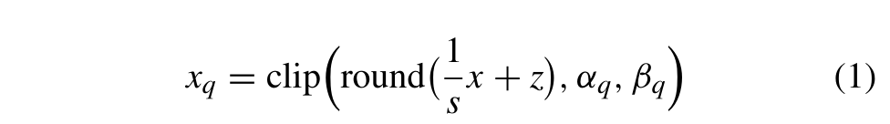

其中 s 为缩放因子（scaling factor），z 为零点（zero-point，即精确表示实数值零所对应的整数值），round 为舍入函数（例如 round-tonearest），clip 则通过饱和离群值将输出范围保持在量化后范围内。相应地，s 和 z 由所选的实数范围与量化后范围定义为：

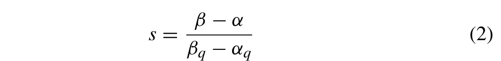

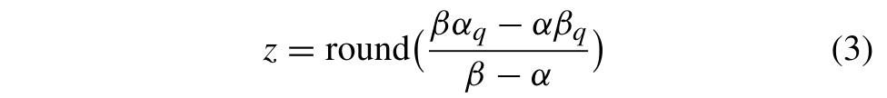

与之相反的操作，即将 $x _ { q }$ 映射回实数范围，定义为：

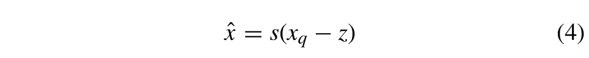

其中 xˆ 是与原始 x 最接近（但不一定相等）的实数值，因为舍入和截断函数可能引入不可恢复的误差。

到目前为止所讨论的量化映射，即采用非对称范围且 $z \neq 0 ,$ 的形式，被称为仿射量化（affine quantization）。而当两个范围均为对称时，z 变为零，且 (1) 仅执行尺度变换。在这种情况下，该量化映射通常被称为尺度量化（scale）或对称量化（symmetric）[29]。此外，当 s 是张量所有通道共用的唯一标量值时，量化被称为逐层；而当 s 是一个由标量组成的一维向量、每个标量对应张量的一个不同通道时，量化则被称为逐通道。

## 2) 纯整数 DNN 核

现在考虑全连接（FC）层的表达式：

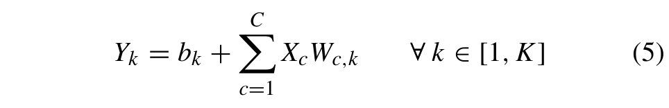

其中 $X \in \mathbb { R } ^ { C }$ 是神经元输入向量，$W \in \mathbb { R } ^ { K \times C }$ 是权重矩阵，$b ~ \in ~ \mathbb { R } ^ { K }$ 是偏置数组，$Y ~ \in ~ \mathbb { R } ^ { K }$ 是输出数组，C 和 K 分别是 FC 层处理的输入与输出激活的数量。对（5）中的四个实变量分别应用（4），预先设定它们各自的量化范围，并将量化输出数组 $Y _ { q , k }$ 移到等式左边，我们得到对第 k 个输出激活有效的量化 FC 表达式：

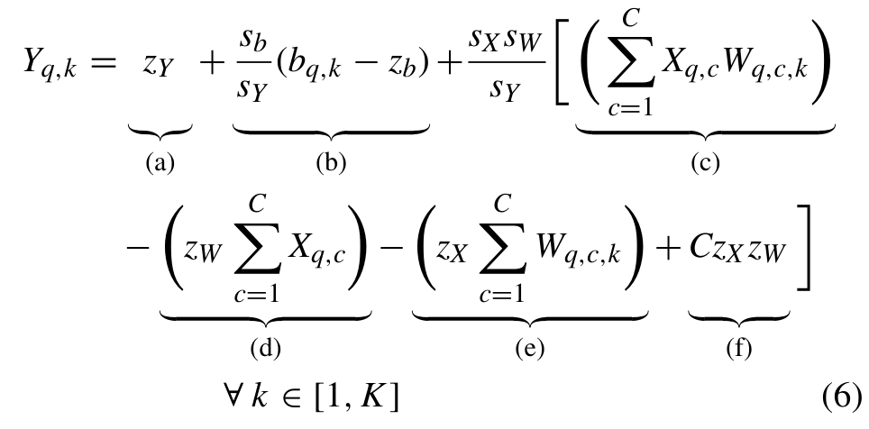

其中 $X _ { q } , W _ { q } , b _ { q } , Y _ { q }$ 是整数值；sX、sW、sb、sY 是缩放因子；zX、zW、zb、zY 是分别与 X、W、b、Y 相关联的零点。式（6）中的项 (c) 是整数点积，即计算的核心，而项 (d) 则引入了导致性能损失的开销。这两项都必须在线计算，因为它们依赖于 $X _ { q } ,$，而 $X _ { q }$ 只有在运行时才可知。相反，项 (a)、(b)、(e) 和 (f) 是常量，因此可以离线计算。注意，在权重采用缩放量化、激活采用仿射量化的情况下——这是文献中的常见做法 [13], [14]—— $z_W$ 和 $z_b$ 变为零，因此项 (d) 和 (f) 也为零，同时项 (b) 得到简化。这也是本文所采用的假设。式（6）的结果在被赋值给 $Y _ { q } ,$ 之前，还需经过舍入和截断，以适配 $Y _ { q }$ 期望的输出量化范围（为便于阅读，公式中未显示）。

2D 卷积和深度可分离卷积（DW-Conv）的纯整数核的数学推导与 FC 的推导紧密类似。我们在附录 A 中给出。此后，我们将（14）、（16）和（6）称为 UIQ 公式。

现在我们关注修正线性单元（ReLU）在纯整数核表达式中的融合。事实上，为了优化嵌入式设备上 DNN 的推理，一些相邻的 DNN 层通常可以合并为单层。这一操作称为层融合，通常在卷积层/全连接层与 Batch Normalization（BN）层或激活层（例如 ReLU）之间进行，并且既可以应用于浮点模型，也可以应用于量化模型。由于我们的 ST 加速器支持与 ReLU 的层融合（详见第 V-B 节），我们在此以 FC 层与其后续 ReLU 层的融合为例解释融合过程。我们选择 ReLU 是因为在 DNN 的高效硬件实现中，它是最常见的激活函数。对式（5）的浮点输出 $Y _ { k }$ 施加 ReLU 非线性，我们得到浮点 FC-ReLU 融合层的表达式：

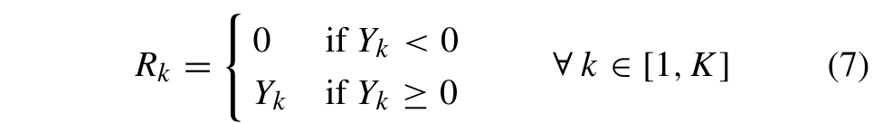

其中 $R _ { k }$ 是 ReLU 层的第 k 个输出。重复从（5）推导出（6）的相同步骤——对（7）的每个实变量应用（4），设定它们的量化范围，并将量化后的 ReLU 输出 $R _ { q , k }$ 移到等式左边——我们得到对第 k 个 ReLU 元素有效的量化 FC-ReLU 融合层：

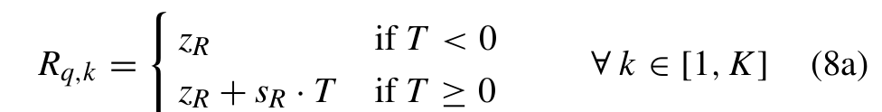

其中

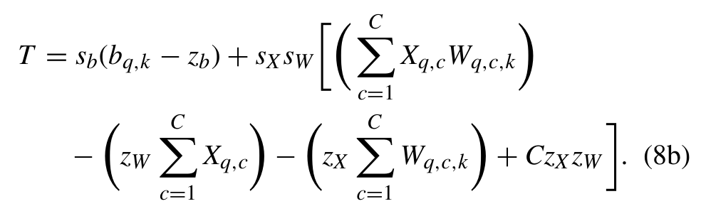

$s _ { R }$ 和 $z _ { R }$ 是与 $R _ { q , k }$ 相关联的缩放因子和零点，而其他所有变量与式（6）中出现的变量相同。注意，$R _ { q , k }$ 需经过舍入和截断操作（为清晰起见在式（8）中未显示），以适配 ReLU 层期望的量化范围。

量化 2D-Conv-ReLU 和 DW-Conv-ReLU 融合层的表达式可通过与这里量化 FC-ReLU 相同的步骤得到。

## B. MLPERF TINY 基准测试

机器学习性能基准测试是机器学习领域一套广受认可的基准，由来自学术界和工业界的五十多个组织协同努力创建 [15]。其中，Tiny 基准是一套由四个轻量级 ML 模型组成的测试集，代表真实世界的应用：视觉唤醒词、图像分类、关键词 spotted（KS）和异常检测（AD）。MLPerf Tiny 旨在评估边缘设备和超低功耗 Tiny ML 系统在有限的能量、内存和/或计算能力预算（例如移动电话、微控制器、物联网设备）下的性能，通过测量这四个 ML 模型在这些设备上推理时的准确率、延迟和能耗。在这方面，MLPerf Tiny 也是一项鼓励 Tiny ML 领域创新的竞赛 [30]。出于这些原因，每个应用不仅附带用于开发和测试的专属数据集，还附带一个专用的性能评估数据集（Perftest 集）。

## 1) 视觉唤醒词

VWW 数据集 [31] 是一个包含 109619 张 96×96 RGB 图像的集合，这些图像包含有人或无人，衍生自 MSCOCO 2014 数据集 [32]。该数据集的用例是当有人出现时设备被唤醒，涵盖智能门铃和占用检测等应用。用于该数据集的模型是 MobilenetV1 的一个较小版本 [33]，我们将其定义为 MobileNetV1Tiny。

## 2) 图像分类

ImgClass 基准使用 CIFAR-10 数据集 [34]，该数据集由 60000 张 32 × 32 的 RGB 图像组成，分属 10 个独特类别，每类 6000 张图像。其用例面向紧凑型视觉系统，包括制造、物联网传感节点以及自主智能体和车辆。所使用的模型是一个自定义的 ResNetV1 [35]，我们将其定义为 ResNetV1Tiny，该模型在第一个卷积层之后没有池化层，残差堆栈更少，且滤波器维度和卷积步长均低于原始 ResNetV1。

## 3) 关键词识别（KEYWORD SPOTTING）

KS 基准测试使用大量英文单词集合，由带各种口音的人发音，源自 Speech Commands v2 数据集 [36]。它包含十二个类别：十个关键词类别（down、go、left、no、off、on、right、stop、up、yes），一个背景噪声类别和一个静音类别。其应用场景是人机交互，包括唤醒词检测以及通过语音对智能设备进行远程控制。该基准测试的目标网络是 [37] 中提出的小型深度可分离卷积神经网络（Depth-wise Separable Convolutional Neural Network，DS-CNN）。

## 4) 异常检测

该基准测试使用 DCASE2020 竞赛数据集 [38] 中六种机器类型之一，即玩具车机器类型（ToyADMOS [39]），其中包含从七辆不同玩具车录制（每辆 1000 条）并与环境噪声混合的单声道 10 秒长度的音频样本。其应用场景是机器异常的早期检测，这是一个常见的工业问题。该基准测试的模型是 DCASE2020 的参考实现，即一个基于 FC 的自编码器 [38]（因此我们将其命名为 FC-AutoEncoder）。与其他 MLPerf Tiny 模型不同，AD 使用的主要指标不是准确率，而是受试者工作特征曲线下面积（Area Under The Receiver Operating Characteristics Curve，AUC）。

  
图 1. 参考 ST 乘法器，修改自 [7]。16 位输入（A 和 B）被划分为 4 位的块以支持多种运算，这些运算由 3 位配置输入（CONFIG）定义，如表 1 所示。X/· 符号表示该乘法器根据配置的不同，能够执行乘法和点积运算。

表 1. 图 1 所示参考 ST 乘法器支持的精度配置与运算。最后三种配置对应低精度下的点积运算。
<table><tr><td>CONFIG</td><td>ST 乘法器的输出</td></tr><tr><td>16×16 (000b)</td><td> $\mathrm { P } _ { [ 3 1 : 0 ] } = \mathrm { A } _ { [ 1 5 : 0 ] } \times \mathrm { B } _ { [ 1 5 : 0 ] }$ </td></tr><tr><td>16×8 (100b)</td><td> $\mathrm { P } _ { [ 3 1 : 0 ] } = \mathrm { A } _ { [ 1 5 : 0 ] } \times \mathrm { B } _ { [ 7 : 0 ] }$ </td></tr><tr><td>8×8 (010b)</td><td> $\mathbf { P } _ { [ 1 6 : 0 ] } = \mathbf { A } _ { [ 1 5 : 8 ] } \times \mathbf { B } _ { [ 7 : 0 ] } + \mathbf { A } _ { [ 7 : 0 ] } \times \mathbf { B } _ { [ 1 5 : 8 ] }$ </td></tr><tr><td>8×4 (011b)</td><td> $\mathbf { P } _ { [ 1 6 : 0 ] } = \mathbf { A } _ { [ 1 5 : 8 ] } \times \mathbf { B } _ { [ 3 : 0 ] } + \mathbf { A } _ { [ 7 : 0 ] } \times \mathbf { B } _ { [ 1 1 : 8 ] }$ </td></tr><tr><td>4×4 (001b)</td><td> $\overline { { { \bf P } _ { [ 9 : 0 ] } = { \bf A } _ { [ 1 5 : 1 2 ] } \times { \bf B } _ { [ 3 : 0 ] } \ + { \bf A } _ { [ 1 1 : 8 ] } \times { \bf B } _ { [ 7 : 4 ] } \ + } }$   $\mathbf { A } _ { [ 7 : 4 ] } \times \mathbf { B } _ { [ 1 1 : 8 ] } + \mathbf { \Delta A } _ { [ 3 : 0 ] } \times \mathbf { B } _ { [ 1 5 : 1 2 ] }$ </td></tr></table>

## IV. SUM-TOGETHER 乘法器

我们提出的新的 ST 乘法器，以及本工作中分析的所有其他乘法器，均具有相同的 I/O 信号，其行为与图 1 和表 1 所描述的参考组件一致。根据 CONFIG 配置信号的不同，它可以并行执行一次 $1 6 \times 1 6 . 1 6 \times 8$ 乘法、两次 $8 \times 8 . 8 \times 4$ 点积或四次 4 × 4 点积，使用的是打包在 16 位输入 A 和 B 中的有符号操作数。根据配置的不同，乘法器输出 P 的 32 位中的子集或全部将包含运算结果。

我们聚焦于这些精度，原因如下。在要求极高准确率的应用中，常见的选择是使用 16 位对激活值和权重进行量化。例如自动驾驶中在雾天环境下进行图像分割的安全关键应用 [5]；还有处理高分辨率卫星图像、高动态范围（HDR）图像以及超分辨率的图像处理应用 [27]。8 位是量化 DNN 且避免性能下降的默认精度 [27]，因此也是使用最广泛的精度。当需要更小的输入和权重位宽时，面向 4 位的量化技术已经在模型尺寸缩减与保留性能之间为大多数应用提供了可接受的折中 [1], [40]。相反，在处理极低位量化（< 4 位）时，除非进行非常大量的调优和超参数搜索，否则现有方法相比基线会产生严重的准确率损失。因此，这仍然是一个活跃的研究方向 [1]。基于上述动机，我们研究的 ST 乘法器支持 4 到 16 位精度之间的操作数。

至于非对称配置（即 16 × 8 和 8×4），我们支持它们是因为它们能够高效地打包较低精度的操作数（如 DNN 权重），同时不损害其他操作数（如 DNN 激活值）的精度。因此，它们有助于缩减 ML 模型的内存占用。这些配置已被 SoA ML 加速器和处理器所采用 [9], [18]，也可以在 TFLite Micro 等商用 ML 框架中找到。1

在下文中，我们首先描述文献中提出的 SoA ST 乘法器的架构，并强调其与我们重新实现的版本之间的差异。实际上，由于原始的 SoA ST 乘法器支持很宽的输入和权重位宽范围，我们进行了少量修改，以使其配置与表 1 中提到的参考 ST 保持一致。这对于保证第 VII 节中所有实验的公平比较非常重要。最后，我们介绍两种新提出的 ST 乘法器。

## A. 最先进（SoA）的 ST 乘法器

文献 [6] 最初的 subword-parallel BW 乘法器由一个可重构的部分积矩阵（PPM）和一个最终的 RCA [41] 组成。该 PPM 可以被重构为计算一个 16 × 16 乘法，或以 m = 8、4 或 2 位精度并行计算 16/m 个点积。我们对 [6] 的重新实现（采用结构化 RTL 描述）展示在图 2(a) 的左侧。从上到下看，它与原始版本具有相同的架构。为了清晰起见，我们还绘制了输出拼接块（&），它将来自 PPM 的最低有效输出位与从最终加法器输出的最高有效位进行合并。然而，在我们的版本中引入了如下修改。首先，我们从 PPM 中移除了 2 位支持，原因如前所述，我们使用的精度介于 4 到 16 位之间。这一点可以从 PPM 主要构建模块的精度中看出，该构建模块是一个 4 × 4 BW 乘法器。其次，在低精度配置下，我们将最终输出右移至最低有效位（LSB）位置，并将其符号扩展至 32 位（right shift & ext 块）。在图 2(a) 的右侧，我们展示了 PPM 在表 1 所列五种工作模式下如何进行重构。在 16 × 16 和 16 × 8 模式下，PPM 的所有部分积（PP）都对乘法器的输出 P 有贡献，其结果以 32 位表示，因此整个结果 P 都是有效的（即在图 2(a) 中为黄色）。在较低精度下，只有位于 PPM 左至右对角线上的黄色部分积保持有效，并分别表现为两个 $8 \times 8 ( 8 \times 8 / 8 \times 4$ in Fig. 2(a)) 或四个 4 × 4 (4 × 4 in Fig. 2(a)) BW 乘法器。这些部分积产生 P 的有效（黄色）输出位，此时其位数少于 32 位，因此需要对齐至 LSB 位置。其余的灰色部分积被门控（使用 AND 门），产生无效（灰色）的输出位。

RI5CY [17] 是一款具有 SIMD ISA 扩展的 RISC-V 处理器，其乘法单元包括一个标准 32 位整数乘法器、一个 32 位定点乘法器和两个 subword-parallel 点积单元。这些单元接受两个 16 位或四个 8 位操作数（打包在一个 32 位寄存器中），并在一个周期内累加得到 32 位结果，因此可同时执行多达四次乘法和累加。这两个点积单元的架构分别由两个 17 位乘法器或四个 9 位乘法器以及随后的压缩树组成。在 [18] 中，同一批作者扩展了该乘法单元，增加了另外两个分别支持 4 位和 2 位操作数的 subword-parallel 点积单元。他们还增加了对若干非对称配置的 ISA 支持 $( 8 \times 4 , 4 \times 8$ 和 $1 6 \times 2 )$。在本工作中，我们实现了 [17] 中的高精度定点乘法器和两个低精度点积单元，将其作为单一设计中的三条互斥数据通路，并将其精度分别缩放至 16、8 和 4 位。我们的重新实现如图 2(b) 所示，采用行为级 RTL 描述，因为 [17] 的作者声明这样可以为综合器提供最大的优化自由度。

Bit Fusion [19] 的 Fusion Unit 通过移位加（shift-and-add）逻辑动态地组合与分解 2 位乘法器（称为 BitBrick）。它支持在一个时钟周期内完成一个 $8 \times 8 ,$、两个 $4 \times 8 .$、四个 $4 \times 4$、四个 $2 \times 8 ,$、八个 $2 \times 4 ,$、十六个 $2 \times 2$ 输入/权重乘法。[12] 和 [20] 针对文献 [19] 的原始工作提出了若干优化，它们降低了移位加逻辑的复杂度和重构开销，但代价是支持的输入/权重精度数量减少 $( 2 \times 2 , 4 \times 4 , 8 \times 8 )$。然而，所有这些 D&C 架构的鼻祖是文献 [21] 提出的可重构并行内积处理器。它使用了 4 位或 8 位的更大 BitBrick 以及更高的输入精度。事实上，其两个输入操作数中的每一个都可以容纳一个 64 位数项、四个 32 位数项、十六个 16 位数项或六十四个 8 位数项。它还保持两个输入操作数的固定位宽，从而在不同配置之间保证了恒定的存储带宽。这与 [12]、[19] 和 [20] 中的 D&C 架构形成对比，后者在降低精度时会遭受存储带宽爆炸的问题，正如 [9] 所指出的。在这些 D&C ST 乘法器中，我们实现了 [21] 的架构，以便在相同存储带宽的基础上与其他 SoA ST 乘法器进行公平比较，从而避免带宽爆炸问题。具体而言，我们使用 4 位 BitBrick 对其进行了重新实现，以支持 16、8 和 4 位精度，如图 2(c) 所示：四个 FU，每个基于四个 4 位 BitBrick，通过移位加逻辑互连。在低精度模式下，我们同样将其输出右移至 LSB 位置并符号扩展至 32 位（与 [6] 中相同的 right shift & ext 块）。

文献 [22] 提出的可重构定点乘法器面向 DSP 应用，由四个 16 位 Booth 乘法器（不含最终加法器）、一个可配置的部分积压缩阵列和三个可配置的 33 位加法器组成。它支持对称（一个 $3 2 \times 3 2 $、两个 16 × 16 或四个 8 × 8）和非对称（两个 16 × 32）的有符号/无符号乘法操作，以及点积/双点积操作（一个或两个 16 × 16±16 × 16 带饱和，一个或两个 16 × 16±16 × 16.16 不带饱和，以及一个 $8 \ \times \ 8 . 8 { \times } 8 { + } 8 { \times } 8 . 8 { \times } 8 )$。在我们对 [22] 的版本中，我们移除了对实现参考 ST 乘法器行为并非严格必要的额外逻辑，例如饱和逻辑或点积中的减法操作。接着，我们改变了所有精度下点积的计算方式。例如，在 8 × 8 配置下，我们将操作数 B 的低位部分与高位部分互换：[22] 中的 A[15:8]×B[15:8] ± aL[7:0]×bL[7:0] 变为 $\mathsf { A } [ 1 5 { : } 8 ] { \times } \mathsf { B } [ 7 { : } 0 ] + \mathsf { A } [ 7 { : } 0 ] { \times } \mathsf { B } [ 1 5 { : } 8 ]$，如表 1 所示。我们还将最大和最小精度分别缩小至 16 位和 4 位。由此产生的架构如图 2(d) 所示，包含四个通过多路选择器网络互连的 8 位 Booth 乘法器，末端为一个加法器树。

文献 [7] 的 subword-parallel 基-4 Booth 架构已经支持 16、8 和 4 位精度的操作数，与表 1 中的参考 ST 乘法器一致。如图 2(e) 所示，它由置于两个输入操作数与一个标准 16 位 Booth 乘法器之间的轻量级重构逻辑（蓝色部分）组成。后者以白色和灰色绘制，采用带有 4:2 压缩器的 Wallace 归约树和带有前缀网络（Prefix Network）的进位传播加法器 [41]。我们按照我们原始论文 [7] 中的做法，采用结构化描述实现了该 Booth ST 乘法器的架构。

  
(e)  
FIGURE 2. (a) 我们的 BW ST 版本 [6]：架构概览（左），PPM 重构（右）。我们的 ST 乘法器版本 [17]：16 位高精度乘法器（左），8 位和 4 位低精度点积单元（中、右）。我们的 D&C ST 版本 [21]：四个 FU，每个含四个 4 位 BitBrick，通过移位加逻辑互连。我们的 ST 乘法器版本 [22]：四个 8 位 Booth 乘法器通过多路选择器网络互连，末端为加法器树。基-4 Booth ST（如 [7] 所述）：重构逻辑（蓝色），16 位 Booth 乘法器（白色和灰色）。由 HLS 导出的 HLS ST（本文提出）：四个乘法器和三个加法器，通过多路选择器和拼接操作组成的网络互连。

最后，在所有原本不支持非对称配置 16 × 8 和 8 × 4 的 SoA ST 乘法器（即 [6]、[17]、[21]）中，我们添加了符号扩展逻辑（为便于阅读，图 2 中未显示），在实际乘法运算之前将低精度操作数 B 扩展至 16 位或 8 位。因此，在任何配置中都不需要对低精度操作数进行零填充（zero-padding），因为这些操作数始终能完全利用乘法器输入 A 和 B 的全部并行性。

最后需要说明的是，我们将所有这些 SoA ST 乘法器都实现为有符号乘法器。

## B. BW-ADD：一种采用改进型最终加法器的 BAUGH-WOOLEY ST 乘法器

根据我们此前工作 [7]、[8] 的结果，我们观察到 BW ST 乘法器 [6] 在时钟频率低于 600 MHz 时具有特别出色的面积效率。而在更高频率下，图 2(a) 中紫色虚线所标示的 BW 阵列的长对角线关键路径以及最终 16 位 RCA 的进位链会导致显著的面积恶化 [8]，因为

## 清单1：HLS ST乘法器的C/C++源代码

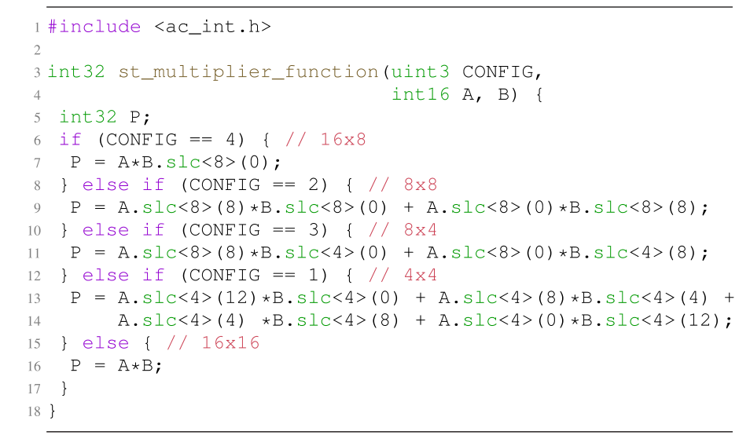

逻辑综合器必须推断出较大的逻辑门才能满足更严苛的时序约束。因此，在本文中，我们通过让逻辑综合器自行选择最合适的最终加法器实现方案（即在满足指定时序约束的前提下面积最小），而不是强制其使用 RCA，来解决这一问题。我们将该乘法器命名为 BW-ADD。通过这一改动，我们期望与 [6] 相比，该乘法器在高频率下的面积更小，而在低频率下保持不变。

## C. HLS ST：一种由 HLS 生成的 ST 乘法器

正如第 V 节所述，我们使用 HLS 从高层描述出发，生成基于 ST 乘法器的 PS DNN 加速器的 RTL。为了在加速器的 MAC 单元中推断出特定实现的 ST 乘法器，我们强制 HLS 工具导入其 RTL 实现。通常，该 RTL 由人工描述，如第 IV-A 节中 SoA ST 乘法器的情形。作为替代方案，我们决定在高层描述 ST 功能，并让 HLS 工具（本文中为 Siemens Catapult）自动生成其 RTL。这一新型 ST 乘法器（我们将其命名为 HLS ST）的源代码见列表 1。为了便于从整数数据类型中访问位字段，我们使用了 Catapult C++ 库 ac\_int.h（第 1 行）中提供的 slc 方法：例如，A.slc<4>(12) 表示 int16 信号 A 中从第 15 位到第 12 位的一个 4 位子字段（第 12 行）。

通过检查 HLS 工具生成的 RTL（其对应的原理图见图 2(f)），我们注意到它包含一个 16 位乘法器、两个 8 位乘法器和两个 4 位乘法器，三个位宽分别为 8/12/16 位的加法器，以及一个由多路选择器和拼接块（&）构成的网络，用于将 16 位输入操作数拆包、分发至各乘法器，并将其低精度结果合并为最终的 32 位输出。此外，低精度配置下的结果已经对齐到最右侧 LSB 的位置。

## V. 基于 ST 的硬件加速器 A. 工作原理

接下来，我们阐述将 ST 乘法器集成到其 MAC 单元中的三个 DNN 加速器的工作原理。图 3 展示了 2D-Conv、DW-Conv 和 FC 加速器从激活值张量（蓝色）和权重张量（橙色）中读取数据的不同访问模式（红色），以及这些数据如何被打包进 ST 乘法器的 16 位输入中。

  
FIGURE 3. Working principle of our ST-based DNN accelerators: 2D-Convolution (2D-Conv), Depth-wise Convolution (DW-Conv) and Fully-Connected (FC).

## 1) 2D-CONV 加速器

对于每个具有 C 个卷积核的橙色滤波器，2D-Conv 加速器中的一个 MAC 单元执行蓝色输入张量的 C 个通道与相应权重卷积核之间的乘法，并沿通道方向累加这些乘积。在全精度（N = 1）下，MAC 单元中的 ST 乘法器每次处理来自一个输入通道的激活值和权重。而在更低精度下，ST 乘法器每次被输入来自两个（N = 2）或四个（N = 4）输入通道的激活值/权重对。这一过程在图 3 的第二列中以红色标出，它利用了 ST 乘法器的点积特性，从而使 MAC 周期数理想情况下按 $C / N$ 缩减，延迟按 1/N 缩减。

## 2) DW-CONV 加速器

在 DW-Conv 中，每个输出通道是相应的蓝色输入通道与橙色权重卷积核之间卷积的结果，而不像 2D-Conv 那样沿通道维度进行累加。因此，我们需要以不同于 2D-Conv 的方式使用 ST 乘法器：我们可以对来自输入张量感受野与其对应权重卷积核的 N = 1、2 或 4 个输入/权重对之间的部分积进行累加。这一新的数据流在图 3 的第三列中以红色标出。

与 2D-Conv 相比，该加速器存在一项会影响 MAC 周期数和延迟缩减的开销，我们将在后文第 VII-C 节中说明。这是因为累加次数由卷积核尺寸的平方 $( K ^ { 2 } )$ 给出，而它并不是低精度下 N（即 N = 2 或 4）的整数倍。以图 3 中的 $3 \times 3$ 卷积核为例，当 $N = 2 \mathrm { ~ o r ~ } 4$ 时，我们分别需要五次或三次迭代来累加输入激活值与卷积核权重的乘积。然而，在最后一次迭代中，感受野内只剩下一个输入对。因此，我们需要向 ST 乘法器输入零来替代缺失的低精度操作数，但这显然会导致 ST 硬件的利用率不足。DW-Conv 的 MAC 周期数为 $\lceil K ^ { 2 } / N \rceil$，延迟缩减按 $\lceil K ^ { 2 } / N / K ^ { 2 } \rceil$ 缩放，其值通常大于 1/N，且该开销随 K 的增大而减小 [10]。

## 3) FC 加速器

该加速器的工作原理如本图 3 的最后一列所示。为了计算绿色输出激活数组的每个元素（例如以红色标出的那个），一个 MAC 单元计算由 C 个输入激活值组成的蓝色数组与橙色权重矩阵某一行之间的点积。MAC 单元中的 ST 乘法器每次从两个数组中取出 N 对数据，或者以高精度模式（N = 1）进行乘法，或者以低精度模式（N = 2 或 4）执行点积。与 2D-Conv 类似，需要 C/N 次连续累加才能完成计算。该过程对权重矩阵的每一行重复执行，直至绿色输出激活数组计算完毕。因此，与 2D-Conv 情况相同，MAC 周期数及相应的延迟分别按 C/N 和 1/N 缩放。

  
FIGURE 4. General architecture of the ST-based accelerators (bottom right), HLS flow (bottom left), and pseudo-code of the high-level C/C++ description (top) that produces the general architecture.

## B. 加速器架构

我们的基于 ST 的 DNN 加速器共享相同的通用架构，如 Fig. 4 中灰色矩形框所示。它由四个部分组成，将在后文 V-B1–V-B4 各节中详细说明：内部缓冲区（用于输入、权重和输出数据）、内存寻址与拼接逻辑、可重构的基于 ST 的 PSMAC 阵列、量化逻辑与 ReLU。

我们通过 Fig. 4 左侧所示的流程获得这一架构，从基于 ST 的加速器的高层 C/C++ 描述（C/C++ (top) 模块）出发，利用 HLS 技术生成最终的 RTL 实现。我们将在 Sec. VI-C 中完整描述这一流程。

尽管这并非本文的重点，我们假设这三个加速器共享一个片上全局缓冲区（Fig. 4 中未显示），例如 [42] 以及其他关于 ML SoC 的较新论文 [43]、[44] 中所示的那样。具体而言，我们假设全局缓冲区足够大，能够存储单个加速器执行时所涉及的三个相关张量（输入激活张量、权重张量和输出激活张量）中每一个的至少两个 tile（两个用于双缓冲）。实际上，我们假设完整的张量已被切分为 tile [45]，以利用该片上全局缓冲区中的数据局部性。此外，我们假设一个片上嵌入式处理器逐个调用各加速器来处理这些 tile。

Table 2 展示了将存储在全局缓冲区中的最大 tile 维度（Part I）和最大 tile 尺寸（Part II）。我们通过对边缘设备上最常见 DNN 的层形状进行统计分析 [10]、[11] 来确定这些维度，这些 DNN 来自面向计算机视觉应用的公开 Model Zoo，例如 TensorFlow [46]、[47]、Intel [48]、[49]、Xilinx [50] 以及 Nvidia [51]、[52]。这些网络包括著名的 ResNet、MobileNet 和 EfficientNet 系列。基于我们的调研，我们为 2D-Conv 和 DW-Conv 分别选择 18 和 22 作为输入 tile 高/宽（IH / IW）和输出 tile 高/宽（OH / OW）维度，因为这些值在全局缓冲区面积与加速器完成 DNN 层所需的 tile 迭代次数之间代表了一个合理的折中 [10]、[11]。而权重 tile 的高/宽（KH / KW）在 2D-Conv 和 DW-Conv 中分别为 7 和 5，以确保加速器能够支持大多数 DNN（例如 ResNetV1 使用 7 × 7 卷积核）。

关于输入 tile 通道数/激活数（IC / IA）和输出 tile 通道数/激活数（OC / OA），我们在 Sec. VII-B 讨论的基于 ST 的加速器 DSE 过程中改变其大小。所探索的取值列于 Table 3 的前两行，其中还包含我们在 DSE 过程中允许变化的 HLS 指令和实现约束。我们将这些变量称为硬件配置旋钮（hardware configuration knobs），因为它们会影响 HLS 工具对 RTL 的综合方式。我们将 IC 和 OC 的最大值取为 32，因为我们发现常见 DNN 的激活张量和权重张量的输入与输出通道数通常可被该值整除。对于 FC 加速器，我们从 [6] 中所用的 IA 和 OA 取值出发，分别为 256 和 8。随后，我们以二的幂次方式添加取值，以扩展设计空间的解的范围，并确保三个加速器所覆盖的面积大致以相同的方式从最小值到最大值分布。我们将在本节后文描述其余的硬件配置旋钮。

TABLE 2. 加速器与 tile 相关参数的描述（Part I 与 Part II）以及加速器内部缓冲区尺寸（Part III）。在 Sec. VII-B 的 DSE 中探索的参数取值（以 DSE 条目标注）列于 Table 3 中。
<table><tr><td>参数名称</td><td>描述</td><td>2D-Conv</td><td>DW-Conv</td><td>FC</td></tr><tr><td colspan="5">Part I: 最大 tile 维度</td></tr><tr><td>IH / IW</td><td>输入 tile 高 / 宽</td><td>18</td><td>22</td><td></td></tr><tr><td> $K H \mathrm { ~ / ~ } K W$ </td><td>权重 tile 高 / 宽</td><td>7</td><td>5</td><td></td></tr><tr><td>OH / OW</td><td>输出 tile 高 / 宽</td><td>18</td><td>22</td><td></td></tr><tr><td>IC / IA</td><td>输入 tile 通道数 / 激活数</td><td>DSE</td><td></td><td>DSE</td></tr><tr><td>OC / OA</td><td>输出 tile 通道数 / 激活数</td><td>DSE</td><td>DSE</td><td>DSE</td></tr><tr><td colspan="5">Part II: 最大 tile 尺寸</td></tr><tr><td>IS</td><td>输入 tile 大小</td><td> $\overline { { I H \times I W \times I C } }$ </td><td> $\overline { { I H \times I W \times I C } }$ </td><td>IA</td></tr><tr><td>WS</td><td>权重 tile 大小</td><td> $K H \times K W \times I C \times O C$ </td><td> $K H \times K W \times O C$ </td><td> $O A \times I A$ </td></tr><tr><td>OS</td><td>输出 tile 大小</td><td> $O H \times O W \times O C$ </td><td> $O H \times O W \times O C$ </td><td>OA</td></tr><tr><td colspan="5">Part III: 加速器内部缓冲区尺寸</td></tr><tr><td>IBS</td><td>输入缓冲区 (IBUF) 大小</td><td> $\overline { { K H \times K W \times 4 } }$ </td><td> $\overline { { K H \times K W \times 1 } }$ </td><td>128</td></tr><tr><td>WBS</td><td>权重缓冲区 (WBUF) 大小</td><td> $K H \times K W \times 4 \times O C$ </td><td> $K H \times K W \times 1 \times O C$ </td><td> $O A \times 1 2 8$ </td></tr><tr><td>OBS</td><td>输出缓冲区 (OBUF) 大小</td><td> $1 \times 1 \times O C$ </td><td> $1 \times 1 \times O C$ </td><td>OA</td></tr></table>

TABLE 3. Sec. VII-B 的 DSE 中探索的硬件配置旋钮，包括最大 tile 尺寸、HLS 指令和实现约束。
<table><tr><td>硬件配置旋钮</td><td>HLS 指令</td><td>2D-Conv</td><td>DW-Conv</td><td>FC</td></tr><tr><td>IC / IA</td><td></td><td>{4, 8, 16, 32}</td><td>一</td><td>{256, 512, 1024}</td></tr><tr><td>OC / OA</td><td></td><td>{4, 8, 16, 32}</td><td> $\{ 2 , 4 , 8 , 1 6 , 3 2 \}$ </td><td>{8, 16, 32}</td></tr><tr><td>PSMAC 阵列并行度 (M) = = 展开 oc / oa 循环</td><td>unroll &lt;unrolling factor (UF)&gt;</td><td>OC</td><td>OC</td><td>OA</td></tr><tr><td>Partition IBUF</td><td>interleave &lt;# of interleaved memories&gt;</td><td>no</td><td>OC</td><td>no</td></tr><tr><td>Partition WBUF</td><td>interleave &lt;# of interleaved memories&gt;</td><td>OC</td><td>OC</td><td>OA</td></tr><tr><td>Partition OBUF</td><td>interleave &lt;# of interleaved memories&gt;</td><td>OC</td><td>OC</td><td>OA</td></tr><tr><td>将 st_multiplier_function 映射到 ST 乘法器 IP</td><td>map_to_operator &lt;component name (X)&gt;</td><td>yes (IP mode, X = { [6], [7], [17], [21], [22], BW-ADD, HLS ST }) 7 / no (Inline mode, i.e., the st_multiplier_function is inlined)</td><td></td><td></td></tr><tr><td>目标时钟频率</td><td></td><td colspan="3"> $[ 1 0 0 \div \mathrm { { 1 0 0 0 } ] \mathrm { { M H z } , \mathrm { { 1 0 } s t e p s } } }$ </td></tr></table>

现在让我们对 Fig. 4 顶部的伪代码进行说明。它是利用 HLS 技术生成基于 ST 的加速器通用架构的高层 C/C++ 描述的一个精简版本。我们首先借助这段简化代码来突出各加速器高层描述之间的共性。随后，我们提供关于该代码关键部分如何转换为三个加速器高层 C/C++ 伪代码的具体细节，这三个加速器的伪代码分别见 Lsts. 2、3 和 4，分别对应 2D-Conv、DW-Conv 和 FC。

在经过一系列流水化的最外层循环 L1–L3 之后，加速器从内部输入缓冲区（IBUF）读取激活值，并通过存储器寻址与拼接逻辑为 ST 乘法器准备第一个操作数 A。对于 2D-Conv 和 FC，该操作发生在最内层循环 L4 之前；然而对于 DW-Conv，该操作发生在 L4 内部，因为 DW-Conv 算法中不存在输入通道循环。接着，在 L4 中，加速器从内部权重缓冲区（WBUF）读取权重并填充第二个操作数 B。随后，它使用通过 CONFIG 配置的 ST 乘法器执行乘法/点积运算，并将结果累加到内部输出缓冲区（OBUF）中。OBUF 保存上一次 tile 迭代的结果，或者在 L2 中当加速器处理某层执行的初始输入-权重 tile 对时被复位（参见 Lsts. 2–4 中的 RESET 信号）。

由于 L4 被展开，HLS 工具通过生成图 4 所示的 M 个并行可重构 ST-based PSMAC 单元阵列来综合该循环。为了符合第 V-A 节所述的工作原理，循环 L3 在低精度配置下需要提前终止：这发生在 L3 的索引达到其最大迭代次数 $( L 3 _ { m a x } )$ 除以 N 时，其中 $L 3 _ { m a x }$ 对应当前 tile 执行中 2D-Conv 的输入通道数、DW-Conv 的核维度乘积，或 FC 的输入激活值数量。这分别通过 Lsts. 2、3 和 4 中的变量 ic_lim、k_lim 和 ia_lim 实现。随着循环 L3 的迭代次数在精度降低时减少，剩余的 IBUF 和 WBUF 读取操作不再执行。因此，无需用零填充这些缓冲区中未使用的部分。最后，仅当加速器生成最后一个输出 tile 时，OBUF 才使用相应的 UIQ 公式进行量化（即 2D-Conv 使用式 (14)，DW-Conv 使用式 (16)，FC 使用式 (6)），随后（在需要时）进行 ReLU，为下一层的计算准备输出。否则，OBUF 继续在加速器内部累加部分结果/输出，以避免外部存储器中的数据传输，从而遵循输出驻留数据流 [42]。

下面我们深入探讨图 4 所示 ST-based 加速器各个架构模块的细节，并重点突出三个加速器之间的关键区别。

## 1) 内部缓冲区

表 2 的第 III 部分报告了加速器的内部缓冲区大小。这些缓冲区遵循与所使用参数相同的排序方式

## 清单2：基于ST的2D-Conv加速器伪代码

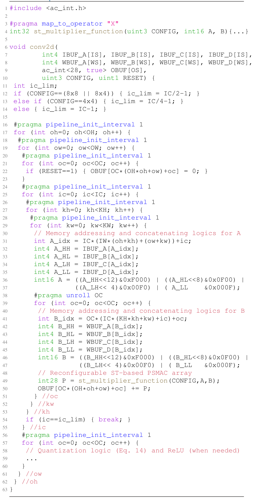

图中注释：Memory addressing and concatenating logics 为存储寻址与拼接逻辑；Reconfigurable ST-based PSMAC array 为可重构ST乘加阵列；Quantization logic and ReLU 为量化逻辑与按需执行的ReLU。

## 清单3：基于ST的DW-Conv加速器伪代码

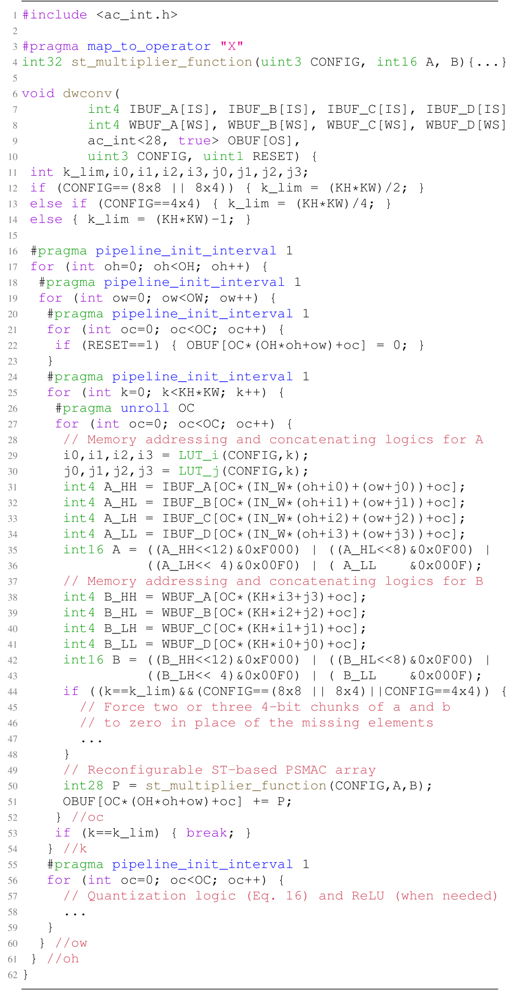

图中注释：Memory addressing and concatenating logics 为存储寻址与拼接逻辑；Reconfigurable ST-based PSMAC array 为可重构ST乘加阵列；Quantization logic and ReLU 为量化逻辑与按需执行的ReLU。 Force two or three 4-bit chunks to zero 表示用零填充缺失元素对应的两个或三个4位块。

其尺寸由第二部分中的 tile 大小决定。对于 2D-Conv 和 DW-Conv 的 IBUF 与 WBUF，我们选择能够计算 1 × 1×OC 个输出元素的最小尺寸。特别地，我们将 2D-Conv 的 IBUF 尺寸设定为可存储 4 个输入通道，以使 ST 乘法器能够在所有精度配置下工作。对于 WBUF，我们按照第一部分中的权重 tile 维度，选取卷积核维度为 7 和 5。对于 FC，我们将 IBUF 尺寸设定为可存储 128 个激活值，将 OBUF 尺寸设定为可存储 OA 个输出元素，以使其缓冲区面积与另外两个加速器相当。内部缓冲区采用双缓冲技术，以确保加速器在从全局缓冲区获取新数据时仍能不间断运行。因此，从加速器的角度来看，由全局缓冲区和内部缓冲区组成的整个存储层级表现为一个可供其透明访问的统一虚拟存储器。

## 清单4：基于ST的FC加速器伪代码（参考[6]）

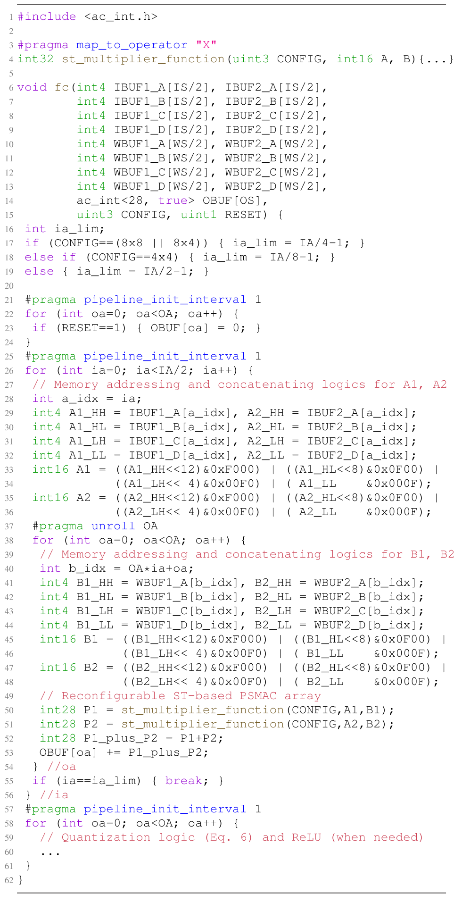

图中注释：Memory addressing and concatenating logics 为存储寻址与拼接逻辑；Reconfigurable ST-based PSMAC array 为可重构ST乘加阵列；Quantization logic and ReLU 为量化逻辑与按需执行的ReLU。

内部输入与权重缓冲区被组织为四个 4 位的存储体（memory bank），分别命名为 IBUF\_A/B/C/D 和 WBUF\_A/B/C/D，以便按照图 3 所示的存储访问模式读取低精度数据。这一点从 Lsts. 2–4 函数签名中的 int4 数据类型可以看出来。输出缓冲区被组织为 28 位的存储体，以匹配 PSMAC 阵列中累加器的位宽，这一点将在第 V-B3 节中说明。

为了保证加速器的正确执行，内部缓冲区由直接存储器访问引擎按照图 3 所示的工作原理进行填充。对于 2D-Conv，在 16 × 16 和 16 × 8 配置下，输入 tile 和权重 tile 的每个元素从全局缓冲区读取后，被扩展为 16 位（如有需要）并拆分为四个 4 位的块。随后，每个输入块和权重块按从最高有效位到最低有效位的顺序，分别存入 IBUF\_A-D 和 WBUF\_A-D。在 8 × 8 和 8 × 4 配置下，从相应 tile 的通道维度取出两个输入元素和两个权重元素，将其扩展为 8 位（如有需要）并拆分为 4 位的块。第一个输入和第一个权重的块分别存入 IBUF\_A-B 和 WBUF\_C-D；第二个输入和第二个权重的块分别存入 IBUF\_C-D 和 WBUF\_A-B。4 位的块始终按从最高有效位到最低有效位的顺序存储。在 4 × 4 的情况下，从相应 tile 的通道维度取出四个输入元素和四个权重元素，将它们全部扩展为 4 位（如有需要），然后分别打包到 IBUF\_A/WBUF\_D、IBUF\_B/WBUF\_C、IBUF\_C/WBUF\_B 和 IBUF\_D/WBUF\_A 中。

对于 FC 加速器，填充存储体的过程与 2D-Conv 类似。然而，其 4 位存储体的数量是 2D-Conv 的两倍（见 Lst. 4 中的第 6–13 行），其原因将在第 V-B3 节中说明。在 16 × 16 和 16 × 8 配置下，从全局缓冲区读取输入 tile 中两个连续的激活值以及权重 tile 同一行中两个连续的权重，将其扩展为 16 位（如有需要）并拆分为四个 4 位的块。按从最高有效位到最低有效位的顺序，两个输入的四个块分别存入 IBUF1\_A-D 和 IBUF2\_A-D，而两个权重的四个块则分别存入 WBUF1\_A-D 和 WBUF2\_A-D。在 8 × 8 和 8 × 4 配置下，沿输入数组以及权重矩阵的同一行分别读取四个连续的激活值和权重。然后，将它们全部扩展为 8 位（如有需要），并将每个元素拆分为两个 4 位的块。四个输入的两个块按以下顺序存储：IBUF1\_A-B、IBUF1\_C-D、IBUF2\_A-B 和 IBUF2\_C-D；而四个权重的两个块则按以下顺序存储：WBUF1\_C-D、WBUF1\_A-B、WBUF2\_C-D 和 WBUF2\_A-B。4 位的块始终按从最高有效位到最低有效位的顺序存储。在 4 × 4 的情况下，读取八对连续的输入和权重，将其扩展为 4 位（如有需要），并按如下方式存入内部存储体：第 1 对存入 IBUF1\_A/WBUF1\_D，第 2 对存入 IBUF1\_B/WBUF1\_C，第 3 对存入 IBUF1\_C/WBUF1\_B，第 4 对存入 IBUF1\_D/WBUF1\_A，第 5 对存入 IBUF2\_A/WBUF2\_D，第 6 对存入 IBUF2\_B/WBUF2\_C，第 7 对存入 IBUF2\_C/WBUF2\_B，第 8 对存入 IBUF2\_D/WBUF2\_A。

对于 DW-Conv 的 16 × 16 和 16 × 8 配置，其存储体（memory bank）的填充方式与 2D-Conv 的步骤相同。然而，对于低精度工作模式，填充过程有所不同。对于 8 × 8 和 8 × 4 配置，来自激活 tile 感受野的两个连续输入元素以及来自权重 tile 对应 kernel 的两个连续权重被扩展为 8 位（如有需要），并拆分为 4 位的块（chunk）。第一个和第二个输入的块存储在 IBUF_A-B 中，而第一个和第二个权重的块存储在 WBUF_C-D 中，IBUF_C-D 和 WBUF_A-B 则保持未使用。

对于 4 × 4 配置，来自激活 tile 感受野的四个连续输入元素以及来自权重 tile 对应 kernel 的四个连续权重被扩展为 4 位（如有需要），然后仅存储在 IBUF_A 和 WBUF_D 中，其余存储体则保持未使用。

上文针对三种加速器所讨论的数据组织方式非常重要，因为它使得内部缓冲区能够被划分为更小的存储体（通过 HLS 指令 interleave 实现）。这确保了每个存储体包含单个 PSMAC 单元独立计算其自身通道/激活输出元素所需的全部数据。通过这种方式，PSMAC 阵列可以并行计算 M 个输出通道/激活，我们将在 Sec. V-B3 中详细说明。然而，为了在所有配置下都能像 2D-Conv 和 FC 那样，在一个时钟周期内为 PSMAC 阵列中的 ST 乘法器提供输入操作数，DW-Conv 的存储组织要求 IBUF_B 和 WBUF_C 各具有两个读取端口，而 IBUF_A 和 WBUF_D 各具有四个读取端口，其余所有存储体仍只需一个读取端口。由于在 SRAM ASIC 技术中实现四端口较为困难，我们决定对 IBUF_A 和 WBUF_D 采用基于锁存器（latch-based）的存储器。

## 2) 存储器寻址与拼接逻辑

这两种逻辑电路旨在实现 Sec. V-A 中概述的工作原理。根据加速器的类型和所选配置（如图 3 所示），前者负责准备地址，以正确访问 IBUF 和 WBUF，并从每个存储体中取出四个 4 位数据（例如，Lst. 2 中第 31–35 行对应操作数 A，第 41–45 行对应操作数 B）。后者通过移位与掩码（shift-and-mask）操作，将这些数据组织成 ST 乘法器的 16 位输入操作数（例如，Lst. 2 中第 36–37 行和第 46–47 行）。对于 DW-Conv，这些逻辑电路要更复杂一些。实际上，需要一对查找表（Look-Up Table，LUT）来根据 CONFIG 和 k 的值检索预先离线计算好的正确索引，其中 k 是 kernel 上循环的迭代计数器（Lst. 3 第 25 行）。此外，正如 Sec. V-A2 中已经讨论的，DW-Conv 要求在 N = 2 或 N = 4 的情况下，在 kernel 的最后一次迭代中，将 A 和 B 的两个或三个 4 位块填充为零，以替代缺失的低精度操作数（Lst. 3 第 44–48 行）。

## 3) 可重构的基于 ST 的 PSMAC 阵列

我们基于 ST 的加速器的 PSMAC 阵列包含 M 个 MAC 单元，如图 4 所示。每个 MAC 单元处理一个不同的输出通道/激活，分别对 2D-Conv 处理不同的滤波器（filter）、对 DW-Conv 处理不同的 kernel、或对 FC 处理权重矩阵的不同行。

PSMAC 阵列的并行度（M）如表 3 所列，对应于通过 HLS 指令 unroll 应用于加速器高级代码最内层循环的展开因子。具体而言，对于 2D-Conv 和 DW-Conv，M 等于 OC；对于 FC，M 等于 OA。这使得 HLS 工具能够完全展开最内层循环（Lst. 2 第 39 行、Lst. 3 第 27 行、Lst. 4 第 38 行），因为展开因子与其上界相匹配，从而将 ST 乘法器和累加加法器复制 M 份。正如 Sec. V-B1 中所介绍的，为了充分利用这种并行性，我们将内部缓冲区划分为 M 个存储体，使各 PSMAC 单元能够并发地访问其所需的数据。为此，我们使用 interleave 指令，并以 OC（对于 2D-Conv 和 DW-Conv）或 OA（对于 FC）作为参数。表 3 还显示，2D-Conv 和 FC 的 IBUF 不需要进行划分，因为操作数 A 是在最内层被展开的循环之外读取的（Lst. 2 第 31–37 行，Lst. 4 第 28–36 行）。

对于 2D-Conv 和 DW-Conv，每个 MAC 单元由一个 16 位 ST 乘法器（见函数调用 st_multiplier_function）、一个 28 位加法器和一个 28 位累加寄存器（P）组成（Lst. 2 和 Lst. 3 中分别为第 49–50 行和第 50–51 行）。对于 FC，我们受 [6] 的启发，每个 MAC 单元包含两个 16 位 ST 乘法器（用于并行处理两个激活/权重对）、两个 28 位加法器（分别用于对两个乘法器的输出求和以及对该结果进行累加）以及一个 28 位累加寄存器（P1_plus_P2）（Lst. 4 第 50–53 行）。这也是我们在接口处拥有两倍输入和权重缓冲区的原因（Lst. 4 第 6–13 行）。

加法器和累加寄存器的位宽是 Sec. VI-B 中讨论的消融实验的结果。

## 4) 量化与 ReLU 模块

该模块将 UIQ 公式 (14)、(16) 和 (6)（其中 $z_W$ = 0 且 $z_b$ = 0 [13], [14]）分别实现到 2D-Conv、DW-Conv 和 FC 中。为了实现高效的硬件实现，我们将除以输出缩放因子 $s_Y$ 的除法转换为乘以其倒数。此外，我们通过 Sec. VI-B 中描述的消融实验来最小化 UIQ 公式中 C/C++ 变量的位宽。当加速器处理完完成某个特定输出 tile 所需的最后一对输入/权重 tile 后，PSMAC 阵列中的累加结果即可使用 UIQ 公式进行量化。事实上，累加结果对应于所有 UIQ 公式 (14)、(16) 和 (6) 中的项。UIQ 公式的其余变量作为输入传递给加速器，因为它们可以离线计算。

此外，该模块实现了 UIQ 公式与 ReLU 之间的层融合，如 Sec. III-A1 中所述。因此，当需要 ReLU 时，可以将加速器配置为在硬件中执行它。为简洁起见，相关的伪代码在 Lst. 2、Lst. 3 和 Lst. 4 中分别位于第 58、57 和 59 行处，此处予以省略。

最后，所有加速器均支持激活的逐层量化，以及权重的逐层或逐通道量化，因为后者在 DNN 量化中能提供更优的性能，如 [14] 和 [27] 所示。

## VI. ACCELERATORS DESIGN FLOW

为了获得我们基于 ST 的硬件加速器，我们采用了图 5 所示的设计流程。它由以下三个步骤组成，并在第 VI-A–VI-C 节中进行了详细分析：

  
FIGURE 5. Accelerators design flow.

A) MP 量化与微调。以 MP 方式量化一组 DNN 模型是所提流程的第一步。在本文中，我们选择 MLPerf Tiny 基准 [15] 作为案例研究，因为其四个网络非常适合边缘设备，而边缘设备正是我们加速器的主要目标。具体而言，我们将其模型的激活值和权重量化为 16、8 或 4 位整数，与我们基于 ST 的加速器所支持的精度相同。

B) UIQ 变量位宽的最小化。第二步是一项旨在通过迭代方法优化硬件加速器的消融研究。在此过程中，我们逐步缩小 UIQ 公式的 C/C++ 定点变量的位宽，并且对每一种位宽选择，我们都评估从步骤 A) 得到的 MP 量化模型在其测试集上的性能。该过程最终报告模型不超过用户自定义退化阈值的最小位宽。

C) 硬件加速器的生成。利用步骤 B) 确定的最优位宽精度，我们对每个加速器在延迟与面积、延迟与功耗两个维度上进行 DSE。在探索过程中，我们改变了许多硬件配置参数，如表 3 所列，包括 HLS 指令（例如流水线和展开）以及 PSMAC 阵列的 ST 乘法器类型。

## A. MP QUANTIZATION AND FINE TUNING

我们在 QKeras [16]（一个专为量化任务定制的 Keras 扩展）之上构建设计流程的第一步。它提供了对部分层的直接替换实现，以将 FP Keras 模型转换为量化模型。它通过实现伪量化层和用于反向传播的直通估计器来支持量化感知训练。由于 QKeras 支持权重的仿射均匀量化，但不支持激活值的仿射均匀量化，我们创建了一个新的激活值层类来实现公式 (1)–(4)，从而得到一个面向仅整数算术推理的新版 QKeras。这个新版本的行为类似于 TFLite [13]，但与 TFLite 不同的是，它还支持低于 8 位的激活值和权重精度。我们在 GitHub 上以开源代码的形式发布了这个修改版的 QKeras。2 如附录 B 中的表 8–11 所示，对于四个 MLPerf Tiny 模型，我们在每个 Conv2D、DepthwiseConv2D 和 Dense 层的前后插入该新的激活层（称为 QActivation）。

在位宽探索方面，我们使用 AutoQKeras [16]，这是 QKeras 的一个扩展，它采用贝叶斯优化来确定每个 DNN 层的最优位数。我们将权重和激活值限定为 INT16、INT8 或 INT4 位，偏置限定为 $\mathrm { I N T } 3 1 ^ { 3 }$ 或 INT16，因为众所周知，将偏置量化到更低的精度会显著损害模型性能 [13]、[27]。我们将 AutoQKeras 配置为最大化一个得分函数，该函数是量化模型的验证指标（限定在 0 到 1 之间）与相对于 16 位平坦参考模型（即所有激活值和权重量化为 INT16、偏置量化为 INT31 的模型）的总位数缩减量的乘积。模型的总位数是每层激活值/权重数量与用于表示它们的位数之间的乘积之和。在我们的案例研究中，除 FC-AutoEncoder 外，我们对所有 MLPerf Tiny 模型使用验证准确率作为验证指标，FC-AutoEncoder 的输出指标是输入与输出预测之间的均方误差损失 $( M S E _ { l o s s } )$。为了将 $M S E _ { l o s s }$ 的 +inf–0 范围映射到其他验证指标的 0–1 范围（这是 AutoQKeras 所要求的），我们为 AutoEncoder 创建了如下自定义验证指标：$1 / ( 1 + M S E _ { l o s s } / 1 0 )$

对于每个网络，我们使用 AutoQKeras 迭代地从搜索空间中采样每层特征图、权重和偏置位宽的不同组合。然后，在存在预训练 FP 权重时，我们让 AutoQKeras 从这些预训练 FP 权重出发，对得到的 MP 网络进行若干轮的微调，以缩短位宽探索过程；否则，我们让它从头开始训练模型。训练使用 QKeras 的量化感知训练引擎进行。在我们的案例研究中，由于我们可以依赖 MLPerf Tiny 仓库提供的预训练权重，4 我们采用第一种方式。为了进一步加速探索，我们使用完整训练集和验证集的子集，并结合早停策略。当验证得分达到收敛（即稳定在某个固定值附近）时，我们中断 AutoQKeras 的搜索。对于 MobileNetV1Tiny、ResNetV1Tiny、DS-CNN 和 FC-AutoEncoder，这一情况分别发生在大约 200、400、100 和 200 次搜索迭代之后。最后，对于每个模型，我们选择能够获得最佳验证得分的位宽组合，并以对其进行微调收尾。在我们的案例研究中，我们使用 MLPerf Tiny GitHub 仓库中训练脚本的默认设置。

在第 V-B 节中，我们没有讨论 BN 运算的硬件实现，为了保持轻量化的设计，我们决定不在加速器中支持 BN。这并不是一个限制，因为 BN 参数可以在离线状态下使用一种称为 BN 折叠 [14] 的技术与相邻卷积层的权重高效地折叠在一起。BN 折叠是在嵌入式设备上加速 DNN 推理的标准流程，因为 BN 参数在训练后保持不变。为了确保对 AutoQKeras 探索得到的最终 MP 模型应用 BN 折叠时，折叠后的权重不会超出我们加速器所支持的位宽（16、8、4 位），我们从探索一开始就主动向 AutoQKeras 提供带有预折叠权重的 FP 模型。因此，我们将 QConv2D+BatchNormalization 替换为 QConv2DBatchnorm，将 QDepthwiseConv2D+BatchNormalization 替换为 QDepthwiseConv2DBatchnorm。在我们进行实验时，QKeras 尚不支持 FC 层的 BN 融合层（即 QDenseBatchnorm 尚不可用）。因此，在案例研究中，我们没有对 FC-AutoEncoder 应用 BN 折叠，如最终 MP FC-AutoEncoder 模型的架构所示（附录 B 中的表 11）。

最终的 MP 量化 MLPerf Tiny 模型见附录 B。它们在相应 Perf 测试集上的 FP 和 MP 性能（对 FC-AutoEncoder 使用 AUC，对其他三个模型使用准确率）分别列于表 4 的第 4 列和第 5 列。为了确保用于与 MP 模型对比的 FP 基线是可靠的，我们在自己的软件环境中重新评估了 FP 模型的性能，而不是盲目依赖 [15] 中报告的数值（MobileNetV1Tiny、ResNetV1Tiny、DS-CNN、FC-AutoEncoder 分别为 86、86.5、92.2、88.0）。为此，我们使用了 MLPerf Tiny 仓库提供的预训练权重和测试脚本。在表 4 中，我们还报告了 MP 模型相对于其 16 位平坦量化对应模型的总位数缩减量（第 7 列），后者正是 AutoQKeras 用于引导其目标函数最小化的参考模型，如前所述。

结果表明，MP 模型相比其 FP 对应模型表现出大约 1% 的准确率下降，但仍满足 MLPerf Tiny 质量目标（第 3 列），即模型在量化和其它优化后应保持的性能水平 [15]。此外，所有模型的总位数缩减量（第 7 列）均大于 50%，证实了 AutoQKeras 所执行的 MP 优化的有效性。

## B. UIQ 变量位宽的最小化

若要满足 UIQ 公式中零计算误差这一假设性约束，将需要具有过大位宽的数学运算符（即乘法器和加法器），因为位精度会随着所涉及的数学运算逐级传播。这会导致加速器面积过大而不实用，甚至可能导致 HLS 工具无法生成可行的解决方案。因此，在设计流程的第二步中，我们进行了一项消融研究（ablation study），通过缩减 UIQ 公式中使用的 C/C++ 变量位宽来优化硬件加速器。

我们以 FC 的 UIQ 公式 (6) 为参考，其中 $z _ { W } = 0$ 且 $z _ { b } = 0 $。同样的推理也适用于其他加速器的 UIQ 公式。消融研究中考量的变量列于表 5 的列标题中。前六个是 UIQ 公式中出现的实际变量，而后三个是由 (6) 分解为 $( 9 ) \substack { - ( 1 2 ) }$ 所得到的中间结果 $\nu 1 _ { q , k } , \nu 2 _ { q , k } , \nu 3 _ { q , k }$

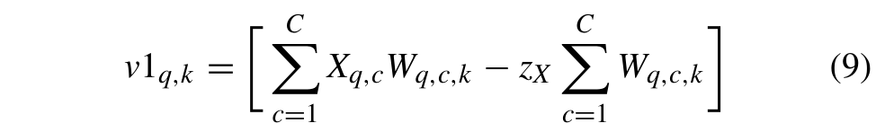

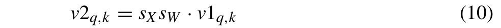

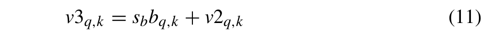

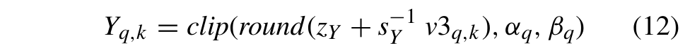

其中 $Y _ { q , k }$ 是第 k 个输出元素，其中 $k ~ \in ~ [ 1 , K ]$ 量化为 INTy 位（$y = 1 6 , 8 .$ 或 4），在整数量化范围 $[ \alpha _ { q } , \beta _ { q } ] = [ - 2 ^ { b _ { y } - 1 } + 1 , 2 ^ { b _ { y } - 1 } - 1 ]$ 上，其余变量均为 Sec. III-A1 中与 (6) 一同引入的变量。在我们的加速器中，我们将这些变量中的每一个都实现为定点数或整数。

我们的消融研究旨在采用迭代的软硬件协同设计方法来优化硬件加速器。作为初步步骤，我们将 QKeras 的 QConv2DBatchnorm、QDepthwiseConv2DBatchnorm 和 QDense 层类中对底层 TensorFlow 例程的调用，替换为描述相应加速器的 HLS C/C++ 代码的调用。然后，我们首先对每个变量所取的最大值和最小值进行统计分析。该分析涉及对流程上一步得到的 MP 量化模型执行推理。推理在从相应测试集中提取的小型校准子集上进行。通过这种方式，我们确定了每个定点变量整数部分所需的最少位数，同时保持最大的 MP 性能（即 FC-AutoEncoder 的 AUC，或其余 MLPerf Tiny 模型的准确率）。此后，以这些整数位数作为起点，我们对 UIQ 公式的 C/C++ 变量（包括中间变量 v1、v2 和 v3）进行位宽探索：每次只考虑一个 C/C++ 变量，迭代地减少其小数位数和/或整数位数，并通过在所考量模型的完整测试集上执行推理（MLPerf Tiny 模型使用 Perf 测试集）来评估其对模型测试指标的影响。当在不降低至少一个被分析 DNN 的性能指标超过某一阈值的情况下无法进一步降低精度时，我们停止探索。在我们的案例研究中，相对于表 4 第 5 列的 MP 量化测试指标，我们将该阈值设为 0.5%。未来，我们计划通过硬件感知训练（hardware-aware training）[53] 自动寻找这些最优位宽。

TABLE 4. MLPerf Tiny 模型（第 1 列）在对应 Perf 测试集（第 2 列）上的性能，FC-AutoEncoder 采用 AUC、其余三个模型采用准确率，分别为其 FP（第 4 列）、MP（第 5 列）以及采用最优 C/C++ 位宽的 MP（第 6 列）版本的结果。
<table><tr><td>MLPerf Tiny 模型</td><td>Perf 测试集（样本数）</td><td>MLPerf Tiny 质量目标 [15] [Top-1 Acc./AUC]</td><td>FP 模型 [Top-1 Acc./AUC]</td><td>MP 模型（vs. FP）[Top-1 Acc./AUC]</td><td>采用最优 C/C++ 位宽的 MP 模型（vs. FP）[Top-1 Acc./AUC]</td><td>总位数缩减（vs. 16-bit flat）[%]</td></tr><tr><td>MobileNetV1Tiny</td><td>VWW (1000)</td><td>80.00</td><td>86.00</td><td>85.00 (−1.00)</td><td>85.00 (−1.00)</td><td>-52.25</td></tr><tr><td>ResNetV1Tiny</td><td>CIFAR-10 (200)</td><td>85.00</td><td>88.50</td><td>87.50 (-1.00)</td><td>87.50 (−1.00)</td><td>-52.91</td></tr><tr><td>DS-CNN</td><td>Speech Comm. V2 (1000)</td><td>90.00</td><td>92.10</td><td>90.00 (−2.10)</td><td>90.40 (−1.70)</td><td>-62.56</td></tr><tr><td>FC-AutoEncoder</td><td>ToyADMOS (248)</td><td>85.00</td><td>88.71</td><td>87.51 (−1.20)</td><td>87.13 (−1.58)</td><td>-70.85</td></tr></table>

TABLE 5. 消融研究得到的最小位宽。
<table><tr><td>C/C++ 变量</td><td> $\textstyle \sum _ { c = 1 } ^ { C } X _ { q , c } W _ { q , c , k }$ </td><td> $\textstyle z _ { X } \sum _ { c = 1 } ^ { C } W _ { q , c , k }$ </td><td>SXSW</td><td> $s _ { b } b _ { q , k }$ </td><td> $1 / s _ { Y }$ </td><td>ZY</td><td> $\nu 1 _ { q , k }$ </td><td> $\nu 2 _ { q , k }$ </td><td> $\nu 3 _ { q , k }$ </td></tr><tr><td>&lt;integer bits&gt;.&lt;fractional bits&gt;</td><td>28.0</td><td>28.0</td><td>4.24</td><td>3.6</td><td>18.0</td><td>18.0</td><td>29.0</td><td>33.6</td><td>34.6</td></tr></table>

## C. 硬件加速器的生成

由此得到的 MLPerf Tiny 基准测试的最优位宽见表 5，而以这些位宽在软件中调用加速器所获得的 MP 量化 MLPerf Tiny 模型的推理结果报告于表 4 的第 6 列。从这些结果中我们观察到：FC-AutoEncoder 相比 FP 模型有 0.38% 的额外损失；MobileNetV1Tiny 和 ResNetTiny 没有出现进一步的精度损失；而 DS-CNN 甚至有 0.4% 的轻微提升，这是量化过程偶尔可能带来的正面副作用 [14]。我们使用这些最优值在加速器设计流程的第三步中综合生成加速器（第 VI-C 节）。

在设计流程的最后一步中，我们使用 HLS 生成基于 ST 的加速器，如图 4 左侧部分所示。该流程包含两个步骤。第一步通过调用 Siemens Catapult（HLS 模块）执行实际的 HLS 过程，其输入包括以下三项：

1) 待生成的基于 ST 的加速器的顶层 C/C++ 高层描述（C/C++ (top) 模块）。它反映了 Lsts. 2-4 中的伪代码；

2) PSMAC 阵列中使用的 ST 乘法器类型的描述（RTL/C/C++ (ST) 模块）：一个 RTL 知识产权（IP）模块（IP 模式）或一个内联的 C/C++ 函数（Inline 模式）。两种模式的区别将在本小节后文说明。

3) 一组从表 3 中采样得到的硬件配置参数，以及一组 HLS 约束与指令，例如时钟频率、展开、流水线化、分区（硬件配置参数模块）。

第二步（Implem. 模块）涉及逻辑综合器，在我们的例子中是 Synopsys Design Compiler (DC)，它接收两个输入：

1) HLS 工具生成的加速器 RTL；

2) 一组实现约束与常规逻辑综合指令，例如时钟频率与时钟不确定性（clock uncertainty）、输入/输出端口延迟、驱动/负载单元、编译策略。

我们使用 HLS 指令执行多项优化。如第 V-B1 节和第 V-B3 节所述，我们使用 unroll 指令对 Lsts. 2-4 中的最内层循环进行完全展开，并使用 interleave 指令对加速器的存储器进行分 bank 分区。这种组合推断出 PSMAC 阵列中的 M 个并行 MAC 单元，并确保并行数据访问。对于所有其他循环，我们将 Initiation Interval 设置为 1，以流水线化其执行并提高加速器的吞吐量。当 HLS 工具无法找到满足时序约束的合适操作调度时，我们会移除最外层循环的流水线化（更多细节见第 VII-B 节）。时钟频率约束对高层综合与逻辑综合是共用的。不过，我们在 HLS 工具中还设置了一个额外的约束：通过 Clock Overhead 指令设置 50% 的时钟不确定性，将目标时钟周期减半，以考虑流程后续步骤（如布线）可能带来的延迟增加 [54]。这一技术通过促使 Catapult 插入额外的控制步来缩短所生成 RTL 中的关键路径。因此，逻辑综合器能够使用更小的逻辑门实现期望的时序。

关于 MAC 阵列中使用的 ST 乘法器的类型（RTL/C/C++ (ST) 模块），我们有两种选择。第一种是让 HLS 工具将高层描述中 ST 乘法器的 C/C++ 函数（st\_multiplier\_function）映射到表 3 所报告的七种 RTL 描述之一。为此我们使用指令 map\_to\_operator（例如 Lst. 2 的第 3 行），后跟我们想要使用的乘法器 RTL 顶层实体的名称 X = { [6], [7], [17], [21], [22], BW-ADD, HLS ST }。换言之，每种 ST 乘法器类型都被视为一个称为 Catapult C Optimized Reusable Entity (CCORE) 的 IP 模块，工具在 st\_multiplier\_function 函数调用的位置使用该模块。在这种情况下，ST 乘法器的代码不会在 HLS 过程中与加速器一起综合，而是作为生成加速器 RTL 代码中的一个组件被实例化。我们在表 3 中将这一选项称为 IP 模式。第二种选项（在 [8] 中未被探索）是让工具将 ST 乘法器的 C/C++ 函数内联到加速器的顶层高层描述中，从而使其与加速器的其余部分一同综合。我们在表 3 中将这一选项称为 Inline 模式。在这种情况下，我们只需将加速器 C/C++ 顶层函数中的 map\_to\_operator 指令注释掉即可。根据 Catapult 的文档 [54]，将一个被多次调用的函数实现为 CCORE（在我们的例子中是受 unroll 指令约束的 st\_multiplier\_function 函数）有望提升设计的规整性并减少多路选择器的共享逻辑，从而获得更好的面积效率。然而，我们也尝试了函数内联，因为使用 CCORE 的优势并非总是有保证的，且依赖于具体设计。例如，CCORE 内部的算子（例如乘法器）将无法与 CCORE 边界之外的任何同类型算器共享。

## VII. 实验结果

## A. ST 乘法器的 PPA 对比

为了比较本文所考虑的所有 ST 乘法器并确定 PPA 方面最优的设计，我们遵循我们先前工作 [8] 中的相同方法，即在添加 I/O 寄存器后，使用 DC 在 28-nm CMOS 工艺、0.9 V 电压下对它们的 RTL 描述进行综合。

图 6 展示了通过将目标时钟频率从 0.5 GHz 到 1.5 GHz 分十档变化所得到的面积和功耗与时钟周期的关系结果。在给定目标时钟周期下，面积或功耗最低的解代表 Pareto 最优点，它们由一条表示 Pareto 前沿的黑色实线连接。在两幅图中，我们排除了最右侧的离群点，以避免压缩左侧最具重要性的解。功耗使用在 0 和 1 之间均匀分布的随机输入比特进行计算。尽管这种方法可能无法真实地反映实际的 ML 工作负载，但它仍然能够进行有效的对比分析。

  
FIGURE 6. SoA 与新提出的 ST 乘法器的 DSE。

在面积与时钟周期的关系图中，Booth 设计 [7] 在 500 MHz（2 ns）时与 [6] 并列最优，随后从 600 MHz（1.67 ns）到 1400 MHz（0.71 ns）超越其他设计，这得益于如 [7] 中所讨论的、与标准 Booth 乘法器相比其较低的可重构性开销。

设计 [17] 则仅在 1500 MHz（0.67 ns）时在面积上达到 Pareto 最优。原因在于逻辑综合器的启发式策略。由于该 ST 乘法器采用行为级描述，工具在为其内部乘法器和加法器选择面积和时序方面的最优实现时拥有更大的自由度。随着时钟约束收紧，工具逐渐发现面积效率更高的解。相反，当约束较为宽松时，优化过程会在找到满足目标时钟周期的解后提前终止。

我们新的 BW-ADD 在低频范围内是面积方面最优的设计之一，在 700 MHz（1.43 ns）到 800 MHz（1.25 ns）之间位列第二，比原始的 BW [6] 更接近 Pareto 前沿。我们的结果证实，BW 架构虽然在低频下非常高效，但不适用于更高的频率 [41]，即使采用更快的加法器也是如此，这是由于其 BW PPM 固有的长关键路径所致。

基于每种配置使用专用乘法器的方案（如 [17]、[22]、HLS ST）在面积上是低效的，因为在不同工作模式之间未共享冗余的逻辑门。换言之，其内部乘法器根据具体的工作模式以互斥的方式运行。相反，以子字并行方式工作的单个高精度乘法器（如 [6]、BW-ADD 和 [7]）对其逻辑门具有更高的利用率，这反映在更低的面积上，尤其是在时序约束不太严格时。

D&C [21] 在面积方面位列倒数第二，这很可能是由于连接低精度乘法器的移位相加逻辑所致。

在功耗与时钟周期的关系图中，所有方案总体上非常接近。最值得关注的结果如下：从 400 到 800 MHz，最优的 ST 乘法器是采用 BW 架构的那些（如 [6] 和 BW-ADD）；从 1000 到 1300 MHz，[7] 逐渐主导 [21] 和 [22]；在高频下，[17] 被证明是功耗效率最高的。

总结这次 ST 乘法器的对比，最优解取决于 PPA 约束：[7] 在大多数频率下提供了面积与时钟周期的最佳折中，[6] 和 BW-ADD 在低频下被证明在功耗上是 Pareto 最优的，而 [7] 和 [17] 在高频下在面积和功耗两方面均为最优。

## B. 基于 ST 的加速器的 DSE

与我们在 [8] 中所做的类似，我们在 28 nm CMOS 工艺下，对三种基于 ST 的加速器在面积、功耗和延迟方面进行 DSE。我们使用第 VI-C 节所述的 HLS 流程，并按照表 3 中的取值，改变硬件配置旋钮、实现约束、加速器内部缓冲区以及最大 tile 尺寸。我们还在十个步进中将目标时钟频率（表 3 最后一行）从 100 MHz 变化到 1000 MHz，我们已验证 1000 MHz 是所有加速器均可达到的最大时钟频率；同时我们还改变 MAC 阵列中使用的 ST 乘法器类型，即第 VI-C 节所述的 IP 模式或 Inline 模式（图 7–8 图例中的 HLS ST Inline）。

尽管如第 VII-A 节的研究结果所示，某些 ST 乘法器的性能并不理想，我们仍将所有类型的 ST 乘法器纳入基于 ST 的加速器的 DSE 中，以验证在乘法器层面观察到的排名在加速器层面是否保持一致。

如第 4 节所述，当 HLS 工具无法满足目标时钟频率时，我们会禁用加速器最外层某些循环的流水线化。在表 6 中，我们列出了需要禁用流水线化的加速器类型、时钟频率值、OC 值、ST 乘法器类型以及循环名称的组合情况。

加速器的面积和功耗通过 DC 进行测量，采用与第 VII-A 节相同的方法。每个加速器点的延迟由加速器处理一个 tile 所需的执行时间乘以一个参考 DNN 层被划分成的 tile 总数来确定。该参考层取决于加速器类型，由以下（输入张量，权重张量）对表示：2D-Conv 为 (16 × 16×256, 3 × 3×256 × 256)；DW-Conv 为 (112 × 112×32, 3 × 3×32)；FC 为 (1024, 1000 × 1024)。第一个是面向边缘设备所选 DNN 中最频繁出现的层（第 V-B 节）；第二个是 MobileNetV1 的第一个 depth-wise 层；第三个则较为任意，因为 FC 层在不同网络之间的差异很大。无论如何，通过在许多其他张量尺寸上进行实验，我们得到的 DSE 趋势与图 7–8 所报告的非常相似，因此这些趋势可以推广到任意 DNN 层。此外，我们对结果进行了归一化绘制，以使其与具体层无关。

表 6. 高层 C/C++ 描述 Lsts. 2–3 中为使 Catapult HLS 能够找到可调度设计而禁用流水线化的 for 循环。我们使用循环索引来引用相应循环。
<table><tr><td>硬件加速器</td><td>循环索引</td><td>OC</td><td>ST 乘法器类型</td><td>时钟频率 [MHz]</td></tr><tr><td>2D-Conv</td><td>oh, ow</td><td>4,8,16,32</td><td>全部</td><td>≥ 200</td></tr><tr><td>DW-Conv</td><td>oh, ow, k</td><td>8</td><td>HLS ST Inline</td><td>≥ 1000</td></tr><tr><td>DW-Conv</td><td>oh, ow, k</td><td>16</td><td>HLS ST Inline</td><td>≥500</td></tr><tr><td>DW-Conv</td><td>oh, ow, k</td><td>16</td><td>非 HLS ST Inline</td><td>≥ 600</td></tr><tr><td>DW-Conv</td><td>oh, ow, k</td><td>32</td><td>全部</td><td>≥500</td></tr></table>

图 7-8 并未报告整个 DSE 的结果，而仅报告了 Pareto 最优的点。为了得到这两张图，我们将这些点从三维 PPA 空间投影到两个二维空间：延迟 vs 面积（LA）和延迟 vs 功耗（LP）。图 9 则给出了 2D-Conv 加速器完整 DSE 的一个示例，展示了所探索的设计变化的广泛范围。图 7 中由实线（Pareto 前沿）连接并以黑色标注的点是 LA 最优的（在 LA 空间中 Pareto 最优），而以红色标注的点是 LP 最优的，即它们属于图 8 中延迟 vs 功耗图的 Pareto 前沿。这些标注表示用于生成相应加速器点的输入/输出通道数：2D-Conv 为 (m, n = IC, OC)，DW-Conv 为 (m = OC) 输出通道数，FC 为 (m, n = IA, OA) 输入/输出激活数，均遵循表 2 中引入的记号。对偶地，图 8 在同一张延迟 vs 功耗图上报告了 LA 和 LP 投影：此时黑色标注标识 LP 最优点，而红色标注标记 LA 最优点。

我们观察到，LA 空间中的大多数最优点在 LP 空间中并非最优，反之亦然。假设一位 SoC 设计者打算为 2D-Conv 加速器分配 $0 . 0 6 \mathrm { m m } ^ { 2 }$ 的面积。该设计者可能会选择以 (32, 8) 输入/输出通道对在 400 MHz 下优化的方案 (B)，其归一化延迟为

  
图 7. 延迟 vs 面积：2D 卷积（上）、Depth-wise 卷积（中）和全连接（下）加速器的 DSE 结果。带黑色标注的点分别为延迟 vs 面积和延迟 vs 功耗空间中的 Pareto 点。

0.007，并使用 IP [7] 作为 ST 乘法器。然而，在相同延迟下，功耗最优的选择变成了方案 (C)，其 (32, 16) 输入/输出通道对在 100 MHz 下优化，采用 IP [6]。注意，(C) 的面积是 (B) 的 1.6 倍，而 (B) 的功耗约为 (C) 的 2.5 倍。

也有少数点在 LA 和 LP 两个投影中均为最优：例如 DW-Conv 加速器 (D)，其为低延迟而设计，具有 32 个通道，在 400 MHz 下工作并采用 HLS ST Inline。

设计者还可以通过选择那些 LA（LP）最优且靠近 LP（LA）Pareto 前沿的方案，来优化 PPA 空间中的权衡。例如，方案 (E) 具有 (1024, 4) 激活对，在 100 MHz 下使用 IP [7]，归一化延迟为 0.23，它是 LA 最优的，但同时也非常靠近标为 (F) 的 LP Pareto 点，后者采用 HLS ST Inline，(E) 相对其仅有 18% 的功耗开销。反之，LP 最优方案 (G) 具有 (1024, 32) 激活对并使用 IP [21]，它在 LA 空间中同样是一个有效方案，相对于最近的 LA Pareto 点 (H)（其使用 HLS ST 作为 IP）仅有 8% 的面积开销。

  
图 8. 延迟 vs 功耗：2D 卷积（上）、Depth-wise 卷积（中）和全连接（下）加速器的 DSE 结果。带黑色标注的点分别为延迟 vs 面积和延迟 vs 功耗空间中的 Pareto 点。

更概括地说，从图 7–8 中我们观察到：

• DSE 和 PPA 结果对控制 PSMAC 阵列并行度的两个主要变量 OC 和 OA 尤为敏感。随着该并行度的增加，MAC 单元的数量以及权重存储和输出存储的规模都会增大。这导致面积和功耗增加，但由于 MAC 单元数量更多，可以同时计算更多输出通道/激活数，从而显著降低延迟。

  
图 9. 2D-Conv 完整 DSE 的一个示例。

• 正如预期的那样，当目标是低面积和/或低功耗时，应优先选择非常低的时钟频率（≤ 200 MHz）。另一方面，要获得更高的性能则需要中高时钟频率。

• 对于 2D-Conv 和 FC 而言，绝大多数 Pareto 点分别始终具有较大的 IC 和 IA 值。事实上，增大这些值可以通过减少 tile 数量 $N _ { T }$ 并增大每个 tile 的尺寸 ST（根据表 2 为 IS、WS 或 OS）来降低整体延迟。这是因为，尽管乘积 $N _ { T } \ \times \ S _ { T }$ 保持不变，但随着 $N _ { T }$ 的减小，整体延迟会以相同比例下降，因为更少的 tile 意味着加速器被执行的次数更少；与此同时，每次执行的延迟随 $S _ { T }$ 的增大而增加的幅度小于比例增长。这一点在 Lst. 2 和 Lst. 4 中清晰可见：不依赖于 IC 或 IA 的循环所产生的延迟贡献，会被依赖于这些变量的循环所增加的延迟所摊薄。

• 图 6 中 Pareto 最优的 ST 乘法器与图 7–8 中占主导地位的加速器所使用的 ST 乘法器类型之间存在强相关性。

这一点在 LA 空间中尤为明显，处于 Pareto 前沿的加速器中有很大比例（2D-Conv 为 75%，DW-Conv 为 93%，FC 为 80%）采用了我们在 [7] 中提出的基于 ST 乘法器的 PSMAC 阵列，该乘法器是图 6 中 Clock Period vs Area 子图中的主导点。然而，有少数 Pareto 点基于 BW-ADD 和 HLS ST，它们虽然在图 6 的上方图中确实并非最优，但位置接近 Pareto 前沿。这是因为有时逻辑综合器的优化启发式方法能够借助这些 ST 乘法器获得稍好的结果。请注意，在图 7 中，没有任何 Pareto 最优加速器基于在图 6 上方图中明显处于次优地位的 ST 乘法器（[17]、[21]、[22]）。

类似地，在 LP 空间中，由于在图 6 底部的 Clock Period vs Power 图中，各 ST 乘法器都非常接近 Pareto 前沿，因此占主导地位的加速器所采用的 ST 乘法器类型分布更为多样化，最优 IP 的选择取决于设计者实际的 PPA 约束。

• 采用手工 RTL 设计的 ST 乘法器的加速器并非总是最佳选择。事实上，存在一些采用基于 HLS 的 ST 乘法器或完全由 C/C++ 描述生成的 ST 乘法器（HLS ST Inline）的加速器也位于 Pareto 前沿之上。具体而言，在 LA 空间中有一些使用 HLS ST 的设计点，而在 LP 空间中使用 HLS ST Inline 的设计点则更多。

总而言之，加速器 DSE 的结果并未揭示出唯一的赢家，而是呈现出种类繁多的 Pareto 最优解，为 SoC 设计者提供了灵活性，使其能够根据自身目标（低面积、低功耗或高性能）选择最合适的实现方案。我们将在下一小节中看到一个具体实例。

## C. 在 MP 量化的 MLPerf Tiny 模型上进行推理

在本小节中，我们展示了基于 ST 的加速器在运行四个 MLPerf Tiny 模型（按第 VI-A 节所述方式量化为 MP）推理时在延迟和能耗方面的优势。这是通过与标准加速器的对比分析来实现的。这些标准加速器使用标准的 16 位乘法器，并在激活值和权重以较低精度量化时将其符号扩展至 16 位。

我们在三种不同的受限 PPA 场景下进行这一对比：低面积、低功耗和低延迟，其中低延迟场景被定义为面积约束显著大于前两者的场景。

针对每种场景，我们从图 7–8 的 DSE 图中选出一组基于 ST 的加速器，将其集成到一个包含全局缓冲区和嵌入式处理器的假想 SoC 中。该组加速器包括一个 2D-Conv、一个 DW-Conv 和一个 FC 加速器，它们均是在满足给定面积或功耗约束的前提下延迟最低的加速器。处理器负责编排 MP 量化 MLPerf Tiny 模型各层的顺序执行，利用张量分块（tensor tiling）以及由双缓冲机制实现的与外部存储器之间的透明数据传输（如第 V-B 节所述）。特别地，在嵌入式处理器与加速器的同步方面，双缓冲机制确保了两个相邻张量分块的平滑且同步的执行。该方法利用双缓冲，使得下一个分块的执行可以立即开始而无需等待，因为执行下一个分块所需的数据已由 DMA 引擎提前准备好。DMA 引擎由处理器在某层执行开始时初始化，并与加速器并发工作，将下一个分块所需的激活值和权重数据填充到双缓冲中。当某层的最后一个分块执行完毕后，处理器会收到来自加速器的中断，随后为下一层的加速配置 DMA。此外，在某层执行开始时，处理器通过 CONFIG 信号将加速器配置为所需的精度（见清单 Lsts. 2–4）。我们决定让处理器来计算池化层，对于 MLPerf Tiny 网络而言，这些池化层全部由平均池化组成。一般而言，也可以采用其他池化方法，例如文献 [55] 所提出的方法，并有可能以硬件方式实现以进一步提升性能。为确保公平比较，我们构建了一个采用三个标准加速器的等效 SoC。这些标准加速器使用与所选三个基于 ST 的加速器相同的配置旋钮进行综合（参见表 3），唯一区别是将 ST 乘法器替换为标准乘法器，使得这些加速器在基于 ST 的加速器配置为最高精度（$16 \times 16$）时，与后者具有相同的时钟周期数意义上的延迟。

MP 量化 MLPerf Tiny 模型的执行延迟计算为各加速层（2D-Conv、DW-Conv 和 FC 层）执行延迟之和，忽略由软件执行的其余层的执行时间。

某一层的执行延迟的计算方式为：该层被分解成的分块数量乘以相应加速器处理一个分块所需的执行延迟。因此，实际延迟加速比是以标准加速器加速执行某 MP 量化 MLPerf Tiny 模型的执行延迟，与以我们的基于 ST 的加速器加速执行同一模型的执行延迟之比。

我们还关注理论延迟加速比，其计算方式为：以标准加速器加速执行某 MP 量化 MLPerf Tiny 模型的执行延迟，与以理想基于 ST 的加速器（即整个执行延迟都被加速 $N$ 倍的加速器）加速执行该模型的执行延迟之比。事实上，在我们的基于 ST 的加速器中，只有部分 for 循环被加速了 $N$ 倍，如清单 Lsts. 2–4 所示：2D-Conv 中关于输入通道的循环、DW-Conv 中关于卷积核的循环以及 FC 中关于输入激活值的循环。所有其他 for 循环在与理想加速器相比时，都构成了加速器实际执行的开销（如我们在第 VII-B 节中所讨论的）。因此，与实际加速比相对照，理论加速比使我们能够把握该计算开销的影响。此外，DNN 模型的理论加速比取决于模型架构及其各层的量化深度。

关于 MLPerf Tiny 模型的能耗，我们将其估算为各加速层执行延迟与相应加速器平均功耗乘积之和。

表 7. 在满足低面积、低功耗或低延迟不同 PPA 约束的加速器上执行四个 MP 量化 MLPerf Tiny 模型的延迟加速比与能耗降低。加速比的平均值采用调和平均，能耗的平均值采用算术平均。
<table><tr><td>场景, PPA 约束, 所选加速器（标注于图 7–8）</td><td>MLPerf Tiny 模型</td><td>理论延迟加速比</td><td>实际延迟加速比</td><td>实际能耗降低 [%]</td></tr><tr><td rowspan="6">低面积,  $< 0 . 0 3 \mathrm { m m ^ { 2 } } .$   $A$ </td><td>MobileNetV1Tiny</td><td>1.51x</td><td>1.28x</td><td>-15.79</td></tr><tr><td>ResNetV1Tiny</td><td>1.58x</td><td>1.51x</td><td>-25.59</td></tr><tr><td>DS-CNN</td><td>2.42x</td><td>1.61x</td><td>-30.14</td></tr><tr><td>FC-AutoEncoder</td><td>1.61x</td><td>1.48x</td><td>-21.25</td></tr><tr><td>均值</td><td>1.72x</td><td>1.46x</td><td>-23.19</td></tr><tr><td>MobileNetV1Tiny</td><td>1.46x</td><td>1.17x</td><td>-9.27</td></tr><tr><td rowspan="5">低功耗,  $< 3 { \mathrm { \bar { m } } } \mathrm { W } ,$   $P$ </td><td>ResNetV1Tiny</td><td>1.57x</td><td>1.43x</td><td>-11.47</td></tr><tr><td>DS-CNN</td><td>2.29x</td><td>1.34x</td><td>-11.35</td></tr><tr><td>FC-AutoEncoder</td><td>1.59x</td><td>1.43x</td><td>-31.38</td></tr><tr><td>均值</td><td>1.68x</td><td>1.33x</td><td>-15.87</td></tr><tr><td>MobileNetV1Tiny</td><td>1.47x</td><td>1.16x</td><td>14.20</td></tr><tr><td rowspan="4">低延迟,  $< 0 . 1 2 \mathrm { m m ^ { \mathrm { 2 } } }$  L</td><td>ResNetV1Tiny</td><td>1.55x</td><td>1.39x</td><td>-2.33</td></tr><tr><td>DS-CNN</td><td>2.29x</td><td>1.30x</td><td>7.32</td></tr><tr><td>FC-AutoEncoder</td><td></td><td>1.34x</td><td>-6.81</td></tr><tr><td></td><td>1.55x</td><td></td><td></td></tr><tr><td>均值</td><td></td><td>1.66x</td><td>1.29x</td><td>3.10</td></tr></table>

在表 7 中，我们报告了在满足这些 PPA 约束——低面积（$< 0.03 \mathrm{mm^2}$）、低功耗（< 3 mW）和低延迟（$< 0.12 \mathrm{mm^2}$）——的加速器上执行 MP 量化 MLPerf Tiny 模型的延迟加速比（理论值与实际值）及能耗降低。我们在表 7 和图 7–8 中分别用字母 A、P、L 标注这三种场景下所选的加速器。对于每种场景，我们选择的三个加速器工作在相同的时钟频率下（但该频率在不同场景之间可以不同）。

表 7 的结果表明，我们的基于 ST 的加速器在所有场景下都加速了四个 MLPerf Tiny 模型的推理，实际延迟加速比在低面积场景下为 1.46x，低功耗场景下为 1.33x，低延迟场景下为 1.29x，该值为各场景下四个网络加速比的调和平均值。

至于理论加速比与实际加速比之间的差距，我们注意到，在每种场景下，这种差距在 MobileNetV1Tiny 和 DS-CNN 上都更为明显。事实上，这是仅有的两个使用 DW-Conv 加速器的网络，而该加速器的加速比随卷积核尺寸的增大而提升，如第 V-A2 节所示。由于这些模型中的卷积核始终为 $3 ~ \times ~ 3$，被加速的 DW-Conv 层对整体加速比的贡献较为有限。

在低面积和低功耗场景下，四个模型的平均能耗降低分别为 −23% 和 −16%。在低延迟场景下，能耗方面的收益不太明显，有时甚至对基于 ST 的加速器不利。这是因为该场景下所选的基于 ST 的加速器（在图 7 中标记为 L）借助展开（unrolling）指令并行处理大量输出通道。这意味着基于 ST 的加速器中部分可重构逻辑被复制，使得其相对于不含可重构逻辑的标准加速器在面积和功耗上产生额外开销。特别是，基于 ST 的 DW-Conv 加速器是三种基于 ST 的加速器中可重构逻辑最复杂的一种。不出所料，基于 ST 的加速器相比标准加速器能耗实际增加的两个模型正是 MobileNetV1Tiny 和 DS-CNN。

这些结果表明，ST 乘法器非常适合 2D-Conv 和 FC，但不适用于 DW-Conv。不过，我们已在着手解决这些低效问题，正在开发一种新的基于 PS 的 DW-Conv 加速器，其采用另一种工作在 Sum-Apart（SA）模式下的子字并行（subword-parallel）乘法器 [6]。该乘法器具有与 ST 乘法器相同的配置，但不返回低精度乘法的求和结果；相反，它将这些结果分开、并排地保留在乘法器的输出中。新的基于 SA 的 DW-Conv 加速器的工作原理将允许并行地将输入通道和权重通道中的一个高精度元素或两个/四个低精度元素相乘，而不对它们求和，同时保持各乘法结果相互独立，以符合 DW-Conv 算法的要求。

最后，我们针对三种场景估算了配备基于 ST 的加速器的 SoC 相对于使用标准加速器的 SoC 的面积开销。除三种加速器（含内部缓冲区）外，我们还纳入了一个小型处理器（即 Zero-Riscy [56]，含缓存）和全局基于 SRAM 的缓冲区。结果表明，与标准方案相比，配备基于 ST 的加速器的 SoC 面积开销有限：低面积场景下为 0.9%，低功耗场景下为 2.5%，低延迟场景下为 8.0%。

## VIII. 结论

在本文中，我们展示了我们在使用精度可扩展 Sum-Together (ST) 乘法器的 DNN 加速器领域所做出的贡献。我们首先介绍了两种新的 ST 乘法器（一种采用改进最终加法器的 Baugh-Wooley 乘法器，以及一种由高层次综合 (High-Level Synthesis, HLS) 导出的乘法器），并对所有最先进的 ST 乘法器在功耗、性能和面积 (PPA) 方面进行了详尽的比较。随后，我们深入阐述了三种面向特定层的基于 ST 的 DNN 加速器的工作原理、硬件架构和设计流程，它们分别针对 2D 卷积、深度可分离卷积和全连接层，并支持统一整数量化。我们展示了由 HLS 驱动的设计空间探索 (DSE) 在延迟与面积、延迟与功耗空间中产生的 Pareto 最优加速器。该 DSE 的结果使设计者能够针对 PPA 空间中的给定目标，选择最佳的 ST 乘法器类型以及最佳的硬件参数配置。最后，我们通过将基于 ST 的加速器集成到具有不同设计需求（低面积、低功耗和低延迟）的系统级芯片 中，展示了其优缺点。作为案例研究，我们报告了在 MP 量化 MLPerf Tiny 模型推理上所实现的延迟加速和能耗降低，同时在与采用非 ST 固定精度 16 位乘法器的等效加速器 SoC 进行比较时，报告了基于 ST 的加速器的面积开销。在未来，我们计划通过实现一种基于 Sum-Apart (SA) 乘法器的新型加速器，来解决本文所讨论的基于 ST 的深度可分离卷积加速器的低效问题。

表 8. MobileNetV1Tiny 的 MP 量化模型（使用 QKeras 语法，并采用实现仿射统一量化的新 QActivation 层）。
<table><tr><td rowspan="2">#</td><td rowspan="2">QKeras 层</td><td rowspan="2">输出形状</td><td colspan="2">激活值 / 偏置</td></tr><tr><td>权重位数 (INT)</td><td>位数 (INT)</td></tr><tr><td>0</td><td>InputLayer</td><td>96, 96, 3</td><td></td><td></td></tr><tr><td>1</td><td>QActivation</td><td>96,96,3</td><td>4</td><td></td></tr><tr><td>2</td><td>QConv2DBatchnorm + ReLU</td><td>48,48,8</td><td>4</td><td>31</td></tr><tr><td>3</td><td>QActivation</td><td>48,48,8</td><td>16</td><td></td></tr><tr><td>4</td><td>QDepthwiseConv2DBatchnorm + ReLU</td><td>48,48,8</td><td>16</td><td>31</td></tr><tr><td>5</td><td>QActivation</td><td>48,48,8</td><td>16</td><td></td></tr><tr><td>6</td><td>QConv2DBatchnorm + ReLU</td><td>48,48,16</td><td>16</td><td>31</td></tr><tr><td>7</td><td>QActivation</td><td>48,48,16</td><td>8</td><td></td></tr><tr><td>8</td><td>QDepthwiseConv2DBatchnorm + ReLU</td><td>24,24,16</td><td>8</td><td>31</td></tr><tr><td>9</td><td>QActivation</td><td>24,24,16</td><td>16</td><td></td></tr><tr><td>10</td><td>QConv2DBatchnorm + ReLU</td><td>24,24,32</td><td>16</td><td>16</td></tr><tr><td>11</td><td>QActivation</td><td>24,24,32</td><td>16</td><td></td></tr><tr><td>12</td><td>QDepthwiseConv2DBatchnorm + ReLU</td><td>24,24,32</td><td>8</td><td>31</td></tr><tr><td>13</td><td>QActivation</td><td>24,24,32</td><td>4</td><td></td></tr><tr><td>14</td><td>QConv2DBatchnorm + ReLU</td><td>24,24,32</td><td>4</td><td>31</td></tr><tr><td>15</td><td>QActivation</td><td>24,24,32</td><td>8</td><td></td></tr><tr><td>16</td><td>QDepthwiseConv2DBatchnorm + ReLU</td><td>12,12,32</td><td>4</td><td>16</td></tr><tr><td>17</td><td>QActivation</td><td>12,12,32</td><td>8</td><td></td></tr><tr><td>18</td><td>QConv2DBatchnorm + ReLU</td><td>12,12,64</td><td>8</td><td>31</td></tr><tr><td>19</td><td>QActivation</td><td>12,12,64</td><td>8</td><td></td></tr><tr><td>20</td><td>QDepthwiseConv2DBatchnorm + ReLU</td><td>12,12,64</td><td>8</td><td>16</td></tr><tr><td>21</td><td>QActivation</td><td>12,12,64</td><td>16</td><td></td></tr><tr><td>22</td><td>QConv2DBatchnorm + ReLU</td><td>12,12,64</td><td>8</td><td>16</td></tr><tr><td>23</td><td>QActivation</td><td>12,12,64</td><td>8</td><td></td></tr><tr><td>24</td><td>QDepthwiseConv2DBatchnorm + ReLU</td><td>6,6,64</td><td>8</td><td>31</td></tr><tr><td>25 26</td><td>QActivation</td><td>6,6,64</td><td>16</td><td></td></tr><tr><td>27</td><td>QConv2DBatchnorm + ReLU</td><td>6,6,128</td><td>16</td><td>31</td></tr><tr><td>28</td><td>QActivation</td><td>6,6,128</td><td>8</td><td></td></tr><tr><td>29</td><td>QDepthwiseConv2DBatchnorm + ReLU</td><td>6, 6,128</td><td>8</td><td>31</td></tr><tr><td>30</td><td>QActivation</td><td>6,6,128</td><td>4</td><td></td></tr><tr><td>31</td><td>QConv2DBatchnorm + ReLU</td><td>6,6,128</td><td>4</td><td>31</td></tr><tr><td>32</td><td>QActivation</td><td>6,6,128</td><td>16</td><td></td></tr><tr><td>33</td><td>QDepthwiseConv2DBatchnorm + ReLU</td><td>6,6, 128</td><td>8</td><td>31</td></tr><tr><td>34</td><td>QActivation</td><td>6,6, 128</td><td>8</td><td></td></tr><tr><td>35</td><td>QConv2DBatchnorm + ReLU</td><td>6,6,128</td><td>8</td><td>16</td></tr><tr><td>36</td><td>QActivation</td><td>6,6, 128</td><td>16</td><td></td></tr><tr><td>37</td><td>QDepthwiseConv2DBatchnorm + ReLU</td><td>6,6,128</td><td>16</td><td>16</td></tr><tr><td>38</td><td>QActivation</td><td>6, 6, 128</td><td>8</td><td></td></tr><tr><td>39</td><td>QConv2DBatchnorm + ReLU</td><td>6,6,128</td><td>4</td><td>16</td></tr><tr><td>40</td><td>QActivation</td><td>6,6,128</td><td>16</td><td></td></tr><tr><td>41</td><td>QDepthwiseConv2DBatchnorm + ReLU</td><td>6,6,128</td><td>16</td><td>31</td></tr><tr><td>42</td><td>QActivation</td><td>6,6, 128</td><td>16</td><td>16</td></tr><tr><td>43</td><td>QConv2DBatchnorm + ReLU QActivation</td><td>6,6,128 6,6,128</td><td>8 8</td><td></td></tr><tr><td>44</td><td>QDepthwiseConv2DBatchnorm + ReLU</td><td>6,6,128</td><td>8</td><td>16</td></tr><tr><td>45</td><td>QActivation</td><td>6,6,128</td><td>8</td><td></td></tr><tr><td>46</td><td>QConv2DBatchnorm + ReLU</td><td>6,6,128</td><td>8</td><td>16</td></tr><tr><td>47</td><td>QActivation</td><td>6,6,128</td><td>8</td><td></td></tr><tr><td>48</td><td>QDepthwiseConv2DBatchnorm + ReLU</td><td>3,3,128</td><td>8</td><td>16</td></tr><tr><td>49</td><td>QActivation</td><td>3,3,128</td><td>16</td><td></td></tr><tr><td>50</td><td>QConv2DBatchnorm + ReLU</td><td>3,3,256</td><td>8</td><td>31</td></tr><tr><td>51</td><td>QActivation</td><td>3,3,256</td><td>16</td><td></td></tr><tr><td>52</td><td>QDepthwiseConv2DBatchnorm + ReLU</td><td>3,3,256</td><td>8</td><td>16</td></tr><tr><td>53</td><td>QActivation</td><td>3,3,256</td><td>8</td><td></td></tr><tr><td>54</td><td>QConv2DBatchnorm + ReLU</td><td>3,3,256</td><td>4</td><td>31</td></tr><tr><td>55</td><td>QActivation</td><td>3,3,256</td><td>4</td><td></td></tr><tr><td>56</td><td>AveragePooling2D</td><td>1,1,256</td><td></td><td></td></tr><tr><td>57</td><td>QActivation</td><td>1,1,256</td><td>4</td><td></td></tr><tr><td>58</td><td>Flatten</td><td>256</td><td></td><td></td></tr><tr><td>59</td><td>QDense</td><td>2</td><td>4</td><td>16</td></tr><tr><td>60</td><td>QActivation</td><td>2</td><td>4</td><td></td></tr><tr><td>61</td><td>Softmax</td><td>2</td><td></td><td></td></tr></table>

表 9. ResNetV1Tiny 的混合精度量化模型（使用 QKeras 语法以及实现仿射均匀量化的新 QActivation 层）。L 表示左分支，R 表示右分支。
<table><tr><td>#</td><td>层类型</td><td>输出形状</td><td>连接至</td><td>激活/权重位数（INT）</td><td>偏置位数（INT）</td></tr><tr><td>0</td><td>InputLayer</td><td>32, 32,3</td><td></td><td></td><td></td></tr><tr><td>1</td><td>QActivation</td><td>32,32,3</td><td>0</td><td>16</td><td></td></tr><tr><td>2</td><td>QConv2DBatchnorm + ReLU</td><td>32, 32, 16</td><td>1</td><td>16</td><td>31</td></tr><tr><td>3</td><td>QActivation</td><td>32, 32, 16</td><td>2</td><td>8</td><td></td></tr><tr><td>4</td><td>QConv2DBatchnorm + ReLU</td><td>32, 32, 16</td><td>3</td><td>8</td><td>31</td></tr><tr><td>5</td><td>QActivation</td><td>32,32, 16</td><td>4</td><td>16</td><td></td></tr><tr><td>6</td><td>QConv2DBatchnorm</td><td>32, 32, 16</td><td>5</td><td>16</td><td>31</td></tr><tr><td>7</td><td>QActivation</td><td>32, 32, 16</td><td> $6$ </td><td>8</td><td></td></tr><tr><td>8</td><td>Add</td><td>32, 32,16</td><td> $\overline { { 7 , 3 } } $ </td><td></td><td></td></tr><tr><td>9</td><td>ReLU</td><td>32, 32, 16</td><td> $\overline { { 8 } } $ </td><td></td><td></td></tr><tr><td>10L</td><td>QActivation</td><td>32, 32, 16</td><td>9</td><td>8</td><td></td></tr><tr><td>11L</td><td>QConv2DBatchnorm + ReLU</td><td>16,16,32</td><td>10L</td><td>8</td><td>16</td></tr><tr><td>12L</td><td>QActivation</td><td>16, 16, 32</td><td>11L</td><td>8</td><td></td></tr><tr><td>13L</td><td>QConv2DBatchnorm</td><td>16,16,32</td><td>12L</td><td>8</td><td>16</td></tr><tr><td>14L</td><td>QActivation</td><td>16, 16,32</td><td>13L</td><td>8</td><td></td></tr><tr><td>10R</td><td>QActivation</td><td>32, 32, 16</td><td>9</td><td>8</td><td></td></tr><tr><td>11R</td><td>QConv2D</td><td>16,16,32</td><td>10R</td><td>8</td><td>16</td></tr><tr><td>12R</td><td>QActivation</td><td>16, 16,32</td><td>11R</td><td>8</td><td></td></tr><tr><td>15</td><td>Add</td><td>16,16, 32</td><td>14L, 12R</td><td></td><td></td></tr><tr><td>16</td><td>ReLU</td><td>16,16,32</td><td>15</td><td></td><td></td></tr><tr><td>17L</td><td>QActivation</td><td>16, 16,32</td><td>16</td><td>8</td><td></td></tr><tr><td>18L</td><td>QConv2DBatchnorm + ReLU</td><td>8,8,64</td><td>17L</td><td>8</td><td>31</td></tr><tr><td>19L</td><td>QActivation</td><td>8,8,64</td><td>18L</td><td>8</td><td></td></tr><tr><td>20L</td><td>QConv2DBatchnorm</td><td>8,8,64</td><td>19L</td><td>4</td><td>31</td></tr><tr><td>21L</td><td>QActivation</td><td>8,8,64</td><td>20L</td><td>4</td><td></td></tr><tr><td>17R</td><td>QActivation</td><td>16,16, 32</td><td>16</td><td>8</td><td></td></tr><tr><td>18R</td><td>QConv2D</td><td>8,8,64</td><td>17R</td><td>8</td><td>16</td></tr><tr><td>19R</td><td>QActivation</td><td>8,8,64</td><td>18R</td><td>8</td><td></td></tr><tr><td>22</td><td>Add</td><td>8,8,64</td><td>21L, 19R</td><td></td><td></td></tr><tr><td>23</td><td>ReLU</td><td>8,8,64</td><td>22</td><td></td><td></td></tr><tr><td>24</td><td>AveragePooling2D</td><td>1, 1, 64</td><td>23</td><td></td><td></td></tr><tr><td>25</td><td>QActivation</td><td>1,1,64</td><td>24</td><td>16</td><td></td></tr><tr><td>26</td><td>Flatten</td><td>64</td><td>25</td><td></td><td></td></tr><tr><td>27</td><td>QDense</td><td>10</td><td>26</td><td>8</td><td>31</td></tr><tr><td>28</td><td>QActivation</td><td>10</td><td>27</td><td>16</td><td></td></tr><tr><td>29</td><td>Softmax</td><td>10</td><td>28</td><td></td><td></td></tr></table>

## 附录 A

### 仅使用整数的 2D-Conv 与 DW-Conv DNN 内核

在本附录中，我们使用表 2 的记号。如第 III-A2 节所述，2D-Conv 和 DW-Conv 的量化内核推导方式与 FC 类似。让我们从非量化的 2D-Conv 开始：

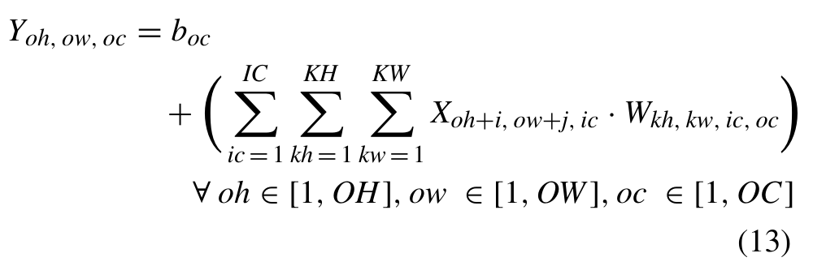

表 10. DS-CNN 的 MP 量化模型（使用 QKeras 语法，并新增了实现仿射均匀量化的 QActivation 层）。
<table><tr><td>#</td><td>层类型</td><td>输出形状</td><td>激活/权重位数 (INT)</td><td>偏置位数 (INT)</td></tr><tr><td>0</td><td>InputLayer</td><td>49, 10, 1</td><td></td><td></td></tr><tr><td>1</td><td>QActivation</td><td>49, 10, 1</td><td>16</td><td></td></tr><tr><td>2</td><td>QConv2DBatchnorm + ReLU</td><td>25,5,64</td><td>16</td><td>31</td></tr><tr><td>3</td><td>Dropout</td><td>25,5,64</td><td></td><td></td></tr><tr><td> $\overline { { 4 } }$ </td><td>QActivation</td><td>25,5,64</td><td>8</td><td></td></tr><tr><td>5</td><td>QDepthwiseConv2DBatchnorm + ReLU</td><td>25,5,64</td><td>8</td><td>16</td></tr><tr><td>6</td><td>QActivation</td><td>25,5,64</td><td>8</td><td></td></tr><tr><td>7</td><td>QConv2DBatchnorm + ReLU</td><td>25,5,64</td><td>4</td><td>31</td></tr><tr><td>8</td><td>QActivation</td><td>25,5,64</td><td>8</td><td></td></tr><tr><td>9</td><td>QDepthwiseConv2DBatchnorm + ReLU</td><td>25,5,64</td><td>8</td><td>16</td></tr><tr><td>10</td><td>QActivation</td><td>25,5,64</td><td>8</td><td></td></tr><tr><td>11</td><td>QConv2DBatchnorm + ReLU</td><td>25,5,64</td><td>4</td><td>16</td></tr><tr><td>12</td><td>QActivation</td><td>25,5,64</td><td>8</td><td></td></tr><tr><td>13</td><td>QDepthwiseConv2DBatchnorm + ReLU</td><td>25,5,64</td><td>4</td><td>16</td></tr><tr><td>14</td><td>QActivation</td><td>25,5,64</td><td>4</td><td></td></tr><tr><td>15</td><td>QConv2DBatchnorm + ReLU</td><td>25,5,64</td><td>4</td><td>16</td></tr><tr><td>16</td><td>QActivation</td><td>25,5,64</td><td>16</td><td></td></tr><tr><td>17</td><td>QDepthwiseConv2DBatchnorm + ReLU</td><td>25,5,64</td><td>16</td><td>31</td></tr><tr><td>18</td><td>QActivation</td><td>25,5,64</td><td>4</td><td></td></tr><tr><td>19</td><td>QConv2DBatchnorm + ReLU</td><td>25,5,64</td><td>4</td><td>16</td></tr><tr><td>20</td><td>QActivation</td><td>25,5,64</td><td>4</td><td></td></tr><tr><td>21</td><td>Dropout</td><td>25,5,64</td><td></td><td></td></tr><tr><td>22</td><td>AveragePooling2D</td><td>1,1,64</td><td></td><td></td></tr><tr><td>23</td><td>QActivation</td><td>1,1,64</td><td>16</td><td></td></tr><tr><td>24</td><td>Flatten</td><td>64</td><td></td><td></td></tr><tr><td>25</td><td>QDense</td><td>12</td><td>8</td><td>31</td></tr><tr><td>26</td><td>QActivation</td><td>12</td><td>16</td><td></td></tr><tr><td>27</td><td>Softmax</td><td>12</td><td></td><td></td></tr></table>

表 11. FC-AutoEncoder 的 MP 量化模型（使用 QKeras 语法，并新增了实现仿射均匀量化的 QActivation 层）。
<table><tr><td>#</td><td>层类型</td><td>输出形状</td><td>激活/权重位数 (INT)</td><td>偏置位数 (INT)</td></tr><tr><td>0</td><td>InputLayer</td><td>640</td><td></td><td></td></tr><tr><td>1</td><td>QActivation</td><td>640</td><td>4</td><td></td></tr><tr><td>2</td><td>QDense + BatchNormalization + ReLU</td><td>128</td><td>4</td><td>16</td></tr><tr><td>3</td><td>QActivation</td><td>128</td><td>16</td><td></td></tr><tr><td>4</td><td>QDense + BatchNormalization + ReLU</td><td>128</td><td>8</td><td>16</td></tr><tr><td>5</td><td>QActivation</td><td>128</td><td>8</td><td></td></tr><tr><td>6</td><td>QDense + BatchNormalization + ReLU</td><td>128</td><td>4</td><td>16</td></tr><tr><td>7</td><td>QActivation</td><td>128</td><td>4</td><td></td></tr><tr><td>8</td><td>QDense + BatchNormalization + ReLU</td><td>128</td><td>4</td><td>31</td></tr><tr><td>9</td><td>QActivation</td><td>128</td><td>4</td><td></td></tr><tr><td>10</td><td>QDense + BatchNormalization + ReLU</td><td>8</td><td>4</td><td>31</td></tr><tr><td>11</td><td>QActivation</td><td>8</td><td>16</td><td></td></tr><tr><td>12</td><td>QDense + BatchNormalization + ReLU</td><td>128</td><td>16</td><td>16</td></tr><tr><td>13</td><td>QActivation</td><td>128</td><td>8</td><td></td></tr><tr><td>14</td><td>QDense + BatchNormalization + ReLU</td><td>128</td><td>4</td><td>31</td></tr><tr><td>15</td><td>QActivation</td><td>128</td><td>8</td><td></td></tr><tr><td>16</td><td>QDense + BatchNormalization + ReLU</td><td>128</td><td>8</td><td>31</td></tr><tr><td>17</td><td>QActivation</td><td>128</td><td>8</td><td></td></tr><tr><td>18</td><td>QDense + BatchNormalization + ReLU</td><td>128</td><td>8</td><td>16</td></tr><tr><td>19</td><td>QActivation</td><td>128</td><td>16</td><td></td></tr><tr><td>20</td><td>QDense</td><td>640</td><td>8</td><td>16</td></tr><tr><td>21</td><td>QActivation</td><td>640</td><td>16</td><td></td></tr></table>

$X ~ \in ~ \mathbb { R } ^ { I H \times I W \times I C }$ 是输入激活张量，$W \in$ $\mathbb { R } ^ { K H \times K W \times I C }$ 是权重张量，$b\in\mathbb{R}^{OC}$ 是偏置数组，$Y \in \mathbb { R } ^ { O H \times O W \times O C }$ 是输出张量；(IH, IW) 和 (OH, OW) 分别是输入和输出张量的维度，IC

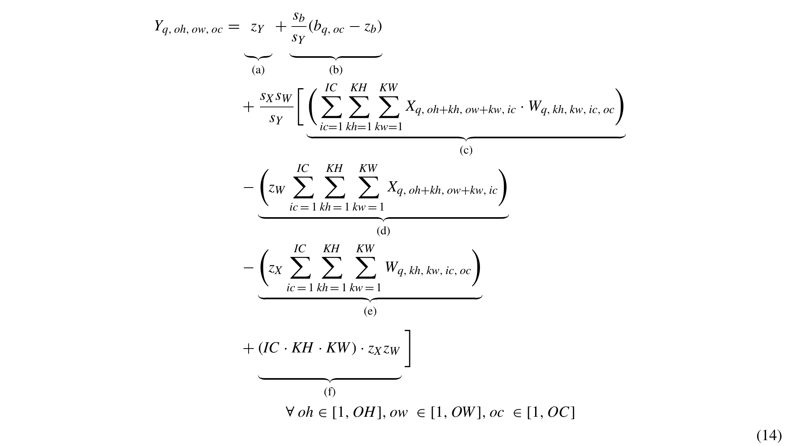

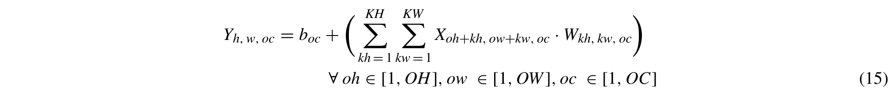

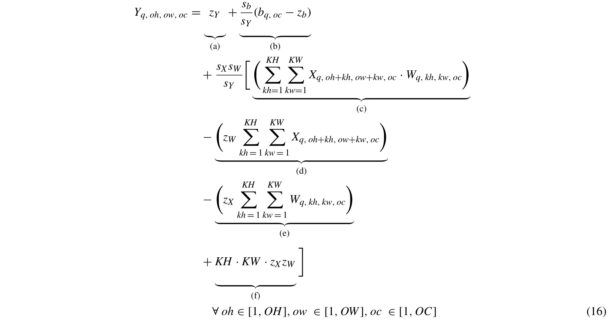

其中 OC 为输入和输出通道数，KH 和 KW 为卷积核维度。为了对其进行量化，我们首先对 (13) 中的每个实数变量应用 (4)。接着，设定它们各自的量化范围，并将量化后的输出数组 $Y _ { o h , o w , o c }$ 移至等式左侧，即得到如前一页顶部所示的量化 2D-Conv 表达式 (14)，该式对第 (oh, ow, oc) 个输出元素有效：

$X _ { q } , \ W _ { q } , \ b _ { q } , \ Y _ { q }$ 为整数值；$s _ { X } , s _ { W } , s _ { b } , s _ { Y }$ 为缩放因子；$z _ { X } , z _ { W } , z _ { b } , z _ { Y }$ 为分别与 X、W、b、Y 相关联的零点。在赋值给 $Y _ { q }$ 之前，(14) 的右侧会被舍入并截断以符合 $Y _ { q }$ 所期望的输出量化范围（为提高可读性，公式中未予显示）。项 的含义与第 III-A2 节中讨论的 FC 的 UIQ 公式中的相应项相同。与 (6) 相比，为了计算一个输出元素，项、 和 中的单重求和被替换为三重求和：其中两个求和的索引分别遍历卷积核维度 KH 和 KW（从 1 到 KH、KW），而第三个求和的索引则从 1 遍历到 IC。此外，项 中的常数 C 被替换为这三重求和的三个上界之积。

非量化的 DW-Conv 层表达式及其整数量化版本分别如前一页顶部的 (15) 和 (16) 所示。对于 (15)，X、Y 和 b 与 2D-Conv 中的张量相同，区别仅在于 $I C = O C$；而 W 则是形状为 $K H \times K W \times O C$ 的权重张量。式 (16) 由 (15) 推导而来，所采用的步骤与 FC 和 2D-Conv 的推导相同。它与 (14) 的区别在于求和的次数（两次而非三次），以及项 中不含 IC 常数。

正如第 III-A2 节中对 (6) 的讨论，本文同样假设 (14) 和 (16) 中的 $z _ { W } = 0$ 且 $z _ { b } = 0$。

## 附录 B

## MLPERF TINY 模型的混合精度结果

表 8–11 给出了在第 VI-A 节的加速器设计流程第一步中所得的 MP 量化 MLPerf Tiny 模型的架构。最后两列分别显示激活/权重和偏置的位数。

## 致谢

计算资源由 HPC@POLITO 提供，该项目是都灵理工大学控制与计算机工程系学术计算的一部分 (http://hpc.polito.it)。作者感谢其 former 硕士毕业生 Marco Alessio Terlizzi 完成 MLPerf Tiny 模型的 MP 训练。

## REFERENCES

[1] A. Gholami, S. Kim, Z. Dong, Z. Yao, M. W. Mahoney, and K. Keutzer, ‘‘A survey of quantization methods for efficient neural network inference,’’ in Low-Power Computer Vision: Improve the Efficiency of Artificial Intelligence. New York, NY, USA: Chapman & Hall, 2022, ch. 1.2.12, pp. 14–17.

[2] M. Rakka, M. E. Fouda, P. Khargonekar, and F. Kurdahi, ‘‘Mixed-precision neural networks: A survey,’’ 2022, arXiv:2208.06064.

[3] S. Anwar, K. Hwang, and W. Sung, ‘‘Fixed point optimization of deep convolutional neural networks for object recognition,’’ in Proc. IEEE Int. Conf. Acoust., Speech Signal Process. (ICASSP), South Brisbane, QLD, Australia, Apr. 2015, pp. 1131–1135.

[4] B. Moons, B. De Brabandere, L. Van Gool, and M. Verhelst, ‘‘Energyefficient ConvNets through approximate computing,’’ in Proc. IEEE Winter Conf. Appl. Comput. Vis. (WACV), Lake Placid, NY, USA, Mar. 2016, pp. 1–8.

[5] T. Hotfilter, J. Hoefer, P. Merz, F. Kreß, F. Kempf, T. Harbaum, and J. Becker, ‘‘Leveraging mixed-precision CNN inference for increased robustness and energy efficiency,’’ in Proc. IEEE 36th Int. System-on-Chip Conf. (SOCC), Santa Clara, CA, USA, Sep. 2023, pp. 1–6.

[6] L. Mei, M. Dandekar, D. Rodopoulos, J. Constantin, P. Debacker, R. Lauwereins, and M. Verhelst, ‘‘Sub-word parallel precision-scalable MAC engines for efficient embedded DNN inference,’’ in Proc. IEEE Int. Conf. Artif. Intell. Circuits Syst. (AICAS), Hsinchu, Taiwan, Mar. 2019, pp. 6–10.

[7] L. Urbinati and M. R. Casu, ‘‘A reconfigurable multiplier/dot-product unit for precision-scalable deep learning applications,’’ in Proc. SIE, Pizzo, Italy, 2022, pp. 9–14.

[8] L. Urbinati and M. R. Casu, ‘‘Design-space exploration of mixed-precision DNN accelerators based on sum-together multipliers,’’ in Proc. 18th Conf. Ph.D Res. Microelectron. Electron. (PRIME), Valencia, Spain, Jun. 2023, pp. 377–380.

[9] V. Camus, L. Mei, C. Enz, and M. Verhelst, ‘‘Review and benchmarking of precision-scalable multiply-accumulate unit architectures for embedded neural-network processing,’’ IEEE J. Emerg. Sel. Topics Circuits Syst., vol. 9, no. 4, pp. 697–711, Dec. 2019.

[10] L. Urbinati and M. R. Casu, ‘‘A reconfigurable depth-wise convolution module for heterogeneously quantized DNNs,’’ in Proc. IEEE Int. Symp. Circuits Syst. (ISCAS), Austin, TX, USA, May 2022, pp. 128–132.

[11] L. Urbinati and M. R. Casu, ‘‘A reconfigurable 2D-convolution accelerator for DNNs quantized with mixed-precision,’’ in Proc. Appl. Electron. Per vading Ind., Environ. Soc. (ApplePies), Genoa, Italy, 2023, pp. 210–215.

[12] W. Liu, J. Lin, and Z. Wang, ‘‘A precision-scalable energy-efficient convolutional neural network accelerator,’’ IEEE Trans. Circuits Syst. I, Reg. Papers, vol. 67, no. 10, pp. 3484–3497, Oct. 2020.

[13] B. Jacob, S. Kligys, B. Chen, M. Zhu, M. Tang, A. Howard, H. Adam, and D. Kalenichenko, ‘‘Quantization and training of neural networks for efficient integer-arithmetic-only inference,’’ in Proc. IEEE/CVF Conf. Comput. Vis. Pattern Recognit., Salt Lake City, UT, USA, Jun. 2018, pp. 2704–2713.

[14] H. Wu, P. Judd, X. Zhang, M. Isaev, and P. Micikevicius, ‘‘Integer quantization for deep learning inference: Principles and empirical evaluation,’ 2020, arXiv:2004.09602.

[15] C. Banbury et al., ‘‘MLPerf tiny benchmark,’’ 2021, arXiv:2106.07597.

[16] C. N. Coelho, A. Kuusela, S. Li, H. Zhuang, J. Ngadiuba, T. K. Aarrestad, V. Loncar, M. Pierini, A. A. Pol, and S. Summers, ‘‘Automatic heteroge neous quantization of deep neural networks for low-latency inference on the edge for particle detectors,’’ Nature Mach. Intell., vol. 3, no. 8, pp. 675–686, Jun. 2021.

[17] M. Gautschi, P. D. Schiavone, A. Traber, I. Loi, A. Pullini, D. Rossi, E. Flamand, F. K. Gürkaynak, and L. Benini, ‘‘Near-threshold RISC-V core with DSP extensions for scalable IoT endpoint devices,’’ IEEE Trans. Very Large Scale Integr. (VLSI) Syst., vol. 25, no. 10, pp. 2700–2713, Oct. 2017.

[18] A. Garofalo, G. Tagliavini, F. Conti, L. Benini, and D. Rossi, ‘‘XpulpNN: Enabling energy efficient and flexible inference of quantized neural networks on RISC-V based IoT end nodes,’’ IEEE Trans. Emerg. Topics Comput., vol. 9, no. 3, pp. 1489–1505, Jul. 2021.

[19] H. Sharma, J. Park, N. Suda, L. Lai, B. Chau, V. Chandra, H. Esmaeilzadeh, and J. K. Kim, ‘‘Bit fusion: Bit-level dynamically composable architecture for accelerating deep neural network,’’ in Proc. ACM/IEEE 45th Annu. Int. Symp. Comput. Archit. (ISCA), Los Angeles, CA, USA, Jun. 2018, pp. 764–775.

[20] W. Li, A. Hu, G. Wang, N. Xu, and G. He, ‘‘Low-complexity precisionscalable multiply-accumulate unit architectures for deep neural network accelerators,’’ IEEE Trans. Circuits Syst. II, Exp. Briefs, vol. 70, no. 4, pp. 1610–1614, Apr. 2023.

[21] R. Lin, ‘‘Reconfigurable parallel inner product processor architectures,’ IEEE Trans. Very Large Scale Integr. (VLSI) Syst., vol. 9, no. 2, pp. 261–272, Apr. 2001.

[22] X. Zhang, Z. Li, and Q. Zheng, ‘‘Design of a configurable fixedpoint multiplier for digital signal processor,’’ in Proc. Asia–Pacific Conf. Postgraduate Res. Microelectron. Electron. (PrimeAsia), Shanghai, China, Jan. 2009, pp. 217–220.

[23] B. Moons, R. Uytterhoeven, W. Dehaene, and M. Verhelst, ‘‘14.5 envision: A 0.26-to-10 TOPS/W subword-parallel dynamic-voltageaccuracy-frequency-scalable convolutional neural network processor in 28 nm FDSOI,’’ in Proc. IEEE Int. Solid-State Circuits Conf. (ISSCC), San Francisco, CA, USA, Feb. 2017, pp. 246–247.

[24] D. Shin, J. Lee, J. Lee, and H.-J. Yoo, ‘‘14.2 DNPU: An 8.1 TOPS/W reconfigurable CNN-RNN processor for general-purpose deep neural networks,’’ in Proc. IEEE Int. Solid-State Circuits Conf. (ISSCC), San Francisco, CA, USA, Feb. 2017, pp. 240–241.

[25] J. Lee, C. Kim, S. Kang, D. Shin, S. Kim, and H.-J. Yoo, ‘‘UNPU: An energy-efficient deep neural network accelerator with fully variable weight bit precision,’’ IEEE J. Solid-State Circuits, vol. 54, no. 1, pp. 173–185, Jan. 2019.

[26] S. Sharify, A. D. Lascorz, K. Siu, P. Judd, and A. Moshovos, ‘‘Loom: Exploiting weight and activation precisions to accelerate convolutiona neural networks,’’ in Proc. 55th ACM/ESDA/IEEE Design Autom. Conf. (DAC), San Francisco, CA, USA, Jun. 2018, pp. 1–6.

[27] R. Krishnamoorthi, ‘‘Quantizing deep convolutional networks for efficient inference: A whitepaper,’’ 2018, arXiv:1806.08342.

[28] M. Horowitz, ‘‘1.1 computing’s energy problem (and what we can do about it),’’ in IEEE Int. Solid-State Circuits Conf. (ISSCC) Dig. Tech. Papers, San Francisco, CA, USA, Feb. 2014, pp. 10–14.

[29] A. Pappalardo, Y. Umuroglu, M. Blott, J. Mitrevski, B. Hawks, N. Tran, V. Loncar, S. Summers, H. Borras, J. Muhizi, M. Trahms, S.-C. Hsu, S. Hauck, and J. Duarte, ‘‘QONNX: Representing arbitrary-precision quantized neural networks,’’ 2022, arXiv:2206.07527.

[30] P. P. Ray, ‘‘A review on TinyML: State-of-the-art and prospects,’’ J. King Saud Univ. Comput. Inf. Sci., vol. 34, no. 4, pp. 1595–1623, Apr. 2022.

[31] A. Chowdhery, P. Warden, J. Shlens, A. Howard, and R. Rhodes, ‘‘Visual wake words dataset,’’ 2019, arXiv:1906.05721.

[32] T.-Y. Lin, M. Maire, S. Belongie, J. Hays, P. Perona, D. Ramanan, P. Dollár, and C. L. Zitnick, ‘‘Microsoft COCO: Common objects in context,’’ in Proc. 13th Eur. Conf. Comput. Vis. (ECCV), Zurich, Switzerland, 2014, pp. 740–755.

[33] A. G. Howard, M. Zhu, B. Chen, D. Kalenichenko, W. Wang, T. Weyand, M. Andreetto, and H. Adam, ‘‘MobileNets: Efficient convolutional neura networks for mobile vision applications,’’ 2017, arXiv:1704.04861.

[34] A. Krizhevsky, ‘‘Learning multiple layers of features from tiny images,’’ M.S. thesis, Dept. Comput. Sci., Univ. Toronto, Toronto, ON, Canada, Apr. 2009. [Online]. Available: https://www.cs.toronto.edu

[35] K. He, X. Zhang, S. Ren, and J. Sun, ‘‘Deep residual learning for image recognition,’’ in Proc. IEEE Conf. Comput. Vis. Pattern Recognit. (CVPR), Las Vegas, NV, USA, Jun. 2016, pp. 770–778.

[36] P. Warden, ‘‘Speech commands: A dataset for limited-vocabulary speech recognition,’’ 2018, arXiv:1804.03209.

[37] Y. Zhang, N. Suda, L. Lai, and V. Chandra, ‘‘Hello edge: Keyword spotting on microcontrollers,’’ 2017, arXiv:1711.07128.

[38] Y. Koizumi, Y. Kawaguchi, K. Imoto, T. Nakamura, Y. Nikaido, R. Tanabe, H. Purohit, K. Suefusa, T. Endo, M. Yasuda, and N. Harada, ‘‘Descrip tion and discussion on DCASE2020 Challenge Task2: Unsupervised anomalous sound detection for machine condition monitoring,’’ 2020, arXiv:2006.05822.

[39] Y. Koizumi, S. Saito, H. Uematsu, N. Harada, and K. Imoto, ‘‘ToyADMOS: A dataset of miniature-machine operating sounds for anomalous sound detection,’’ in Proc. IEEE Workshop Appl. Signal Process. Audio Acoust. (WASPAA), New Paltz, NY, USA, Oct. 2019, pp. 313–317.

[40] X. Sun, N. Wang, C.-Y. Chen, J. Ni, A. Agrawal, X. Cui, S. Venkataramani, K. El Maghraoui, V. V. Srinivasan, and K. Gopalakrishnan, ‘‘Ultra-low precision 4-bit training of deep neural networks,’’ in Advances in Neural Information Processing Systems, vol. 33, H. Larochelle, M. Ranzato, R. Hadsell, M. F. Balcan, and H. Lin, Eds. Red Hook, NY, USA: Curran Associates, 2020, pp. 1796–1807.

[41] N. H. E. Weste and D. M. Harris, CMOS VLSI Design, 4th ed. Reading, MA, USA: Addison-Wesley, 2011, ch. 11.

[42] Y.-H. Chen, J. Emer, and V. Sze, ‘‘Eyeriss: A spatial architecture for energy-efficient dataflow for convolutional neural networks,’’ in Proc. ACM/IEEE 43rd Annu. Int. Symp. Comput. Archit. (ISCA), Jun. 2016, pp. 367–379.

[43] L. Zhang, Q. Lv, D. Gao, X. Zhou, W. Meng, Q. Yang, and C. Zhuo, ‘‘A fine-grained mixed precision DNN accelerator using a two-stage big– little core RISC-V MCU,’’ Integration, vol. 88, pp. 241–248, Jan. 2023.

[44] G. Ottavi, A. Garofalo, G. Tagliavini, F. Conti, A. D. Mauro, L. Benini, and D. Rossi, ‘‘Dustin: A 16-cores parallel ultra-low-power cluster with 2 b-to-32 b fully flexible bit-precision and vector lockstep execution mode,’ IEEE Trans. Circuits Syst. I, Reg. Papers, vol. 70, no. 6, pp. 2450–2463, Mar. 2023.

[45] A. Burrello, A. Garofalo, N. Bruschi, G. Tagliavini, D. Rossi, and F. Conti, ‘‘DORY: Automatic end-to-end deployment of real-world DNNs on low cost IoT MCUs,’’ IEEE Trans. Comput., vol. 70, no. 8, pp. 1253–1268, Aug. 2021.

[46] TensorFlow. TensorFlow Hub. Accessed: Jan. 19, 2024. [Online]. Avail able: https://tfhub.dev

[47] TensorFlow. TensorFlow Lite Example Apps. Accessed: Jan. 19, 2024. [Online]. Available: https://www.tensorflow.org/lite/examples

[48] Intel. Neural Compute Application Zoo. Accessed: Jan. 19, 2024. [Online]. Available: https://movidius.github.io/ncappzoo/

[49] Intel. (2023). OpenVINO Model Zoo. Accessed: Jan. 19, 2024. [Online]. Available: https://docs.openvino.ai/2023.2/modelzoo.html

[50] AMD Xilinx. Vitis AI Model Zoo. Accessed: Jan. 19, 2024. [Online]. Available: https://docs.xilinx.com/r/en-U.S./ug1414-vitis-ai/Vitis-AI-Mo del-Zoo

[51] NVIDIA. NVIDIA NGC Catalog. Accessed: Jan. 19, 2024. [Online]. Available: https://catalog.ngc.nvidia.com/models

[52] NVIDIA. Jetson Model Zoo. Accessed: Jan. 19, 2024. [Online]. Available: https://elinux.org/JetsonZoo

[53] M. A. Mansoori and M. R. Casu, ‘‘Multi-objective framework for training and hardware co-optimization in FPGAs,’’ in Proc. Applications Electron. Pervading Ind., Environ. Soc. (ApplePies), Genoa, Italy, 2023, pp. 273–278.

[54] Catapult Synthesis User and Reference Manual, Mentor Graph. Corp., Wilsonville, OR, USA, 2018.

[55] K. Khalil, O. Eldash, A. Kumar, and M. Bayoumi, ‘‘Designing novel AAD pooling in hardware for a convolutional neural network accelerator,’’ IEEE Trans. Very Large Scale Integr. (VLSI) Syst., vol. 30, no. 3, pp. 303–314, Mar. 2022.

[56] P. Davide Schiavone, F. Conti, D. Rossi, M. Gautschi, A. Pullini, E. Flamand, and L. Benini, ‘‘Slow and steady wins the race? A comparison of ultra-low-power RISC-V cores for Internet-of-Things applications,’’ in Proc. 27th Int. Symp. Power Timing Model., Optim. Simul. (PATMOS), Thessaloniki, Greece, Sep. 2017, pp. 1–8.

LUCA URBINATI（IEEE 研究生会员）于 2017 年获得意大利博洛尼亚大学（Università di Bologna）电子与电信学学士学位，并于 2019 年获得意大利都灵理工大学（Politecnico di Torino）电子工程硕士学位，目前在该校攻读博士学位。

他还与食品安全、嵌入式系统和高层次综合等其他学科的研究者开展合作。他的研究兴趣包括面向人工智能（AI）与机器学习的集成架构，尤其关注通过软硬件协同设计（HW–SW co-design）方法在嵌入式边缘设备上实现 AI 算法。

MARIO R. CASU（IEEE 高级会员）于 2001 年获得意大利都灵理工大学（Politecnico di Torino）电子与通信工程博士学位。

他现任都灵理工大学副教授。他的研究兴趣包括带有专用加速器的片上系统（SoC）、面向 FPGA 与 ASIC 的系统级设计和设计方法学，以及嵌入式机器学习。他还关注面向生物医学、汽车和食品等工业应用的电路、系统与平台设计。他过去的工作主要集中在 SoC 与片上网络的延迟无关设计。他定期担任 DAC、ICCAD 和 DATE 等国际会议的技术程序委员会成员。