# Finding the Pareto Frontier of Low-Precision Data Formats and MAC Architecture for LLM Inference 原文翻译

# 寻找用于 LLM 推理的低精度数据格式与 MAC 架构的帕累托前沿

Brian Crafton1, Xiaochen Peng1, Xiaoyu Sun1, Ashwin Lele1, Bo Zhang1, Win-San Khwa2, 和 Kerem Akarvardar1 1TSMC 企业研究部，美国圣何塞。2TSMC 企业研究部，台湾新竹。

摘要——为加速 AI 应用，研究人员提出了众多数据格式和矩阵乘法的物理实现，形成了一个复杂的设计空间。本文研究整数、浮点、posit 和对数数制（LNS）数据格式，以及微缩放（MX）和向量缩放量化（VSQ）块数据格式的高效 MAC 实现。我们评估了超过 25,000 种 MAC 设计的面积、功耗和数值精度（以信号量化噪声比评估），这些设计涵盖了上述每种数据格式，以及内积规模和累加位宽等若干关键设计参数。我们发现，在相同数值精度下，采用新兴数据格式（LNS16、MXINT8、VSQINT4）的帕累托最优 MAC 设计，与 FP16、FP8 和 FP4 点积实现相比，分别实现了 1.8×、2.2× 和 1.9× 的 TOPs/W 提升。

## I. 引言

现代人工智能（AI）应用的计算需求催生了整个硬件加速产业。尽管处理这些应用的系统级架构多种多样，但所有领先的 AI 处理器都利用了量化技术和用于矩阵乘法的定制硬件。

量化通过将较高精度（FP32）的权重和激活值转换为 INT8 或 FP8 等较低精度的数据格式，实现更窄的数据格式 [10]、[13]、[26]。减少每个权重或激活值使用的比特数，可以使有效内存容量和带宽获得线性提升，并使面积效率和能效获得平方级提升。凭借这些改进，量化技术迅速在商业设计中得到广泛采用。NVIDIA 最近在 Blackwell 中加入 FP4 和 FP6 支持就是一个例子 [37]。随着商业领域的关注和成功应用，人们提出了大量新的数据格式以及所谓的块数据格式 [7]、[9]。这些数据格式共同构成了一个丰富的设计空间，能够以较低的面积和功耗开销改善动态范围。

提升性能的第二个因素是定制矩阵乘法硬件。大多数现代商用 AI 加速器都配备了某种矩阵乘法加速器，例如 NVIDIA GPU 中的 Tensor Core [1] 或 Google 的张量处理单元（TPU）[20]。在这些矩阵乘法加速器中，可以使用比传统乘法器和加法器更高效的专用融合点积单元 [16]。除了降低逻辑复杂度外，定制矩阵乘法单元还能并行处理更多运算，从而减少处理器数据通路的开销。

新数据格式与矩阵乘法物理实现的结合，形成了一个值得探索的复杂设计空间。向更窄数据格式和更低精度硬件发展的趋势，归根结底是在数值精度与硬件效率之间进行权衡。因此，为有效评估这一设计空间，有必要同时根据数值精度、面积效率和能效来比较数据格式及其硬件实现。

在本研究中，我们评估了整数、浮点、posit [15] 和对数数制（LNS）数据格式，以及微缩放（MX）[9] 和向量缩放量化（VSQ）[7] 块数据格式的高效 MAC 实现。针对这些数据格式和各种 MAC 设计参数，包括内积规模、外积规模、累加位宽等，我们设计、实现、验证并评估了超过 25,000 种 MAC 实现。接着，我们展示了在若干大语言模型（LLM）基准测试中，综合考虑功耗、性能和数值精度的帕累托最优 MAC 设计。首先，我们发现，在相同数值精度下，LNS、MX 和 VSQ 比整数和浮点格式具有更高的面积效率和能效。其次，我们发现，选择最优的 MAC 设计参数，尤其是内积规模和累加位宽，对于实现较高的面积效率和能效至关重要。最后，我们表明，在相同数值精度下，采用不同位宽的新兴格式（LNS16、MX-INT8、VSQINT4）的帕累托最优 MAC 设计，与 FP16、FP8 和 FP4 点积实现相比，分别实现了 1.8×、2.2× 和 1.9× 的 TOPs/W 提升。

## II. 背景与相关工作

## A. 面向 AI 的数据格式

为评估数据格式的设计空间，我们研究并评估了四种具有独特性质的常见数据格式：整数、浮点、posit 和对数数制（LNS）。为介绍这些数据格式之间的关键差异，我们在图 1 中展示了每种数据格式在 4 位精度下的 16 个实数值（表示值）。每种数据格式都具有不同的动态范围（最大值除以最小值）和步长。当权重或激活值分布的方差较大时，需要较大的动态范围；然而，当数据格式的动态范围过大而无必要时，许多比特模式就会被浪费。因此，理想情况下，目标数据格式的动态范围应尽可能匹配数据分布的方差。

整数（INT）和浮点（FP）数据格式是 AI 模型中常用的数据格式。对于整数和浮点格式，我们均遵循 [32] 中的规范。对于整数，采用隐式缩放因子和对称范围，使原始值的范围为：$[ - 1 \frac { 6 3 } { 6 4 } , + 1 \frac { 6 3 } { 6 4 } ]$ ]。对于浮点格式，E5M2、E4M3、E3M2 和 E2M1 遵循 [32]，FP32 和 FP16 遵循 [2]。

posit 数据格式 [15] 是一种相对较新的浮点替代格式，具有更大的动态范围、更少的无效比特模式，并采用渐变分布，在零附近分配更多比特模式。与浮点格式类似，posit 具有符号位、指数（位宽为“es”）和小数字段——小数字段的作用类似于尾数，但不具有次正规数行为。posit 还增加了一个采用游程编码的区段（regime）字段。这意味着字段的大小和位置是动态的，因此需要复杂的解码逻辑 [24]。不过，这些动态字段形成了一种渐变分布，具有更大的动态范围，并在零附近分配更多比特模式。图 1 包含一个具有 1 位指数字段（E1）的 4 位 posit。

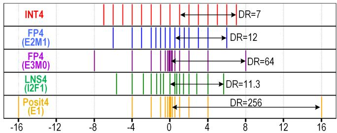  
图 1. INT4、FP4 E2M1 & E3M0、LNS4 和 posit4 的 16 个实数值。动态范围（DR）因数据格式而异。

对数数制（LNS）最初用于简化乘法：将乘法转移到对数域，使其变为加法 [35]。此后，若干研究 [19]、[29]、[41] 将同样的思想用于降低 AI 应用中矩阵乘法的成本。用浮点术语来说，LNS 使用符号位（s）和指数来编码一个数，而不设置尾数或小数字段。为提高 LNS 的精度，近期研究提出了多维对数数制（MDLNS）[41] 或多基对数数制 [19]。在本研究中，我们采用 [41] 中展示的 MDLNS 的一个特例，其中指数被替换为包含整数部分和小数部分的定点数。例如，对于 8 位（I4F3）LNS，其指数包含 4 个整数位（int）和 3 个小数位（frac），可将其建模为如下形式的双基 MDLNS：

$$
(- 1) ^ {s} \cdot 2 ^ {i n t} \cdot \sqrt [ 8 ]{2} ^ {f r a c}
$$

## B. 块数据格式

为提高低精度下的准确性，研究者提出了一类相对较新的数据格式，称为块数据格式 [9]。总体而言，块数据格式为一个数据块使用共享的缩放因子或指数，其中一个块通常包含来自同一矩阵或向量的 32 至 64 个相邻权重或激活值。共享缩放因子的优点是，能够以较低的存储、面积和功耗开销，为一个数据块提供更大的有效动态范围。我们评估的两种块数据格式是微缩放（Microscaling，MX）[33] 和向量缩放量化（Vector-Scaled Quantization，VSQ）[7]。MX 定义了一种标准，其中一个包含 32 个权重或激活值的数据块共享一个 8 位指数缩放因子（E8M0）。VSQ 则为一个包含 64 个权重或激活值的向量应用线性缩放因子 [7]、[22]。尽管先前工作使用 FP32 [7] 和 INT8 [22] 缩放因子，我们使用 FP8（E5M2）缩放因子，因为在我们的评估中，它在硬件成本与数值准确性之间实现了最佳权衡。与 MX 相比，VSQ 的主要优势在于，缩放因子不受限于 2 的幂，因此能够提供更高的精度。然而，对数据重新缩放的成本更高，需要使用乘法而非移位操作。尽管还有其他一些工作符合块数据格式的判定标准 [8]、[12]、[23]、[36]，我们认为，它们在设计上均与 MX 或 VSQ 类似，即为一个数据块使用共享指数或线性缩放因子。

## C. 矩阵乘法单元设计

现代 AI 处理器采用专用矩阵乘法硬件，以同时获得指令级并行性以及更高的面积和能量效率。传统上，GPU 在一个线程束（warp），即执行相同操作但处理不同数据的 32 个线程上，执行单指令多数据（SIMD）操作。在这种执行模型中，32 条独立的乘累加指令作用于 32 个不同的数据。虽然这种模型为程序员提供了通用性，但它未能利用融合操作在面积和能量效率方面的优势。最简单的例子是 DP4（4 输入点积）指令，其实现为：$\begin{array} { r } { C = \sum _ { n = 1 } ^ { 4 } A _ { i } \cdot B _ { i } , } \end{array}$，其中 A 和 B 是包含 4 个输入的向量。

点积的实现方式，以及各种因素如何影响功耗、性能、面积和准确性，已成为多项研究的主题 [14]、[17]、[21]、[27]、[30]、[34]。点积单元传统上实现为由乘法器和加法器组成的网络，但最初的所谓“融合”点积实现表明，通过融合乘法器和加法器网络，面积和功耗最多可降低 40% [34]。图 2 展示了 4 输入 FP8（E4M3）点积单元的设计，其采用 MX 缩放以及 FP32（或 FP16）

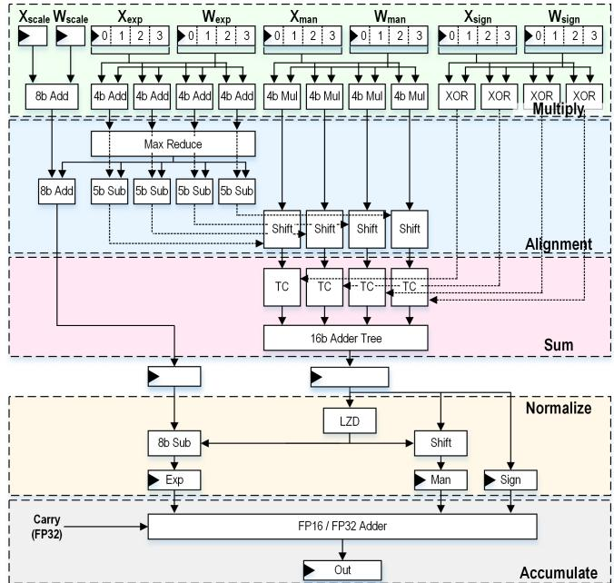  
图 2. 4 输入融合式 FP8（E4M3）点积单元示意图。颜色编码对应于图 4 中的面积和功耗细分。

累加。在融合式点积中，乘法的执行方式与基线方法类似，但所有四个乘积的对齐和累加会在任何规格化或舍入操作之前一并完成。累加后，仅执行一次规格化和舍入步骤，从而降低面积、功耗和延迟。Intel 的两项设计 [17]、[21] 将这一思想扩展到 32 个输入项，进一步摊薄了对齐和规格化的成本，有效提高了面积和能量效率。

作为点积操作（向量与向量相乘）的扩展，一些商用设计引入了专用硬件，将向量与矩阵相乘以及矩阵与矩阵相乘作为单个操作来执行。NVIDIA 在 Volta 架构 [1] 中引入的 Tensor Core 是最广为人知的例子。第一版 Tensor Core 每个时钟周期执行一次 4×4×4 矩阵乘法，相比仅使用 CUDA 核心的上一代架构（Pascal），FP16 吞吐量提高了 6×（21.2→125 TOPs）。后续版本的 Tensor Core 将维度从 4×4×4（Volta）增至 8×8×4（Ampere），再增至 16×8×4（Hopper），从而提高了吞吐量。虽然执行融合式矩阵与矩阵相乘的主要优势是指令级并行性，但预处理逻辑和输入寄存器均可共享，因此也能适度节省面积和功耗。

融合式点积可以比传统设计实现更高的数值准确性，因为它避免了各次操作之间的截断。然而，大多数融合式点积实现会在对齐后截断乘积，以避免不必要的过宽内部数据通路（对于 FP16，超过 90 位）。不同商用设计的累加位宽差异很大，包括 Samsung 移动处理器中的 22 位 [31]、NVIDIA Tensor Core 中的 24 位 [16]、Intel 加速器中的 37 位 [17]，以及 ARM DP4 IP 中的 69 位 [27]。然而，对于机器学习应用，[4] 表明，即使截断至低至 16 位（对于 FP16），也不会造成任何显著的数值准确性损失。

随着 MX 和 VSQ 等块数据格式的出现，一些设计 [9]、[27]、[37] 已将块缩放实现为 MAC 设计的一部分。传统的逐层或逐通道量化可以在软件中高效执行，其中一个缩放因子可能由张量中的数千个值共享。然而，块数据格式的细粒度缩放需求要求将缩放因子集成到 MAC 操作内部，以最大限度地提高效率 [9]、[39]。图 2 展示了如何将 MX 缩放集成到点积中：首先并行地将缩放因子相加，然后在规格化之前，将其结果加到最大指数上。

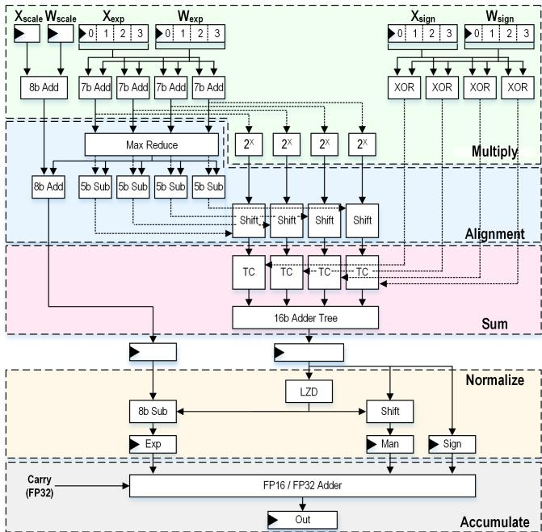  
图 3. 4 输入融合式 LNS8（I4F3）点积单元示意图。颜色编码对应于图 4 中的面积和功耗细分。

## III. MAC 设计与评估

## A. MAC 架构

图 2 中，我们介绍了可配置的 4 输入浮点点积单元架构。对于 posit 和 LNS，我们对该设计进行了调整，以便公平地评估应用于各数据格式的设计优化。遵循先前工作 [24]、[30]，我们发现，实现 posit 点积的最高效方式是先将 posit 转换为浮点数，然后以浮点形式执行点积。需要指出的是，posit 到浮点数的转换在面积和功耗方面的成本都很高，近期工作重新定义了 posit，使解码步骤的成本有所降低 [18]。Posit 的字段大小还会动态变化，因此需要更高精度的乘法器和加法器。

图 3 展示了我们针对 LNS 的 4 输入点积设计。为实现 8 位（1 位符号、4 位整数、3 位小数，即 I4F3）LNS，使用 7 位加法替代尾数乘法和指数加法模块。接下来，使用以 2 为底的定点指数函数，将结果的小数部分（最低 3 位）从对数域转换出来。在我们的 Verilog 实现中，我们使用相应的 Synopsys Designware 定点 IP（DW exp2）。结果的整数部分（最高 5 位）可以通过对小数部分进行移位来处理。点积中的求和、规格化和累加部分仍与浮点设计基本相似。

## B. 评估方法

为了评估各种数据格式的 MAC 实现，我们考虑三个关键评价指标：面积效率、能量效率和数值精度。为了评估面积效率和能量效率，我们针对每种数据格式在不同比特精度下设计、实现、验证并优化 Verilog 模型。每种数据格式的 Verilog 模型均采用参数化设计，因此我们可以扫描下一节研究的各种优化参数（内积大小、累加位宽、流水线级数等）。为了验证每种 MAC 设计，我们创建了一个 Python 仿真器，并使用 10,000 个测试向量进行验证，特别关注 NaN、无穷大、次正规数和零等特殊情况。我们在 5nm CMOS 工艺下，以 1 GHz 频率和 750mV VDD（TT 工艺角）对每种 MAC 设计进行综合，并收集面积（um2）和关键路径（ns）结果。接下来，我们使用从 4 个 LLM 基准测试中采样的 100 个向量，对综合后的 MAC 设计进行仿真，并使用 Synopsys PrimePower 提取功耗（mW）。在图 5 至图 10 中，我们交替使用 TOPs/W 和 TOPs/mm2，以兼顾这两项评价指标。我们发现，TOPs/W 和 TOPs/mm2 的提升具有很强的相关性，尤其是在 VDD 固定时。

虽然面积效率和能量效率是评估 AI 硬件的常用指标，但数值精度对于公平比较也同样重要。这是因为，在转向更低精度的数据格式或更高效的 MAC 设计时，主要的权衡在于数值精度。遵循 [9]，我们使用信号量化噪声比（SQNR）来评估数值精度。不过，我们使用量化矩阵乘法的结果来计算 SQNR，以将 MAC 设计引入的数值误差纳入考虑。我们根据以下公式计算每种 MAC 设计的 SQNR：

$$
S Q N R = - 1 0 \log (\frac {| | Q (X) \cdot Q (W) - X \cdot W | | ^ {2}}{| | X \cdot W | | ^ {2}})
$$

其中，X 和 W 分别是 FP32 格式的激活值和权重，Q 是将 FP32 映射到量化数据格式（例如 FP8）的量化函数，且 $\textstyle | | X | | = ( \sum _ { i = 1 } ^ { N } x _ { i } ^ { 2 } ) ^ { 1 / 2 }$

SQNR 是一个简单而强大的评价指标，因为它随数据格式的比特数线性变化，并使我们能够公平地比较各种数据格式及其 MAC 实现。然而，SQNR 与应用准确率之间的关系取决于模型和任务，而且通常是非线性的。但如果我们假设 SQNR 与应用准确率之间的关系大体上是单调的，那么我们就可以有效地比较达到相近 SQNR 的数据格式。为了评估每种 MAC 设计的 SQNR，我们从在 Hellaswag 数据集 [40] 上运行的 OpenELM-1B [28] 和 Llama3.2-1B [38]，以及在 STSB 数据集 [6] 上运行的 BERT-Large [25] 和 RoBERTa-Large [25] 的每一层中随机采样向量内积。我们首先计算这些向量内积的 FP32 结果作为参考。接下来，我们根据目标数据格式的最大值与采样这些向量的张量的最大值之比，对向量进行缩放。这确保了目标数据格式的整个数值范围都得到利用。然后，我们将向量量化为目标数据格式，并使用每种 MAC 设计计算向量内积。为了使用较小的 MAC 设计执行较大的向量内积，我们将其分解为若干次运算，并以 FP32 精度累加部分和。最后，我们相对于 FP32 参考结果计算 SQNR。

## C. MAC 设计特性分析

在图 4 中，我们使用标称 MAC 设计，对每种数据格式进行基线评估（面积、功耗和 SQNR），作为下一节设计优化的参考。对于每种数据格式，我们均使用具有 16 个输入、累加位宽为 16、流水线级数为 1 的 MAC。为了表征面积和功耗，我们展示了在 5nm CMOS 工艺下每种 MAC 实现的模块级细分结果。根据图 4 中的结果，我们得出以下初步观察：1 由于设计参数的设置，INT8、FP8（E4M3）和 LNS8（I4F3）的面积和功耗相近。由于累加位宽固定为 16 位，INT4 的功耗效率和面积效率明显高于 FP4（E2M1）和 LNS4（I2F1）。在后续章节中，我们将展示改变设计参数如何导致面积和功耗出现大幅变化。2 由于 FP 转换开销，Posit（E1）的面积和功耗几乎是其他数据格式的 2×。不过，由于动态范围更大，它也实现了最佳的 SQNR。3 乘法在 INT 设计中占据相当大的比例，但 FP（E4M3）仅需要一个 4 位乘法器，而 4/6/8 位 LNS 中以 2 为底的指数运算逻辑开销可以忽略不计。4 对于 4/6/8 位数据格式，单个流水线级（图 4 中的寄存器部分）会带来显著的面积和功耗开销。5 平均而言，复杂数据格式（FP、posit、LNS）实现的 SQNR 高于 INT，因为它们具有更大的动态范围，而这对于所考虑的 transformer 模型是必需的。

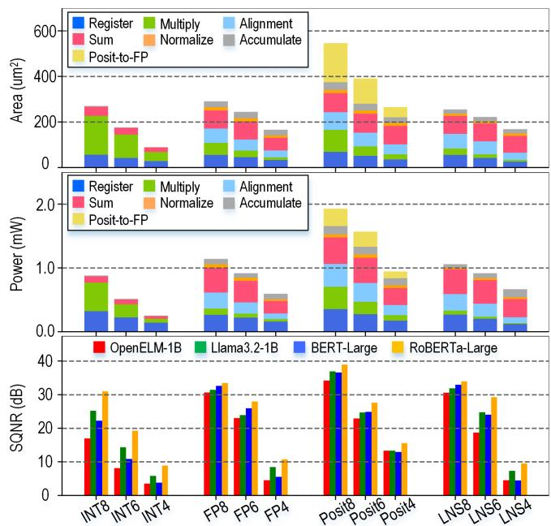  
图 4. 整数、浮点、posit 和 LNS 的 8 位、6 位和 4 位 MAC 设计的面积、功耗和 SQNR。

## D. MAC 设计优化

内积规模：在第 II 节中，我们讨论了融合点积的内积规模（输入项数量）如何显著影响面积效率和能效。为了了解各数据格式如何受益于更大的内积规模，我们对基准 MAC 设计的内积规模进行扫描，并在图 5 中评估其能效（TOPs/W）。首先，我们发现，增大 MAC 的内积规模可以提高所有数据格式的能效。为了更好地理解这一现象，我们在图 6 中绘制了 FP8 MAC 的每个 MAC 归一化面积构成。这一提升源于规格化、累加以及累加后寄存器的开销得到分摊。然而，当规格化和累加在 MAC 面积中所占的比例变得可以忽略不计时，这种提升便趋于饱和。其次，我们发现，相比 INT8，复杂数据格式（FP8、LNS8、posit8）从输入项数量增加中获益更多，因为整数点积不执行规格化，而且累加的开销显著更低（FP32 加法与 INT24 加法的比较）。最后，应当注意，虽然增大内积规模可以提高峰值 TOPs/W，但这并不一定意味着应用性能会提高，因为根据具体的层规模，利用率不足的情况更有可能发生。

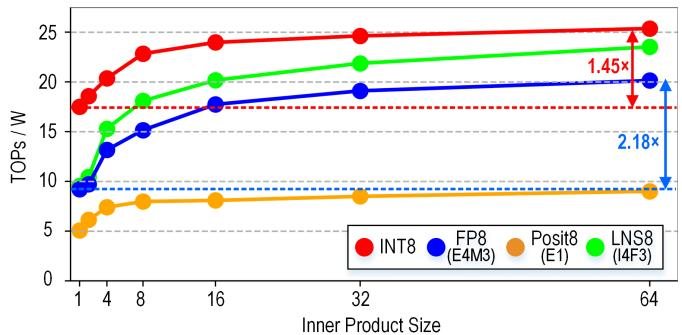  
图 5. 8 位数据格式的 TOPs/W 随内积规模的变化。

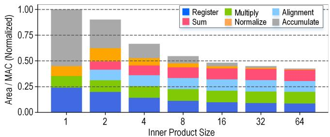  
图 6. FP8（E4M3）融合点积的归一化面积构成随内积规模的变化。

外积规模：在第 II 节中，我们指出，一些商用设计已将点积指令（向量与向量相乘）扩展为向量与矩阵相乘以及矩阵与矩阵相乘。虽然这样做主要是为了提高指令级并行性，但它也会在逻辑层面影响面积效率和能效。为了了解各数据格式如何受益于执行矩阵与矩阵相乘（相对于向量与向量相乘），我们对外积形状分别为 1×1、2×2 和 4×4 的 16 输入点积进行综合，并在图 7 中评估其面积效率（TOPs/mm2）。首先，我们发现，增大 FP8、INT8 和 LNS8 的外积规模会带来 ∼11% 的适度提升，因为只有输入寄存器和预处理逻辑（次正规数、零、无穷大、NaN）的开销得到了分摊。其次，我们发现，posit 的提升明显高于其他格式，因为其开销较大的解码逻辑可以在各外积之间共享。外积为 4×4 时，Posit8 相较于 1×1 达到 $1 . 3 5 \times \mathrm { ~ T O P s / m m ^ { 2 } }$。

累加位宽：在第 II 节中，我们指出，一些 AI 加速器中实现的浮点点积会在相加之前截断对齐后的乘积，以提高面积效率和能效。为了了解各数据格式如何受益于缩减累加位宽，我们对基准 MAC 设计的累加位宽进行扫描，并在图 8 中评估其能效（TOPs/W）。由于缩减累加位宽会对数值精度产生负面影响，我们也在图 8 中评估了 SQNR。首先，我们发现，在 SQNR 开始下降之前，FP8 和 LNS8 获得的能效提升相近。其次，我们发现，INT8 对累加位宽的缩减更为敏感，因为它是定点格式（而非浮点格式）。因此，整数的累加位宽很少会被截断（甚至从不截断），但为了完整起见，此处仍将其纳入。

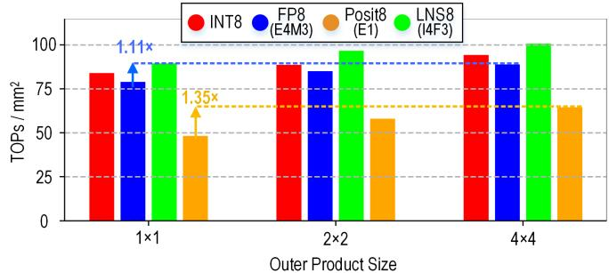  
图 7. 8 位数据格式的 $\mathrm { T O P s } / \mathrm { m m } ^ { 2 }$ 随外积规模的变化。

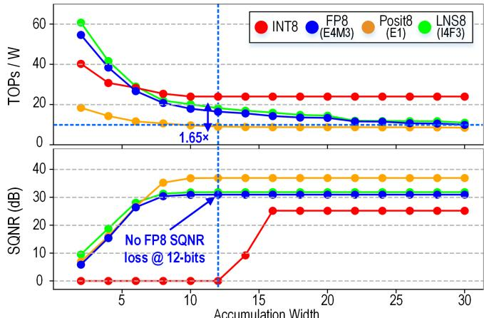  
图 8. 8 位数据格式的 TOPs/W 随累加位宽的变化。

块数据格式：在第 II 节中，我们指出，业界正趋向于采用块数据格式，以实现有效的低精度量化。为了了解 MX 和 VSQ 如何影响面积效率与数值精度之间的权衡空间，我们设计并仿真了它们与整数、浮点、posit 和 LNS 数据格式的组合。在图 9 中，我们将不采用块缩放的设计与块大小为 32 和 64 的设计进行比较。首先，我们发现，块缩放显著提高了 INT4、FP4 和 LNS4 的 SQNR，而面积开销可以忽略不计。然而，由于 posit4 具有较大的动态范围，即使在 4 位下，它也可能不需要块缩放。其次，我们发现，减小块大小（64→32）会提高 SQNR，并使面积效率略微降低。第三，我们观察到，VSQ 的开销略高于 MX，得到的 SQNR 也略高。由于 VSQ 能更精确地设置缩放因子，其 SQNR 提高了 ∼3dB，相当于 $\textstyle { \frac { 1 } { 2 } }$ 位精度。

定点累加：在第 II 节中，我们描述了融合点积如何在累加之前，将所有尾数乘积对齐到最大指数。在这种拓扑结构下，浮点乘法的乘积以浮点形式累加；它们使用最大指数和 N 个尾数乘积来表示，其中 N 为内积规模。如果我们改为将浮点乘法的乘积表示为定点数，那么在 FP16 中将需要 >90 位 [5]。然而，对于 FP4，浮点乘法的乘积仅需 8 位即可用定点形式表示，且全局对齐的开销超过了截断带来的收益。在图 10 中，我们绘制了 FP16、FP12、FP8、FP6、FP4 和 FP3 采用浮点累加和定点累加时的能效。我们发现，对于 FP16、FP12 和 FP8，浮点累加显著更好。然而，我们发现，采用定点累加的 FP4 比采用浮点累加的实现获得了高 17% 的能效。

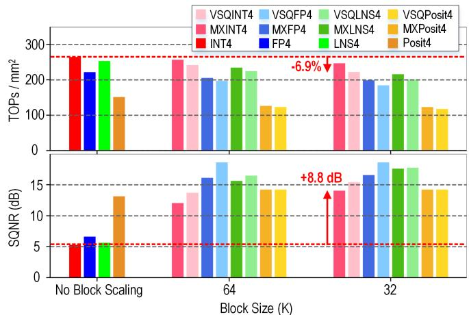  
图 9. MX 和 VSQ 4 位数据格式的 TOPs/mm2 随块大小的变化。

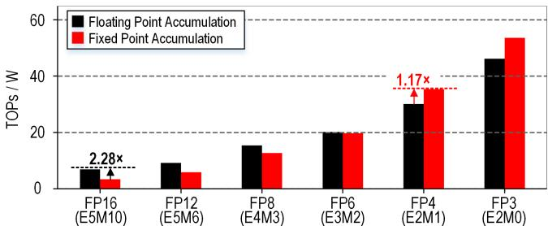  
图 10. 浮点累加与定点累加的 TOPs/W 对比。

流水线级：我们评估的最后一个设计参数是流水线级的数量（及位置）。在我们的浮点 Verilog 模型中，有 6 个可启用或禁用的流水线级，总共产生 64 种 $( 2 ^ { 6 } )$ 组合。对于每个设计，我们找出能获得最佳面积效率和能效的流水线配置子集。最终，我们发现，最优流水线配置会随数据格式和其他设计参数（内积规模、累加位宽等）而变化。

## IV. 设计空间探索

## A. 实验结果

在图 11 中，我们绘制了 INT、FP、LNS、posit 以及 INT 和 FP 的 MX 与 VSQ 变体的数值精度与能效设计空间。对于每种数据格式，我们评估了其 4 位、6 位、8 位、12 位和 16 位变体的 MAC 实现。在每个位宽下，我们评估了 FP（例如 E5M2、E4M3）、LNS（例如 I5F2、I4F3）和 posit（例如 E0、E1）数据格式的多种配置。我们对第 III 节中介绍的 MAC 设计参数进行了大范围扫描，总共生成了超过 25,000 种设计。对于每种数据格式，我们仅为帕累托最优设计着色，灰色点表示非最优设计。需要注意的是，我们在评估中未考虑量化的面积和功耗开销。

在图 11 中，我们考察了分别对应三种不同 SQNR 水平的三组数据点。第一组（A1、B1、C1）是基线单输入 MAC 设计，类似于 CPU 或 NVIDIA CUDA 核心中融合乘加（FMA）指令的实现。第二组（A2、B2、C2）是外积规模为 4×8 的融合点积设计，用于建模 NVIDIA H100 中的 Tensor Core [3]。内积规模从 16（FP16）增加到 32（FP8），再增加到 64（FP4），以建模 NVIDIA H100 中的 Tensor Core [3]。第三组（A3、B3、C3）是我们的设计空间评估得到的帕累托最优设计。需要注意的是，为了限制设计空间，我们在评估中将内积规模限制为 64，将外积规模限制为 4×4（A2、B2、C2 除外）。还需要注意的是，由于其他因素，并非所有帕累托最优设计点都适合商业实现。这项设计空间探索旨在展示采用新数据格式和定制 MAC 设计目前能够达到的上限。首先考察 16 位（∼70dB）数据格式，我们发现 FP16 点积设计（A2）的 TOPs/mm2 和 TOPs/W 分别为基线单输入 MAC（A1）的 2.0× 和 1.9×。在 SQNR 几乎相同的情况下，帕累托最优的 16 位 LNS 数据点（A3）的 TOPs/mm2 和 TOPs/W 分别为 FP16 点积（A2）的 1.8× 和 1.8×。这些改进来自更大的内积规模、更小的求和（累加）位宽，以及 LNS 通过避免乘法运算所节省的面积。接下来，我们评估 8 位（∼30dB）数据格式。我们发现，帕累托最优的 MXINT8 数据点（B3）在实现更高 SQNR 的同时，其 TOPs/mm2 和 TOPs/W 可分别达到 FP8 点积（B2）的 1.8× 和 2.2×。最后，我们评估 4 位（∼15dB）

<table><tr><td rowspan="2">ID</td><td colspan="6">MAC 设计</td><td colspan="4">性能指标</td></tr><tr><td>数据格式</td><td>内积</td><td>外积</td><td>求和位宽</td><td>流水线数</td><td>块大小</td><td>位数</td><td>TOPs/W</td><td> $TOPs/mm^2$ </td><td>SQNR (dB)</td></tr><tr><td>A1</td><td>FP16</td><td>1</td><td>-</td><td>37</td><td>2</td><td>-</td><td>16</td><td>3.1</td><td>22.0</td><td>70.8</td></tr><tr><td>A2</td><td>FP16</td><td>16</td><td>4×8</td><td>24</td><td>2</td><td>-</td><td>16</td><td>5.8</td><td>43.9</td><td>70.8</td></tr><tr><td>A3</td><td>LNS16</td><td>64</td><td>4×4</td><td>16</td><td>2</td><td>-</td><td>16</td><td>10.3</td><td>78.1</td><td>70.2</td></tr><tr><td>B1</td><td>FP8 (E4M3)</td><td>1</td><td>-</td><td>37</td><td>2</td><td>-</td><td>8</td><td>7.1</td><td>43.7</td><td>30.3</td></tr><tr><td>B2</td><td>FP8 (E4M3)</td><td>32</td><td>4×8</td><td>24</td><td>2</td><td>-</td><td>8</td><td>15.6</td><td>90.8</td><td>30.3</td></tr><tr><td>B3</td><td>MXINT8</td><td>64</td><td>4×4</td><td>16</td><td>1</td><td>64</td><td>8.125</td><td>33.8</td><td>164.7</td><td>34.2</td></tr><tr><td>C1</td><td>FP4 (E2M1)</td><td>1</td><td>-</td><td>37</td><td>2</td><td>-</td><td>4</td><td>7.9</td><td>59.1</td><td>4.6</td></tr><tr><td>C2</td><td>FP4 (E2M1)</td><td>64</td><td>4×8</td><td>24</td><td>2</td><td>-</td><td>4</td><td>43.6</td><td>238.7</td><td>4.6</td></tr><tr><td>C3</td><td>VSQINT4</td><td>64</td><td>4×4</td><td>8</td><td>1</td><td>32</td><td>4.25</td><td>82.2</td><td>413.9</td><td>14.6</td></tr></table>

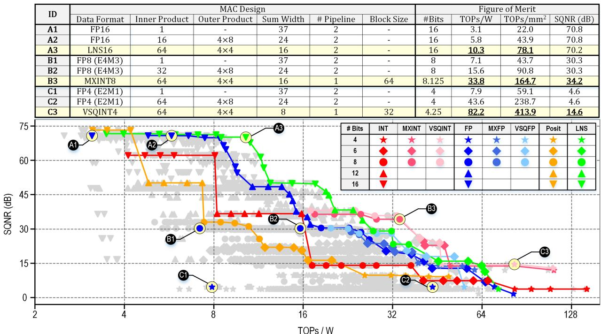  
图 11. INT、MXINT、VSQINT、FP、MXFP、VSQFP、posit 和 LNS 的能效与数值精度设计空间

数据格式。我们发现，帕累托最优的 VSQINT4 数据点（C3）在实现更高 SQNR 的同时，其 TOPs/mm2 和 TOPs/W 可分别达到 FP4 点积（C2）的 1.7× 和 1.9×。

从图 11 中，我们还可以得到其他几项观察结果。1 对于 >8 位的情况，帕累托最优的数据格式是 LNS。LNS 相较于 FP 略有优势，是因为它避免了乘法运算；当尾数位数较多时（FP16、FP12），乘法运算占 FP 能耗的很大一部分。2 对于 ≤8 位的情况，帕累托最优的数据格式是 MXINT 和 VSQINT。MX 和 VSQ 都能以较低的硬件开销提高低精度数据格式的精度。3 尽管 posit 与位数相近的数据格式相比具有较高的 SQNR（例如 posit8 与 FP8），但它似乎并非最优。这是因为 posit 需要用于解码和动态字段定长的硬件开销。4 INT 的 SQNR 并非最优，因为其动态范围不足以适应 LLM 中的数据分布。将 INT 与 MX 或 VSQ 结合可解决这一问题。5 在散点图的多个位置，我们看到一些设计能够在不损失 SQNR 的情况下提高 TOPs/W。出现这一现象的原因是，内积规模、外积规模和流水线配置可以在不影响 SQNR 的情况下提高 TOPs/W。6 对于每种数据格式，帕累托曲线的多个位置都存在阶跃。这些阶跃对应于从较高精度格式向较低精度格式的转换（例如 INT12→INT8），或累加位宽、块大小等参数的变化，这些参数使 TOPs/W 与 SQNR 之间产生权衡。

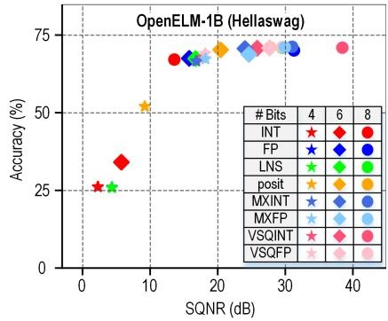

为了将数值精度与应用准确率关联起来，我们在四个具有代表性的 LLM 上进行了基准测试。我们评估了两个仅含解码器的 Transformer 模型 OpenELM-1B [28] 和 Llama-3.2-1B [38]，以及两个仅含编码器的 Transformer 模型 BERT-Large [11] 和 RoBERTa-Large [25]。对于 OpenELM-1B 和 Llama-3.2-1B，我们在 HellaSwag 数据集 [40] 上执行推理，模型从四个答案中选择一个。对于 BERT-Large 和 RoBERTa-Large，我们在 STSB 数据集 [6] 上执行推理，模型预测一个介于 0 和 1 之间的相似度分数。为了在每个模型上评估不同的数据格式，我们实现了定制 PyTorch 内核，将每次矩阵乘法运算的 FP32 权重和激活值量化为目标数据格式。实际的矩阵乘法以 FP32 执行，但底层权重和激活值被限制为目标数据格式，从而模拟定制硬件。图 12 展示了在我们的一组 Transformer 基准测试中，采用 4 位、6 位和 8 位精度的目标数据格式所达到的准确率。如果相较于 FP32 基线的准确率损失 <1%，则结果标为绿色，否则标为红色。我们观察到 MX 和 VSQ 呈现出较好的趋势，与图 9 和图 11 中的结果相似。在图 12 中，我们还绘制了 OpenELM-1B 在 Hellaswag 上的 SQNR 与准确率之间的关系，并通过实验确认，SQNR 与应用层准确率之间存在基本单调（且非线性）的关系。其他基准测试中也存在类似的关系。

## B. 应用基准测试

<table><tr><td>任务</td><td colspan="6">语言解码器</td><td colspan="6">语言编码器</td></tr><tr><td>数据集</td><td colspan="6">Hellaswag</td><td colspan="6">STSB</td></tr><tr><td>模型</td><td colspan="3">OpenELM-1B</td><td colspan="3">Llama3.2-1B</td><td colspan="3">BERT-Large</td><td colspan="3">RoBERTa-Large</td></tr><tr><td>FP32 基线</td><td colspan="3">71.26</td><td colspan="3">63.66</td><td colspan="3">90.22</td><td colspan="3">90.57</td></tr><tr><td>数据格式</td><td>4-bit</td><td>6-bit</td><td>8-bit</td><td>4-bit</td><td>6-bit</td><td>8-bit</td><td>4-bit</td><td>6-bit</td><td>8-bit</td><td>4-bit</td><td>6-bit</td><td>8-bit</td></tr><tr><td>INT</td><td>26.19</td><td>34.14</td><td>67.31</td><td>25.27</td><td>26.41</td><td>27.74</td><td>0.00</td><td>0.00</td><td>67.72</td><td>0.00</td><td>52.18</td><td>90.38</td></tr><tr><td>FP</td><td>25.95</td><td>67.55</td><td>70.14</td><td>26.10</td><td>39.22</td><td>41.21</td><td>0.00</td><td>80.87</td><td>89.72</td><td>1.46</td><td>90.29</td><td>90.55</td></tr><tr><td>Posit</td><td>52.12</td><td>70.37</td><td>71.10</td><td>27.63</td><td>60.51</td><td>63.58</td><td>39.77</td><td>89.74</td><td>90.25</td><td>37.08</td><td>86.99</td><td>88.18</td></tr><tr><td>LNS</td><td>25.89</td><td>67.49</td><td>70.97</td><td>26.28</td><td>34.50</td><td>44.06</td><td>3.39</td><td>82.28</td><td>90.17</td><td>0.00</td><td>90.47</td><td>90.55</td></tr><tr><td>MXINT $_{K=32}$ </td><td>67.77</td><td>70.80</td><td>71.06</td><td>49.74</td><td>63.50</td><td>63.56</td><td>88.09</td><td>89.98</td><td>90.17</td><td>88.80</td><td>90.35</td><td>90.60</td></tr><tr><td>MXFP $_{K=32}$ </td><td>66.65</td><td>70.69</td><td>71.26</td><td>45.14</td><td>62.38</td><td>63.12</td><td>89.28</td><td>90.15</td><td>90.33</td><td>86.90</td><td>90.45</td><td>90.49</td></tr><tr><td>MXLNS $_{K=32}$ </td><td>63.31</td><td>70.84</td><td>71.10</td><td>36.60</td><td>62.55</td><td>63.54</td><td>88.86</td><td>90.02</td><td>90.06</td><td>81.19</td><td>90.38</td><td>90.61</td></tr><tr><td>VSQINT $_{K=32}$ </td><td>69.12</td><td>70.88</td><td>71.22</td><td>56.73</td><td>63.30</td><td>63.63</td><td>88.97</td><td>90.06</td><td>90.19</td><td>90.01</td><td>90.57</td><td>90.59</td></tr><tr><td>VSQFP $_{K=32}$ </td><td>67.37</td><td>68.89</td><td>71.14</td><td>57.85</td><td>62.67</td><td>63.77</td><td>89.34</td><td>90.19</td><td>90.22</td><td>90.12</td><td>90.44</td><td>90.63</td></tr></table>

图 12. 目标数据格式在 LLM 基准测试（OpenELM-1B、Llama3.2-1B、BERT-Large 和 RoBERTa-Large）上的准确率结果（%）

[1] (2017) Nvidia tesla v100 gpu architecture. [Online]. Available: http://tinyurl.com/volta-architecture-whitepaper

[2] “Ieee standard for floating-point arithmetic,” IEEE Std 754-2019 (Revision of IEEE 754-2008), pp. 1–84, 2019.

[3] (2022) Nvidia h100 tensor core gpu architecture. [Online]. Available: https://resources.nvidia.com/en-us-tensor-core/gtc22-whitepaper-hopper

[4] H. Abdelaziz, J. H. Shin, A. Pedram, J. Hassoun et al., “Rethinking floating point overheads for mixed precision dnn accelerators,” Proceedings of Machine Learning and Systems, vol. 3, pp. 223–239, 2021.

[5] N. Brunie, “Modified fused multiply and add for exact low precision product accumulation,” in 2017 IEEE 24th Symposium on Computer Arithmetic (ARITH), 2017, pp. 106–113.

[6] D. Cer, M. Diab, E. Agirre, I. Lopez-Gazpio, and L. Specia, “Semeval-2017 task 1: Semantic textual similarity multilingual and crosslingual focused evaluation,” in Proceedings of the 11th International Workshop on Semantic Evaluation (SemEval-2017). Association for Computational Linguistics, 2017. [Online]. Available: http://dx.doi.org/10.18653/v1/S17-2001

[7] S. Dai, R. Venkatesan, M. Ren, B. Zimmer, W. Dally, and B. Khailany, “Vs-quant: Per-vector scaled quantization for accurate low-precision neural network inference,” Proceedings of Machine Learning and Systems, vol. 3, pp. 873–884, 2021.

[8] B. Darvish Rouhani et al., “Pushing the limits of narrow precision inferencing at cloud scale with microsoft floating point,” Advances in neural information processing systems, vol. 33, pp. 10 271–10 281, 2020.

[9] B. Darvish Rouhani et al., “With shared microexponents, a little shifting goes a long way,” in Proceedings of the 50th Annual International Symposium on Computer Architecture, 2023, pp. 1–13.

[10] T. Dettmers, M. Lewis, Y. Belkada, and L. Zettlemoyer, “Gpt3.int8(): 8-bit matrix multiplication for transformers at scale,” in Advances in Neural Information Processing Systems, S. Koyejo, S. Mohamed, A. Agarwal, D. Belgrave, K. Cho, and A. Oh, Eds., vol. 35. Curran Associates, Inc., 2022, pp. 30 318–30 332.

[11] J. Devlin, M.-W. Chang, K. Lee, and K. Toutanova, “Bert: Pre-training of deep bidirectional transformers for language understanding,” 2019. [Online]. Available: https://arxiv.org/abs/1810.04805

[12] M. Drumond, T. Lin, M. Jaggi, and B. Falsafi, “Training dnns with hybrid block floating point,” Advances in Neural Information Processing Systems, vol. 31, 2018.

[13] E. Frantar, S. Ashkboos, T. Hoefler, and D. Alistarh, “Gptq: Accurate post-training quantization for generative pre-trained transformers,” 2023. [Online]. Available: https://arxiv.org/abs/2210.17323

[14] S. Galal and M. Horowitz, “Energy-efficient floating-point unit design,” IEEE Transactions on computers, vol. 60, no. 7, pp. 913–922, 2010.

[15] J. L. Gustafson and I. T. Yonemoto, “Beating floating point at its own game: Posit arithmetic,” Supercomputing frontiers and innovations, vol. 4, no. 2, pp. 71–86, 2017.

[16] B. Hickmann and D. Bradford, “Experimental analysis of matrix multiplication functional units,” in 2019 IEEE 26th Symposium on Computer Arithmetic (ARITH). IEEE, 2019, pp. 116–119.

[17] B. Hickmann, J. Chen, M. Rotzin, A. Yang, M. Urbanski, and S. Avancha, “Intel nervana neural network processor-t (nnp-t) fused floating point many-term dot product,” in 2020 IEEE 27th Symposium on Computer Arithmetic (ARITH). IEEE, 2020, pp. 133–136.

[18] N.-D. Ho, G. Jeong, C.-M. Kang, S. Choi, and I.-J. Chang, “Mersit: A hardware-efficient 8-bit data format with enhanced post-training quantization dnn accuracy,” in Proceedings of the 61th ACM/IEEE Design Automation Conference, 2024, pp. 1–6.

[19] J. Johnson, “Efficient, arbitrarily high precision hardware logarithmic arithmetic for linear algebra,” in 2020 IEEE 27th Symposium on Computer Arithmetic (ARITH). IEEE, 2020, pp. 25–32.

[20] N. Jouppi et al., “In-datacenter performance analysis of a tensor processing unit,” in Proceedings of the 44th annual international symposium on computer architecture, 2017, pp. 1–12.

[21] H. Kaul, M. Anders, S. Mathew, S. Kim, and R. Krishnamurthy, “Optimized fused floating-point many-term dot-product hardware for machine learning accelerators,” in 2019 IEEE 26th Symposium on Computer Arithmetic (ARITH). IEEE, 2019, pp. 84–87.

[22] B. Keller, R. Venkatesan, S. Dai, S. G. Tell, B. Zimmer, C. Sakr, W. J. Dally, C. T. Gray, and B. Khailany, “A 95.6-tops/w deep learning inference accelerator with per-vector scaled 4-bit quantization in 5 nm,” IEEE Journal of Solid-State Circuits, vol. 58, no. 4, pp. 1129–1141, 2023.

[23] U. Koster¨ et al., “Flexpoint: An adaptive numerical format for efficient training of deep neural networks,” Advances in neural information processing systems, vol. 30, 2017.

[24] Q. Li, C. Fang, and Z. Wang, “Pdpu: An open-source posit dotproduct unit for deep learning applications,” in 2023 IEEE International Symposium on Circuits and Systems (ISCAS). IEEE, 2023, pp. 1–5.

[25] Y. Liu, M. Ott, N. Goyal, J. Du, M. Joshi, D. Chen, O. Levy, M. Lewis, L. Zettlemoyer, and V. Stoyanov, “Roberta: A robustly optimized bert pretraining approach,” 2019. [Online]. Available: https://arxiv.org/abs/1907.11692

[26] Z. Liu, B. Oguz, C. Zhao, E. Chang, P. Stock, Y. Mehdad, Y. Shi, R. Krishnamoorthi, and V. Chandra, “Llm-qat: Data-free quantization aware training for large language models,” 2023. [Online]. Available: https://arxiv.org/abs/2305.17888

[27] D. R. Lutz et al., “Fused fp8 4-way dot product with scaling and fp32 accumulation,” in 2024 IEEE 31st Symposium on Computer Arithmetic (ARITH). IEEE, 2024, pp. 40–47.

[28] S. Mehta, M. H. Sekhavat, Q. Cao, M. Horton, Y. Jin, C. Sun, I. Mirzadeh, M. Najibi, D. Belenko, P. Zatloukal, and M. Rastegari, “Openelm: An efficient language model family with open training and inference framework,” 2024. [Online]. Available: https://arxiv.org/abs/2404.14619

[29] D. Miyashita, E. Lee, and B. Murmann, “Convolutional neural networks using logarithmic data representation. arxiv 2016,” arXiv preprint arXiv:1603.01025.

[30] R. Murillo, D. Mallasen, A. A. Del Barrio, and G. Botella, “Energy-´ efficient mac units for fused posit arithmetic,” in 2021 IEEE 39th International Conference on Computer Design (ICCD). IEEE, 2021, pp. 138–145.

[31] J.-S. Park et al., “A multi-mode 8k-mac hw-utilization-aware neural processing unit with a unified multi-precision datapath in 4-nm flagship mobile soc,” IEEE Journal of Solid-State Circuits, vol. 58, no. 1, pp. 189–202, 2022.

[32] B. D. Rouhani, N. Garegrat, T. Savell, A. More, K.-N. Han, M. Zhao, R. Hall, J. Klar, E. Chung, Y. Yu, M. Schulte, R. Wittig, I. Bratt, N. Stephens, J. Milanovic, J. Brothers, P. Dubey, M. Cornea, A. Heinecke, A. Rodriguez, M. Langhammer, S. Deng, M. Naumov, P. Micikevicius, M. Siu, , and C. Verrilli, “Ocp microscaling (mx) specification,” Open Compute Project, 2023.

[33] B. D. Rouhani, R. Zhao, A. More, M. Hall, A. Khodamoradi, S. Deng, D. Choudhary, M. Cornea, E. Dellinger, K. Denolf et al., “Microscaling data formats for deep learning,” arXiv preprint arXiv:2310.10537, 2023.

[34] J. Sohn and E. E. Swartzlander, “A fused floating-point four-term dot product unit,” IEEE Transactions on Circuits and Systems I: Regular Papers, vol. 63, no. 3, pp. 370–378, 2016.

[35] E. E. Swartzlander and A. G. Alexopoulos, “The sign/logarithm number system,” IEEE Transactions on Computers, vol. 100, no. 12, pp. 1238– 1242, 1975.

[36] T. Tambe, E.-Y. Yang, Z. Wan, Y. Deng, V. J. Reddi, A. Rush, D. Brooks, and G.-Y. Wei, “Algorithm-hardware co-design of adaptive floating-point encodings for resilient deep learning inference,” in 2020 57th ACM/IEEE Design Automation Conference (DAC). IEEE, 2020, pp. 1–6.

[37] A. Tirumala and R. Wong, “ NVIDIA Blackwell Platform: Advancing Generative AI and Accelerated Computing ,” in 2024 IEEE Hot Chips 36 Symposium (HCS). Los Alamitos, CA, USA: IEEE Computer Society, Aug. 2024, pp. 1–33. [Online]. Available: https://doi.ieeecomputersociety.org/10.1109/HCS61935.2024.10665247

[38] H. Touvron, T. Lavril, G. Izacard, X. Martinet, M.-A. Lachaux, T. Lacroix, B. Roziere, N. Goyal, E. Hambro, F. Azhar,\` A. Rodriguez, A. Joulin, E. Grave, and G. Lample, “Llama: Open and efficient foundation language models,” 2023. [Online]. Available: https://arxiv.org/abs/2302.13971

[39] G. Xiao, J. Lin, M. Seznec, H. Wu, J. Demouth, and S. Han, “Smoothquant: Accurate and efficient post-training quantization for large language models,” in International Conference on Machine Learning. PMLR, 2023, pp. 38 087–38 099.

[40] R. Zellers, A. Holtzman, Y. Bisk, A. Farhadi, and Y. Choi, “Hellaswag: Can a machine really finish your sentence?” in Proceedings of the 57th Annual Meeting of the Association for Computational Linguistics, 2019.

[41] J. Zhao, S. Dai, R. Venkatesan, B. Zimmer, M. Ali, M.-Y. Liu, B. Khailany, W. J. Dally, and A. Anandkumar, “Lns-madam: Lowprecision training in logarithmic number system using multiplicative weight update,” IEEE Transactions on Computers, vol. 71, no. 12, pp. 3179–3190, 2022.

> 本文由 Codex/GPT 根据论文 PDF 生成中文译文与解读；PDF 由 MinerU 解析。全文译文保留原始参考文献，解读与原文结论请结合阅读。
