# MASQ: Accelerating Masked Diffusion via Stage-Wise Multi-Precision Quantization 原文翻译

# MASQ：通过分阶段混合精度量化加速掩码扩散

Seeyeon Kim、Jaehun Lee、Sungyeob Yoo、Joo-Young Kim

作者单位：KAIST，韩国大田。邮箱依次为 seeyakim@kaist.ac.kr、jaehunlee@kaist.ac.kr、sungyeob.yoo@kaist.ac.kr、jooyoung1203@kaist.ac.kr。

## 摘要

掩码扩散可以实现针对特定区域的图像合成，但存在计算冗余：虽然只有掩码区域需要生成内容，每个时间步却仍处理整幅图像。为此，我们提出软硬件协同设计的掩码扩散加速器 MASQ。

该方法根据空间与语义重要性动态分配分阶段 MXINT8/4/2 精度，并结合时间步感知调度和非矩阵运算优化。MASQ 配备逐块混合精度计算引擎与掩码管理单元，高效执行这一方法。在保持生成质量的同时，相对 A100 和 Orin NX，最高分别实现 16.06 倍、5.39 倍加速，以及 4.18 倍、4.93 倍能效提升。

**CCS 分类：** 计算机系统组织→体系结构；计算方法→计算机视觉。

**关键词：** 掩码扩散、量化、软硬件协同设计。

**ACM 引用信息：** Seeyeon Kim, Jaehun Lee, Sungyeob Yoo, and Joo-Young Kim. 2026. MASQ: Accelerating Masked Diffusion via Stage-Wise Multi-Precision Quantization. 第 63 届 ACM/IEEE Design Automation Conference（DAC ’26），2026 年 7 月 26–29 日，美国加州长滩，ACM，纽约，共 7 页。[DOI: 10.1145/3770743.3804133](https://doi.org/10.1145/3770743.3804133)。

本作品采用 Creative Commons Attribution 4.0 International 许可。© 2026，版权归作者或所有者。ACM ISBN 979-8-4007-2254-7/2026/07。

## 1. 引言

掩码扩散 [17, 28, 35, 37, 38] 已成为可控图像合成的常用方法。用户提供的掩码指导模型选择性编辑指定区域，并尽量保留周围内容，因此能够为图像修复、编辑等任务提供直观、交互式的工作流程。

这些优势来自底层扩散模型 [4, 10, 11, 22, 25, 27, 28, 31, 34]：它们通过迭代去噪生成图像，相比生成对抗网络 [1, 6, 13, 14] 展示出更好的稳定性与表达能力。扩散模型现已成为 Stable Diffusion [28]、DALLE-3 [25] 等先进图像生成系统的基础。这些生成能力使实用的掩码扩散工作流成为现代交互式图像生成系统的核心功能。

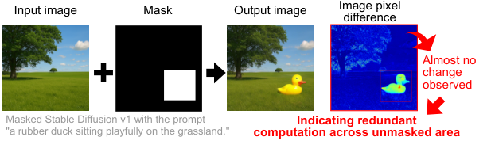

**图 1.** 掩码扩散输入与输出之间的逐像素差异。图中依次为输入图像、掩码、输出图像和像素差异图。Masked Stable Diffusion v1 的提示词为“一只橡皮鸭在草地上欢快地坐着”。未掩码区域几乎没有变化，说明其中存在冗余计算。

尽管掩码扩散能够进行指定区域的无缝合成，却引入了明显低效。如图 1，大量计算花在基本不变的未掩码区域，这些区域仍被统一以 FP32 或 FP16 处理。为了保留掩码区与未掩码区的全局依赖关系，现有方法重新计算整个特征张量，以保证全局连贯性、避免可见接缝。

SIGE [16] 尝试缓存并复用未掩码区域的中间表示来缓解这一开销。但它依赖从预先生成的原始图像中提取的特征图，存储开销大，适用范围受限。因此，需要更加通用、高效的方法，避免掩码扩散中的不必要计算。

为解决这一问题，我们提出减少未掩码区域冗余处理的软硬件协同加速器 MASQ。MASQ 不依赖预生成的特征图，而是利用未掩码区域变化很小这一观察：这些区域能够容忍更激进的低精度计算。以低精度计算这些区域，而不是完全跳过它们，既保留全局连贯性，又显著降低计算成本。因此，MASQ 使用掩码感知混合精度策略，在保留较高保真度的同时降低未掩码区域精度。

- **算法层面：** 根据掩码所导出的空间与语义重要性，动态将特征图划为多个阶段。掩码或语义关键区域采用较高精度 MXINT8 [30]，不重要区域可降至 MXINT2；进一步结合时间步感知调度，以及精度感知归一化和 softmax，在保留输出保真度的同时减少冗余计算。

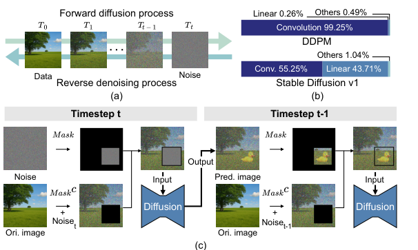

**图 2.** （a）正向扩散与反向去噪过程；（b）扩散模型各类运算的计算量占比；（c）掩码扩散概览。DDPM 的卷积、线性、其他运算分别占 99.25%、0.26%、0.49%；Stable Diffusion v1 分别占 55.25%、43.71%、1.04%。掩码扩散在每个时间步结合掩码区的生成结果，以及向原图注入当前时间步噪声后得到的未掩码区。

- **硬件层面：** 设计专门架构，采用灵活计算引擎，支持块浮点 MXINT8、MXINT4、MXINT2 混合精度执行。高效的掩码管理单元动态生成、更新多阶段掩码，使 MASQ 能够执行分阶段掩码计算，支持多种掩码扩散场景。
- **结果：** 相比 NVIDIA A100 [23]，最高加速 16.06 倍，能效提高 4.18 倍；相比 Jetson Orin NX [24]，最高加速 5.39 倍，能效提高 4.93 倍，质量损失可忽略。

## 2. 背景与动机

### 2.1. 掩码扩散

扩散模型在图像生成中取得显著成功，能够从随机噪声合成高质量图像。其核心是迭代反向去噪过程，反复运行 U-Net [29]，逐步消除噪声，如图 2a。U-Net 在多个分辨率上排列 ResNet 和注意力块，先下采样特征图，再上采样。每个块既包含卷积、线性层等矩阵运算，也包含归一化、softmax 等非矩阵运算。

重复去噪实现了高质量生成，却带来昂贵的计算成本。如图 2b，Stable Diffusion [28] 等模型中，矩阵运算占总运算量 90% 以上。

作为图像修复和编辑的重要范式 [17, 28]，掩码扩散进一步加重这一计算负担。用户掩码指定需要修改的区域。如图 2c，掩码区域从随机噪声合成；为了保留原内容，未掩码区在每一步通过向原图注入相应时间步的噪声进行重置。这使去噪网络专注于掩码区，同时保留周围上下文。

但这种处理本质上不够高效：每一步去噪都处理完整特征张量，尽管只有很少一部分发生明显变化。大量计算因而在变化可忽略的区域重复执行，形成显著开销。

为减少重复计算，SIGE [16] 引入缓存式加速。它保存原始输入图像生成过程中全部时间步的中间特征图，并在未掩码区复用，以跳过重算。该设计虽然降低工作量，却需要保存针对特定参考图像的大型特征张量。

以 512×512、FP16 的 Stable Diffusion [28] 为例，模型权重占 1.72GB，而缓存 50 个时间步特征需约 12.31GB，是权重的 7.16 倍。因此，它仅适用于已有预计算特征的场景，而且存储占用会随图像分辨率迅速增加。

EXION [8] 等近期工作探索专门扩散加速器，提高通用推理效率，但关注整图生成，没有处理掩码任务特有的冗余计算。因此，需要直接以输入图像和掩码运行、兼顾通用性与计算效率的掩码感知方案。

### 2.2. 量化

量化 [3, 5, 7, 12, 19–21] 用低比特整数或浮点表示替代高精度算术，是降低计算成本的常用技术。逐张量缩放等简单方法虽高效，但扩散模型对量化误差敏感，粗粒度方案不足，需要更细粒度策略。

块浮点 BFP 量化在数值精度与硬件效率间提供实用折中 [2, 3, 30]：多个数分成一块，每块共享缩放因子，相较逐张量或逐通道量化，缩放粒度更细。MX [30] 是硬件友好的 BFP 实现，共享缩放为二的幂指数。

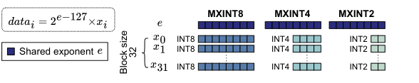

**图 3.** 在 MXINT8 基础上扩展 MXINT4、MXINT2。每块 32 个元素，共享一个 8 比特指数 e；元素采用 8、4 或 2 比特二进制补码。图中数值解释为 $\mathrm{data}_i=2^{e-127}x_i$。块级指数与低比特整数共同实现缩放。

本文在原始 MXINT8 基础上引入 MXINT4、MXINT2，如图 3。每块含 32 个元素，共享 8 比特指数，元素以 INT2、INT4 或 INT8 补码编码。该格式在硬件效率和表示灵活性之间取得有效平衡。

## 3. MASQ 算法

MASQ 以重要性感知混合精度算法减少冗余计算，同时保留输出质量。图 4a 展示软件算法：根据空间和语义重要性分配多级激活精度；为保证数值稳定，所有模型权重保持 MXINT8。时间步感知调度允许更激进地降精度，精度感知归一化和 softmax 则维持混合精度执行的数值稳定性。

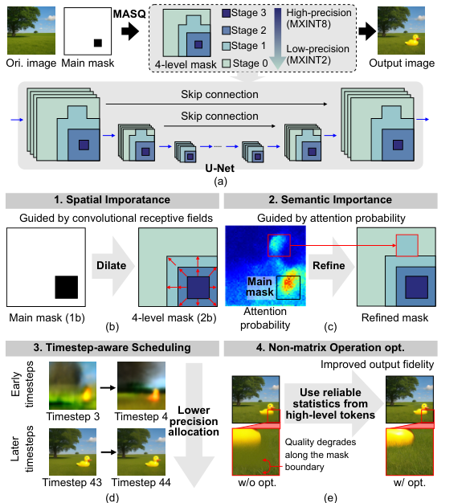

**图 4.** （a）MASQ 软件方法概览；（b）按卷积感受野决定空间重要性；（c）按注意力概率决定语义重要性；（d）时间步感知精度调度；（e）非矩阵运算优化。主掩码为 1 比特，四阶段掩码为 2 比特。Stage 3 对应主掩码，高精度为 MXINT8，低精度可降至 MXINT2。图中还展示 U-Net 与跳连、掩码膨胀与语义细化、早晚时间步的精度变化，以及优化前后掩码边界的质量差异。

### 3.1. 空间重要性

空间重要性源于卷积感受野：掩码区域的影响会传播至邻近区域。为刻画这种依赖，我们构造反映感受野空间范围的四阶段膨胀掩码。

扩散模型中的 3×3 卷积核聚合邻近 token 的特征，使掩码区影响越过其显式边界。如果简单地将掩码区设为高精度、未掩码区设为低精度，低精度区的量化噪声可能通过重叠感受野传播到相邻高精度区域，降低重建质量。

这种空间依赖意味着不同区域的重要性不同：越靠近掩码边界，越需要较高精度保留视觉保真度。为此，我们通过分阶段掩码膨胀实现多级量化，在掩码内部和周围采用较高精度，距离较远时逐渐降低精度，如图 4b。

具体地，四阶段掩码对用户主掩码的空间影响范围建模。Stage 3 就是主掩码，代表需要生成的核心区域。Stage 2 根据当前分辨率的 3×3 卷积层数量，对主掩码进行膨胀。例如，经过两个卷积层时，沿所有方向，包括对角线方向，扩展两个 token。

Stage 1 捕捉 U-Net 下一较低分辨率层级带来的跨分辨率影响。由于下采样将空间分辨率减半，为维持等价感受野，这一级的膨胀距离需要加倍。Stage 0 覆盖前面几个阶段之外的所有剩余区域。

通过静态分析 U-Net 结构，可以根据各分辨率的卷积深度生成多级掩码。该空间感知设计保留掩码附近区域的重要性，缓解低精度误差传播，从而维持整体生成质量。

### 3.2. 语义重要性

除空间掩码外，我们还根据 token 间的语义关联细化精度分配。扩散模型中，即使空间上相距较远，未掩码 token 仍能通过注意力影响掩码区域。

为刻画这一影响，我们使用注意力概率量化语义重要性，即自注意力计算得到的成对依赖强度。自注意力先将 token 投影成 query、key，计算点积，再通过 softmax 归一化得到注意力概率。如图 4c，主掩码之外的 token 常与掩码 token 具有较高注意力概率，说明语义关联较强。如果以低精度处理这些 token，量化噪声可能经注意力层传播到掩码区域，降低最终图像质量。

为缓解这一问题，我们使用注意力概率指导的细化过程，动态将语义重要的 token 提升到较高精度。去噪初期，在最后一个自注意力层使用 MXINT8、MXINT4 计算注意力概率，以可靠识别重要 token。对相应于掩码 token 的注意力概率求平均；若平均值超过预设阈值，便选择性将原先 Stage 0 的 token 提升为 Stage 1，以较高精度处理。

按语义关联重新分配精度，有助于保留那些通过注意力与掩码区域强关联的区域的生成保真度。

### 3.3. 时间步感知精度分配

如图 4d，扩散模型前期做较大的结构性更新，后期只做较小调整。在后期，量化误差对感知的影响较小，因此可以在不损失视觉质量的情况下采用更低精度。

基于这一观察，去噪过程中逐步降低未掩码区域精度，减少冗余计算。我们通过实验确定两个降级点，使从 Stage 3 到 Stage 0 的精度配置依次由 MXINT8/8/4/2 变为 MXINT8/4/4/2，最后变为 MXINT8/4/2/2。掩码区域始终保持 MXINT8。

这一简单的时间步感知调度，在保留视觉保真度的同时，允许后期更激进地降低精度，提高效率。

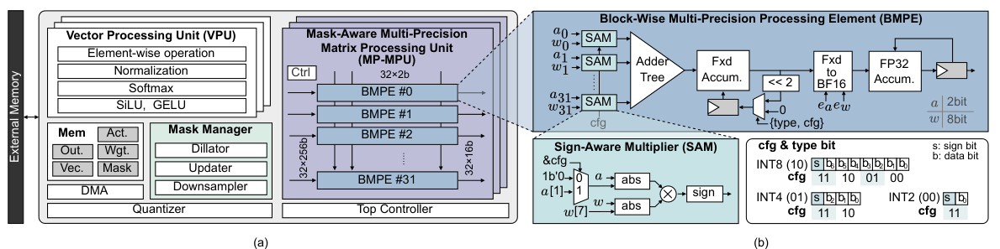

**图 5.** （a）MASQ 总体架构；（b）逐块混合精度处理单元 BMPE 的详细结构。总体包含向量处理单元 VPU、掩码感知混合精度矩阵处理单元 MP-MPU、掩码管理器、量化器、片上存储、DMA 和顶层控制器。BMPE 包含 32 个符号感知乘法器 SAM、加法树、定点累加、定点到 BF16 转换，以及 FP32 累加；type 和 cfg 共同控制当前精度与位片解释。

### 3.4. 非矩阵运算的精度感知优化

扩散模型中的量化误差，也能通过组归一化和 softmax 等非矩阵运算全局传播。这类运算虽然计算量占比较低，但其全局行为仍会在 token 间传播量化误差，降低质量，如图 4e。因此，我们为组归一化和 softmax 加入针对性优化，保证混合精度下准确、稳定的处理。

组归一化对同一组全部 token 计算均值与方差。共享统计量容易被低精度值污染，进而将误差传播给高精度 token。我们只用 Stage 2、3 的较高精度 token 计算归一化统计量，再将这些统计量应用于全部 token，从而保留掩码区域的保真度。

自注意力 softmax 中，低精度 key 的量化误差可能扭曲高精度 query 的注意力概率。为避免这一问题，最低精度 Stage 0 的 token 被排除在 softmax 计算之外，等效于将其概率设为零。这些精度感知优化稳定了多级量化下的归一化和注意力，维持整体生成质量。

## 4. MASQ 架构

### 4.1. 总体架构

MASQ 是高效执行所提软件方法的软硬件协同掩码扩散加速器，如图 5a。其掩码感知混合精度架构根据空间和语义重要性动态分配精度，提高处理效率。

MASQ 以掩码感知混合精度矩阵处理单元 MP-MPU 为计算核心，同时配备掩码管理器、量化器与 VPU。MP-MPU 包含 32 个 BMPE，按照掩码管理器提供的阶段信息执行混合精度运算。量化器将激活转成逐块表示供 MP-MPU 使用，VPU 负责 softmax、归一化等非矩阵运算。

片上存储保存激活、模型权重、中间特征和掩码；顶层控制器调度各模块，DMA 在片上与外部存储间搬运数据。

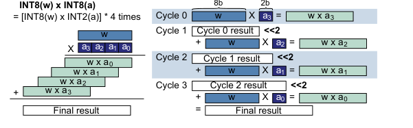

**图 6.** 混合精度执行流程。8 比特权重 w 与 8 比特激活 a 的乘法，被拆成四次 INT8(w)×INT2(a) 运算。从最高位片开始，后续周期将已有结果左移 2 比特，再累加当前位片乘积，四周期得到完整结果。

### 4.2. 混合精度矩阵处理单元

MP-MPU 是混合精度执行的核心，由 32 个 BMPE 组成，各 BMPE 按配置精度完成块级计算。

#### 4.2.1. 逐块混合精度处理单元

图 5b 展示 BMPE 的结构。每个 BMPE 并行处理 32 对 2 比特激活与 8 比特权重。若激活为 4 或 8 比特，则将其拆成 2 比特位片串行处理。每个 BMPE 集成 32 个 SAM，以二进制补码形式执行激活与权重的有符号乘法，再通过加法树累加部分结果。

为支持混合精度，BMPE 接收两个控制信号：2 比特 type 指定格式，00、01、10 分别对应 MXINT2、MXINT4、MXINT8；2 比特 cfg 指定本周期处理哪个位片。计算从最高有效位开始，cfg 按位权降序选择各 SAM 的当前位片。

SAM 根据当前 2 比特位片是否含符号位调整操作，以正确处理有符号乘法。每个位片的部分和按相应位权左移，在定点寄存器中累加，MXINT8 例子见图 6。

全部位片处理完后，先将最终定点结果转成 BF16，同时纳入激活和权重的缩放因子，再以 FP32 累加以维持数值稳定。累加结果最终转回 BF16 输出。

这一位串行机制使 BMPE 高效支持多精度：MXINT8×MXINT8 需要 4 周期；采用 MXINT4、MXINT2 激活时，分别需要 2 周期、1 周期。

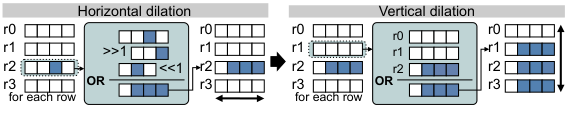

**图 7.** 掩码膨胀过程。先对每行位向量执行左移、右移和按位 OR，完成水平方向膨胀；再将相邻行按位 OR，完成垂直方向膨胀。重复该过程扩展掩码的空间覆盖范围。

#### 4.2.2. MP-MPU 执行流程

MP-MPU 控制器结合多阶段掩码与当前时间步，决定 BMPE 的数据精度，执行时间步感知分配策略。

为支持 MP-MPU 内的混合精度负载均衡，一组 32 个激活数据广播给全部 32 个 BMPE。每个 BMPE 接收各自的一组 32 个权重，与共享激活执行 32 次乘法。因此，所有 BMPE 在当前周期使用相同精度和 cfg 配置。

这一流程在统一精度设置下处理当前输入，使硬件原生支持针对指定区域的合成，不依赖掩码形状或大小。

### 4.3. 掩码管理器

MASQ 使用掩码管理器，在整个去噪过程中动态生成、更新多阶段掩码，实现重要性感知精度控制。它包含膨胀器、更新器和下采样器。四阶段掩码采用 2 比特编码：最高精度 Stage 3 为 11，Stage 2、1、0 分别为 10、01、00。

#### 4.3.1. 掩码膨胀器

膨胀器对主二值掩码进行空间引导膨胀，生成初始四阶段掩码。如图 7，按顺序执行水平、垂直的 1 比特膨胀，覆盖卷积层的空间影响范围。膨胀次数根据模型卷积结构预先分析，在执行前静态确定。

膨胀模块处理最大 64×64 token 的掩码块。更大掩码被划分成 64×64 块，以无需修改的同一套硬件逻辑处理。分块支持大规模处理，膨胀逻辑仍与卷积层的空间影响一致。

#### 4.3.2. 掩码更新器

更新器依据注意力概率细化精度。它接收一个二值细化掩码，标明哪些 token 与掩码 token 的语义关联超过预设阈值。对于最低精度 Stage 0 的 token，通过轻量按位 OR，选择性将其重新分配到 Stage 1。这以很小硬件开销将语义重要性加入精度分配，同时不改变 Stage 2、3。

#### 4.3.3. 掩码下采样器

为了支持 U-Net 的多分辨率结构，下采样器生成较低分辨率特征图对应的掩码。它使用步长为 2 的 2×2 滑动窗口，将掩码分辨率减半。每个窗口采用多数规则：若两个或以上输入位为 1，输出位便设为 1。这在保留掩码整体结构的同时，适配 U-Net 的不同分辨率。

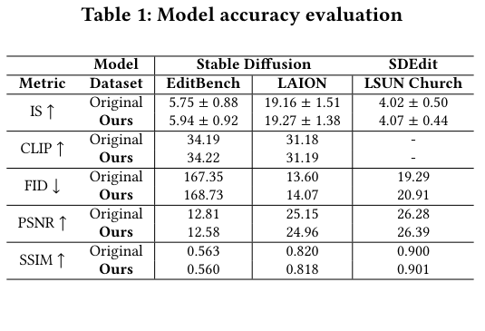

**表 1.** 模型准确性评估。Stable Diffusion 使用 EditBench、LAION；SDEdit 使用 LSUN Church。Original 为原始模型，Ours 为 MASQ；↑ 越高越好，↓ 越低越好。

| 指标 | 方法 | Stable Diffusion / EditBench | Stable Diffusion / LAION | SDEdit / LSUN Church |
| --- | --- | --- | --- | --- |
| IS ↑ | 原始 | 5.75 ± 0.88 | 19.16 ± 1.51 | 4.02 ± 0.50 |
| IS ↑ | MASQ | 5.94 ± 0.92 | 19.27 ± 1.38 | 4.07 ± 0.44 |
| CLIP ↑ | 原始 | 34.19 | 31.18 | — |
| CLIP ↑ | MASQ | 34.22 | 31.19 | — |
| FID ↓ | 原始 | 167.35 | 13.60 | 19.29 |
| FID ↓ | MASQ | 168.73 | 14.07 | 20.91 |
| PSNR ↑ | 原始 | 12.81 | 25.15 | 26.28 |
| PSNR ↑ | MASQ | 12.58 | 24.96 | 26.39 |
| SSIM ↑ | 原始 | 0.563 | 0.820 | 0.900 |
| SSIM ↑ | MASQ | 0.560 | 0.818 | 0.901 |

## 5. 评估

### 5.1. 方法

为展示 MASQ 在不同掩码扩散任务中的效率，我们评估两类代表场景：Stable Diffusion v1 [28] 的文本引导修复，以及 SDEdit [17] 的笔画引导编辑。后者建立在基础扩散模型 DDPM [10] 上。

修复任务使用两个数据集：EditBench [35]，简称 EB，平均掩码比例 42.87%；以及从 LAION [33] 构造的修复集，平均掩码比例较小，为 2.38%。LAION 数据按照 SIGE [16] 的流程生成。

SDEdit 使用 LSUN Church [39]，平均掩码比例 13.12%。该数据集由 SIGE 为笔画编辑准备并公开。评估中，每五个时间步执行一次语义细化；在 50 时间步调度下，于第 9、18 步降低精度。

硬件评估使用 SystemVerilog 实现 MASQ 的 RTL，并以 14nm 工艺综合，目标频率 800MHz、电压 0.8V。基线为服务器级 A100 [23] 与边缘级 Orin NX [24]。我们构建周期精确模拟器，评估 MASQ 延迟与能耗。

为公平比较，将 MASQ 在 MXINT8×MXINT8 下的峰值吞吐量，配置为匹配 A100、Orin NX 的 FP16 峰值性能，分别为 312TFLOPS 和 3.76TFLOPS。MASQ 实例化为两个版本：边缘版采用 102.4GB/s LPDDR5，服务器版采用 2TB/s HBM2E。DRAM 能量根据厂商规格估计 [15, 18]。

### 5.2. 准确性

表 1 比较所提量化方案与原始 FP16 模型的准确性，采用五个标准指标：Inception Score（IS）[32]、CLIP 分数 [9]、Fréchet Inception Distance（FID）[26]、峰值信噪比 PSNR，以及结构相似性 SSIM [36]。

IS、FID 衡量感知质量与分布相似性，CLIP 衡量图像与文本提示的语义一致性，PSNR 衡量像素级保真度，SSIM 衡量结构层面的感知相似性。如表 1，MASQ 在这些指标上的表现与 FP16 可比，说明即便采用激进量化，仍可保留输出质量。

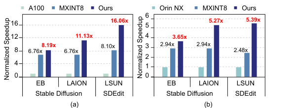

**图 8.** 相对（a）A100 服务器 GPU、（b）Orin NX 边缘 GPU 的归一化加速比。GPU 为 1；MXINT8 是同一 MASQ 硬件统一使用 MXINT8 的配置，Ours 为完整混合精度方案。

| 基线 | 工作负载 | 统一 MXINT8 加速比 | MASQ 加速比 |
| --- | --- | --- | --- |
| A100 | Stable Diffusion / EB | 6.76× | 8.19× |
| A100 | Stable Diffusion / LAION | 6.76× | 11.13× |
| A100 | SDEdit / LSUN | 8.10× | 16.06× |
| Orin NX | Stable Diffusion / EB | 2.94× | 3.65× |
| Orin NX | Stable Diffusion / LAION | 2.94× | 5.27× |
| Orin NX | SDEdit / LSUN | 2.48× | 5.39× |

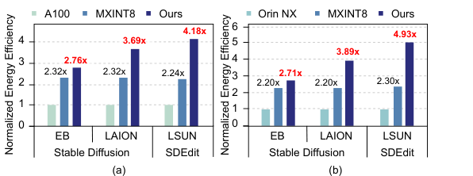

**图 9.** 相对（a）A100、（b）Orin NX 的归一化能效；同样区分统一 MXINT8 和完整 MASQ。

| 基线 | 工作负载 | 统一 MXINT8 能效 | MASQ 能效 |
| --- | --- | --- | --- |
| A100 | Stable Diffusion / EB | 2.32× | 2.76× |
| A100 | Stable Diffusion / LAION | 2.32× | 3.69× |
| A100 | SDEdit / LSUN | 2.24× | 4.18× |
| Orin NX | Stable Diffusion / EB | 2.20× | 2.71× |
| Orin NX | Stable Diffusion / LAION | 2.20× | 3.89× |
| Orin NX | SDEdit / LSUN | 2.30× | 4.93× |

### 5.3. 性能

#### 5.3.1. 加速比与能效

图 8、9 展示 MASQ 相对服务器和边缘 GPU 的归一化速度与能效。为准确量化 MASQ 算法带来的收益，我们首先让同一硬件在统一 MXINT8 模式下运行，作为参考。它均匀处理整幅图像，没有利用掩码任务内在的冗余计算机会。

即使不对掩码扩散做专门优化，加速器本身已带来明显收益：相对 A100、Orin NX，最高分别加速 8.10 倍、2.94 倍，能效最高提高 2.32 倍、2.30 倍。结合针对掩码扩散冗余计算的方案后，MASQ 获得更大提升：相对 A100、Orin NX，最高分别加速 16.06 倍、5.39 倍，能效提高 4.18 倍、4.93 倍。

相对统一 MXINT8 基线，服务器配置的平均加速比再提升 61.35%，能效再提升 54.88%；边缘配置的平均加速比再提升 73.58%，能效再提升 71.45%。

GPU 与统一 MXINT8 配置的行为不随掩码大小改变。MASQ 则利用掩码信息，按掩码模式动态调整精度，因而获得更大收益。服务器与边缘两类基线上都出现稳定改善，也表明 MASQ 可适用于不同推理环境。

#### 5.3.2. 延迟

图 10 比较 MASQ、A100 与已有先进扩散加速器 EXION [8] 的延迟。EXION 面向一般扩散模型，而非掩码扩散。比较使用 Stable Diffusion 结果，EXION 数据取自其原论文 [8]。

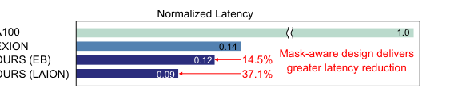

**图 10.** 归一化延迟比较。A100 为 1.0，EXION 图示约 0.14，MASQ 在 EB、LAION 上分别约 0.12、0.09。红色标注的 14.5%、37.1% 表示相对 EXION 的进一步延迟下降。

相对 A100，EXION 将延迟降低 85.7%；MASQ 在此基础上，分别在 EB、LAION 上进一步降低 14.5%、37.1%，展示处理掩码扩散负载的优势。LAION 的编辑区域更小，允许更激进的低精度量化，因此 MASQ 表现更好。这说明掩码感知混合精度执行，可以超越面向一般扩散的加速方案。

### 5.4. 面积与功耗分解

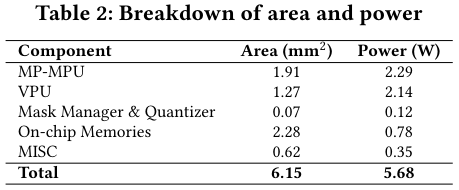

**表 2.** 面积和功耗分解。

| 组件 | 面积（mm²） | 功耗（W） |
| --- | --- | --- |
| MP-MPU | 1.91 | 2.29 |
| VPU | 1.27 | 2.14 |
| 掩码管理器与量化器 | 0.07 | 0.12 |
| 片上存储 | 2.28 | 0.78 |
| 其他 | 0.62 | 0.35 |
| 合计 | 6.15 | 5.68 |

表 2 展示 800MHz、0.8V 下 MASQ 的综合面积与功耗。被综合配置包含 32 个 MP-MPU 和 2MiB 片上存储，每个 MP-MPU 含 32 个 BMPE，总面积为 6.15mm²，功耗为 5.68W。

原文将 MP-MPU 描述为硬件成本的主要组成；掩码管理器和量化器虽然是关键模块，但只增加 1.13% 面积和 2.11% 功耗。这说明所提方法能以很小附加资源开销带来明显性能收益。

## 6. 结论

本文提出高效执行掩码扩散的软硬件协同加速器 MASQ。软件层面，将掩码所决定的空间、语义重要性与分阶段混合精度量化结合，并加入时间步感知调度和非矩阵运算优化，减少冗余计算。

硬件层面，灵活的混合精度计算引擎与专门掩码管理逻辑，以较小开销高效执行这一方案。相对 NVIDIA A100 和 Jetson Orin NX，MASQ 最高分别实现 16.06 倍、5.39 倍加速，以及 4.18 倍、4.93 倍能效提升，同时保持生成质量。

## 致谢

本研究受韩国政府 MSIT 资助，支持项目包括信息通信技术规划评估院 IITP 的 AI Semiconductor 研究生院项目（IITP-2026-RS-2023-00256472）及 IITP-ITRC 项目（IITP-2026-RS-2020-II201847）。EDA 工具由韩国 IC Design Education Center（IDEC）支持。

## References

[1] Andrew Brock, Jeff Donahue, and Karen Simonyan. 2018. Large scale GAN
training for high fidelity natural image synthesis. arXiv preprint arXiv:1809.11096
(2018).
[2] Bita Darvish Rouhani, Daniel Lo, Ritchie Zhao, Ming Liu, Jeremy Fowers, Kalin
Ovtcharov, Anna Vinogradsky, Sarah Massengill, Lita Yang, Ray Bittner, et al.
2020. Pushing the limits of narrow precision inferencing at cloud scale with
microsoft floating point. Advances in neural information processing systems 33
(2020), 10271–10281.
[3] Bita Darvish Rouhani, Ritchie Zhao, Venmugil Elango, Rasoul Shafipour, Mathew
Hall, Maral Mesmakhosroshahi, Ankit More, Levi Melnick, Maximilian Golub,
Girish Varatkar, Lai Shao, Gaurav Kolhe, Dimitry Melts, Jasmine Klar, Renee
L’Heureux, Matt Perry, Doug Burger, Eric Chung, Zhaoxia (Summer) Deng, Sam
Naghshineh, Jongsoo Park, and Maxim Naumov. 2023. With Shared Microex-
ponents, A Little Shifting Goes a Long Way. In Proceedings of the 50th Annual
International Symposium on Computer Architecture (Orlando, FL, USA) (ISCA ’23).
Association for Computing Machinery, New York, NY, USA, Article 83, 13 pages.
doi:10.1145/3579371.3589351
[4] Prafulla Dhariwal and Alexander Nichol. 2021. Diffusion models beat gans on
image synthesis. Advances in neural information processing systems 34 (2021),
8780–8794.
[5] Amir Gholami, Sehoon Kim, Zhen Dong, Zhewei Yao, Michael W Mahoney, and
Kurt Keutzer. 2022. A survey of quantization methods for efficient neural network
inference. In Low-Power Computer Vision. Chapman and Hall/CRC, 291–326.
[6] Ian J Goodfellow, Jean Pouget-Abadie, Mehdi Mirza, Bing Xu, David Warde-Farley,
Sherjil Ozair, Aaron Courville, and Yoshua Bengio. 2014. Generative adversarial
nets. Advances in neural information processing systems 27 (2014).
[7] Song Han, Huizi Mao, and William J Dally. 2015. Deep compression: Compressing
deep neural networks with pruning, trained quantization and huffman coding.
arXiv preprint arXiv:1510.00149 (2015).
[8] Jaehoon Heo, Adiwena Putra, Jieon Yoon, Sungwoong Yune, Hangyeol Lee, Ji-
Hoon Kim, and Joo-Young Kim. 2025. EXION: Exploiting Inter-and Intra-Iteration
Output Sparsity for Diffusion Models. In 2025 IEEE International Symposium on
High Performance Computer Architecture (HPCA). IEEE, 324–337.
[9] Jack Hessel, Ari Holtzman, Maxwell Forbes, Ronan Le Bras, and Yejin Choi. 2021.
Clipscore: A reference-free evaluation metric for image captioning. In Proceedings
of the 2021 conference on empirical methods in natural language processing. 7514–
7528.
[10] Jonathan Ho, Ajay Jain, and Pieter Abbeel. 2020. Denoising diffusion probabilistic
models. In Proceedings of the 34th International Conference on Neural Information
Processing Systems (Vancouver, BC, Canada) (NIPS ’20). Curran Associates Inc.,
Red Hook, NY, USA, Article 574, 12 pages.
[11] Jonathan Ho, Chitwan Saharia, William Chan, David J. Fleet, Mohammad Norouzi,
and Tim Salimans. 2022. Cascaded Diffusion Models for High Fidelity Image
Generation. Journal of Machine Learning Research 23, 47 (2022), 1–33.
http:
//jmlr.org/papers/v23/21-0635.html
[12] Benoit Jacob, Skirmantas Kligys, Bo Chen, Menglong Zhu, Matthew Tang, Andrew
Howard, Hartwig Adam, and Dmitry Kalenichenko. 2018. Quantization and
training of neural networks for efficient integer-arithmetic-only inference. In
Proceedings of the IEEE conference on computer vision and pattern recognition.
2704–2713.
[13] Tero Karras, Samuli Laine, and Timo Aila. 2019. A style-based generator ar-
chitecture for generative adversarial networks. In Proceedings of the IEEE/CVF
conference on computer vision and pattern recognition. 4401–4410.
[14] Tero Karras, Samuli Laine, Miika Aittala, Janne Hellsten, Jaakko Lehtinen, and
Timo Aila. 2020. Analyzing and improving the image quality of stylegan. In
Proceedings of the IEEE/CVF conference on computer vision and pattern recognition.
8110–8119.
[15] Jin Kim. 2016. The future of graphic and mobile memory for new applications.
In 2016 IEEE Hot Chips 28 Symposium (HCS). IEEE, 1–25.
[16] Muyang Li, Ji Lin, Chenlin Meng, Stefano Ermon, Song Han, and Jun-Yan Zhu.
2022. Efficient spatially sparse inference for conditional gans and diffusion models.
Advances in neural information processing systems 35 (2022), 28858–28873.
[17] Chenlin Meng, Yutong He, Yang Song, Jiaming Song, Jiajun Wu, Jun-Yan Zhu, and
Stefano Ermon. 2022. SDEdit: Guided image synthesis and editing with stochastic
differential equations. In International Conference on Learning Representations
(ICLR).
[18] Ki-Ill Moon, Ho-Young Son, and Kangwook Lee. 2023. Advanced Packaging
Technologies in Memory Applications for Future Generative AI Era. In 2023
International Electron Devices Meeting (IEDM). 1–4.
[19] Markus Nagel, Rana Ali Amjad, Mart Van Baalen, Christos Louizos, and Tijmen
Blankevoort. 2020. Up or down? adaptive rounding for post-training quantization.
In International Conference on Machine Learning. PMLR, 7197–7206.
[20] Markus Nagel, Mart van Baalen, Tijmen Blankevoort, and Max Welling. 2019.
Data-free quantization through weight equalization and bias correction. In Pro-
ceedings of the IEEE/CVF International Conference on Computer Vision. 1325–1334.
[21] Markus Nagel, Marios Fournarakis, Rana Ali Amjad, Yelysei Bondarenko, Mart
Van Baalen, and Tijmen Blankevoort. 2021. A white paper on neural network
quantization. arXiv preprint arXiv:2106.08295 (2021).
[22] Alex Nichol, Prafulla Dhariwal, Aditya Ramesh, Pranav Shyam, Pamela Mishkin,
Bob McGrew, Ilya Sutskever, and Mark Chen. 2022. GLIDE: Towards Photo-
realistic Image Generation and Editing with Text-Guided Diffusion Models.
arXiv:2112.10741 [cs.CV] https://arxiv.org/abs/2112.10741
[23] NVIDIA. 2020. NVIDIA A100 Tensor Core GPU. https://www.nvidia.com/en-
us/data-center/a100/. Accessed: 2025-05-07.
[24] NVIDIA. 2022. NVIDIA Jetson Orin. https://www.nvidia.com/en-us/autonomous-
machines/embedded-systems/jetson-orin/. Accessed: 2025-11-08.
[25] OpenAI. 2023. DALL·E 3. https://openai.com/dall-e-3. Accessed: 2025-05-07.
[26] Gaurav Parmar, Richard Zhang, and Jun-Yan Zhu. 2022. On Aliased Resizing
and Surprising Subtleties in GAN Evaluation. In 2022 IEEE/CVF Conference on
Computer Vision and Pattern Recognition (CVPR). 11400–11410. doi:10.1109/
CVPR52688.2022.01112
[27] Dustin Podell, Zion English, Kyle Lacey, Andreas Blattmann, Tim Dockhorn,
Jonas Müller, Joe Penna, and Robin Rombach. 2023. SDXL: Improving Latent
Diffusion Models for High-Resolution Image Synthesis. arXiv:2307.01952 [cs.CV]
https://arxiv.org/abs/2307.01952
[28] Robin Rombach, Andreas Blattmann, Dominik Lorenz, Patrick Esser, and Björn
Ommer. 2022. High-resolution image synthesis with latent diffusion models. In
Proceedings of the IEEE/CVF conference on computer vision and pattern recognition.
10684–10695.
[29] Olaf Ronneberger, Philipp Fischer, and Thomas Brox. 2015. U-net: Convolutional
networks for biomedical image segmentation. In International Conference on
Medical image computing and computer-assisted intervention. Springer, 234–241.
[30] Bita Darvish Rouhani, Ritchie Zhao, Ankit More, Mathew Hall, Alireza Kho-
damoradi, Summer Deng, Dhruv Choudhary, Marius Cornea, Eric Dellinger,
Kristof Denolf, Stosic Dusan, Venmugil Elango, Maximilian Golub, Alexander
Heinecke, Phil James-Roxby, Dharmesh Jani, Gaurav Kolhe, Martin Langhammer,
Ada Li, Levi Melnick, Maral Mesmakhosroshahi, Andres Rodriguez, Michael
Schulte, Rasoul Shafipour, Lei Shao, Michael Siu, Pradeep Dubey, Paulius Micike-
vicius, Maxim Naumov, Colin Verrilli, Ralph Wittig, Doug Burger, and Eric Chung.
2023. Microscaling Data Formats for Deep Learning. arXiv:2310.10537 [cs.LG]
https://arxiv.org/abs/2310.10537
[31] Chitwan Saharia, William Chan, Saurabh Saxena, Lala Li, Jay Whang, Emily L
Denton, Kamyar Ghasemipour, Raphael Gontijo Lopes, Burcu Karagol Ayan, Tim
Salimans, Jonathan Ho, David J Fleet, and Mohammad Norouzi. 2022. Photoreal-
istic text-to-image diffusion models with deep language understanding. Advances
in neural information processing systems 35 (2022), 36479–36494.
[32] Tim Salimans, Ian Goodfellow, Wojciech Zaremba, Vicki Cheung, Alec Radford,
and Xi Chen. 2016. Improved techniques for training gans. Advances in neural
information processing systems 29 (2016).
[33] Christoph Schuhmann, Romain Beaumont, Richard Vencu, Cade Gordon, Ross
Wightman, Mehdi Cherti, Theo Coombes, Aarush Katta, Clayton Mullis, Mitchell
Wortsman, et al. 2022. Laion-5b: An open large-scale dataset for training next
generation image-text models. Advances in neural information processing systems
35 (2022), 25278–25294.
[34] Jiaming Song, Chenlin Meng, and Stefano Ermon. 2022. Denoising Diffusion
Implicit Models. arXiv:2010.02502 [cs.LG] https://arxiv.org/abs/2010.02502
[35] Su Wang, Chitwan Saharia, Ceslee Montgomery, Jordi Pont-Tuset, Shai Noy,
Stefano Pellegrini, Yasumasa Onoe, Sarah Laszlo, David J Fleet, Radu Soricut,
et al. 2023. Imagen editor and editbench: Advancing and evaluating text-guided
image inpainting. In Proceedings of the IEEE/CVF conference on computer vision
and pattern recognition. 18359–18369.
[36] Zhou Wang, A.C. Bovik, H.R. Sheikh, and E.P. Simoncelli. 2004. Image quality
assessment: from error visibility to structural similarity. IEEE Transactions on
Image Processing 13, 4 (2004), 600–612. doi:10.1109/TIP.2003.819861
[37] Shaoan Xie, Zhifei Zhang, Zhe Lin, Tobias Hinz, and Kun Zhang. 2023. Smart-
Brush: Text and Shape Guided Object Inpainting With Diffusion Model. In Pro-
ceedings of the IEEE/CVF Conference on Computer Vision and Pattern Recognition
(CVPR). 22428–22437.
[38] Shaoan Xie, Yang Zhao, Zhisheng Xiao, Kelvin C. K. Chan, Yandong Li, Yanwu
Xu, Kun Zhang, and Tingbo Hou. 2023. DreamInpainter: Text-Guided Subject-
Driven Image Inpainting with Diffusion Models. arXiv:2312.03771 [cs.CV] https:
//arxiv.org/abs/2312.03771
[39] Fisher Yu, Ari Seff, Yinda Zhang, Shuran Song, Thomas Funkhouser, and Jianxiong
Xiao. 2016. LSUN: Construction of a Large-scale Image Dataset using Deep
Learning with Humans in the Loop. arXiv:1506.03365 [cs.CV] https://arxiv.org/
abs/1506.03365

[原文与版本信息](https://doi.org/10.1145/3770743.3804133)。技术总结、通俗讲解与图表说明属于阅读解读，可结合全文译文对照原文。
