# MixFP4: Enhancing NVFP4 with Adaptive FP4/INT4 Block Representations 图表详解

### 图像 1

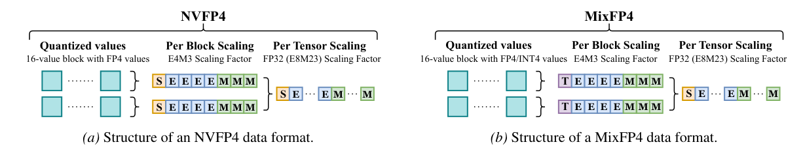

图 1 比较 NVFP4 与 MixFP4 的存储结构。两者均使用 16 值块、E4M3 块缩放和 FP32 张量缩放；差别是缩放最高位由符号 S 改为类型 T，载荷可按 E2M1/E1M2 解读。图证明的是元数据空间可复用，不能据此认为现有解码硬件已经支持新格式。

### 图像 2

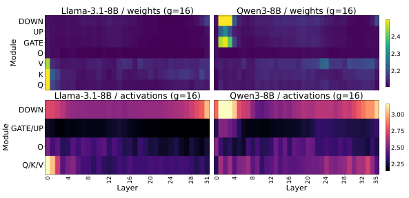

图 2 的横轴是层，纵轴是投影模块，上半为权重、下半为激活。颜色表示平均块内峰值因子；越亮说明最大值相对 RMS 越大。Llama 与 Qwen 的激活在不同模块间变化明显，支持局部格式适应。各小图色标不同，跨图比较绝对值时应读色标，不能只凭亮暗判断。

### 图像 3

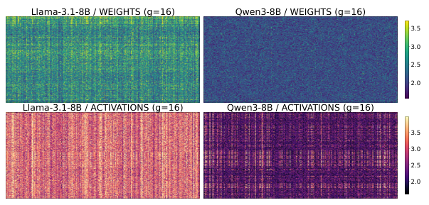

图 3 进一步固定到第 0 层 Q 投影，把同一张量内的各块展开成热图。权重在上、激活在下，亮点对应高峰值因子。相同张量仍有不同热点，说明按模型或按层只选一种格式仍过于粗糙。颜色描述统计特征，并非已经测得的量化误差。

### 图像 4

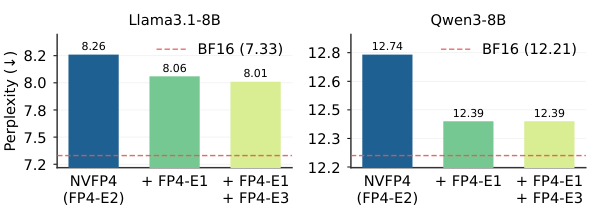

图 4 纵轴是 WikiText 困惑度，越低越好；红虚线为 BF16。Llama 从 NVFP4 的 8.26，加 E1M2 后降至 8.06，再加 E3M0 仅到 8.01；Qwen 为 12.74→12.39→12.39。该消融支持只保留两个代表码本，但不表示所有块大小都呈相同趋势。

### 图像 5

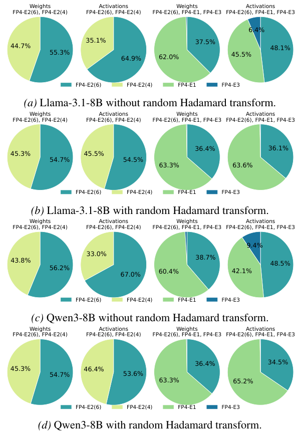

图 5 每组四个饼图，分别比较权重、激活及两种候选集合，四行区分 Llama/Qwen 与是否 RHT。E2M1(6)、E1M2 在三候选集合中占主导；使用 RHT 后 E3M0 通常更少。饼图体现实际选择频率，不直接衡量某种格式对最终准确率的贡献。

### 图像 6

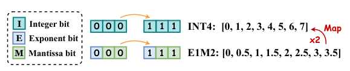

图 6 展示码本的精确常数映射。原始 E1M2 幅值是步长 0.5 的 0…3.5，乘 2 后对应整数 0…7。INT4 兼容性来自数值解释和缩放约定，不能忽略这一乘 2 因子，也不意味着把普通二补码 INT4 字节直接当作浮点位域即可。

### 图像 7

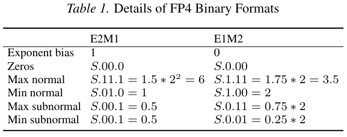

表 1 按 S.E.M 位域列出 E2M1 与 E1M2 的指数偏置、零、最大/最小正规数和次正规数。原始 E1M2 最大值 3.5，算法中的 7 来自固定乘 2 重映射。把这两种数值解释分清，是复现缩放和解码的第一步。

### 图像 8

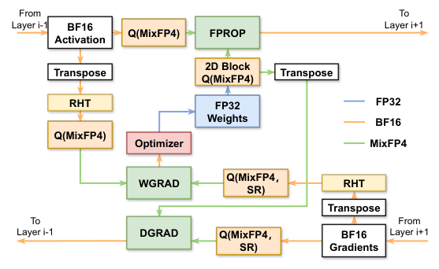

图 7 同时画出前向 FPROP、输入梯度 DGRAD、权重梯度 WGRAD。绿色路径代表模拟 MixFP4 矩阵乘；蓝色保持 FP32 主权重，橙色保持 BF16 激活/梯度。转置、权重二维块量化、WGRAD 输入 RHT、梯度随机舍入构成训练配方。图是算法数据流，不是原生 GPU 指令的时序图。

### 图像 9

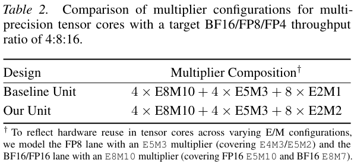

表 2 固定 BF16:FP8:FP4 吞吐量结构为 4:8:16。基线与本文前两类乘法器均为 4×E8M10 和 4×E5M3，只将 8×E2M1 替换为 8×E2M2。表注说明较宽指数/尾数包络用于覆盖多种精度复用，不能把模型配置当作实际 GPU 内部单元的公开完整实现。

### 图像 10

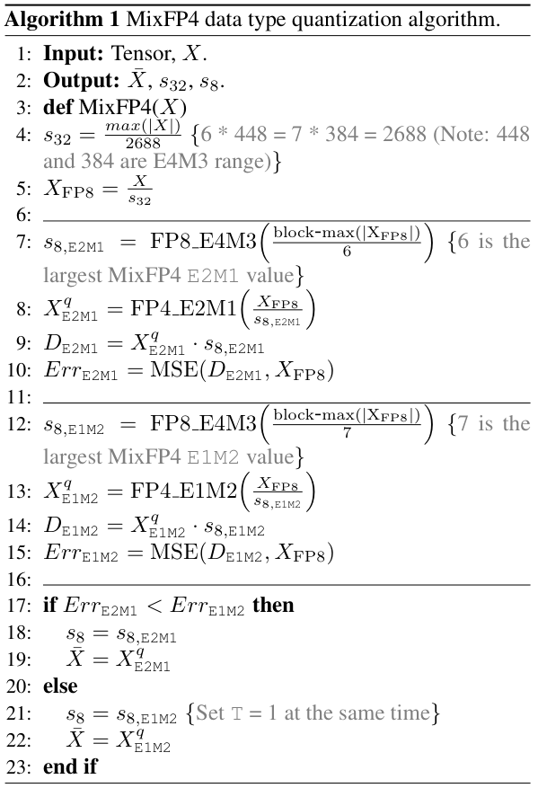

算法 1 对两种码本分别计算 E4M3 缩放、量化重建和 MSE，最后逐块选误差较低者并打包类型位。共同张量缩放使用最大绝对值/2688；E2 分支除以 6，E1 分支按重映射解释除以 7。严格小于选 E2，否则选 E1，因此平局会进入 E1。该算法没有仅按峰值因子阈值决定格式。

### 图像 11

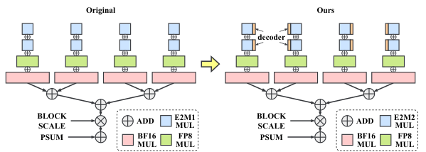

图 8 左侧为原始张量核切片，右侧为 MixFP4 扩展。增加前端解码，将 E2M1 乘法换为 E2M2，BF16/FP8 分支与块缩放、部分和结构保留。共享计算路径控制了增量面积，但内部位宽确有变化，因此不能将“复用”解释为完全无需硬件修改。

### 图像 12

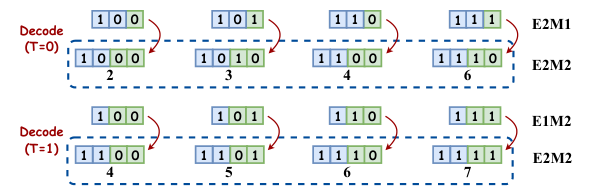

图 9 给出部分位串映射示例，T=0 为 E2M1 补尾零，T=1 为 E1M2 查表。最终统一进入 E2M2，允许下游共享算术。图只展示部分较大正幅值；完整实现还需正确处理符号、零和次正规数，不能仅照抄这几个示例建立不完整映射表。

### 图像 13

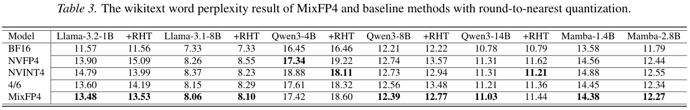

表 3 汇总 RTN 的 WikiText 困惑度，并区分是否 RHT。多数模型 MixFP4 较好，但 Qwen3-4B 无 RHT 的 NVFP4 为 17.34，优于 MixFP4 的 17.42；Qwen3-14B +RHT 的 NVINT4 为 11.21，也优于 MixFP4 的 11.44。表内反例对理解结论边界很重要。

### 图像 14

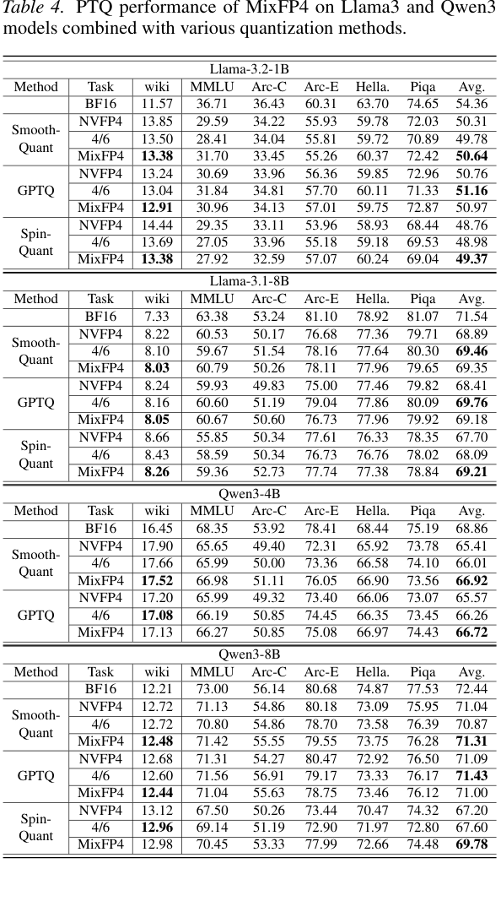

表 4 将格式与 SmoothQuant、GPTQ、SpinQuant 组合。Wiki 是困惑度越低越好，其他任务及 Avg 是准确率越高越好。同一格式可能困惑度更好但平均分更差，例如 Qwen3-8B GPTQ 下 MixFP4 的 12.44/71.00 与 4/6 的 12.60/71.43。不要只挑一个指标宣称全面领先。

### 图像 15

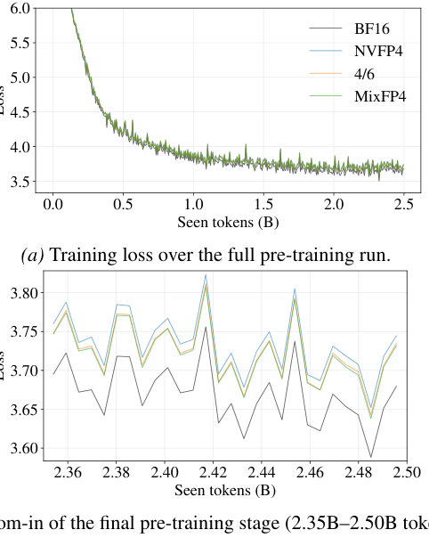

图 10 比较 114M 模型训练 2.5B token 的损失。上图展示全程，下图放大最后 2.35B–2.50B，BF16 为参考。MixFP4 在量化基线中表现较好，末期放大有助于看清小差异。不能把图线的相邻波动当作多次独立实验的统计置信区间。

### 图像 16

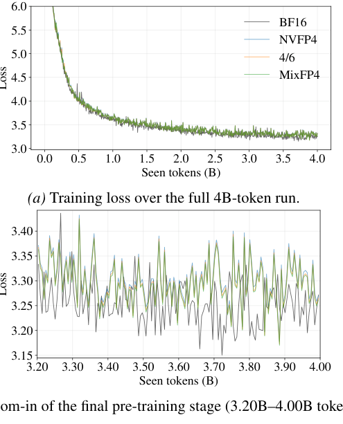

图 11 将规模扩大到 476M 参数和 4B token；下图放大 3.20B–4.00B。MixFP4 在后期低于其他低精度基线，支持收益并非仅来自 114M 试验模型。规模仍远小于现代大规模基础模型，也没有端到端训练效率测量。

### 图像 17

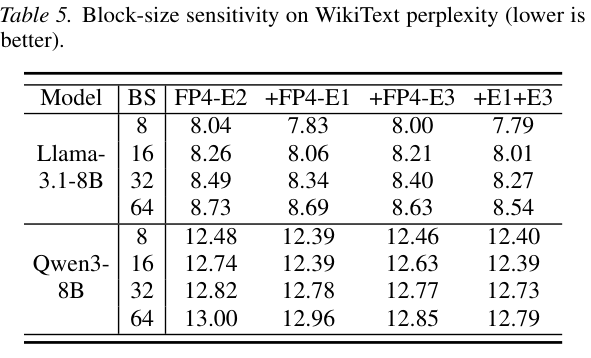

表 5 的行改变块大小 8/16/32/64，列改变候选集合。g=16 时 E2+E1 接近三候选效果；块变大时 E3 的优势增加。Qwen g=64 的 E2+E3 为 12.85，比 E2+E1 的 12.96 更好。该结果表明一个类型位的双候选设计针对细粒度块作了取舍。

### 图像 18

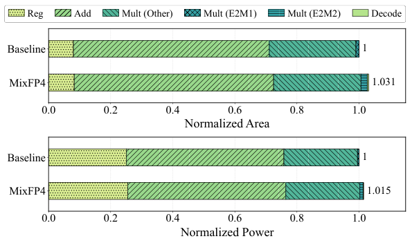

图 12 以基线为 1，显示 MixFP4 面积 1.031、功耗 1.015。堆叠颜色区分寄存器、加法器、其他乘法器、E2M1/E2M2 和解码。实验是 28nm/1GHz 计算切片综合结果，不能表述为整卡面积增加 3.1% 或推理耗电实测只增 1.5%。

### 图像 19

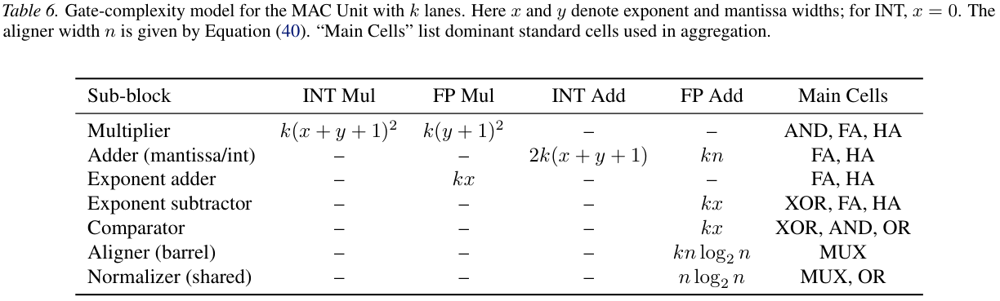

表 6 使用指数宽 x、尾数宽 y、通道数 k 和对齐宽 n 参数化乘加成本。整数与浮点乘法器、指数处理、桶形对齐和共享规格化器被分别计数。它是架构级成本模型，并非各单元的综合面积实测；FA/HA/MUX 的等效门价来自后续模型假设。

### 图像 20

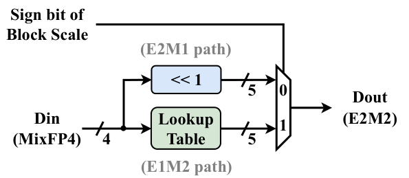

图 13 把块缩放符号位作为选择信号：E2M1 走左移补零路径，E1M2 走查表路径，MUX 输出五比特 E2M2。类型在块内共享，解码在元素输入侧完成。该图说明如何以小规模组合逻辑统一格式，不包含整个缩放乘法器和累加器设计。

### 图像 21

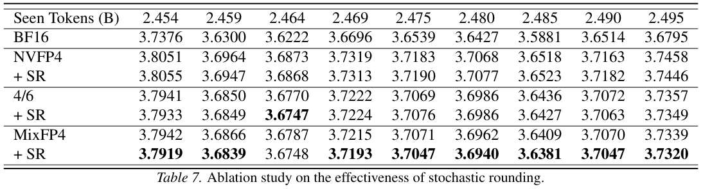

表 7 比较训练末期多个 token 检查点的验证损失，+SR 与其上一行量化方法配对。MixFP4 加 SR 在大多数列进一步下降，但量级较小；BF16 仍明显更低。九列是同一次训练不同时间的测点，不是九次独立重复，不能用它们直接推断统计显著性。

### 图像 22

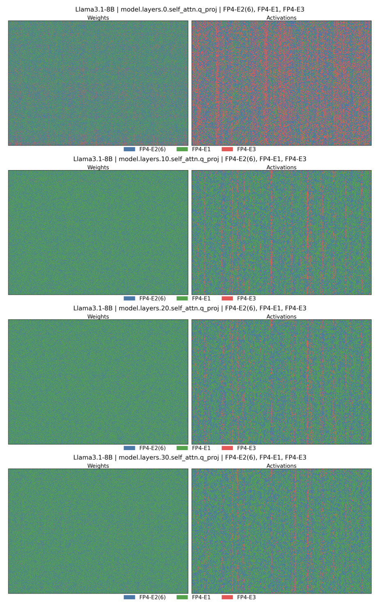

图 14 比较 Llama-3.1-8B 第 0、10、20、30 层 Q 投影，左列权重、右列激活。蓝色 E2M1(6)、绿色 E1M2、红色 E3M0。权重中的绿色和蓝色交错，激活随层变化更明显，体现同一张量内部混合。图使用三候选集，是解释为何选两种格式的消融证据，并非最终双格式存储布局。

### 图像 23

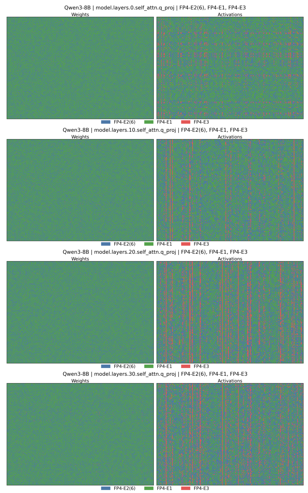

图 15 改为 Qwen3-8B 的同组 Q 投影层，列与颜色含义同图 14。权重整体多为绿蓝混合，激活有更明显的局部竖向结构，说明块格式选择同时依赖模型、层和张量类型。红色频率不能从有限图像肉眼精确估计，应结合图 5 的汇总比例。

### 图像 24

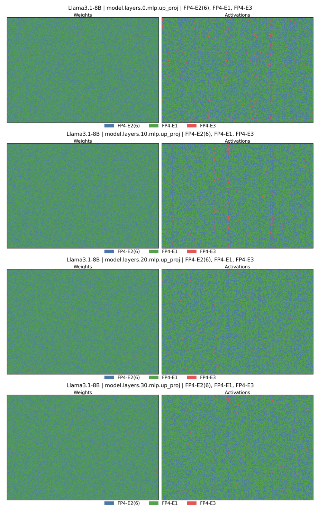

图 16 展示 Llama 的 UP 投影，仍比较第 0、10、20、30 层权重和激活。与 Q 投影相比，它覆盖不同线性模块，支持格式选择不能由一个模块推广到全模型。三种颜色是选择类别而非数值大小，读图时不能套用峰值因子热图的连续色标。

### 图像 25

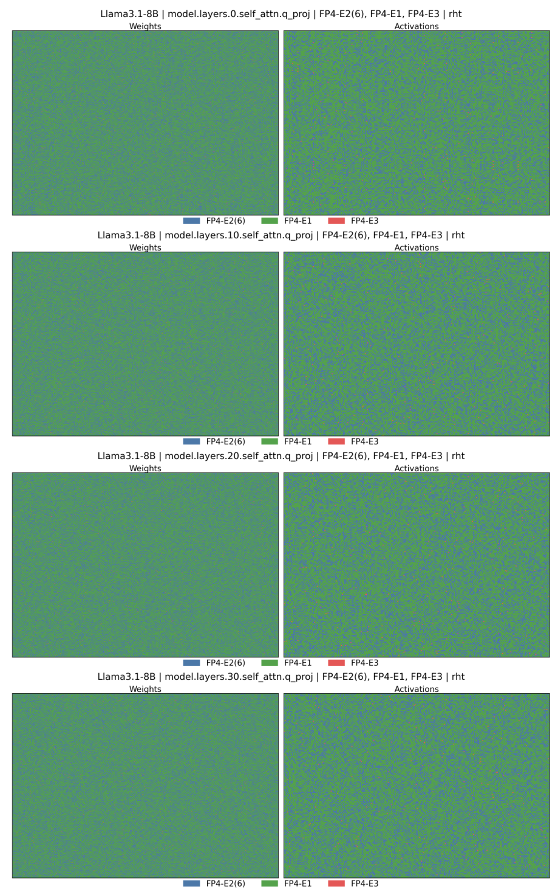

图 17 是加入 RHT 后的 Llama Q 投影。相较无 RHT 的图 14，激活中红色明显减少，绿色较常见，符合混合降低离群性后更常偏好均匀码本的动机。选择仍按 MSE，不是 RHT 后固定强制 E1M2；部分蓝色保留说明需要局部适应。

### 图像 26

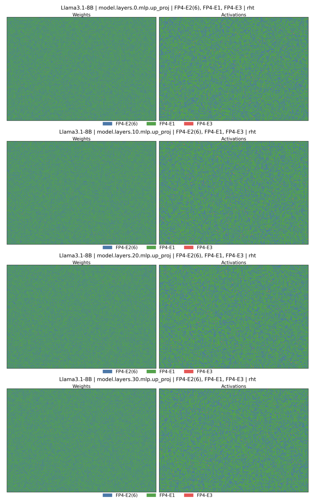

图 18 是 RHT 后的 Llama UP 投影，可与图 16 对照。权重和激活继续呈现逐块混合，激活主要在 E2M1/E1M2 之间选择，E3M0 较少。它补充展示模块差异，不提供模型准确率或硬件速度数值；这些结论需分别看表格与综合结果。
