# PacQ: A SIMT Microarchitecture for Efficient Dataflow in Hyper-asymmetric GEMMs 原文翻译

# PacQ：一种面向超非对称 GEMM 高效数据流的 SIMT 微架构

Ruokai Yin 耶鲁大学 ruokai.yin@yale.edu

Yuhang Li 耶鲁大学 yuhang.li@yale.edu

Priyadarshini Panda 耶鲁大学 priya.panda@yale.edu

摘要—仅权重量化已在大语言模型（LLM）中得到广泛研究，以减少内存存储和数据加载开销。在单指令多线程（SIMT）架构上部署时，权重以低精度整数（INT）格式存储，而激活值保持全精度浮点（FP）格式，以维持推理精度。尽管权重矩阵的内存占用和数据加载需求有所降低，但由于在 GEMM 运算之前需要通过解包和反量化将权重转换回 FP 格式，计算性能的提升仍然有限。在本工作中，我们研究如何加速涉及打包的低精度 INT 权重和高精度 FP 激活值的 GEMM 运算，并将其定义为超非对称 GEMM 问题。我们的方法对 INT 权重矩阵的分块级打包策略和数据流策略进行协同优化。我们进一步设计了一种专门的 FP-INT 乘法器单元，以适配我们的打包和数据流策略，实现多个 INT 权重的并行处理。最后，我们将打包策略、数据流和乘法器单元集成到 PacQ 中，这是一种旨在高效加速超非对称 GEMM 的 SIMT 微架构。我们表明，与在传统 SIMT 基线上运行的仅权重量化 LLM 工作负载相比，PacQ 可实现最高 1.99× 的加速，并将 EDP 降低 81.4%。

## I. 引言

大语言模型（LLM）在广泛而复杂的自然语言处理任务中展现了出色的性能 [19], [23]。然而，其庞大的参数量带来了重大的部署挑战，包括更高的内存占用和计算成本。量化已成为提高 LLM 部署效率的一种常用方案，尤其是在边缘设备上。

传统的深度神经网络（DNN）量化通过将权重和激活值压缩为低精度整数，同时减少计算量和内存流量 [5], [8]。然而，由于 LLM 激活值的动态范围以及显著值的出现，对其进行量化尤为困难 [10], [21]。因此，近期许多研究聚焦于仅权重量化，即将权重压缩为极低精度整数（例如，≤INT4），同时将激活值保留为高精度浮点格式，通常为 FP16 [2], [9], [10], [20], [21]。

虽然权重量化显著减少了 LLM 的内存流量（例如，采用 FP16 权重的 Llama2-70B [19] 需要 131.6 GB，而采用 INT4 仅权重量化时仅需 35.8 GB），但它并未降低计算成本。这一局限源于当前在单指令多线程（SIMT）硬件上的部署流程，此类硬件广泛用于 NVIDIA GPU 等商用机器学习加速器。如图 1(a) 所示，仅权重量化 LLM 在 SIMT 硬件上的推理部署流程面临三项主要挑战：（1）内存层次结构利用效率低：虽然低精度整数（INT）权重以打包格式存储在片外 DRAM 中并从中读取，但在加载到 L1 缓存时，它们会被解包并反量化为高精度浮点（FP）格式，从而在 L1 缓存及其上层失去内存方面的收益。（2）解包和反量化开销：权重的解包和反量化会引入显著的延迟和计算开销 [10]。（3）缺乏计算节省：反量化后，GEMM 计算以 FP 格式执行，因而丧失了低精度整数权重的计算效率优势。

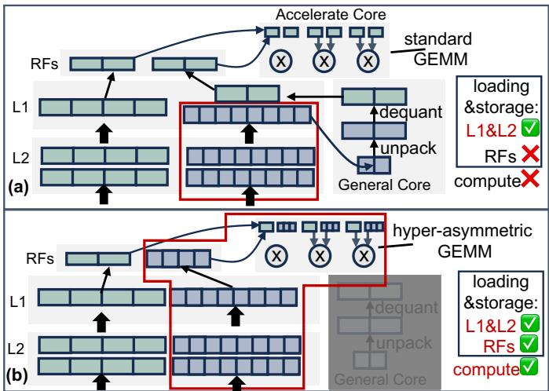  
图 1.（a）仅权重量化 LLM 在 SIMT 架构上的标准推理流程。绿色表示高精度浮点激活值，蓝色表示低精度整数权重。（b）我们提出的流程利用超非对称 GEMM，在整个 GEMM 计算栈中获得低精度整数权重所带来的加载、存储和计算成本降低的收益。

尽管存在这些局限，现有的仅权重量化技术在内存受限场景下（例如单批次文本生成）通常仍能在 SIMT 架构上实现推理加速。然而，实际的 LLM 服务系统主要采用多批次处理，以获得更高的硬件利用率 [22]。相比之下，多批次处理通常受计算限制，其性能受到前述三项局限的制约。

为解决在 SIMT 架构上部署仅权重量化模型的局限，我们提出在整个 GEMM 计算栈中始终以打包格式保留 INT 权重。我们将这一问题定义为超非对称 GEMM，其中操作数的精度高度不均衡（非对称），如图 1(b) 所示。在本工作中，我们探索了在基于 SIMT 的硬件上加速超非对称 GEMM 的设计空间。我们的主要贡献如下：（1）我们指出了 INT 权重打包方向对优化超非对称 GEMM 的关键作用，而这一因素在以往工作中常被忽视。具体而言，我们分析了沿输入特征（k）维度打包权重的低效之处，这是现有量化 LLM 部署框架中常用的一种方法 [1], [11]。为解决这一问题，我们提出了另一种打包策略以及针对超非对称 GEMM 优化的数据流。与基线方法相比，我们的策略将寄存器文件访问次数减少了 54.3%。

（2）我们提出了一种针对我们的打包和数据流策略优化的并行 FP-INT 乘法器。通过识别 INT 权重值的 FP 表示中的固定模式，我们的设计能够在单个周期内高效地并行处理四次 FP16×INT4 或八次 FP16×INT2 乘法，同时复用标准 FP16 乘法器中 ∼73% 的硬件资源。与传统设计相比，该设计的每瓦吞吐量最高提升 6.8×。

（3）我们将所提出的打包策略、数据流和并行乘法器设计整合到 PacQ 中，这是一种专为超非对称 GEMM 设计的 SIMT 微架构。以 NVIDIA GPU 为基线，PacQ 在选定的 LLM 推理工作负载上实现了最高 81.4% 的 EDP 降低。

## II. 背景

SIMT 架构。单指令多线程（SIMT）架构广泛应用于 NVIDIA GPU 等商用 ML 加速器，通过连续编号的线程集合（线程束）实现高度的计算、访存和控制并行性。这类架构将大型 ML 工作负载（例如 GEMM）划分为映射到各个线程的较小块，从而提高带宽效率和数据复用率 [18]。NVIDIA 的 Volta GPU 首次引入了具备专用 ML 加速能力的流式多处理器（SM），其中包括专门用于 GEMM 加速的张量核心（TC）[14], [16]。

在 Volta 中，多个 SM 通过片上网络与一个以 HBM 为后备存储的末级缓存互连。每个 SM 包含共享 L1 缓存的子核心，子核心又进一步划分为通用核心和张量核心。通用核心负责解包和反量化等操作，而张量核心则针对 GEMM 运算进行了优化。操作数数据存储在寄存器堆中，以便在由张量核心处理之前高效复用。不失一般性，我们的研究以 Volta 张量核心的数据流和微架构为基线。

浮点数。图 2 展示了 IEEE 754 标准的 FP16 格式。在本工作中，我们关注规格化格式（即尾数的隐含位始终为 1）。在浮点乘法过程中，尾数之间的整数乘法需要考虑隐含位，如图 2 右侧所示。相关工作。先前关于加速量化 DNN 混合精度 GEMM 的研究 [4], [17] 主要面向操作数精度不平衡程度较低（差异 ≤ 4×）的工作负载。相比之下，我们的工作关注超非对称 GEMM，其特点是操作数精度不平衡程度较高（差异≥ 4×）。

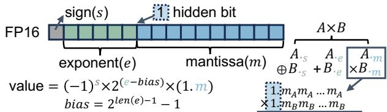  
图 2. IEEE 754 标准的 FP16 格式。

近期工作 FIGNA [6] 引入了一个 FP-INT 单元，以消除仅权重量化 LLM 在部署过程中的解包和反量化开销。然而，其方法侧重于 FP-INT 乘法器与块浮点格式的协同设计。相比之下，我们的工作将 FP-INT 乘法器设计与处理已打包 INT 权重的打包策略和数据流策略相结合。此外，我们的设计通过支持 FP 激活值与多个 INT 权重并行相乘来提高吞吐量，而 FIGNA 并未探索这一能力。

其他用于加速仅权重量化 LLM 中混合精度 GEMM 的方法采用查找表（LUT）技术，或者设计对 LUT 友好的新硬件 [12]，或者侧重于 GPU 上的单批次文本生成 [15]。相比之下，我们的工作增强了通用的基于 SIMT 的架构，以支持多批次推理，这一场景在实际 LLM 部署中更为常见。此外，面向高效反量化内核的方法 [10], [24] 针对的是互补性挑战，与我们的工作正交。

## III. 超非对称 GEMM 的打包流程

基本 GEMM 数据流。为便于说明，我们以图 3 所示的 Volta GPU 执行用于 W16A16 的 FP16 张量核心 MMA 指令 mma.sync.m16n16k16 为例，其中权重和激活均采用 FP16 精度。在此示例中，每个矩阵的大小均为 16×16。如图 3(a) 所示，矩阵 A、B 和 C 由一个包含 32 个线程的线程束协同取入。随后，工作负载被均匀分配给四个八线程组 [16]（每组包含 8 个线程），如图 3(b) 所示。如图 3(c) 所示，每个八线程组采用权重驻留数据流取入分块，由左侧的三重嵌套 for 循环表示；每个分块内部的计算则遵循输出驻留数据流，由右侧的三重嵌套 for 循环表示。最后，图 3(d) 展示了如何将八线程组级别的工作负载映射到硬件上（即 Volta GPU 中的张量核心）。B 的一个 4 × 4 分块从寄存器文件中取入一个由八线程组内全部八个线程共享的缓冲区。与此同时，A 的 2 × 4 分块被加载到各自独立的缓冲区中，每个缓冲区由四个线程共享。两个四元素点积单元（DP-4）负责计算 C 的 4 × 4 分块。

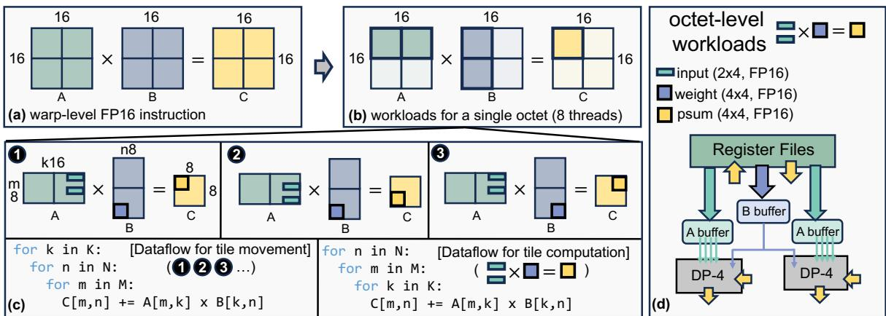  
图 3. (a) 和 (b)：线程束级别（一组 32 个线程）的 mma.sync.m16n16k16 指令向不同八线程组（包含 8 个线程的子集）的分块映射。其中，A 表示形状为 [m, k] 的输入矩阵，B 表示形状为 [k, n] 的权重矩阵，C 表示形状为 [m, n] 的输出（部分和）矩阵。(c) 八线程组级别的数据移动和计算流程的逐步分解示例。(d) 八线程组级别的工作负载到基线张量处理单元的映射。DP-4 代表执行 4 × 4 内积运算的四元素点积单元。

超非对称 GEMM 的打包与数据流。我们将超非对称 GEMM 定义为操作数 A 和 B 的精度相差至少 4× 的 GEMM 运算（例如 W4A16 或 W2A16）。尽管以往基于反量化的 GEMM 方法大多忽略了 INT 权重沿哪个维度打包，但这一维度在超非对称 GEMM 中成为一个关键因素。形式化地，我们将权重矩阵 B 的打包格式定义为 $P ( B _ { x } ) _ { y } ,$ 其中 x 表示沿 y 维度打包的 B 元素数量。例如，在 W4A16 中，如果权重（B）沿 k 维度打包为 INT16 数据类型，则该打包方式可形式化地表示为 $P ( B _ { 4 } ) _ { k }$。取入 L1 缓存后，INT16 被解包为 4 个 INT4 权重，并反量化为 FP16，以便在标准 FP16 GEMM 中执行。

尽管针对 INT 权重矩阵打包方向的研究有限，但几乎所有以往的 LLM 仅权重量化框架 [1], [3], [11] 都选择沿输入特征维度（k 维度）打包权重。在基于反量化的 GEMM 中，打包维度并不重要，因为无论打包方向如何，打包后的 INT 权重都会在 L1 缓存处解包；但超非对称 GEMM 的情况并非如此。在超非对称 GEMM 中，INT 操作数以打包形式取入，使暂存在寄存器和张量核心中的数据量呈现超非对称性。不恰当的打包维度与这种超非对称性相结合，会导致性能显著下降。

具体而言，当权重沿 k 维度打包时，每次取入打包后的 INT 权重都需要多条激活取数指令，因为在 GEMM 计算过程中，两个操作数的 k 维度必须对齐。图 4(a) 给出了一个示例：为了处理以 $P ( B _ { 4 } ) _ { k }$ 格式打包的 INT 权重，必须发出四条不同的 A 取数指令，以对齐操作数。此外，沿 k 维度打包 INT 权重（B）会导致激活（A）的数据复用效果不佳。如图 4(b) 所示，必须不断沿 k 维度取入 A 的新数据，导致张量核心内部缓冲区中的数据被驱逐，使 A 的数据无法复用。这会造成对大型寄存器文件的过量数据访问，而此类访问的功耗很高。当操作数精度的非对称性显著时，这个问题甚至会超出寄存器文件层级，进一步波及 L1 缓存。

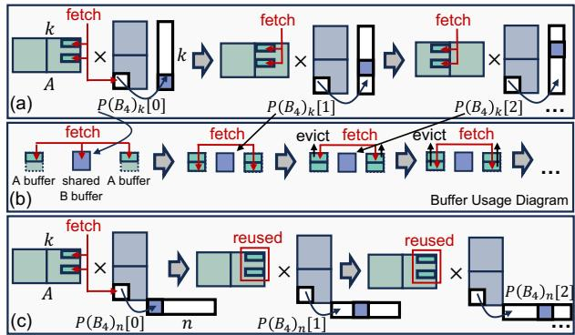  
图 4. (a) 沿 k 维度打包权重时，超非对称 GEMM 需要多条取数指令的示意图。(b) 沿 k 维度打包时 A 的数据复用效果不佳的示意图。(c) 沿 n 维度打包所带来的数据复用改善和取数指令减少的示意图。分块大小与图 3 相同。

我们认为，INT 权重应改为沿输出特征（n）维度打包。与处理沿 k 维度打包的 INT 权重相比，这种方法避免了取数指令的额外内部循环。如图 4(c) 所示，一旦按照标准流程取入激活（A）和打包后的权重 $( P ( B _ { 4 } ) _ { n } )$，就不再需要额外的取数指令。此外，我们提出的打包策略确保在处理打包后的 B 时，A 不会被驱逐，从而使激活能够在打包的各个权重之间得到充分复用。而且，我们在分块移动和分块计算中均采用输出驻留数据流，取代了图 3(c) 中用于分块移动的权重驻留数据流。这种打包方式与数据流的组合在数据复用和部分和流量之间取得了良好的平衡。

## IV. 提出的并行 FP-INT 乘法器

如前所述，我们提出的打包方式和数据流在单条数据获取指令中，使所有打包的 INT 权重复用激活值。在标准方法中，这些数据先经过反量化，再由流水线式 FP 乘法器依次处理。然而，我们发现，可以并行执行单个 FP 激活值与多个 INT 权重之间的乘法。为利用这一机会，我们提出了一种专用的并行 FP-INT 乘法器。

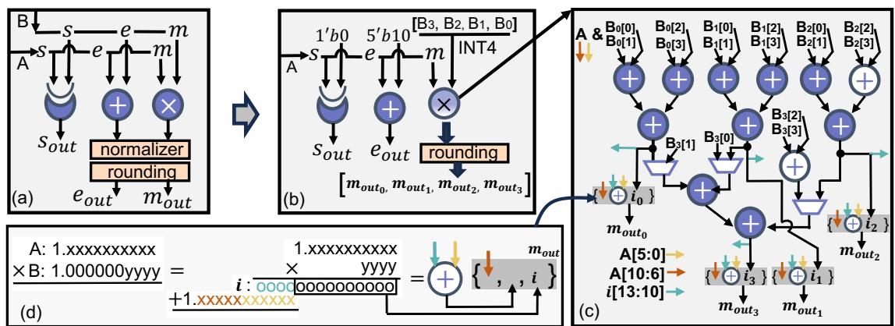  
图 5. (a) 标准 FP 乘法器设计。s 表示符号，e 表示指数，m 表示尾数。(b) 我们提出的并行 FP-INT-16 乘法器概览。在给出的示例中，我们的设计可以在一个周期内生成四个输出尾数。(c) 对原始 11 位整数乘法器所做修改的详细示意图。紫色元素属于原始乘法器，白色元素表示新增单元。B 的尾数的所有位在送入加法器之前，均与移位后的 A 的尾数执行逻辑与运算。(d) 说明如何从不同的数值来源组装最终输出尾数（灰色阴影部分）。{} 表示拼接操作。

从 INT 值的 FP 表示中得到的观察。当以 FP16 格式表示 INT x ∈ [1024, 2048) 时，转换过程中会呈现某些规律。首先，x 的 FP16 表示始终具有指数值 11001（对应十进制的 $2 ^ { 2 5 - 1 5 } = 1 0 2 4$）。其次，x 的尾数始终具有 $1 0 ^ { \prime } b 0 | ( x - 1 0 2 4 )$ 的形式。基于这些规律，我们进一步观察了低精度 INT 权重的 FP16 表示。不失一般性，我们以 INT4 为例，这可以很容易地扩展到 INT2 [7]。

假设 B ∈ [−8, 7) 是一个有符号 INT4 权重标量。为简化算术运算，我们首先通过加 8 将 B 转换为无符号表示，得到 $B { + } 8 \in [ 0 , 1 5 )$。由于 B 采用 INT4 格式，我们可以确保 B + 8 + 1024（B + 1032）位于 [1024, 2048) 范围内。利用观察到的规律，我们得出以下结论：1 B + 1032 的 FP16 表示始终具有指数值 11001。2 B + 1032 的尾数始终具有 000000yyyy 的形式，其中 yyyy 是 B + 8 的 4 位整数表示。

提出的设计。利用 1 和 2，我们设计了一种并行 FP-INT 乘法器，最大限度地复用图 5(a) 所示原始 FP 乘法器的硬件资源。我们的设计能够并行执行一个 FP16 输入与四个 INT4 值或八个 INT2 值的乘法，并在单个周期内产生所有输出。为便于说明，我们重点讨论 INT4。

由于 B 被转换为无符号表示，因此四个输出的符号都仅取决于 A 的符号。因此，我们将 A 的符号位与 0 进行异或运算，计算公共输出符号 $s _ { o u t }$。利用 1，我们将 A 的 5 位指数与 11001 相加，得到所有输出共享的指数 $e _ { o u t }$，如图 5(b) 所示。图 5(c) 展示了我们提出的并行 FP-INT 乘法器的细节。原始 FP16 整数乘法器需要 10 个并行加法器（16 位）来计算一次 11 位×11 位乘法（紫色部分）。利用 2，我们将原来的四次 11 位×11 位乘法拆解为四次 11 位×4 位乘法。通过引入两个额外的 16 位并行加法器（白色部分），我们的设计可以同时执行全部四次 11 位×4 位乘法。

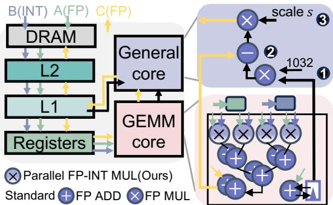  
图 6. PacQ 架构概览。B 表示 INT 权重向量，A 表示 FP 激活向量，C 表示 FP16 格式的输出或部分和。通用核心中展示的步骤仅按顺序反映所需的指令。PacQ 无需对通用核心进行任何硬件修改。

最后，如图 5(d) 所示，我们将中间结果 i（青绿色部分，来自 11 位×4 位乘法）的最高 4 位与 A 的最低 6 位（黄色部分）进行一次 6 位加法，以确保计入 B 的尾数中的隐藏位。随后，我们将 A 的最高 5 位（棕色部分）与加法结果及 i 拼接，得到四个最终的尾数乘积 $m _ { o u t }$。这些结果被送入舍入单元，并截断为 10 位（不包括隐藏位）。由于 A 和 B 的尾数均已规格化，且 B 的尾数值被限制为 4 位无符号整数，因此无需对输出进行规格化。

整体架构（PacQ）。我们将提出的打包和数据流策略以及并行 FP-INT 乘法器单元整合到 PacQ 中：这是一种用于加速高度非对称 GEMM 的 SIMT 微架构。整体架构如图 6 所示。我们提出的微架构保留了 Volta GPU 基线中的大多数组件，仅需对 GEMM 加速核心（即张量核心）进行硬件修改。我们对原始张量核心进行了以下三项关键改动：

首先，我们将所有原始 FP16 乘法器替换为所提出的并行 FP-INT 乘法器。其次，我们将 DP-4 中原有的加法器树复制两次，从而能够在 INT4 权重下用 2 个周期完成 16 个值的内积累加（或在 INT2 权重下用 4 个周期完成 32 个值的内积累加）。第三，我们为 GEMM 核心配备小型累加器，用于存储处理后的 A 值。回顾前文，在将打包的 INT 权重送入并行 FP-INT 乘法器之前，我们将所有权重值 B 转换为 $B + 1 0 3 2$。为恢复原始权重值，我们在后续计算中减去 1032。借助小型累加器，我们将这一减法直接融合到内积计算中：

$$
\sum_ {0} ^ {k} \left(A _ {k} \left(B _ {k} - 1 0 3 2\right)\right) = \sum_ {0} ^ {k} A _ {k} B _ {k} - 1 0 3 2 \times \sum_ {0} ^ {k} A _ {k},\tag{1}
$$

其中，k 表示内积的维度。累加器负责生成 $\textstyle \sum _ { 0 } ^ { k } A _ { k }$ 的结果。如图 6 的通用核心所示，累加结果在步骤 1 中乘以 1032，随后在步骤 2 中从内积结果 $( \sum _ { 0 } ^ { k } A _ { k } B _ { k } )$ 中减去。最后，在步骤 3 中应用分组量化缩放因子 s，将输出缩放回预期范围。

## V. 实验结果

实验设置。为了评估打包与数据流，我们用 Python 开发了一个定制模拟器，用于监测访存模式并记录 PacQ 和各基线的执行周期数。PacQ 和各基线的关键组件均使用 RTL 实现，并使用 Synopsys Design Compiler 在 32nm 工艺下以 400MHz 进行综合。我们使用 CACTI7.0 [13] 对片上 SRAM 和寄存器文件进行建模，以获取存储器统计数据。PacQ 和基线架构的配置细节汇总于表 I。除非另有说明，在本节其余部分中，INT2 和 INT4 指权重的精度，而激活值和部分和始终采用 FP16 格式表示。在硬件单元比较中，“基线”始终指表 I 中所列的标准基线设计。$P ( B _ { 4 ( 8 ) } )$ k 表示超非对称 GEMM 流程的基线，该流程沿 k 维将 4 个 INT4（8 个 INT2）权重打包到一个 INT16 中。所提出的打包与数据流。在图 7(a) 中，我们展示了 PacQ 与沿 k 维打包 INT4（INT2）权重的超非对称 GEMM 相比的寄存器文件访问次数。结果表明，通过改善数据复用，我们的方法可将寄存器文件访问次数最多减少 54.3%。此外，在图 7(b) 中，我们展示了 PacQ 相对于沿 k 维打包的超非对称 GEMM 的归一化加速比。得益于我们的并行处理策略，我们实现了平均 1.99× 的加速。

我们在此明确指出，PacQ 无需对任何量化算法进行修改即可实现硬件效率，因为我们的设计中没有任何近似。

表 I  
PacQ 及各基线的配置。

<table><tr><td>INT11 乘法器（基线） 并行 INT11 乘法器</td><td>10 个 INT16 加法器；12 个 INT16 加法器，4 个 INT6 加法器</td></tr><tr><td>FP16 乘法器（基线） 并行 FP-INT-16 乘法器</td><td>1 个 INT11 乘法器，1 个 INT5 加法器，1 个归一化单元，1 个舍入单元；1 个并行 INT11 乘法器，1 个 INT5 加法器，1 个归一化单元，4 个舍入单元</td></tr><tr><td>FP-16 DP-4（基线） 并行 FP-INT-16 DP-4</td><td>4 个 FP16 乘法器，4 个 FP16 加法器；4 个并行 FP-INT-16 乘法器，8 个 FP16 加法器</td></tr><tr><td>张量核心</td><td>4 个并行 FP-INT-16 DP-4；基线：4 个 FP16 DP-4；$2 \times 3072$ 位缓冲区，256KB 寄存器文件 [14]</td></tr><tr><td>流式多处理器</td><td>8 个张量核心，96 KB 共享 L1 缓存</td></tr></table>

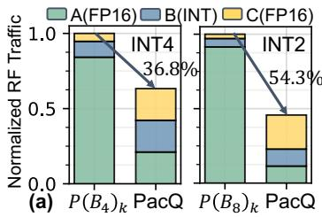

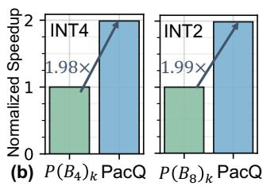  
图 7. (a) 归一化寄存器文件访问次数的比较。(b) PacQ 与沿 k 维打包 INT 权重的超非对称 GEMM 之间的归一化加速比比较。工作负载为 m16n16k16。$P ( B _ { 4 ( 8 ) } ) _ { k }$ 表示沿 k 维将 4 个 INT4 权重（或 8 个 INT2 权重）打包到一个 INT16 数据中。

然而，我们观察到，对现有 PTQ 算法进行小幅调整可以进一步提高 PacQ 的效率。具体而言，使量化组跨越两个维度（[n, k]），而非仅沿输入特征维度（k）分组，可以减少 PacQ 在通用核心中获取量化缩放因子 s 的次数，如图 6- 3 所示。我们在现有框架 [11] 内调整了基于标准就近舍入（RTN）的 PTQ 算法，使量化组跨越 n 和 k 两个维度。Llama2-7B [19] 的困惑度结果见表 II。结果表明，通过这些量化组维度的修改，我们实现了与标准 RTN 4 位仅权重量化模型相同的困惑度。

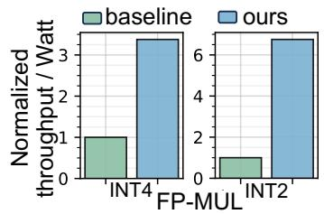

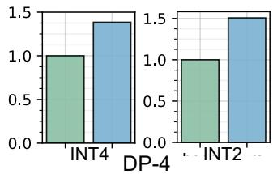  
图 8. 基线 FP16 设计与我们运行 INT4 和 INT2 权重的并行 FP-INT-16 设计之间的归一化性能比较。对于 DP-4，我们考虑的工作负载为 m2n4k4。

并行 FP-INT 乘法器。我们首先评估吞吐量 / Watt，以衡量所提出的并行 FP-INT 乘法器的整体性能。图 8 比较了我们的设计相对于原始 FP16 乘法器和 FP16 DP-4 单元的归一化性能。原始 FP16 乘法器的吞吐量为 1，而我们的并行设计的吞吐量为 4（8），其所采用的权重为

表 II  
基于 RTN 的 PTQ Llama2 模型在 WikiText-2 和 C4 上的困惑度。W4A16-G128 表示沿 k 维、组大小为 128 的 4 位仅权重量化。G[32,4] 表示组大小为 128，分布为沿 k 的 32 组和沿 n 的 4 组。

<table><tr><td>模型 Llama2-7B</td><td>W16A16 fp16 基线</td><td>W4A16 g128</td><td>W4A16 g[32,4]</td><td>W4A16 g256</td><td>W4A16 g[64,4]</td></tr><tr><td>wikitext-2</td><td>5.47</td><td>5.73</td><td>5.72</td><td>5.75</td><td>5.77</td></tr><tr><td>C4</td><td>7.26</td><td>7.58</td><td>7.59</td><td>7.64</td><td>7.66</td></tr></table>

INT4（INT2）。原始 FP16 DP-4 单元需要 11 个周期来生成 8 个 FP16 输出，而我们的并行设计对于 INT4（INT2）权重，需要 19（35）个周期来生成 32（64）个 FP16 输出。与原始 FP16 乘法器相比，我们的设计在 INT4 权重下的性能达到其 3.38×，在 INT2 权重下达到其 6.75×。

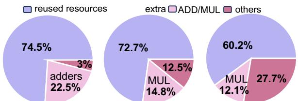  
并行 INT-11 乘法器 并行 FP-INT-16 乘法器 并行 FP-INT-16 DP-4  
图 9. 我们所提出单元的功耗构成。MUL 表示乘法器。

我们进一步在图 9 中展示了所提出单元的功耗构成。我们的设计目标是最大限度地复用标准设计中的硬件资源。如图中的紫色部分所示，我们成功复用了原始 INT-11 乘法器近 75% 的资源，这些资源构成了我们的并行 FP-INT 乘法器的基本构建模块。对于 DP-4 单元，我们实现了约 60% 的硬件资源复用。所观察到的资源复用率下降源于额外单元的复制；例如，我们需要将 DP-4 设计中的 FP16 加法器树数量增加一倍。尽管如此，我们的设计仍保持了平均 69% 的硬件资源复用率，显著减少了资源复制并提高了整体效率。

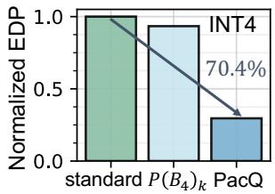

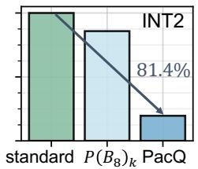  
图 10. PacQ 与各基线的归一化 EDP。“标准”指基于反量化的标准 W16A16 GEMM。$P ( B _ { 4 ( 8 ) } ) _ { k }$ 表示沿 k 维打包 INT4（INT2）权重的超非对称 GEMM。

其他结果。在图 10 中，我们展示了 PacQ 与类 Volta SIMT 基线的整体能量延迟积（EDP）比较。我们评估了两种基线情况：基于反量化的标准 GEMM 流程，以及沿 k 维打包权重的超非对称 GEMM 流程。结果表明，对于工作负载 m16n4096k4096，PacQ 可将 EDP 最多降低 81.4%；该工作负载表示 Llama2-7B 在 16 个批次下的一个 FFN 层。

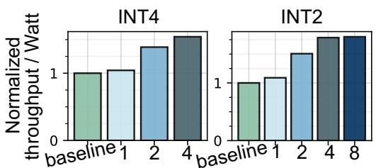  
图 11. 关于加法器树复制的消融研究。数字表示加法器树的复制级别（基线中共有 4 个 FP16 加法器）。例如，复制级别为 4 表示我们的并行 FP-INT-16 DP-4 设计中有 16 个 FP16 加法器。

在图 11 中，我们研究了在并行 FP-INT DP-4 单元中复制 FP16 加法器树对 m16n16k16 工作负载整体性能（吞吐量 / 瓦）的影响。我们观察到，虽然提高复制程度能够持续提升性能，但复制因子为 2 时带来的增益最为显著。对于 INT4（INT2），与复制因子为 1 相比，其性能提升至 1.33×（1.38×）。相比之下，对于 INT4（INT2），复制因子为 4 时的性能仅为复制因子为 2 时的 1.11×（1.18×）。

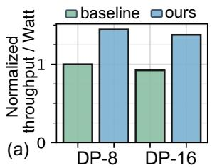

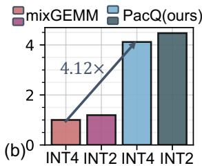  
图 12.（a）不同大小的 DP 单元的比较。（b）PacQ 与 Mix-GEMM [17] 的比较。（a）和（b）均采用每瓦吞吐量作为衡量指标。两项比较的工作负载均为 m16n16k16。

在图 12(a) 中，我们进一步研究了 DP 单元大小（DP-8 和 DP-16）的影响。结果表明，PacQ 的性能提升与 DP 单元的大小正交。在图 12(b) 中，我们将 PacQ 的性能与先前的工作 Mix-GEMM [17] 进行了比较，后者同样旨在通过二进制分段提高混合精度 GEMM 工作负载的吞吐量。在使用 FP16 激活值时，对于 INT4 权重，PacQ 的性能提升至 4.12×，对于 INT2 权重则提升至 3.75×。这一性能优势源于二进制分段技术在超非对称 GEMM 上表现不佳。

## VI. 结论

在本工作中，我们提出了 PacQ，这是一种新颖的 SIMT 微架构，旨在高效处理采用混合精度权重（INT4 和 INT2）与激活值（FP16）的超非对称 GEMM。通过引入新的打包和数据流策略，并结合我们的并行 FP-INT 乘法器，PacQ 显著提高了硬件效率和吞吐量。通过广泛的实验评估，我们证明，与常规 SIMT 基线相比，PacQ 可将寄存器文件访问次数最多减少 54.3%，将吞吐量提升至 1.99×，并将能量延迟积（EDP）最多降低 81.4%。我们相信，我们的工作能够为研究界探索超非对称 GEMM 加速的设计空间提供启发。

## VII. 致谢

本工作得到以下机构和项目的部分支持：由 DARPA 和 SRC 资助的 JUMP2.0 中心 CoCoSys、美国国家科学基金会（CAREER 奖、资助编号 #2312366、资助编号 #2318152）、DARPA 青年教师奖，以及 DoE MMICC 中心 SEA-CROGS（资助编号 #DE-SC0023198）。

## REFERENCES

[1] A. contributors, “Autogptq,” https://github.com/AutoGPTQ, 2024.

[2] E. Frantar, S. Ashkboos, T. Hoefler, and D. Alistarh, “Gptq: Accurate post-training quantization for generative pre-trained transformers,” arXiv preprint arXiv:2210.17323, 2022.

[3] ——, “Optq: Accurate quantization for generative pre-trained transformers,” in The Eleventh International Conference on Learning Representations, 2022.

[4] D. Gope, J. Beu, and M. Mattina, “High throughput matrix-matrix multiplication between asymmetric bit-width operands,” arXiv preprint arXiv:2008.00638, 2020.

[5] B. Jacob, S. Kligys, B. Chen, M. Zhu, M. Tang, A. Howard, H. Adam, and D. Kalenichenko, “Quantization and training of neural networks for efficient integer-arithmetic-only inference,” in Proceedings of the IEEE conference on computer vision and pattern recognition, 2018, pp. 2704– 2713.

[6] J. Jang et al., “Figna: Integer unit-based accelerator design for fp-int gemm preserving numerical accuracy,” in 2024 IEEE International Symposium on High-Performance Computer Architecture (HPCA). IEEE, 2024, pp. 760–773.

[7] Y. J. Kim, R. Henry, R. Fahim, and H. H. Awadalla, “Who says elephants can’t run: Bringing large scale moe models into cloud scale production,” arXiv preprint arXiv:2211.10017, 2022.

[8] Y. Li, R. Gong, X. Tan, Y. Yang, P. Hu, Q. Zhang, F. Yu, W. Wang, and S. Gu, “Brecq: Pushing the limit of post-training quantization by block reconstruction,” arXiv preprint arXiv:2102.05426, 2021.

[9] Y. Li and P. Panda, “Tesseraq: Ultra low-bit llm post-training quantization with block reconstruction,” arXiv preprint arXiv:2410.19103, 2024.

[10] J. Lin et al., “Awq: Activation-aware weight quantization for on-device llm compression and acceleration,” Proceedings of Machine Learning and Systems, vol. 6, pp. 87–100, 2024.

[11] llmc contributors, “llmc: Towards accurate and efficient llm compression,” https://github.com/ModelTC/llmc, 2024.

[12] Z. Mo et al., “Lut tensor core: Lookup table enables efficient low-bit llm inference acceleration,” arXiv preprint arXiv:2408.06003, 2024.

[13] N. Muralimanohar, R. Balasubramonian, and N. P. Jouppi, “Cacti 6.0: A tool to model large caches,” HP laboratories, 2009.

[14] NVIDIA Corporation, “NVIDIA TESLA V100 GPU ARCHITEC-TURE,” http://images.nvidia.com/content/volta-architecture/pdf/voltaarchitecture-whitepaper.pdf, June 2017.

[15] G. Park, B. Park, M. Kim, S. Lee, J. Kim, B. Kwon, S. J. Kwon, B. Kim, Y. Lee, and D. Lee, “Lut-gemm: Quantized matrix multiplication based on luts for efficient inference in large-scale generative language models,” arXiv preprint arXiv:2206.09557, 2022.

[16] M. A. Raihan et al., “Modeling deep learning accelerator enabled gpus,” in 2019 IEEE International Symposium on Performance Analysis of Systems and Software (ISPASS). IEEE, 2019, pp. 79–92.

[17] E. Reggiani et al., “Mix-gemm: An efficient hw-sw architecture for mixed-precision quantized deep neural networks inference on edge devices,” in 2023 IEEE International Symposium on High-Performance Computer Architecture (HPCA). IEEE, 2023, pp. 1085–1098.

[18] G. Tan et al., “Fast implementation of dgemm on fermi gpu,” in Proceedings of 2011 International Conference for High Performance Computing, Networking, Storage and Analysis, 2011, pp. 1–11.

[19] H. Touvron, T. Lavril, G. Izacard, X. Martinet, M.-A. Lachaux, T. Lacroix, B. Roziere, N. Goyal, E. Hambro, F. Azhar\` et al., “Llama: Open and efficient foundation language models,” arXiv preprint arXiv:2302.13971, 2023.

[20] H. Wang, S. Ma, L. Dong, S. Huang, H. Wang, L. Ma, F. Yang, R. Wang, Y. Wu, and F. Wei, “Bitnet: Scaling 1-bit transformers for large language models,” arXiv preprint arXiv:2310.11453, 2023.

[21] G. Xiao, J. Lin, M. Seznec, H. Wu, J. Demouth, and S. Han, “Smoothquant: Accurate and efficient post-training quantization for large language models,” in International Conference on Machine Learning. PMLR, 2023, pp. 38 087–38 099.

[22] G.-I. Yu, J. S. Jeong, G.-W. Kim, S. Kim, and B.-G. Chun, “Orca: A distributed serving system for {Transformer-Based} generative models,” in 16th USENIX Symposium on Operating Systems Design and Implementation (OSDI 22), 2022, pp. 521–538.

[23] S. Zhang, S. Roller, N. Goyal, M. Artetxe, M. Chen, S. Chen, C. Dewan, M. Diab, X. Li, X. V. Lin et al., “Opt: Open pre-trained transformer language models,” arXiv preprint arXiv:2205.01068, 2022.

[24] Y. Zhao, C.-Y. Lin, K. Zhu, Z. Ye, L. Chen, S. Zheng, L. Ceze, A. Krishnamurthy, T. Chen, and B. Kasikci, “Atom: Low-bit quantization for efficient and accurate llm serving,” Proceedings ofMachine Learning and Systems, vol. 6, pp. 196–209, 2024.

> 本文由 Codex/GPT 根据论文 PDF 生成中文译文与解读；PDF 由 MinerU 解析。全文译文保留原始参考文献，解读与原文结论请结合阅读。
