# Taxonomy and Benchmarking of Precision-Scalable MAC Arrays under Enhanced DNN Dataflow Representation 图表详解

### 图像 1

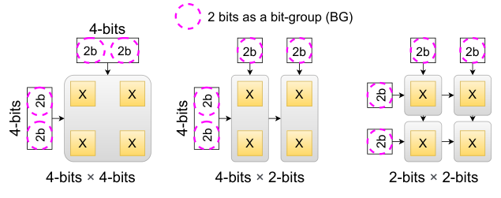

图 1 以四个 2×2 比特乘法器实现四比特可扩展乘法。高精度把多个 BG 乘积组合成一个结果，低精度可独立使用子单元。图体现基本计算单元复用的起点，尚未包含阵列接口与累加状态成本。

### 图像 2

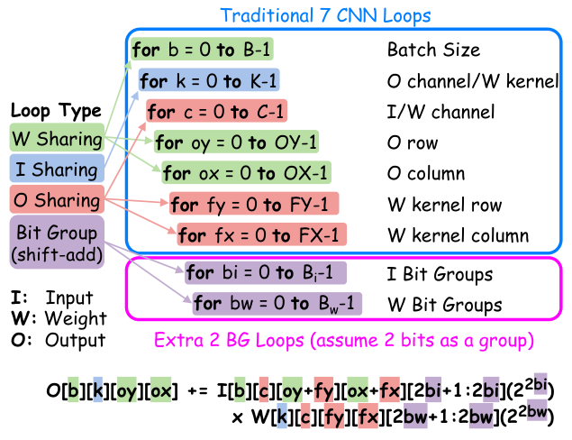

图 2 在 CNN 七重循环后加入输入和权重位组循环 bi、bw，颜色标出输入、权重、输出共享与移位相加。高精度占用 BG 展开空间，低精度可将其分配给其他循环。这个映射语言把数值精度和数据流联系起来；循环顺序、空间/时间选择都影响硬件。

### 图像 3

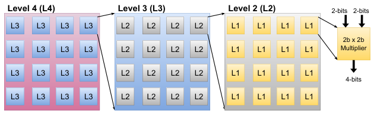

图 3 展示 L1 到 L4 的层级。L1 为二比特基本乘法器，L2、L3、L4 各由 4×4 个下一级组成。一个 L4 因而含 4096 个 L1。图中层级是模板结构，不是四级流水线，也不能自动推断每级具有寄存器。

### 图像 4

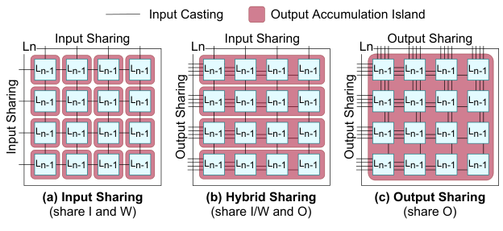

图 4 比较一个 4×4 层级的三种共享方式。IS 在两个维度广播操作数，保留 16 个输出；HS 在一个维度归约，形成 4 个输出；OS 两维均归约，只留下一个输出。红色累加岛表示可相加的结果集合，广播线表示操作数复用，不能将二者混为一类数据驻留。

### 图像 5

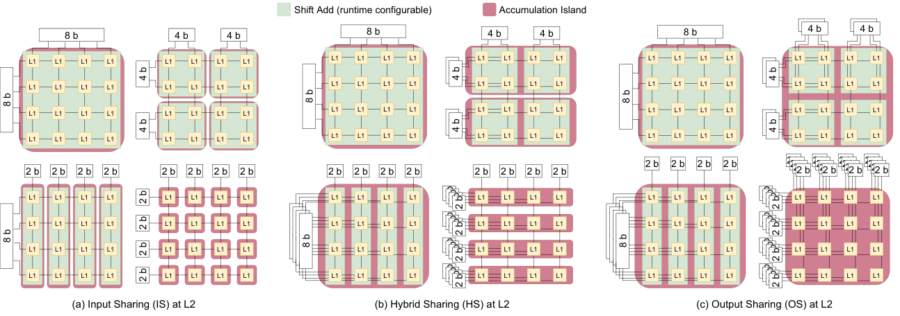

图 5 固定 BG 位于 L2，比较 FU 在 8/4/2 比特下的 IS、HS、OS。精度降低后，BG 组合空间减少，剩余子单元转做更多工作。IS 增加输出数量，OS 增加输入需求，HS 折中；图强调满计算利用率需要相应接口带宽，未声明内存系统能够无成本供给。

### 图像 6

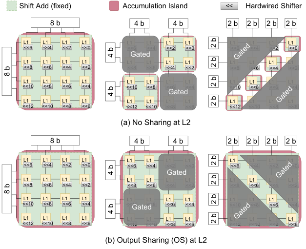

图 6 比较 SWU 的不共享与 OS 布局。固定移位网络保留，降精度时灰色单元门控，以维持接口带宽。低精度会牺牲部分硬件利用率；图中的门控降低活动能耗，不代表这些单元被从物理芯片移除。

### 图像 7

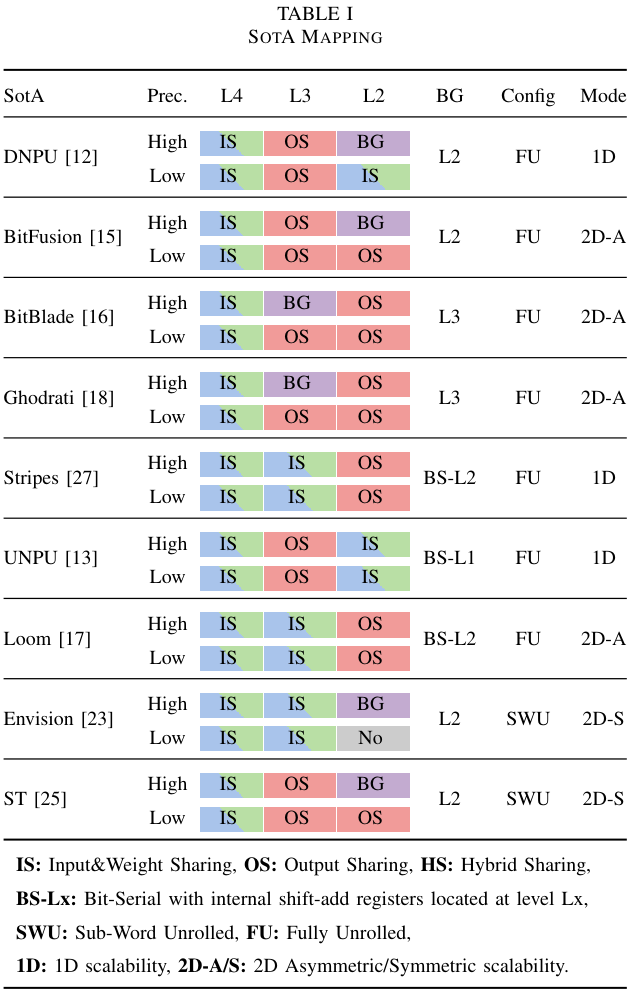

表 I 将九种已有架构映射到统一分类，每种区分高、低精度。高精度的 BG 位置在低精度下可被其他共享循环替代。注意 UNPU 的 BS-L1 虽被分类描述，却不在随后 72 点受限模板内；表中分类覆盖面不能等同于实验覆盖面。

### 图像 8

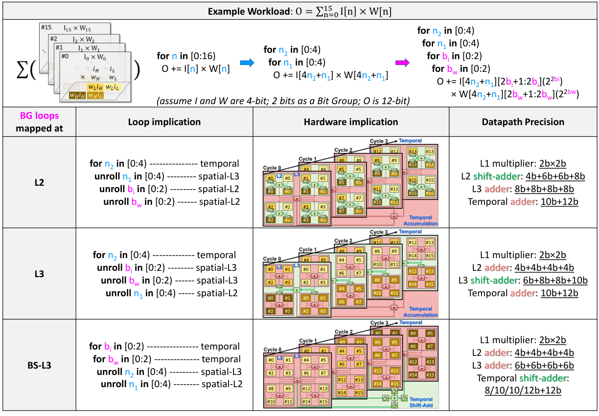

图 7 是理解共享的关键：同一个 16 项点积可把 BG 放在 L2、L3 或时间上。三列同时给出循环、硬件和位宽。L3 BG 使同位权结果先在 L2 归约，再共享移位。此图简化为每级 2×2，不能直接按图中单元数推算完整 4×4 模板面积。

### 图像 9

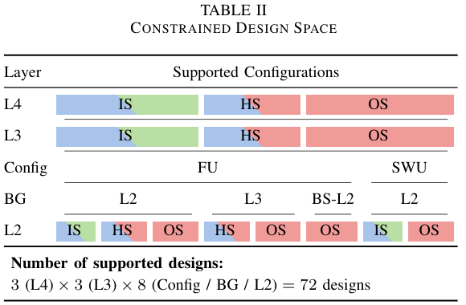

表 II 给出八种 Config/BG/L2 组合，再乘九种 L4/L3 得到 72 点。BG:L3 排除 L2:IS，BS 限制为 L2:OS/BS-L2，SWU 仅保留对称布局。这些约束围绕共享收益和寄存成本，属于剪枝后的设计空间。

### 图像 10

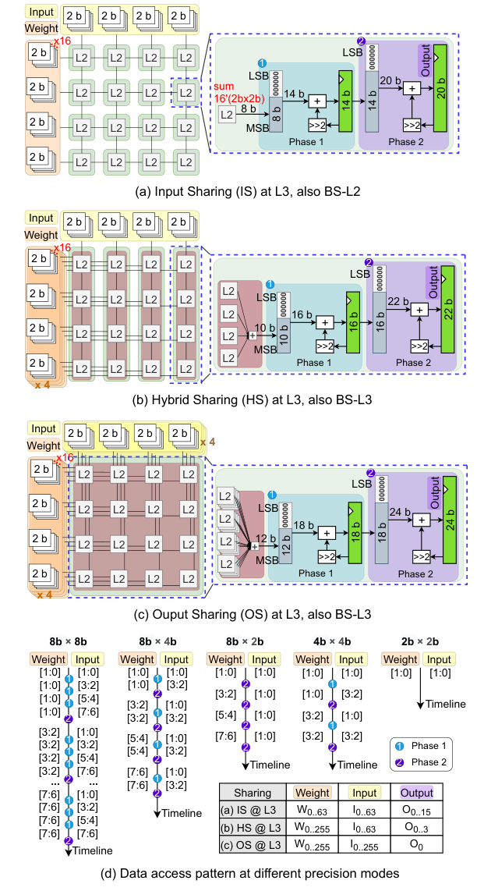

图 8 展示 BS 的两阶段调度及 L3 共享方式：阶段 1 遍历输入位组，阶段 2 切换权重并转移寄存值。底部是不同精度的数据访问时间线。BS-L2/BS-L3 用来解释内部状态所在层级，本次完整基准仅采用受限的 BS-L2，不是图中所有结构都被测量。

### 图像 11

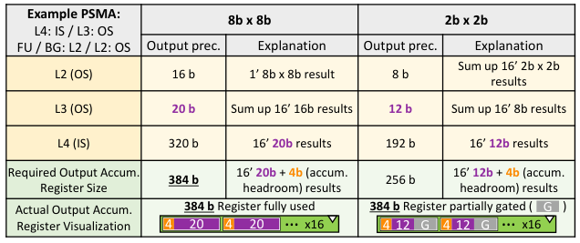

图 9 给出可手算的输出寄存器账目：L4:IS/L3:OS/L2:OS 在全精度需 16×(20+4)=384b，低精度需 16×(12+4)=256b。红色或门控标记说明运行时只停用部分位，固定寄存器最大容量仍由最坏精度决定。这个例子说明精度伸缩涉及寄存器而不只是乘法器。

### 图像 12

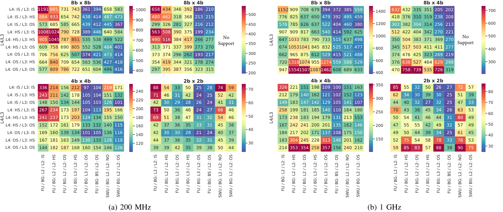

图 10 分别给出 200MHz、1GHz 下四种精度的 72 点能量热图。行是 L4/L3，列是 Config/BG/L2，单位 fJ/op。每个完整 MAC 计两次 op。各热图色标不同，应比较实际数字；SWU 的 8×4 标注不支持。它只评估理想满利用率工作负载。

### 图像 13

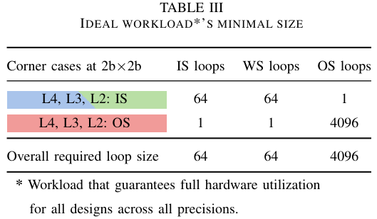

表 III 用全 IS 和全 OS 两种极端反推工作负载规模：IS=64、WS=64、OS=4096。其作用是使全部设计满利用率，消除层形状影响，因此适于分离结构成本。真实模型未必提供这些循环规模，性能排序可能变化。

### 图像 14

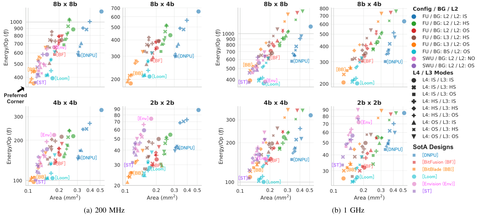

图 11 横轴面积 mm²、纵轴 fJ/op，双对数坐标；颜色标 Config/BG/L2，形状标 L4/L3。左下角较好，标签把已有架构映射到模板中的对应点。200MHz 的 L3 BG 与 SWU/OS 较好，1GHz BS 更节能但未必更省面积。图不是各原始芯片的跨工艺实测对比。

### 图像 15

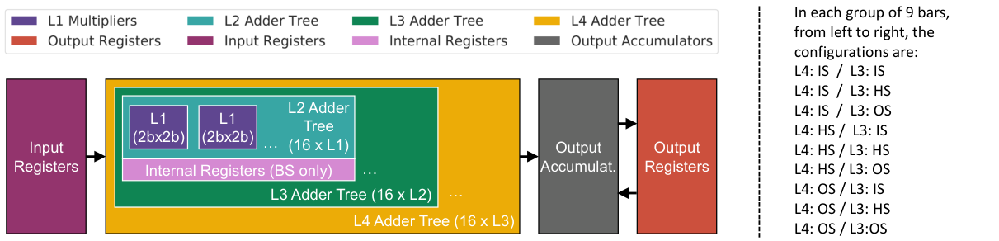

图 12 解释图 13、14 的颜色与状态位置：L1 乘法器、三级加法树、输入/输出寄存器、BS 内部寄存器和输出累加器。右侧列出每组九根柱的 L4/L3 顺序。阅读能量分解应先看本图，否则容易把寄存器开销误归于算术部分。

### 图像 16

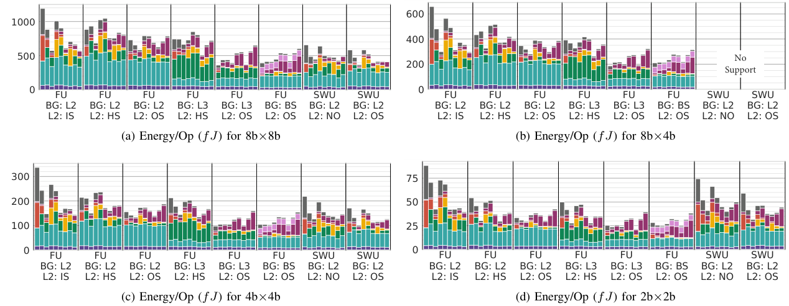

图 13 在 200MHz 下按四种精度分解每次运算能量。横轴八类基本配置，每类九种 L4/L3；不同子图纵轴范围不同。L1 能量接近，移位树和寄存器决定多数差异。低频下 BS 的内部状态开销尚不足以换来明显时序收益。

### 图像 17

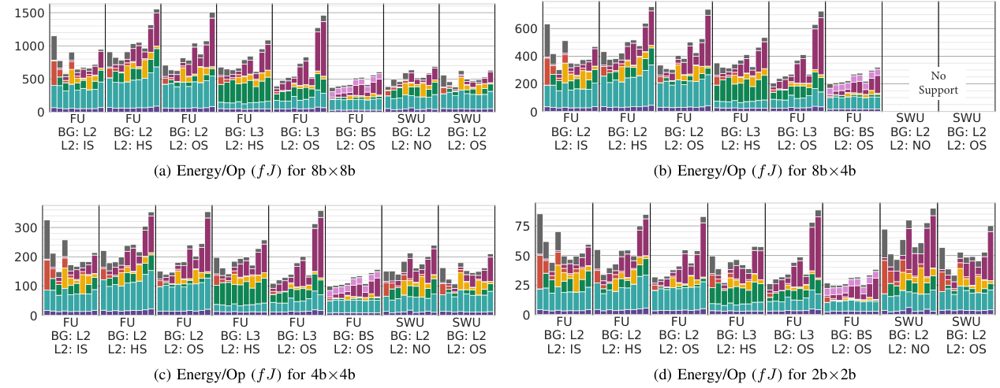

图 14 与图 13 相同结构，但频率为 1GHz。多层 OS 的长组合路径会推高能量，BS 寄存器开始体现时序价值。比较两图必须同时读精度、纵轴和频率；不能用柱高视觉比例跨子图估算加速比。

### 图像 18

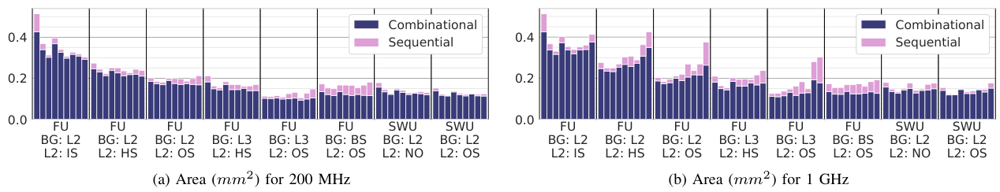

图 15 比较 200MHz/1GHz 的组合与时序面积。组合逻辑占主导，L2:OS 往往更小；高频可能因单元放大增加面积。BS 也要承担内部寄存器面积，所以更节能并不必然更省面积。面积单位为 mm²，与前两图 fJ/op 不同。

### 图像 19

原文作者简介所配的 Ehab M. Ibrahim 照片。其研究涉及能效深度学习加速、软硬件协同设计和精度可扩展计算。照片属于作者信息，不是架构或性能实验图；相关经历按原文写作时记录。

### 图像 20

原文作者简介所配的 Linyan Mei 照片。简介涉及鲁汶大学 MICAS 的嵌入式机器学习处理器研究、设计空间探索与协同优化，时间信息以提供的 2022 年版本为准。

### 图像 21

原文作者简介所配的 Marian Verhelst 照片。简介介绍 MICAS、嵌入式机器学习及低功耗系统研究经历，图像不用于支持任何性能或硬件实现结论。

[原文与版本信息](https://arxiv.org/abs/2108.04773v2)。技术总结、通俗讲解与图表说明属于阅读解读，可结合全文译文对照原文。
