# RaPiD: AI Accelerator for Ultra-low Precision Training and Inference 论文解析

## 0. 论文基本信息

**作者 (Authors)**: Swagath Venkataramani, Vijayalakshmi Srinivasan, Wei Wang, et al.

**发表期刊/会议 (Journal/Conference)**: ISCA

**发表年份 (Publication Year)**: 2021

**研究机构 (Affiliations)**: IBM Research, Yorktown Heights, NY, IBM Research, Zurich, Switzerland, IBM Research, Tokyo, Japan

---

## 1. 摘要

**目的**

- 应对 AI 工作负载日益增长的算力需求，在 CMOS 技术缩放放缓的背景下，探索通过**精度缩放**这一独特维度同时提升 AI 加速器的性能与能效。
- 设计并流片一颗支持**超低精度**训练与推理的混合精度 AI 加速器芯片 **RAPID**，覆盖从 FP16 到 INT2 的宽谱精度：
  - 训练：**Hybrid-FP8 (HFP8)** 双格式浮点，基于 IBM 的算法突破（FP8 前向 (1,4,3) + 高动态范围 (1,5,2) 反向误差表示）。
  - 推理：**INT4/INT2** 定点量化，基于 PACT（可学习激活裁剪）与 SaWB（统计感知权重量化）算法。
- 验证在单芯片推理系统与多芯片训练系统上的端到端性能、能效及可扩展性。

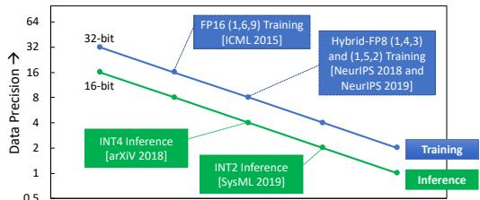 *Figure 1: Precision scaling road map for training and inference*

---

**方法**

- **核心架构（MPE Array，Mixed-Precision PE Array）**：
  - 采用 8×8 二维脉动阵列作为基础架构，每个 MPE 包含 8 个 FPU（支持 FP16/HFP8）与 8 个 FXU（支持 INT4/INT2）。
  - **FPU/FXU 流水线分离**：仅增加约 16% 面积，但使 INT4 流水线功耗仅为 FP16 的 0.3 倍，从而支持 **double-pumping** 翻倍定点计算引擎（每 FXU 含 8 个 INT4 / 16 个 INT2 MAC 引擎）。
  - **On-the-Fly 转换**：将 (1,4,3) 与 (1,5,2) 两种 FP8 输入格式在运行时转换为统一 (1,5,3) 中间格式，配合**可编程指数 bias** 支持 HFP8 训练。
  - **Sub-SIMD 分区**：在相同接口总线宽度与功耗下，HFP8 模式实现 2× 于 FP16 的峰值算力。
- **数据流设计**：
  - 采用改进的 **weight-stationary** 数据流，将 Ci/Co 映射为空间维度，权重驻留 LRF，输入沿行流式传输、输出沿列输出，实现 batch size = 1 下仍保持高利用率。
  - 通过跨 sub-SIMD 与跨列的 operand 复用缓解 L0 带宽约束。
- **SFU 阵列**：提供 FP16/FP32 精度的激活函数（ReLU、Sigmoid、Tanh 等）、归一化、池化、shuffle/permute 操作，保障辅助操作的高精度执行与端到端覆盖率。
- **稀疏感知频率调节**：
  - FPU 引入 **zero-gating** 旁路逻辑，乘数为零时跳过计算。
  - 编译期离线分析各层权重稀疏度，结合硅片功耗-频率特征化数据，通过 **clock-edge skipping** 将省下的功耗重新投资为更高时钟频率，实现功耗预算内性能最大化。
- **多核与多芯片扩展**：
  - 每 core 含 2 个 corelet 共享 2MB L1 scratchpad；采用双向 **ring 互连**（128 B/cycle 方向）与异步时钟域。
  - **MNI** 支持带请求聚合的 multi-cast 传输，实现重叠的生产者-消费者核间通信。
- **评估方法**：构建校准至**硅片实测 1% 误差以内**的性能模型，外推评估 4 核单芯片 INT4 推理系统与 4×32 核（共 768 TFLOPS）HFP8 训练系统。

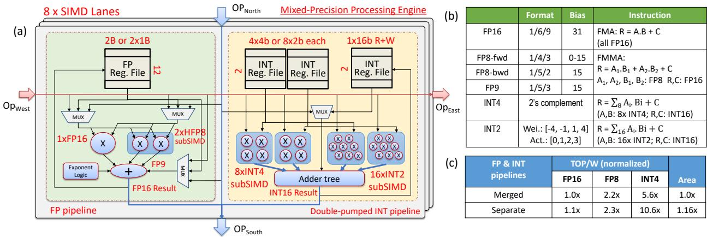

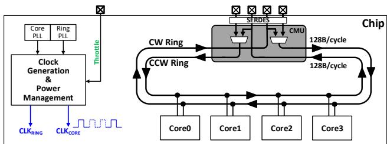 *Figure 9: 4-core RAPID architecture*

---

**结果**

- **芯片实现**：36mm² 芯片，**7nm EUV** 工艺，主频 1.5 GHz，4 核架构。

| 精度模式 | 峰值算力 | 峰值能效 |
|---|---|---|
| FP16 | 12 TFLOPS | 1.8 TFLOPS/W |
| HFP8 | 24 TFLOPS | 3.5 TFLOPS/W |
| INT4 | 96 TOPS | 16.5 TOPS/W |

- **INT4 推理**（batch size = 1，11 个 DNN 基准）：
  - 相对 FP16 基线端到端加速 **1.4×–4.2×（平均 2.8×）**。
  - 持续能效 **3–13.5（平均 7）TOPS/W**，为 FP16 基线的 **3.6×**；FP8 为 **1.6×**。
  - 计算周期分解：Conv/GEMM 占 50%，数据流开销 14%，量化开销 17%，辅助操作 19%。
- **HFP8 训练**（minibatch = 512，4 芯片系统）：
  - 相对 FP16 训练加速 **1.1×–2×（平均 1.4×）**。
  - 持续吞吐 **102–588（平均 203）TFLOPS**，覆盖图像分类、目标检测、机器翻译与语音任务。
  - 训练加速略低于推理，主因是梯度规约与权重广播的片外通信开销，以及反向传播需保留前向激活带来的访存压力。
- **稀疏感知调节**：在剪枝模型（稀疏度 50%–80%，精度损失可忽略）上实现 **1.1×–1.7×（平均 1.3×）** 额外性能提升。
- **系统扩展性**：推理系统在 batch size = 1 下从 1 核扩展至 32 核仍获得近似线性扩展（受限于固定外部带宽的部分基准除外）；训练系统扩展至 32 芯片时，HFP8 的 8-bit 权重广播有效降低了通信开销。

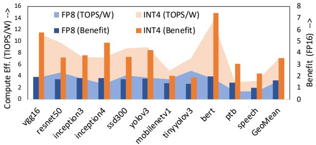

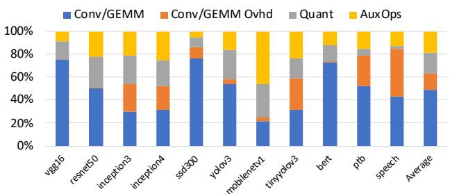

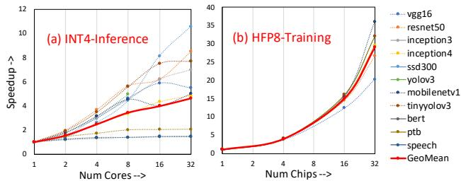

---

**结论**

- RAPID 是首个支持 **8-bit 浮点训练与 4-bit 定点推理**的混合精度 AI 加速器芯片，验证了精度缩放可作为 AI 加速器跨代性能提升的有效路径。
- 关键设计经验：
  - **FPU/FXU 流水线解耦 + double-pumping** 是在超低精度下同时缩放 TOPS 与 TOPS/W 的有效手段。
  - 保留高精度路径（首末层、激活函数等）对维持端到端精度不可或缺。
  - 编译期驱动的**稀疏感知频率调节**能在不增加电压调节开销的前提下挖掘功耗预算内的性能。
- 局限与未来工作：INT2 推理仍有约 2% 精度损失，剪枝与超低精度结合尚属开放研究问题，二者均被列为后续探索方向。

---

## 2. 背景知识与核心贡献

**研究背景**

- AI 工作负载计算需求爆发式增长：以 **ResNet50** 为代表的图像识别 DNN 分类单张图像即需约 **100 亿**次标量运算，训练更需 exa-FLOPs 级算力与数百 GB 数据集，传统计算平台难以支撑。
- 硬件加速器成为主流方案：DNN 为静态数据流图，可由少量原语（几十个）表达，天然适合专用加速。业界已涌现大量学术加速器（如 **Eyeriss**、**DianNao**）与商用 AI 芯片（**Google TPU**、**NVIDIA Tensor Cores**、**Intel NNP**）。
- CMOS 工艺缩放放缓：依赖工艺节点提升性能的传统路径收益递减，跨硬件-软件栈的系统性创新成为必然。

 *Figure 1: Precision scaling road map for training and inference*

**研究动机：Precision Scaling 的机遇与挑战**

- **核心机遇**：AI 工作负载具有内在的**误差容忍性**（error-resilient），可在不明显损失精度的前提下缩减数据表示位宽，从而同步改善计算效率、内存占用与数据带宽，且保持计算的规则性、不增加数据流复杂度。
- **算法侧已成熟的低精度技术基础**：
  - **推理侧**：PACT（参数化激活裁剪）与 **SaWB**（统计感知权重分箱）已实现 **INT4** 推理几乎无精度损失，**INT2** 推理仅约 **2%** 精度损失。
  - **训练侧**：HFP8（Hybrid-FP8，前向用 FP8(1,4,3)、反向梯度用 FP8(1,5,2)、指数 bias 可编程）已证明可在广泛任务上达到与 FP32 等价的训练精度。
- **现存问题**：下一代 AI 加速器必须支持超越 FP16 训练 / INT8 推理的**超低精度执行**，但低精度并非全量适用——首末层、shortcut 路径及激活/归一化等辅助算子仍需高精度保精度，这对架构设计（TOPS 扩展、带宽平衡、算力配比）提出新挑战。

**核心贡献：RAPID 芯片**

- **首个混合超低精度架构**：据作者所知，RAPID 是首个同时支持 **8-bit 训练（HFP8）** 与 **4-bit 推理（INT4）** 的混合精度 AI 加速器，覆盖 **FP16 / HFP8 / INT4 / INT2** 共 5 种数据格式。
- **7nm EUV 流片验证**：4 核、36mm² 芯片，主频 1.5 GHz，标称能效如下：

| 精度模式 | 峰值算力（4 核） | 能效 |
|---|---|---|
| FP16 | 12 TFLOPS | 1.8 TFLOPS/W |
| HFP8 | 24 TFLOPS | 3.5 TFLOPS/W |
| INT4 | 96 TOPS | 16.5 TOPS/W |

- **MPE（混合精度处理单元）微架构创新**：
  - **FPU/FXU 双流水线分离**：以约 16% 面积开销换取 INT4 能效提升至 FP16 的 **10.6×**（归一化 TOPS/W），支持 INT4/INT2 引擎倍增（double pumping）。
  - **HFP8 即时格式转换**：将 (1,5,2) 与 (1,4,3) 输入在线转为自定义 (1,5,3) 内部格式，配合 **sub-SIMD 细粒度切分**在 FP16 同等功耗与接口位宽下实现 **2×** 峰值吞吐。
  - 新颖的 **weight-stationary 数据流**：以 Ci/Co 为空间映射维度，batch size 低至 1 仍保持高利用率。
- **Sparsity-aware 频率节流**：结合 **zero-gating**（零操作数旁路）与编译期稀疏度分析，通过时钟边沿跳过（clock-edge skipping）在功耗包络内提升有效频率，对剪枝模型实现 **1.1×–1.7×（平均 1.3×）** 加速，规避了 DVFS 的电压调节开销。
- **可扩展的多核/多芯片互连**：基于双向 ring 的 **MNI（Memory-Neighbor Interface）** 支持异步时钟域、多核 **multi-cast** 广播（含硬件级请求聚合），可平滑扩展至 32 核芯片与多芯片训练系统。
- **端到端系统与软件栈**：配备图编译器 + 执行运行时，编译期完成数据流映射、scratchpad 管理与功耗节流决策，并集成量化（PACT/SaWB）与 HFP8 训练算法链路。

**关键实测/评估结果**

- **INT4 推理**（4 核芯片、batch=1）：11 个 SOTA 基准（VGG16、ResNet50、BERT、LSTM 等）上实现 **3–13.5（平均 7）TOPS/W**，相对 FP16 基线平均 **2.8×** 端到端加速。
- **HFP8 训练**（4×32 核芯片、768 TFLOPS 系统模型、mini-batch=512）：实现 **102–588（平均 203）TFLOPS** 持续吞吐，相对 FP16 平均 **1.4×** 加速。
- 性能模型经硅片测量校准，误差 **<1%**，保证了扩展性评估（1→32 核 / 1→32 芯片）结论的可信度。

---

**一句话总结**

RAPID 通过算法-架构-电路协同设计，将 precision scaling 从单一精度降级提升为**混合精度、可扩展、端到端覆盖**的系统级能力，在 7nm EUV 上同时兑现了 INT4 推理与 HFP8 训练的超低精度算力红利。

---

## 3. 核心技术和实现细节

### 0. 技术架构概览

**RaPiD 整体技术架构**

RaPiD 是 IBM 提出的**混合超低精度 AI 加速器**，在 **7nm EUV 工艺**、**36mm²** 的 4-core 芯片上同时支持训练与推理，核心设计理念是通过 **precision scaling** 同时提升 TOPS 与 TOPS/W，而非仅降低功耗。

---

**一、精度体系**

RaPiD 支持从 FP16 到 INT2 的完整精度谱系，依据 PACT、SaWB、HFP8 等算法研究成果选定：

| 格式 | 组成 | 典型用途 | 峰值性能 (4-core) | 能效 (峰值) |
|---|---|---|---|---|
| FP16 | (1,6,9), bias=31 | 高精度辅助层 | 12 TFLOPS | 1.8 TFLOPS/W |
| HFP8 | FP8-fwd (1,4,3) + FP8-bwd (1,5,2), 可编程 bias | 训练 | 24 TFLOPS | 3.5 TFLOPS/W |
| INT4 | 2's complement | 推理 | 96 TOPS | 16.5 TOPS/W |
| INT2 | 权重 [-4,-1,1,4]，激活 [0,1,2,3] | 推理 (未来工作) | — | — |

- 保留高精度支持的原因：首末层、shortcut 路径等仍需高精度以保持准确率
- HFP8 训练策略：前向传播双操作数均用 (1,4,3)；反向传播与梯度计算混合 (1,4,3) 与 (1,5,2)，并通过**可编程 exponent bias** 适配不同层的动态范围

---

**二、核心架构：Systolic Dataflow 基线之上的增强**

基线为 8×8 2D-systolic PE 阵列 + 1D SFU 阵列 + 两级 scratchpad 层次，RaPiD 在此基础上做了系统性增强。

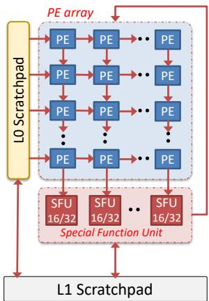 *Figure 2: Baseline: Systolic Dataflow Architecture*

**1. MPE (Mixed-Precision Processing Element) 阵列**

- **分离 FP 与 INT 流水线**：每个 MPE 含 8 个 FPU（FP16/HFP8）与 8 个 FXU（INT4/INT2），独立流水线带来面积开销约 16%，但 INT4 流水线功耗仅为 FP16 的 0.3 倍，因此可实现 **double-pumping**——每 FXU 容纳 8 个 INT4（16 个 INT2）MAC 引擎
- **On-the-fly 格式转换**：HFP8 的 (1,5,2) 与 (1,4,3) 输入在进入计算前实时转换为自定义 (1,5,3) 9-bit 格式，简化硬件
- **sub-SIMD 分区**：128-bit 数据通路在 HFP8 模式下细粒度切分，一条 FMMA 指令完成 2 次乘加，实现**同功耗下 2× 峰值 TOPS**
- **操作数复用**：修改的 weight-stationary dataflow，West 链路上的 32-bit 操作数 B 在 8-way sub-SIMD 与各列间复用，总计参与 64 次乘加，缓解 L0 带宽约束
- **Dataflow 映射约束**：Ci 沿行与 LRF 映射，Co 沿列与 SIMD 映射，权重驻留 LRF，H×W 与 N 作为最内层循环——保证 batch size=1 时仍有高利用率

**2. SFU 阵列**

- 提供 FP16 精确与快速两类非线性激活函数，以及 FP32 运算
- 承担 ReLU、Sigmoid、Tanh、normalization、pooling、shuffle/permute/transpose、chunk-based accumulation 等辅助操作
- 随 MPE 阵列峰值 TOPS 提升，SFU 阵列**加倍**以平衡计算负载

---

**三、AI Core：双 corelet 结构**

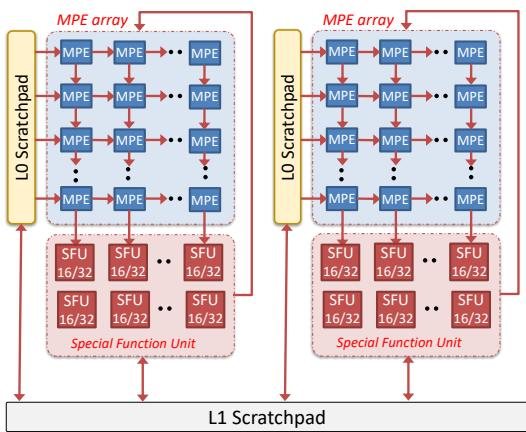 *D. Ultra-low Precision Core with 2 corelets Figure 7: AI core: 2 corelets and shared L1 scratchpad*

- 每个 AI core 由 **2 个 corelet**（各自含 MPE 阵列、SFU 阵列、L0 scratchpad）+ **共享 2MB L1 scratchpad** 构成
- L1 到每个 corelet 128 bytes/cycle 带宽；INT4 计算仅消耗 5/8 可用带宽，INT2 时部分和写回达到带宽上限
- 大容量 L1 使超低精度推理的中间结果可驻留片上

---

**四、片上互联与多核通信**

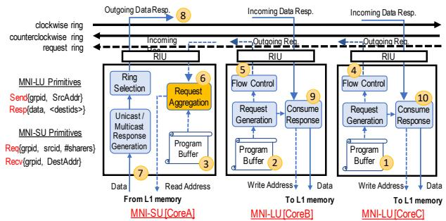 *Figure 8: Multi-cast Support in Memory-Neighbor Interface DNN workloads exhibit high-degree of parallelism allowing spatial partitioning of the work with data sharing across*

- **双向 Ring 互联**：每个方向 128 bytes/cycle，core 与 memory 通信；ring 与 core 处于**异步时钟域**（独立 PLL）
- **MNI (Memory-Neighbor Interface)**：每个 core 配备可编程 MNI-LU/MNI-SU，支持 send/recv 原语、tag 匹配、out-of-order 数据返回、多 outstanding 请求
- **Multi-cast 支持**：编译器为共享数据的多个消费 core 分配公共识别 tag；MNI-SU 的**请求聚合 (request aggregation)** 硬件在收齐请求后构建消费列表，单次传输服务多核，扩展至多芯片系统

---

**五、功耗管理：Sparsity-aware Zero-gating 与频率调节**

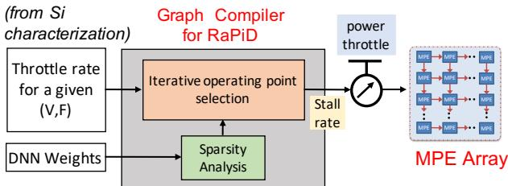 *Figure 6: Workload-Aware Power Throttling*

- **Zero-gating**：乘数为零时旁路 FPU 流水线直接传递加数，节省动态功耗
- **软件引导的 clock throttling**（区别于 DVFS，无需电压调节与 PLL 环路）：
  - 图编译器离线分析各层权重稀疏度
  - 结合硅片表征数据（不同电压/频率/稀疏度下的功耗）计算每层节流率
  - 片上 power control module 通过 **clock-edge skipping** 在单周期内调整有效频率，将省下的功耗“再投资”为更高频率
  - 调节决策在编译期完成，不在推理关键路径上；实测带来平均 1.3× 性能提升

---

**六、芯片级与系统级扩展**

 *Figure 9: 4-core RAPID architecture*

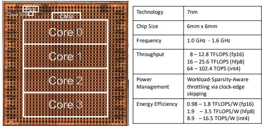 *Figure 10: 4-core RAPID Chip: 36mm2 in 7nm EUV technology*

- **4-core RAPID 芯片**：4 个 core 挂接 CW/CCW 双向 ring，1.5 GHz，由 **CMU (Chip Management Unit)** 控制单芯片闭环或多芯片级联构成 many-core 系统
- **推理系统**：4-core 芯片 + 200 GBps DDR，用于 INT4/FP8 batch-1 推理
- **训练系统**：4 片 32-core 扩展芯片，768 TFLOPs，64MB 分布式 L1 + 400 GBps HBM，片间 128 GBps 互联用于梯度与权重通信

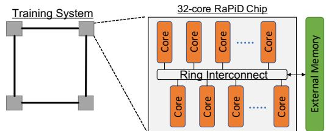 *Figure 11: AI Training System: 4 chips with 32 cores*

---

**七、软件栈**

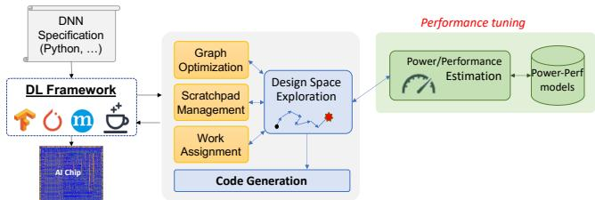 *Figure 12: End-to-End Software Stack for Inference and Training*

- **可插拔的编译期与运行期扩展**，集成于现有 DL framework
- 核心组件：
  - **Graph compiler**：自动完成 DNN 图到芯片的映射，执行 design space exploration（图优化、scratchpad 管理、多核任务分配），由经硬件校准（误差 <1%）的 bandwidth-centric 分析式功耗-性能模型引导搜索
  - **Execution runtime**：触发并管理芯片上的计算与数据搬运操作

---

**八、整体架构的实测效果**

| 场景 | 配置 | 结果 |
|---|---|---|
| INT4 推理 (batch=1) | 4-core 芯片 | 3–13.5 (平均 7) **TOPS/W**；相对 FP16 平均 2.8× 加速 |
| FP8 推理 (batch=1) | 4-core 芯片 | 平均 3.16 TOPS/W；相对 FP16 平均 1.55× 加速 |
| HFP8 训练 (mini-batch=512) | 4×32-core 系统 | 102–588 (平均 203) **TFLOPS**；相对 FP16 平均 1.4× 加速 |
| 峰值能效 | 7nm 硅片实测 | HFP8 **3.5 TFLOPS/W**，INT4 **16.5 TOPS/W** |

整体而言，RaPiD 的架构哲学是：在保持 systolic 数据流规则性的前提下，通过 **FP/INT 流水线解耦 + 精度自适应的计算引擎扩容（sub-SIMD、double-pumping）+ 带宽匹配的数据流映射 + 稀疏感知的功耗再分配 + 可扩展的多核/多芯片通信原语**，将算法侧的量化突破（HFP8、PACT/SaWB）完整转化为硬件侧 TOPS 与 TOPS/W 的同步提升。

### 1. 混合精度处理单元阵列（MPE）的吞吐量扩展架构

**核心观点**

MPE（Mixed-Precision Processing Element）阵列是 RAPID 芯片实现“吞吐量随精度等比扩展”的核心硬件单元。其设计哲学是：**保持 128-bit 接口总线宽度与 systolic 互连结构不变**，通过 **sub-SIMD partition（细粒度 SIMD 子分区）**、**FP/INT 双流水线分离**、以及 **on-the-fly 格式转换**，在不增加数据通路位宽的前提下，使 HFP8 峰值吞吐量达到 FP16 的 **2X**，INT4 达到 FP16 的 **8X**。

---

**一、MPE 基础架构与微结构组成**

- 每个 MPE 内部包含 **8 个 FPU**（支持 FP16/HFP8）与 **8 个 FXU**（支持 INT4/INT2）共两套独立流水线，替代单一合并流水线。
- 选择 **FP 与 INT 流水线物理分离** 的原因：
  - 消除多种精度格式共存时的 **pipeline depth 与 execution latency 不匹配**问题；
  - 为电路级优化（如 INT4/INT2 的 double pumping）打开设计空间；
  - 代价仅为约 **16% 面积开销**，但 INT4 流水线功耗仅为 FP16 流水线的 **0.3X**。
- 数据流向遵循 systolic 范式：
  - 输入操作数来自 **North/West 邻居 MPE** 或本 PE 的 **LRF（Local Register File）**；
  - 输入操作数同时向 **East 链路传播**（供同列邻居复用）；
  - 输出向 **South 邻居** 传播或写回 LRF；
  - FP16 与 HFP8 的计算路径在 **加法器（adder）处汇合**，统一输出 FP16 结果。

**FP/INT 流水线分离的量化收益（基于 Figure 4c 归一化数据）：**

| 流水线方案 | FP16 TOPS/W | FP8 TOPS/W | INT4 TOPS/W | 面积 |
|---|---|---|---|---|
| Merged（合并） | 1.0x | 2.2x | 5.6x | 1.0x |
| **Separate（分离）** | **1.1x** | **2.3x** | **10.6x** | **1.16x** |

关键结论：仅 **16% 面积开销** 即可将 INT4 能效从 5.6x 提升至 **10.6x**，几乎翻倍。

---

**二、sub-SIMD partition：HFP8 模式下 2X 吞吐量的实现原理**

- **问题背景**：FP16 乘法需完整 128-bit datapath 执行 8-way SIMD；而 FP8 操作数仅 8-bit，若仍按 8-lane 组织，一半位宽被浪费。
- **解决方案**：在 **同一 128-bit SIMD FPU datapath 内** 进行细粒度切分，将每个 FP16 SIMD lane 拆分为 **2 个 FP8 sub-lane**：
  - 一条 **FMMA 指令**（R = A1·B1 + A2·B2 + C）在单周期内完成 **2 次乘法 + 2 次加法**；
  - 接口总线宽度、寄存器堆端口、数据搬运带宽**完全复用**，故峰值 TOPs 翻倍而**功耗基本不变**。
- **时序可行性依据**：由于 FP8 仅需 **4-bit mantissa 乘法器**，HFP8 乘法路径的 **logic depth 与 FP16 相当**，无需降低时钟频率。
- **sub-SIMD 同样作用于 INT 通路**：
  - 每条 SIMD lane 完成 **8 个 INT4**（或 **16 个 INT2**）MAC 操作，产生 16-bit 整数结果；
  - SIMD MAC 单元 datapath 扩展至 **256-bit**，单条 MAC 指令可访问 **2 个寄存器**，摊薄累加开销。

**MPE ISA 指令格式规格：**

| 格式 | (S/E/M) | Bias | 指令语义 |
|---|---|---|---|
| FP16 | 1/6/9 | 31 | FMA: R = A·B + C（全 FP16） |
| FP8-fwd | 1/4/3 | 0–15 可编程 | FMMA: R = A1·B1 + A2·B2 + C（A/B 为 FP8，R/C 为 FP16） |
| FP8-bwd | 1/5/2 | 15 | 同上 |
| FP9（内部） | 1/5/3 | 15 | 内部统一计算格式 |
| INT4 | 2's complement | — | R = Σ₈ A·Bᵢ + C（8×INT4 → INT16） |
| INT2 | Wei: [-4,-1,1,4] / Act: [0,1,2,3] | — | R = Σ₁₆ A·Bᵢ + C（16×INT2 → INT16） |

---

**三、on-the-fly FP8→FP9 转换机制**

- **算法需求**：HFP8 训练要求 backward pass 中两个操作数使用不同格式（FP8(1,4,3) 与 FP8(1,5,2)），直接实现双格式浮点乘法器会显著增加面积与功耗。
- **硬件对策**：
  - 权重与激活在 memory/scratchpad 中以原始 FP8 格式存储（节省容量与带宽）；
  - 进入 MPE 时，在 **L0 侧的水平总线** 或 **来自 L1 的 FIFO 北向接口** 处，**动态转换为 9-bit 的 FP9(1,5,3) 内部格式**；
  - FPU 内部只需实现单一 FP9 乘法器，简化数据通路。
- **可编程 exponent bias**：
  - FP8-fwd 的 bias 可编程范围为 **0–15**，由 MPE 程序写入寄存器配置；
  - 使不同 DNN layer 可根据自身动态范围选择不同 bias，且硬件可据此确定 **data-gating 宽度**。

---

**四、吞吐量扩展的约束平衡：操作数复用与带宽设计**

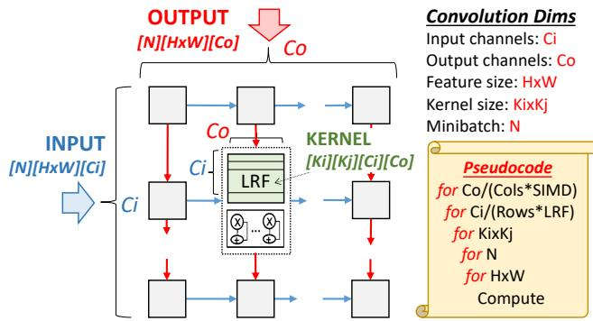 *Figure 5: Convolution dataflow*

低精度下 MPE 计算吞吐暴涨，**L0/L1 带宽成为瓶颈**，RAPID 通过数据流设计与操作数复用解决：

- **空间维度映射**（以 7 维卷积 Ci, Co, H×W, Ki×Kj, N 为基础）：
  - **Co** 映射至 columns 与 SIMD 方向（避免跨 SIMD 归约）；
  - **Ci** 映射至 rows 与 LRF；
  - **H×W 与 N** 作为 innermost loops，最大化复用 block-loaded 权重；
  - **权重驻留 LRF**（weight-stationary），输入沿 rows 流入，输出沿 columns 流出。
- **INT4 复用倍数**：8 个 INT4 输入操作数 B（32 bits）经 West link 进入后：
  - 被 **8-way sub-SIMD 各 lane 复用**；
  - 同时沿 MPE **列方向传播**给邻居；
  - 单个操作数最终参与 **64 次 multiply-add**。
- **带宽平衡数据**（corelet 级，见 Figure 7）：
  - L1→corelet 带宽 128 bytes/cycle；
  - INT4 计算仅消耗其 **5/8**（80 bytes/cycle）；
  - INT2 时每周期写入一个 partial sum 至 L1，**恰好达到带宽上限**——说明数据流设计精确卡在 speeds-vs-feeds 平衡点。

 *D. Ultra-low Precision Core with 2 corelets Figure 7: AI core: 2 corelets and shared L1 scratchpad*

---

**五、输入输出关系与在整体架构中的角色**

- **输入**：
  - FP16/HFP8/INT4/INT2 操作数，经 North/West systolic 链路或 LRF 提供；
  - 程序通过寄存器配置格式与 bias，硬件据此执行 data-gating。
- **输出**：
  - 统一以 **FP16（浮点模式）或 INT16（整数模式）** 形式产出，保证后续辅助操作（activation、normalization、chunk-based accumulation）可维持高精度；
  - HFP8 训练中，partial sums 经 SFU 执行 **chunk-based accumulation**，以层级累加方式保真中间和。
- **系统级定位**：
  - 每 **2 组 MPE 阵列 + SFU 阵列 + L0** 构成一个 **corelet**，2 个 corelet 共享 **2MB L1 scratchpad**；
  - 4 核（8 corelet）构成 36mm² 的 7nm EUV 芯片，峰值 12/24/96 T(FL)OPS（FP16/HFP8/INT4），实测能效 **3.5 TFLOPS/W（HFP8）**、**16.5 TOPS/W（INT4）**；
  - 实测端到端表现：INT4 推理（batch=1）平均 **7 TOPS/W**，HFP8 训练（mini-batch=512）平均 **203 TFLOPS**。

---

**总结要点**

- sub-SIMD partition 的本质是**用位宽换吞吐**：精度减半 → lane 数翻倍 → 峰值翻倍，而总线、寄存器端口、功耗几乎零增量。
- FP/INT 流水线分离以 **16% 面积** 换取 INT4 能效近 **2 倍提升**，是低精度能效跃升的关键杠杆。
- on-the-fly FP9 转换与可编程 bias 将算法层的 HFP8 混合格式需求压缩为硬件层的单一计算格式，兼顾灵活性（forward/backward 格式差异、逐层动态范围）与实现效率。
- 吞吐扩展的最终约束不在计算单元，而在 **L1 带宽与数据流映射**；RAPID 通过 weight-stationary 数据流 + SIMD/列双重操作数复用（单操作数复用 64 次），将带宽需求精确压在 128 bytes/cycle 的供给曲线之下。

### 2. HFP8异构格式的在线转换与可编程指数偏置

**核心观点**

HFP8（Hybrid-FP8）训练要求前向与反向传播使用**异构的 8-bit 浮点格式**——前向权重/激活采用 **FP8(1,4,3)**（低动态范围、高精度），反向误差梯度采用 **FP8(1,5,2)**（高动态范围、低精度）。若硬件直接实现两套乘加管线，会带来显著的面积与功耗开销。RaPiD 的解法是在 **FPU 内部统一采用自定义中间格式 FP9(1,5,3)**，在数据流入计算单元的瞬间完成**在线转换（on-the-fly conversion）**，同时配合**可编程指数偏置（programmable bias）**，使单一数据通路即可覆盖全部 HFP8 场景，实现相对 FP16 的 **2X 峰值 TOPS**。

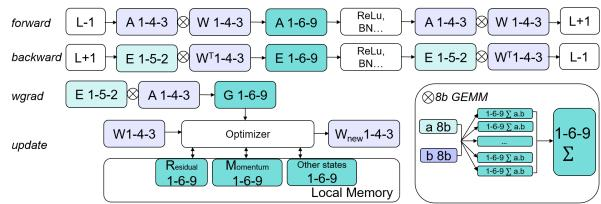 *Figure 3: Support for mixed FP8 precisions for training [45]*

---

**实现原理：为什么要在线转换**

- **算法侧需求**：HFP8 训练 [44,45] 的核心洞察是——前向传播的激活与权重数值分布集中，**4-bit 指数 + 3-bit 尾数**已足够；而反向传播中的梯度（误差项）动态范围跨多个数量级，必须使用 **5-bit 指数 + 2-bit 尾数**。两种格式不可互换，否则损失训练精度。
- **硬件侧矛盾**：若 FPU 为每种 FP8 格式单独设计乘法器与对齐逻辑，则：
  - 面积随格式种类近似线性增长；
  - 不同格式的 pipeline 深度与执行延迟不一致，破坏 systolic array 的节拍同步；
  - 与 FP16 共存的 128-bit datapath 需要复杂的格式仲裁逻辑。
- **解耦思路**：将**存储格式**（memory/scratchpad 中的 1,4,3 或 1,5,2）与**计算格式**（FPU 内部统一的 1,5,3）分离，转换只发生在数据通路的边界处，计算核心完全无感知。

---

**算法流程：转换路径与时机**

- **数据驻留阶段（低功耗）**：
  - 权重与激活以 FP8(1,4,3)（携带 bias）或 FP8(1,5,2) 形式存储于外部存储器与 L1/L0 scratchpad 中，节省一半的存储容量与搬运带宽。
- **转换触发点（两个入口）**：
  - **水平总线入口**：来自 L0 scratchpad 的数据在进入 MPE 的水平 bus 时，被在线转换为目标 FP9(1,5,3)；
  - **FIFO 接口入口**：来自 L1 scratchpad、经 North link 注入的数据，在 FIFO 接口处完成同样转换。
- **转换操作本身**：
  - **(1,4,3) → (1,5,3)**：指数位宽从 4-bit 扩展到 5-bit（高位补零），尾数 3-bit 不变。由于 (1,4,3) 的取值范围是 (1,5,3) 的子集，此方向为**无损扩展**；
  - **(1,5,2) → (1,5,3)**：指数 5-bit 不变，尾数从 2-bit 扩展到 3-bit（低位补零），同样为无损的位宽对齐。
  - 两个方向的转换均为纯连线重排（rewiring）级别的操作，无需进位链或查找表，**几乎零逻辑延迟开销**。
- **计算阶段**：
  - FPU 的 8-way SIMD 单元内部所有乘法、对齐、加法均按统一的 9-bit (1,5,3) 格式执行；
  - FMMA 指令（R = A1·B1 + A2·B2 + C）在 HFP8 模式下将一条 SIMD lane **细粒度分区（sub-SIMD）**为两个半宽乘加，输入 A1/A2/B1/B2 为 FP8，累加结果 R 与 C 为 FP16——这是 2X 峰值吞吐的微架构基础，而 4-bit 乘法器保证了与 FP16 相当的逻辑深度。
- **输出阶段**：
  - HFP8 与 FP16 的 FPU 计算路径在**加法器处汇合**（见图 4(a)），两种模式均输出 FP16 结果，保证后续辅助运算（激活函数、normalization 等）可在高精度下执行，维持端到端精度。

---

**参数设置：格式与偏置配置**

| 格式 | (S,E,M) 结构 | 指数偏置 | 典型用途 | 指令形态 |
|---|---|---|---|---|
| FP16 | 1/6/9 | 31（固定） | 高精度层、辅助运算 | FMA: R = A·B + C |
| FP8-fwd | 1/4/3 | **0–15（可编程）** | 前向权重与激活 | FMMA: R = A1·B1 + A2·B2 + C |
| FP8-bwd | 1/5/2 | 15 | 反向误差梯度 | （A1,A2,B1,B2 为 FP8；R,C 为 FP16） |
| FP9（内部） | 1/5/3 | 15 | FPU 统一计算格式 | — |

- **可编程偏置的动机**：固定偏置意味着固定的动态范围窗口。而不同 DNN 层（如浅层卷积 vs 深层 gradient）的数值动态范围差异巨大，尤其在训练早期梯度幅值剧烈波动。可编程 bias 允许每层将指数窗口平移到最匹配该层数值分布的位置。
- **配置机制**：
  - MPE 程序在装载时将操作数的**格式与偏置写入控制寄存器**；
  - 在单个程序执行期间，操作数精度保持固定，硬件据此确定**数据门控宽度**以节省功耗；
  - 偏置可编程范围覆盖 **0–15**，配合 4-bit 指数最多可提供 16 种动态范围窗口选择。

---

**输入输出关系与在整体中的作用**

- **输入**：
  - 存储侧的异构 FP8 张量：前向 (1,4,3)、反向混合 (1,4,3)×(1,5,2)；
  - 编译期确定的偏置配置与格式选择信号。
- **输出**：
  - MPE 阵列产出的 **FP16 部分和**；随后由 SFU 执行 **chunk-based accumulation** [51]，以分层累加方式保持中间和的保真度，弥补低精度累加的精度损失。
- **在整体架构中的定位**：
  - 该机制是 RaPiD 支撑 **“单芯片同时覆盖 8-bit 训练与 4-bit 推理”** 的关键支点之一：FPU 侧（FP16/HFP8）与 FXU 侧（INT4/INT2）采用**分离管线**，相比合并管线方案在仅 1.16x 面积开销下，INT4 能效提升至 **10.6x**（见 Figure 4(c) 对比表），而 HFP8 在线转换正是 FPU 侧在不增加面积的前提下达成 2.3x 能效的设计杠杆；
  - 实测层面，4 核 36mm² 的 7nm EUV 芯片在 HFP8 模式下达到 **3.5 TFLOPS/W** 峰值能效；在 4-chip 32-core 训练系统模型中，HFP8 相对 FP16 取得 **1.1×–2×（平均 1.4×）** 的吞吐提升；
  - 由于权重在前向仅需 8-bit 表示，HFP8 还天然降低了训练系统中 weight broadcast 的通信量——每芯片只向邻居同步更新后的 **8-bit 权重**，缓解了多芯片扩展时的互连瓶颈。

---

**设计权衡小结**

- **存储/带宽收益**：8-bit 存储相比 FP16 减半内存占用与搬运能耗；
- **计算收益**：sub-SIMD 分区 + 统一 FP9 内部格式，使同一 128-bit datapath 实现 2X 吞吐；
- **精度保障**：无损位宽扩展 + FP16 输出汇合 + chunk-based 累加 + 可编程偏置，四重机制协同确保 HFP8 训练精度对齐 FP32 baseline；
- **代价**：转换逻辑极轻（连线重排级别），主要开销在于寄存器配置与格式仲裁控制，属于典型的**以微小控制复杂度换取大幅能效增益**的设计。

### 3. 面向超低精度的权驻留数据流与操作数复用

**核心定位**

在 RaPiD 架构中，**权驻留数据流**是连接“算法层精度缩减”与“硬件层 TOPS/W 提升”的关键桥梁。其核心目标是：当精度从 FP16 缩减至 INT4/INT2 后，计算引擎数量倍增（double-pumped FXU），若操作数供给仍按旧模式搬运，则 **L0/L1 scratchpad 带宽**将立即成为瓶颈。该数据流通过**空间映射 + SIMD 内复用 + 跨列传播**三重手段，将单个 32-bit 操作数的实际利用率放大 **64 倍**，从而在 batch size = 1 的极端推理场景下仍维持高 PE 利用率。

---

**一、数据流推导的三条约束（设计动机）**

MPE array 的 dataflow 并非任意选择，而是由以下硬性约束收敛得出：

- **约束 1：batch size = 1 下的满利用率**
  - 边缘侧推理要求延迟最低，无法依赖 batch 维度填充空间阵列。
  - 结论：**N（minibatch）被排除出空间维度**，只能进入时间循环。
- **约束 2：禁止跨行/跨列通信**
  - MPE 的物理连线仅支持 **North/West 输入、South 输出、East 传播**（见图 4a），不存在对角或跨行布线。
  - 结论：**H×W（特征图尺寸）不能作为空间维度**，否则需跨 PE 归约。
- **约束 3：最小化 strip-mining 残差**
  - 硬件阵列维度为 8×8（行/列各 8），若映射维度的取值不是 8 的倍数，则产生填充浪费。
  - **Ki×Kj（kernel 尺寸）通常为小素数（3×3、5×5）**，与 8 对齐性差。
  - 结论：**Ci（输入通道）与 Co（输出通道）被选为空间维度**，因为现代 CNN 中 Ci/Co 普遍远大于 8 且常为 8 的倍数（如 64、128、256）。

---

**二、空间映射方案（Spatial Mapping）**

基于上述约束，卷积的 7 个维度（Ci, Co, H×W, Ki×Kj, N）被拆分为：

- **Co（输出通道）**
  - 映射到 **MPE array 的列方向 + SIMD lane 方向**。
  - 同一行内的各 SIMD lane 各自负责不同的输出通道，避免**跨 SIMD 归约**（cross-SIMD reduction）——这在硬件上不可实现。
- **Ci（输入通道）**
  - 映射到 **行方向 + Local Register File（LRF）**。
  - 每个行对应一组 Ci 分片，权重切片驻留在该行 PE 的 LRF 中。
- **权重**
  - **完全驻留于 LRF**，即“weight-stationary”的字面含义。
  - LRF 持有该 MPE（按其阵列坐标定位）所负责的 Ci/Co 组合对应的全部 Ki×Kj 权重元素。
- **输入/输出张量的流向**
  - **输入沿行方向streaming**、**输出沿列方向 streaming**。
  - 原理：systolic array 中，沿行送入的数据须被所有列复用，反之亦然。因此列上映射的维度（Co）必须与沿行流动的数据（输入）**相互独立**——输入张量不含 Co 维，天然满足。

---

**三、循环嵌套顺序**

Figure 5 伪代码的循环排序遵循“最大化驻留权重复用、最小化 block-load 频率”原则：

- **最内层：H×W 与 N**
  - 权重一次性 block-load 进 LRF 后，最内层循环的所有迭代（特征图每个位置 × 每个 batch 样本）都直接复用驻留权重。
  - 效果：**LRF 装载间隔被最大化**，装载等待时间被摊薄到最长的时间窗。
- **次内层：Ki×Kj**
  - 同一份 scratchpad 中的输入/输出体在该循环的所有迭代中完整复用，无需重新搬入 L0/L1。
- **最外层：Ci 与 Co**
  - 这两个维度已被空间映射消化，循环计数极小（仅处理 strip-mining 残余），对整体利用率影响微弱。

---

**四、Sub-SIMD 分区与 64 倍操作数复用（INT4 关键机制）**

这是本文档引用线索所指的核心机制，逐层拆解如下：

- **硬件前提：加宽的 SIMD MAC 通路**
  - 每个 MPE 的 FXU datapath 从 128-bit **加倍至 256-bit**。
  - 单条 MAC 指令可**同时访问 2 个寄存器**（共 256 bit）。
  - 每个 FXU lane 在一个周期内完成 **8 个 INT4 MAC**（INT2 模式下为 16 个），累加输出为 INT16，匹配 128-bit 的 MPE 间互连。
- **操作数 B（West link 输入，32 bits = 8 × INT4）的两级复用**
  - **第一级 —— 8-way sub-SIMD 内复用**：
    - 来自 West 链路的 32-bit 输入操作数 B 被**广播到同一 MPE 内的 8 个 sub-SIMD lane**。
    - 各 lane 持有不同的驻留权重（对应不同 Co 分片），B 与 8 份权重分别相乘累加 → 8 次 MAC。
  - **第二级 —— 跨列传播复用**：
    - B 同时通过 **East 链路向相邻列的 MPE 传播**（systolic 传播）。
    - 沿列方向的 8 个 MPE 各自再次进行 8 次 sub-SIMD MAC。
  - **合计复用次数：8 lanes × 8 列 = 64 次 multiply-add**，而 B 仅从 West 链路进入一次。
- **带宽收益**
  - 若无该复用，每周期需从 L0 取 64 × 4 bit = 256 bit 输入数据；复用后仅需 32 bit，**输入带宽需求降低 8 倍**。
  - 加宽 datapath 至 256 bit 的另一动机是**摊薄累加器的能耗开销**——精度缩减使乘法器成本大幅下降后，累加（特别是 16-bit 累加链）在能耗中的占比反而上升。

---

**五、在整体架构中的位置与输入输出关系**

 *D. Ultra-low Precision Core with 2 corelets Figure 7: AI core: 2 corelets and shared L1 scratchpad*

- **数据通路全景**
  - **输入侧**：L1 scratchpad（2MB，双 corelet 共享）→ L0 scratchpad → 沿行送入 MPE array（输入张量）/ 权重经 block-load 驻留 LRF。
  - **计算侧**：MPE 执行 Conv/GEMM，输出以 **INT16 部分和**形式沿列流出，写回 L1 或经 South 链路传至下一行。
  - **输出侧**：为保证端到端精度，**MPE 输出固定为 16-bit 格式**，后续激活函数、归一化、池化等辅助操作在 **SFU 以 FP16/FP32 高精度执行**。
- **带宽平衡的量化依据**
  - 修改后的 weight-stationary dataflow 下，INT4 计算仅消耗 **L1 → corelet 128 bytes/cycle 带宽的 5/8**。
  - 当精度进一步降至 INT2 时，每周期需写回 L1 的部分和数量增加，**恰好触及 L1 带宽上限**——该 dataflow 为 INT2 预留了带宽余量设计。
- **多层扩展（FC 层兼容性）**
  - 全连接层可视作 H×W = Ki×Kj = 1 的退化卷积，直接复用同一 dataflow。
  - 但小 batch 下 FC 层需频繁 block-load 权重，LRF 复用率下降，这是图 17 中 **Conv/GEMM overheads（平均 14%）** 的来源之一。

---

**六、对实测性能的影响**

- **利用率方面的短板被精确暴露**（Figure 17 的 compute cycle 分解）：

| 开销类别 | 平均占比 | 触发原因 |
|---|---|---|
| Conv/GEMM（有效计算） | 50% | weight-stationary 复用到位 |
| Conv/GEMM overheads | 14% | 阵列维度与 workload 维度不匹配（如 InceptionV3/V4、Tiny-YoloV3 的非规则通道数）、core/corelet 负载不均 |
| Quantization | 17% | FP16 ⇔ INT4 转换，激活尺寸大的网络开销显著 |
| Auxiliary operations | 19% | SFU 上的激活/归一化，MobileNetV1 等精简网络占比最高 |

- **复用机制对 TOPS/W 的贡献**
  - 该 dataflow 使得 INT4 模式下 4-core 芯片可达成 **16.5 TOPS/W 峰值**、实际 benchmark **3–13.5（平均 7）TOPS/W**。
  - 对比 FP16 基线，INT4 平均端到端加速 **2.8×**，其中带宽节省（而非单纯计算引擎倍增）是 batch size = 1 场景下维持高利用率的前提。
- **对比参考：独立 FP/INT 流水线的量化数据**（Figure 4c，正是该复用机制赖以生效的电路基础）：

| 流水线方案 | FP16 TOPS/W | FP8 TOPS/W | INT4 TOPS/W | 面积 |
|---|---|---|---|---|
| Merged（合并流水线） | 1.0× | 2.2× | 5.6× | 1.0× |
| Separate（分离流水线） | 1.1× | 2.3× | **10.6×** | 1.16× |

  - 仅 **16% 面积开销**即可换取 INT4 能效近翻倍（5.6× → 10.6×），分离流水线 + double-pumped 引擎 + 64 倍操作数复用三者共同构成 INT4 高能效的完整因果链。

---

**总结**

该权驻留数据流的设计哲学是：**用空间换时间、用复用换带宽**。通过将 Ci/Co 固化为空间维度、将权重锁定于 LRF、将 H×W/N 推入最深循环以最大化驻留周期，再叠加 256-bit 加宽 datapath 上的 sub-SIMD 广播与 East 链路跨列传播，RaPiD 在 batch size = 1 的最难推理条件下，用单个 32-bit 操作数驱动了 64 次 INT4 multiply-add，使计算引擎倍增后带宽不再成为短板，是 INT4 模式 16.5 TOPS/W 峰值能效与平均 2.8× 端到端加速的直接架构支撑。

### 4. 稀疏感知的零门控与频率节流

**核心观点**

RaPiD 将 **FMA 引擎中的 zero-gating 逻辑** 与 **软件引导的 clock-edge skipping 频率节流机制** 相结合，构成一套 **硬件/软件协同的功耗-性能再分配方案**。其本质逻辑是：稀疏（剪枝）模型中大量乘法操作数为零 → zero-gating 跳过计算使动态功耗下降 → 把节省下来的功耗预算通过提升有效时钟频率“再投资”回该层执行 → 在固定功耗包络（power envelope）内获得更高的有效 TOPS。

---

**实现原理：Zero-gating（零值门控）**

- **触发条件**：MPE 的 FMA 流水线检测到任一乘数（multiplicand）为零时，触发 bypass 路径。
- **行为**：完全跳过整个 FPU 流水线的计算，直接将加数（addend）作为结果传递，避免翻转乘法器与加法树的动态功耗。
- **收益来源**：剪枝后的 DNN 权重稀疏度分布中存在大量零值，且激活值经 ReLU 后同样稀疏；zero-gating 将“逻辑上的无效计算”转化为“物理上的功耗节省”。
- **关键特性**：该机制是数据驱动的逐周期硬件行为，无需软件干预，是后文频率节流所依赖的“功耗节省来源”。

**实现原理：Sparsity-aware Frequency Throttling（稀疏感知频率节流）**

- **动机**：同一 DNN 不同层之间的权重稀疏度差异显著；对推理而言，稀疏度分布是 **静态的**（权重在推理期间不变），因此可在编译期离线分析并利用。
- **为什么不用 DVFS**：传统 DVFS 涉及 **电压调节环路** 和 **PLL 锁相环**，切换延迟大；RaPiD 采用 **clock-edge skipping（时钟沿跳过）**，可在 **单个时钟周期时间尺度内** 调制有效频率，由软件控制的 on-chip power control module 执行。

---

**算法流程与参数设置**

*第一步：硅特性表征*

- 芯片流片后测量功耗（**动态功耗 + 静态功耗**）随电压的变化曲线。
- 在允许电压范围内确定对应的可用频率点，建立 **→ 功耗** 的基础映射表。
- 在每个工作点上改变模型稀疏度，量化 zero-gating 带来的功耗节省，推导出 **稀疏度 → 时钟节流停顿率** 的映射关系。

*第二步：编译期分析*

- Graph compiler 逐层分析 DNN 的权重稀疏度。
- 将稀疏度信息与硅特性数据作为输入，为每一层计算最优的 **throttling level（节流等级）**。
- 目标函数：在不超过功耗包络的前提下，将功耗推到最接近极限的位置——即“用满”功率预算换取最高有效频率。
- **关键优势**：该计算完全在编译期完成，**不在推理关键路径上**，且对同一 DNN 的多次推理可完全摊销，运行时零开销。

*第三步：运行时执行*

- On-chip power control module 依据编译器推荐的节流率执行 **clock-edge skipping**，即周期性地屏蔽时钟沿，实现有效频率调制。
- 在功耗与热限制内缩短整体执行时间。

 *Figure 6: Workload-Aware Power Throttling*

*图：Workload-Aware Power Throttling 流程，展示编译器稀疏度分析 → 硅特性数据 → 逐层节流等级决策的闭环*

---

**输入输出关系**

- **输入**：
  - DNN 各层的权重稀疏度统计（编译期，由 graph compiler 提取）。
  - 芯片硅特性测量数据（功耗-电压-频率曲线，叠加不同稀疏度下的功耗校准）。
  - 功耗包络约束（以标称电压/频率下的功率限制为基准）。
- **输出**：
  - 逐层的节流率配置，写入程序供 on-chip power control module 在该层执行期间生效。
  - 直接结果：每层的有效执行频率在功耗约束下被最大化。
- **反馈闭环**：zero-gating 节省的功耗 → 功耗余量 → 更高有效频率 → 更短执行时间，形成“功耗再投资”循环。

---

**实测效果与数据**

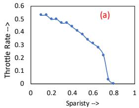

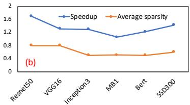

*图：(a) 4-core RaPiD 芯片上不同稀疏度对应的频率节流率（基于硅测量）； 公开剪枝模型上稀疏感知节流带来的加速比*

- 实验对象为 **公开的 FP16 剪枝模型**（ResNet、SSD、BERT 等的剪枝版本）；作者明确指出 **剪枝与超低精度结合** 仍是开放研究方向，故该机制仅在 FP16 精度上评估。

| 指标 | 数值范围 |
|---|---|
| 各网络平均稀疏度 | **50% – 80%** |
| 精度损失 | 可忽略 |
| 相对无节流基线的加速比 | **1.1× – 1.7×** |
| 平均加速比 | **1.3×** |

- 加速比与稀疏度正相关：稀疏度越高，zero-gating 省电越多，可再投资的功耗余量越大，可选取的有效频率越高。

---

**在整体架构中的作用**

- **能效闭环的关键拼图**：RaPiD 的设计原则是“同时提升 TOPS 与 TOPS/W”（设计要点 2）；zero-gating + 频率节流使芯片在低精度引擎（如 INT4 的 16.5 TOPS/W 峰值能效）之上，进一步通过算法特性（稀疏性）榨取功耗预算。
- **与精度缩放正交**：该机制作用于功耗域，与数据格式（FP16/HFP8/INT4/INT2）无关，理论上可与任何精度模式叠加；论文将其列为与 mixed-precision、multi-core scaling 并列的五大架构特性之一。
- **硬件成本极低**：无需电压调节器和 PLL 重锁，仅需时钟门控单元与编译器支持，即可在单周期内完成频率调制。
- **适用边界**：依赖稀疏度在推理期静态可预测；对训练场景（梯度分布动态变化）不适用，故论文仅将其应用于推理。

---

**局限性**

- 剪枝与超低精度（INT4/INT2）的组合尚不成熟，两套优化目前无法叠加使用，是论文明确的 future work。
- 节流决策基于层粒度的平均稀疏度，若层内激活稀疏度动态波动，功耗预算分配可能偏保守或偏激进。
- 加速比上限受“功耗节省量”约束——即使 80% 稀疏，实测平均加速也仅 **1.3×**，说明功耗再投资的边际收益受频率-功耗非线性能耗曲线限制。

### 5. 内存邻居接口（MNI）与多播通信协议

---

**核心定位与设计动机**

- **MNI（Memory-Neighbor Interface）** 是 RAPID 架构中实现 **core-to-core** 与 **core-to-memory** 通信和同步的可编程接口单元，是整个芯片从“单核加速器”扩展为“多核/多芯片 AI 系统”的关键互连枢纽。
- 其设计动机源于 DNN 负载的两个本质特征：
  - **高并行度**：DNN workload 天然支持空间划分，工作可切分到多个 core 并行执行。
  - **高数据共享度**：空间划分后，多个 core 之间存在大量共享数据（如同一份 weights 被多个 core 的不同 batch 分片使用），若逐 core 单播传输会浪费带宽。
- 因此 MNI 的设计目标是在 **带宽受限的 ring 互连** 上，以最少的硬件开销实现**延迟隐藏**与**多播数据复用**。

 *Figure 8: Multi-cast Support in Memory-Neighbor Interface DNN workloads exhibit high-degree of parallelism allowing spatial partitioning of the work with data sharing across*

---

**互连物理层：双向 Ring 架构**

- 拓扑结构：**bi-directional ring**，由顺时针（**CW**）与逆时针（**CCW**）两条环组成，4-core RAPID 芯片中的所有 core 均挂接其上。
- 带宽规格：每个方向 **128 bytes/cycle**，全双工总计 256 bytes/cycle。
- 时钟域隔离：ring 与 core 运行在**异步时钟域**，分别配备独立的 core PLL 与 ring PLL，使 **数据搬运** 与 **计算** 可以独立进行功耗/频率优化，跨时钟域由 MNI 完成 CDC（Clock Domain Crossing）。
- 环的扩展机制：通过 **CMU（Chip Management Unit）**，ring 既可以在单芯片内闭合，也可以跨多芯片串联，构成 manycore 系统——这是 RAPID 4 芯片训练系统（Figure 11）的物理基础。

 *Figure 9: 4-core RAPID architecture*

---

**MNI 内部组成：可编程 LU/SU 双单元架构**

MNI 的核心思想是“**可编程的通信端点**”——与 RAPID core 中 access-execute 解耦的编程范式保持一致，把数据搬运本身也变成程序：

- **MNI-LU（Load Unit）**：可编程 load 单元，负责发起从 memory 或 neighbor core 的数据读取，并将返回数据写入本 core 的 **L1 scratchpad**。
- **MNI-SU（Store Unit）**：可编程 store 单元，负责从 L1 scratchpad 读取数据并向 memory 或 neighbor core 发送。
- **RIU（Ring Interface Unit）**：ring 侧接口，MNI 通过它接入环，并执行 ring 上的带宽仲裁与 L1 bank conflict 预约管理。

**延迟隐藏机制（输入输出关系的关键）**

- DNN 的数据访问模式是 **静态且规则** 的，编译器在编译期即可完整知晓。
- 因此采用 **double-buffering** 策略：在 core 计算当前数据块的同时，MNI-LU 预取下一个数据块到 L1 scratchpad 的另一 buffer，实现计算与搬运的时间重叠，将数据取回延迟完全隐藏。
- 编译器通过 **loop blocking/tiling** 决定每次 fetch/store 的粒度，平衡 **scratchpad 容量** 与 **可用带宽** 两个约束。

---

**请求-响应协议：Tag、乱序返回与流控**

**1. Tag-based 请求标识**

- 每次 load/store 请求由 MNI-SU 的 `Send` 原语或 MNI-LU 的 `Recv` 原语在执行时分配一个 **唯一 identification tag**。
- tag 是整个多播协议的匹配依据：数据在 ring 上流动时携带 tag，接收方据此匹配到对应的 pending 请求。

**2. Out-of-Order 数据返回**

- MNI 内部维护 **load queue** 与 **store queue**，支持 **multiple outstanding requests**（多个在途未完成请求）。
- 由于 load queue 中记录了 tag → 目标 L1 scratchpad 地址的映射，数据允许**乱序返回**——先返回的数据可以先写入，无需严格按请求顺序到达。
- **流控（Backpressure）**：当在途请求数量达到上限时，MNI-LU/SU 程序自动 stall，形成硬件-软件协同的天然背压，无需额外的信用机制。

**3. 双向带宽利用的微观优化**

- MNI-LU 被设计为**每 cycle 最多接收 2 个 data return**。
- 该能力依赖两项配套设计：
  - L1 scratchpad 的 **banked architecture**，保证单 cycle 两次写入落在不同 bank 上；
  - RIU 中的 **reservation management policy**，在 ring 层面预先规避写入端的 L1 bank conflict。

---

**多播通信协议：Request Aggregation 全流程**

多播的目标场景：core A 持有一份数据（例如某层 weights），需要分发给 core B 和 core C（可扩展至任意消费者集合）。协议分三阶段执行：

**阶段一：消费者注册（Recv 请求，步骤 1-2）**

- 编译器为参与多播的所有 core 生成 MNI 程序，各消费者的 MNI-LU 向生产者 core A 发出 `Recv` 请求。
- 每个 Recv 请求携带：
  - **共同 identification tag**（由编译器静态分配，所有参与者一致）；
  - **消费者数量**（consumer count）。
- 消费者之间相互独立、无需协调——汇聚工作完全交给 core A 的硬件。

**阶段二：生产者侧请求聚合（步骤 3-6，核心创新）**

- core A 的 MNI-SU 程序中包含匹配的 `Send` 原语，同样携带 common tag 及消费者列表。
- **MNI-SU 的硬件 Request Aggregation 逻辑**：
  - 持续接收带同一 tag 的 Recv 请求；
  - 等待**所有参与消费者的请求到齐**后，动态构造出消费者列表——这意味着消费者集合不必静态写死在硬件中，而是运行时由请求流动态汇聚而成；
  - 该设计使得协议可 **scaling to 大量 core**，而 MNI-SU 硬件只需维护计数与列表缓冲，无需预先知道系统规模。

**阶段三：单次多播发布（步骤 7）**

- 聚合完成后，MNI-SU 从本 core 的 L1 scratchpad **一次性读取数据**；
- 将数据连同 **common identification tag + 消费者列表** 一起 post 到 ring 上；
- ring 上的数据沿拓扑传递，各消费者根据 tag 匹配后由 MNI-LU 写入各自 L1 scratchpad；
- **带宽收益**：数据在 ring 上只需被读出并传输一次，N 个消费者共享同一次传输，将原本 O(N) 的单播流量压缩为 O(1)。

**Memory 侧对称扩展**

- 相同的 **request aggregation** 支持同样实现在 **external memory interface** 上：多个 core 的 MNI-LU 向 memory 请求同一份共享数据时，memory 侧硬件聚合这些请求后，以**一次多播传输**响应所有 core。
- 这对 data-parallel 训练尤其关键：HFP8 训练中权重以 8-bit 形式从 HBM 广播到 4 芯片 × 32 core 的系统中，多播使广播开销大幅降低。

---

**在整体架构中的作用与量化效果**

- **作用一：核间数据交换的编译期优化载体**。MNI 的 send/recv 原语由 graph compiler 生成，sparsity 分析、tile 决策、work assignment 均可影响通信调度，通信协议成为编译器设计空间探索的一部分。
- **作用二：同步原语承载**。除数据搬运外，MNI 支持基于 tag 的 producer-consumer 同步，与 core 内部 token-based 同步机制配合，保证多核数据依赖的正确性。
- **作用三：多播支撑分布式训练**。4-chip 训练系统中，gradient reduction 与 weight broadcast 通过 128 GBps 的 chip-to-chip 互连完成；HFP8 使 forward pass 权重仅 8-bit，每芯片各自计算所拥有权重分片的更新，仅广播 8-bit 更新量，通信量与多播机制叠加，是训练吞吐达到 **102-588（平均 203）TFLOPS** 的重要保障。
- **作用四：推理扩展中的带宽瓶颈缓冲**。在 Figure 18(a) 的 1→32 core 推理扩展实验中，compute-intensive 网络持续受益，而受 memory 带宽限制的网络出现饱和——这说明 MNI+ring 的 128 B/cycle 设计在多数场景下够用，但外部 DDR 带宽是最终上限，也从侧面验证了 MNI 协议在片内通信维度没有成为瓶颈。

---

**协议设计权衡总结**

| 设计维度 | 选择 | 理由 |
|---|---|---|
| 请求匹配机制 | 唯一 identification tag | 编译期静态分配，硬件零歧义匹配，天然支持多播 |
| 数据返回顺序 | Out-of-order（load queue 跟踪地址） | 隐藏互连延迟，提升 ring 利用率 |
| 流控方式 | outstanding 请求上限 + 程序 stall | 无需复杂信用协议，硬件开销极小 |
| 消费者集合确定 | 运行时 request aggregation 动态构建 | 硬件无需预设系统规模，可扩展至任意核数 |
| 传输方式 | 单读 + tag 多播发布 | O(N)→O(1) 的带宽压缩，适配 DNN 数据共享特征 |
| 时钟域 | ring 与 core 异步、独立 PLL | 数据搬运与计算的频率/功耗解耦优化 |

**关键结论**

- MNI 的多播协议是一个典型的 **编译器-硬件协同设计**：编译器提供静态 tag 与原语编排，硬件提供 request aggregation 与乱序返回，两者结合实现了在极简硬件（可编程 LU/SU + tag + queue）之上的高效可扩展通信。
- **Request aggregation** 是协议的灵魂——它将“多消费者”这一信息从静态配置转变为运行时汇聚，使同一套硬件无缝覆盖从单芯片 4-core 到多芯片 manycore 系统的完整扩展路径，这正是 RAPID 声称"scalable to multiple cores and chips"的架构根基。

### 6. 双corelet共享L1暂存的核组织

**核心观点**

RaPiD 的 AI core 采用**“双 corelet + 共享 L1 scratchpad”**的组织方式：每个 corelet 内含一套 **MPE array（Mixed-Precision PE Array）**、一套 **SFU array** 以及私有 **L0 scratchpad**，两个 corelet 通过独立的可编程 load/store 单元共享一块 **2MB L1 scratchpad**。该设计的根本动机是在**精度缩放**下同时优化**数据复用**、**带宽匹配** 与 **容量摊销**，并使单个 core 既能独立作为边缘推理加速器，又能作为大规模训练系统的基本构建块。

 *D. Ultra-low Precision Core with 2 corelets Figure 7: AI core: 2 corelets and shared L1 scratchpad*

---

**一、层级式存储组织的结构原理**

- **Corelet 内部（计算近端）**：
  - **L0 scratchpad**：紧贴 MPE/SFU array，沿行方向（**X direction**）喂数据，延迟最低、带宽最紧。
  - **MPE array**：8×8 2D 脉动阵列，每个 MPE 含 **8 个 FPU**（FP16/HFP8）与 **8 个 FXU**（INT4/INT2），FXU 内部经 **double pumping** 后实际容纳 **8 个 INT4（16 个 INT2）MAC 引擎**。
  - **SFU array**：处理激活函数（ReLU、Sigmoid、Tanh）、归一化、pooling、permute/transpose 等辅助算子，支持 FP16/FP32，且相对基线架构**数量翻倍**——用以匹配 MPE 在低精度下暴涨的吞吐，避免 SFU 成为瓶颈。
- **Corelet 之间（计算远端）**：
  - **共享 2MB L1 scratchpad**：容量大，负责承接外部 memory 经 ring 传入的数据，并将中间结果驻留片上。
  - **独立的可编程 load/store 单元**：每个 corelet 各自持有一套，与共享 L1 对接，带宽为 **128 bytes/cycle**，保证两个 corelet 并行取数互不干扰。

---

**二、数据通路与输入输出关系**

- **纵向通路（Y direction）**：L1 scratchpad 连接 L0 与 SFU/PE array 的列方向，同时作为与外部 memory 交互的唯一接口（经 **MNI/Ring Interface Unit**）。
- **横向通路（X direction）**：L0 沿行方向向 PE array 流水供给操作数。
- **操作数来源与去向（单个 MPE 视角）**：
  - 输入操作数来自 **North/West 邻居 MPE** 或自身 **LRF（Local Register File）**，并继续向 East 链路传播以供邻居复用；
  - MAC 输出向南传播或写回 LRF。
- **HFP8 特殊通路**：权重与激活以 (1,4,3) 或 (1,5,2) 格式存储于 scratchpad，在 **L0 水平总线**或 **L1 北向 FIFO 接口**处被 **on-the-fly 转换**为内部统一的 (1,5,3) 9-bit 格式后进入 FPU。
- **精度提升下的输出策略**：无论 FPU 运行 FP16 还是 HFP8，输出恒定保持 **FP16 精度**（FP16 与 HFP8 计算路径在加法器处汇合），保证后续 SFU 辅助运算（如 chunk-based accumulation 的部分和累加）有足够精度维持端到端准确率。

---

**三、带宽匹配：“Speeds vs. Feeds” 的量化设计**

设计者显式做了 L1 带宽预算平衡，核心约束是低精度下 MPE 吞吐翻倍后不能被 L1 供给卡死：

| 精度模式 | MPE 峰值吞吐变化 | L1 带宽占用情况 |
|---|---|---|
| **FP16** | 1×（基线） | 常规占用 |
| **HFP8** | 2×（sub-SIMD 细粒度切分，FMMA 单周期完成 2 乘 2 加） | 常规占用 |
| **INT4** | 4×（double pumping + 256-bit SIMD 数据通路） | 修改版 weight-stationary dataflow 下仅占 **5/8** 的 128 B/cycle L1 带宽 |
| **INT2** | 8× | **触及 L1 带宽极限**——每周期需向 L1 写回一个 partial sum |

- 关键技术支撑：
  - **Weight-stationary dataflow**：权重分块驻留 LRF，H×W 与 N 作为最内层循环最大化权重块复用，输入张量沿行流、输出张量沿列流，跨行/跨列通信被彻底消除；
  - **操作数复用**：来自 West 链路的 8 个 INT4 输入操作数（32 bits）在 **8-way sub-SIMD 内部**复用，并沿 MPE 列方向传播，最终参与 **64 次 multiply-add**；
  - **双寄存器访问**：SIMD MAC 数据通路加宽至 **256 bits**，单条 MAC 指令可访问 2 个寄存器，摊薄随精度缩放而日益凸显的累加能耗。

---

**四、为何选择“双 corelet 共享”而非单 corelet 或私有 L1**

- **容量摊销与数据复用**：
  - 精度缩放到 INT4/INT2 后，张量占用的存储容量按比例缩小，**2MB 共享 L1** 足以让两套计算阵列的中间输出全部驻留片上——这对**超低精度推理**尤其关键（避免与 host/外部 memory 之间的昂贵数据搬运）。
  - 两个 corelet 可直接在 L1 层共享同一份输入数据（配合 MNI 的 **multi-cast** 机制扩展到多 core 场景），无需重复装载。
- **面积与功耗再平衡**：
  - 精度缩放使计算单元能耗下降（INT4 流水线功耗仅约 FP16 的 **0.3×**），设计将省下的功耗预算**再投资**于计算引擎数量（double pumping、SFU 翻倍），而共享 L1 避免了存储侧面积的成倍扩张。
- **可编程去中心化控制**：
  - 沿用基线架构的 **access-execute** 范式，L1→L0 之间由位于链路两端的**可编程单元**分别控制地址序列与写入位置，配合 **token-based 硬件同步**保证 producer-consumer 依赖（写先于读）。
  - 双 corelet 各自的 load/store 程序独立执行，L1 通过**多 bank 结构**支持 MNI-LU 每周期接收最多 **2 个乱序返回数据**，RIU 的预留管理策略规避 bank 冲突。

---

**五、在整体系统中的作用与扩展**

- **单 core 即产品**：一个 AI core（2 corelets + 2MB L1 + MNI）自身具备执行端到端 DNN 所需的全部要素（卷积/GEMM + 全谱系辅助算子 + 片上容量），可直接作为**边缘端单核推理加速器**。
- **多核扩展**：
  - 4-core RaPiD 芯片中，4 个 core 经 **128 B/cycle 双向 ring** 互连，ring 与 core 运行在**异步时钟域**（各自独立 PLL）；
  - 训练系统模型将单芯片扩展到 **32 cores、64MB 分布式 L1 scratchpad**，4 芯片经 **128 GBps 片间互连**构成 **768 TFLOPs（HFP8）** 训练系统，梯度与权重广播依赖 MNI 的 multi-cast + request aggregation 原语；
  - 系统级实测/建模结果显示：INT4 推理（batch size 1）实现 **3–13.5（平均 7）TOPS/W**，HFP8 训练（mini-batch 512）实现 **102–588（平均 203）TFLOPS** 持续吞吐。

---

**设计权衡总结**

- **本质**：双 corelet 共享 L1 是在**精度缩放红利**（容量需求下降 + 计算能效提升）与**系统约束**（带宽墙、面积预算、辅助算子占比上升）之间找到的平衡点——用共享大容量 L1 摊销存储成本，用翻倍的计算与 SFU 阵列兑现低精度的理论峰值，用 weight-stationary dataflow 与操作数复用把 INT4 压到 5/8 L1 带宽以内，同时在 INT2 场景下诚实地暴露带宽极限作为下一代设计边界。

---

## 4. 实验方法与实验结果

**一、实验设置分析**

---

**1. 评测方法论：校准性能模型而非纯硬件实测**

- 核心方法：构建**详细的 RAPID chip 性能模型**，并基于 4-core 芯片的**实测数据校准至误差 <1%**（引自 ISSCC 2021 硅片测量 [50]）。
- 功耗估算：各 DNN primitive（Convolution、ReLU 等）的功耗在**硅片上直接测量**，再结合各组件（MPE array、SFU、scratchpad）的利用率投影，推算 **TOPS/W**。
- 动机：实测芯片仅 4 cores，而训练系统（32-core × 4 chips）和 32-core 推理扩展无法直接测量，故依赖校准模型做外推。
- 潜在风险：多芯片系统的**互连竞争、热耦合、同步抖动**等真实系统效应可能未被 1% 校准精度覆盖，属于模型外推的固有局限。

**2. 系统配置**

| 维度 | 推理配置 | 训练配置 |
|---|---|---|
| 芯片规模 | 1 × 4-core RAPID | 4 × 32-core RAPID |
| 峰值算力 | 96 TOPS @1.5GHz (INT4) | 768 TOPs (HFP8)，文中一处写 760 TOPs |
| 片上存储 | 共享 L1 scratchpad | 64MB 分布式 L1 |
| 外部内存 | DDR, **200 GBps** | HBM, **400 GBps** |
| 芯片间互连 | — | **128 GBps**（用于梯度/权重通信） |
| Batch 配置 | **batch size = 1**（最难利用场景） | **mini-batch = 512** |

**3. Benchmark 覆盖（11 个 SOTA DNN）**

- **图像分类**：VGG16、ResNet50、InceptionV3、InceptionV4、MobileNetV1（ImageNet）
- **目标检测**：SSD300、YoloV3、YoloV3-Tiny（COCO）
- **NLP**：BERT（seq length=384，WMT14 En-De）、2-layer LSTM（PTB）
- **语音**：4-layer bidirectional LSTM（SWB300）
- 覆盖 CNN / RNN / Transformer 三大架构，验证**端到端应用覆盖**的声明，而非只挑 Conv-friendly 的 workload。

**4. 基线选择与公平性**

- 基线为**同构系统下的 FP16 实现**（相同带宽、相同芯片配置），报告相对加速比——控制变量严格。
- 作者引用 **MLPerf** 数据论证其 FP16 基线在归一化技术节点/功耗/面积后具有竞争力，避免“弱基线”质疑。
- 推理限定了两个精度点：**FP8-fwd 与 INT4**；INT2 被搁置（因 ≈2% 精度损失），剪枝实验仅在 FP16 精度模型上进行（剪枝+超低精度组合仍属开放问题）——体现了评测边界的诚实披露。

---

**二、结果数据分析**

---

**1. 推理性能（图 13）**

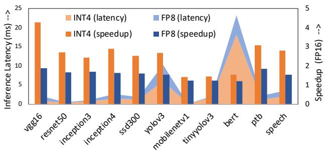

| 精度 | 端到端加速比（vs FP16） | 说明 |
|---|---|---|
| FP8 (1-4-3) | **1.2×–1.9×（平均 1.55×）** | 距理论 2× 峰值有差距 |
| INT4 | **1.4×–4.2×（平均 2.8×）** | 距理论 8× 峰值差距更大 |

- 加速比受限原因：首/末层、激活函数、normalization、pooling 等操作**仍需 FP16 执行**。
- 分布规律：**计算密集型** CNN（VGG16、ResNet50、SSD300 等）获益最大；**MobileNetV1** 等精简卷积 + 辅助操作占比高的网络获益最小——与架构分析一致。
- 注意：batch size = 1 条件下仍能取得 2.8× 平均加速，说明**数据流设计对低 batch 利用率**的优化（排除 batch 维度作空间映射维度）是有效的。

**2. 推理能效（图 14）**

| 精度 | Sustained TOPS/W | vs FP16 基线 |
|---|---|---|
| FP8 | 1.4–4.68（平均 **3.16**） | **1.6×** |
| INT4 | 3–13.5（平均 **7**） | **3.6×** |
| 峰值参考 | — | INT4 峰值 16.5 TOPS/W |

- INT4 平均 sustained 效率约为峰值的 **42%**（7/16.5），batch=1 下属于合理水平。
- TOPS/W 提升倍数（3.6×）**高于** TOPS 提升倍数（2.8×），验证了 precision scaling 同时改善算力与能效的双目标设计。

**3. 训练吞吐（图 15）**

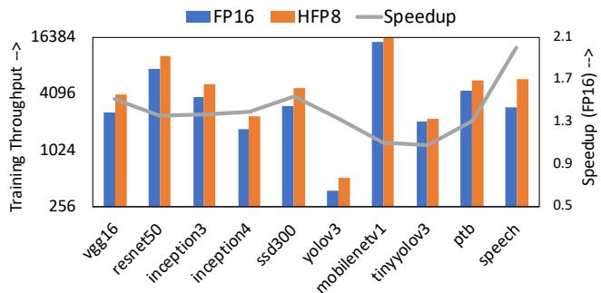

- HFP8 vs FP16 加速比：**1.1×–2×（平均 1.4×）**，低于推理侧。
- 两个明确的瓶颈归因：
  - 训练引入**额外的片外通信**（梯度 all-reduce、权重 broadcast）
  - 训练是**内存密集型**：forward pass 的 activation 需保留用于 backward 的 weight gradient 计算
- HFP8 部分缓解通信压力：forward 仅用 8-bit 权重，各芯片只需向邻居广播更新的 8-bit 权重。
- 摘要给出的绝对指标：mini-batch=512 下 sustained **102–588（平均 203）TFLOPS**，约对应 768 TOPs 峰值的 13%–77%，波动范围极大，反映 workload 异构性（LSTM 类通信受限 vs VGG/BERT 计算密集）。

**4. 稀疏感知节流收益（图 16）**

- 方法链条完整：**硅片测量功耗-电压-频率特性 → 离线推导各稀疏度下的 stall rate → 图编译器按层分析权重稀疏度 → 编译期确定各层节流等级**。
- 实测剪枝模型稀疏度：**50%–80%**（精度损失可忽略，FP16 精度模型）
- 性能收益：**1.1×–1.7×（平均 1.3×）**
- 关键设计优势：节流决策在**编译期完成**，不占推理关键路径，且对同一 DNN 的多次推理可摊销开销；相比 DVFS 避免了电压调节器和 PLL 的慢速响应，通过**clock-edge skipping 在单个时钟周期内调制功率**。

---

**三、消融与分解分析**

---

**1. 架构级消融：分离 FP/INT 流水线（图 4c）**

| 流水线方案 | FP16 TOPS/W | FP8 TOPS/W | INT4 TOPS/W | 面积 |
|---|---|---|---|---|
| Merged（合并） | 1.0× | 2.2× | 5.6× | 1.0× |
| **Separate（分离）** | 1.1× | 2.3× | **10.6×** | 1.16× |

- 这是论文最关键的架构决策消融：仅 **16% 面积开销**，换来 INT4 能效近乎翻倍（5.6×→10.6×）。
- 根本原因：INT4 流水线功耗仅为 FP16 的 **0.3×**，分离后得以**double-pump FXU 引擎**（每 FXU 含 8 个 INT4 / 16 个 INT2 MAC 引擎），而合并方案受共享数据通路的功耗/时序耦合限制无法扩展。

**2. 周期分解分析（图 17）—— 低精度瓶颈定位**

- INT4 推理的 compute cycles 四分类：

| 类别 | 平均占比 | 含义 |
|---|---|---|
| Conv/GEMM（有效计算） | **50%** | MPE array 上的低精度主计算 |
| Conv/GEMM overheads | **14%** | 数据流低效（workload 维度与阵列不匹配）、core/corelet 间负载不均 |
| Quantization（FP16⇔INT4 转换） | **17%** | 高吞吐 MPE 下该开销变得不可忽视 |
| 辅助操作（SFU, FP16） | **19%** | 激活函数、batch norm 等 |

- 各类 benchmark 的异质瓶颈画像：
  - **InceptionV3/V4、Tiny-YoloV3、LSTM**：受 Conv/GEMM overheads 拖累（维度与 MPE 阵列不匹配，residue 效应）
  - **大 activation 的卷积网络**：quantization 开销显著
  - **MobileNetV1、Tiny-YoloV3**：辅助操作占比最高
- 核心洞察：**低精度下“非主计算”开销合计达 50%**，即进一步优化的空间主要在数据流映射、量化融合和 SFU 吞吐，而非单纯堆 MAC 单元——这也解释了为何实测加速比（2.8×）远低于峰值比（8×）。

**3. 系统扩展性消融（图 18）**

- **推理侧（1→32 cores，INT4）**：
  - VGG16、ResNet50、YoloV3、SSD300 等计算密集型 benchmark 在 32 cores 时仍在提升
  - MobileNetV1（辅助操作主导）与内存带宽受限的网络出现**加速饱和**
  - 关键实验变量：扩展核数时**外部带宽固定 200 GBps 不变**——明确暴露 INT4 高 TOPS 下的 memory wall
- **训练侧（1→32 chips，HFP8）**：
  - 采用 data parallelism，需在 update 阶段通信梯度与权重
  - HFP8 将权重通信量减半（仅广播 8-bit 更新权重），且各芯片并发计算自有权重分片

---

**四、总体评价与局限**

---

**优势**

- 评测方法学严谨：性能模型 **<1% 校准误差**、功耗来自**硅片实测**、基线经 **MLPerf** 交叉验证。
- 覆盖面完整：11 个 benchmark 跨 4 个应用域、3 种架构；batch=1 推理与 mini-batch=512 训练分别代表最难和最易场景。
- 消融分析有据：FP/INT 流水线分离、周期四分类、扩展性饱和点定位，均能直接指导后续架构迭代。

**局限与可质疑之处**

- 训练系统结果完全依赖**模型外推**，32-core 芯片与 128 GBps 芯片间互连的实测验证缺失。
- 剪枝实验仅在 **FP16 精度**下进行（平均 1.3× 收益），与 INT4 超低精度的**组合增益**（两者理论上可乘）未探索，是最大的收益缺口。
- INT2 推理被搁置，摘要宣称的“2-bit 支持”缺少端到端性能数据支撑。
- 768 TOPs（摘要）与 760 TOPs（正文）存在轻微数据不一致。
- 平均 sustained/峰值比（INT4 约 42%，HFP8 训练约 26%）表明峰值指标与实际 workload 间仍有显著 gap，周期分解已定性归因，但缺少针对性的量化消融（例如单独移除 quantization 开销的对照实验）。

---

