# Review and Benchmarking of Precision-Scalable Multiply-Accumulate Unit Architectures for Embedded Neural-Network Processing 图表详解

### 图像 1

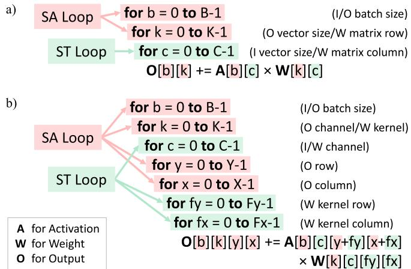

图1：全连接和卷积的嵌套循环。输出索引b/k/y/x对应SA，归约c/fy/fx对应ST。颜色区分独立输出与共同累加，说明电路的并行组织必须服从算法输出关系，不能任意相加乘积。

### 图像 2

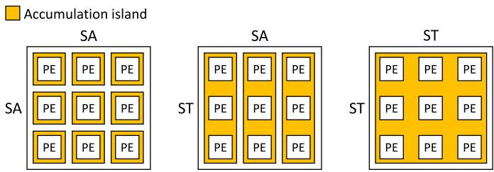

图2：二维PE阵列的SA-SA、SA-ST、ST-ST。黄色轮廓是累加岛；分别由单PE、一维向量、全阵列构成。相同PE数不保证相同输出并行度，阵列归约和数据复用需要结合数据流判断。

### 图像 3

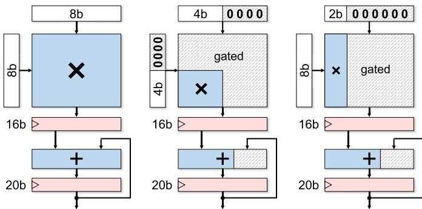

图3：数据门控基线。8×8、4×4、2×8都只产生一个结果，低有效位置零减少活动；它没有结构拆分或选择性寄存器时钟门控。灰色为不参与运算的逻辑，而非物理删除。

### 图像 4

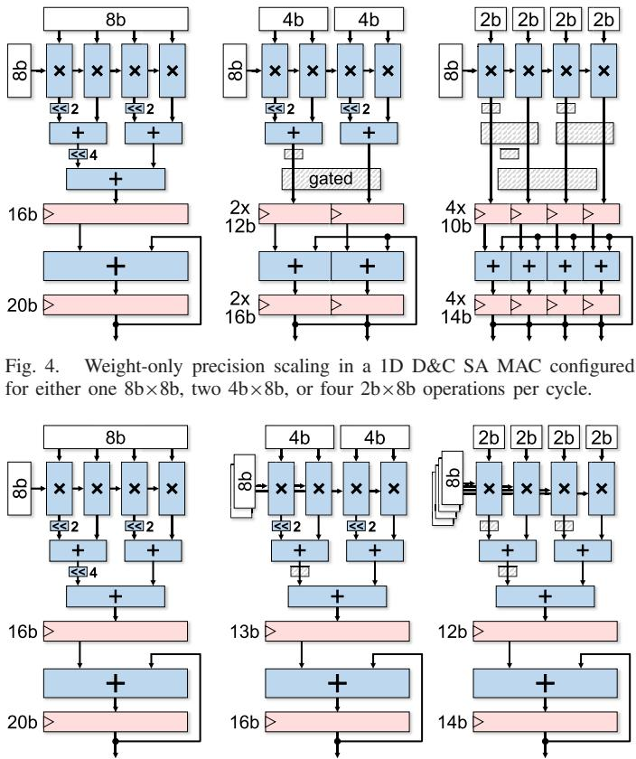

合并图4/5：上半为1D D&C SA（DNPU），下半为1D D&C ST。四个2×8子乘法在低精度下复用；SA保留2/4个独立结果，ST使用加法树归约为一个。SA共享左输入，ST需要不同激活。原提取图包含两幅，不能只按图5解释。

### 图像 5

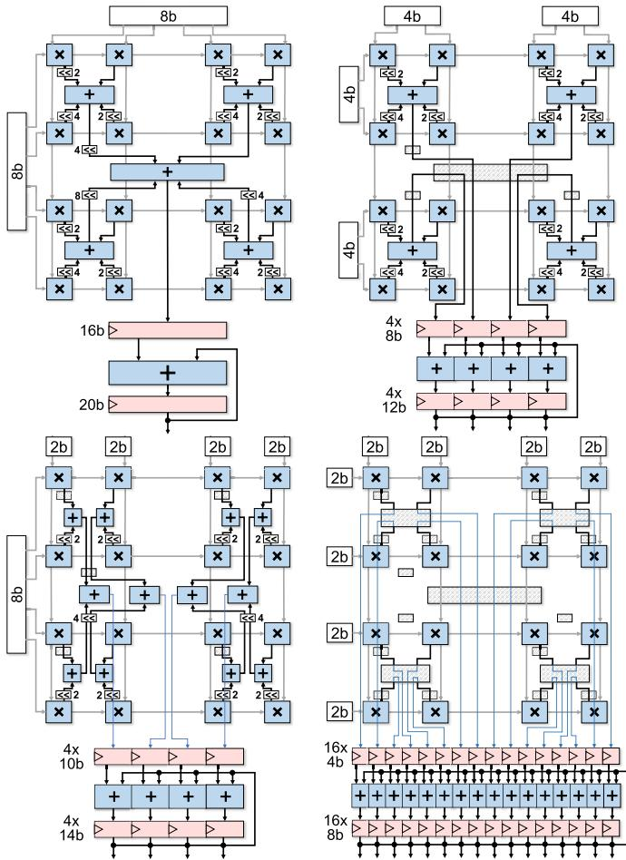

图6：2D D&C SA的四种模式。8×8拆为16个2×2子乘法器，可同时形成4个4×4或16个2×2独立结果。寄存器与输出宽度随并行度显著增加；batch1全连接不能自然共享两类输入，适用映射有限。

### 图像 6

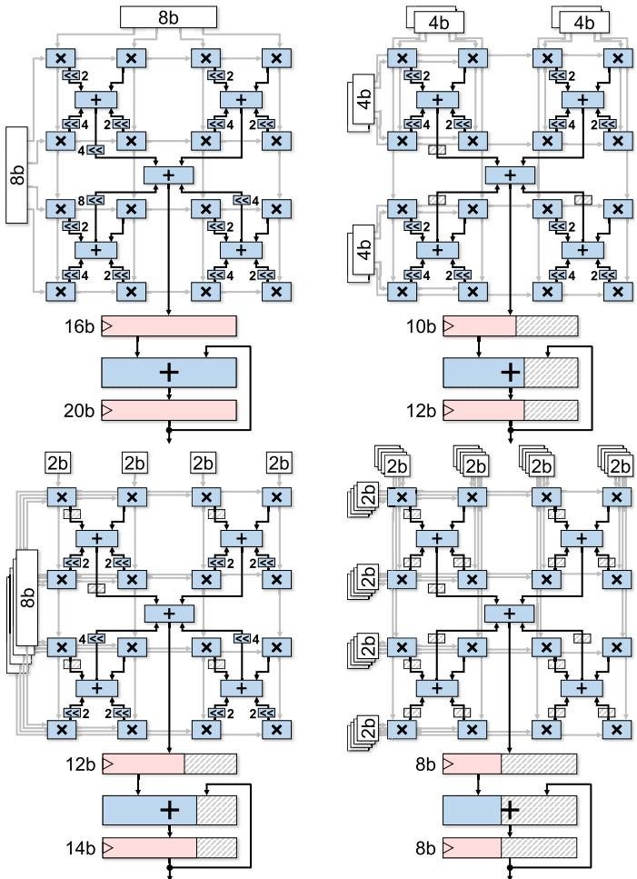

图7：2D D&C ST（BitFusion）。同样组合小乘法器，但低精度乘积归约为一个结果，避免SA的输出带宽增长。对应代价是更多独立输入以及配置移位/加法，需确认存储系统能持续供数。

### 图像 7

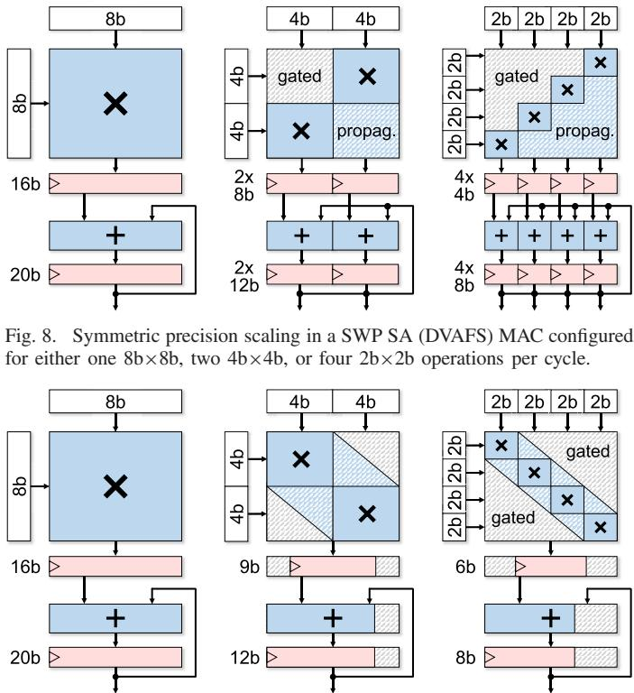

合并图8/9：上半SWP SA，沿一组对角区域做独立乘法；下半SWP ST采用另一对角组织，共同归约。X为活动乘法，灰色门控，浅蓝为仅传播的单元，说明未参与乘法的逻辑未必完全关闭。两者主要支持对称缩放。

### 图像 8

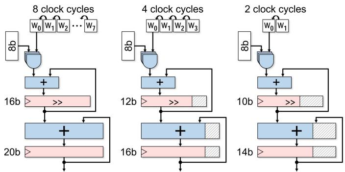

图10：1D逐位串行（UNPU）权重按1位输入，激活并行。8/4/2位权重分别需8/4/2拍；移位累加跨周期重建乘积。小面积和窄输入并不等于高能效，时钟及寄存器每拍仍活动。

### 图像 9

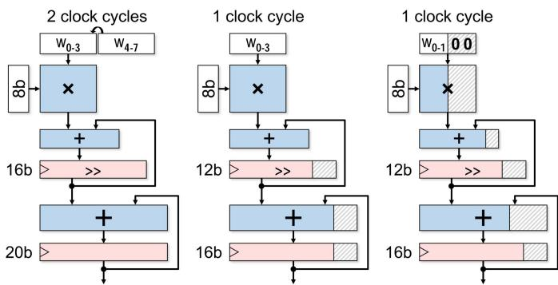

图11：1D四位串行。8位权重分两拍，4位一拍，2位仍在4位核上数据门控。相较逐位，减少反复时钟，但低于基本4位粒度不会再减少周期。

### 图像 10

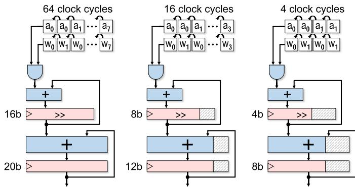

图12：2D逐位串行（LOOM），两个输入都逐位。8×8、4×4、2×2需64/16/4拍。它把乘法核缩为AND及移位累加，但完整乘积需要遍历两输入所有位组合。

### 图像 11

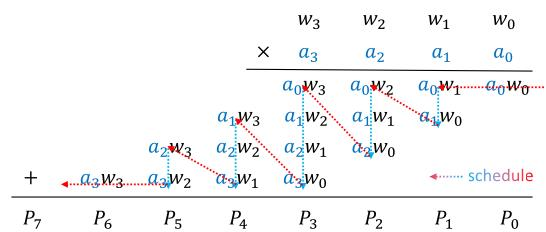

图13：4×4的二维逐位输入调度。蓝色是位乘积与进度，红箭头是非均匀移位；某输入位重复读取。调度复杂度是二维串行的必要代价，不能按一次顺序读取全部位理解。

### 图像 12

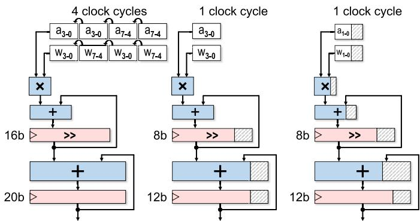

图14：2D四位串行。8×8用四拍、4×4一拍、2×2仍由4×4门控。多位核减少时钟周期，但增加算术面积；低于核粒度的缩放收益主要来自活动减少。

### 图像 13

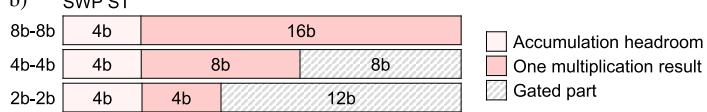

图15的ST局部图。粉色乘积、浅色累加预留4位、斜线门控。ST只有一个累加结果；SA每个独立输出都需要预留位。完整SA/ST对照已从PDF恢复：

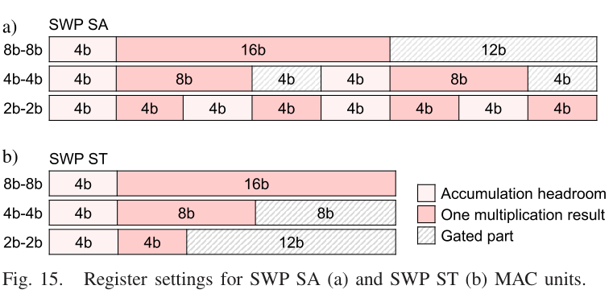

SA在2位模式重复四个预留区，解释其寄存器面积开销；不得把原局部图视为包含(a)。

### 图像 14

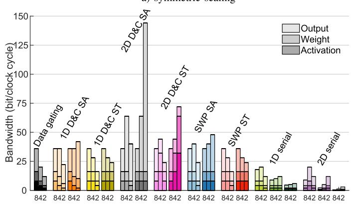

图16(a)：对称缩放每周期带宽，分为激活、权重、输出。8/4/2为各电路模式；SA多输出、ST多独立输入，2D D&C ST在2位需要大量供数。单位bit/cycle，尚未除以完成操作数。

### 图像 15

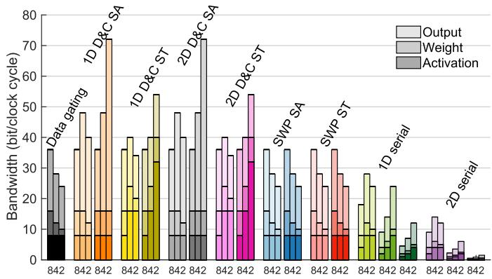

图16(b)：仅权重缩放的每周期带宽。激活仍8位，增加乘法并行常增加激活需求；串行每拍带宽低但每操作多拍。要和图17每操作指标共同比较，避免把窄接口误当高效率。

### 图像 16

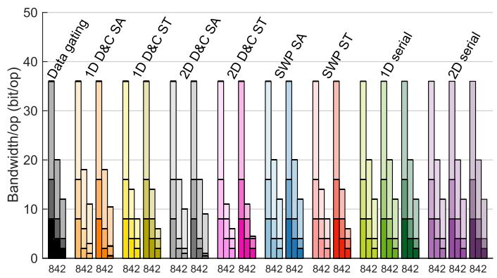

图17(a)：对称缩放带宽/操作。把图16带宽除以每周期计算数，ST因归约输出通常更有优势。此处下降并不意味着绝对每周期接口需求下降。

### 图像 17

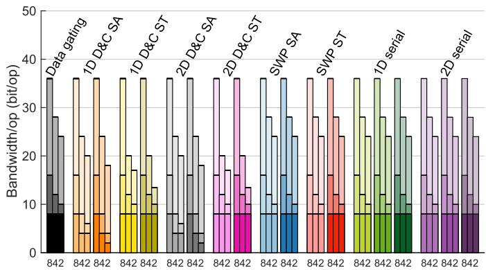

图17(b)：权重缩放带宽/操作。SWP对非对称格式主要数据门控，因此吞吐变化较小；1D D&C ST的归约可降低每操作开销。仍需按系统供数约束评估。

### 图像 18

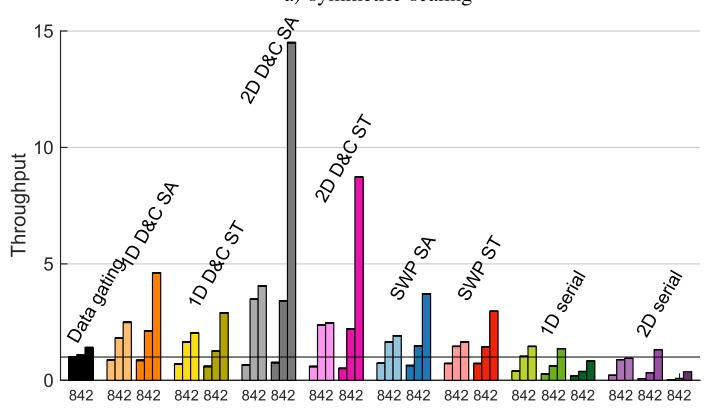

图18(a)：对称模式吞吐归一化到8位门控基线。2级2D D&C SA的2位约14.5倍，来自16路并行；这不是完整网络加速，未包含外部带宽限制。

### 图像 19

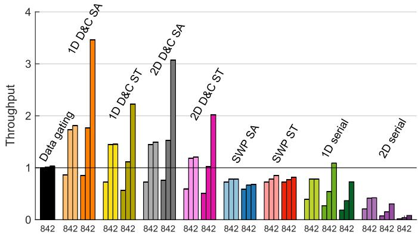

图18(b)：只降权重吞吐。2级1D D&C SA最高约3.5倍，2D SA约3.1倍。8/4位下不同缩放级别大致相近，但2位直接硬件缩放与数据门控存在差别。

### 图像 20

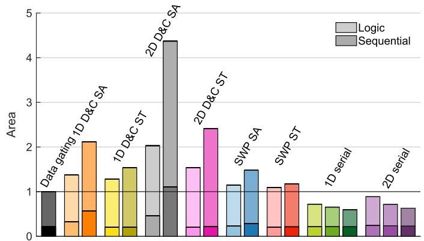

图19：归一化面积，浅色逻辑、深色时序。2D D&C最多约4.4倍，SWP ST仅10%–18%附加，串行可更小。面积不含输入寄存器与共享控制，不能直接作为芯片面积比。

### 图像 21

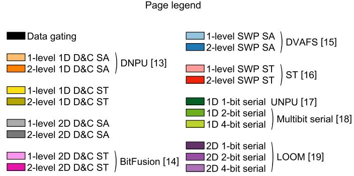

页面图例：颜色表示D&C/SWP/串行家族，浅深或线型区分1级/2级，符号区分SA/ST等。后续所有能量和帕累托曲线应使用一致图例；它是图例而不是新实验结果。

### 图像 22

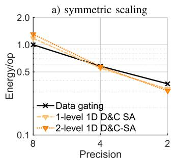

图20(a)：1D D&C SA对称缩放的归一化能量。横轴8→4→2位，纵轴对数、以8位门控为1；黑线为各精度门控参考。配置在8位多耗能，4/2位收益有限，应结合使用比例。

### 图像 23

图20(b)：同架构只降权重。2级4位能量仍高于门控，2位仅约9%节省，说明高并行吞吐不自动意味着高能效。激活保持8位，加法及独立输出仍消耗资源。

### 图像 24

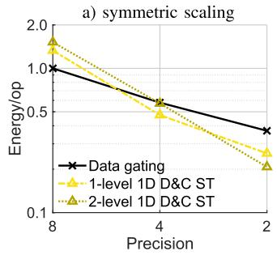

图21(a)：1D D&C ST对称缩放能量。ST复用中间加法归约，第二缩放级额外成本较小；低位下降较明显。黑线是相同模式的数据门控参考，并非一直固定为1。

### 图像 25

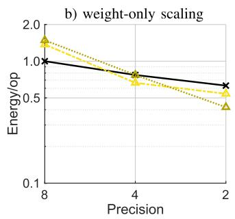

图21(b)：1D D&C ST权重缩放。低位仍具较好能量下降，优于1D SA的独立输出组织。结论针对MAC级与这套供数假设，外部输入带宽还需计入。

### 图像 26

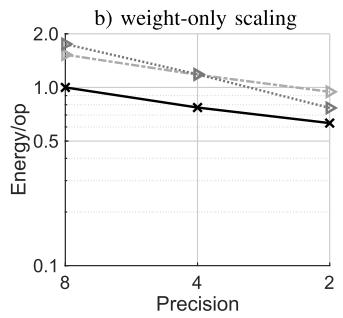

图22(b)：2D D&C SA只降权重的能量。灰色1/2级曲线高于黑色门控参考，尽管吞吐高，寄存器和配置开销未被充分摊薄。此文件是(b)，解析后的图片顺序与caption顺序不同。

### 图像 27

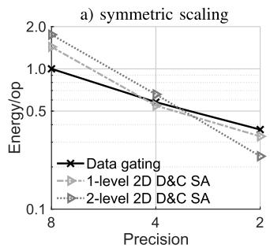

图22(a)：2D D&C SA对称缩放。两输入均降位才能较充分利用并行，在2位有节省，但8位有明显配置开销。灰色曲线的面积与输出成本需要和图19一起看。

### 图像 28

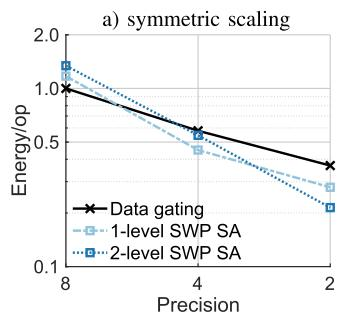

图24(a)：SWP SA对称缩放。蓝色曲线以活动区域及门控降低能量，2级到2位更低；仍保留传播区域和多个输出。不要将曲线误归给ST，SA/ST的结果组织不同。

### 图像 29

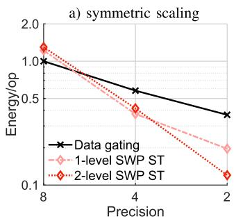

图25(a)：SWP ST对称缩放。红色低位曲线明显低于门控，特别是2级2位；复用阵列归约并只存一个结果。它的低面积及8位较小开销，使后续混合使用场景有优势。

### 图像 30

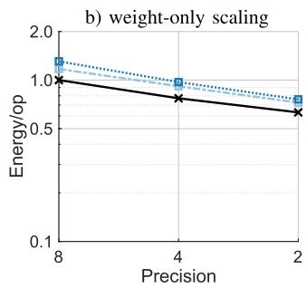

图24(b)：SWP SA只降权重。不能结构性独立降一输入，主要依赖数据门控，蓝色曲线在参考附近或更高。它为对称量化设计的优势不能直接外推到权重量化。

### 图像 31

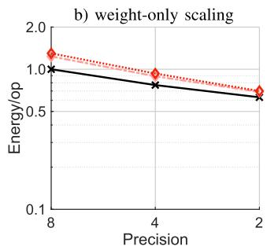

图25(b)：SWP ST只降权重。红色曲线也主要门控而非充分并行重构，节能比对称模式弱。选择架构前应确认激活是否也能降低精度。

### 图像 32

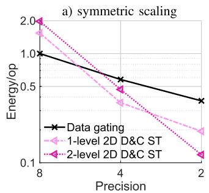

图23(a)：2D D&C ST（BitFusion）对称缩放。粉色曲线在8位配置开销较高，2位降幅很大。单模式2位优点需要与高精度使用比例权衡，不能仅按最低点选架构。

### 图像 33

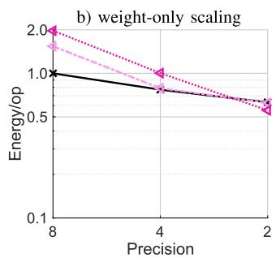

图23(b)：BitFusion只降权重。粉色低位收益远小于对称缩放，独立输入供数及归约仍有成本。本文中1D ST更适合这一使用模式。

### 图像 34

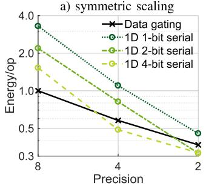

图26(a)：1D逐位/2位/4位串行对称能量，纵轴与前图不同。逐位全精度约3.3倍、2位核约2.2倍、4位核约1.5倍；多周期时钟代价降低低面积方案的吸引力。

### 图像 35

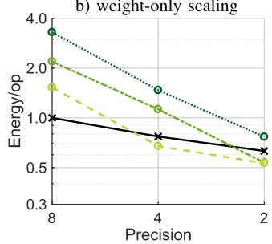

图26(b)：1D串行只降权重。4位串行相对逐位更节能，因8位只用两拍；4位以下转数据门控。图中最低能量与实际精度比例加权后收益不同。

### 图像 36

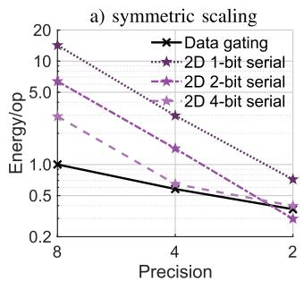

图27(a)：2D串行对称能量。纵轴最大达20倍，逐位8位约14倍，不能和前面0.1–2范围图按可见高度比较。降低两输入位宽使拍数乘积下降，但完整精度代价极大。

### 图像 37

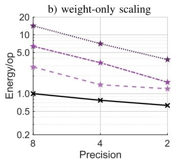

图27(b)：2D串行只降权重。激活全宽使周期仍多，曲线显著高于门控；低位也难抵消时间与时钟开销。它在本文条件下不适合权重缩放能量目标。

### 图像 38

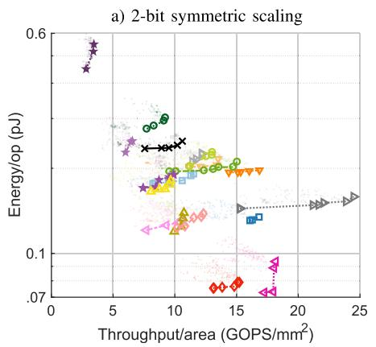

图28(a)：1V、2位对称帕累托。横轴吞吐/面积越大越好，纵轴pJ/op越小越好；右下更优。SWP ST与2D D&C ST能量低，2D SA面积吞吐高，反映不同目标的选择。

### 图像 39

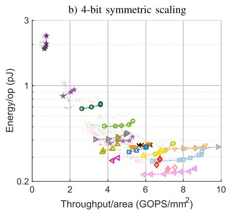

图28(b)：1V、4位对称。1级设计通常平衡更好，2级附加控制未在此模式充分获益。横轴范围和(a)不同，不宜只比曲线位置。

### 图像 40

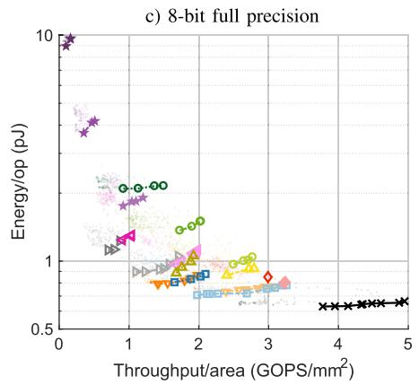

图28(c)：1V、8位全精度。黑色数据门控在较低能量、较高吞吐/面积处，配置硬件普遍有额外开销。这解释少数8位操作可能改变混合场景的最优架构。

### 图像 41

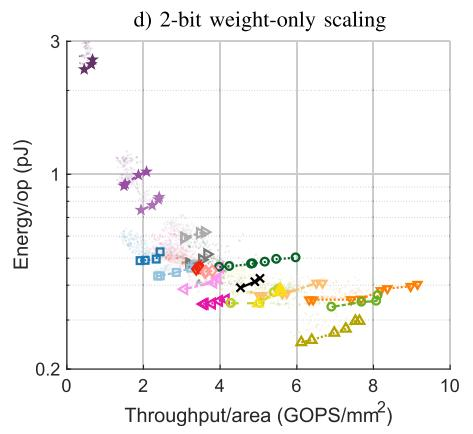

图28(d)：1V、2位权重缩放。1D ST在能量方向较好，1D SA偏吞吐/面积；SWP及二维串行缺乏突出净收益。需按具体前沿点而非家族名称判断。

### 图像 42

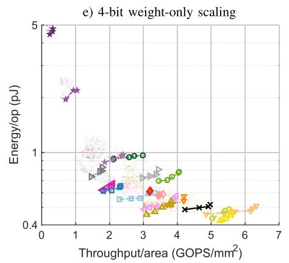

图28(e)：1V、4位权重缩放。1级1D ST与1D二位串行可较节能，但相对门控增益有限，正文最多约20%。单模式结果仍不能代表整个模型。

### 图像 43

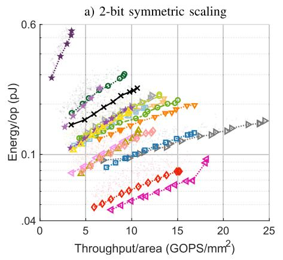

图29(a)：0.8–1V DVFS、2位对称。相对图28增加电压工作点，前沿扩大。比较仍是能量与面积吞吐的取舍，电压效应按模型估计而非逐点实机测量。

### 图像 44

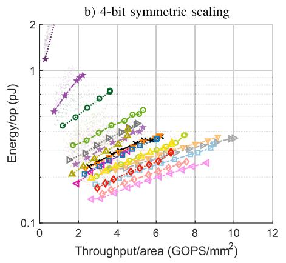

图29(b)：DVFS、4位对称。可通过降低电压换更低能量或调整频率满足吞吐；SWP ST等前沿范围扩大，但整体架构优劣倾向类似1V。

### 图像 45

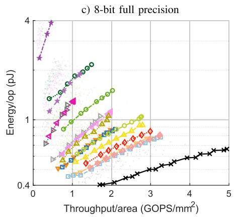

图29(c)：DVFS、8位。门控基线仍有较好综合位置，串行多拍耗能仍高。电压模型不能抹去全精度配置成本。

### 图像 46

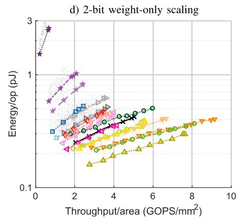

图29(d)：DVFS、2位权重量化。前沿加入连续电压自由度，不同吞吐预算可选不同点；不能拿最低能量点和另一个设计最高吞吐点作同条件比。

### 图像 47

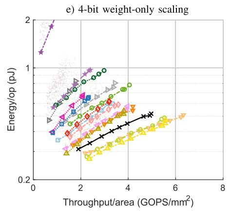

图29(e)：DVFS、4位权重量化。降压扩展可实现范围，收益仍受激活全宽及架构开销限制。需要匹配吞吐或能量约束后比较。

### 图像 48

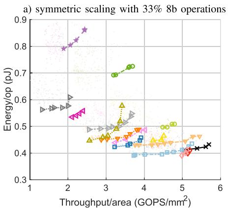

图30(a)：8位占33%、其余4/2位等分，对称缩放整体指标。黑色门控接近最佳能量且面积吞吐突出；多数低位优势被8位开销摊薄。比例按操作数而非执行时间。

### 图像 49

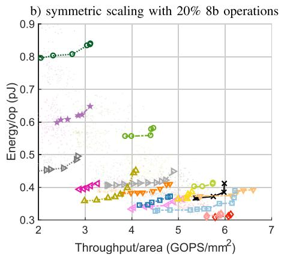

图30(b)：8位占20%的对称场景。SWP SA/ST开始显示节能优势，最多约20%；不同前沿点依吞吐目标选择。2级不自动胜过1级。

### 图像 50

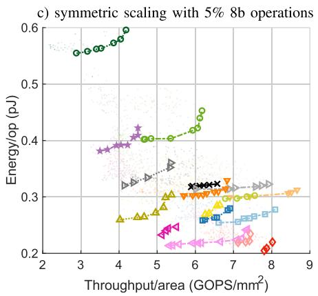

图30(c)：8位占5%的对称场景。SWP ST整体节能约32%，2D D&C ST约22%；高精度使用很少后，低位配置才更值得。该5%是案例设定，并非通用准确率保证。

### 图像 51

图30(d)：8位占33%，只降权重。简单门控仍较优，多数精度配置开销无法抵消。它与(a)共享占比但激活精度不同，不能合并结论。

### 图像 52

图30(e)：8位占20%，只降权重。大多数方案仍难明显节能，2级1D ST接近门控但有面积吞吐代价。只看权重模型压缩比例不足以判断硬件收益。

### 图像 53

图30(f)：8位占5%，只降权重。2级1D ST最多省15%，1级ST/4位串行约8%；1D SA主要优势在吞吐/面积。加权案例说明应按应用精度画像选架构。

### 图像 54

作者照片：Vincent Camus。依据原文2019年的作者简介，对应低功耗数字电路、EDA及精度可扩展计算等研究背景。照片不属于电路性能证据；简介中的任职时间按论文当时理解。

### 图像 55

作者照片：Linyan Mei。原文2019年简介涉及BIT、KU Leuven学习经历及嵌入式机器学习硬件研究。此图是人物介绍，不承载实验变量或准确率结论。

### 图像 56

作者照片：Christian Enz。对应原文作者简介，介绍低功耗模拟/RF、器件建模等背景。不能从照片推断研究贡献分工，作者身份来自论文文字。

### 图像 57

作者照片：Marian Verhelst。对应2019年简介中的KU Leuven及嵌入式机器学习、自适应电路研究。保留人物图以完整对应论文，科学结果仍见架构和基准图。

