# An Algorithm-Hardware Co-design Based on Revised Microscaling Format Quantization for Accelerating Large Language Models 图表详解

### 图像 1

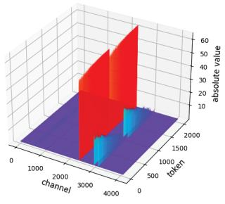

图1(a)，OPT-6.7B典型线性层的激活绝对值分布。底面两个轴分别为channel和token，范围约为0—4000、0—2000，竖轴为absolute value，最高刻度约60。少数通道形成红色高脊，并沿多个token延伸，大部分区域贴近蓝紫色底面，说明大幅值具有明显通道结构。它支持按通道结构安排局部分组的动机，但不能仅凭这幅单层图确定离群值比例、所有层的分布或量化收益；颜色表示数值幅度，不是误差。

### 图像 2

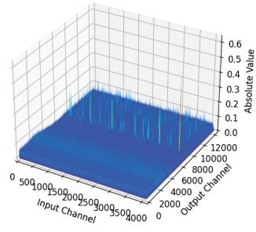

图1(b)，与图1(a)配套的权重绝对值三维图。横向轴为Input Channel，约0—4000；另一底面轴为Output Channel，约0—12000；竖轴Absolute Value最高约0.6。主体接近底面，夹有局部尖峰与带状较大值，显示权重也有非均匀结构，但视觉上的极端程度弱于配套激活图。两图纵轴量级不同，比较时应保留这一差异。该图为权重采用局部共享尺度提供定性依据，未给出组内误差统计，也不能证明所有权重层都具有相同模式。

### 图像 3

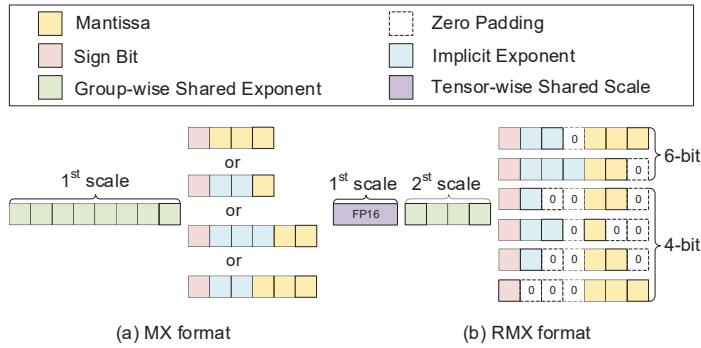

图2同时比较(a) MX与(b) RMX，顶部是共同图例：黄色尾数、粉色符号位、浅绿组共享指数、浅蓝隐式指数、紫色张量共享尺度，虚线格为补零。左侧示意一层组尺度配合不同元素布局；右侧增加FP16张量尺度和较短组指数，并列出6位、4位候选布局。虚线零格说明不同格式如何映射到统一计算结构，不代表存储中额外写入这些零。该图支持两级尺度及混合类型设计，不能单靠位格数推出完整动态范围、舍入规则或实际层间类型比例。

### 图像 4

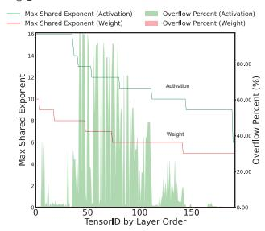

图3(a)，OPT-6.7B在WikiText上的共享指数统计。横轴为按层序排列的Tensor ID；左纵轴为最大共享指数，右纵轴为超过3位可表达上限7的组所占百分比。绿色线表示激活最大指数，红线表示权重最大指数；同色阴影为溢出比例。激活线约从16降至9，权重约从10降至5，激活在中前段有大量溢出，权重阴影几乎不可见。它支持3位指数对激活不足、需要扩大范围；图中接近16的区域也提示4位方案并未由此证明完全无溢出，精确峰值受图像分辨率限制。

### 图像 5

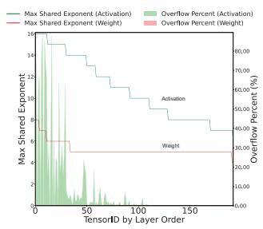

图3(b)，GPT2-XL在WikiText上的共享指数统计，轴和图例含义与图3(a)相同。横轴是按层序排列的Tensor ID，左轴看最大指数，右轴看超过7的比例。激活最大指数由约16逐步降至7附近，权重在早段约6，随后大致维持5；绿色溢出主要集中于前段，后续明显减少，权重溢出难以辨认。该子图表明不同模型的指数压力分布不同，并支持激活比权重更需要范围保护。它不直接测量量化误差，也没有报告改用4位指数后的最终溢出比例。

### 图像 6

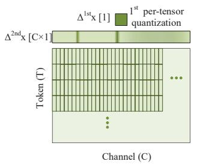

图4的激活侧子图，纵轴为Token(T)，横轴为Channel(C)。上方单个深绿色方块标出第一层张量尺度Δ¹ˢᵗ_x[1]，横向长条标出第二层尺度Δ²ⁿᵈ_x[C×1]；矩阵内部的窄竖格与横向分段表示局部分组，省略号表示其余数据。依据网格方向，可解读为固定通道、沿token形成组，以减少不同通道幅值范围相互影响。它是两级量化的结构示意，没有数值坐标。正文对分组方向的叫法与图8不完全一致，应以具体索引关系理解，而不能只凭“channel-wise”字样判定。

### 图像 7

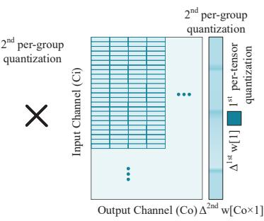

图4的权重侧子图，与激活侧通过左边乘号共同组成矩阵乘法示意。纵轴为Input Channel(Ci)，横轴为Output Channel(Co)；内部横向短条显示沿输出通道安排的局部组，右侧标出第一层张量尺度与第二层组尺度。蓝色表示权重侧结构，省略号表示未展开区域。图意是权重也采用张量尺度加局部尺度，并与激活分组配套。右侧Δ²ⁿᵈ_w[Co×1]的维度标记不足以唯一确定所有分组索引，不能把示意图直接当成完整张量布局规范；它也没有展示精度或性能测量。

### 图像 8

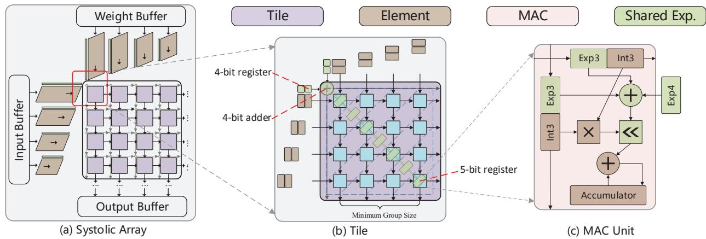

图5包含(a)整体脉动阵列、(b)tile和(c)MAC单元。左图显示输入缓冲区从侧面供数、权重缓冲区从上方供数，结果进入下方输出缓冲区；中图放大最小分组tile，用颜色和斜向传播关系表示组指数与数据的周期对齐，并标注4位寄存器、4位加法器和5位寄存器。右图显示元素指数、数值乘法、共享指数、移位及累加路径，Exp3、Int3是统一计算结构的字段标记。该图解释RMX如何进入乘加流水线，不给出绝对时延；4位指数相加形成5位结果，是额外寄存器的来源。

### 图像 9

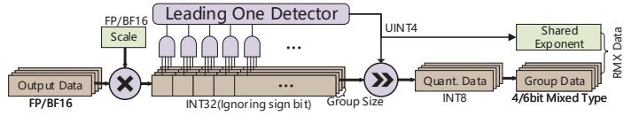

图6为RMX编码器数据流。FP16/BF16输出先与Scale相乘，中间数据送入Leading One Detector；检测得到的UINT4作为共享指数，同时控制右移，生成INT8 Quant. Data，再按所选格式输出4/6位Group Data及组指数。下方Group Size表示按组汇集数据。该图支持用前导1检测与移位生成局部指数，避免直接使用通用对数计算。图中中间节点标作INT32、忽略符号位，而正文称截断为16位并检测高16位，两者未完全统一，因此中间精确位宽、符号和截断顺序需保留不确定性。

### 图像 10

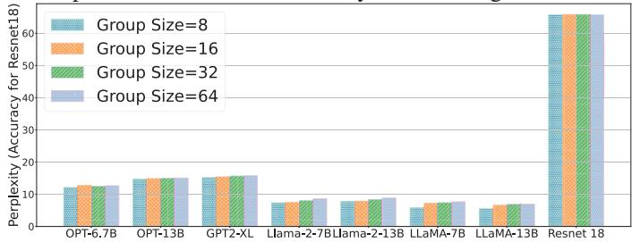

图7比较4位RMX的组长8、16、32、64，四种颜色对应图例中的组长。横轴依次为OPT-6.7B、OPT-13B、GPT2-XL、Llama-2-7B/13B、LLaMA-7B/13B和ResNet-18。纵轴对语言模型表示困惑度，对ResNet表示准确率，因此不同模型间的柱高不能直接比较优劣，且两种指标的理想方向相反。各模型四根柱总体接近，部分Llama模型仍有可见变化，支持组长8至64总体影响有限，不能理解为误差完全相同。图内没有128或256组长，更大组的结论需看图8。

### 图像 11

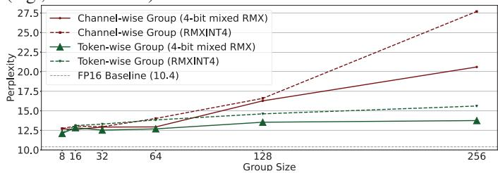

图8在OPT-6.7B/WikiText上比较分组方向和类型。横轴为组长8—256，纵轴为困惑度，灰虚线是FP16基线10.4；红色为Channel-wise Group，绿色为Token-wise Group，实线为4位混合RMX，虚线为RMXINT4。小组时各曲线较接近，组长256时红色实线约21、虚线约28，绿色约14和16，表明绿色分组随组长增大更稳定，混合类型也有帮助。数值为读图近似。正文称采用token方向，但II-C用语不同；本图支持该命名下的趋势，不能消除索引定义歧义。

### 图像 12

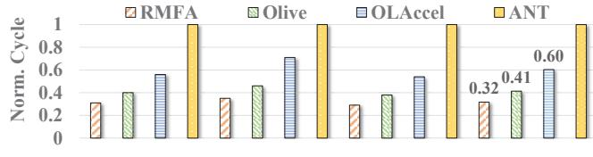

图9(a)比较归一化执行周期，纵轴Norm. Cycle，以ANT约1为参照，柱形图例为RMFA、OliVe、OLAccel、ANT。此裁图没有保留横轴组名，结合图9(b)可判读为OPT-6.7B、GPT2-XL、LLaMA-7B及几何平均。末组标注RMFA约0.32、OliVe约0.41、OLAccel约0.60，对应正文相对ANT、OLAccel、OliVe的3.13、1.88、1.28倍周期性能。比较采用作者所称匹配困惑度的混合精度配置；柱高是模拟周期比例，没有给出绝对时延或tokens/s。

### 图像 13

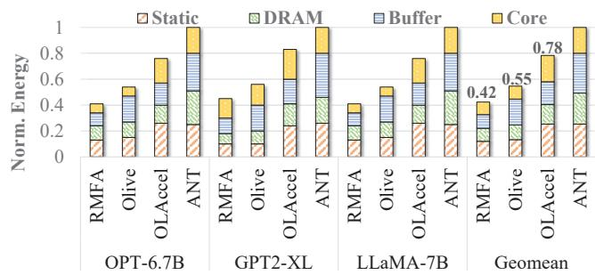

图9(b)为归一化能耗堆叠柱。横轴按OPT-6.7B、GPT2-XL、LLaMA-7B、Geomean分组，每组含RMFA、OliVe、OLAccel、ANT；纵轴Norm. Energy，以ANT为1。堆叠项分别为Static、DRAM、Buffer、Core。几何平均总高度约为0.42、0.55、0.78、1，对应RMFA相对三种基线2.38、1.31、1.86倍的能耗改善。它支持RMFA在该模拟配置下总能耗较低，并展示存储与核心共同构成能耗；没有绝对焦耳数，也不能把堆叠能量比例直接当成功耗、面积或芯片实测结果。

> 本文由 Codex/GPT 根据论文 PDF 生成中文译文与解读；PDF 由 MinerU 解析。全文译文保留原始参考文献，解读与原文结论请结合阅读。
