# RFIPSA: A Reconfigurable FIP-based Systolic Array for Various Matrix-Intensive Workloads 图表详解

### 图像 1

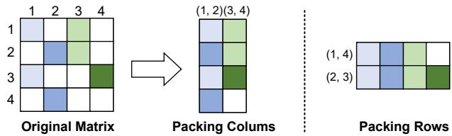

图1展示传统稀疏打包的两种方式。左侧4×4原矩阵中，颜色区分来自不同列的非零元素，白格表示零。中间将列(1,2)、(3,4)分别合并，得到4×2表示；右侧将行(1,4)、(2,3)合并，得到2×4表示，两者是不同打包选择。原矩阵的7个非零位置被放入更紧凑空间，所选组合没有位置冲突。图支持打包能够提高输入密度，但颜色只用于示意来源，实际硬件还需索引恢复坐标，并承担匹配和累加选择开销。

### 图像 2

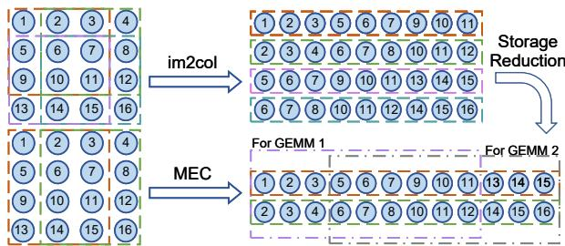

图2说明MEC的卷积映射。左侧是编号1至16的4×4输入，虚线框标出滑动窗口；右上im2col逐窗口展开为4×9数据，重复出现重叠元素。右下MEC形成2×12紧凑表示，GEMM1使用第1至9列，GEMM2使用第4至12列，共用6列。解读：图中存储位置由36降至24，小例子减少约33.3%；这与图11较大输入约60%的结果属于不同尺寸条件。该图证明的是数据组织与复用关系，未给出执行时间或能耗。

### 图像 3

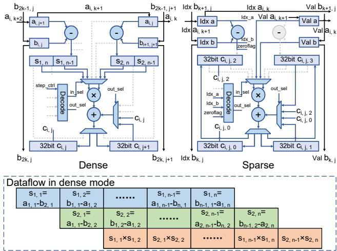

图3上部对照同一PE在Dense与Sparse模式下的资源使用。稠密侧先做差分，经S寄存器缓存后进入共享乘法器，step_ctrl通过Decoder产生in_sel、out_sel，控制两路部分和的更新；稀疏侧增加Idx_a、Idx_b及零标志判断，四个32位C寄存器改存部分和。下方是稠密模式的时间展开：两组差分错位准备，乘法交替执行。图支持算术与寄存器跨模式复用。顶端部分细小下标不够清晰，具体操作数关系按正文公式（3）解释。

### 图像 4

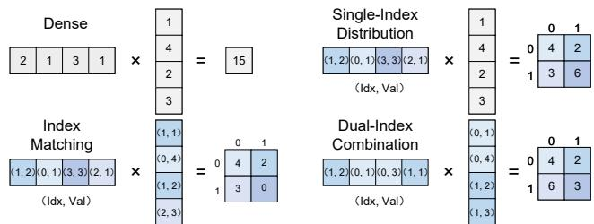

图4给出四种运算语义。左上Dense把[2,1,3,1]与[1,4,2,3]作内积得到15。右上Single-Index Distribution依据单侧索引把乘积分配至四个槽，结果[[4,2],[3,6]]。左下Index Matching只累加双方索引一致的项，第三项被排除，结果[[4,2],[3,0]]。右下Dual-Index Combination用两侧最低位组合选槽，得到[[4,2],[6,3]]。小方阵旁的0、1是局部输出坐标，各例用于解释索引控制，并非四种模式都直接输出同一个标量。

### 图像 5

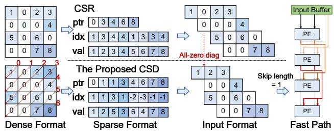

图5从左到右展示稠密矩阵、CSR/CSD编码、阵列输入形式与旁路。CSR按行记录8个非零值；CSD按图示斜对角线组织，ptr=[0,1,1,3,4,6,7,8]，其中连续两个1标识一条全零线，idx通过正负号选择位置参考。中间上方输入仍保留该空线，下方将其跳过；右侧Skip length=1示意跨越一个PE级的快速路径。该图支持CSD可直接发现空对角线并提供跳过信息，不能据此推断任意零元素都能独立删除。

### 图像 6

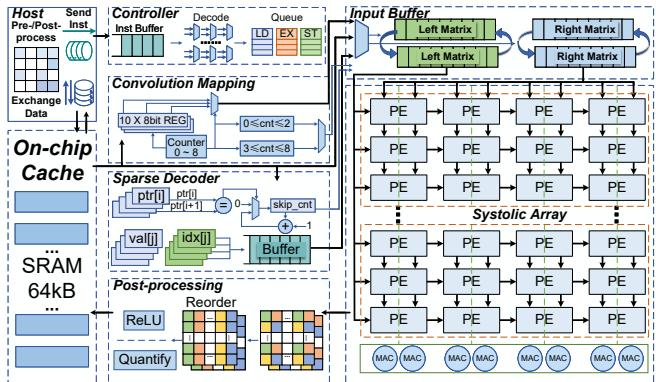

图6是整体架构框图。左侧主机与64kB片上SRAM交换指令、数据；控制器解码并排队LD、EX、ST。中间卷积映射模块与稀疏解码器分别组织MEC数据和解析ptr/idx/val，再写入右上左右矩阵双缓冲。右侧8×4物理PE分为上下两个4×4区域，箭头表示相邻数据传播，附加连线承担跳过旁路；底部8个MAC计算稠密FIP校正项。结果经重排、ReLU和量化返回存储。图说明端到端功能连接，不能仅凭箭头数量确定全部路径的每周期带宽。

### 图像 7

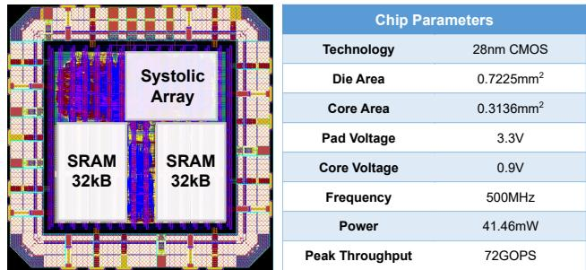

图7左侧为物理版图，标出脉动阵列和两块32kB SRAM，合计64kB；右侧是参数表。工艺28nm CMOS，整片面积0.7225mm²、核心0.3136mm²，焊盘与核心电压分别3.3V、0.9V，频率500MHz，功耗41.46mW，峰值72GOPS。结合第6节，这些是完成布局布线后的实现报告。图片展示的是版图而非流片后芯片显微照片，不能据其确认硅后实测；核心面积也应与表1用于效率计算的0.04mm²阵列面积区分。

### 图像 8

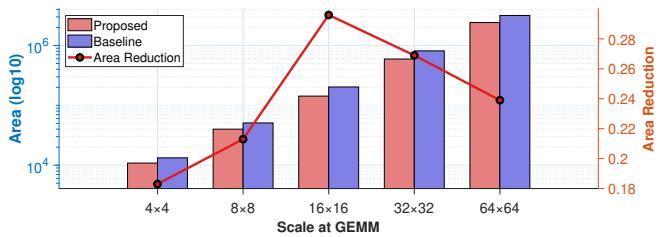

图8比较不同规模阵列的综合资源。横轴为4×4至64×64的GEMM配置，左纵轴为对数面积，具体单位未在图中明确；红、蓝柱分别代表本文与参考阵列。右轴及红色折线表示面积减少比例：4×4约18%，8×8正文给出21.3%，16×16约29%—30%，随后降至约27%和24%，后几项均为读图近似。结果支持面积收益随规模先升后降，而非固定比例；论文将前段趋势归因于校正MAC的线性增长，将后段归因于综合优化受设计复杂度限制。

### 图像 9

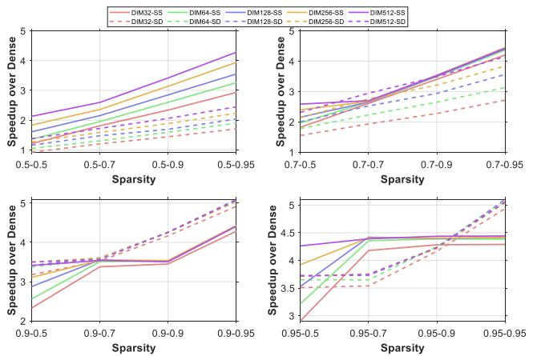

图9由四个子图组成，分别固定第一矩阵零值比例为0.5、0.7、0.9、0.95；横轴标签给出两侧比例组合，第二侧从0.5增加到0.95，纵轴为相对GEMM的加速比。颜色对应32、64、128、256、512阶矩阵，实线为SS、虚线为SD。总体上零值比例提高带来更大收益，SS在高稀疏区域趋于平台，SD在右下区域继续上升。正文最高值分别为4.4倍、5.1倍。图未给误差条或端到端时间拆分，不能直接判断主机打包及访存开销。

### 图像 10

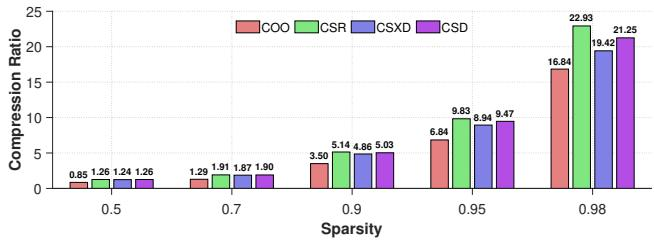

图10横轴为零值比例0.5、0.7、0.9、0.95、0.98，纵轴为稠密元素数除以压缩表示元素数，越高越节省。按这五组顺序，COO为0.85/1.29/3.50/6.84/16.84，CSR为1.26/1.91/5.14/9.83/22.93，CSXD为1.24/1.87/4.86/8.94/19.42，CSD为1.26/1.90/5.03/9.47/21.25。CSD优于COO和CSXD，接近但未超过CSR；COO首组低于1说明元数据可能使表示膨胀。图未分别展开三种矩阵尺寸结果，也未完整给出字段位宽。

### 图像 11

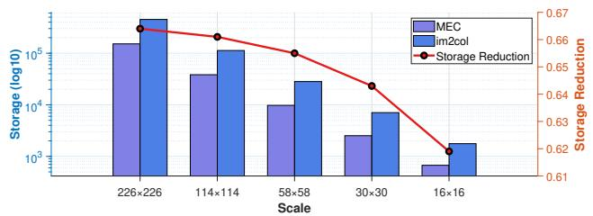

图11比较卷积映射存储量。横轴是226×226、114×114、58×58、30×30、16×16输入，正文说明取自VGG-16常见尺寸并加入padding=1；左轴为对数存储量，具体计量单位未标明。紫柱为MEC、蓝柱为im2col，红线及右轴表示存储减少比例，读图约从66.4%逐步降至61.9%。小尺寸边界影响更明显，但各组仍超过约六成。该图直接支持展开数据量下降，未提供卷积执行时延、功耗或完整VGG-16推理加速结果。

> 中文翻译与解读由 Codex/GPT 根据所提供的论文 PDF 生成。PDF 使用 MinerU 解析，乱码数学符号已对照原文校正；参考文献保留原文。技术总结和通俗讲解属于解读，请与全文译文结合阅读。[原文 DOI](https://doi.org/10.1145/3770743.3804286)。
