# SCALE-Sim v3: A modular cycle-accurate systolic accelerator simulator for end-to-end system analysis 图表详解

### 图像 1

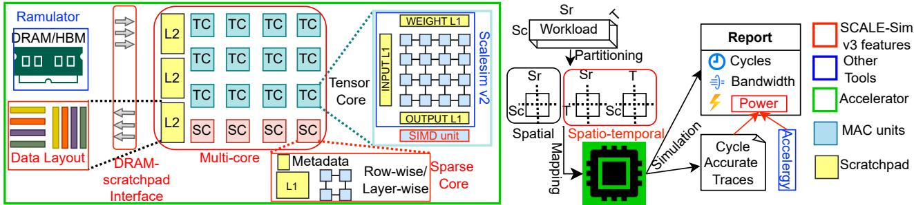

图1：v3新增功能总览，红色突出多核、稀疏、DRAM接口、布局、能耗。迹线和周期报告连接各模块，Ramulator与Accelergy分别处理内存时序和动作能量。图说明模型范围，不代表单个工具已经验证全部硬件组合。

### 图像 2

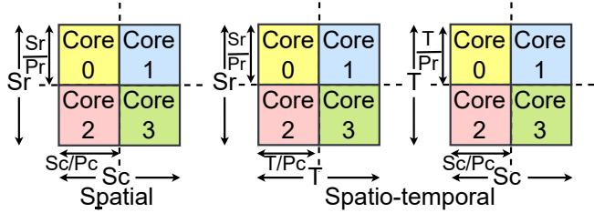

图2：空间与时空分区。左图沿Sr、Sc分核；中/右用T替代一个空间分区维，改变每核归约及数据复用。需要先按表II确定IS/WS/OS的Sr/Sc/T，再理解同一切法映射到GEMM的含义。

### 图像 3

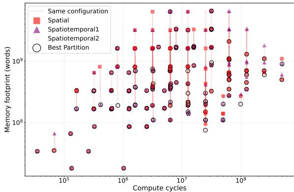

图3(a)：先优化计算周期的分区。横轴计算周期、纵轴存储字数，两轴对数；连线对应相同工作负载/阵列/核数，圈出候选优点。相同计算优化条件下，应挑存储更低的点；时空切分在部分配置优于纯空间。

### 图像 4

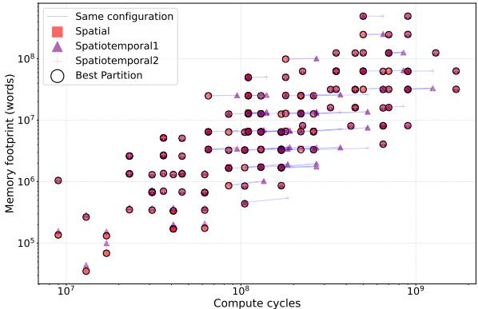

图3(b)：先优化内存占用的分区。与(a)不同，候选已按存储目标选择，之后比较周期。纯空间在多数展示案例表现更好。必须同时看两张子图，不能由(a)推出时空切分总是最佳；遗漏的(b)现已恢复。

### 图像 5

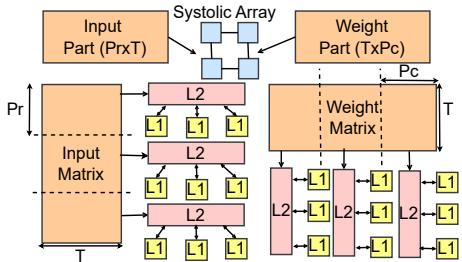

图4：输入与权重共享L2。核行共享输入块，核列共享权重块，各核还有本地L1。公共L2降低重复数据，L1容量与miss取舍仍影响停顿；共享结构并不消除互连或带宽成本。

### 图像 6

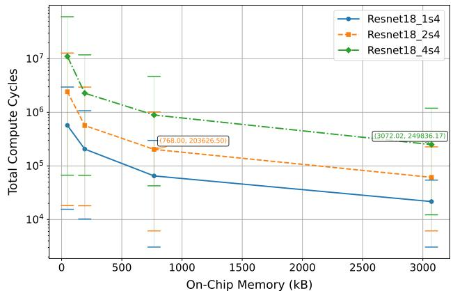

图5：ResNet-18总周期含停顿与片上容量。纵轴对数，1:4、2:4、4:4分别更稀疏到密集。增加容量减少停顿，相同周期约束下稀疏可用更小SRAM；文中250000周期案例密集3MB、2:4约768KB，属于指定配置。

### 图像 7

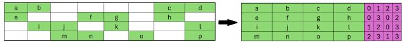

图6：Blocked ELLPACK示例。绿色为非零filter数值，紫色为原位置元数据，压缩后仍需两部分。位置位数与块大小有关，不能将N:M直接当成存储按N/M缩小。

### 图像 8

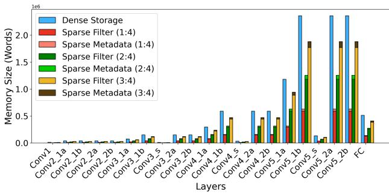

图7：逐层密集/1:4/2:4/3:4存储比较。每种稀疏方案同时画压缩filter与metadata，早后层尺寸差异很大。3:4是图中对照，正文实现限制N≤M/2的说明需分开理解。

### 图像 9

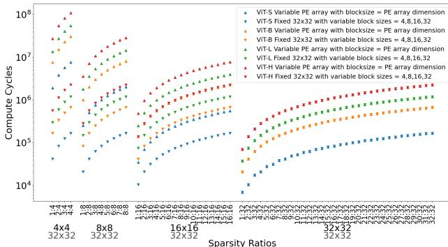

图8：ViT前馈层周期随阵列、块大小和N:M变化。第一组数组/块一起变，第二组阵列固定32×32而改变块大小，两种实验不能直接归因于单一因素。更低非零比例通常减少计算，但实际内存与利用率也影响周期。

### 图像 10

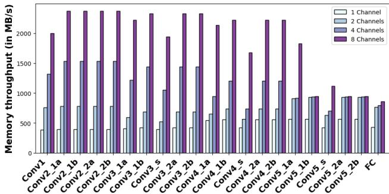

图9：ResNet-18在1/2/4/8个DRAM通道下吞吐。前层大张量可利用更多通道，部分后层两通道已饱和。通道增加并非所有层同比加速，还带来控制器面积及功耗。

### 图像 11

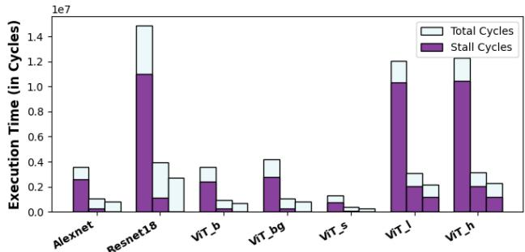

图10：不同模型的总周期与内存停顿。每组三柱为请求队列32/128/512项，紫色停顿是总柱的一部分。较深队列降低阻塞；正文32→128平均改善3.76倍，512再改善38%，不能把停顿柱与总柱相加。

### 图像 12

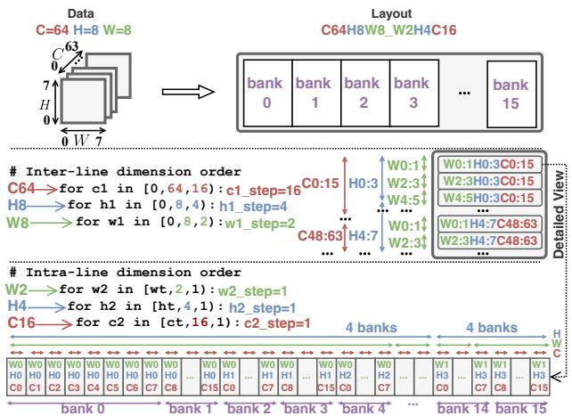

图11：CHW张量到多bank布局。行间循环决定line，行内循环决定col，再按每bank带宽映射bank。示例C64/H8/W8与W2/H4/C16分块展示相邻地址未必对应同一维连续访问；端口限制决定并发。

### 图像 13

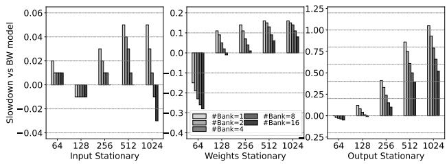

图12：ResNet-18的IS/WS/OS在带宽与bank数变化下的布局影响，阵列128×128。不同子图纵轴尺度不同；更多bank通常减少冲突。图中slowdown含负值，属于原图标注口径，不能直接读为延迟比。

### 图像 14

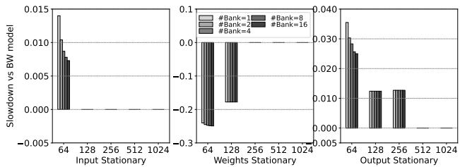

图13：ViT的对应布局实验。模型与数据流改变访问模式，bank数的效应也改变；不能把ResNet曲线直接套给ViT。对零或负刻度的定量解释需要核实报告定义，本文保留原图。

### 图像 15

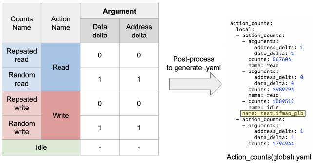

图14：访问计数转换为Accelergy YAML。重复/随机读写对应data_delta、address_delta等动作参数，idle另计。相同访问数可能因地址、数据变化不同产生不同能量，说明只统计总字节不足。

### 图像 16

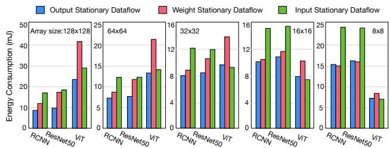

图15：不同阵列规模及数据流的能耗。每面板8×8到128×128规模，三模型分别比较OS/WS/IS，蓝色OS多为更低。大阵列并不一定更节能；分面纵轴不同，需按具体数值比较而非柱高跨面板对比。

