# SEADA: An efficient methodology for optimizing mixed-precision DNNs on multi-precision spatial architectures 原文翻译

# SEADA：面向多精度空间架构的混合精度 DNN 高效优化方法

Leandro Fiorin∗†  
独立研究者  
荷兰格罗宁根  
leandro.fiorin@gmail.com

Marco Ronzani  
米兰理工大学电子与信息系，意大利米兰  
marco.ronzani@polimi.it

Cristina Silvano  
米兰理工大学电子与信息系，意大利米兰  
cristina.silvano@polimi.it

## 摘要

混合精度计算已被引入深度神经网络（DNN），用于有效降低延迟、能耗和内存占用。然而，将混合精度网络高效映射到多精度空间架构仍面临诸多挑战：为每层确定合适的精度，在各层对量化的精度敏感性、架构异构性和系统约束之间取得平衡，以及准确估计异构精度分配的系统级开销。

本文提出 SEADA，一种应对这些挑战的高效方法。SEADA 包括：（i）可配置的多精度空间加速器架构系统级解析成本模型；（ii）为 DNN 工作负载寻找目标整数加速器上近似最优映射的快速映射工具；（iii）估计混合精度执行整体收益的浮点层解析模型；（iv）基于比特级熵的逐层精度选择方法，支持在多种数值精度之间高效分配。

SEADA 的效率为设计者提供了一个稳健的多精度架构设计空间探索框架1。

## 关键词

DNN 加速器、混合精度、优化、映射。

## 1 引言

DNN 工作负载对能耗、性能和内存提出的苛刻要求，推动了高度优化的硬件加速器及存储子系统的发展。DNN 训练通常在 GPU 上采用浮点（FP）运算；推理则经常映射到节能硬件加速器上，通过空间架构和有限精度量化运算降低计算成本 [35]。DNN 不同层准确表示信息所需的数值精度并不相同，这一观察促使研究者探索混合精度系统，让各层可以采用不同精度 [3,42]。将混合精度网络高效映射到多精度空间架构带来若干挑战。尤其是为每层选择合适精度，是一个并不简单的优化问题：必须在逐层量化精度敏感性、架构异构性和系统约束之间取得平衡，同时尽量减少整体准确率下降。其他挑战还包括协调异构计算单元、管理精度相关的数据通路和存储访问，以及降低精度转换和负载不均衡产生的开销 [14]。

图 2a 展示了当前常规先进工作流。解决这一优化问题需要三项主要输入：神经网络特征、目标训练数据集以及空间架构的性能模型 [24,27]。工作流根据这些参数选择逐层数值精度的最优候选分布，然后把量化网络映射到加速器模型上，按所选目标（例如比特乘加操作数 bMAC、能耗或执行延迟）进行评估。同时，量化网络经过固定轮数的训练，以评估推理准确率。测得的准确率和相应成本指标用于构建所探索设计空间的帕累托前沿。如果尚未满足终止条件，就选择新的逐层精度配置，重复这一过程直到收敛。

对于具有 $L$ 层、每层有 $B$ 种候选精度的 DNN，逐层精度配置总数为 $B^L$。每个配置都可能需要通过训练评估准确率，并映射到硬件加速器上评估所选优化指标。映射空间还取决于架构并行度和各层维度。例如，ResNet-18 [16] 的联合设计与映射空间规模约为 $O(10^{33})$ [22]，穷举探索在实践中不可行。

近期混合精度优化研究采用整数线性规划、启发式搜索等方法确定最优逐层精度 [3,6,11,42]。但这些方法往往依赖 bMAC 数等高层代理指标，忽略数据搬移成本、微架构约束和映射策略等关键架构因素。此外，现有分析经常忽略低精度层与全精度组件交互时量化、反量化的性能和能耗开销，因此常高估混合精度执行的实际收益 [29]。

另一类互补研究通过穷举、混合整数线性规划或启发式方法优化空间加速器上的 DNN 映射与调度 [18–20,22,24,26,30,34,37]。这些方法通常假设固定数值精度，不能直接扩展到多精度架构，因为精度异构性会从根本上改变性能与数据搬移之间的取舍。

尽管已有研究试图综合解决这些挑战 [24,27]，目前仍缺少统一且全面的框架来处理整个问题。

本文提出 SEADA，为当前方法的局限提供完整解决方案。在给定计算预算下，SEADA 快速估计最优逐层精度配置及其相应准确率损失。计算成本通过解析估计确定，这些估计来自混合精度层在目标多精度空间加速器上的最优映射。SEADA 从几个关键方向推进了现有工作：

- 提出多精度加速器模板架构，支持解析评估混合精度计算核的执行取舍。
- 建立浮点运算解析模型，估计混合精度执行的整体收益；证明可将量化运算直接融合到后续计算步骤的系数中，消除其额外开销。
- 开发映射工具，高效地将混合精度计算核映射到多精度空间架构，并明确考虑操作数精度对计算及数据搬移的影响。
- 扩展已有的基于比特级熵的逐层精度选择方法，快速完成精度分配，所得混合精度网络仅需一次微调。

这些贡献使 SEADA 能够高效解决目标优化问题，为多精度架构设计空间探索提供稳健框架。为展示其用途，我们开展了整体探索研究，联合优化加速器存储层次、精度选择和目标指标。研究的一个关键认识是：一旦建立 DNN 准确率下降与逐层精度分布的对应关系，基于模型 bMAC 数的简单指标便足以估计硬件配置所对应的准确率。因此，我们引入计算比特减少量（Computational Bit Reduction，CBR），作为与硬件无关的准确率下降代理。CBR 仅依赖各层熵，因此在所有探索的架构配置中只需评估一次。

本文组织如下：第 2 节介绍量化和混合精度计算背景，第 3 节讨论 SEADA 的组成，第 4 节进行实验评估，第 5 节讨论设计探索流程中的应用，第 6 节介绍相关工作，第 7 节总结。

## 2 背景

### 2.1 量化方法与计算

设计量化神经网络系统时，需要考虑若干相互独立的选择，它们分别影响数值精度、硬件效率和模型准确率。

量化可以是均匀或非均匀、对称或非对称、静态或动态。均匀量化在数值范围内采用等间距量化级；非均匀量化不均匀地分配量化级，以更好匹配数据分布，但增加复杂度。对称量化以零为中心，正负范围相同；非对称量化引入非零偏移，更好表示偏斜的数值分布。静态量化在推理前确定缩放和零点参数，例如使用校准数据；动态量化则在执行中计算这些参数。可以根据准确率和计算简洁性的目标采用不同选择。低精度量化中，一个较优方案是对权重采用均匀、对称、静态量化，对激活采用均匀、非对称、静态量化：前者通过权重分析预先确定量化范围，后者通过不同批次的激活范围分析确定 [3,12]。

量化把 DNN 操作数限制在一组离散可表示值中，通过实数到整数的映射完成。式（1）中，$Q(\cdot)$ 是量化算子，$r$ 是实数权重或激活，$S_r$ 是实数缩放系数；零点 $z_r$ 保证实数 0 精确映射到整数，对称量化时零点为 0。$\mathrm{Int}(\cdot)$ 按所选舍入规则（例如最近舍入或截断）把浮点值转换成整数。

$$
Q(r)=r_q=\mathrm{Int}\left(\frac{r}{S_r}\right)-z_r \tag{1}
$$

反量化 $DQ(\cdot)$ 重建量化值的近似全精度表示：

$$
r\approx DQ(r_q)=S_r\mathrm{FP}(r_q+z_r) \tag{2}
$$

其中 $\mathrm{FP}(\cdot)$ 把整数转换成浮点表示。为清楚起见，后续公式省略零点 $z_r$；实际解析模型实现完整计入该因素。

缩放参数 $S_r$ 通常根据待量化张量的动态范围确定：对称量化使用绝对值最大值，非对称量化使用最小值和最大值。在训练后量化（PTQ）中，这些统计量通常从有代表性的校准数据集采集；量化感知训练（QAT）则可在训练中采集或调整 [14,43,44]。范围估计决定映射到可用离散量化级的区间。对于极低数值精度，这些方法往往不够理想，因为它们不能适应网络优化过程和损失景观。此时，学习型量化器，例如学习步长量化（LSQ）[12]，是更有效的 QAT 方案。它把特定权重组（通常逐层或逐通道）的缩放参数 $S_r$ 作为可训练变量，与网络权重共同优化量化器，使模型精确适应量化敏感性，在严格低位宽限制下明显改善准确率。基于这些优势，本文采用 LSQ：权重使用逐通道学习缩放，激活使用逐层缩放。这一组合在捕获各通道权重分布差异所需的细粒度精度，与激活图使用单个缩放因子的计算效率之间取得平衡。

DNN 使用量化操作数，主要是为降低向量—矩阵或矩阵—矩阵乘法计算核的成本。对隐藏激活 $h$ 和权重张量 $W$，乘法或卷积可用量化值 $h_q$、$W_q$ 表示：

$$
a=S_W S_h\mathrm{FP}(W_q*h_q) \tag{3}
$$

$S_h$、$S_W$ 分别是 $h$、$W$ 的实数量化缩放系数。$W_q*h_q$ 表示完全采用低精度整数运算的矩阵乘法或卷积，并使用 INT32 累加。

把中间结果 $a$ 传给下一层前，可以再次量化：

$$
a_q=\mathrm{Int}\left(\frac{a}{S_a}\right)
=\mathrm{Int}\left(\frac{S_W S_h}{S_a}\mathrm{FP}(W_q*h_q)\right) \tag{4}
$$

$S_a$ 是预先计算的输出激活缩放系数。

### 2.2 层精度选择

混合精度量化基于这样的直觉：网络各层对量化的敏感性不同，因此一些层比其他层更适合激进量化 [3,6,42]。假设逐层准确率估计可以线性组合来确定网络整体准确率 [3]，则各层最优精度选择可表述为：在计算成本（例如延迟、bMAC 数或能耗）约束下，最大化网络总准确率，或最小化采用低精度层引起的准确率扰动。通常采用整数线性规划（ILP），或把优化写成多选择背包问题 [3,6,42]。

本文利用文献 [3] 提出的熵近似引导层选择（EAGL）策略。给定候选精度集合 $B=\{b_0,b_1\}$，EAGL 将优化表述为 0–1 背包问题，在总计算预算 $T$ 下最大化累计准确率增益：

$$
\operatorname{maximize}\sum_{l=1}^{L}G_lP_l
\quad\operatorname{subject\ to}\sum_{l=1}^{L}C_l\le T
$$

$G_l$ 表示把层 $l$ 保持为较高精度 $b_1$ 所带来的估计准确率增益；$P_l$ 是二元指示变量，高精度 $b_1$ 时为 1，否则为 0；$C_l$ 是层 $l$ 的计算成本；$T$ 是整数表示的全局预算。为避免穷举，EAGL 用经验层熵作为量化敏感性代理。对于预先量化到 $b_0$ 的模型，EAGL 把权重映射到 $2^b$ 个离散区间，以判断是否需要更高精度 $b_1$。权重均匀分散在区间中会产生高熵，表示增加精度可能有益；低熵意味着权重集中，表明该层变换可能用更低位宽紧凑表示。

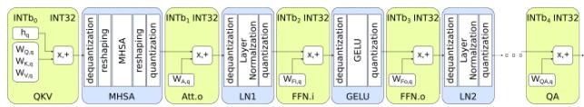  
(a)

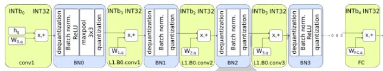  
(b)

图 1：DNN 计算模型：（a）用于问答的 BERT-base；（b）ResNet-50。绿色框表示低精度整数操作数计算，蓝色框表示全精度浮点计算。

设层 $l$ 的 $n$ 个已训练参数形成向量 $w$，量化精度为 $b$，经验层熵计算为
$H(\hat p_l^b)=-\sum_c\hat p_l^b(c)\log(\hat p_l^b(c))$。
每个离散值（$|c|\le 2^b$）的经验概率为
$\hat p_l^b(c)=\frac1n\sum_i\mathbb1_c(w_i)$；
若 $w_i=c$，$\mathbb1_c(w_i)=1$，否则为 0。

与其他方法不同，EAGL 只需一个精度为 $b$ 的预训练量化模型来估计参数分布。虽然这偶尔会产生次优精度分配，但速度比其他方法快几个数量级 [3]。这种效率使 EAGL 适合集成到全面的估计方法中。

### 2.3 DNN 模型中的浮点层

图 1 展示本文两个用例的完整计算流程：针对问答微调的 BERT-base 语言模型 [10]，以及 ResNet-50 CNN [16]。为清楚起见，图中强调顺序处理阶段，省略残差（跳跃）连接。

BERT-base 包含十二个 Transformer 块。每个块依次计算 Query、Key、Value 矩阵（QKV），执行多头自注意力（MHSA），再执行注意力输出投影（Att.o）。还包括层归一化（LayerNorm：LN1、LN2）、中间和输出前馈网络（FFN.i、FFN.o），以及高斯误差线性单元（GELU）激活函数。流程最后由问答任务专用层（QA）完成输出。

ResNet-50 主干交替使用卷积和批归一化（BatchNorm，BN），最后通过全连接（FC）层分类。

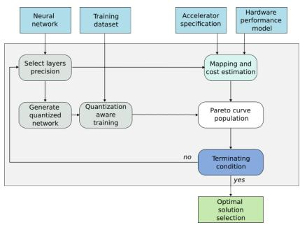  
(a)

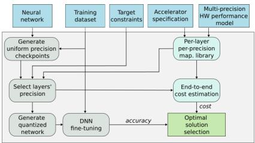  
(b)

图 2：（a）当前 DNN 空间加速器硬件性能与推理准确率联合优化框架概览；（b）本文 SEADA 方法的主要组成。

图 1 的绿色框表示卸载到加速器的低精度整数运算，蓝色框表示全精度浮点步骤。这种模拟量化方式 [23] 以整数存储参数，但只有部分运算在整数域完成。因此数据进入浮点运算前必须反量化，进入后续低精度阶段前必须重新量化。

已有研究探索了 BERT 的统一整数执行 [23]，以及 CNN 的全整数混合精度执行 [42]。然而，这些技术在极低精度限制下维持准确率的能力仍未得到证明。因此本文聚焦模拟量化，把全整数混合精度模型留待后续研究。

## 3 SEADA

本节介绍 SEADA：一种高效探索多精度加速器上混合精度神经网络设计空间的方法。SEADA 集成：（i）可配置的多精度空间加速器系统级解析成本模型；（ii）寻找 DNN 工作负载在目标整数加速器上近似最优映射的快速工具；（iii）估计混合精度整体收益的浮点层解析模型；（iv）基于比特级熵、支持多种数值精度高效分配的逐层精度选择方法。

图 2b 展示各组件的交互。基于 EAGL 的方法确定量化网络的逐层精度。精度选择的输入包括：（i）映射工具生成的各层、各精度成本估计库；（ii）允许的成本预算；（iii）从统一精度预训练检查点中计算的熵。

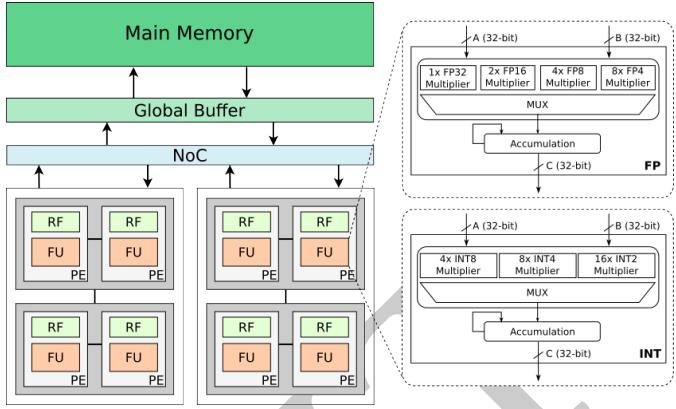

图 3：目标空间加速器架构模板。

确定逐层精度后，对混合精度网络微调以评估准确率，同时使用解析模型估计完整计算成本。相较于图 2a 的迭代工作流，该方法不必反复探索多个逐层精度配置，就能得到最优或近似最优解。

下面详细介绍 SEADA 的主要组成。

### 3.1 多精度性能模型

为估计混合精度量化的实现成本，我们建立了面向 DNN 工作负载的多精度空间加速器模板系统级解析模型。该模型以已有加速器架构为基础，抽象出与性能和能耗分析相关的关键特征 [1,7,26,28]。

图 3 为通用空间加速器模板：处理单元（PE）阵列中，每个 PE 都有存储输入、输出操作数的本地寄存器文件（RF）；架构还包括全局缓冲（GB）、片外主存，以及互连各组件的片上网络（NoC）。假设加速器缓冲支持双缓冲，从而重叠计算与数据搬移。PE 还可组织为多级物理簇，提供不同程度的空间并行。

每个 PE 具备基于先进设计的可配置混合精度功能单元（FU）[1,15,28]。遵循文献 [28]，FU 的浮点和定点运算流水线解耦，能够分别优化能效。图 3 把两条流水线画在每个 PE 中，但解析模型很灵活，也容易适配共享或集中式资源等配置。

功能单元输入、输出端口均为 32 位。浮点流水线支持 FP32、FP16、FP8、FP4 [5,21,25,36]；定点流水线支持 INT8、INT4、INT2 [13,28]，累加采用 INT32。

两条流水线都支持融合乘加（FMA）。浮点流水线选择 32 位精度时执行一次 FMA；使用较低精度 $Q$ 时，把 32 位通道分为 $P=32/Q$ 个操作数，执行 $\sum_i^P A_iB_i+C$。定点流水线可并行执行四个 INT8、八个 INT4 或十六个 INT2 FMA，并以 INT32 累加结果。浮点和定点乘法引擎使用不同流水级数 [28]。目标算法高度并行，可通过线程调度降低数据依赖影响，理想情况下达到每周期一条指令的吞吐 [13]。设计空间探索依据目标用例的精度要求自动实例化模板组件，并配置适当加法树、累加器位宽及输入输出打包。

DNN 还需要 FMA 之外的运算，因此浮点流水线模型也包含基本算术和数据类型转换等更广泛指令；为简洁起见，图 3 省略这些部分 [13,38]。

### 3.2 卷积与 GEMM 映射工具

我们使用 QuickFlow 映射工具 [34] 评估混合精度卷积和通用矩阵乘法（GEMM）计算核的性能与成本。

QuickFlow 通过迭代局部搜索优化层次化空间加速器上的 DNN 卷积、GEMM 映射。它利用基于活动的解析成本模型评估候选，在分块和数据流中寻找延迟、能耗更低的方案；模型与 Timeloop [30,33] 验证对比，并集成 Accelergy [41]。架构被表示为从叶节点算术单元到 DRAM 的层次树，支持自动推断拓扑和优化资源调度。QuickFlow 通常假设一次探索中全部计算、传输采用统一精度。虽然能分别优化不同精度的层，却把各精度视为独立的架构基线，因此无法准确建模统一系统内多精度 PE 的硬件灵活性和特定性能。

为解决这些局限，我们扩展 QuickFlow，将低精度执行的 $\sum_i A_iB_i+C$ 显式建模为 $P$ 个 FMA 单元构成的簇，最终以 INT32 累加。簇受到空间映射约束：各低精度功能单元不能把不同输出特征图位置或不同输出通道的部分和累加在一起。支持多精度执行还需扩展随精度变化的加法归约树、部分结果累加模型，并准确描述输入输出数据跨各级存储层次传输时的打包与解包。

### 3.3 浮点层模型

为全面评估混合精度执行，我们为图 1 蓝色框中的浮点阶段建立基于活动的解析模型。遵循已有方法 [30,34,41]，先估计组件级活动，再乘以每次操作的成本。

BERT-base 的 MHSA、GELU、LayerNorm 和 ResNet-50 的 BatchNorm 常使用特殊功能单元（SFU）完成指数、除法、三角函数等复杂运算。精确成本估计需要特定硬件和计算核细节；本文则依据优化 DNN 库常用的先进算法及近似 [2,38]，把计算核分解为等价的简单浮点运算序列来估计成本。

解析分析表明，将加速层的量化、反量化直接融合到后续浮点步骤的系数中，可尽量降低其开销。另一个简单但重要的观察是：融合计算核的成本只轻微依赖前后层的数值精度，因此可独立优化加速层。

#### 3.3.1 多头自注意力

BERT 的多头自注意力（MHSA，图 1a）捕获序列所有词元之间的上下文依赖。多头并行探索不同表示子空间，以识别多种关系；汇总后的输出提供复杂语言理解需要的上下文表示。将反量化和量化直接融合到 MHSA 中，运算可写为：

$$
\begin{aligned}
a_q^{MHSA}
&=Q\left(SM\left(\frac{Q_m*K_m^T}{\sqrt{d_m}}\right)*V_m\right)\\
&=\mathrm{Int}\left(
SM\left(\frac{S_QS_K}{\sqrt{d_m}}\mathrm{FP}(Q_q)*\mathrm{FP}(K_q^T)\right)
*\frac{S_V}{S_a}\mathrm{FP}(V_q)\right)\\
&=\mathrm{Int}\left(
SM\left(\omega_0\mathrm{FP}(Q_q)*\mathrm{FP}(K_q^T)\right)
*\omega_1\mathrm{FP}(V_q)\right)
\end{aligned}\tag{5}
$$

$SM(\cdot)$ 为 softmax；$Q_m,K_m,V_m$ 分别为 Query、Key、Value 矩阵的逐头分区，$d_m$ 是相应缩放因素。$\omega_0,\omega_1$ 是预计算常数，其余符号沿用此前定义。

MHSA 的计算效率主要受大型中间矩阵所需存储带宽限制。FlashAttention-2 [8] 通过分块访问 $Q,K,V$，并将注意力运算融合到单个计算核缓解这一问题。在线 softmax 避免实际生成中间得分矩阵，减少存储流量，使相对于序列长度的存储复杂度由二次降为线性。

我们使 FlashAttention-2 适应目标架构的约束，沿 DNN 序列长度并行计算，每个 PE 负责单个输入词元的融合注意力计算核。这使解析模型能准确描述存储层次中的访问模式，包括本地寄存器、共享存储与全局存储之间的数据搬移。

为评估融合计算核
$\operatorname{softmax}(\omega_0\mathrm{FP}(Q_q)*\mathrm{FP}(K_q^T))*\omega_1\mathrm{FP}(V_q)$
的成本，我们推导文献 [8] 在线 softmax 所需的浮点运算数量与类型。具体包括文献 [4] 的指数函数多项式近似，以及只通过乘法、加法执行三次 Newton–Raphson 迭代，计算 softmax 归一化项的倒数 [31]。

#### 3.3.2 GELU

BERT-base 的高斯误差线性单元（GELU）是平滑、非单调的激活函数，通过按累积分布函数缩放输入引入非线性。Hugging Face 的 BERT 实现使用近似
$GELU(x)=k_0x(1+\tanh(k_1(x+k_2x^3)))$，
其中 $k_0=0.5$、$k_1=\sqrt{2/\pi}$、$k_2=0.044715$ [40]。将反量化、GELU、量化融合后：

$$
\begin{aligned}
a_q^{GELU}
&=Q(GELU(DQ(h_q)))\\
&=\mathrm{Int}\left(
k_0'\mathrm{FP}(h_q)
\left[1+\tanh\left(k_1'\left(\mathrm{FP}(h_q)+k_2'\mathrm{FP}(h_q)^3\right)\right)\right]\right)
\end{aligned}\tag{6}
$$

其中 $k_0'=k_0S_h/S_a$、$k_1'=k_1S_h$、$k_2'=k_2S_h^2$。

利用 $\tanh(z)=1-2/(\exp(2z)+1)$，GELU 成本模型采用 softmax 中同样的指数函数多项式近似 [4]，并通过三次 Newton–Raphson 迭代求分母倒数 [31]。

GELU 对每个激活逐点执行，$k_0',k_1',k_2'$ 是所有激活共享的预计算常数，因此容易推导其存储访问模式。

#### 3.3.3 层归一化

LayerNorm 对各序列元素沿特征维度归一化激活，稳定隐藏状态动态。它对每个词元的隐藏张量，沿维度 $H$ 独立计算均值 $\mu$ 和方差 $\sigma^2$，使归一化不受批大小或序列长度影响，改善梯度流并明显加速预训练收敛。通常写为：

$$
y=\frac{h-\mu}{\sqrt{\sigma^2+\epsilon}}\odot\gamma+\beta \tag{7}
$$

$\gamma,\beta$ 为维度 $H$ 的可学习参数向量，由批次和序列中的各词元共享。

LayerNorm 通常分两阶段。先用 Welford 在线算法 [39] 单次遍历输入，计算运行均值及离差平方和；再把归一化、缩放和平移融合为一次计算。反量化、LayerNorm、量化融合时：

$$
\mu\approx\frac1H\sum_{i=1}^{H}S_h\mathrm{FP}(h_q)=S_h\mu' \tag{8}
$$

$$
\sigma^2\approx\frac1H\sum_{i=1}^{H}
(S_h\mathrm{FP}(h_q)-S_h\mu')^2
=S_h^2{\sigma'}^2 \tag{9}
$$

整体融合运算为：

$$
\begin{aligned}
a_q^{LN}
&=\mathrm{Int}\left(
\frac{S_h\mathrm{FP}(h_q)-S_h\mu'}{\sqrt{S_h^2{\sigma'}^2+\epsilon}}
\odot\frac{\gamma}{S_a}+\frac{\beta}{S_a}\right)\\
&=\mathrm{Int}\left(
\frac{\mathrm{FP}(h_q)-\mu'}{\sqrt{{\sigma'}^2+\epsilon'}}
\odot\gamma'+\beta'\right)
\end{aligned}\tag{10}
$$

其中 $\gamma'=\gamma/S_a$、$\beta'=\beta/S_a$；可将 $\epsilon'$ 选得足够小，以符合浮点精度要求并保证数值稳定性。

LayerNorm 成本模型采用优化库中的同样两阶段计算，并沿序列词元并行。归一化需要求修改后的标准差倒数，我们通过三次 Newton–Raphson 迭代近似 [31]。

第二阶段对激活逐点执行，并共享预计算缩放和偏置 $\gamma',\beta'$，因此相应存储访问模式容易推导。

#### 3.3.4 批归一化

BatchNorm 对层输入归一化，缓解内部协变量偏移，防止饱和并允许更大学习率，从而稳定并加速 CNN 训练 [16]。以图 1b 为参考，量化隐藏张量 $h_q$ 的反量化、批归一化、量化可以融合成修改后的 BatchNorm：

$$
\begin{aligned}
a_q^{BN}
&=Q(BN(DQ(h_q)))
=\mathrm{Int}\left(\frac{BN(S_h\mathrm{FP}(h_q))}{S_a}\right)\\
&=\mathrm{Int}\left(
\gamma\frac{S_h\mathrm{FP}(h_q)-\mu}{S_a\sqrt{\sigma^2+\epsilon}}
+\frac{\beta}{S_a}\right)
=\mathrm{Int}\left(\alpha_0\mathrm{FP}(h_q)+\alpha_1\right)
\end{aligned}\tag{11}
$$

$BN(\cdot)$ 为批归一化；$\mu,\sigma^2$ 是训练中沿批次和空间维度计算的均值、方差；$\beta,\gamma$ 是 BatchNorm 的可训练仿射参数。忽略数据类型转换后，式（11）可建模为激活与 $\alpha_0,\alpha_1$ 之间的逐点 FMA 序列；这些系数对同一批次全部元素是预计算常数。运算容易在浮点 PE 之间并行，但每个激活仅消费一次、没有复用，因此算术强度较低。

### 3.4 逐层精度选择

SEADA 在计算、存储或能耗约束下，寻找使模型准确率最大的精度分布。混合精度的组合搜索空间常促使研究者采用遗传算法、强化学习等元启发式方法 [24,27]。但对大型架构而言，即使缩短微调，逐个候选评估准确率的累计开销仍可能高得难以承受。

我们采用基于 EAGL [3] 的探索策略。计算开销由第 3.2 节的解析成本模型量化，聚焦量化层，因为不同配置的浮点成本基本不变。为提高效率，将所有可能逐层精度的指标预计算为最优映射库。SEADA 通过汇总查找表快速估计总成本，使搜索与模型执行解耦。

我们用分步方法把原始 EAGL 扩展为可选择两种以上精度。以三种精度 $b_0,b_1,b_2$，$b_0>b_1>b_2$ 为例：先对 $b_0$ 训练网络计算层熵，用这些值选择分配 $b_1$ 的层，直至计算预算等于所有层采用 $b_1$ 的成本；进一步降低预算时，改用 $b_1$ 训练网络的熵作为参考。

我们还把精度分配建模为多选择背包问题，同时考虑 $b_0,b_1$ 的层熵。但这种方法结果较差，尤其在较宽松预算下；限于篇幅，省略结果。

给定预计算指标、候选精度集合和层熵，SEADA 把每层精度视为一个可选项目，其成本为预计算指标，预期收益为充当准确率代理的熵，据此自动分配位宽。相较穷举，该方法给出确定且快速的精度分配解。

为保持一致，共享激活张量的多层必须使用统一精度。这些层归并成一个逻辑单元，总成本和准确率增益分别取各组成层指标的和。

最终配置确定后，自动修改 Torchvision、Hugging Face 等仓库的预训练架构，生成混合精度 PyTorch 模型：逐层把标准线性层和卷积层替换成使用 LSQ 的专用模块。

最终准确率通过知识蒸馏 [17] 微调评估，原始全精度模型作为教师网络，指导量化学生模型优化。即使位宽约束严格，该过程也能尽量保持原始性能。

## 4 SEADA 评估

本节评估 SEADA。如第 6 节所述，以前没有全面处理该优化问题的工作，因此无法直接与现有先进方案比较。此外，无法获得已有研究的特定训练超参数和 DNN 配置，也阻碍了复现实验。

### 4.1 实验设置

#### 4.1.1 参考空间架构

实验以 Eyeriss 空间架构 [7] 为参考，继承其存储层次、PE 数量及基本数据流等系统特征。遵循文献 [28]，每个 PE 包含整数和浮点流水线，整数流水线中的多精度 FU 按第 3.1 节建模。系统配置 168 个 PE；每条整数、浮点流水线分别具备独立的 1.66 KB 寄存器文件组，用于输入、权重和输出。系统还有 128 KB 全局缓冲和 LPDDR4 DRAM。整数流水线、存储及互连的延迟和能耗模型使用 Accelergy [41] 生成，方法与 QuickFlow、Timeloop [30] 一致，假设 32 nm 工艺、1 GHz 时钟。为与准确率评估设置一致，浮点流水线仅使用 FP32 操作数；浮点组件的能耗、性能、面积同样由 Accelergy 推导。

低精度计算核成本库由映射器生成，对每种精度以最小化各层能量—延迟积（EDP）为目标。浮点计算核按第 3.3 节在可用 PE 上并行。MHSA 效率特别依赖 PE 数量和 FlashAttention-2 的矩阵分块大小，因此对配置穷举设计空间探索，以寻找该层最小 EDP。

#### 4.1.2 DNN 模型预训练

我们评估两个代表性任务：基于 BERT-base [10] 的自然语言问答，以及基于 ResNet-50 [16] 的图像分类。BERT-base 来自 Hugging Face Transformers [40]，在 SQuAD 1.1 [32] 上微调；ResNet-50 改自 PyTorch Model Zoo，在 ImageNet [9] 上训练。

先训练两种全精度网络，作为低精度模型知识蒸馏的教师。为计算精度选择所需熵，训练所有可变精度层统一为 8 位或 4 位的参考模型。按量化网络常用做法 [3,45]，低精度模型的首层和末层固定为 8 位。

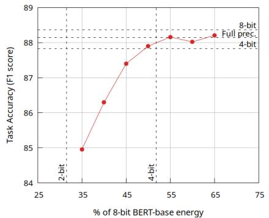  
(a)

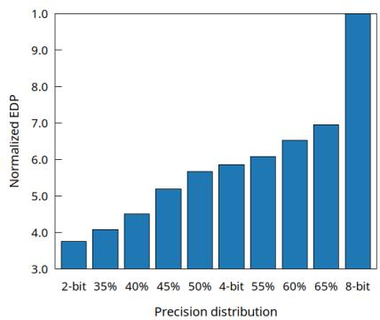  
(b)

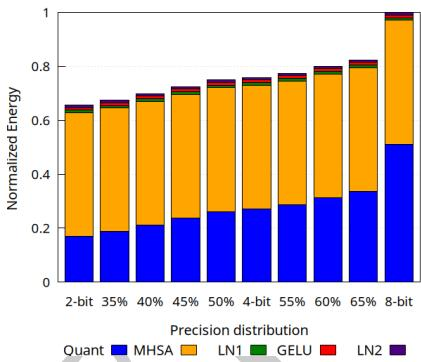  
(c)

图 4：BERT-base：（a）不同能量预算下微调后的准确率，预算参照加速计算核统一 8 位实现；（b）不同层精度分布下完整模型的归一化 EDP；（c）按层类型拆分的完整模型归一化能耗。

BERT-base 使用 LAMB 优化器训练 60 轮，初始学习率 $5\times10^{-5}$，权重衰减 $10^{-2}$，批大小 192。8 位 ResNet-50 用 SGD 训练 40 轮，动量 0.9，权重衰减 $10^{-4}$，初始学习率 $10^{-3}$，余弦学习率衰减，批大小 128。4 位 ResNet-50 的初始学习率增至 $10^{-2}$，权重衰减为 $2.5\times10^{-5}$。全部模型采用知识蒸馏微调，温度为 1，标准任务损失与蒸馏损失等权。

#### 4.1.3 混合精度模型微调

混合精度模型的可变精度层允许使用 8、4、2 位。从最优 4 位检查点初始化，沿用 4 位训练配置，以三个不同随机种子微调；BERT 最多再训练 60 轮，ResNet-50 最多 40 轮。为稳定后续训练，4 位降到 2 位的层把学习到的量化缩放系数乘以 4；8 位、4 位层保持不变。

所有任务均以“全部量化层采用 8 位”的基线成本的一定比例作为约束，寻找最优逐层精度分布。传给背包算法的成本指标为能耗。BERT 预算从基线的 65% 到 35%，间隔 5%；ResNet-50 从 75% 到 45%，间隔 10%。

### 4.2 实验结果

#### 4.2.1 BERT-base

图 4a 展示应用本文方法后准确率与节能的取舍，不包括浮点层能耗。预算高于 45% 时，准确率相对全精度基线的损失保持在 1% 以内；进一步限制预算，准确率明显下降。

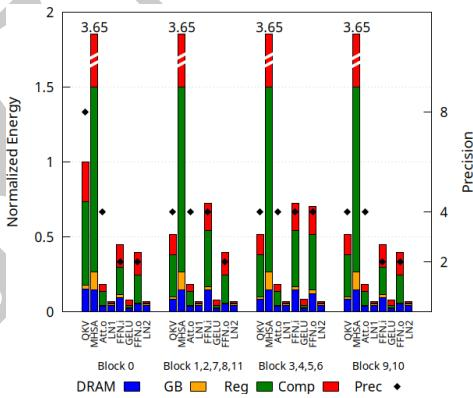

图 5：BERT-base 各块、各层的完整能耗按架构组件拆分，归一化到最初 QKV 层能耗。精度值仅针对模型中的加速层报告。

图 4b 比较含整数加速层和浮点层的完整网络归一化 EDP，包括统一 2、4、8 位，以及七种能量预算选出的混合精度网络。低精度的 EDP 降低来自能耗减少、加速计算核数据搬移减少，以及计算密集型操作延迟降低。相对 8 位配置，65% 预算的混合精度方案降低 EDP 30%，35% 预算降低 59%。45% 方案相对 8 位降低 48%，相对全精度降低 97%。

图 4c 按 BERT 层类型拆分不同精度分布的归一化能耗：低精度矩阵乘法（Quant）、MHSA、LayerNorm（LN）和 GELU。

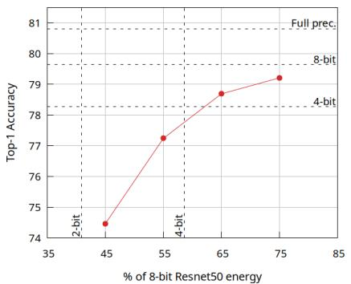  
(a)

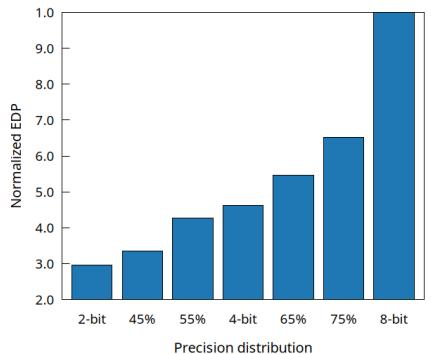  
(b)

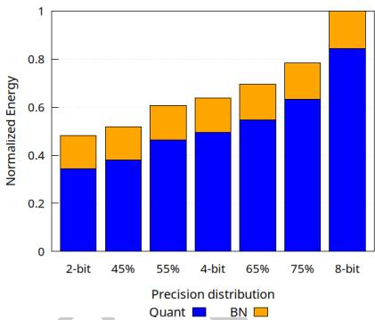  
(c)

图 6：ResNet-50：（a）不同能量预算下微调后的准确率，预算参照加速计算核统一 8 位实现；（b）不同层精度分布下完整模型归一化 EDP；（c）按层类型拆分的完整模型归一化能耗。

计算核量化后，MHSA 主导总能耗，与文献 [8,38] 的 FlashAttention-2 加速结果一致。相对 8 位配置，65% 混合精度方案整体节能 17.7%，35% 方案节能 32.7%。45% 网络相对 8 位降低能耗 27.6%，相对全精度降低 88.4%。计入完整网络后，节能幅度小于只考虑加速层的情况，强调了系统级整体优化的必要性。

图 5 展示 45% 混合精度网络各层归一化能耗，并按十二个 BERT 块所选精度配置分类。能耗拆分为主存（DRAM）、全局缓冲（GB）、寄存器文件（Reg）和计算单元（Comp）。QKV、MHSA、Att.o、FFN.i、FFN.o 等计算受限层主要消耗预算于计算单元和寄存器文件。其他层能耗贡献很小，其中 GELU 以计算开销为主，LN1、LN2 则以存储开销为主。

#### 4.2.2 ResNet-50

图 6a 展示 ResNet-50 结果。预算超过 55% 时，准确率损失在全精度基线的 4.5% 以内。

图 6b 比较完整 EDP。相对 8 位基线，75% 混合精度方案降低 35%，45% 方案降低 66%。55% 方案相对 8 位降低 57%，相对全精度降低 98%。

图 6c 将完整归一化能耗分为低精度矩阵乘法（Quant）和 BatchNorm（BN）。相对 8 位基线，75% 预算节能 21.5%，45% 预算节能 48%；55% 混合精度网络相对 8 位节能 39.4%，相对全精度节能 93%。

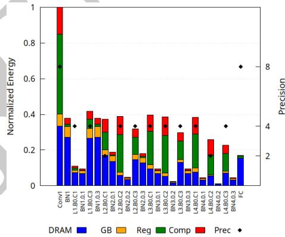

图 7：选定 ResNet-50 层的完整能耗按架构组件拆分，归一化到初始 Conv1 层能耗。精度值仅针对加速层报告。

图 7 详细展示 55% 混合精度 ResNet-50 的逐层能耗，包括卷积 Lx.By.Cz（第 x 层、第 y 块、第 z 个卷积）及随后的 BNx.y.z。结果反映输入特征图大小、权重张量维度、Eyeriss 行驻留数据流复用及逐层精度的相互作用。首层 Conv1 能耗较高，原因是大量 8 位 FMA，以及输入通道维度较小造成的映射低效。BatchNorm 能耗则直接随输入隐藏向量大小变化。

#### 4.2.3 执行时间

在 AMD Epyc 7302、3 GHz 上测量 SEADA 各组件平均执行时间，映射阶段采用 8 线程。相同特征的层只搜索一次最优映射，以优化映射库生成。表 1 列出库生成、混合精度选择（经验熵计算、背包优化、检查点生成）及微调轮数。ResNet-50 的独特层配置更多，因此映射库生成通常比 BERT 更费时。与总训练和微调时间相比，库生成与网络选择累计耗时仍可忽略。

表 1：SEADA 组件平均执行时间。

| 项目 | BERT-base | ResNet-50 |
|---|---:|---:|
| 映射库生成 | 15 分 40 秒 | 19 分 8 秒 |
| 精度选择 | 1 分 42 秒 | 53 秒 |
| 检查点训练轮数 | 60 | 40 |
| 微调轮数 | 60 | 40 |

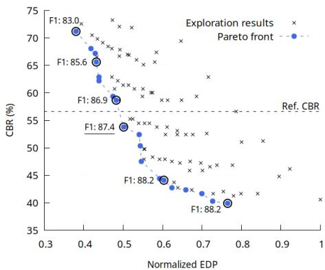

图 8：设计空间探索结果。帕累托前沿由同时最小化 EDP 和 CBR 的配置组成。

#### 4.2.4 数据转换成本

我们比较了融合和未融合量化/反量化步骤的全精度层。融合可隐藏这些步骤的开销；全精度层写回量化操作数，而不是全精度值，也降低了存储相关能耗。估计表明，45% 混合精度 BERT-base 节能 2%，55% ResNet-50 节能 40%。差异来自 BERT 以计算密集核为主，存储节省影响很小；ResNet-50 的 BatchNorm 则受存储限制、算术强度低，对存储访问效率更敏感。

## 5 架构设计空间探索

SEADA 的高效率使它可用于更全面的架构设计空间探索。本节以基线加速器存储层次的最优配置为案例。

此前实验探索不同硬件预算，发现 45% 混合精度配置在准确率损失较小的情况下实现最大节能。架构参数改变时，各配置的混合精度分布与准确率下降的关系也会改变。与 bMAC 数等高层代理不同，特定硬件预算下的准确率本质上与映射策略、优化指标和硬件实现细节相联系。

架构探索中，我们没有微调每个配置来测定其准确率，而采用计算比特减少量（CBR）：统一 8 位基线与给定混合精度模型之间总 bMAC 数减少的百分比。它作为与硬件无关的微调后准确率代理；直观而言，CBR 越高，明显准确率下降的可能性越大。

假设类似 EAGL 的方法能够在硬件预算约束下确定最优精度分布，需要强调：CBR 与准确率之间的关系是 DNN 的固有性质，由各层熵决定。在基线架构上刻画这一关系后，CBR 可作为所有探索架构配置中的硬件无关准确率代理。

45% 混合精度配置被确定为在准确率下降不超过 1% 时节能最大的工作点，因此采用它的 CBR 作为设计空间探索候选解的上限。

探索中固定总硬件面积和 PE 数量，扫描全局缓冲及全部输入、权重、输出寄存器文件大小。基线存储面积由式（12）确定：

$$
\mathrm{Area}=\#PE\times\mathrm{Area}(3\times32B\ RFs)
+\mathrm{Area}(2MB\ GB) \tag{12}
$$

为更好利用异构存储层次，允许映射工具充分探索映射空间，不再限定 Eyeriss 原有行驻留数据流。以 BERT-base 为工作负载，主要目标为最小化整体 EDP。

每个 PE 的寄存器文件以 32 B 为步长变化。各配置对应的全局缓冲面积按式（12）确定，粒度为 8 KB。对每个架构实例，在其相应 8 位配置能耗的 35%–60% 预算内，以 5% 步长评估整体 EDP 和 CBR。

图 8 展示探索结果，突出同时最小化整体 EDP 和 CBR 的帕累托最优点。水平线表示第 4.2.1 节 45% 配置的 CBR。

为验证准确率损失假设，对图中突出配置微调并测量 F1。图 8 显示，当 CBR 超过参考阈值，准确率迅速下降，支持在设计空间探索中以 CBR 作为高效准确率代理。

整个探索耗时 6 小时 49 分钟。对更大设计空间，可容易地加入启发式和剪枝，明显缩短时间。

图 8 标出的选定帕累托最优配置采用 1776 KB 全局缓冲和 192 字节寄存器文件。相对统一 8 位模型，总 EDP 和能耗分别降低 51% 和 20%；相对全精度基线，分别降低 97.7% 和 90%。

## 6 相关工作

近年提出在 DNN 不同层采用不同精度，以减少计算成本，并发展多种最优精度分布选择方法。

研究逐渐把混合精度分配视为约束优化问题，通常在硬件效率与模型敏感性之间取得平衡。

HAWQ-V3 [42] 用整数线性规划与基于 Hessian 的敏感性指标 [11] 优化位精度，并采用二进有理数运算维持全整数流水线。文献 [6] 同样用二阶 Taylor 展开量化敏感性，将精度选择转化为多选择背包问题，在固定资源预算内最大化准确率。

ALPS [3] 等方法通过经验准确率下降排序层重要性；EAGL [3] 则用权重分布熵代理敏感性，提供更快的解析方案。把选择写成 0–1 背包问题后，EAGL 优先为高熵层保留较高位宽，以尽量小的准确率损失实现压缩。

本文扩展 EAGL，支持更广泛的精度选择，并解决抽象成本模型的局限。与依赖简化指标的已有方法不同，我们加入反映空间加速器具体架构细节的高保真解析模型，计入优化应用映射、量化与反量化开销，以及未量化计算核能耗，从而更准确表示系统级性能。

将 DNN 映射到空间架构并最小化特定成本的研究也与本文相关。MAESTRO [26]、Timeloop [30] 用数据流表示空间加速器映射，评估 CNN 性能；基于活动的解析模型估计所选设计点的计算和存储成本。GAMMA [22] 等工具探索针对特定硬件优化的逐层数据流，以最小化延迟、能耗或 EDP。LOMA [37]、CoSA [18]、SALSA [20] 分别采用穷举、混合整数线性规划和模拟退火等方法优化 DNN 映射、调度、循环结构及顺序。FactorFlow [33]、QuickFlow [34] 进一步通过自适应编程和贪心优化细化 GEMM、CNN 映射设计空间，得到局部最优，探索时间比早期工具快一个数量级。

上述框架支持 DNN 映射空间探索，但假设计算采用单一、通用且未指定的精度。本文利用 QuickFlow 的探索能力，加入多精度架构活动成本模型，扩展为混合精度 DNN 在空间架构上的映射探索。

QUIDAM [19] 在不同位精度下同时优化 DNN 模型和硬件加速器，支持统一设计空间探索。该研究发现，位精度与 PE 的相互作用形成很大设计空间，单位面积性能和能效可能相差几个数量级。利用低精度轻量 PE，研究者在不降低准确率的情况下，相较传统 INT16 实现明显提高硬件效率。

虽然 QUIDAM 建模了低精度流水线，其优化仍限于单精度处理，不支持混合精度实现探索。

文献 [24] 将混合精度量化与硬件映射联合优化。通过扩展 Timeloop 支持可变位宽，展示低精度如何改善数据分块与比特打包。使用 NSGA-II 搜索，在准确率、能耗和存储约束间取得平衡。其重要限制是：虽然混合精度优化了数据搬移和存储，底层 MAC 单元仍采用固定精度，并不参与优化。

文献 [27] 首先把混合精度引入空间架构的数据流探索。SEADA 基于 QuickFlow 重新设计框架，明显扩展 [27] 的解析能力，包括量化/反量化与未量化计算核专用成本模型、改进逐层精度选择方法，以及快速推理准确率评估。联合优化软硬件变量，使 SEADA 更全面呈现空间硬件部署混合精度 DNN 的取舍。

## 7 结论

本文提出 SEADA，一种在多精度架构上优化混合精度 DNN 的快速方法，包括：（i）可配置的多精度空间加速器系统级解析成本模型；（ii）寻找 DNN 在目标整数加速器上近似最优映射的快速工具；（iii）估计混合精度整体收益的浮点层解析模型；（iv）基于比特级熵、支持多种精度高效分配的逐层精度选择方法。

SEADA 的高效率支持更全面的架构设计空间探索。我们研究多精度加速器的最优存储层次配置，证明新指标 CBR 可作为可靠的准确率代理，使探索不必为每个架构配置都微调 DNN。

本文获接收后，将开放完整源代码，以支持复现及后续研究。

## References

[1] Michael Andersch, Greg Palmer, Ronny Krashinsky, Nick Stam, Vishal Mehta, Gonzalo Brito, and Sridhar Ramaswamy. 2022. NVIDIA Hopper Architecture In-Depth. Technical Report. NVIDIA. https://developer.nvidia.com/blog/nvidiahopper-architecture-in-depth

[2] Renzo Andri, Enrico Reggiani, and Lukas Cavigelli. 2025. Flex-SFU: Activation Function Acceleration With Nonuniform Piecewise Approximation. IEEE Transactions on Computer-Aided Design ofIntegrated Circuits and Systems 44, 11 (2025), 4236–4248. https://doi.org/10.1109/TCAD.2025.3558140

[3] Deepika Bablani, Jefrey L. McKinstry, Steven K. Esser, Rathinakumar Ap puswamy, and Dharmendra S. Modha. 2024. Eficient and Efective Methods for Mixed Precision Neural Network Quantization for Faster, Energy-eficient Inference. In ASPLOS’24 Workshop on Energy Eficient Machine Learning and Cognitive Computing (EMC2). https://doi.org/10.48550/arXiv.2301.13330

[4] Andrea Belano, Yvan Tortorella, Angelo Garofalo, Luca Benini, Davide Rossi, and Francesco Conti. 2025. A Flexible Template for Edge Generative AI With High-Accuracy Accelerated Softmax and GELU. IEEE Journal on Emerging and Selected Topics in Circuits and Systems 15, 2 (2025), 200–216. https://doi.org/10. 1109/JETCAS.2025.3562734

[5] Sami Ben Ali, Silviu-Ioan Filip, and Olivier Sentieys. 2024. A Stochastic Rounding-Enabled Low-Precision Floating-Point MAC for DNN Training. In Design, Automation & Test in Europe Conference & Exhibition (DATE), 2024. 1–6. https://doi.org/10.23919/DATE58400.2024.10546735

[6] Weihan Chen, Peisong Wang, and Jian Cheng. 2021. Towards Mixed-Precision Quantization ofNeural Networks via Constrained Optimization. In 2021 IEEE/CVF International Conference on Computer Vision (ICCV). 5330–5339. https://doi.org 10.1109/ICCV48922.2021.00530

[7] Yu-Hsin Chen, Joel Emer, and Vivienne Sze. 2016. Eyeriss: A Spatial Architecture for Energy-Eficient Dataflow for Convolutional Neural Networks. In 2016 ACM/IEEE 43rd Annual International Symposium on Computer Architecture (ISCA). 367–379. https://doi.org/10.1109/ISCA.2016.40

[8] Tri Dao. 2024. FlashAttention-2: Faster Attention with Better Parallelism and Work Partitioning. In 12th International Conference on Learning Representations (ICLR). https://doi.org/10.48550/arXiv.2307.08691

[9] Jia Deng, Wei Dong, Richard Socher, Li-Jia Li, Kai Li, and Li Fei-Fei. 2009. ImageNet: A large-scale hierarchical image database. In 2009 IEEE Conference on Computer Vision and Pattern Recognition. 248–255. https://doi.org/10.1109/CVPR. 2009.5206848

[10] Jacob Devlin, Ming-Wei Chang, Kenton Lee, and Kristina Toutanova. 2018. BERT: Pre-training of Deep Bidirectional Transformers for Language Understanding. CoRR abs/1810.04805 (2018). https://doi.org/10.48550/arXiv.1810.04805

[11] Zhen Dong, Zhewei Yao, Daiyaan Arfeen, Amir Gholami, Michael W. Mahoney, and Kurt Keutzer. 2020. HAWQ-V2: Hessian Aware Trace-Weighted Quantization of Neural Networks. In 34th International Conference on Neural Information Processing Systems (Vancouver, BC, Canada) (NIPS ’20). Article 1555, 12 pages. https://doi.org/doi/abs/10.5555/3495724.3497279

[12] Steven K Esser, Jefrey L McKinstry, Deepika Bablani, Rathinakumar Appuswamy, and Dharmendra S Modha. 2020. Learned Step Size Quantization. In International Conference on Learning Representations. https://doi.org/10.48550/arXiv.1902. 08153

[13] Sameh Galal and Mark Horowitz. 2011. Energy-Eficient Floating-Point Unit Design. IEEE Trans. Comput. 60, 7 (2011), 913–922. https://doi.org/10.1109/TC. 2010.121

[14] Amir Gholami, Sehoon Kim, Zhen Dong, Zhewei Yao, Michael W. Mahoney, and Kurt Keutzer. 2021. A Survey of Quantization Methods for Eficient Neural Network Inference. CoRR abs/2103.13630 (2021). https://doi.org/10.48550/arXiv. 2103.13630

[15] Mark Harris. 2016. Mixed-Precision Programming with CUDA 8. Technical Report. NVIDIA. https://developer.nvidia.com/blog/mixed-precision-programming-

cuda-8/

[16] Kaiming He, Xiangyu Zhang, Shaoqing Ren, and Jian Sun. 2016. Deep Residual Learning for Image Recognition. In 2016 IEEE Conference on Computer Vision and Pattern Recognition (CVPR). 770–778. https://doi.org/10.1109/CVPR.2016.90

[17] Geofrey E. Hinton, Oriol Vinyals, and Jefrey Dean. 2015. Distilling the Knowledge in a Neural Network. CoRR abs/1503.02531 (2015). https://doi.org/10.48550/ arXiv.1503.02531

[18] Qijing Huang, Minwoo Kang, Grace Dinh, Thomas Norell, Aravind Kalaiah,James Demmel, John Wawrzynek, and Yakun Sophia Shao. 2021. CoSA: Scheduling by Constrained Optimization for Spatial Accelerators. In 2021 ACM/IEEE 48th Annual International Symposium on ComputerArchitecture (ISCA). 554–566. https: //doi.org/10.1109/ISCA52012.2021.00050

[19] Ahmet Inci, Siri Virupaksha, Aman Jain, Ting-Wu Chin, Venkata Thallam, Ruizhou Ding, and Diana Marculescu. 2023. QUIDAM: A Framework for Quantization-aware DNN Accelerator and Model Co-Exploration. ACM Trans. Embed. Comput. Syst. 22, 2, Article 33 (Jan. 2023), 21 pages. https://doi.org/10. 1145/3555807

[20] Victor J.B. Jung, Arne Symons, Linyan Mei, Marian Verhelst, and Luca Benini. 2023. SALSA: Simulated Annealing based Loop-Ordering Scheduler for DNN Accelerators. In 2023 IEEE 5th International Conference on Artificial Intelligence Circuits and Systems (AICAS). 1–5. https://doi.org/10.1109/AICAS57966.2023. 10168625

[21] Dhiraj D. Kalamkar, Dheevatsa Mudigere, Naveen Mellempudi, Dipankar Das, Kunal Banerjee, Sasikanth Avancha, Dharma Teja Vooturi, Nataraj Jammalamadaka, Jianyu Huang, Hector Yuen, Jiyan Yang, Jongsoo Park, Alexander Heinecke, Evangelos Georganas, Sudarshan Srinivasan, Abhisek Kundu, Misha Smelyanskiy, Bharat Kaul, and Pradeep Dubey. 2019. A Study of BFLOAT16 for Deep Learning Training. CoRR abs/1905.12322 (2019). https://doi.org/10.48550/arXiv.1905.12322

[22] Sheng-Chun Kao and Tushar Krishna. 2020. GAMMA: Automating the HW Mapping of DNN Models on Accelerators via Genetic Algorithm. In IEEE/ACM International Conference On Computer Aided Design, ICCAD. 44:1–44:9. https: //doi.org/10.1145/3400302.3415639

[23] Sehoon Kim, Amir Gholami, Zhewei Yao, Michael W Mahoney, and Kurt Keutzer. 2021. I-BERT: Integer-only BERT quantization. In International Conference on Machine Learning. PMLR, 5506–5518. https://doi.org/10.48550/arXiv.2101.01321

[24] Jan Klhufek, Miroslav Safar, Vojtech Mrazek, Zdenek Vasicek, and Lukas Sekanina. 2024. Exploring Quantization and Mapping Synergy in Hardware-Aware Deep Neural Network Accelerators. In 2024 27th International Symposium on Design & Diagnostics ofElectronic Circuits & Systems (DDECS). 1–6. https://doi.org/10. 1109/DDECS60919.2024.10508920

[25] Andrey Kuzmin, Mart Van Baalen, Yuwei Ren, Markus Nagel, Jorn Peters, and Tijmen Blankevoort. 2022. FP8 quantization: the power of the exponent. In 36th International Conference on Neural Information Processing Systems (NIPS). Article 1065, 12 pages. https://doi.org/10.52202/068431-1065

[26] Hyoukjun Kwon, Prasanth Chatarasi, Michael Pellauer, Angshuman Parashar, Vivek Sarkar, and Tushar Krishna. 2019. Understanding Reuse, Performance, and Hardware Cost of DNN Dataflow: A Data-Centric Approach. In 52nd Annual IEEE/ACM International Symposium on Microarchitecture (MICRO) (Columbus, OH, USA). 754–768. https://doi.org/10.1145/3352460.3358252

[27] Fiorin Leandro, Luigi Altamura, and Cristina Silvano. 2025. qGAMMA: A Framework for Optimal DNN Mapping on Multi-Precision Accelerators. In Embedded Computer Systems: Architectures, Modeling, and Simulation (SAMOS). Springer International Publishing.

[28] Sae Kyu Lee, Ankur Agrawal, Joel Silberman, Matthew Ziegler, Mingu Kang, Swagath Venkataramani, Nianzheng Cao, Bruce Fleischer, Michael Guillorn, Matthew Cohen, Silvia M. Mueller, Jinwook Oh, Martin Lutz, Jinwook Jung, Siyu Koswatta, Ching Zhou, Vidhi Zalani, Monodeep Kar, James Bonanno, Robert Casatuta, Chia-Yu Chen, Jungwook Choi, Howard Haynie, Alyssa Herbert, Radhika Jain, Kyu Hyoun Kim, Yulong Li, Zhibin Ren, Scot Rider, Marcel Schaal, Kerstin Schelm, Michael R. Scheuermann, Xiao Sun, Hung Tran, Naigang Wang, Wei Wang, Xin Zhang, Vinay Shah, Brian Curran, Vijayalakshmi Srinivasan, Pong-Fei Lu, Sunil Shukla, Kailash Gopalakrishnan, and Leland Chang. 2022. A 7-nm Four-Core Mixed-Precision AI Chip With 26.2-TFLOPS Hybrid-FP8 Training, 104.9-TOPS INT4 Inference, and Workload-Aware Throttling. IEEE Journal ofSolid-State Circuits 57, 1 (2022), 182–197. https://doi.org/10.1109/JSSC.2021.3120113

[29] Yujun Lin, Haotian Tang, Shang Yang, Zhekai Zhang, Guangxuan Xiao, Chuang Gan, and Song Han. 2025. QServe: W4A8KV4 Quantization and System Codesign for Eficient LLM serving. Machine Learning and Systems (MLSys) 7 (2025). https://doi.org/10.48550/arXiv.2405.04532

[30] Angshuman Parashar, Priyanka Raina, Yakun Sophia Shao, Yu-Hsin Chen, Victor A. Ying, Anurag Mukkara, Rangharajan Venkatesan, Brucek Khailany, Stephen W. Keckler, and Joel Emer. 2019. Timeloop: A Systematic Approach to DNN Accelerator Evaluation. In 2019 IEEE International Symposium on Performance Analysis ofSystems and Software (ISPASS). 304–315. https://doi.org/10. 1109/ISPASS.2019.00042

[31] William H. Press, Saul A. Teukolsky, William T. Vetterling, and Brian P. Flannery. 2007. Numerical Recipes: The Art ofScientific Computing (3rd ed.). Cambridge University Press.

[32] Pranav Rajpurkar, Jian Zhang, Konstantin Lopyrev, and Percy Liang. 2016. SQuAD: 100,000+ Questions for Machine Comprehension of Text. CoRR abs/1606.05250 (2016). https://doi.org/10.48550/arXiv.1606.05250

[33] Marco Ronzani and Cristina Silvano. 2025. FactorFlow: Mapping GEMMs on Spatial Architectures through Adaptive Programming and Greedy Optimization. In 30th Asia and South Pacific Design Automation Conference (ASPDAC). 706–712. https://doi.org/10.1145/3658617.3697670

[34] Marco Ronzani and Cristina Silvano. 2025. QuickFlow: An Eficient Local Search Method to Map Convolutions on Spatial Architectures. In 2025 IEEE/ACM International Conference On Computer Aided Design (ICCAD). 1–9. https: //doi.org/10.1109/ICCAD66269.2025.11240877

[35] Cristina Silvano, Daniele Ielmini, Fabrizio Ferrandi, Leandro Fiorin, Serena Curzel, Luca Benini, Francesco Conti, Angelo Garofalo, Cristian Zambelli, Enrico Calore, Sebastiano Schifano, Maurizio Palesi, Giuseppe Ascia, Davide Patti, Nicola Petra, Davide De Caro, Luciano Lavagno, Teodoro Urso, Valeria Cardellini, Gian Carlo Cardarilli, Robert Birke, and Stefania Perri. 2025. A Survey on Deep Learning Hardware Accelerators for Heterogeneous HPC Platforms. Comput. Surveys 57, 11 (June 2025), 1–39. https://doi.org/10.1145/3729215

[36] Xiao Sun, Naigang Wang, Chia-yu Chen, Jia-min Ni, Ankur Agrawal, Xiaodong Cui, Swagath Venkataramani, Kaoutar El Maghraoui, Vijayalakshmi Srinivasan, and Kailash Gopalakrishnan. 2020. Ultra-low precision 4-bit training of deep neural networks. In 34th International Conference on Neural Information Processing Systems (NIPS). Article 152, 12 pages.

[37] Arne Symons, Linyan Mei, and Marian Verhelst. 2021. LOMA: Fast Auto-Scheduling on DNN Accelerators through Loop-Order-based Memory Allocation. In 2021 IEEE 3rd International Conference on Artificial Intelligence Circuits and Systems (AICAS). 1–4. https://doi.org/10.1109/AICAS51828.2021.9458493

[38] Run Wang, Gamze Islamoglu, Andrea Belano, Viviane Potocnik, Francesco Conti, Angelo Garofalo, and Luca Bonini. 2025. VEXP: A Low-Cost RISC V ISA Extension for Accelerated Softmax Computation in Transformers. In 2025 IEEE 32nd Symposium on Computer Arithmetic (ARITH). 37–44. https:

//doi.org/10.1109/ARITH64983.2025.00016

[39] B. P. Welford. 1962. Note on a method for calculating corrected sums of squares and products. Technometrics 4, 3 (1962), 419–420.

[40] Thomas Wolf, Lysandre Debut, Victor Sanh, Julien Chaumond, Clement Delangue, Anthony Moi, Pierric Cistac, Tim Rault, Rémi Louf, Morgan Funtowicz, Joe Davison, Sam Shleifer, Patrick von Platen, Clara Ma, Yacine Jernite, Julien Plu, Canwen Xu, Teven Le Scao, Sylvain Gugger, Mariama Drame, Quentin Lhoest, and Alexander M. Rush. 2020. Transformers: State-of-the-Art Natural Language Processing. In 2020 Conference on Empirical Methods in Natural Language Processing (EMNLP). 38–45. https://doi.org/10.18653/v1/2020.emnlp-demos.6

[41] Yannan Nellie Wu, Joel S. Emer, and Vivienne Sze. 2019. Accelergy: An Architecture-Level Energy Estimation Methodology for Accelerator Designs. In 2019 IEEE/ACM International Conference on Computer-Aided Design (ICCAD). 1–8. https://doi.org/10.1109/ICCAD45719.2019.8942149

[42] Zhewei Yao, Zhen Dong, Zhangcheng Zheng, Amir Gholami, Jiali Yu, Eric Tan, Leyuan Wang, Qijing Huang, Yida Wang, Michael W. Mahoney, and Kurt Keutzer. 2020. HAWQ-V3: Dyadic Neural Network Quantization. CoRR abs/2011.10680 (2020). https://doi.org/10.48550/arXiv.2011.10680

[43] Jiaqi Zhang. 2025. Survey of Quantization-Aware Training (QAT) Applications in Deep Learning Quantization. In 2025 International Symposium on Artificial Intelligence and Computational Social Sciences (AICSS). 431–442. https://doi.org/ 10.1145/3776759.3776826

[44] Xiaotian Zhao, Ruge Xu, and Xinfei Guo. 2023. Post-training Quantization or Quantization-aware Training? That is the Question. In 2023 China Semiconductor Technology International Conference (CSTIC). 1–3. https://doi.org/10.1109/ CSTIC58779.2023.10219214

[45] Shuchang Zhou, Zekun Ni, Xinyu Zhou, He Wen, Yuxin Wu, and Yuheng Zou. 2016. DoReFa-Net: Training Low Bitwidth Convolutional Neural Networks with Low Bitwidth Gradients. CoRR abs/1606.06160 (2016). https://doi.org/10.48550/ arXiv.1606.06160