# SynGPU: Synergizing CUDA and Bit-Serial Tensor Cores for Vision Transformer Acceleration on GPU 图表详解

### 图像 1

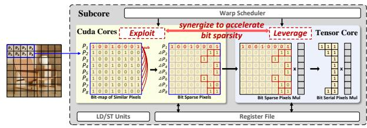

图1是SynGPU协同机制图，没有数值坐标轴。左侧图像块对应token或像素数据，进入CUDA Core后，由相似值生成差分，形成含更多0位的矩阵；右侧Tensor Core将这些输入转换成位串行乘法所需表示。上方Warp Scheduler负责调度，下方LD/ST与共享Register File提供数据通路。红字“Exploit”“Leverage”分别对应生成位稀疏和利用位稀疏。该图说明两类核心的职责及共同供数关系，属于设计概念，不能单凭示意箭头判断实际并行比例、吞吐或数值无损性。

### 图像 2

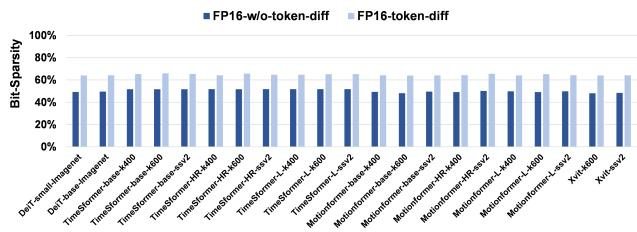

图2(a)比较FP16原始token与差分token的位稀疏率。横轴为DeiT、TimeSformer、Motionformer、XViT及其模型和数据集组合，纵轴Bit-Sparsity从0%到100%；深蓝为FP16-w/o-token-diff，浅蓝为FP16-token-diff。各组合的浅色柱均高于深色柱，支持差分通常增加0位这一观察。正文报告平均值由50.19%升至65.98%，精确统计应以正文为准，不能从低分辨率柱高补出逐模型数据。该比例描述二进制0位，不代表token删除率，也不能直接换算成加速比。

### 图像 3

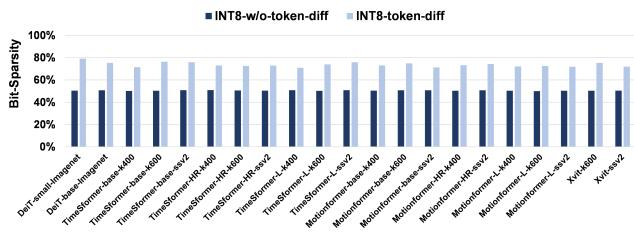

图2(b)给出INT8位稀疏率，横轴沿用不同模型、规模和数据集组合，纵轴为0%—100%的Bit-Sparsity。深蓝柱表示未做token差分，浅蓝柱表示差分后；原始柱大致接近50%，差分柱明显提高，且各配置提升程度不同。正文平均值由50.48%变为75.82%，即增加25.34个百分点。图支持INT8差分具有更丰富的可跳过0位，但未展示负数编码、差分溢出或每组最稠密元素，因此不能单由平均稀疏率推断BSTC所需周期。模糊横轴后缀不宜自行补全。

### 图像 4

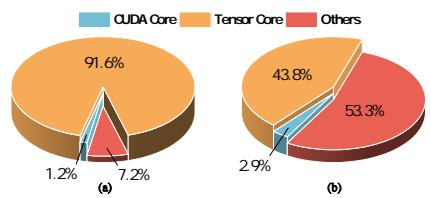

图3包含两个不同统计口径的饼图，图例中青色为CUDA Core、橙色为Tensor Core、红色为Others。子图(a)描述A100运行ViT时的寄存器文件带宽占用构成：CUDA为1.2%，Tensor为91.6%，其他为7.2%。子图(b)描述执行时间构成，对应为2.9%、43.8%、53.3%。两图共同支持Tensor Core主导寄存器访问、CUDA参与程度较低的研究动机。带宽占比与时间占比不能混用，Others也没有进一步拆解；图中没有给出SynGPU优化后的对应结果，不能据此量化最终重叠率。

### 图像 5

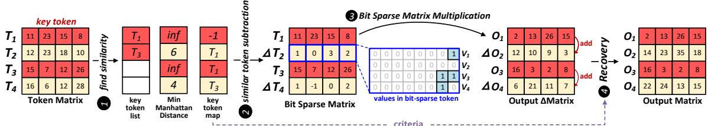

图4展示IBA四阶段数据流。先选T₁、T₃为关键token，为T₂、T₄分别找到距离6、4的参考项并记录映射；随后得到ΔT₂=[1,0,3,2]、ΔT₄=[1,−1,0,2]。蓝框放大部分用二进制展示差分中的0位。位稀疏矩阵乘法产生关键行输出和差分输出，再按映射加回，例如[2,13,26,15]+[12,10,9,3]=[14,23,35,18]。图说明单次线性乘法的恢复关系；右乘矩阵未展示，也没有证明有限精度下逐位无误，不能把示意整数输出当成精度实验。

### 图像 6

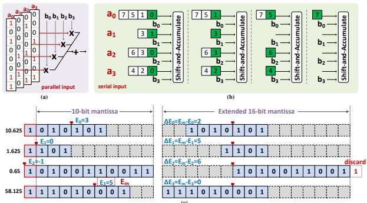

图5由三部分组成：(a)左上展示传统并行点积，多位操作数同时参与乘法；(b)右上将A元素写成1位索引序列，每轮选择对应B元素做移位累加，已完成的通道逐渐空闲，包含更多1位的元素决定结束时间；(c)下半部展示浮点指数对齐，将文中标称10位尾数扩展到16位，并按与最大指数的差右移。图中最大指数为5，部分移位量标为2、5、6、0，右端还有“discard”标记。这既解释共用定点式通路的方法，也显示有限扩展仍可能丢弃低位，不能只凭扩展位宽宣称完整浮点无损。

### 图像 7

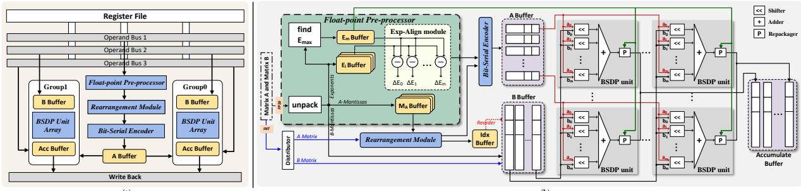

图6(a)左侧为BSTC总览：寄存器文件经三条操作数总线供数，两组BSDP阵列共享A缓冲，各自连接B缓冲与累加缓冲，结果从底部写回。图6(b)右侧展开FP与INT路径；浮点数据经过拆包、最大指数搜索和指数差计算，A尾数进入位串行编码器，B尾数进入B缓冲。重排模块通过Idx Buffer控制B的对应顺序。BSDP单元中的移位器、加法器和重打包模块完成局部计算，再写入累加缓冲。连线解释功能依赖与数据方向，没有给出各模块延迟、峰值供数或所有阶段同时运行的时序保证。

### 图像 8

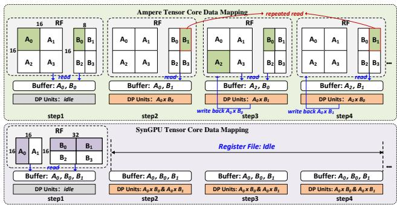

图7上下对比Ampere与SynGPU的数据映射，横向step1—step4表示时间步骤，没有性能纵轴。上半部依次读入A、B分块，计算与写回形成流水；红色虚线指出B₁在不同步骤重复读取。下半部在首步取入更大的A、B数据集合，之后缓冲保留操作数并支持多个乘积并行，顶部标注后续阶段Register File: Idle。图支持减少重复访问、把供数集中到较少阶段的机制。该空闲标注只对应画出的计算片段，不能解释为整个模型无需再次读写寄存器，也不是优化后带宽占用率的实测曲线。

### 图像 9

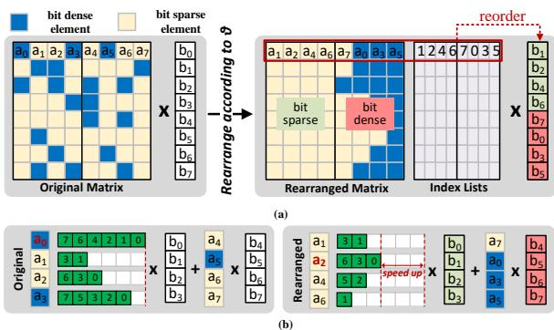

图8(a)用蓝色表示位稠密元素、浅黄色表示位稀疏元素；依据阈值θ，将a₀至a₇重新分组为a₁、a₂、a₄、a₆、a₇、a₀、a₃、a₅，并以索引列表控制右侧B元素的配对重排。图8(b)将原始分组与重排后的稀疏组比较，绿色格中的数字是有效位位置，最长序列由6项缩短为3项，说明慢元素会拖累同步计算。右侧还保留位稠密组，表示其工作并未消失。因此6到3支持局部分组减少等待，不能直接当作整个矩阵或模型固定加速2倍的结果。

### 图像 10

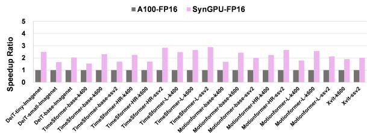

图9(a)比较FP16加速比。横轴为DeiT、TimeSformer、Motionformer和XViT的模型与数据集组合，纵轴Speedup Ratio；灰色A100-FP16归一为1，粉色为SynGPU-FP16。所有粉色柱均高于基线，不同配置的增益存在明显差别，正文报告平均2.20倍、最高2.89倍。该图与位稀疏因输入变化而产生不同执行周期的机制一致，但不能独立拆分差分、映射和硬件扩展各自的贡献。纵轴是相对性能，不是毫秒时延或绝对吞吐，证据来自论文所述仿真评估。

### 图像 11

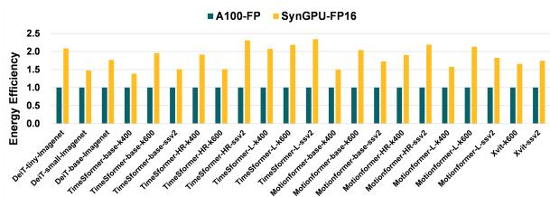

图9(c)展示FP16相对能效，应依据纵轴Energy Efficiency识别子图，原文排版中的说明位置较错乱。横轴是模型与数据集组合，青色A100-FP基线为1，黄色SynGPU-FP16表示对应能效比；正文平均提升为1.84倍。各柱高于基线，支持所评估配置下单位能量计算收益提高，但提升幅度与图9(a)加速比不同。图中没有直接给出瓦数、单次推理焦耳数或整卡能耗边界，也不能将该平均能效比与表II的峰值计算功效2.58倍混为同一指标。

### 图像 12

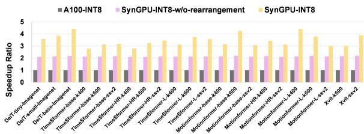

图9(b)是INT8性能及重排消融。横轴为模型和数据集组合，纵轴Speedup Ratio；灰色A100-INT8为1，浅粉色为无重排SynGPU，浅黄色为完整INT8配置。无重排柱大多接近2，带重排柱进一步提高且跨模型变化更大。正文给出无重排平均2.15倍、最高2.20倍，带重排平均3.38倍，未单列其精确最高值。该对照支持重排缓解位串行不平衡；柱高不能说明位稠密元素被删除，也不能把表II中INT8计算功效的3.95倍填作这里的平均加速比。

### 图像 13

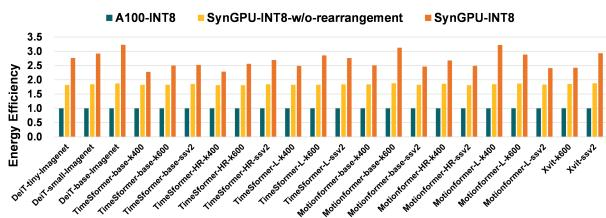

图9(d)展示INT8相对能效。横轴是不同模型与数据集组合，纵轴Energy Efficiency；青色A100-INT8归一为1，黄色为无重排，橙色为带重排。橙色在各配置中高于黄色，正文平均能效比分别为1.85倍和2.68倍。作者将额外收益归因于重排缩短执行周期、减少静态能量消耗；图本身没有动态与静态能量分项，因而支持总能效改善，不能单独验证贡献比例。该结果来自仿真及功耗建模，不是实体SynGPU的板卡功耗测量，也不同于表II的TOPs/W峰值指标。

> 本文由 Codex/GPT 根据论文 PDF 生成中文译文与解读；PDF 由 MinerU 解析。全文译文保留原始参考文献，解读与原文结论请结合阅读。
