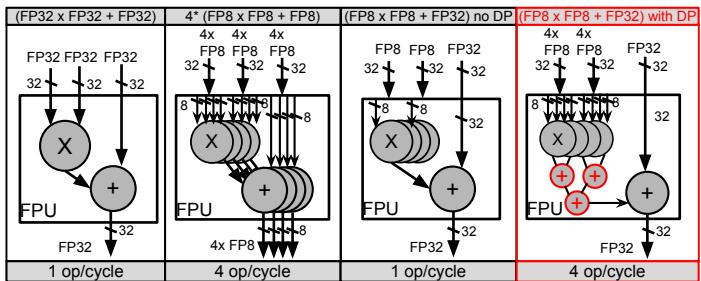
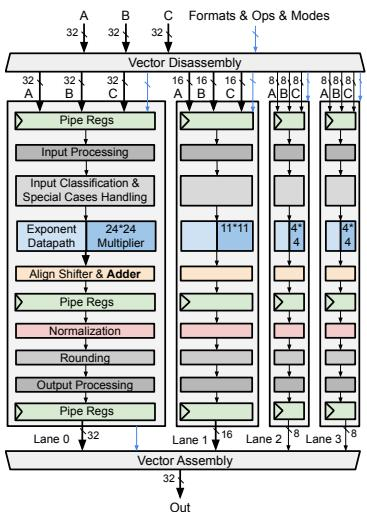
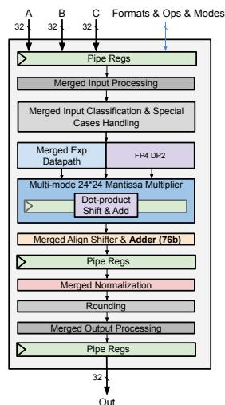
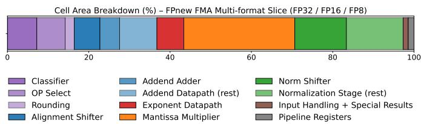
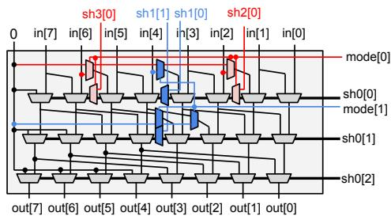
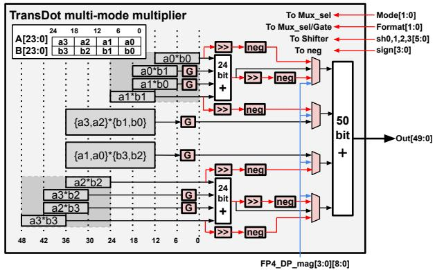
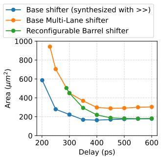
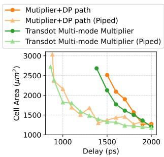
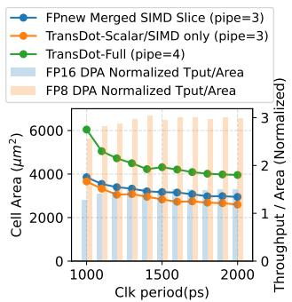
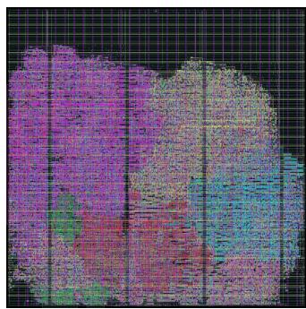

# TransDot: An Area-efficient Reconfigurable Floating-Point Unit for Trans-Precision Dot-Product Accumulation for FPGA AI Engines 原文翻译

(a) FPnew 合并式多格式 FMA SIMD 计算切片（FP32、2 路 FP16、4 路 FP8）

# TransDot：面向 FPGA AI 引擎跨精度点积累加的面积高效可重构浮点单元

Jiayi Wang∗、Maohua Nie∗、Sin-Chen Lin、C.-J. Richard Shi、Ang Li  
华盛顿大学电气与计算机工程系。电子邮件：{jwang710, mhnie, sinchl, cjshi, angliz}@uw.edu。∗同等贡献。

摘要——AMD Versal 等商用 FPGA 越来越多地集成 AI 引擎，通过低精度打包 SIMD 融合乘加（FMA）获得与并行度成比例的吞吐提升。然而，跨精度 FMA，例如将两个 FP16 数相乘并把结果加到 FP32 累加器中，虽然能通过高精度累加保持数值稳定性，其吞吐仍受精度最高、吞吐最低的操作限制。点积累加（DPA），例如对两个由 4 个 FP8 元素组成的向量求点积，再将结果加到 FP32 累加器中，能够充分利用输入输出带宽和计算资源。FPnew 等现有灵活开源 FPU 不支持 DPA；它们通过复制相互独立的 FMA 通道实现低精度 SIMD FMA，增加了面积，使共享算术资源利用不足，也使 DPA 的集成更加复杂。

本文提出 TransDot，一种在共享的可重构数据通路中统一多精度 SIMD FMA 和跨精度 DPA 的可重构 FPU。TransDot 利用可重构子组件，在基线设计上扩展了将 2 项 FP16、4 项 FP8 和 8 项 FP4 点积累加到 FP32 的能力。评估表明，在采用 FP32 累加的 DPA 模式下，TransDot 分别提供 2 倍 FP16、4 倍 FP8 和 8 倍 FP4 吞吐；FP16 DPA 和 FP8 DPA 的面积效率分别达到 1.46 倍和 2.92 倍。与 FPnew 基线相比，其代价是面积平均增加 37.3%，并在点积模式下增加一级流水线。这些结果表明，TransDot 的面积高效设计能够支持在下一代 AMD Versal AI 引擎中进行可扩展部署。

索引术语——浮点单元、点积累加、混合精度算术、FPGA AI 引擎、可重构数据通路。

## I. 引言

现代 AI 加速器越来越依赖低精度算术来提高性能和能效。FP16 [1]、bfloat16、FP8 [2]、[3] 和 FP4 [4] 等低精度格式已被广泛用于训练和推理，计算主要由反复执行的乘加操作组成 [5]、[6]。不过，为了保持数值稳定性，累加需要采用更高精度：每个输出都要累加大量乘积，低精度累加会造成过多的舍入误差，并损害收敛性 [7]、[8]。把低精度乘法与高精度累加结合起来的跨精度 FMA，已经在现代 AI 加速器中得到广泛采用。

图 1：FP32 标量 FMA、FP8 打包 SIMD FMA，以及具备或不具备原生点积累加（DPA）支持的 FP8 到 FP32 跨精度 FMA 的吞吐比较。

(b) 本文提出的 TransDot FMA + DPA SIMD（FP32、2 路 FP16、4 路 FP8、8 路 FP4）

图 2：FPnew FMA SIMD 计算切片与 TransDot 的微架构。

这些现代 AI 加速器包括 NVIDIA Tensor Cores [9]、Google TPU [10] 和 AWS Trainium [11]。

AMD Versal [12] 等商用 FPGA 越来越多地集成可重构 AI 引擎，利用低精度打包 SIMD FMA 获得成比例的吞吐提升。然而，要直接以 SIMD 形式支持跨精度 FMA，就必须加宽 FPU 输出接口，以便每周期生成多个高精度结果；这会显著增加缓冲区带宽，并加剧输入与输出之间的不平衡。实际中，FPU 输入输出接口通常宽度固定。当软件工作负载需要跨精度执行时，这种接口每周期只能输出一个高精度结果，迫使 SIMD 数据通路和输入带宽利用不足，如图 1 所示。DPA 通过把低精度操作数打包进 SIMD 数据通路，并把所有乘积累加为一个高精度输出，克服了这一限制。如图 1 所示，将多个低精度乘积归并成一个高精度结果后，DPA 能保持 FPU 的输入输出带宽需求，并在单个 FPU 中取得与非跨精度 SIMD 执行相当的吞吐。

表 I：TransDot 的 FMA 与点积累加所支持的精度模式。

<table><tr><td>格式</td><td>编码</td><td>标量/SIMD FMA</td><td>DPA</td><td>累加格式</td></tr><tr><td>FP32</td><td>E8M23</td><td>1 路</td><td>1 项</td><td>FP32</td></tr><tr><td>FP16</td><td>E5M10</td><td>2 路</td><td>2 项</td><td>FP32 / FP16</td></tr><tr><td>FP8</td><td>E4M3</td><td>4 路</td><td>4 项</td><td>FP32 / FP16</td></tr><tr><td>FP4</td><td>E2M1</td><td>8 路</td><td>8 项</td><td>FP32 / FP16</td></tr></table>

图 3：FPnew 多格式 FMA 计算切片的面积组成（%）。

FPnew [13] 和 HardFloat [14] 等现有开源 FPU 提供灵活的格式配置，并支持低精度打包 SIMD 操作，但缺少对跨精度 DPA 的原生支持。若干先前工作 [15]–[17] 已探索专用 DPA 单元。例如 Minifloats [18] 设计了一个点积单元，以独立计算切片的形式集成到 FPnew [13] 中。然而，当工作负载可提供的点积并行性有限时，这些单元可能利用不足；专用数据通路也限制了它们在其他执行模式之间的复用。其他工作 [19]、[20] 提出了支持较高精度混合精度点积的多格式 FMA 单元，但这些工作早于 FP8、FP4 等新兴 AI 数据类型的出现，而且 [19] 只支持两项点积。

TransDot 通过系统性复用数据通路，在标量 FP32 单元上扩展多格式 SIMD FMA 与跨精度 DPA，并纳入现代 AI 格式，在上述设计方案之间建立联系。Minifloats [18] 在 FPnew 的 FMA 切片旁增加专用点积单元；TransDot 则复用现有 FP32 数据通路，以尽量少的架构改动实现点积执行，显著降低面积开销，因此适合集成到 Versal AI Engines [12] 等 FPGA AI 引擎中。本文的贡献如下：

• 提出 TransDot，一种支持跨精度 DPA、并在大部分共享的数据通路中统一标量、SIMD 和 DPA 执行的可重构 FPU。

• 将支持的格式扩展到新兴低精度浮点格式，包括表 I 所列的 FP4。

• 使用商用 12nm 工艺的 ASIC 设计流程评估 TransDot，展示良好的面积与延迟取舍及较高的面积效率。

## II. 架构与方法

## A. FPnew 基线浮点 FMA 数据通路

图 2(a) 展示了开源 FPnew 多格式 FMA 切片，可在标量和 SIMD 模式下支持 FP32、FP16 和 FP8。FMA $( A \times B + C )$ 通过将 A、B 的尾数相乘生成进位保存形式的乘积，同时由指数数据通路计算操作数 C 的对齐移位量。对齐移位器将 C 的尾数与乘积对齐，然后使用覆盖无精度损失范围的加法器进行累加；其宽度为 $( 3 p + 4 )$，其中 p 表示精度位数，即尾数位数加 1。

FPnew 为低精度格式实例化额外的窄通道，以实现 SIMD 执行，并利用共享的宽数据通路支持多格式混合精度 FMA。虽然这种组织方式清晰且模块化，但在标量和 SIMD 模式下都存在硬件利用不足。此外，FPnew 不原生支持跨精度 DPA。因此，当累加到 FP32 时，FPnew 每周期只能发出一个 FMA，其吞吐低于低精度 SIMD 执行。

相比之下，TransDot 显式支持多种格式的 DPA，使跨精度 FMA 获得与 SIMD 相当的吞吐。为提高面积效率，TransDot 不采用 FPnew 的通道复制方式，而是通过可配置的算术与逻辑子组件，在不同精度模式之间细粒度复用数据通路。图 2(b) 展示了 TransDot 的微架构。

## B. 子组件数据通路复用

TransDot 将宽数据通路组件作为共享基础，通过分区、门控和依赖模式的控制进行重配置，支持标量、SIMD 和 DPA 执行。逻辑运算器等在位级上独立工作的组件可以直接复用；移位器、加法器和乘法器等具有层次结构的算术组件则需要重组，以显露内部的子字并行性。舍入与特殊情况处理等格式专用阶段，作为轻量外围逻辑，在每个 SIMD 通道中分别复制。图 3 给出了 FPnew FMA 切片的面积组成，显示移位器和乘法器占据了主要面积。因此，以下小节重点讨论这些组件，并说明 TransDot 如何将它们改造成可重构多模式结构，以高效支持跨精度 DPA。

1) 可重构桶形移位器：FMA 数据通路会多次使用移位器。对齐阶段采用宽度为 (4p + 4) 位的右移器，FP32 对应 100 位；归一化阶段需要宽度为 $( 3 p + 5 )$ 位的左移器。这些大型移位器合计约占 FPU 总面积的 15%–20%，如图 3 所示。

图 4：可重构桶形移位器的架构。蓝色区域表示用于支持两个半宽模式的新增硬件，红色区域表示进一步支持四个四分之一宽度模式的扩展。sh 表示移位量信号；四分之一宽度模式下 mode[1:0]=2'b11，半宽模式下 mode[1:0]=2'b10。

为降低多种执行模式下的面积开销，TransDot 在常规桶形移位器的基础上引入多模式移位器，支持全宽、两个半宽和四个四分之一宽度操作。

图 4 为便于说明，以 8 位实例展示了所提出的可重构桶形移位器微架构。支持多种模式的面积开销，可以根据额外需要的多路选择器数量估算。常规 n 位桶形移位器由 $\log _ { 2 } ( n )$ 级组成，每级包含 n 个 2:1 多路选择器，总数为 $n \log _ { 2 } ( n )$。

实现重配置还需要额外逻辑：处理不同模式的移位量，阻止数据跨越子字边界，并在操作较窄分区时选择性旁路最后几个阶段。这些机制引入的额外多路选择器总数为 $\textstyle { \frac { 5 n } { 8 } } + 3 \log _ { 2 } ( n ) - 5$。

据此估算，相对于基线桶形移位器，可重构桶形移位器在 $n = 1 2 8$ 时面积开销约为 10.7%，在 $n = 6 4$ 时约为 13.8%。该估算没有计入高扇出缓冲器；这些缓冲器会增加基线面积，因而实际中相对开销还能进一步摊薄。相比之下，分别实现四个完全独立的移位器，在 n=128 和 n=64 时的面积开销分别约为 78.5% 和 75%，凸显了可重构设计的效率。

2) 多模式阵列乘法器：尾数乘法器是 FMA 数据通路的重要面积来源，约占图 3 中面积的 30%；相比加法器或逻辑单元，它也更难在不同精度模式间复用。常规 p 位尾数乘法器通常作为整体结构实现，在执行低精度或 SIMD 操作时，大量硬件利用不足。先前工作探索了复用阵列乘法器或 Booth 乘法器内部的部分积来支持较低精度，使一个 2n 位乘法器能够划分为两个 n 位乘法器，依此类推 [19]、[21]、[22]。但随着操作数宽度下降，乘法器中的大量子乘法器和部分和加法器仍然空闲。为提高利用率，[21] 将这些空闲子乘法器用于生成更多 SIMD 结果。我们进一步发现，这种分解式乘法器显露出来的缩减加法树，天然匹配点积的累加方式，提供了超越 SIMD 执行、进一步复用数据通路的机会。

图 5：TransDot 多模式乘法器的架构。红色部分表示相对于阵列乘法器，为点积操作增加的硬件。G 表示门控。

图 5 展示了所提出的多模式乘法器，在标量、SIMD 和 DPA 模式间复用数据通路。FP32 模式下，原本的 24 位尾数被划分为四段，每段 6 位。8 个 12 位部分积和 2 个 24 位部分积只生成一次，随后依据执行模式选择性组合。标量模式启用完整加法树，生成全精度结果；低精度 SIMD 和 DPA 模式则对相应部分和进行门控。在 DPA 模式下，增加六个移位器进行对齐移位，并增加六个取负单元，以确定减法场景下是否需要条件取负。还可以插入一个可重配置的流水级，缓解各模式下的时序压力。

3) FP4 支持：由于 FP4 操作数的动态范围极为有限，TransDot 使用专用的 FP4 两项点积（DP2）阶段，以符号与幅值形式直接计算两对 FP4 操作数的乘积。该阶段接收 8 对 FP4 输入，生成四个 9 位部分积及其符号，再交给多模式乘法器，最终累加为一个共享的高精度结果。

## III. 评估与结果

我们通过 RTL 修改，以及使用 Cadence Genus [23] 和商用 12nm PDK 的 ASIC 综合评估 TransDot。评估的关键问题是确保所提出的 RTL 改动没有被激进的综合优化消除或掩盖，同时避免综合工具从优化不足的 RTL 中自动推导出等效优化。为此，我们将 Genus 的映射和优化努力程度设为高，并启用高努力程度的重定时，以在规定的时序约束下最大限度地回收面积。这样，观察到的面积差异来自有意设计的微架构变化，而不是综合过程造成的表象。我们首先分析子组件层面的面积节省。

(a) 可重构移位器。

(b) 多模式阵列乘法器。

图 6：TransDot 可重构数据通路组件的面积与延迟取舍。(a) 比较 100 位单模式移位器、具有四个通道的 100 位多通道移位器（FPnew 方式：一个全宽、一个半宽和两个四分之一宽度移位器），以及本文提出的 100 位可重构桶形移位器的面积和延迟。(b) 比较具有独立点积数据通路的乘法器与 TransDot 多模式阵列乘法器，包括流水线和非流水线实现。

## A. 可重构桶形移位器

图 6a 比较了三种移位器设计在 Genus 中的综合面积，具体设计见图注。当目标延迟超过 400 ps 时，可重构移位器的面积趋近于基线综合移位器，而多通道移位器的面积仍高出 35.8%–67.2%。当延迟约束收紧到 400 ps 以下时，可重构移位器的面积增加，逐渐接近多通道设计；这说明综合工具会逐步复制数据通路或使各段相互独立，以用面积换取性能。这些结果表明，所提出的桶形移位器通过显式共享数据通路，可以显著降低面积，并把握综合工具难以自动推断的优化机会。

## B. TransDot 多模式乘法器

图 6b 展示了具有专用点积归约通路的分离式乘法器，与所提出的 TransDot 多模式乘法器的单元面积和延迟取舍。在组合电路实现中，TransDot 的面积更小、时序也更好：其最小有效延迟约为 1.38 ns，而分离式设计约为 1.50 ns；在 1.6 ns 下，TransDot 的单元面积降低 15.4%。这一改进来自对统一数据通路内部加法器结构的复用，既缩短关键归约路径，也避免额外的专用点积逻辑。插入一级流水线后，TransDot 与分离式设计的最小有效延迟分别约为 0.86 ns 和 0.88 ns。在 1.0 ns 下，流水线 TransDot 的单元面积降低 15.8%；在更宽松的时序目标下，其面积仍然更小。总体而言，TransDot 的算术复用提高了面积效率，同时保持了频率能力。

## C. TransDot 的性能、面积与能耗

图 7a 比较 FPnew 基线、合并 SIMD 通道的 TransDot，以及完整 TransDot 的面积与延迟取舍，同时给出相对面积效率，即吞吐除以面积。

(a) 面积与延迟，以及归一化的吞吐/面积比（TransDot/FPnew）。

(b) TransDot 版图，100µm × 100µm，1 GHz。

图 7：TransDot 的面积与延迟比较及物理版图。粉色：多模式乘法器（34.5%）；青色：归一化（15.5%）；红色：指数处理（11.8%）；黄色：对齐移位器和加法器（18.1%）；绿色：FP4 DP2（3.9%）；紫色：其他部分（16.2%）。

表 II：TransDot 的性能与能效。条件为布局布线后、12nm、1 GHz、标称电压 0.8 V、TT 工艺角。

<table><tr><td>精度/操作</td><td>延迟/吞吐*</td><td>性能 (GFLOP/s)</td><td>能耗 (pJ/FLOP)</td></tr><tr><td>FP32 标量 FMA</td><td>4/1</td><td>2</td><td>3.75</td></tr><tr><td>FP16 标量 FMA</td><td>4/1</td><td>2</td><td>2.76</td></tr><tr><td>FP16 SIMD FMA</td><td>4/1</td><td>4</td><td>1.85</td></tr><tr><td>FP16 DPA，FP32 累加</td><td>4/1</td><td>4</td><td>1.80</td></tr><tr><td>FP8 标量 FMA</td><td>4/1</td><td>2</td><td>2.21</td></tr><tr><td>FP8 SIMD FMA</td><td>4/1</td><td>8</td><td>0.84</td></tr><tr><td>FP8 DPA，FP32 累加</td><td>4/1</td><td>8</td><td>0.84</td></tr><tr><td>FP4 DPA，FP32 累加</td><td>4/1</td><td>16</td><td>0.41</td></tr></table>

* 延迟单位为周期；吞吐单位为操作/周期。

图 7b 是使用 Synopsys ICC2 [24] 得到的物理版图。FP4 相关逻辑仅带来 3.9% 的额外面积。合并 SIMD 通道的 TransDot 相对于 FPnew，平均减少 9.44% 面积。扩展成完整 TransDot 后，通过 DPA 获得 2 倍 FP16、4 倍 FP8、8 倍 FP4 FMA 吞吐，但相对于基线的面积平均增加 37.3%，范围为 31.8%–56.8%。因此，TransDot 的 FP16 DPA 面积效率平均为 FPnew 基线的 1.46 倍，范围 1.28–1.52 倍；FP8 DPA 平均为 2.92 倍，范围 1.56–3.04 倍。表 II 给出了使用 PrimeTime PX [25] 评估的、布局布线后各支持精度模式的每 FLOP 能耗。

## IV. 结论

本文提出 TransDot，一种在共享可重构数据通路中统一 SIMD FMA 和跨精度 DPA 的可重构 FPU。评估表明，相对于基线，TransDot 平均增加 37.3% 面积，换来 FP16 DPA 的 1.46 倍面积效率和 FP8 DPA 的 2.92 倍面积效率。这些结果说明，TransDot 是用于下一代 AMD Versal AI Engines 的实用且面积高效的基础组件。TransDot 的 RTL 实现已公开：https://github.com/pncel/TransDot。

## REFERENCES

[1] IEEE, “IEEE Standard for Floating-Point Arithmetic,” IEEE Std 754- 2019 (Revision of IEEE 754-2008), pp. 1–84, 2019.

[2] N. Wang, J. Choi, D. Brand, C.-Y. Chen, and K. Gopalakrishnan, “Training deep neural networks with 8-bit floating point numbers,” in Proceedings ofthe 32nd International Conference on Neural Information Processing Systems, ser. NIPS’18. Red Hook, NY, USA: Curran Associates Inc., 2018, pp. 7686–7695.

[3] P. Micikevicius, D. Stosic, N. Burgess, M. Cornea, P. Dubey, R. Grisenthwaite, S. Ha, A. Heinecke, P. Judd, J. Kamalu, N. Mellempudi, S. Oberman, M. Shoeybi, M. Siu, and H. Wu, “Fp8 formats for deep learning,” no. arXiv:2209.05433, 2022, arXiv:2209.05433 [cs]. [Online]. Available: http://arxiv.org/abs/2209. 05433

[4] NVIDIA Corporation, “Introducing nvfp4 for efficient and accurate low-precision inference,” https://developer.nvidia.com/blog/ introducing-nvfp4-for-efficient-and-accurate-low-precision-inference/, 2024, nVIDIA Developer Blog.

[5] N. P. Jouppi, C. Young, N. Patil, D. Patterson, G. Agrawal, R. Bajwa, S. Bates, S. Bhatia, N. Boden, A. Borchers, R. Boyle, P.-l. Cantin, C. Chao, C. Clark, J. Coriell, M. Daley, M. Dau, J. Dean, B. Gelb, T. V. Ghaemmaghami, R. Gottipati, W. Gulland, R. Hagmann, C. R. Ho, D. Hogberg, J. Hu, R. Hundt, D. Hurt, J. Ibarz, A. Jaffey, A. Jaworski, A. Kaplan, H. Khaitan, D. Killebrew, A. Koch, N. Kumar, S. Lacy, J. Laudon, J. Law, D. Le, C. Leary, Z. Liu, K. Lucke, A. Lundin, G. MacKean, A. Maggiore, M. Mahony, K. Miller, R. Nagarajan, R. Narayanaswami, R. Ni, K. Nix, T. Norrie, M. Omernick, N. Penukonda, A. Phelps, J. Ross, M. Ross, A. Salek, E. Samadiani, C. Severn, G. Sizikov, M. Snelham, J. Souter, D. Steinberg, A. Swing, M. Tan, G. Thorson, B. Tian, H. Toma, E. Tuttle, V. Vasudevan, R. Walter, W. Wang, E. Wilcox, and D. H. Yoon, “In-datacenter performance analysis of a tensor processing unit,” in Proceedings of the 44th Annual International Symposium on Computer Architecture. Toronto ON Canada: ACM, 2017, pp. 1–12. [Online]. Available: https://dl.acm.org/doi/10.1145/3079856.3080246

[6] S. Gupta, A. Agrawal, K. Gopalakrishnan, and P. Narayanan, “Deep learning with limited numerical precision,” in Proceedings of the 32nd International Conference on International Conference on Machine Learning - Volume 37, ser. ICML’15. JMLR.org, 2015, pp. 1737–1746.

[7] P. Micikevicius, S. Narang, J. Alben, G. Diamos, E. Elsen, D. Garcia, B. Ginsburg, M. Houston, O. Kuchaiev, G. Venkatesh, and H. Wu, “Mixed precision training,” no. arXiv:1710.03740, Feb. 2018, arXiv:1710.03740 [cs]. [Online]. Available: http://arxiv.org/abs/1710. 03740

[8] Z. Mo, L. Wang, J. Wei, Z. Zeng, S. Cao, L. Ma, N. Jing, T. Cao, J. Xue, F. Yang, and M. Yang, “Lut tensor core: A software-hardware co-design for lut-based low-bit llm inference,” in Proceedings of the 52nd Annual International Symposium on Computer Architecture, ser. ISCA ’25. New York, NY, USA: Association for Computing Machinery, 2025, pp. 514–528. [Online]. Available: https://doi.org/10.1145/3695053.3731057

[9] NVIDIA Corporation, “Nvidia rtx blackwell gpu architecture,” https://images.nvidia.com/aem-dam/Solutions/geforce/blackwell/ nvidia-rtx-blackwell-gpu-architecture.pdf, 2024, whitepaper.

[10] N. P. Jouppi, D. H. Yoon, G. Kurian, S. Li, N. Patil, J. Laudon, C. Young, and D. Patterson, “A domain-specific supercomputer for training deep neural networks,” Communications of the ACM, vol. 63, no. 7, pp. 67– 78, 2020.

[11] Amazon Web Services, “Neuroncore-v2 architecture,” https://awsdocs-neuron.readthedocs-hosted.com/en/latest/about-neuron/ arch/neuron-hardware/neuron-core-v2.html, 2023.

[12] AMD, “Versal™ AI Engine,” https://www.amd.com/en/products/ adaptive-socs-and-fpgas/intellectual-property/versal-ai-engine.html, accessed: 2026-03-16.

[13] S. Mach, F. Schuiki, F. Zaruba, and L. Benini, “Fpnew: An open-source multiformat floating-point unit architecture for energy-proportional transprecision computing,” IEEE Transactions on Very Large Scale Integration (VLSI) Systems, vol. 29, no. 4, pp. 774–787, Apr. 2021.

[14] J. R. Hauser, “Berkeley hardfloat floating-point arithmetic package,” 2019. [Online]. Available: https://www.jhauser.us/arithmetic/HardFloat. html

[15] D. R. Lutz, A. Saini, M. Kroes, T. Elmer, and H. Valsaraju, “Fused fp8 4-way dot product with scaling and fp32 accumulation,” in 2024 IEEE 31st Symposium on Computer Arithmetic (ARITH).

Malaga, Spain: IEEE, 2024, pp. 40–47. [Online]. Available: https: //ieeexplore.ieee.org/document/10579354/

[16] J. Sohn and E. E. Swartzlander, “A fused floating-point four-term dot product unit,” IEEE Transactions on Circuits and Systems I: Regular Papers, vol. 63, no. 3, pp. 370–378, Mar. 2016.

[17] S. Li, Y. Zhao, C. Li, B. Guo, J. Zhang, W. Zhu, Z. Ye, C. Wan, and Y. C. Lin, “Fusion-3d: Integrated acceleration for instant 3d reconstruction and real-time rendering,” in 2024 57th IEEE/ACM International Symposium on Microarchitecture (MICRO), 2024, pp. 78–91.

[18] L. Bertaccini, G. Paulin, M. Cavalcante, T. Fischer, S. Mach, and L. Benini, “Minifloats on risc-v cores: Isa extensions with mixedprecision short dot products,” IEEE Transactions on Emerging Topics in Computing, vol. 12, no. 4, pp. 1040–1055, Oct. 2024.

[19] H. Zhang, D. Chen, and S.-B. Ko, “Efficient multiple-precision floatingpoint fused multiply-add with mixed-precision support,” IEEE Transactions on Computers, vol. 68, no. 7, pp. 1035–1048, 2019.

[20] M. Gok and M. M.¨ Ozbilen, “Multi-functional floating-point maf designs¨ with dot product support,” Microelectronics Journal, vol. 39, no. 1, pp. 30–43, Jan. 2008.

[21] P.-H. Kuo, Y.-H. Huang, and J.-D. Huang, “Configurable multi-precision floating-point multiplier architecture design for computation in deep learning,” in 2023 IEEE 5th International Conference on Artificial Intelligence Circuits and Systems (AICAS), 2023, pp. 1–5. [Online]. Available: https://ieeexplore.ieee.org/document/10168572/

[22] A. D. BOOTH, “A signed binary multiplication technique,” The Quarterly Journal of Mechanics and Applied Mathematics, vol. 4, no. 2, pp. 236–240, Jan. 1951.

[23] Cadence Design Systems, Inc., “Genus synthesis solution,” 2025. [Online]. Available: https://www.cadence.com/en US/home/tools/ digital-design-and-signoff/synthesis/genus-synthesis-solution.html

[24] Synopsys, Inc., “Ic compiler ii datasheet,” 2025. [Online]. Available: https://www.synopsys.com/content/dam/synopsys/ implementation%26signoff/datasheets/ic-compiler-ii-ds.pdf

[25] “Primetime suite,” https://www.synopsys.com/ implementation-and-signoff/signoff/primetime.html, 2026, accessed: 2026-03-27.