# Voyager: An End-to-End Framework for Design-Space Exploration and Generation of DNN Accelerators 图表详解

### 图像 1

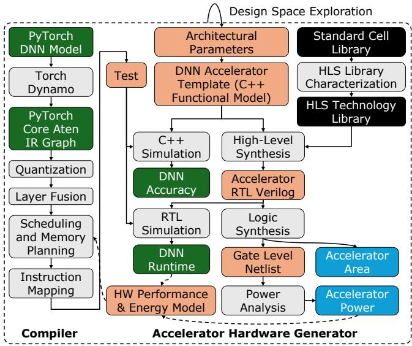

图1：端到端生成与评估闭环。左侧PyTorch→量化→融合→调度→指令，右侧C++模板结合工艺/时钟参数经HLS生成RTL。C++推理给准确率，RTL仿真给周期，综合与功耗分析给成本。不同阶段证据应区分：生成可综合RTL不等于全部设计点已流片。

### 图像 2

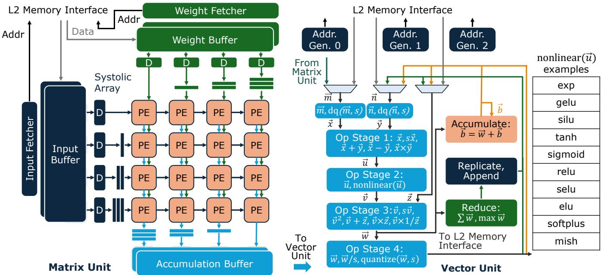

图2：矩阵与向量模板。左侧权重驻留阵列、读取器及缓冲；右侧多级逐元素运算、累加、归约和可编程非线性。矩阵结果可直接进入向量，降低写回；双缓冲变体用于解除反压。箭头展示数据路径，不能按图示方块面积估成本。

### 图像 3

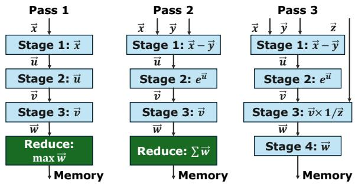

图3：softmax三遍映射。第一遍求max，第二遍减max、指数、求sum，第三遍重复指数并除sum。中间归约结果经存储或反馈传递。它说明非GEMM也被映射，代价包含多次读取，不能等同于FlashAttention在线融合算法。

### 图像 4

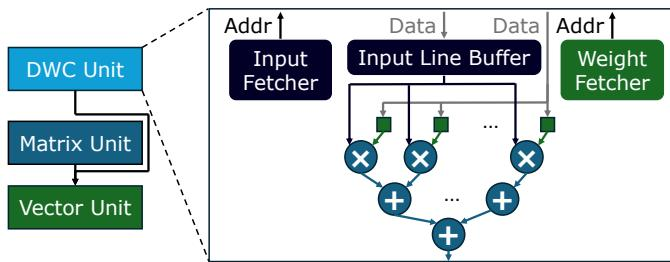

图4：深度卷积用户扩展。输入行缓冲和权重读取器为3×3 MAC树供数，输出接向量。更大核由编译器切片/填充并归约。专用模块适应DWC低复用特性，展示框架扩展能力而非普通脉动阵列天然高效。

### 图像 5

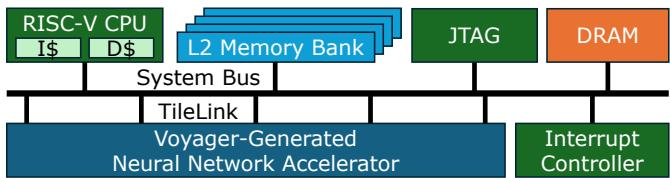

图5：Chipyard SoC集成。RISC-V CPU、L2、JTAG、DRAM及中断经系统总线互连；加速器作为TileLink外设，控制经存储映射寄存器。它说明系统接口组织，不单独证明所有内存系统配置下的性能。

### 图像 6

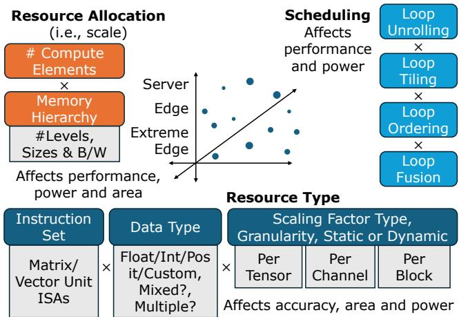

图6：设计空间三个轴。资源分配包括计算数及存储层级/大小/带宽；资源类型包含ISA、数值格式和scale粒度；调度包括展开、分块、排序、融合。准确率不仅由类型决定，还与量化和累加语义相关，性能则需要硬件与映射共同选择。

### 图像 7

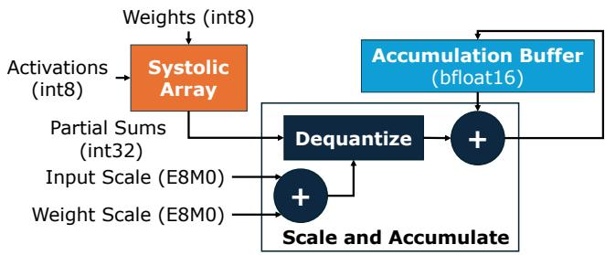

图7：微缩放矩阵归约。INT8输入/权重先在阵列形成INT32部分和，E8M0 scale组合后反量化，与BF16累加缓冲中的跨块结果相加。E8M0表示指数scale，因此图中scale加法对应指数域组合，并不是把两个实数scale直接相加。

### 图像 8

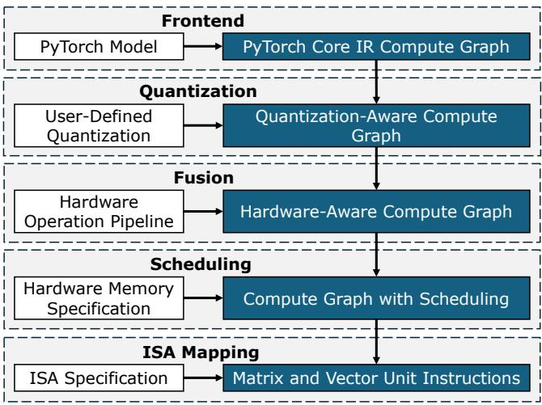

图9：编译流水。前端生成静态IR，用户量化规格改变图，硬件流水指导融合，存储规格指导调度，ISA规格指导指令映射。每一步都需要与生成的硬件参数一致，不能单独更换类型而忽略指令及调度。

### 图像 9

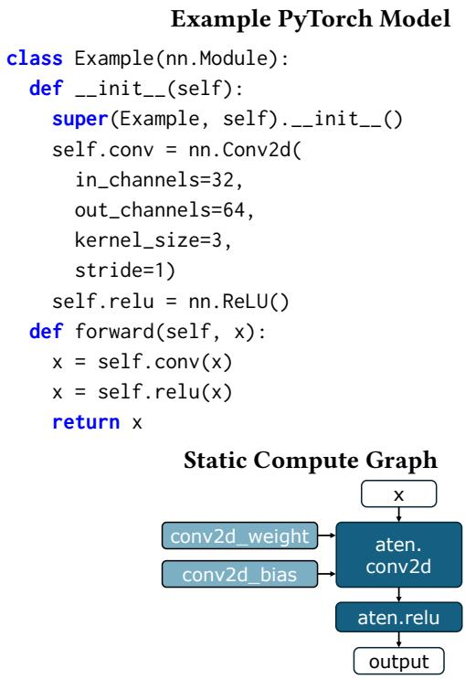

图10：卷积+ReLU的PyTorch模型及ATen图。例子输入通道32、输出64、3×3、stride1，前端保留权重、偏置和操作关系。图中代码是前端示例，后续仍需量化、地址分配及循环调度。

### 图像 10

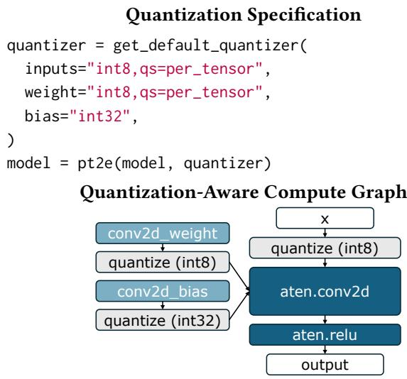

图11：量化规格和量化感知图。输入/权重INT8、逐张量scale，偏置INT32；插入quantize并连接卷积/ReLU。伪量化用于浮点模型校准和模拟，后续硬件准确性仍需C++数值实现核实。

### 图像 11

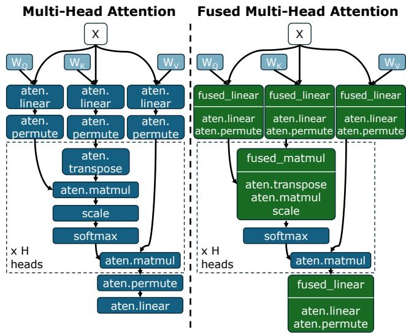

图12：多头自注意力的重塑融合。左侧QKV线性、排列、K转置和matmul分离；右侧将这些访存变换并入线性/matmul，softmax等仍保留。收益来自消除中间搬移，不意味着整个attention被合成一个单指令。

### 图像 12

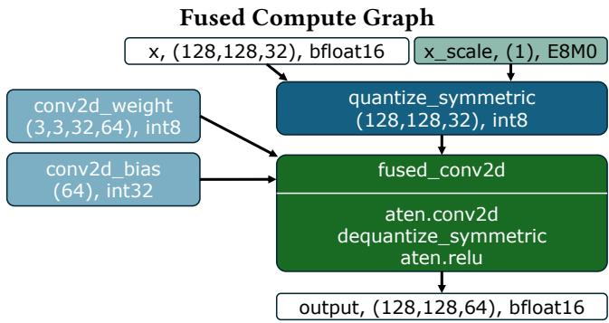

图13：卷积—反量化—ReLU融合图。输入先quantize，卷积权重INT8、偏置INT32，后处理恢复浮点并激活，输出同一融合节点。形状128×128×32到128×128×64展示IR元数据如何随图保持；融合受硬件流水能力约束。

