# XtraMAC: An Efficient MAC Architecture for Mixed-Precision LLM Inference on FPGA 原文翻译

# XtraMAC：面向 FPGA 上混合精度 LLM 推理的高效 MAC 架构

Feng Yu*、Hongshi Tan*、Yao Chen†,‡、Weng-Fai Wong*、Bingsheng He*,‡

新加坡国立大学计算机学院，新加坡

†华中科技大学计算机科学与技术学院，中国武汉  
{yuf, hongshi}@u.nus.edu，{dcswwf, dcsheb}@nus.edu.sg，chenyao_cs@hust.edu.cn

**摘要**——大型语言模型（LLM）广泛采用混合精度量化，对能够高效执行不同数据类型乘加（MAC）、并在运行时切换类型的硬件产生了需求。现有 FPGA MAC 方案受固定类型设计、低效空间或时间共享，以及混合精度支持不足限制，导致 DSP 资源利用率偏低，限制并行度和吞吐。本文提出 XtraMAC，在单一、可适应数据类型的微架构中统一整数、浮点和混合精度运算。XtraMAC 将所有支持格式的 MAC 分解为共享整数尾数乘积，并配合轻量符号和指数处理，支持动态操作数打包、高效 DSP 共享，在全部类型下保持恒定延迟与为 1 的启动间隔。在 AMD Xilinx U55c FPGA 上，XtraMAC 计算密度提高 1.4–2.0 倍，每次操作的 LUT、FF、DSP 消耗减少 27%–51%；代表性混合精度 LLM 工作负载的能效最高提高 1.9 倍，加速最高 1.2 倍。实现已开源：https://github.com/Xtra-Computing/XtraMAC。

**索引词**——MAC 架构、混合精度运算、运行时数据类型切换、DSP 打包、FPGA。

## I. 引言

乘加（MAC）是从数字信号处理到深度学习等广泛计算任务的基本构件。近年 LLM 成为最突出、需求最高的 MAC 使用者，其推理主要由涉及数十亿参数的矩阵乘法组成。MAC 需求快速增长，推动低精度量化来降低存储占用和计算能耗。量化方法 [6,11,13,22,39,44] 对权重、激活、MoE 专家等不同组件采用混合数值格式，并按量化敏感性为不同层分配类型，例如计算密集层采用低位整数，数值敏感层采用浮点 [13,22,39]。表 I 汇总了各量化方法与模型组件中多样的 MAC 类型组合。

表 I：不同 LLM 量化方案中的 MAC 多样性。

| 类别 | 示例 | 投影/FFN MAC | 注意力 MAC |
|---|---|---|---|
| 仅权重量化 | AWQ、GPTQ、SpQR | INT × FP + FP → FP | FP × FP + FP → FP |
| 权重与激活量化 | SmoothQuant、Atom | INT × INT + INT → INT | FP × FP + FP → FP |
| 原生 LLM | GPT-oss-20b、120b | MXFP4/BF16* × FP + FP → FP | FP × FP + FP → FP |

* GPT-oss 的 MoE 块采用 MXFP4，其他部分采用 BF16。

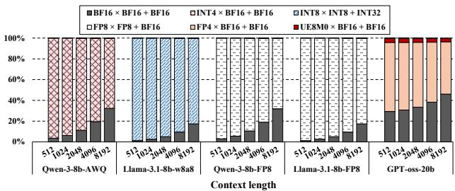

图 1：表 VI 中不同量化 LLM 检查点在不同上下文长度下的解码阶段 MAC 分布。每段代表一种 MAC 配置；非 MAC 操作少于总操作的 1%，未列出。

混合精度量化的普及也给硬件带来挑战。定义 $P=A\times B+C$，实践中有两种计算模式：一是混合精度 MAC，即乘数 $A,B$ 的数值格式或位宽不同，例如 INT4×BF16；二是运行时数据类型切换，即单个硬件单元随执行经过不同模型组件而切换 MAC 类型。例如一次前向传播从投影层 INT4×BF16 转到注意力层 BF16×BF16。图 1 中 Qwen-3-8B-AWQ 解码阶段超过 68% 的 MAC 用 INT4×BF16 执行投影，注意力仍用 BF16×BF16，展示两种模式在同一模型中并存。这种动态异构性要求硬件原生支持两者，并避免性能退化。

FPGA 可定制计算流水线，对算术和数据流实施细粒度比特控制，因此是有潜力的平台。尤其是到主要计算单元 DSP 核的数据通路可按多种类型定制。然而现有 FPGA 混合精度 MAC 仍不理想，利用 DSP 的常规方案大体如下。

表 II：FPGA MAC 的混合精度（MP）和运行时类型切换（RDS）支持。年份沿用原文表格。

| 名称 | 年份 | A 类型 | B 类型 | C 类型 | P 类型 | MP | RDS | 说明 |
|---|---:|---|---|---|---|:---:|:---:|---|
| FINN [35] | 2017 | 二值 | 二值 | 整数 | 整数 | ✗ | ✗ | 二值网络固定架构 |
| FP-BNN [21] | 2017 | 二值 | 二值 | 整数 | 整数 | ✗ | ✗ | 二值网络固定架构 |
| DNNBuilder [43] | 2018 | 定点 | 定点 | 定点 | 定点 | ✗ | ✗ | 精度在综合时确定 |
| BISMO [36]* | 2019 | 整数 | 整数 | 整数 | 整数 | ✓ | ✓ | 运行时切换整数位宽 |
| Xilinx FP Operator [1]† | 2020 | 浮点 | 浮点 | 浮点 | 浮点 | ✗ | ✗ | 格式在综合时确定 |
| Triple MAC [20] | 2021 | 定点 | 定点 | 定点 | 定点 | ✗ | ✗ | 静态精度，设计时选择位宽 |
| TATAA [38]‡ | 2025 | INT8 或 BF16 | INT8 或 BF16 | INT32 或 BF16 | INT32 或 BF16 | ✗ | ✓ | INT8 与 BF16 运行时切换 |
| 本文 | 2025 | 整数、浮点 | 整数、浮点 | 整数、浮点 | 整数、浮点 | ✓ | ✓ | 全部类型间运行时切换 |

* BISMO 可在运行时任意选择整数位宽，但 FPGA 资源限制使允许的最高精度在综合时固定。  
† A、B、C、P 必须采用相同浮点类型。  
‡ A、B、C、P 必须采用同一类型，即全为 INT8 或全为 BF16。

- **操作数提升**：把低精度操作数提升到固定高精度 MAC 的类型，明显浪费 DSP 比特空间。
- **空间复制或时间共享**：实例化多个专用类型数据通路，或跨周期复用单通路，以支持运行时类型切换。任一时刻只有部分资源工作，有效 DSP 利用率较低。

例如 AMD Xilinx Floating-Point Operator [1] 执行低精度工作负载时，平均 DSP 比特利用率为 32.4%，因为全部操作数必须提升到固定高精度浮点格式。使用同一 IP 复制多种类型通路来支持运行时切换，会使平均有效利用率进一步降至 26.7%：只有一条通路活动，其余空闲。TATAA [38] 的时间共享把 BF16 MAC 分成四个顺序 INT8 操作，INT8 MAC 利用率为 71.1%，但 BF16 因多周期分解仅为 8.9%。

根本原因是计算模式与 FPGA DSP 固定资源粒度在理论上脱节。DSP 打包已能明显提高纯整数工作负载利用率 [8,24]，但当前方案缺少把该技术扩展到现有工作负载所需的比特级分析。因此各 DSP 吞吐远低于算术上限；LLM 在一次前向中越来越多地混合精度、切换类型时，差距更加明显。

本文提出资源紧凑、原生理解混合精度的 MAC 架构，在统一数据通路中支持运行时类型切换。主要贡献如下：

- 统一表述整数、浮点及混合精度 MAC 的乘法部分：均可分解为整数尾数乘积和轻量符号/指数处理。
- 提出类型自适应 XtraMAC，将格式解释与算术执行解耦，在同一共享通路中统一整数、浮点、混合精度 MAC。
- 提出以 DSP 为中心的设计原则，通过动态比特映射和多通道打包提高乘法器利用率；采用固定四级流水线，使全部支持类型维持恒定延迟及为 1 的启动间隔。
- 相对先进 FPGA 基线，计算密度提高 1.4–2.0 倍，LUT、FF、DSP 使用量分别减少 30.0%、47.9%、50.0%；相对 GPU 基线，GEMV 延迟改善 1.2 倍、能效提高 1.9 倍。

## II. 背景与设计动机

针对 LLM 的混合精度和运行时类型切换需求，先按照常用约定定义 DSP 利用率，再审视 FPGA MAC 微架构，重点分析其 DSP 利用情况。

### A. DSP 利用率

现代 FPGA 的硬化 DSP 片以整数乘法器为主要算术资源。配套的前加法、后加法和流水逻辑结构更简单，面积与功耗远低于乘法器本身 [4,40]。因此遵循文献 [9] 的操作数比特利用模型，按乘法器硬件实际发挥程度量化利用率。设乘数有效位宽为 $w_a,w_b$：

$$
U_{\mathrm{DSP}}=(w_a+w_b)/W_{\mathrm{mul}}
$$

$W_{\mathrm{mul}}$ 是 DSP 乘法器两输入端口位宽之和。本文针对现代 Xilinx FPGA 广泛使用的 DSP48E2，乘法输入 A 为 27 位、B 为 18 位，故 $W_{\mathrm{mul}}=45$ 位 [4]。

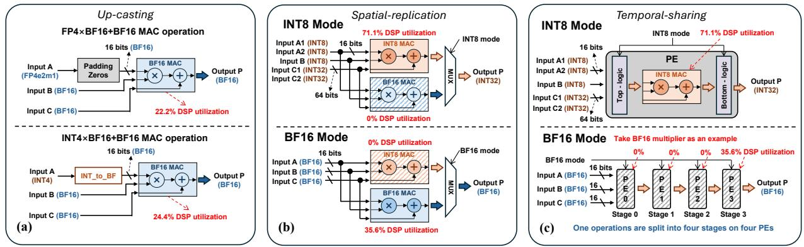

图 2：现有 FPGA 混合精度和运行时切换 MAC 架构。（a）用 FP Operator [1] 提升精度；（b）多类型空间复制 [1]；（c）时间共享（TATAA [38]）。

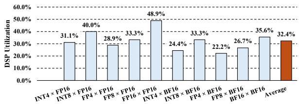

图 3：提升精度方案在不同混合精度组合下的 DSP 利用率（FP8=E4M3，FP4=E2M1）。

### B. 当前 FPGA MAC 设计

FPGA MAC 从二值、整数、定点逐步发展到全精度浮点。表 II 展示可重构逻辑对算术专用化的灵活性，但混合精度和运行时切换仍有持续局限。

**1）缺少高效混合精度支持。** FINN [35]、FP-BNN [21]、DNNBuilder [43] 等早期加速器针对固定整数或定点格式，精度在综合时确定。大多数 MAC 优化固定或统一操作数类型，对混合精度支持有限。实践中常把低精度操作数提升到最高支持精度，在高精度通路计算。如图 2(a) 的 AMD Xilinx FP Operator [1]，通过填充或提升匹配最高精度，全部操作都在固定高精度通路执行。图 3 量化了由此造成的大量闲置 DSP 比特容量。

**2）DSP 低效及运行时切换局限。** 近期设计主要采用空间复制或时间共享，图 2(b)、(c) 为代表。两者各有优势，但在适应 LLM 多样数值需求时，都给 DSP 利用率带来固有限制。

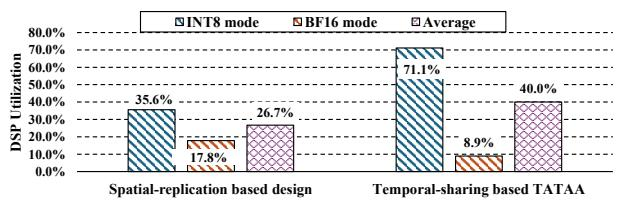

图 4：图 2 中支持运行时类型切换的现有 FPGA MAC 的 DSP 利用率比较。

**空间复制。** 文献 [5] 等方案为每种类型复制 MAC，再用 MUX 运行时选择。INT8/BF16 可配置实例同时包含两种 MAC，用控制信号切换。它支持零延迟切换且避免流水气泡，但格式越多，硬件开销越大。未激活类型的 MAC 闲置，也未利用低精度运算天然的并行优势。图 4 平均 DSP 利用率降至 26.7%。

**时间共享。** TATAA [38] 将 BF16 分成跨多个周期的 INT8 微操作，使整数 MAC 同时支持 INT8、BF16，无需单独 BF16 逻辑，减少面积。但牺牲空间并行和吞吐：每次 BF16 操作占用四个 PE 与流水阶段，同样硬件规模下 BF16 峰值吞吐只有 INT8 的四分之一。图 4 中 BF16 MAC 利用率仅 8.9%，明显降低硬件有效性。

这些低效说明了根本的微架构问题。先进 LLM 推理越来越多地使用混合精度浮点与运行时类型切换，该问题会更突出。

### C. 本文观察

上述量化结果指向共同根因：低精度 MAC 的比特级计算模式与 FPGA DSP 固定资源粒度不匹配。现有设计要么把窄操作数提升为宽格式，要么在窄精度核上串行执行高精度运算。两者都把 DSP 当作不透明单通道单元，而未把其比特空间视为可系统划分、跨类型共享的资源。类型切换也被当作对整条数据通路的粗粒度控制，而非 DSP 比特空间中的细粒度工作分配。

这说明仅小幅调整通路难以再获得显著收益。因此我们从计算模式重新思考：低精度、混合精度 INT/FP 乘法如何分解为比特运算，按 DSP 特征分配到乘法器；MAC 微架构如何以合适并行度提高利用率。下一节给出该表述，作为 XtraMAC 高利用率和细粒度运行时切换的理论基础。

## III. 计算模式表述

为充分利用混合精度 MAC 的共享及性能潜力，先分析低精度和混合精度运算如何映射到 FPGA DSP 原生乘法器和累加器。与固定精度不同，异构操作数宽度不能自然匹配 DSP 比特粒度，形成不同的子 DSP 打包及通道并行模式。资源紧凑架构因此需系统描述这些模式。先以规格化、非异常数值建立核心表述，后续再扩展特殊值和舍入。在这些约定下，XtraMAC 在全部支持类型上生成与 NVIDIA A100/H100 Tensor Core [27,28] 及官方 AMD FP Operator [1] 逐比特一致的结果。

### A. 跨数据类型共享乘法通路

对 IEEE 浮点操作数 $x=s_x\cdot2^{e_x}\cdot m_x$，假设尾数包含隐含首位 1，即规格化数的 $m_x\in[1,2)$。两个浮点值的乘积按原文符号约定分解为：

$$
x\cdot y=(s_x\oplus s_y)\cdot
2^{e_x+e_y-\mathrm{bias}}\cdot(m_xm_y) \tag{1}
$$

FPGA DSP 构成的 MAC 中，DSP 只计算尾数乘积 $m_xm_y$，符号、指数单独处理 [1,4]。乘法后以首零计数（LZC）规格化：

$$
\Delta=\mathrm{LZC}(m_xm_y),\qquad
m^{\mathrm{norm}}=(m_xm_y)\ll\Delta \tag{2}
$$

$$
e^{\mathrm{out}}=e_x+e_y-\mathrm{bias}-\Delta \tag{3}
$$

对混合精度 INT×FP，二进制补码整数 $a$ 分解为符号与幅值：

$$
a=s_a\cdot m_a
$$

提取符号后的 $m_a$ 视为整数尾数。整数没有指数编码，赋予逻辑无偏指数 0，对应浮点输出格式的有偏指数等于 bias，例如 FP32/BF16 为 127，FP16 为 15。浮点 $y$ 与 $x$ 同样表示，$m_y$ 包含首位 1。乘积为：

$$
a\cdot y=(s_a\oplus s_y)\cdot
2^{e_y-\mathrm{bias}}\cdot(m_am_y) \tag{4}
$$

DSP 仍只计算整数尾数乘积 $m_am_y$；指数通路传递 $e_y$，减去格式偏置并应用规格化移位：

$$
\Delta=\mathrm{LZC}(m_am_y),\qquad
m^{\mathrm{norm}}=(m_am_y)\ll\Delta \tag{5}
$$

$$
e^{\mathrm{out}}=e_y-\mathrm{bias}-\Delta \tag{6}
$$

式（1）、（4）表明，FP×FP 和 INT×FP 的核心相同：DSP 计算整数尾数乘积，符号与指数在 DSP 外处理。因此可共享通用乘法通路，只在操作数如何映射到 $(s,m,e)$ 以及规格化后如何更新指数上不同。全部整数、浮点、混合格式的乘法可描述为：

1. **映射**：提取或构造每个输入操作数的符号、尾数、指数。
2. **DSP 乘法**：计算 $m_{\mathrm{prod}}=m_A m_B$。
3. **计算后处理**：用 LZC 规格化，并按操作数格式更新指数。

类型相关行为被限制在轻量映射与后处理逻辑中，DSP 始终执行同一种整数乘法。因此单个乘法通路只需少量附加硬件，即可支持 FP×FP、INT×FP 和纯整数乘法。

### B. 数据类型专用累加

乘法自然共享统一的整数尾数结构，但整数、浮点的比特语义不同，加法计算模式并不兼容。二进制补码整数 $x,y$ 满足：

$$
x+y=(x\oplus y)\oplus\operatorname{carry}(x,y)
$$

它直接映射到 FPGA 串行进位链。$w_{\mathrm{int}}$ 位整数加法器资源成本近似线性：

$$
C_{\mathrm{int}}(w_{\mathrm{int}})
\approx\alpha_{\mathrm{int}}w_{\mathrm{int}} \tag{7}
$$

$\alpha_{\mathrm{int}}$ 为进位链实现带来的每位 LUT 成本。

浮点 $x=s_x2^{e_x}m_x$、$y=s_y2^{e_y}m_y$ 的指数差为 $\Delta e=e_x-e_y$。假设 $e_x\ge e_y$，较小尾数必须按运行时决定的距离右移：

$$
m_s=m_x\pm(m_y\cdot2^{-\Delta e})
$$

结果再用 LZC 规格化：

$$
\Delta=\mathrm{LZC}(m_s),\quad
m_{\mathrm{out}}=m_s\ll\Delta,\quad
e_{\mathrm{out}}=e_x-\Delta
$$

$\Delta e$ 可取指数范围内任意值，因此对齐必须支持覆盖尾数全宽 $w_{\mathrm{fp}}$ 的可变右移，规格化则需要可变左移。在 FPGA 上，经典桶形移位器有 $\log_2w_{\mathrm{fp}}$ 级，每级 $w_{\mathrm{fp}}$ 个 MUX [32]：

$$
N_{\mathrm{MUX}}=w_{\mathrm{fp}}\log_2w_{\mathrm{fp}}
$$

LUT 成本超线性增长：

$$
C_{\mathrm{shifter}}(w_{\mathrm{fp}})
\approx\beta_{\mathrm{sh}}w_{\mathrm{fp}}\log_2w_{\mathrm{fp}} \tag{8}
$$

$\beta_{\mathrm{sh}}$ 为每个选择器阶段的 LUT 成本。已有工作证实，对齐和规格化移位器主导 FPGA 浮点加法器的 LUT 占用 [12,25]。

因此累加具有固有的类型专用性。整数加法往往位宽较大，例如 INT4/INT8 采用 32 位累加 [26,28]，但高效进位链避免了昂贵移位。浮点加法尾数较窄，如 FP16 的 10 位、BF16 的 7 位，但对齐和规格化移位器成本很高。若统一 INT–FP 加法器，就迫使本不需要移位的整数通过浮点移位路径，还必须按更宽整数位宽设置移位器，浪费面积，资源效率低于分立加法通路。

### C. 单个 DSP 片上的并行混合精度 MAC

DSP 片执行一次宽整数乘法：

$$
P_{\mathrm{DSP}}=A_{\mathrm{DSP}}\cdot B_{\mathrm{DSP}}
$$

两输入为比特向量。固定精度方案把操作数放在最低有效位，乘法器大部分闲置。但第 III-A 节表明，全部 MAC 类型适当映射后都归结为整数尾数乘法，因此可把多个低精度通道打包到 DSP 输入的不同比特区域，利用完整宽度 [8,14,24]。

映射阶段为各尾数或整数幅值分配不重叠区间：

$$
A_{\mathrm{DSP}}=\sum_i(a_i\ll s_i),\qquad
B_{\mathrm{DSP}}=\sum_j(b_j\ll t_j) \tag{9}
$$

逐通道偏移 $s_i,t_j$ 按类型组合选择，避免通道干扰。无论 INT、FP 或 INT×FP，DSP 始终收到有效的整数操作数。

一次宽乘法后，各通道乘积出现在预定位置：

$$
P_{\mathrm{DSP}}=\sum_{i,j}(a_i b_j)\ll(s_i+t_j) \tag{10}
$$

后处理用固定移位和掩码提取：

$$
P_{i,j}=(P_{\mathrm{DSP}}\gg(s_i+t_j))\ \&\ (2^S-1) \tag{11}
$$

$S$ 为每通道分配的比特步距。若支持乘积 $|a_i b_j|$ 的最大位宽为 $W_{\mathrm{lane}}$，保证不重叠要求：

$$
S\ge W_{\mathrm{lane}}+G
$$

$G$ 是吸收进位的小保护间隔，通常为 1 位。

把通道打包放入映射阶段、乘积提取放入后处理阶段，第 III-A 节共享乘法通路便自然扩展为并行混合精度 MAC。多个 INT、FP、INT×FP 操作可在一个 DSP 内并行。

共享 DSP 乘法器并行度受输入宽度限制。给定类型和步距 $S$，原文给出的上界为：

$$
\mathrm{Parallelism}\le
\min\left(\left\lfloor\frac{L_A}{S}\right\rfloor,
\left\lfloor\frac{L_B}{S}\right\rfloor\right) \tag{12}
$$

DSP48E2 的 $L_A=27$、$L_B=18$。INT4×BF16、FP8×FP8、INT8×INT8 等类型操作数精度不同，步距也不同。确定某类型步距后，式（12）的并行上界由两输入宽度决定。

总体而言，将数值格式转为整数乘积，并按精确偏移打包，使单个 DSP 可在整数、浮点、混合精度 MAC 间共享。式（10）的多项式结构保持通道隔离，逐通道规格化和指数重建恢复正确浮点/混合精度语义。这种比特级控制是混合精度支持及低精度通道并行的基础。

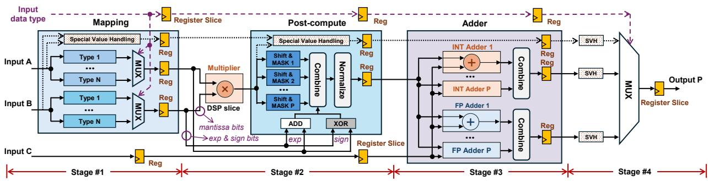

图 5：支持 $N$ 种类型组合、最高 $P$ 路并行的 XtraMAC 架构。SVH 表示特殊值处理。

### D. 特殊值处理

**1）数值覆盖。** XtraMAC 全数据通路采用结果下溢归零（FTZ）和非规格化输入视为零（DAZ），与 NVIDIA A100/H100 Tensor Core [27,28] 和 AMD Xilinx FP Operator [1] 等现代硬件常用约定一致。非规格化输入读取时视为零，低于最小值的输出归零。NaN 传播为规范 quiet NaN（qNaN），无穷大保留符号；$\infty\times0$、$+\infty+(-\infty)$ 等冲突产生 qNaN。没有无穷大编码的格式把全 1 指数编码视为 NaN。整数到浮点转换精确，浮点累加始终采用最近偶数舍入（RN-even）。

**2）不改变流水行为的异常处理。** 异常不能破坏主通路时序。XtraMAC 在输入处检测 NaN、无穷大、非规格化和溢出等特殊情况，编码为状态标志，与操作数经过同样寄存器延迟，保持控制、数据时序对齐。输出用纯组合逻辑选择适当结果，不需停顿、清空流水或控制流分歧。溢出同样通过标志选择饱和到 $\pm\infty$。所以正常、异常输入都保持相同延迟和吞吐。

## IV. XtraMAC 架构细节

按照第 III 节，XtraMAC 将数值解释与执行分离：轻量外围逻辑负责格式解码、比特映射、打包及后处理；算术核为类型无关 DSP 乘法器和解耦 INT/FP 累加路径。参数包括：（i）综合时选定的支持类型数 $N$；（ii）这些类型的最大并行度 $P$，决定各阶段共享的统一通道结构，选择值不超过式（12）上界。本节说明支持运行时切换的全流水混合精度通路。

### A. 整体架构

图 5 的四级流水线在入口寄存专用类型选择信号，经过匹配延迟传到全部阶段，每周期选择 $N$ 种类型之一。所有类型相关映射、重建模块静态实例化，运行时完全通过类型控制的选择器切换，不进行硬件重配置。每操作处理最多 $P$ 个逻辑通道，$P$ 是所支持类型中的最大并行度，全部格式共享同一并行基础。四级分别完成：操作数解释和 DSP 打包；类型无关乘法与逐通道后处理；解耦 INT/FP 专用累加；最终输出选择和组装。

### B. 第 1 级：操作数解释与比特映射

输入 $A,B$ 可能编码多个拼接低精度值，本级将其转为第 2 级所需的类型相关 DSP 端口打包操作数。类型输入确定活动格式及各值解释方式。为无需重配置支持 $N$ 种类型，本级实例化 $N$ 个并行映射模块。

浮点模块提取符号、指数、尾数，恢复隐含首位 1，把尾数放到指定 DSP 输入位置，同时把指数、符号作为元数据传递。整数模块解码补码，打包幅值并传递符号；纯整数的指数元数据置零，视为指数为 0 的定点尾数。全部模块并行计算后，类型信号选择一对打包 DSP 操作数及对应逐通道元数据，为第 2 级提供统一接口，实现异构类型逐周期切换。

### C. 第 2 级：乘法器与后处理

本级接收打包操作数及逐通道元数据。DSP 乘法完全类型无关，只执行整数乘法，符合式（1）、（4）的尾数分解。输出为聚合所有打包通道的宽比特域。

后处理根据第 1 级打包布局，确定性地移位、掩码，重建 $P$ 个逻辑通道。浮点通道做首零计数、规格化移位和指数更新；整数通道只提取幅值、计算符号异或，无需规格化。$P$ 条相同逐通道流水并行重建，输出整数或浮点值供第 3 级累加。

### D. 第 3 级：类型专用累加

本级接收乘积及逐通道加数 $C$，通过解耦加法模块累加。整数模块是一组补码加法器；浮点模块执行指数对齐、尾数加减、重新规格化。按第 III 节原则分离，可避免统一 INT–FP 加法器的面积和延迟开销。两模块每周期并行算出 $P$ 个结果，再由类型信号选择输出。

### E. 第 4 级：输出选择

按输入类型选择逐通道累加结果，将 $P$ 个通道拼成最终打包输出，例如四个 FP8 或两个 BF16 拼成 32 位。本级无需额外规格化或转换，每周期输出一组多通道 MAC 结果。

### F. 流水行为

XtraMAC 固定为四个逻辑流水阶段，各阶段由有界组合逻辑及其后的寄存器边界组成，分离逻辑求值和时间排序。DSP 内部流水寄存器关闭，因此乘法器是第 1、2 级寄存器之间的纯组合模块。全部接口信号通过匹配延迟保持对齐，持续提供吞吐。类型信号在第 1、4 级都使用，需在到达第 4 级前延迟相应拍数；只在第 3 级使用的 $C$ 同样延迟，以匹配第 2 级输出乘积。

虽然逻辑阶段固定为四个，各阶段周期数可在综合时配置。默认每级一周期，端到端延迟四周期。若第 3 级等复杂逻辑成为关键路径，可插入额外寄存器，以增加延迟换取更高频率；只需延长并行通路的匹配延迟，启动间隔仍为 1。逐级可配置延迟配合控制/数据对齐，使全部类型拥有确定延迟和为 1 的启动间隔。

### G. 系统集成

新增类型端口只是流水对齐控制元数据，不改变标准 MAC 的操作数接口或时序行为。所有类型相关格式化和重建都在 XtraMAC 内完成，外部模块仍提供、消费已有加速器使用的通道打包操作数。全部类型延迟固定、启动间隔为 1，可替换传统 MAC 而无需改变调度或接口，便于集成。

## V. 评估

本节评估混合精度覆盖、运行时类型适应性，并与 AMD Xilinx FP Operator [1]、TATAA [38] 等先进 FPGA 基线比较资源效率及性能。

### A. 实验设置

全部设计在 AMD Xilinx Alveo U55c 上用 Vivado 2022.2、Vitis 2022.2 实现，工具配置和编译设置相同。浮点采用最近偶数舍入，非规格化输入归零；整数采用有符号补码，溢出饱和，累加时截断多余位。

### B. 混合精度评估

图 6 每行是只启用一种类型配置、独立综合的 MAC 实例，本小节关闭运行时切换。报告 LUT、FF、DSP，以及延迟、启动间隔、并行度。全部配置延迟四周期、启动间隔为 1，说明类型变化不改变流水深度。FP4、FP8 等低精度最多每 DSP 四通道；BF16 等较宽尾数限制打包空间，为两通道。

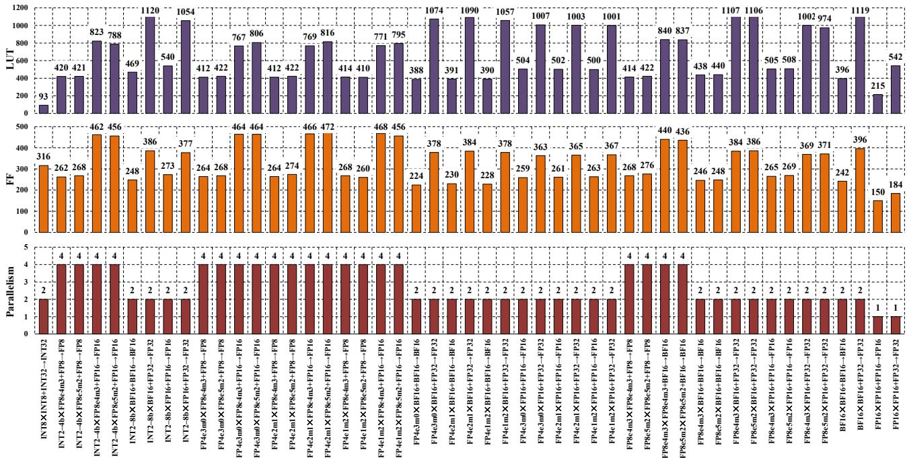

图 6：全部 $A\times B+C\rightarrow P$ 配置的资源和并行度。固定值 DSP=1、延迟=4 周期、II=1 为简洁而省略。完整指数—尾数格式（E4M3、E5M2 等）仅在各类型配置首次出现时注明。

INT8×INT8→INT32 具有两路并行，LUT 使用量为所有配置最低。浮点因加法器尾数对齐需要更多 LUT、FF，桶形移位器主导资源。加法器位宽增加时，移位范围和复杂度超线性增长，明显增加 LUT、FF。

### C. 运行时数据类型切换评估

我们采用图 1 的代表性类型组合评估运行时切换效率。表 III 为综合后资源。各配置 DSP 成本不变，跨类型共享 LUT、FF，延迟仍四周期、II=1。图 7 将资源分解为映射/后处理、算术和加法逻辑，以量化共享收益。

表 III：运行时切换评估的资源消耗。

| 配置 | 类型组合 | 模型 | LUT | FF | DSP |
|---|---|---|---:|---:|---:|
| I | INT4×BF16+BF16；BF16×BF16+BF16 | Qwen3-8b-AWQ | 436 | 302 | 1 |
| II | INT8×INT8+INT32；BF16×BF16+BF16 | Llama-3.1-8b-W8A8 | 568 | 513 | 1 |
| III | FP8×FP8+BF16；BF16×BF16+BF16 | Qwen3-8b-FP8、Llama-3.1-8b-FP8 | 948 | 622 | 1 |
| IV | FP4×BF16+BF16；BF16×BF16+BF16 | GPT-oss-20b† | 395 | 274 | 1 |

† GPT-oss-20b 的 UE8M0 与 BF16 相乘通过偏移 BF16 指数实现，不视为独立 MAC。

配置 I 复用算术核和加法单元；整数、浮点需要不同对齐，映射逻辑分立。因此相对按类型各建一个 MAC 的简单方案，加法逻辑 LUT、FF 减少约 50%，映射成本基本不变。配置 II 仅共享算术核，INT32、BF16 累加的规格化、饱和规则不同；整数映射又不含指数对齐，不能复用映射逻辑，相应资源下降很小。配置 III 部分复用 BF16 加法通道，因为 FP8、BF16 分别四路、两路并行；四个加法通道中的两个可共享，加法逻辑 LUT、FF 节省约 30%。配置 IV 几乎完全复用映射、算术、加法，两种 MAC 都为两路并行，FP4 可零填充扩为 BF16，不需指数对齐或舍入调整，因此 LUT、FF 最低。

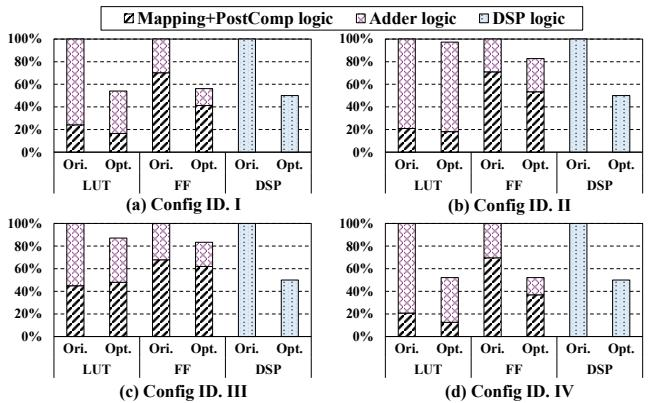

图 7：表 III 各配置的归一化资源分解。

### D. XtraMAC 可扩展性评估

从 BF16、FP16 MAC 基线开始，逐步增加 INT8、FP8（E4M3）、FP4（E2M1）混合精度模式；每步综合并测资源及最大频率。图 8 中 LUT 随类型增加逐渐上升，来自映射和后处理规格化外围逻辑；DSP 始终不变，证明核心乘法器跨全部格式共享。最大频率仅从 483 MHz 小幅降至 462 MHz，说明支持类型增加时扩展较平稳。

### E. 与先进 FPGA MAC IP 比较

**1）混合精度比较。** 基线为厂商标准浮点 MAC——AMD Xilinx FP Operator [1]。两设计均使用非阻塞 AXI、最近偶数舍入、非规格化值归零；为公平比较，II=1、延迟相同，资源在综合后报告。厂商 IP 不支持混合精度，因此加常用开源整数转浮点模块 [10,17] 支持混合输入。

表 IV 报告代表性格式按并行度归一化的资源，即总 LUT、FF、DSP 除以 MAC 通道数，得到每操作资源。

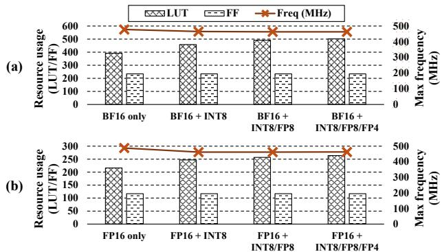

图 8：单 DSP 随支持类型增加的可扩展性。（a）FP16 MAC 依次增加 INT8、FP8、FP4 乘法操作数；（b）BF16 MAC 同样增加类型。

表 IV：按并行度归一化的资源。各行 $B,C,P$ 均采用“格式”列中的类型。

| A | B/C/P 格式 | 资源 | 厂商 IP [1] | XtraMAC‡ | 减少 | 计算密度提高 |
|---|---|---|---:|---:|---:|---:|
| INT2–8 | BF16 | LUT | 331 | 235 | 29.0% | 1.4× |
| INT2–8 | BF16 | FF | 222 | 124 | 44.1% | 1.8× |
| INT2–8 | BF16 | DSP | 1 | 0.5 | 50.0% | 2.0× |
| INT2–8 | FP16 | LUT | 387 | 270 | 30.2% | 1.4× |
| INT2–8 | FP16 | FF | 262 | 137 | 47.7% | 1.9× |
| INT2–8 | FP16 | DSP | 1 | 0.5 | 50.0% | 2.0× |
| FP4 | BF16 | LUT | 301 | 196 | 34.9% | 1.5× |
| FP4 | BF16 | FF | 226 | 115 | 49.1% | 2.0× |
| FP4 | BF16 | DSP | 1 | 0.5 | 50.0% | 2.0× |
| FP4 | FP16 | LUT | 357 | 251 | 29.7% | 1.4× |
| FP4 | FP16 | FF | 266 | 131 | 50.8% | 2.0× |
| FP4 | FP16 | DSP | 1 | 0.5 | 50.0% | 2.0× |
| FP8 | BF16 | LUT | 301 | 219 | 27.2% | 1.4× |
| FP8 | BF16 | FF | 226 | 123 | 45.6% | 1.8× |
| FP8 | BF16 | DSP | 1 | 0.5 | 50.0% | 2.0× |
| FP8 | FP16 | LUT | 357 | 253 | 29.1% | 1.4× |
| FP8 | FP16 | FF | 266 | 133 | 50.0% | 2.0× |
| FP8 | FP16 | DSP | 1 | 0.5 | 50.0% | 2.0× |

† FP4=E2M1，FP8=E4M3。  
‡ 为公平比较，XtraMAC 包含非阻塞 AXI 包装，资源高于仅报告核心的图 6。

平均而言，相对厂商 IP，XtraMAC 的 LUT、FF、DSP 分别减少 30.0%、47.9%、50.0%。收益来自低精度自适应并行：多个混合精度通道打包到一个 DSP，提高乘法器利用率；比特映射也消除冗余操作和专用类型逻辑。图 9 显示所有组合均保持较高 DSP 利用率。计算密度定义为厂商 IP 资源量与 XtraMAC 资源量之比，各格式、各资源类型提高 1.4–2.0 倍，表示单位硬件提供更多有效计算。

还比较单 DSP 最大频率：

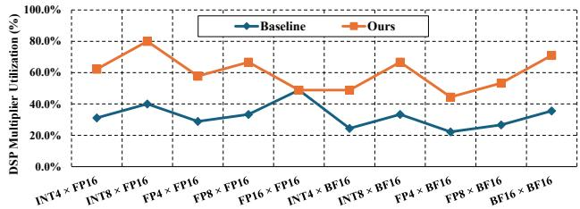

图 9：不同类型 DSP 利用率（FP8=E4M3，FP4=E2M1）。

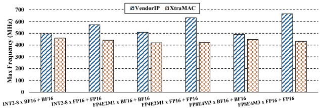

图 10：单 DSP 最大频率比较。

XtraMAC 平均比厂商 MAC 频率低 22%。这是预期结果：每配置提供每 DSP 两路并行，基线一路，外围 LUT、FF 更多且布线拥塞更重。全部配置仍超过 400 MHz，高于典型 FPGA 加速器部署频率。计入频率下降后，两路并行仍使每 DSP 有效吞吐提高约 1.56 倍，计算密度收益超过频率开销。

**2）运行时类型切换比较。** 比较空间复制 INT8/BF16 MAC 的厂商 IP [1] 和 TATAA [38]。全部设计交替 INT8、BF16 模拟动态工作负载；总资源除以各设计实现的 BF16 或 INT8 通道数，得到每操作资源。接口相同，II=1、延迟四周期。

表 V 显示，对运行时切换的每 BF16 操作，XtraMAC 相对 TATAA 的 LUT、FF、DSP 减少 59.7%、72.5%、93.8%；相对厂商 IP 减少 35.5%、58.7%、75.0%。浮点硬件效率明显改善，同时相对 INT8 专用 TATAA 保持合理的 INT8 资源消耗。

基线浮点效率低源于异构类型处理。厂商 IP 复制独立 INT8/BF16 通路，算术和对齐不能共享；TATAA 将 BF16 拆成多个 INT8 微操作，增加控制与操作数调整，降低 BF16 利用率。XtraMAC 共享比特映射前端，在算术核前统一异构格式，使精度共享乘法及相应加法路径，减少重复硬件。

表 V：每操作归一化资源消耗。

| 设计 | BF16：LUT | BF16：FF | BF16：DSP | INT8：LUT | INT8：FF | INT8：DSP |
|---|---:|---:|---:|---:|---:|---:|
| 厂商 IP [1] | 220.0 | 310.5 | 1 | 110.0 | 155.3 | 0.5 |
| TATAA [38]† | 352.0 | 467.0 | 4 | 22.0 | 29.2 | 0.25 |
| XtraMAC | 142.0 | 128.3 | 0.25 | 142.0 | 128.3 | 0.25 |

† TATAA 仅评估浮点加法器、乘法器，省略 fapp（近似 sqrt/div），因此资源低于 [38] 完整设计。

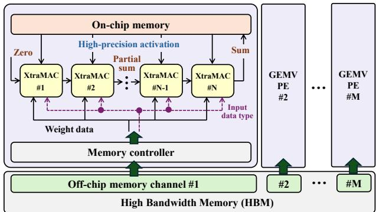

图 11：基于 XtraMAC 的混合精度 GEMV 架构。

## VI. 案例研究：混合精度 LLM 推理

本节将 XtraMAC 集成到实际分块 GEMV 流水线，量化混合精度 LLM 收益。先描述系统集成及代表性工作负载类型需求，再测量混合精度 GEMV，与先进 GPU 核比较，最后扩展解析仿真框架，用加速后的 GEMV 估计端到端推理延迟。

### A. 集成到分块 GEMV

图 11 展示分块并行 GEMV 引擎。现代 FPGA GEMV [23,42] 在各 PE 中使用流式 MAC 链，权重直接来自 HBM，激活片上缓冲以复用。XtraMAC 保留接口并替换原标量 MAC，不修改 PE 拓扑、分块或全局数据流。

表 VI：代表性量化 LLM 部署画像。

| 检查点 | 下载量* | 实际用例† |
|---|---:|---|
| Qwen-3-8B-AWQ | 222,126 | 边缘 AI 推理，准确率损失2%–3%；长上下文NLP保留91%–97%基准表现，上下文扩展4倍 |
| Llama-3.1-8B-W8A8 | 27,536 | 商业聊天机器人，存储减少50%、吞吐2倍，多语言客服准确率99%–100% |
| Qwen-3-8B-FP8 | 429,968 | 本地智能体及数据分析流程；131k词元上下文，支持可扩展多语言RAG |
| Llama-3.1-8B-FP8 | 168,122 | 多语言助手，准确率恢复99.52%，面向快速商业API部署优化 |
| GPT-oss-20B | 4,633,438 | 消费级微调、可定制推理延迟，以及智能体数据研究中的低延迟分析 |

* 下载量为原文在2025年10月记录的 Hugging Face 数据。  
† 用例中的准确率损失只反映模型量化影响。

执行时，从 HBM 读取的宽接口字（通常 256 或 512 位）拆成逐通道权重段，分发到 PE 内 XtraMAC，各实例同时接收相应片上激活。逐块类型控制与权重块一起存储，和操作数同步传播到块内全部单元，保证运行时选择正确映射和累加路径。逐通道部分和沿级联 MAC 链累加，写回最终 GEMV 输出；多个 PE 跨 HBM 通道并发，保留带宽扩展性。

### B. LLM 工作负载的混合精度需求

Llama [16]、Qwen [41]、GPT-oss [30] 等部署依赖量化以减少存储和延迟并保留准确率。实际系统跨层组合整数和浮点，而非单一格式。表 I 中，仅权重量化使用整数权重、浮点激活；权重—激活量化同时量化两操作数；GPT-oss 等混合格式检查点将 FP4/FP8 与 BF16 交织以保证稳定性。表 VI 的多语言助手、长上下文 RAG、端侧模型说明 INT4、FP4、FP8 已有活跃部署，也表明 GEMV 引擎需要原生混合精度与运行时切换支持。

### C. 混合精度 GEMV 计算核评估

各模型解码 GEMV 主要由两种模式组成：（i）INT4×BF16→BF16；（ii）FP4×BF16→BF16，因此选它们为代表计算核。FPGA 实验使用具备 32 个 HBM 通道的 U55c，Vivado/Vitis 2022.2 综合、实现，时序为布局布线后结果；稳态流式执行时用 xbutil 测功耗。GPU 基线在 NVIDIA H100 PCIe 上使用 CUTLASS [29] 官方 GEMV 核测时间，用 nvidia-smi 测功耗，以提供一致、可复现的比较环境。

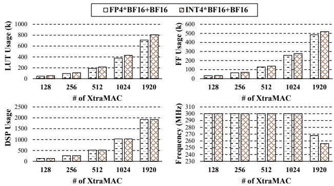

图 12：不同 XtraMAC 数量的混合精度 GEMV 实现后 LUT、FF、DSP 与频率。

为利用 HBM，将 GEMV 分为 $M$ 个块，各映射到连接独立 HBM 通道的 PE。权重在 HBM，激活片上缓存；PE 内以级联 XtraMAC 链实现点积。每通道实例数为：

$$
N_{\mathrm{MAC}}=
\frac{\mathrm{BitWidth}_{\mathrm{channel}}}
{\mathrm{BitWidth}_{\mathrm{weight}}\times P}
$$

每 HBM 通道提供 512 位接口，INT4 权重为 4 位、每 XtraMAC 两通道，因此一通道每周期供给 $512/(4\times2)=64$ 个 MAC 输入。32 通道理论最多 2048 个实例；实际采用 1920 个、分布在 30 个活动通道，保留一个通道读激活、一个写回，并保证布线时序收敛。

图 12 中 LUT、FF、DSP 随实例数线性增长。最多 1024 个实例保持 300 MHz，1920 个因 HBM 邻近布线拥塞降至 250–270 MHz。大规模计算核受带宽限制，因此降频对整体吞吐影响很小。图 13 为 512 个实例的系统资源分解：XtraMAC 占 LUT 98.5%、FF 95.6%、DSP 100%，其余为类型控制寄存器、片上激活缓冲等。HBM 控制器在 Alveo 静态 shell [2]，不计用户逻辑资源。非 MAC 组件与操作数流并行寄存，不增加流水级，保持固定延迟、II=1。

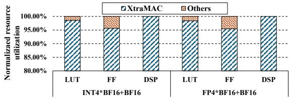

图 13：512-XtraMAC 配置的系统级资源分解。

表 VII：混合精度 GEMV 性能。

| GEMV 规模 | 设计 | 时间（ms） | 功率（W） | 能量（J） | 加速比 | 能效 |
|---|---|---:|---:|---:|---:|---:|
| 1×4096×4096 | CUTLASS（H100） | 0.0294 | 135 | 0.00397 | 1.0× | 1.0× |
| 1×4096×4096 | XtraMAC（U55c） | 0.0246 | 85 | 0.00209 | 1.2× | 1.9× |
| 1×4096×12288 | CUTLASS（H100） | 0.0879 | 135 | 0.01187 | 1.0× | 1.0× |
| 1×4096×12288 | XtraMAC（U55c） | 0.0743 | 85 | 0.00632 | 1.2× | 1.9× |

虽然 GPU 峰值存储带宽明显更高（2 TB/s 对 460 GB/s），FPGA 核在两个工作负载上仍取得 1.2 倍延迟改善、1.9 倍能效。作者将收益归因于高效混合精度通路、免格式转换开销，以及约 74% 有效 HBM 利用率。FPGA 因此接近带宽上限，在这些带宽受限 GEMV 上超过 GPU。

### D. 端到端混合精度 LLM 推理仿真

采用文献 [7] 的解析框架，将 Transformer 层建模为交替计算、存储阶段，假设理想化流式和权重复用。表 VI 全部模型在 AMD Alveo V80 上仿真：260 万 LUT、10,848 DSP、300 MHz、810 GB/s HBM。基线依据表 IV 资源实例化厂商浮点 IP，本文配置替换为 XtraMAC；类型打包、检查点 MAC 数和分块行为等均固定，使差异只来自算术单元密度。

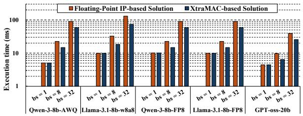

图 14：上下文长度 512、批大小 1、8、32 时，不同 LLM 解码执行时间。

批大小 1 时，五个模型均受存储限制，权重流式读取主导约 4.4–10.0 ms 端到端延迟，计算差异影响很小。批增大时，计算量增长，而权重读取成本近乎不变；批 8、32 转为计算受限。XtraMAC 较低 LUT、DSP 占用允许更多 MAC 实例，从而持续降低总延迟。批 32 时，端到端推理改善 1.5–1.8 倍。趋势与各模型混合精度 GEMV 占比一致，说明大批下主限制转为算术单元密度。

### E. 设计指南

首先，全部类型延迟固定、II=1，可在已有 GEMV/GEMM 中替换标量 MAC，保持相应流水调度与接口时序。其次，运行时切换只需逐块类型信号与操作数同步传播，可把全部类型按统一流水调度，无需清空或重配置。最后，打包效率与操作数位宽负相关；FPGA 部署可优先考虑 INT4、FP4 等低于 8 位方案，以提高每 DSP 并行度和整体吞吐。

## VII. 相关工作

本节审视混合精度 MAC 与运行时切换方法，并说明 XtraMAC 对剩余局限的定位。

### A. 固定精度设计

通用处理器通过固定硬件流水线提供多种格式。CPU 的 AVX-512、AMX、ARM SVE 等扩展支持整数及低精度浮点；GPU Tensor Core 支持 FP16、BF16、FP8、INT8 [27,28]。Google TPU [15,18,37] 等专用加速器以脉动阵列优化固定精度集合，如 BF16、INT8，各类型对应专用流水线。这些设计通过把低精度提升到共同高精度，或把类型路由至物理分离的执行通路处理混合精度。只有部分类型工作时，两者都会留下闲置资源，也未利用共享通路内部的细粒度比特并行。

### B. 可配置精度设计

另一类设计引入运行时精度适应。BitFusion [33] 动态融合 2 位 PE，以匹配每层整数位宽；Stripes [19] 用比特串行，使延迟与精度成比例；OLAccel [31] 通过异构 MAC 和时间分解支持操作数级精度变化。FlexiBit [34] 提出可配置比特并行归约树，支持任意 FP/INT 精度，包括非二次幂格式。然而 BitFusion、Stripes、OLAccel 只支持整数，无原生浮点；FlexiBit 虽支持浮点，但为 ASIC，适配新量化方案需重新制造硬件。这些设计均不支持在共享通路中逐周期切换异构 INT/FP。

XtraMAC 将整数、浮点、混合精度乘法统一到资源紧凑 FPGA 通路。将 MAC 格式归结为共享整数尾数乘积、并解耦累加路径，使逐周期类型切换保持恒定延迟及高吞吐。

## VIII. 结论

MAC 主导现代 LLM 推理计算，但 FPGA 设计常提升低精度操作数或复制类型专用通路，导致 DSP 利用低、运行时灵活性有限。XtraMAC 是紧凑、类型自适应的混合精度 MAC，支持逐周期切换。其关键创新是以共享整数乘积表述统一 INT/FP，使单 DSP 打包多个低精度通道，同时延迟固定。相较先进 MAC，计算密度提高 1.4–2.0 倍，LUT、FF、DSP 分别减少 30.0%、47.9%、50.0%。

## 致谢

研究获得新加坡教育部 AcRF Tier 3（MOE-MOET32024-0003）及 Google Gift 2025 支持。感谢 AMD Heterogeneous Accelerated Compute Clusters（HACC）计划 [3] 慷慨捐赠硬件。

## REFERENCES

[1] AMD Xilinx Floating-Point Operator v7.1 LogiCORE IP Product Guide (PG060), Advanced Micro Devices, Inc., accessed Oct. 2025. [Online]. Available: https://docs.amd.com/v/u/en-US/pg060-floating-point

[2] AMD, “Alveo U55C accelerator card: Support and downloads,” https://www.amd.com/en/products/accelerators/alveo/u55c/a-u55cp00g-pq-g.html, accessed Oct. 2025.

[3] AMD Xilinx, “Heterogeneous accelerated compute cluster (HACC) at NUS,” https://xacchead.ddns.comp.nus.edu.sg/, accessed Oct. 2025.

[4] AMD Xilinx, Inc., “Vivado design suite reference guide: Modelbased dsp design using system generator (ug958),” accessed Oct. 2025. [Online]. Available: https://docs.amd.com/r/en-US/ug958-vivadosysgen-ref/DSP48E2

[5] A. Arora, M. Ghosh, S. Mehta, V. Betz, and L. K. John, “Tensor slices: FPGA building blocks for the deep learning era,” ACM Trans. Reconfigurable Technol. Syst., vol. 15, no. 4, Dec. 2022.

[6] J. Chee, Y. Cai, V. Kuleshov, and C. De Sa, “Quip: 2-bit quantization of large language models with guarantees,” in Proceedings of the 37th International Conference on Neural Information Processing Systems, ser. NIPS ’23. Red Hook, NY, USA: Curran Associates Inc., 2023.

[7] H. Chen, J. Zhang, Y. Du, S. Xiang, Z. Yue, N. Zhang, Y. Cai, and Z. Zhang, “Understanding the potential of fpga-based spatial acceleration for large language model inference,” ACM Trans. Reconfigurable Technol. Syst., vol. 18, no. 1, Dec. 2024.

[8] Y. Chen, C. Gong, and B. He, “HiPACK: Efficient sub-8-bit direct convolution with SIMD and bitwise management,” in Proceedings of the 58th IEEE/ACM International Symposium on Microarchitecture (MICRO), 2025, pp. 1579–1591.

[9] Y. Chen, J. Dotzel, and M. S. Abdelfattah, “M4bram: Mixed-precision matrix-matrix multiplication in fpga block rams,” in 2023 International Conference on Field Programmable Technology (ICFPT), 2023, pp. 69– 78.

[10] J. Dawson, “Integer-to-floating point converter (Verilog implementation),” https://github.com/dawsonjon/fpu/blob/master/int to float/int to float.v, accessed Oct. 2025.

[11] T. Dettmers, R. Svirschevski, V. Egiazarian, D. Kuznedelev, E. Frantar, S. Ashkboos, A. Borzunov, T. Hoefler, and D. Alistarh, “Spqr: A sparsequantized representation for near-lossless llm weight compression,” arXiv preprint arXiv:2306.03078, 2023.

[12] A. Ehliar, “Area efficient floating-point adder and multiplier with IEEE-754 compatible semantics,” in 2014 International Conference on Field Programmable Technology (FPT). IEEE, 2014, pp. 131–138.

[13] E. Frantar, S. Ashkboos, T. Hoefler, and D. Alistarh, “GPTQ: Accurate post-training quantization for generative pretrained transformers,” arXiv preprint arXiv:2210.17323, 2022. [Online]. Available: https: //arxiv.org/abs/2210.17323

[14] Y. Fu, E. Wu, A. Sirasao, S. Attia, K. Khan, and R. Wittig, “Deep learning with INT8 optimization on Xilinx devices,” Xilinx, Inc., White Paper WP486 v1.0.1, April 2017. [Online]. Available: https://docs.amd. com/api/khub/documents/z7yAy aweTmRYkGaTVyhbw/content

[15] Google Cloud, “Cloud TPU v5e,” https://cloud.google.com/tpu/docs/ v5e, accessed Oct. 2025.

[16] A. Grattafiori, A. Dubey et al., “The Llama 3 herd of models,” arXiv preprint arXiv:2407.21783, 2024. [Online]. Available: https: //arxiv.org/abs/2407.21783

[17] D. K. Hartman, “Floating point multiply/add unit for the M-Machine node processor,” Master’s thesis, Massachusetts Institute of Technology, Cambridge, MA, May 1996. [Online]. Available: http://hdl.handle.net/1721.1/38791

[18] N. P. Jouppi, C. Young, N. Patil, D. Patterson, G. Agrawal, R. Bajwa, S. Bates, S. Bhatia, N. Boden, A. Borchers et al., “In-datacenter performance analysis of a tensor processing unit,” in Proceedings of the 44th annual international symposium on computer architecture (ISCA), 2017, pp. 1–12.

[19] P. Judd, J. Albericio, T. H. Hetherington, T. M. Aamodt, and A. Moshovos, “Stripes: Bit-serial deep neural network computing,” in Proceedings of the 49th Annual IEEE/ACM International Symposium on Microarchitecture (MICRO), 2016, pp. 19:1–19:12.

[20] M. Kerner, K. Tammemae, J. Raik, and T. Hollstein, “Triple fixed-point¨ MAC unit for deep learning,” in 2021 Design, Automation & Test in Europe Conference & Exhibition (DATE), 2021, pp. 1404–1407.

[21] S. Liang, S. Yin, L. Liu, W. Luk, and S. Wei, “FP-BNN: Binarized neural network on FPGA,” Neurocomputing, vol. 275, pp. 1072–1086, 2018.

[22] J. Lin, J. Tang, H. Tang, S. Yang, W.-M. Chen, W.-C. Wang, G. Xiao, X. Dang, C. Gan, and S. Han, “AWQ: Activation-aware weight quantization for on-device LLM compression and acceleration,” in Proceedings of Machine Learning and Systems (MLSys), vol. 6, 2024, pp. 87–100.

[23] J. Liu, S. Zeng, L. Ding, W. Soedarmadji, H. Zhou, Z. Wang, J. Li, J. Li, Y. Dai, K. Wen, S. He, Y. Sun, Y. Wang, and G. Dai, “FlightVGM: Efficient video generation model inference with online sparsification and hybrid precision on FPGAs,” in Proceedings of the ACM/SIGDA International Symposium on Field Programmable Gate Arrays (FPGA), 2025, pp. 2–13.

[24] X. Liu, Y. Chen, P. Ganesh, J. Pan, J. Xiong, and D. Chen, “HiKonv: High throughput quantized convolution with novel bit-wise management and computation,” in 2022 27th Asia and South Pacific Design Automation Conference (ASP-DAC), 2022, pp. 140–146.

[25] Y. O. M. Moctar, N. George, H. Parandeh-Afshar, P. Ienne, G. G. Lemieux, and P. Brisk, “Reducing the cost of floating-point mantissa alignment and normalization in FPGAs,” in Proceedings of the ACM/SIGDA International Symposium on Field-Programmable Gate Arrays (FPGA), 2012, pp. 255–264.

[26] NVIDIA Corporation, “NVIDIA A100 tensor core GPU architecture,” NVIDIA, White Paper, May 2020. [Online]. Available: https://resources. nvidia.com/en-us-tensor-core/nvidia-ampere-architecture-whitepaper

[27] ——, “NVIDIA A100 tensor core GPU datasheet,” https://www.nvidia. com/content/dam/en-zz/Solutions/Data-Center/a100/pdf/nvidia-a100- datasheet-us-nvidia-1758950-r4-web.pdf, 2021, accessed Oct. 2025.

[28] ——, “NVIDIA H100 tensor core GPU architecture,” NVIDIA, White Paper, 2022. [Online]. Available: https://resources.nvidia.com/en-ustensor-core/nvidia-h100-whitepaper

[29] ——, “CUTLASS 3.x performance profiling results,” https://github.com/ NVIDIA/cutlass, 2025, accessed Oct. 2025.

[30] OpenAI, “gpt-oss-120b & gpt-oss-20b model card,” arXiv preprint arXiv:2508.10925, 2025. [Online]. Available: https://arxiv.org/abs/2508. 10925

[31] E. Park, D. Kim, and S. Yoo, “Energy-efficient neural network accelerator based on outlier-aware low-precision computation,” in Proceedings of the 45th Annual International Symposium on Computer Architecture (ISCA), 2018, pp. 688–698.

[32] M. R. Pillmeier, M. J. Schulte, and E. G. Walters III, “Design alternatives for barrel shifters,” in Advanced Signal Processing Algorithms, Architectures, and Implementations XII, vol. 4791. SPIE, 2002, pp. 436–447.

[33] H. Sharma, J. Park, N. Suda, L. Lai, B. Chau, V. Chandra, and H. Esmaeilzadeh, “Bit Fusion: Bit-level dynamically composable architecture for accelerating deep neural network,” in Proceedings ofthe 45th Annual International Symposium on Computer Architecture (ISCA). IEEE, 2018, pp. 764–775.

[34] F. Tahmasebi, Y. Wang, B. Y. H. Huang, and H. Kwon, “FlexiBit: Fully flexible precision bit-parallel accelerator architecture for arbitrary mixed precision AI,” 2024. [Online]. Available: https://arxiv.org/abs/ 2411.18065

[35] Y. Umuroglu, N. J. Fraser, G. Gambardella, M. Blott, P. Leong, M. Jahre, and K. Vissers, “FINN: A framework for fast, scalable binarized neural network inference,” in Proceedings of the ACM/SIGDA International Symposium on Field-Programmable Gate Arrays (FPGA), 2017, pp. 65– 74.

[36] Y. Umuroglu, L. Rasnayake, and M. Sjalander, “BISMO: A scalable¨ bit-serial matrix multiplication overlay for reconfigurable computing,” in 2018 28th International Conference on Field Programmable Logic and Applications (FPL). IEEE, 2018, pp. 307–314.

[37] A. Vahdat, “Ironwood: The first Google TPU for the age of inference,” https://blog.google/products/google-cloud/ironwood-tpu-age-ofinference/, accessed Oct. 2025.

[38] J. Wu, M. Song, J. Zhao, Y. Gao, J. Li, and H. K.-H. So, “TATAA: Programmable mixed-precision transformer acceleration with a transformable arithmetic architecture,” ACM Trans. Reconfigurable Technol. Syst., vol. 18, no. 1, pp. 14:1–14:31, 2025.

[39] G. Xiao, J. Lin, M. Seznec, H. Wu, J. Demouth, and S. Han, “Smoothquant: Accurate and efficient post-training quantization for large language models,” in International conference on machine learning. PMLR, 2023, pp. 38 087–38 099.

[40] Xilinx, Inc., UltraScale Architecture DSP Slice User Guide (UG579), Xilinx, Inc., 2023. [Online]. Available: https://docs.xilinx.com/v/u/en-US/ug579-ultrascale-dsp

[41] A. Yang et al., “Qwen3 technical report,” arXiv preprint arXiv:2505.09388, 2025. [Online]. Available: https://arxiv.org/abs/ 2505.09388

[42] S. Zeng, J. Liu, G. Dai, X. Yang, T. Fu, H. Wang, W. Ma, H. Sun, S. Li, Z. Huang, Y. Dai, J. Li, Z. Wang, R. Zhang, K. Wen, X. Ning, and Y. Wang, “FlightLLM: Efficient large language model inference with a complete mapping flow on FPGAs,” in Proceedings of the ACM/SIGDA International Symposium on Field Programmable Gate Arrays (FPGA), 2024, pp. 223–234.

[43] X. Zhang, J. Wang, C. Zhu, Y. Lin, J. Xiong, W.-m. Hwu, and D. Chen, “DNNBuilder: An automated tool for building high-performance DNN hardware accelerators for FPGAs,” in Proceedings of the IEEE/ACM International Conference on Computer-Aided Design (ICCAD), 2018, pp. 1–8.

[44] Y. Zhao, C.-Y. Lin, K. Zhu, Z. Ye, L. Chen, S. Zheng, L. Ceze, A. Krishnamurthy, T. Chen, and B. Kasikci, “Atom: Low-bit quantization for efficient and accurate LLM serving,” in Proceedings of Machine Learning and Systems (MLSys), vol. 6, 2024, pp. 196–209.