# BitMoD: Bit-serial Mixture-of-Datatype LLM Acceleration 原文翻译

# BitMoD：比特串行混合数据类型 LLM 加速

Yuzong Chen<sup>†</sup>, Ahmed F. AbouElhamayed<sup>†</sup>, Xilai Dai<sup>†</sup>, Yang Wang<sup>‡</sup>, Marta Andronic<sup>§</sup>,

George A. Constantinides<sup>§</sup>, 和 Mohamed S. Abdelfattah<sup>†</sup>

<sup>†</sup>康奈尔大学计算机系统实验室

<sup>‡</sup>微软研究院系统与网络研究组

<sup>§</sup>伦敦帝国理工学院电气与电子工程系

<sup>†</sup>{yc2367, afa55, xd44, mohamed}@cornell.edu

<sup>‡</sup>yang.wang92@microsoft.com

<sup>§</sup>{marta.andronic18, g.constantinides}@imperial.ac.uk

摘要——大语言模型（LLM）在各种机器学习任务中展现出了卓越的性能。然而，LLM 庞大的内存占用严重阻碍了其部署。本文通过 BitMoD<sup>1</sup> 提高 LLM 的可及性。BitMoD 是一种算法与硬件协同设计方案，可在低权重精度下实现高效的 LLM 加速。在算法方面，BitMoD 引入细粒度的数据类型自适应，为每组（例如，128 个）权重使用不同的数值数据类型进行量化。通过精心设计这些新数据类型，BitMoD 能够在保持高准确率的同时，将 LLM 权重量化至极低精度（例如，4 比特和 3 比特）。在硬件方面，BitMoD 采用比特串行处理单元，以便轻松支持多种数值精度和数据类型；我们的硬件设计包含两项关键创新：首先，采用统一表示来处理不同的权重数据类型，从而降低硬件成本。其次，采用比特串行反量化单元，以极小的硬件开销对每组部分和进行重新缩放。我们在六个具有代表性的 LLM 上开展的评估表明，BitMoD 显著优于最先进的 LLM 量化与加速方法。对于判别式任务，BitMoD 能够将 LLM 权重量化至 4 比特，平均准确率损失 < 0.5%。对于生成式任务，BitMoD 能够将 LLM 权重量化至 3 比特，同时获得优于以往 LLM 量化方案的困惑度。通过将优异的模型性能与高效的加速器设计相结合，相较于以往的 LLM 加速器 ANT 和 OliVe，BitMoD 分别实现了平均 1.69× 和 1.48× 的加速比。

## I. 引言

大语言模型（LLM）在自然语言处理任务中取得了重大突破 [47], [57]。然而，LLM 规模和复杂度的增长持续快于现有硬件平台计算性能与内存容量的扩展 [22]。例如，2018 年推出的第一代 GPT 模型仅包含 1.17 亿个参数，而第二代和第三代模型在两年内分别增长至超过 10× 和 1000× [9]。模型规模的快速增长使模型部署需要巨大的内存容量，阻碍了它们的广泛应用，尤其是在计算和内存资源有限的边缘场景中。例如，最先进（SOTA）的开源 LLM 系列 Llama-3 [35] 包含超过 80 亿个参数，以 16 比特浮点（FP16）格式存储模型权重需要超过 16GB 的内存，因此无法装入内存为 8GB 的 Jetson-TX2 等边缘 GPU [37]。因此，设计新型 LLM 压缩算法，并协同设计能够高效部署压缩模型的加速器，是提高边缘设备上 LLM 可及性的一种有前景的解决方案。

量化是降低 LLM 计算与内存需求的最具硬件效率的方法之一。通常，量化机制分为两类。第一类是量化感知训练（QAT），需要通过重新训练来更新模型权重和量化参数（例如，缩放因子）[26], [31]。第二类是训练后量化（PTQ），不需要重新训练 [10], [19], [20], [25], [30], [42], [52]。尽管 QAT 能够取得比 PTQ 更有竞争力的准确率，但重新训练 LLM 的高昂成本使其不够实用。因此，现有 LLM 量化研究普遍采用 PTQ。虽然一些 PTQ 工作将权重和激活都量化为低精度 [25], [42], [52]，但对于权重占据主要内存空间的 LLM 边缘部署场景，仅权重量化能够在模型准确率与硬件效率之间提供更好的权衡 [10], [19], [20], [30]。然而，现有在 GPU 上实现的仅权重量化工作计算效率较低，因为 GPU 缺乏执行整数权重与浮点激活之间乘法运算的专用硬件。因此，这些方法必须先将权重反量化为 FP16，再依靠浮点流水线进行计算。

为提高 LLM 的计算效率，近期的加速器工作 FIGNA [27] 提出了一系列专用计算单元，用于整数权重与浮点激活之间的混合精度运算。为进一步释放量化在提高硬件效率方面的潜力，多项工作提出了基于自定义低精度数据类型的算法与硬件协同设计方案 [25], [26], [38], [40]。微缩放格式（MX）[38], [40] 为一组低精度权重分配 8 比特元数据，作为共享指数。ANT [26] 引入了一种能够更好地适应张量内部数值分布的新数据类型，从而降低量化误差。OliVe [25] 提出了一种离群值与牺牲值配对的量化机制，其中，幅值较大的离群值采用“自适应偏置浮点”格式表示，并通过剪除其相邻的幅值较小的牺牲值来保护该离群值。

本文提出 $B i t M o D ^ { 2 }$，这是一种在低权重精度下实现高效 LLM 加速的算法与硬件协同设计方案。在算法方面，BitMoD 利用分组量化 [16]，并通过将冗余零值重新用作特殊值来修改低精度浮点数据类型，从而使数据类型本身能够更好地适应各权重组的数值分布。通过精心选择特殊值，BitMoD 能够以极小的编码开销将 LLM 权重量化至极低精度 $( \mathrm { e . g . } ,$ , 4 比特和 3 比特)，同时保持良好的模型准确率。在硬件方面，BitMoD 采用比特串行计算范式，并为不同的低精度数据类型使用统一表示，从而在权重精度与硬件效率之间实现有效权衡。

本文的主要贡献总结如下：

1) 我们提出 BitMoD，一种面向 LLM 加速、具有高硬件效率的 PTQ 方案。BitMoD 引入了专为 4 比特和 3 比特精度的分组权重量化定制的新数据类型，且编码开销极小。

2) 我们证明，所提出的数据类型能够与其他量化优化技术无缝集成，获得优于最先进的纯软件 LLM 量化工作的模型困惑度。

3) 我们为 BitMoD 提出了一种高效的加速器设计，为多种低精度数据类型采用统一的比特串行表示。这有效降低了执行低精度权重与 FP16 激活之间计算的硬件成本，并通过权衡权重精度来提高硬件效率。

4) 我们在六个具有代表性的 LLM 上开展的评估表明，与基准 FP16 加速器相比，BitMoD 在不损失准确率的情况下，平均实现了 2.2× 的加速比和 2.31× 的能效提升。与最先进的加速器 ANT 和 OliVe 相比，BitMoD 分别实现了平均 1.69× 和 1.48× 的加速比。

## II. 背景与动机

## A. 为什么要对 LLM 进行权重量化？

为展示 LLM 权重量化对边缘应用的重要性，我们分析了四种代表性 LLM 在批大小为 1 时运行判别式任务和生成式任务的权重与激活总内存访问量。对于判别式任务，LLM 接收输入上下文并输出单个词元，例如情感分析 [46] 和多项选择问答 [13]。对于生成式任务，LLM 接收输入上下文并输出多个词元。按照 Lin 等人 [30] 针对边缘应用的建议，我们将判别式任务和生成式任务的输入与输出序列长度分别设为 256 : 1 和 256 : 256。如图 1 所示，LLM 权重的内存访问量比激活的内存访问量高出数个数量级。尽管判别式任务只需输出单个词元（例如，多项选择问答中的“A”/“B”/“C”），但 LLM 的权重张量维度（例如，OPT-1.3B 为 2048）远大于输入词元长度，因此内存访问由权重主导。此外，生成式任务每输出一个新词元都需要重复获取权重，从而导致 LLM 权重的内存访问量显著增加。因此，在批大小较小且输入词元长度通常较短的边缘场景中，权重量化对于部署 LLM 更为有效。

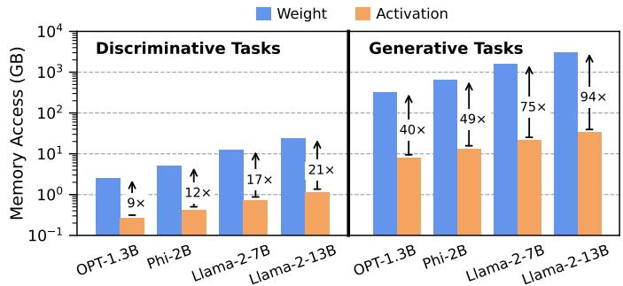  
图 1：判别式任务（256 个输入词元和 1 个输出词元）与生成式任务（256 个输入词元和 256 个生成词元）中权重与激活的总内存访问量。注意，y 轴采用对数刻度。请注意，在批大小为 1 时，尽管生成式任务的 KV 缓存远大于判别式任务，但其权重与激活内存访问量之间的差距仍然更大。虽然先前的工作 [44] 正确地报告了由 KV 缓存引起的内存瓶颈，但这种情况仅出现在参数量为 175B+、批大小较大（例如 512）且上下文长度超过 512 个词元的模型中。这种场景与我们关注的小批量边缘 LLM 推理关联较小；在后者中，权重确实主导了总内存访问量。

## B. 量化基础

整数化量化是最常用的量化方案之一，它将浮点值缩放并舍入为低精度整数。有两种广泛使用的量化模式——对称量化和非对称量化。对称整数量化可表示如下：

$$
\Delta = \frac {W _ {f \max}}{2 ^ {b - 1} - 1}; W _ {q} = \text { Round } \left(\frac {W _ {f}}{\Delta}\right); W _ {q f} = W _ {q} \cdot \Delta\tag{1}
$$

其中，$W _ { f }$ 是原始浮点张量，$W _ { f \operatorname* { m a x } }$ 是最大绝对值，b 是量化整数的精度，$\Delta$ 是缩放因子，$W _ { q }$ 是量化后的整数值，$W _ { q f }$ 是执行反量化（即重新缩放）后的浮点值。

对称量化假设张量的最小值与最大值具有相同的绝对值（即对称的取值范围），但实际情况并非总是如此。因此，另一种常用的量化模式是非对称量化，可表示如下：

$$
\Delta = \frac {\text { Range } (W _ {f})}{2 ^ {b} - 1}; z = \text { Round } \left(\frac {- W _ {f \min}}{\Delta}\right)
$$

$$
W _ {q} = \mathrm{Round} \left(\frac {W _ {f}}{\Delta}\right) + z; W _ {q f} = (W _ {q} - z) \cdot \Delta\tag{2}
$$

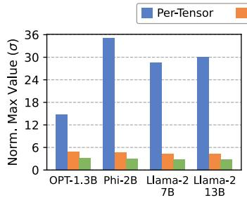

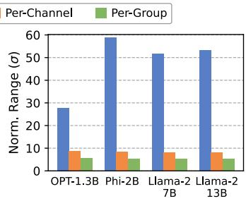  
图 2：不同量化粒度下的最大值和值域。结果先以对应粒度下权重向量的标准差（σ）进行归一化，再对所有权重向量取平均。逐组粒度的组大小为 128。

其中，$W _ { f \mathrm { m i n } }$ 是 $W _ { f }$ 的绝对最小值，$z$ 表示量化张量的零点。

## C. 动机

我们分析了近期量化研究中广泛采用的几种技术，这些分析为我们提出 BitMoD 框架提供了动机。在讨论中，我们主要关注权重量化。

量化粒度很重要。考虑一个浮点权重张量 $W _ { f } ^ { K \times \pmb { \breve { D } } }$，其中 K 表示输出通道数，D 为通道大小。模型权重的量化有三种粒度：逐张量、逐通道和逐组。逐张量量化使用相同的缩放因子来量化整个权重张量，而逐通道量化则沿输出通道维度将权重张量划分为 K 个向量，并独立量化每个向量 $\boldsymbol { W } _ { \boldsymbol { f } } ^ { \mathbf { i } \times \boldsymbol { D } }$。然而，鉴于 LLM 的张量规模和隐藏维度都很大，这两种粒度仍会导致较大的量化误差。具体而言，式 1 中反量化权重的量化误差可以表示为：

$$
\operatorname{Error} (W _ {q f}) = \operatorname{ErrorRound} \left(\frac {W _ {f}}{\Delta}\right) \cdot \Delta\tag{3}
$$

其中，ErrorRound 为量化过程中的舍入误差，已有研究表明其期望值为 0.25 [30]。因此，量化误差与缩放因子 $\Delta ,$ 成正比，而对于对称量化（式 1）和非对称量化（式 2），缩放因子又分别与最大值和取值范围成正比。

为了进一步减小量化误差，近期的 LLM 量化研究采用了逐组粒度 [16], [19], [20], [30]。逐组量化将一个权重通道 $W _ { f } ^ { 1 \times \bar { D } }$ 进一步划分为 $D / G$ 个组，每组的大小为 G。分组会引入存储量化参数的额外开销，即需要为每组存储缩放因子（以及零点）；在最先进的量化框架中，组大小通常设为 128，以平衡准确率和内存开销 [20], [30]。图 2 展示了四个具有代表性的 LLM 在不同粒度下的最大值和取值范围，以说明逐组量化的优势。逐组粒度的最大值和取值范围均最小，因此，与另外两种粒度相比，其量化误差更低。因此，本工作重点研究逐组量化。

表 I. 不同量化粒度和 4 位数据类型下的 Wikitext-2 困惑度（↓）。$\mathrm { \stackrel { \cdot } { P } C ^ { \vec { \prime } } }$ 和“PG”分别表示逐通道和逐组。组大小为 128。

<table><tr><td>模型</td><td colspan="2">OPT-1.3B</td><td colspan="2">Phi-2B</td><td colspan="2">Llama-2-7B</td><td colspan="2">Llama-2-13B</td></tr><tr><td>粒度</td><td>PC</td><td>PG</td><td>PC</td><td>PG</td><td>PC</td><td>PG</td><td>PC</td><td>PG</td></tr><tr><td>FP16</td><td>14.62</td><td>14.62</td><td>9.71</td><td>9.71</td><td>5.47</td><td>5.47</td><td>4.88</td><td>4.88</td></tr><tr><td>INT4-Sym</td><td>36.05</td><td>16.04</td><td>13.03</td><td>11.15</td><td>12.92</td><td>5.84</td><td>5.47</td><td>5.07</td></tr><tr><td>INT4-Asym</td><td>48.41</td><td>15.41</td><td>12.08</td><td>10.67</td><td>8.89</td><td>5.77</td><td>5.27</td><td>5.01</td></tr><tr><td>FP4</td><td>16.07</td><td>14.99</td><td>11.24</td><td>10.68</td><td>8.07</td><td>5.77</td><td>5.15</td><td>5.05</td></tr><tr><td>Flint</td><td>15.87</td><td>16.23</td><td>11.71</td><td>11.23</td><td>6.67</td><td>6.09</td><td>5.31</td><td>5.29</td></tr></table>

量化数据类型很重要。许多研究为逐通道粒度的量化提出了自定义数据类型 [25], [26], [40]。我们分析了在逐通道和逐组权重量化中采用不同数据类型的影响。我们考察了 4 位精度下的四种基本数据类型：采用对称量化（INT4-Sym）和非对称量化（INT4-Asym）的整数、浮点数（FP4），以及 ANT [26] 提出的 Flint 数据类型。表 I 展示了在 Wikitext-2 数据集 [33] 上得到的困惑度。我们着重指出两个重要观察结果。首先，尽管 Flint 在逐通道粒度下能够获得更好的困惑度，但在逐组粒度下，它从未优于其他数据类型。其次，逐组 INT4-Asym 和 FP4 量化在部分而非全部受研究的 LLM 上取得了最佳困惑度，这表明非对称性和浮点数据类型都有利于逐组量化。这背后的原因有两方面。首先，权重张量通常呈现类高斯分布，与浮点数据类型十分契合 [17], [51]。其次，尽管逐组量化减轻了离群值的影响，但一个权重组仍可能包含呈非对称分布的离群值，即离群值仅为正值或仅为负值，先前的研究也强调了这一点 [15], [16]。非对称量化有利于处理这一特征。

上述观察促使我们探索新的量化数据类型，将非对称性与浮点格式的优势结合起来，以在逐组量化下获得更高的准确率。我们注意到，基本浮点数据类型采用固有的符号-幅值二进制表示，其中包含正零和负零，因此其量化取值是对称的。我们的关键洞见是，可以将一个冗余的零值重新用作另一个特殊值，从而为浮点格式引入额外的非对称性。这种方法为我们带来了两项主要优势。首先，它能够充分利用有限的量化等级。尽管冗余零值不会影响 FP16 等高精度格式，但在低精度下，它在量化等级中占据很大比例（例如，在 3 位精度下占 12.5%）。其次，我们可以调整该特殊值，使扩展后的浮点数据类型更好地适应逐组权重分布，我们将在第 III-B 节中对此进行讨论。

量化位宽很重要。尽管以往的 LLM 加速器主要依赖支持 8 位和 4 位精度的位并行架构 [25]–[27]，但近期研究表明，在多种 LLM 模型和任务中，6 位浮点权重带来的准确率损失可以忽略不计 [49], [51]。受此启发，我们分析了使用不同 6 位数据类型进行逐组 LLM 权重量化的影响。我们考虑了四种数据类型：采用对称量化（INT6-Sym）和非对称量化（INT6-Asym）的整数、具有 2 位指数和 3 位尾数的浮点数（FP6-E2M3），以及具有 3 位指数和 2 位尾数的浮点数（FP6-E3M2）。表 II 比较了不同量化数据类型在 Wikitext-2 [33] 和 C4 [18] 数据集上得到的困惑度。平均而言，与 FP16 基线相比，所研究的 6 位数据类型带来的困惑度损失相近，且均可忽略不计。例如，INT6-Sym 的平均困惑度损失小于 0.05，其简单的整数表示为高效 LLM 加速提供了一种很有前景的解决方案。因此，加速器支持多种量化位宽至关重要，这能够在内存占用和模型准确率之间实现更好的权衡。

表 II. 不同 6 位数据类型下的 Wikitext-2 和 C4 困惑度（↓）。我们采用组大小为 128 的逐组权重量化。

<table><tr><td>模型</td><td colspan="2">OPT-1.3B</td><td colspan="2">Phi-2B</td><td colspan="2">Llama-2-7B</td><td colspan="2">Llama-2-13B</td></tr><tr><td>数据集</td><td>Wiki</td><td>C4</td><td>Wiki</td><td>C4</td><td>Wiki</td><td>C4</td><td>Wiki</td><td>C4</td></tr><tr><td>FP16</td><td>14.62</td><td>14.72</td><td>9.71</td><td>12.74</td><td>5.47</td><td>6.97</td><td>4.88</td><td>6.47</td></tr><tr><td>INT6-Sym</td><td>14.51</td><td>14.80</td><td>9.85</td><td>12.82</td><td>5.49</td><td>6.99</td><td>4.89</td><td>6.46</td></tr><tr><td>INT6-Asym</td><td>14.61</td><td>14.78</td><td>9.76</td><td>12.8</td><td>5.49</td><td>6.99</td><td>4.89</td><td>6.46</td></tr><tr><td>FP6-E2M3</td><td>14.59</td><td>14.76</td><td>9.85</td><td>12.8</td><td>5.52</td><td>6.99</td><td>4.92</td><td>6.49</td></tr><tr><td>FP6-E3M2</td><td>14.81</td><td>14.81</td><td>9.81</td><td>12.87</td><td>5.49</td><td>7.02</td><td>4.89</td><td>6.50</td></tr></table>

支持可变精度的一种自然方案是采用位串行架构 [3], [12], [28], [45]。然而，现有的位串行加速器主要面向整数数据类型，这会在 3 位精度下造成显著的准确率损失，我们将在第 V-B 节中展示这一点。此外，这些加速器无法利用逐组量化来提高准确率。这是因为逐组量化为不同的组分配不同的缩放因子，因此需要面积开销较大的浮点单元，以便在计算每个组的点积后，动态地对部分和进行反量化。因此，需要一种硬件成本低且高效的反量化机制。

算法与硬件协同设计至关重要。如表 III 所示，已有众多用于加速 LLM 执行的框架被提出。AWQ [30] 等当前最先进的（SOTA）算法方案将 LLM 权重量化为低精度整数，同时保持较高的准确率。然而，AWQ 针对 GPU 上的 LLM 加速进行了优化，而 GPU 缺乏专用的混合精度计算单元。因此，它将低精度权重转换为 FP16，并依赖 GPU 浮点流水线进行计算，导致计算效率低下。

相比之下，ANT [26]、OliVe [25] 和 FIGNA [27] 提出了高效的位并行加速器，用于加速量化模型。但它们的精度仅限于 8 位和 4 位，这限制了利用其他精度（例如 6 位）实现更好的准确率与效率权衡的能力。此外，它们的加速器并不原生支持逐组量化，后者需要浮点单元来实时、动态地对每组的部分和进行反量化。尽管 Microscaling [40] 支持多种精度，但它需要浮点流水线来处理权重组共享的微指数，因此与其他低精度计算单元相比，其能耗更高。此外，考虑到 LLM 占用大量内存，有必要探索在保持良好模型准确率的同时采用低于 4 位的量化，而 ANT、OliVe 和 Microscaling 并未解决这一问题。正如我们将在第 V-B 节中展示的那样，在逐组量化下，ANT、OliVe 和 Microscaling 提出的自定义量化数据类型在 4 位权重精度下无法获得优于简单非对称整数量化的准确率，并且在 3 位权重精度下会造成不可接受的准确率损失。上述局限促使我们提出一种高效的 LLM 加速框架，支持广泛的硬件友好位宽，同时在低权重精度下保持良好的准确率。

表 III. BitMoD 与用于量化 LLM 加速的 SOTA 协同设计框架的比较。

<table><tr><td>框架</td><td>逐组量化？</td><td>支持的精度</td><td>3 位权重下的准确率</td><td>硬件效率</td></tr><tr><td>AWQ [30]</td><td>是</td><td>有限</td><td>高</td><td>低</td></tr><tr><td>FIGNA [27]</td><td>否</td><td>有限</td><td>低</td><td>高</td></tr><tr><td>ANT [26]</td><td>否</td><td>有限</td><td>低</td><td>高</td></tr><tr><td>OliVe [25]</td><td>否</td><td>有限</td><td>中</td><td>高</td></tr><tr><td>Microscaling [40]</td><td>是</td><td>多种</td><td>低</td><td>中</td></tr><tr><td>BitMoD（本文）</td><td>是</td><td>多种</td><td>高</td><td>高</td></tr></table>

## III. BITMOD 量化框架

在本节中，我们介绍 BitMoD 量化框架，其中包含专为 3 位和 4 位精度下的逐组量化设计的新数据类型族。第 III-A 节介绍我们提出的数据类型，它们扩展了 3 位和 4 位精度下的基本浮点数据类型。第 III-B 节介绍一种使用所提出数据类型的增强型 LLM 逐组量化策略。第 III-C 节介绍使用整数缩放因子的高硬件效率逐组反量化机制。

## A. 非对称 FP3 和 FP4 数据类型

基本浮点格式采用同时具有 +0 和 −0 的符号-幅值表示，因此包含一个冗余的量化级别。我们提出用另一个特殊值替换这个冗余零值，以充分利用可用的量化级别，并引入额外的不对称性。我们首先使用基本 FP3 格式推导出自定义的 3 位数据类型，然后将这一思路扩展到 4 位精度。

FP3 扩展。基本 FP3 数据类型包含七个不同的值 {0, ±1, ±2, ±4}。我们的主要思路是扩展 FP3，允许用一组预定义特殊值中的一个替换冗余零值。因此，可以使用基本 FP3 数据类型和一个选定的特殊值来量化一个权重组，从而最小化量化误差。理想情况下，特殊值可以具有任意精度。但是，高精度（例如 FP16）的特殊值会带来更多计算硬件开销，从而抵消低精度数据类型的效率优势。因此，我们将特殊值限制为低精度整数。此外，设允许的特殊值数量为 N，则需要 logN 位的编码开销，以指定计算过程中选择哪个特殊值。这种选择在硬件实现中还需要一个 N 选 1 多路复用器。为了平衡编码开销与硬件复杂度，我们设置 N = 4，这样每组仅需要 2 位编码。

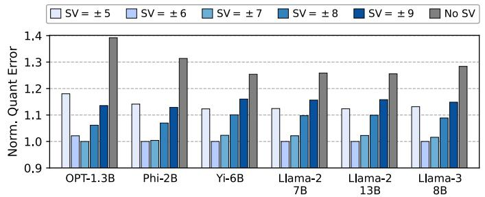  
图 3：FP3 使用不同特殊值（SV）时的归一化权重量化误差（↓）。我们采用分组量化，组大小为 128。特殊值 ± 6 实现了最低的总体量化误差，因此被 BitMoD 采用。

特殊值的选择会影响最终的量化误差，因为它改变了可用量化值的集合。如第 II-C 节所述，在分组量化下，不对称性和浮点数据类型对于获得良好的精度都至关重要。由于缩放因子和量化值最终由数据类型的最大绝对值决定 [32]，我们根据两条原则构建特殊值集合。首先，一些特殊值应位于 FP3 的数值范围内，以确保它们不会改变其原有的最大绝对值（即 4）。这有利于量化呈现对称类高斯分布的权重组。其次，一些特殊值可以位于 FP3 的数值范围之外，以引入额外的不对称性，即扩展后的 FP3 的最大量化值与最小量化值的绝对值不同。这有利于呈现非对称分布的权重组。

为了满足第一个性质，特殊值应设置为 ± 3，分别用 + 3 和 − 3 替换冗余零值。我们将这种新数据类型称为 FP3-ER，因为它在 FP3 的范围内增加了额外的分辨率（ER）。为了满足第二个性质，有无穷多个值可以位于 FP3 的范围之外。因此，我们确定了能够最小化量化误差的另外两个特殊值。我们进一步将这两个特殊值限制为具有相同的绝对值，以缩小搜索空间，从而使所有权重组之间的不对称性保持平衡。这是可取的，因为尽管单个权重组可能更适合非对称量化，但整个权重张量通常呈现对称的类高斯分布 [26], [55]。图 3 展示了向 FP3 添加不同特殊值时，六个 LLM 上的归一化分组量化误差。我们观察到，增加不对称性可以显著降低量化误差。此外，除 OPT-1.3B 外，特殊值 ± 6 在大多数 LLM 上都具有最低的量化误差，因此被 BitMoD 采用。我们将得到的新数据类型称为 FP3-EA，因为它通过增加额外的不对称性（EA）来扩展 FP3 的范围。

表 IV. 我们提出的扩展分辨率（ER）和扩展不对称性（EA）FP3 与 FP4 数据类型。

<table><tr><td>数据类型</td><td>基本值</td><td>扩展数据类型</td><td>特殊值</td></tr><tr><td rowspan="2">FP3</td><td rowspan="2">0, ±1, ±2, ±4</td><td>FP3-ER</td><td>-3 或 +3</td></tr><tr><td>FP3-EA</td><td>-6 或 +6</td></tr><tr><td rowspan="2">FP4</td><td rowspan="2">0, ±0.5, ±1, ±1.5 ±2, ±3, ±4, ±6</td><td>FP4-ER</td><td>-5 或 +5</td></tr><tr><td>FP4-EA</td><td>-8 或 +8</td></tr></table>

<div class="mineru-algorithm" style="white-space: pre-wrap; font-family:monospace;">
算法 1：细粒度数据类型自适应。

输入：权重组：W；量化精度：p
输出：量化后的权重组： $W_{qout}$ ；
选定的特殊值： $v_{out}$ 

1 函数 AdaptiveQuant(W, p):
    // 根据表 IV 获取基本量化值和特殊量化值
2 basicValues = GetBasicValues(p)
3 specialValues = GetSpecialValues(p)
    // 搜索最佳特殊值
4 minError = +∞
5 对于 specialValues 中的 v，执行
6 quantValues = basicValues ∪ v
7  $W_{q}$  = NonLinearQuantize(W, quantValues)
8 newError = MeanSquareError(W,  $W_{q}$ )
9 如果 newError &lt; minError，则
10 minError = newError
11  $W_{qout}$  =  $W_{q}$ 
12  $v_{out}$  = v
13 返回 $W_{qout}$ ,  $v_{out}$
</div>

FP4 扩展。与 FP3-ER 和 FP3-EA 类似，我们为 FP4 增加了额外的分辨率和不对称性。我们通过实验测量了不同 FP4 特殊值对最终量化误差的影响，由此得到了最优的 FP4-ER 和 FP4-EA，其特殊值分别为 ± 5 和 ± 8。表 IV 总结了扩展后的 FP3 和 FP4 数据类型。请注意，尽管我们固定了这四个特殊值，因为它们能够在我们评估的多种 LLM 上最小化量化误差，但所提出的 BitMoD 加速器可以灵活支持其他任意特殊值，这些值可能在不同的 LLM 上表现良好，我们将在第 IV-A 节对此进行讨论。

## B. 细粒度数据类型自适应

扩展的 FP3 和 FP4 数据类型包含四个特殊值，但每个权重组在量化时，除了基础值之外只能使用一个特殊值。因此，我们提出了一种细粒度数据类型自适应策略，使用不同的特殊值对各组进行量化，以最小化量化误差，具体如算法 1 所示。首先，从表 IV 中获取基础值和特殊值（第 2–3 行）。我们遍历所有特殊值，并在每次迭代中将一个特殊值添加到基础值集合中（第 5–6 行）。随后进行非线性量化（第 7 行），这种方法在先前的 PTQ 研究中被广泛使用，将浮点张量映射到一组非线性取值（即非 INT 数据类型）[19]、[25]、[26]。最后，我们选用使原始权重与量化权重之间的均方误差最小的特殊值（第 8–11 行）。

表 V. 逐组缩放因子（SF）采用不同精度时，在 Wikitext-2 和 C4 上的困惑度（↓）。我们使用 INT4-Asym 进行权重量化，组大小为 128。

<table><tr><td>模型</td><td colspan="2">OPT-1.3B</td><td colspan="2">Phi-2B</td><td colspan="2">Llama-2-7B</td><td colspan="2">Llama-2-13B</td></tr><tr><td>SF 位宽</td><td>Wiki</td><td>C4</td><td>Wiki</td><td>C4</td><td>Wiki</td><td>C4</td><td>Wiki</td><td>C4</td></tr><tr><td>FP16</td><td>15.41</td><td>15.84</td><td>10.68</td><td>13.66</td><td>5.77</td><td>7.31</td><td>5.01</td><td>6.62</td></tr><tr><td>INT8</td><td>15.41</td><td>15.84</td><td>10.68</td><td>13.66</td><td>5.77</td><td>7.31</td><td>5.01</td><td>6.62</td></tr><tr><td>INT6</td><td>15.43</td><td>15.84</td><td>10.74</td><td>13.71</td><td>5.77</td><td>7.31</td><td>5.01</td><td>6.62</td></tr><tr><td>INT4</td><td>15.52</td><td>15.93</td><td>10.76</td><td>13.73</td><td>5.77</td><td>7.36</td><td>5.03</td><td>6.64</td></tr><tr><td>INT2</td><td>18.46</td><td>18.61</td><td>15.68</td><td>18.32</td><td>8.41</td><td>10.63</td><td>6.19</td><td>8.12</td></tr></table>

尽管算法 1 描述的是单个权重组的量化过程，但该算法可以在 GPU 上进行向量化，同时为一个权重张量的所有组找到最佳特殊值。在我们的实现中，该算法在单张 A6000 GPU 上量化整个 Llama-2-7B 模型仅需 ∼10 秒。因此，我们提出的量化策略具有很高的压缩速度和效率。

## C. 高效的逐组反量化

尽管量化允许以低精度计算点积，但在产生输出后仍需要进行反量化（即重新缩放）。具体而言，式 1 表明，量化后的低精度权重应乘以缩放因子，以获得实际的浮点权重。逐通道量化只需在产生最终的输出激活后进行重新缩放。在将输出激活写回内存之前，这种逐通道重新缩放还可以进一步融合到层归一化等其他逐元素操作中，从而降低数据传输成本 [30]、[52]。然而，逐组量化必须在每组点积计算完成后对部分和进行反量化，因为不同组具有不同的缩放因子。此外，由于 BitMoD 将输入激活保持为 FP16，组内部分和也将采用浮点格式。因此，即时执行反量化需要一条浮点流水线，这可能削弱使用低精度权重所带来的潜在硬件效率收益。

为了降低反量化成本，我们以先前的工作 VS-Quant [14] 为基础，该工作采用第二级量化，将缩放因子进一步量化为低精度整数。给定权重通道大小 D 和组大小 G，VS-Quant 对同一通道中的 D/G 个缩放因子应用对称量化（式 1），其中逐组缩放因子的精度是一个设计参数。然而，VS-Quant 仅面向小规模神经网络，并采用较小的组大小 16。对更大组的缩放因子进行量化会如何影响 LLM 的精度，目前尚不清楚。因此，我们通过实验来寻找逐组缩放因子的最佳精度。我们以 INT4-Asym 量化为例，而其他数据类型也呈现相同的趋势。如表 V 所示，与使用 FP16 缩放因子相比，INT8 逐组缩放因子不会造成精度损失。这符合预期，因为即使对于数值范围远大于缩放因子的逐通道权重量化，INT8 也能实现无精度损失 [52]、[53]。因此，我们在 BitMoD 中使用 INT8 逐组缩放因子，从而能够以位串行方式高效地进行逐组反量化，具体将在第 IV-B 节中介绍。

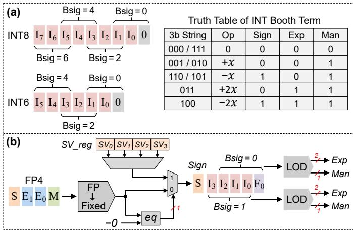  
图 4：(a) INT8、INT6 和 (b) FP4 的统一位串行表示。每个位串行项包含四个部分：符号、指数（exp）、尾数（man）和位权（bsig）。

内存开销分析。所提出的 BitMoD 量化方法对每个组仅需要一个 8 位缩放因子和 2 位编码元数据，用于选择特殊值。当采用较大的组大小（例如 128，这在当前最先进的纯软件 LLM 量化研究 [19]、[20]、[30] 中很常见）时，每组额外的 10 位内存几乎不会带来开销。此外，先前的纯软件 PTQ 工作主要采用非对称整数量化 [19]、[20]、[30]，每组需要一个 16 位缩放因子和一个 8 位零点。因此，与这些工作相比，BitMoD 的内存开销更低。

## IV. BITMOD 硬件加速器

本节介绍 BitMoD 的硬件设计，它利用位串行计算范式，在权重精度、模型精度和硬件效率之间实现良好的权衡。第 IV-A 节构建了 BitMoD 所支持的不同低精度数据类型的统一位串行表示。第 IV-B 节详细介绍 BitMoD 处理单元（PE）的微架构。最后，第 IV-C 节介绍加速器的整体架构。

## A. 统一位串行表示

先前的研究表明，与使用 FP16 权重相比，逐通道 INT8 权重量化不会造成精度损失 [27]、[52]、[53]。此外，如第 II-C 节所述，逐组 INT6 量化的精度损失也可忽略不计。因此，BitMoD 硬件的设计目标是在统一架构中支持 INT8、INT6，以及新的 FP4 和 FP3 扩展。然而，FP3 和 FP4 的基本值采用浮点格式，与整数表示不兼容。一种朴素的方法是将所有数据类型转换为 INT8，但这无法提高较低精度权重的计算效率。

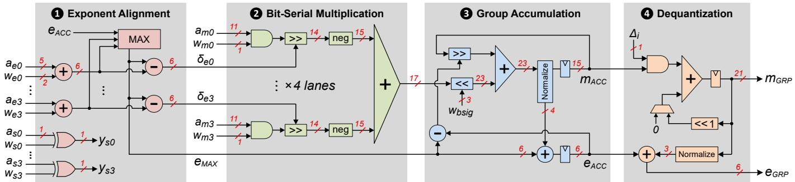  
图 5：BitMoD PE 的微架构。每个位串行权重项包含 1 位符号（w ）、2 位指数 $( w _ { e } ) ,$ 1 位尾数 $( w _ { m } ) ,$ 以及一个共享位权 $( w _ { b s i g } )$

为了以较低的权重精度换取更高的硬件效率，我们提出了一种统一位串行表示，其中每个数被分解为一系列位串行项，每项包含四个部分：符号（sign）、指数（exp）、尾数（man）和位权（bsig）。一个位串行项的值可表示为：

$$
v _ {\mathrm{term}} = (- 1) ^ {\mathrm{sign}} \cdot 2 ^ {\mathrm{exp}} \cdot \mathrm{man} \cdot 2 ^ {\mathrm{bsig}}\tag{4}
$$

图 4 描述了 BitMoD 支持的不同数据类型的位串行表示。对于 INT8 和 INT6，我们采用 Booth 编码 [8]，将它们的二进制串分别分解为四个和三个 3 位 Booth 串。Booth 编码已广泛用于先前的位串行加速器，以加快计算 [3]、[5]、[43]。每两个相邻 Booth 串的位权相差 2。符号、指数和尾数取决于 Booth 串的内容，该内容定义了与另一个操作数 x 相乘时所需的操作。

对于扩展 FP4，我们首先将其转换为原码格式的定点值，其中包含 1 个符号位、4 个整数位 $\{ I _ { 3 } , I _ { 2 } , I _ { 1 } , I _ { 0 } \}$，以处理 $\begin{array} { r } { \operatorname { E P 4 - E A } . } \end{array}$ 的最大特殊值 ± 8，以及 1 个小数位 $\{ F _ { 0 } \}$，以处理 FP4 基本值中的 ± 0.5 和 ± 1.5。随后，将该定点值与冗余的负零进行比较。如果比较结果为相等，则将负零替换为分配给特定权重组的特殊值（SV）。四个允许的特殊值存储在寄存器文件（SV reg）中，该寄存器文件只需在部署 LLM 前编程一次。为了获得位串行项，我们观察到，表 IV 中所有扩展 FP4 值在转换为定点格式后，最多包含两个 $\cdot _ { 1 } \cdot$ 位。因此，我们使用简单的前导一检测器（LOD），分别从前四位 $\{ I _ { 3 } , I _ { 2 } , I _ { 1 } , I _ { 0 } \}$ 和后四位 $\{ I _ { 2 } , I _ { 1 } , I _ { 0 } , F _ { 0 } \}$ 中获得两个位串行项。最后，由于扩展 FP3 值是 FP4 的子集，因此可以使用相同的硬件将其解码为两个位串行项。请注意，位串行解码器的支持范围并不限于表 IV 中所示的特殊值。可以根据需要将其他特殊值编程写入特殊值寄存器文件，并通过对解码器进行简单修改，尽可能减少解码出的位串行项数量。例如，特殊值 7 可以表示为 $2 ^ { 3 }$ 和 − 2<sup>0</sup> 两个位串行项，而不必使用会输出三个位串行项的前导一检测器。

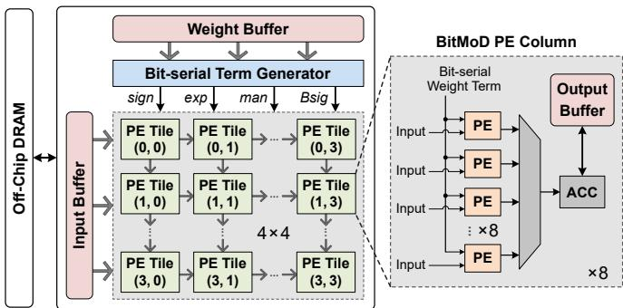  
图 6：BitMoD 加速器架构。

## B. BitMoD 处理单元

虽然 BitMoD 能够将权重量化至低精度，但激活值仍采用 FP16。为应对这一挑战，我们提出了一种混合精度位串行 PE，如图 5 所示。在每个周期中，该 PE 对四个位串行权重项（w）和四个 FP16 激活值（a）执行一次 4 路点积。步骤 1 首先对指数之和 $( a _ { e } + w _ { e } )$ 进行对齐，以计算指数差 $( \delta _ { e } )$。它还生成每个权重项与激活值乘积的符号 $( y _ { s } )$。步骤 2 在 1 位权重尾数 $( w _ { m } )$ 与包含隐含位的 11 位激活值尾数 $( a _ { m } )$ 之间执行位串行乘法。乘法结果通过一个由指数差控制的右移器进行对齐。按照 Awad 等人 [5] 的建议，我们在移位器结果中额外保留 3 位，以支持就近舍入、平局取偶。随后使用加法树计算尾数的位串行点积。在生成位串行点积后，步骤 3 执行累加：首先将点积与权重比特的位权 $( W _ { b s i g } )$ 相乘，再与累加器尾数 $( m _ { A C C } )$ 相加。随后对累加后的尾数进行规格化，以更新累加器指数 $( e _ { A C C } )$。由于 BitMoD 采用逐组量化，累加得到的组部分和必须即时进行反量化。为降低这一硬件开销，步骤 4 以位串行方式执行反量化。具体而言，每个周期将累加器尾数与组缩放因子（∆<sub>i</sub>）的一位相乘，随后通过移位加法获得反量化后的部分和的指数（e ）和尾数（m ）。

表 VI. 在逐组权重量化下使用不同数据类型的 Wikitext-2 和 C4 困惑度（↓）。

<table><tr><td rowspan="2">精度</td><td rowspan="2">数据类型*</td><td colspan="2">OPT-1.3B</td><td colspan="2">Phi-2B</td><td colspan="2">Yi-6B</td><td colspan="2">Llama-2-7B</td><td colspan="2">Llama-2-13B</td><td colspan="2">Llama-3-8B</td><td rowspan="2">平均 ΔPPL</td></tr><tr><td>Wiki</td><td>C4</td><td>Wiki</td><td>C4</td><td>Wiki</td><td>C4</td><td>Wiki</td><td>C4</td><td>Wiki</td><td>C4</td><td>Wiki</td><td>C4</td></tr><tr><td>16 位</td><td>FP16</td><td>14.62</td><td>14.72</td><td>9.71</td><td>12.74</td><td>5.84</td><td>8.91</td><td>5.47</td><td>6.97</td><td>4.88</td><td>6.47</td><td>6.13</td><td>8.88</td><td>0</td></tr><tr><td rowspan="5">4 位</td><td>ANT</td><td>16.23</td><td>16.08</td><td>11.23</td><td>14.31</td><td>6.87</td><td>10.95</td><td>6.09</td><td>7.71</td><td>5.31</td><td>6.91</td><td>7.58</td><td>11.04</td><td>1.23</td></tr><tr><td>OliVe</td><td>15.38</td><td>15.82</td><td>10.49</td><td>13.51</td><td>6.55</td><td>9.84</td><td>5.91</td><td>7.34</td><td>5.13</td><td>6.74</td><td>6.89</td><td>9.91</td><td>0.68</td></tr><tr><td>MX-FP4</td><td>15.39</td><td>15.81</td><td>10.72</td><td>13.72</td><td>6.62</td><td>10.24</td><td>5.82</td><td>7.39</td><td>5.11</td><td>6.71</td><td>7.04</td><td>10.13</td><td>0.79</td></tr><tr><td>INT4-Asym</td><td>15.41</td><td>15.74</td><td>10.67</td><td>13.65</td><td>6.32</td><td>9.69</td><td>5.77</td><td>7.31</td><td>5.01</td><td>6.62</td><td>6.84</td><td>9.79</td><td>0.62</td></tr><tr><td>BitMoD</td><td>14.89</td><td>15.29</td><td>10.48</td><td>13.53</td><td>6.23</td><td>9.58</td><td>5.72</td><td>7.26</td><td>5.01</td><td>6.61</td><td>6.73</td><td>9.66</td><td>0.48</td></tr><tr><td rowspan="5">3 位</td><td>ANT</td><td>340.6</td><td>332.9</td><td>15.57</td><td>18.35</td><td>9.01</td><td>14.32</td><td>8.51</td><td>10.28</td><td>6.40</td><td>7.98</td><td>15.22</td><td>17.56</td><td>57.61</td></tr><tr><td>OliVe</td><td>76.79</td><td>59.63</td><td>14.93</td><td>17.76</td><td>32.42</td><td>66.02</td><td>9.13</td><td>12.04</td><td>8.69</td><td>12.43</td><td>26.76</td><td>46.39</td><td>23.14</td></tr><tr><td>MX-FP3</td><td>1E+3</td><td>771.6</td><td>17.89</td><td>20.37</td><td>15.41</td><td>21.97</td><td>8.86</td><td>11.99</td><td>7.19</td><td>9.13</td><td>23.82</td><td>31.39</td><td>152.8</td></tr><tr><td>INT3-Asym</td><td>139.4</td><td>144.9</td><td>13.92</td><td>16.79</td><td>8.66</td><td>13.33</td><td>7.08</td><td>9.29</td><td>5.64</td><td>7.35</td><td>13.26</td><td>17.80</td><td>24.34</td></tr><tr><td>BitMoD</td><td>22.67</td><td>20.47</td><td>12.91</td><td>15.69</td><td>7.66</td><td>11.98</td><td>6.55</td><td>8.36</td><td>5.50</td><td>7.18</td><td>8.96</td><td>12.82</td><td>2.94</td></tr></table>

<sup>\*</sup> 所有量化数据类型均采用逐组量化。MX 数据类型遵循 [38] 中的标准，采用大小为 32 的分组，而其他数据类型采用大小为 128 的分组。使用更大的分组大小时，MX 的困惑度会变差。

位串行反量化的一个顾虑是，它是否会比常规点积阶段耗费更多周期，从而可能导致流水线停顿。如第 III-C 节所述，逐组缩放因子为 8 位，因此反量化需要 8 个周期。另一方面，即使是 BitMoD 中精度最低的 FP3 数据类型，也需要两个周期来处理两个位串行项。给定 PE 的点积规模为 4，且采用常用的分组大小 128，组点积阶段需要 $1 2 8 / 4 \times 2 = 6 4$ 个周期才能完成。因此，所提出的位串行反量化绝不会使计算流水线停顿。此外，由于 INT6 和扩展的 FP4/FP3 数据类型分别包含三个和两个位串行项，所提出的 BitMoD PE 能够分别在 3 个和 2 个周期内完成 4 次乘加运算。与常规 FP16 乘加硬件相比，BitMoD 对 INT6 和 FP4/FP3 数据类型分别实现了 1.33× 和 2× 的吞吐量提升。事实上，如第 V-C 节将要评估的那样，BitMoD PE 的面积比 FP16 PE 小 24%，因此在相同计算面积约束下能够提供更高的吞吐量。

除了权重与激活值之间的矩阵乘法，LLM 还包含自注意力层，其中涉及三个激活张量（即查询、键和值）之间的两次矩阵乘法运算。鉴于 BitMoD PE 仅将一个激活张量保持为 FP16，另外两个激活张量需要采用低精度整数。幸运的是，先前的研究已经证明，由于自注意力内部的 softmax 归一化，键张量和值张量非常适合量化，可以安全地量化为 INT8 甚至 INT4，而精度损失可以忽略不计 [44]、[52]、[58]。因此，通过将键张量和值张量量化为低精度整数，BitMoD 可以使用所提出的位串行 PE 来支持自注意力层。

## C. BitMoD 加速器

图 6 展示了 BitMoD 加速器的整体架构。输入缓冲区和权重缓冲区均采用多存储体设计，以为 PE 的访问提供充足的带宽。位串行项生成器接收权重数据，并按照第 IV-A 节所述将其分解为位串行项。主 PE 阵列包含以脉动方式连接的 4 × 4 个分块。每个 PE 分块包含 8 行 × 8 列，并采用输出固定数据流。位串行权重项广播至整列 PE，而输入广播至整行 PE。这使 BitMoD 能够通过权重共享和输入共享来实现数据复用。每列 PE 包含一个本地输出缓冲区和一个累加器，后者用于累加来自 PE 的逐组部分和，以获得最终的逐通道输出激活值。由于处理一个权重组需要许多周期，因此有足够的时间仅使用一个共享累加器来排出整列 PE 的输出，从而分摊硬件开销。

## V. 评估

## A. 实验方法

LLM 基准测试。为了进行评估，我们选择了六个具有不同模型规模的代表性 LLM，包括 OPT-1.3B [57]、Phi-2B [36]、Yi-6B [1]、Llama-2-7B、Llama-2-13B [34] 和 Llama-3-8B [35]。我们从 HuggingFace 仓库获取预训练模型，并在 PyTorch 中实现所提出的 BitMoD 量化框架。为了评估量化对模型最终性能的影响，我们同时考虑判别式任务和生成式任务。对于判别式任务，我们使用 LM-Evaluation-Harness [21]，在零样本设置下评估三个基准：HellaSwag [56]、Wino-Grande [41] 和 Piqa [7]。对于生成式任务，我们选择 Wikitext-2 [33] 和 C4 [18] 数据集，并遵循先前量化工作 [4]、[20]、[30]、[42] 中的方法评估困惑度。

量化数据类型。我们将 BitMoD 的模型准确率与四种基线量化数据类型进行比较：

• ANT [26]，以按通道的粒度，自适应地使用不同数据类型对不同张量进行量化。

• OliVe [25]，引入了一种离群值与牺牲值的配对编码机制，通过牺牲与离群值相邻的正常值（即牺牲值）来容纳重要的离群值。

• 微缩放（MX）[40]，将 32 个低精度 FP 权重分为一组，并额外使用一个 8 位共享指数。

表 VII. 在按组权重量化下使用不同数据类型时，判别式任务的准确率（↑）。

<table><tr><td rowspan="2">精度</td><td rowspan="2">数据类型</td><td colspan="3">OPT-1.3B</td><td colspan="3">Phi-2B</td><td colspan="3">Yi-6B</td><td colspan="3">Llama-2-7B</td><td colspan="3">Llama-2-13B</td><td colspan="3">Llama-3-8B</td><td rowspan="2">平均 ΔAcc</td></tr><tr><td>Hella</td><td>Wino</td><td>Piqa</td><td>Hella</td><td>Wino</td><td>Piqa</td><td>Hella</td><td>Wino</td><td>Piqa</td><td>Hella</td><td>Wino</td><td>Piqa</td><td>Hella</td><td>Wino</td><td>Piqa</td><td>Hella</td><td>Wino</td><td>Piqa</td></tr><tr><td>16位</td><td>FP16</td><td>53.72</td><td>59.43</td><td>72.41</td><td>73.74</td><td>75.77</td><td>79.22</td><td>74.96</td><td>70.72</td><td>78.78</td><td>75.98</td><td>69.06</td><td>79.11</td><td>79.39</td><td>72.38</td><td>80.5</td><td>79.18</td><td>72.85</td><td>80.74</td><td>0</td></tr><tr><td rowspan="2">4位</td><td>INT4-Asym</td><td>52.31</td><td>59.35</td><td>71.05</td><td>72.29</td><td>75.14</td><td>78.4</td><td>73.91</td><td>70.51</td><td>77.64</td><td>75.29</td><td>68.74</td><td>78.22</td><td>78.76</td><td>72.45</td><td>80.2</td><td>78.07</td><td>73.24</td><td>79.76</td><td>-0.71</td></tr><tr><td>BitMoD</td><td>53.03</td><td>59.12</td><td>71.49</td><td>72.51</td><td>77.58</td><td>79.48</td><td>73.98</td><td>70.09</td><td>78.35</td><td>75.43</td><td>68.19</td><td>78.45</td><td>78.41</td><td>72.14</td><td>80.42</td><td>78.49</td><td>73.09</td><td>79.98</td><td>-0.42</td></tr><tr><td rowspan="2">3位</td><td>INT3-Asym</td><td>38.98</td><td>55.01</td><td>64.25</td><td>67.75</td><td>71.74</td><td>77.48</td><td>71.3</td><td>67.32</td><td>76.71</td><td>71.87</td><td>66.46</td><td>76.66</td><td>76.58</td><td>69.61</td><td>78.94</td><td>68.56</td><td>66.61</td><td>75.03</td><td>-4.84</td></tr><tr><td>BitMoD</td><td>49.16</td><td>58.09</td><td>68.88</td><td>70.16</td><td>75.22</td><td>78.18</td><td>70.72</td><td>67.72</td><td>76.28</td><td>72.68</td><td>66.22</td><td>77.53</td><td>76.79</td><td>72.37</td><td>79.22</td><td>73.56</td><td>70.32</td><td>77.91</td><td>-2.61</td></tr></table>

• 按组非对称整数量化，先前的软件量化方法普遍采用这种量化方式。

为了确保与 BitMoD 进行公平比较，我们仅将 ANT、OliVe 和 MX 的数据类型应用于 LLM 权重量化，同时将激活保持为 FP16。尽管原始 ANT 和 OliVe 框架由于缺乏专用的反量化硬件而仅支持按通道量化，我们仍将其算法扩展为支持按组量化。这样就可以仅依据所采用的量化数据类型来比较模型准确率。虽然我们的评估主要关注权重量化，但第 V-E 节表明，BitMoD 可以与最先进的激活量化方案相结合，从而也有望减少激活内存占用。

除了协同设计工作之外，我们还展示了 BitMoD 可以无缝集成到现有的纯软件量化优化中，以进一步减少内存占用或提升模型性能。我们将 BitMoD 与三种软件量化方法相结合：

• SmoothQuant [52]，旨在使用 INT8 同时量化权重和激活。它通过将激活的大幅值特性部分迁移至权重，来解决大幅值激活带来的量化困难。

• AWQ [30]，采用激活感知的权重量化，以保护与较大激活幅值相对应的显著权重通道。

• OmniQuant [42]，通过逐块微调来优化裁剪阈值，从而调整离群权重值。

为了将 BitMoD 与这些纯软件方法集成，我们使用 BitMoD 的扩展 FP4 和 FP3 数据类型，替换这些方法中原本使用整数数据类型的权重量化器。

加速器基线。为了评估硬件性能和能效，我们将 BitMoD 与一个支持 FP16 模型的基线加速器进行比较，该加速器使用 FP16 乘累加 PE，代替所提出的位串行 PE。我们还将 BitMoD 与 ANT 和 OliVe 进行比较，后两者设计了定制解码器，以在统一的脉动阵列中支持多种数据类型。与先前工作 [30] 一样，为适应边缘应用场景，我们在批大小为 1、输入序列长度为 256 的条件下评估 LLM 的性能。

表 VIII. 使用不同数据类型量化 Llama 权重时，在 Wikitext-2 和 C4 上的困惑度（↓）。我们采用按组权重量化，组大小为 128。

<table><tr><td rowspan="2">精度</td><td rowspan="2">数据类型</td><td colspan="2">Llama-2-7B</td><td colspan="2">Llama-2-13B</td><td colspan="2">Llama-3-8B</td></tr><tr><td>Wiki</td><td>C4</td><td>Wiki</td><td>C4</td><td>Wiki</td><td>C4</td></tr><tr><td rowspan="4">4位</td><td>FP4</td><td>5.77</td><td>7.32</td><td>5.05</td><td>6.66</td><td>6.86</td><td>9.85</td></tr><tr><td>FP4-ER</td><td>5.74</td><td>7.28</td><td>5.03</td><td>6.63</td><td>6.76</td><td>9.71</td></tr><tr><td>FP4-EA</td><td>5.81</td><td>7.30</td><td>5.08</td><td>6.65</td><td>6.83</td><td>9.79</td></tr><tr><td>BitMoD</td><td>5.72</td><td>7.26</td><td>5.01</td><td>6.61</td><td>6.73</td><td>9.66</td></tr><tr><td rowspan="4">3位</td><td>FP3</td><td>7.51</td><td>10.28</td><td>5.90</td><td>7.58</td><td>15.22</td><td>19.87</td></tr><tr><td>FP3-ER</td><td>7.18</td><td>9.71</td><td>5.66</td><td>7.33</td><td>13.43</td><td>17.56</td></tr><tr><td>FP3-EA</td><td>6.61</td><td>8.45</td><td>5.54</td><td>7.23</td><td>9.06</td><td>12.97</td></tr><tr><td>BitMoD</td><td>6.55</td><td>8.36</td><td>5.50</td><td>7.18</td><td>8.96</td><td>12.82</td></tr></table>

硬件实现。我们使用 SystemVerilog 在 RTL 级实现 BitMoD 加速器，并通过 RTL 仿真验证各组件的功能。我们使用 Synopsys Design Compiler，基于 TSMC 28nm 工艺对 BitMoD 进行综合，以报告面积和功耗。为了进行端到端性能评估，我们实现了一个周期级模拟器，其中加速器的时序和能耗参数根据 RTL 综合结果设置。DRAM 功耗基于 DRAMSim3 [29] 中的 DDR4 模型计算。所有加速器均在相同计算面积约束下进行评估，并配备 512 KB 激活缓冲区和 512 KB 权重缓冲区，这些缓冲区使用 CACTI [6] 建模。

## B. 不同数据类型的精度比较

生成式任务。表 VI 详细列出了在 4 位和 3 位权重精度下采用不同 PTQ 数据类型时的困惑度。对于 4 位和 3 位权重量化，相较于 FP16 基线模型，BitMoD 的平均困惑度损失分别 < 0.5 和 < 3。尽管 ANT、OliVe 和 MX 在 4 位精度下能够保持可接受的困惑度，但在将权重量化为 3 位时，它们的困惑度均显著恶化。OliVe 旨在处理逐通道量化中的离群值，但其优势有所减弱，因为如第 II-C 节所述，逐组量化可以显著减轻离群值的影响。MX 采用基本的 FP4 和 FP3，却未探索其冗余零表示的潜力，因此其困惑度逊于 INT-Asym，后者在支持非对称性的同时充分利用了可用的量化级别。相比之下，在逐组粒度下，BitMoD 始终优于非对称整数量化，而且在 3 位精度下优势更为明显。这表明，BitMoD 将非对称性与浮点数据类型相结合，可以显著降低量化误差。

表 IX. FP3 使用不同特殊值时在 Wikitext-2 和 C4 上的困惑度（↓）。

<table><tr><td rowspan="2">特殊值</td><td colspan="2">OPT-1.3B</td><td colspan="2">Phi-2B</td><td colspan="2">Llama-2-7B</td><td colspan="2">Llama-3-8B</td></tr><tr><td>Wiki</td><td>C4</td><td>Wiki</td><td>C4</td><td>Wiki</td><td>C4</td><td>Wiki</td><td>C4</td></tr><tr><td> $\{ \pm 5, \pm 6\}$ </td><td>23.39</td><td>20.12</td><td>13.02</td><td>15.84</td><td>6.61</td><td>8.48</td><td>9.09</td><td>13.81</td></tr><tr><td> $\{ \pm 3, \pm 5\}$ </td><td>35.54</td><td>37.65</td><td>13.41</td><td>16.29</td><td>6.68</td><td>8.73</td><td>10.32</td><td>14.48</td></tr><tr><td> $\{ \pm 3, \pm 6\}$ </td><td>22.67</td><td>20.47</td><td>12.91</td><td>15.69</td><td>6.55</td><td>8.36</td><td>8.96</td><td>12.82</td></tr></table>

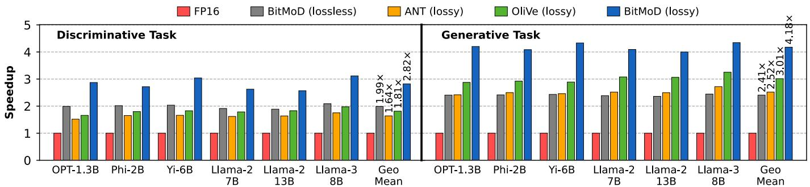  
图 7：不同加速器的加速比（↑）。

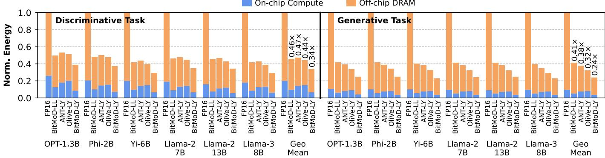  
图 8：不同加速器的能耗（↓）。“LL”和“LY”分别代表“无损”和“有损”。

判别式任务。表 VII 比较了在逐组粒度下采用 BitMoD 和基线非对称整数量化时，模型在判别式任务上的准确率。BitMoD 的准确率优于或相当于非对称整数量化。在 4 位精度下，相较于 FP16 基线模型，BitMoD 的平均准确率损失 < 0.5%。此外，相较于最先进（SOTA）的软件量化方法中广泛使用的非对称整数量化，BitMoD 的模型准确率平均大幅提高了 2.2%。

BitMoD 数据类型消融。如第 III-A 节所述，BitMoD 通过为 FP3 和 FP4 增加额外分辨率和非对称性，引入了新的数据类型。我们分析了这些不同数据类型对所研究的三个 Llama 模型困惑度的影响。如表 VIII 所示，同时具备额外分辨率和非对称性的 BitMoD 数据类型实现了最佳困惑度。相较于基本的 FP4 数据类型，FP4-ER 在困惑度上的改善大于 FP4-EA。这是因为在 4 位精度下，基本的 FP4 仍具有足够多的量化级别，能够对呈非对称分布的权重组进行量化，而增加额外分辨率可以更好地降低量化误差。相反，在 3 位精度下，FP3-EA 的困惑度远优于 FP3-ER。由于 3 位精度下的量化级别更少，在处理呈非对称分布的权重组时，FP3-EA 引入的额外非对称性具有更大的影响。

BitMoD 特殊值消融。BitMoD PE 可以灵活支持不同的特殊值。我们评估了 FP3 的另外两种潜在特殊值组合：$\{ \pm 3 , \pm 5 \}$ 和 $\{ \pm 5 , \pm 6 \}$。表 IX 展示了所得的 Wikitext 和

C4 困惑度。BitMoD 采用的特殊值，即 $\{ \pm 3 , \pm 6 \}$，实现了最低的平均困惑度。特殊值组合 {± 5, ± 6} 仅为基本的 FP3 引入了额外的非对称性。然而，许多权重组可能呈对称分布，这种分布更适合最大值与最小值的绝对值相同的对称数据类型。另一方面，如第 III-A 节所述，特殊值 ± 5 的量化误差高于 ± 6，因此与 ± 3 组合时会导致更差的困惑度。

## C. 加速器性能

在加速器评估中，我们根据模型最终达到的精度，考虑 BitMoD 加速器的两种配置：(1) 无损配置，权重精度为 INT6，因为在逐组量化下，其精度损失接近于零。我们将此配置与基准 FP16 加速器进行比较。(2) 有损配置，在保持良好模型性能的同时，可将判别式任务的权重量化至 4 位，将生成式任务的权重量化至 3 位。我们将此配置与 ANT 和 OliVe 进行比较。

计算块面积和功耗。表 X 展示了 BitMoD 和基准 FP16 加速器在 1 GHz 频率下的 PE 计算块面积和功耗明细。统一的位串行表示使 BitMoD 能够以较低的硬件成本支持不同的权重数据类型。因此，BitMoD PE 的面积比基准 PE 小 24%，从而能够在相同的计算面积内容纳更多 BitMoD PE。此外，位串行项编码器的硬件开销极小，仅占 PE 阵列面积的 2.5%。

表 X. 基准 FP16 加速器与 BitMoD 在 1 GHz 频率下每个计算块的面积和功耗。

<table><tr><td rowspan="2"></td><td rowspan="2">PE 数量</td><td colspan="3">面积（ $\mu m^{2}$ ）</td><td colspan="3">功耗（mW）</td></tr><tr><td>PE 阵列</td><td>编码器</td><td>总计</td><td>PE 阵列</td><td>编码器</td><td>总计</td></tr><tr><td>基准</td><td>6 × 8</td><td>95,498</td><td>-</td><td>95,498</td><td>36.96</td><td>-</td><td>36.96</td></tr><tr><td>BitMoD</td><td>8 × 8</td><td>97,090</td><td>2,419</td><td>99,509</td><td>37.5</td><td>1.86</td><td>39.36</td></tr></table>

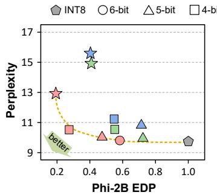

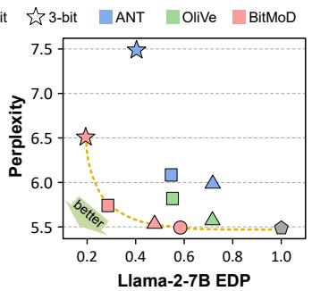  
图 9：Phi-2B 和 Llama-2-7B 在 Wikitext-2 上的困惑度-EDP 帕累托图。

性能。图 7 展示了判别式任务和生成式任务中相对于基准 FP16 加速器归一化后的硬件性能。BitMoD 在无损量化和有损量化下均实现了最佳性能。BitMoD 的性能增益主要来自针对不同量化数据类型精心进行的算法与硬件协同设计。由于判别式任务受计算限制，且主要涉及矩阵-矩阵乘法，BitMoD PE 更高的吞吐量使其性能优于基准 PE。相比之下，OliVe 需要更复杂的 PE，并产生显著的硬件开销，以容纳数值范围宽得多的离群值（例如，4 位精度下的 {24, ..., 192}）。与之相比，BitMoD 数据类型的数值范围较小，可以通过所提出的统一位串行表示进行高效处理。对于受内存限制的生成式任务，BitMoD 可以将 LLM 权重量化至极低精度，例如 3 位，从而在保持良好困惑度的同时显著节省内存。相反，由于缺乏专用的反量化硬件，ANT 和 OliVe 原生均不支持逐组量化，并且在采用 3 位权重精度进行逐通道量化时，无法保持可接受的模型质量。因此，它们必须采用更高的权重精度，以弥补困惑度的显著恶化。总体而言，与基准 FP16 架构相比，无损 BitMoD 在判别式任务和生成式任务上分别实现了 1.99× 和 2.41× 的加速。与 ANT / OliVe 相比，有损 BitMoD 在判别式任务上实现了 1.72× / 1.56× 的加速，在生成式任务上实现了 1.66× / 1.39× 的加速。

能耗。图 8 展示了不同加速器归一化后的能耗明细，其中片上计算能耗包括缓冲区和计算核心的能耗。BitMoD 的节能效果主要来自权重内存占用的减少以及高效的位串行 PE。ANT 和 OliVe 均需要比 BitMoD 更高的权重精度来保持可接受的模型质量，从而导致更高的 DRAM 能耗。此外，基准架构使用 FP16 权重，这对于 LLM 而言精度过高，因为在逐组权重量化下，简单的 INT6 数据类型即可达到相当的精度。总体而言，在不同任务中，无损 BitMoD 的能效达到基准架构的 2.31×。有损 BitMoD 的能效分别达到 ANT 和 OliVe 的 1.48× 和 1.31×。

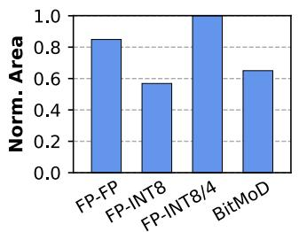

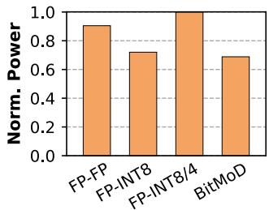  
图 10：BitMoD 和不同位并行 PE 的归一化面积和功耗。

精度与效率的权衡。所提出的 BitMoD 能够在模型精度与硬件效率之间提供良好的权衡。为证明这一点，我们分析了 Phi-2B 和 Llama-2-7B 在 Wikitext-2 上的能量延迟积（EDP）与模型困惑度之间的关系。我们在不同的 LLM 权重精度下，将 BitMoD 与 ANT 和 OliVe 进行比较。图 9 展示了所研究的两个 LLM 和三种加速器的困惑度-EDP 关系。请注意，尽管图中未明确展示 5 位精度，但利用其 Booth 编码器，可以轻松扩展 BitMoD，以执行位串行 INT5 计算。同样，ANT 和 OliVe 引入的自定义数据类型也可以根据其数据类型定义扩展至 5 位精度。如图 9 所示，左下区域表示困惑度与 EDP 之间更好的权衡。尽管 ANT 和 OliVe 为 LLM 加速提出了不同的算法与硬件协同设计方法，但它们仅采用逐通道量化粒度，这种粒度无法在极低精度下保持模型质量，而且它们缺少能够高效支持不同数据类型和精度的统一架构。相比之下，BitMoD 利用专为逐组量化定制的新数据类型，并采用高效的位串行计算范式来支持各种数据类型。因此，BitMoD 始终能够位于帕累托前沿。

## D. 与混合精度位并行架构的比较

FIGNA [27] 提出了一系列位并行 PE，用于执行低精度整数权重与浮点激活值之间的算术运算。然而，每种 FIGNA PE 都是单独设计的，且仅支持一种权重精度，因此无法在模型准确率与硬件效率之间进行权衡。我们探索了让 FIGNA 支持混合精度整数权重的可能性。我们考虑了一种类似 FIGNA 的基线 PE，它在 FP16 激活值与 INT8 权重之间执行乘累加运算。我们扩展了该基线 PE，使其支持一次 FP16-INT8 运算或两次 FP16-INT4 运算，后者将同一个 FP16 激活值与两个 INT4 权重相乘。图 10 比较了不同 PE 的归一化面积和功耗。尽管 FP-INT8 PE 的面积最小，但增加对混合权重精度的支持会带来显著的硬件开销，导致其面积和功耗甚至高于传统的 FP-FP PE。这是因为，执行两次 FP16-INT4 运算的位并行 PE 会产生两个独立的输出，使浮点累加器和输出寄存器的开销翻倍。相比之下，位串行 BitMoD PE 在权重精度与延迟之间进行权衡，对于任何权重精度都只需要一个累加器和一个输出寄存器。因此，与可分解的位并行 PE 相比，BitMoD 在支持可变权重精度方面提供了最高的灵活性，同时具有更高的效率。

表 XI. 不同量化策略在 Wikitext-2 和 C4 上的困惑度（↓）。我们采用分组权重量化，组大小为 128。对于表中的每一列，我们将最好的两个困惑度结果以粗体突出显示。

<table><tr><td rowspan="2">位数</td><td rowspan="2">方法</td><td colspan="2">Llama-2-7B</td><td colspan="2">Llama-2-13B</td><td colspan="2">Llama-3-8B</td><td rowspan="2">平均 ΔPPL</td></tr><tr><td>Wiki</td><td>C4</td><td>Wiki</td><td>C4</td><td>Wiki</td><td>C4</td></tr><tr><td>16 位</td><td>FP16</td><td>5.47</td><td>6.97</td><td>4.88</td><td>6.47</td><td>6.13</td><td>8.88</td><td>0</td></tr><tr><td rowspan="6">4 位</td><td>QuaRot</td><td>5.60</td><td>7.48</td><td>5.00</td><td>6.88</td><td>6.54</td><td>10.18</td><td>0.48</td></tr><tr><td>GPTQ</td><td>5.63</td><td>7.13</td><td>4.99</td><td>6.56</td><td>6.53</td><td>9.38</td><td>0.24</td></tr><tr><td>AWQ</td><td>5.60</td><td>7.12</td><td>4.97</td><td>6.56</td><td>6.54</td><td>9.39</td><td>0.23</td></tr><tr><td>OmniQ</td><td>5.59</td><td>7.12</td><td>4.96</td><td>6.56</td><td>6.57</td><td>9.50</td><td>0.25</td></tr><tr><td>BitMoD + AWQ</td><td>5.59</td><td>7.09</td><td>4.96</td><td>6.55</td><td>6.50</td><td>9.33</td><td>0.20</td></tr><tr><td>BitMoD + OmniQ</td><td>5.57</td><td>7.07</td><td>4.95</td><td>6.55</td><td>6.45</td><td>9.30</td><td>0.18</td></tr><tr><td rowspan="6">3 位</td><td>QuaRot</td><td>6.09</td><td>8.44</td><td>5.37</td><td>7.52</td><td>7.64</td><td>12.49</td><td>1.88</td></tr><tr><td>GPTQ</td><td>6.29</td><td>7.89</td><td>5.42</td><td>7.00</td><td>9.58</td><td>11.66</td><td>1.51</td></tr><tr><td>AWQ</td><td>6.24</td><td>7.81</td><td>5.32</td><td>6.95</td><td>8.22</td><td>11.56</td><td>1.22</td></tr><tr><td>OmniQ</td><td>6.05</td><td>7.76</td><td>5.28</td><td>6.99</td><td>8.33</td><td>12.04</td><td>1.28</td></tr><tr><td>BitMoD + AWQ</td><td>6.07</td><td>7.64</td><td>5.27</td><td>6.88</td><td>7.81</td><td>11.07</td><td>0.98</td></tr><tr><td>BitMoD + OmniQ</td><td>5.89</td><td>7.59</td><td>5.21</td><td>6.85</td><td>7.57</td><td>11.05</td><td>0.89</td></tr></table>

## E. 将 BitMoD 与其他量化方案相结合

通过将现有纯软件量化方法的原始权重量化器所使用的整数数据类型替换为 BitMoD 扩展的 FP4 和 FP3 数据类型，BitMoD 可以与这些方法无缝集成。我们在 AWQ [30]、OmniQuant [42] 和 SmoothQuant [52] 上展示了这种可行性。

与量化优化正交。原始的 AWQ 和 OmniQuant 采用 INT-Asym 权重量化，并结合权重裁剪和缩放因子搜索等多种算法优化，在 4 位和 3 位权重精度下实现了最先进的模型性能。我们评估了在 BitMoD 数据类型基础上应用 AWQ 和 OmniQuant 优化时的模型性能。我们还在仅权重量化条件下，与包括 GPTQ [20] 和 QuaRot [4] 在内的最先进纯软件 LLM 量化方法进行了比较。表 XI 展示了所研究的 Llama 模型在使用不同量化策略时的 Wikitext 和 C4 困惑度。将 BitMoD 与 AWQ 和 OmniQuant 相结合的效果显著优于其他方法。例如，采用 BitMoD 数据类型可使 OmniQuant 在 4 位和 3 位精度下的平均困惑度损失分别降低 28% 和 31%。总体而言，BitMoD 与 AWQ 和 OmniQuant 相结合，在 4 位和 3 位权重精度下均实现了 < 1 的平均困惑度损失，将 LLM 权重量化的极限推向了新的最先进水平。需要注意的是，使用 AWQ 和 OmniQuant 不会妨碍 BitMoD 加速器的功能——它们的优化仅调整每组的缩放因子，而 BitMoD 的位串行反量化单元支持这一操作。

表 XII. 激活值保持为 FP16 或使用 SmoothQuant 量化为 INT8（SQ8）时的 Wikitext-2 困惑度（↓）。对于权重，我们采用分组量化，组大小为 128。

<table><tr><td rowspan="2">权重精度</td><td rowspan="2">权重数据类型</td><td colspan="2">Llama-2-7B</td><td colspan="2">Llama-2-13B</td><td colspan="2">Llama-3-8B</td></tr><tr><td>FP16</td><td>SQ8</td><td>FP16</td><td>SQ8</td><td>FP16</td><td>SQ8</td></tr><tr><td>8 位</td><td>INT8</td><td>5.47</td><td>5.52</td><td>4.95</td><td>4.93</td><td>6.13</td><td>6.26</td></tr><tr><td rowspan="2">4 位</td><td>INT4-Asym</td><td>5.77</td><td>5.83</td><td>5.01</td><td>5.09</td><td>6.84</td><td>7.05</td></tr><tr><td>BitMoD</td><td>5.72</td><td>5.76</td><td>5.01</td><td>5.07</td><td>6.73</td><td>6.87</td></tr><tr><td rowspan="2">3 位</td><td>INT3-Asym</td><td>7.08</td><td>7.58</td><td>5.64</td><td>5.99</td><td>13.26</td><td>25.78</td></tr><tr><td>BitMoD</td><td>6.55</td><td>6.85</td><td>5.5</td><td>5.82</td><td>9.09</td><td>10.57</td></tr></table>

与激活量化正交。SmoothQuant 可以将 LLM 的激活值量化为 INT8，同时仅带来较小的准确率损失。我们在 SmoothQuant 提供的、使用 INT8 激活值的预校准 Llama 模型上，采用 BitMoD 和 INT-Asym 数据类型进行权重 PTQ。表 XII 展示了在 FP16 和 INT8 激活值下，采用不同量化权重精度和数据类型时的 WikiText-2 困惑度。在使用 SmoothQuant 将激活值量化为 INT8 后，BitMoD 相较于 INT-Asym 的困惑度改善仍然存在，而且在更低精度（即 3 位）下尤为明显。例如，在 Llama-3-8B 上应用 SmoothQuant 后，BitMoD 相较于 INT3-Asym 将困惑度降低了 15.21。值得注意的是，在 Llama-2-7B 上，采用 BitMoD 权重与 INT8 激活值时的困惑度甚至优于采用 INT-Asym 权重与 FP16 激活值时的困惑度，这表明 BitMoD 有潜力在达到目标模型质量的条件下进一步降低 LLM 的内存占用。

## VI. 相关工作

DNN 加速器。已有大量关于 DNN 加速器的研究 [3], [5], [12], [23]–[28], [39], [40], [43], [45], [48], [50], [54], [55], [59]。这些加速器提出了专用处理单元和数据流，以匹配 DNN 的计算特征和内存访问模式。一些加速器利用数值稀疏性，在重新训练的帮助下加速小规模 DNN [23], [24], [48], [50], [59]。其他工作则基于模型量化，致力于低精度 DNN 加速 [25]–[27], [39], [40], [54], [55]。其中，[25], [26], [40] 引入了自定义数据类型，以更好地适应 DNN 的数值分布。另一类工作依靠位串行计算，使性能随操作数精度的降低而提升，并利用位级稀疏性跳过无效的位运算 [3], [5], [12], [28], [43], [45]。本文提出的 BitMoD 结合了量化与位串行计算的优势，在权重精度和硬件效率之间实现高效权衡。

LLM 量化。大量算法研究提出了量化方案，以减少 LLM 的内存占用 [4], [11], [15], [19], [20], [30], [31], [42], [49], [52]。这些工作大多依赖对 LLM 权重进行非对称整数量化，同时采用其他技术来优化量化参数。本文提出的 BitMoD 数据类型与其中许多工作相互独立，可以与不同的量化优化方法协同结合。

## VII. 结论

本文介绍了 BitMoD，这是一种用于高效 LLM 加速的算法与硬件协同设计方案。在算法方面，BitMoD 设计了专门适用于极低精度 LLM 权重分组量化的新数据类型。通过巧妙地将冗余的零值重新用作一个额外的数值，BitMoD 扩展了 3 位和 4 位浮点数据类型的分辨率或表示范围。此外，BitMoD 量化框架可以与现有的纯软件量化方法无缝集成，以进一步改善模型性能。在硬件方面，BitMoD 为多种低精度数据类型提出了统一的位串行表示，并提出了一种高效的位串行处理单元（PE），用于处理量化权重和 FP16 激活。我们的评估表明，BitMoD 显著优于现有 LLM 量化方法，将 LLM 权重量化的极限推向了新的最高水平。与已有加速器 ANT / OliVe 相比，BitMoD 实现了 1.69× / 1.48× 的加速和 1.48× / 1.31× 的能效提升，同时能够支持多种权重精度，在模型准确率与硬件效率之间提供良好的权衡。

## 致谢

本项目的部分资助来自英特尔公司、国家科学基金会（资助编号：2339084）以及工程与物理科学研究理事会（EP-SRC，资助编号：EP/S030069/1）。我们感谢 Jordan Dotzel、Hongxiang Fan、Stylianos I. Venieris、Alexandros Kouris、Mahesh Iyer、Grace Zgheib、Sergey Gribok 以及匿名审稿人提供的建设性反馈。

## REFERENCES

[1] 01-AI, “01-ai/yi-6b.” [Online]. Available: https://huggingface.co/01- ai/Yi-6B

[2] Abdelfattah Lab, “BitMoD Artifacts,” Nov. 2024. [Online]. Available: https://doi.org/10.5281/zenodo.14252531

[3] J. Albericio, A. Delmas, P. Judd, S. Sharify, G. O’Leary, R. Genov, and A. Moshovos, “Bit-pragmatic deep neural network computing,” IEEE/ACM 50th Annual International Symposium on Microarchitecture (MICRO), 2017.

[4] S. Ashkboos, A. Mohtashami, M. L. Croci, B. Li, M. Jaggi, D. Alistarh, T. Hoefler, and J. Hensman, “QuaRot: Outlier-free 4-bit inference in rotated llms,” arXiv preprint arXiv:2404.00456, 2024.

[5] O. M. Awad, M. Mahmoud, I. E. Vivancos, A. H. Zadeh, C. Bannon, A. Jayarajan, G. Pekhimenko, and A. Moshovos, “FPRaker: A processing element for accelerating neural network training,” IEEE/ACM 54th Annual International Symposium on Microarchitecture (MICRO), 2020.

[6] R. Balasubramonian, A. B. Kahng, N. Muralimanohar, A. Shafiee, and V. Srinivas, “CACTI 7: New tools for interconnect exploration in innovative off-chip memories,” ACM Trans. Archit. Code Optim., vol. 14, no. 2, June 2017.

[7] Y. Bisk, R. Zellers, R. L. Bras, J. Gao, and Y. Choi, “PIQA: Reasoning about physical commonsense in natural language,” arXiv preprint arXiv:1911.11641, 2019.

[8] A. D. Booth, “A signed binary multiplication technique,” Quarterly Journal of Mechanics and Applied Mathematics, vol. 4, pp. 236–240, 1951.

[9] T. Brown, B. Mann, N. Ryder, M. Subbiah, J. D. Kaplan, P. Dhariwal, A. Neelakantan, P. Shyam, G. Sastry, A. Askell, S. Agarwal, A. Herbert-Voss, G. Krueger, T. Henighan, R. Child, A. Ramesh, D. Ziegler, J. Wu, C. Winter, C. Hesse, M. Chen, E. Sigler, M. Litwin, S. Gray, B. Chess, J. Clark, C. Berner, S. McCandlish, A. Radford, I. Sutskever, and D. Amodei, “Language Models are Few-Shot Learners,” in Advances in Neural Information Processing Systems, 2020, pp. 1877–1901.

[10] J. Chee, Y. Cai, V. Kuleshov, and C. D. Sa, “QuIP: 2-bit quantization of large language models with guarantees,” arXiv preprint arXiv:2307.13304, 2023.

[11] M. Chen, W. Shao, P. Xu, J. Wang, P. Gao, K.-C. Zhang, Y. Qiao, and P. Luo, “EfficientQAT: Efficient quantization-aware training for large language models,” arXiv preprint arXiv:2407.11062, 2024.

[12] Y. Chen, J. Meng, J.-S. Seo, and M. S. Abdelfattah, “BBS: Bi-directional bit-level sparsity for deep learning acceleration,” 57th IEEE/ACM International Symposium on Microarchitecture (MICRO), 2024.

[13] P. Clark, I. Cowhey, O. Etzioni, T. Khot, A. Sabharwal, C. Schoenick, and O. Tafjord, “Think you have solved question answering? try ARC, the ai2 reasoning challenge,” arXiv preprint arXiv:1803.05457, 2018.

[14] S. Dai, R. Venkatesan, H. Ren, B. Zimmer, W. J. Dally, and B. Khailany, “VS-Quant: Per-vector scaled quantization for accurate low-precision neural network inference,” in Proceedings of Machine Learning and Systems (MLSys), 2021.

[15] T. Dettmers, M. Lewis, Y. Belkada, and L. Zettlemoyer, “LLM.int8(): 8-bit matrix multiplication for transformers at scale,” arXiv preprint arXiv:2208.07339, 2022.

[16] T. Dettmers, M. Lewis, S. Shleifer, and L. Zettlemoyer, “8-bit optimizers via block-wise quantization,” arXiv preprint arXiv:2110.02861, 2022.

[17] T. Dettmers, A. Pagnoni, A. Holtzman, and L. Zettlemoyer, “QLoRA: Efficient finetuning of quantized llms,” arXiv:2305.14314, 2023.

[18] J. Dodge, A. Marasovic, G. Ilharco, D. Groeneveld, M. Mitchell, and M. Gardner, “Documenting large webtext corpora: A case study on the colossal clean crawled corpus,” in Conference on Empirical Methods in Natural Language Processing (EMNLP), 2021.

[19] J. Dotzel, Y. Chen, B. Kotb, S. Prasad, G. Wu, S. Li, M. S. Abdelfattah, and Z. Zhang, “Learning from students: Applying t-distributions to explore accurate and efficient formats for llms,” arXiv preprint arXiv:2405.03103, 2024.

[20] E. Frantar, S. Ashkboos, T. Hoefler, and D. Alistarh, “GPTQ: Accurate post-training compression for generative pretrained transformers,” arXiv preprint arXiv:2210.17323, 2022.

[21] L. Gao, J. Tow, B. Abbasi, S. Biderman, S. Black, A. DiPofi, C. Foster, L. Golding, J. Hsu, A. Le Noac’h, H. Li, K. McDonell, N. Muennighoff, C. Ociepa, J. Phang, L. Reynolds, H. Schoelkopf, A. Skowron, L. Sutawika, E. Tang, A. Thite, B. Wang, K. Wang, and A. Zou, “A framework for few-shot language model evaluation,” 12 2023. [Online]. Available: https://zenodo.org/records/10256836

[22] A. Gholami, Z. Yao, S. Kim, C. Hooper, M. W. Mahoney, and K. Keutzer, “Ai and memory wall,” IEEE Micro, 2024.

[23] A. Gondimalla, N. Chesnut, M. Thottethodi, and T. N. Vijaykumar, “SparTen: A sparse tensor accelerator for convolutional neural networks,” Proceedings of the 52nd Annual IEEE/ACM International Symposium on Microarchitecture (MICRO), 2019.

[24] A. Gondimalla, M. Thottethodi, and T. N. Vijaykumar, “Eureka: Efficient tensor cores for one-sided unstructured sparsity in dnn inference,” 56th IEEE/ACM International Symposium on Microarchitecture (MICRO), 2023.

[25] C. Guo, J. Tang, W. Hu, J. Leng, C. Zhang, F. Yang, Y.-B. Liu, M. Guo, and Y. Zhu, “OliVe: Accelerating large language models via hardware-friendly outlier-victim pair quantization,” ACM/IEEE 50th Annual International Symposium on Computer Architecture (ISCA), 2023.

[26] C. Guo, C. Zhang, J. Leng, Z. Liu, F. Yang, Y.-B. Liu, M. Guo, and Y. Zhu, “ANT: Exploiting adaptive numerical data type for low-bit deep neural network quantization,” IEEE/ACM 55th Annual International Symposium on Microarchitecture (MICRO), 2022.

[27] J. Jang, Y. Kim, J. Lee, and J.-J. Kim, “FIGNA: Integer unit-based accelerator design for fp-int gemm preserving numerical accuracy,” IEEE International Symposium on High-Performance Computer Architecture (HPCA), 2024.

[28] P. Judd, J. Albericio, and A. Moshovos, “Stripes: Bit-serial deep neural network computing,” 49th Annual IEEE/ACM International Symposium on Microarchitecture (MICRO), 2016.

[29] S.-J. Li, Z. Yang, D. Reddy, A. Srivastava, and B. Jacob, “DRAMsim3: A cycle-accurate, thermal-capable dram simulator,” IEEE Computer Architecture Letters, vol. 19, pp. 106–109, 2020.

[30] J. Lin, J. Tang, H. Tang, S. Yang, W.-M. Chen, W.-C. Wang, G. Xiao, X. Dang, C. Gan, and S. Han, “AWQ: Activation-aware weight quantization for llm compression and acceleration,” in Proceedings of Machine Learning and Systems (MLSys), 2024.

[31] Z. Liu, B. Oguz, C. Zhao, E. Chang, P. Stock, Y. Mehdad, Y. Shi,˘ R. Krishnamoorthi, and V. Chandra, “LLM-QAT: Data-free quan-

tization aware training for large language models,” arXiv preprint arXiv:2305.17888, 2023.

[32] J. Meng, Y. Liao, A. Anupreetham, A. Hasssan, S. Yu, H.-s. Suh, X. Hu, and J.-s. Seo, “Torch2Chip: An end-to-end customizable deep neural network compression and deployment toolkit for prototype hardware accelerator design,” in Proceedings of Machine Learning and Systems (MLSys), 2024.

[33] S. Merity, C. Xiong, J. Bradbury, and R. Socher, “Pointer sentinel mixture models,” arXiv preprint arXiv:1609.07843, 2016.

[34] Meta, “Meta llama.” [Online]. Available: https://github.com/metallama/llama

[35] Meta, “Meta llama 3.” [Online]. Available: https://github.com/metallama/llama3

[36] Microsoft, “microsoft/phi-2.” [Online]. Available: https://huggingface. co/microsoft/phi-2

[37] NVIDIA, “Jetson TX2 Module.” [Online]. Available: https://developer. nvidia.com/embedded/jetson-tx2

[38] Open Compute Project, “OCP Microscaling Formats (MX) Specification.” [Online]. Available: https://www.opencompute.org/ documents/ocp-microscaling-formats-mx-v1-0-spec-final-pdf

[39] E. Park, D. Kim, and S. Yoo, “Energy-efficient neural network accelerator based on outlier-aware low-precision computation,” ACM/IEEE 45th Annual International Symposium on Computer Architecture (ISCA), 2018.

[40] B. D. Rouhani, R. Zhao, V. Elango, R. Shafipour, M. Hall, M. Mesmakhosroshahi, A. More, L. Melnick, M. Golub, G. Varatkar, L. Shao, G. Kolhe, D. Melts, J. Klar, R. L’Heureux, M. Perry, D. Burger, E. S. Chung, Z. Deng, S. Naghshineh, J. Park, and M. Naumov, “With shared microexponents, a little shifting goes a long way,” ACM/IEEE 50th Annual International Symposium on Computer Architecture (ISCA), 2023.

[41] K. Sakaguchi, R. L. Bras, C. Bhagavatula, and Y. Choi, “WinoGrande: An adversarial winograd schema challenge at scale,” arXiv preprint arXiv:1907.10641, 2019.

[42] W. Shao, M. Chen, Z. Zhang, P. Xu, L. Zhao, Z. Li, K. Zhang, P. Gao, Y. J. Qiao, and P. Luo, “OmniQuant: Omnidirectionally calibrated quantization for large language models,” arXiv preprint arXiv:2308.13137, 2024.

[43] S. Sharify, A. D. Lascorz, M. Mahmoud, M. Nikolic, K. Siu, D. M. Stuart, Z. Poulos, and A. Moshovos, “Laconic deep learning inference acceleration,” ACM/IEEE 46th Annual International Symposium on Computer Architecture (ISCA), 2019.

[44] Y. Sheng, L. Zheng, B. Yuan, Z. Li, M. Ryabinin, D. Y. Fu, Z. Xie, B. Chen, C. W. Barrett, J. Gonzalez, P. Liang, C. Re, I. Stoica, and´ C. Zhang, “FlexGen: High-throughput generative inference of large language models with a single gpu,” in International Conference on Machine Learning (ICML), 2023.

[45] M. Shi, V. Jain, A. Joseph, M. Meijer, and M. Verhelst, “BitWave: Exploiting column-based bit-level sparsity for deep learning acceleration,” Proceedings of the 30th IEEE International Symposium on High-Performance Computer Architecture (HPCA), 2024.

[46] R. Socher, A. Perelygin, J. Wu, J. Chuang, C. D. Manning, A. Ng, and C. Potts, “Recursive deep models for semantic compositionality over a sentiment treebank,” in Conference on Empirical Methods in Natural Language Processing (EMNLP), 2013.

[47] H. Touvron, T. Lavril, G. Izacard, X. Martinet, M.-A. Lachaux, T. Lacroix, B. Roziere, N. Goyal, E. Hambro, F. Azhar, A. Rodriguez,\` A. Joulin, E. Grave, and G. Lample, “Llama: Open and efficient foundation language models,” arXiv preprint arXiv:2302.13971, 2023.

[48] Y. Wang, C. Zhang, Z. Xie, C. Guo, Y. Liu, and J. Leng, “Dual-side sparse tensor core,” ACM/IEEE 48th Annual International Symposium on Computer Architecture (ISCA), 2021.

[49] X. Wu, H. Xia, S. Youn, Z. Zheng, S. Chen, A. Bakhtiari, M. Wyatt, R. Y. Aminabadi, Y. He, O. Ruwase, L. Song, and Z. Yao, “ZeroQuant(4+2): Redefining llms quantization with a new fp6-centric strategy for diverse generative tasks,” arXiv preprint arXiv:2312.08583, 2023.

[50] Y. N. Wu, P.-A. Tsai, S. Muralidharan, A. Parashar, V. Sze, and J. S. Emer, “HighLight: Efficient and flexible dnn acceleration with hierarchical structured sparsity,” 56th IEEE/ACM International Symposium on Microarchitecture (MICRO), 2023.

[51] H. Xia, Z. Zheng, X. Wu, S. Chen, Z. Yao, S. Youn, A. Bakhtiari, M. Wyatt, D. Zhuang, Z. Zhou, O. Ruwase, Y. He, and S. L. Song, “Quant-llm: Accelerating the serving of large language models via fp6- centric algorithm-system co-design on modern gpus,” in USENIX Annual Technical Conference (ATC), 2024.

[52] G. Xiao, J. Lin, M. Seznec, J. Demouth, and S. Han, “SmoothQuant: Accurate and efficient post-training quantization for large language models,” arXiv preprint arXiv:2211.10438, 2022.

[53] Z. Yao, R. Y. Aminabadi, M. Zhang, X. Wu, C. Li, and Y. He, “ZeroQuant: Efficient and affordable post-training quantization for largescale transformers,” arXiv preprint arXiv:2206.01861, 2022.

[54] A. H. Zadeh, I. Edo, O. M. Awad, and A. Moshovos, “GOBO: Quantizing attention-based nlp models for low latency and energy efficient inference,” IEEE/ACM 53rd Annual International Symposium on Microarchitecture (MICRO), 2020.

[55] A. H. Zadeh, M. Mahmoud, A. Abdelhadi, and A. Moshovos, “Mokey: enabling narrow fixed-point inference for out-of-the-box floating-point transformer models,” ACM/IEEE 49th Annual International Symposium on Computer Architecture (ISCA), 2022.

[56] R. Zellers, A. Holtzman, Y. Bisk, A. Farhadi, and Y. Choi, “HellaSwag: Can a machine really finish your sentence?” in Annual Meeting of the Association for Computational Linguistics (ACL), 2019.

[57] S. Zhang, S. Roller, N. Goyal, M. Artetxe, M. Chen, S. Chen, C. Dewan, M. T. Diab, X. Li, X. V. Lin, T. Mihaylov, M. Ott, S. Shleifer, K. Shuster, D. Simig, P. S. Koura, A. Sridhar, T. Wang, and L. Zettlemoyer, “Opt: Open pre-trained transformer language models,” arXiv preprint arXiv:2205.01068, 2022.

[58] Y. Zhao, C.-Y. Lin, K. Zhu, Z. Ye, L. Chen, S. Zheng, L. Ceze, A. Krishnamurthy, T. Chen, and B. Kasikci, “Atom: Low-bit quantization for efficient and accurate llm serving,” in Proceedings of Machine Learning and Systems (MLSys), 2024.

[59] X. Zhou, Z. Du, Q. Guo, S. Liu, C. Liu, C. Wang, X. Zhou, L. Li, T. Chen, and Y. Chen, “Cambricon-S: Addressing irregularity in sparse neural networks through a cooperative software/hardware approach,” 51st Annual IEEE/ACM International Symposium on Microarchitecture (MICRO), 2018.

```txt
$ cd bitmod_sim
$ conda activate awq-bitmod
```


## 附录

## A. 摘要

本制品附录介绍如何获取和评估 BitMoD 制品 [2]，以复现第 V 节中进行的实验。

## B. 制品检查清单（元信息）

• 程序：Python、Shell 脚本

• 运行环境：Ubuntu 20.04

• 硬件：显存 ≥40 GB 的 NVIDIA GPU（例如 A6000）。

• 模型（LLM）：OPT-1.3B、Phi-2B、Yi-6B、Llama-2-7B、Llama-2-13B、Llama-3-8B。

• 数据集：Wikitext、C4。

• 实验：第 V-B 节和第 V-E 节中的 LLM 困惑度评估。第 V-C 节中的加速器性能评估。

• 所需磁盘空间（约）：512 GB。

• 完成实验需要多长时间（约）？：50 小时。

• 是否公开可用？：是。

• 存档地址：https://doi.org/10.5281/zenodo.14252531

## C. 说明

1) 获取方式：我们维护了一个公开可用的代码仓库 [2]，其中已开源我们的所有制品。

2) 硬件依赖：一个显存至少为 40 GB 的 NVIDIA GPU（例如 A6000），以及一台至少有 512 GB 可用磁盘空间的普通台式计算机。

3) 软件依赖：所有实验都需要使用 Conda 来管理 Python 虚拟环境。量化实验需要 CUDA。其他依赖项由后续各节中的脚本自动安装。运行实验时，请使用 tmux 会话，以确保长时间运行的任务不会意外终止。

## D. 安装

进行制品评估时，首先从 Zenodo 下载顶层代码仓库：

```shell
wget -O BitMoD.zip https://zenodo.org/records/14252531/files/BitMoD-HPCA-25.zip
$ unzip BitMoD.zip
```

制品位于解压后的 BitMoD-HPCA-25 代码仓库中，该仓库包含五个子文件夹，每个子文件夹对应一组实验：

1) bitmod-quant，使用不同数据类型运行基线仅权重量化。它可以复现表 VI 和表 VIII 中的结果。

2) bitmod-sim，包含一个自定义模拟器，用于计算 BitMoD 加速器的延迟和能耗。它可以复现图 7 和图 8 中的结果。

3) AWQ-BitMoD，使用整数和 BitMoD 数据类型运行 AWQ [30]。它可以复现表 XI 中的 AWQ 结果。

4) OmniQuant-BitMoD，使用整数和 BitMoD 数据类型运行 OmniQuant [42]。它可以复现表 XI 中的 OmniQuant 结果。

5) SmoothQuant-BitMoD，使用整数和 BitMoD 数据类型运行 SmoothQuant [52]，进行权重量化。它可以复现表 XII 中的结果。

请进入每个子文件夹，并参阅相应的 ‘README.md’ 以获取详细的设置说明。请注意，AWQ、OmniQuant 和 SmoothQuant 需要不同的 conda 环境。因此，安装一个 conda 环境后，请先切换回 base 环境，再创建下一个环境。

例如，可以运行以下命令来创建 AWQ 环境：

\$ cd AWQ−BitMoD

\$ conda create −n awq−bitmod python=3.10 −y

\# 按照 AWQ−BitMoD 文件夹内的 ‘README.md’ 设置其他依赖项。

\$ conda deactivate # 切换回 base 环境

重复上述步骤，并按照各自的 ‘README.md’ 设置其他依赖项，即可用类似方式创建 OmniQuant 和 SmoothQuant 环境。

## E. 实验工作流程

环境设置完成后，我们将进行五组实验，每组实验对应 BitMoD-HPCA-25 代码仓库中的一个子文件夹。

1) BitMoD 仅权重量化：运行基本的 LLM 仅权重量化实验，以复现表 VI 和表 VIII 中的结果。

```txt
$ cd bitmod_quant
$ conda activate awq-bitmod
```

在 ‘run\_exp.sh’ 中，修改 ‘export’ 命令，指定您计算机上的 HuggingFace 主目录 ‘HF\_HOME’。默认情况下，可以将其设为您的主目录。

```shell
$ export HF_HOME="your/HF_HOME/directory"
```

然后运行以下命令：

```shell
$ bash run_exp.sh
```

困惑度结果将保存在名为 ‘results\_quant’ 的文件夹中。

2) BitMoD 硬件模拟：运行模拟器前，请进入代码仓库的 ‘bitmod\_sim’ 目录：

在 ‘run\_shape\_profile.sh’ 中，修改 ‘export’ 命令，指定您计算机上的 HuggingFace 主目录 ‘HF\_HOME’：

```shell
$ export HF_HOME="your/HF_HOME/directory"
```

然后生成可传递给加速器模拟器的模型形状信息：

```shell
$ bash run_shape_profile.sh
```

接下来，分别运行基线 FP16 加速器、ANT、OliVe 和 BitMoD 的模拟器：

```shell
$ python test_baseline.py --is_generation
$ python test_ant.py --is_generation
$ python test_olive.py --is_generation
$ python test_bitmod.py --is_generation --is_lossless
```

标志 --is generation 是可选的。启用／禁用该标志时，将评估生成式／判别式任务的硬件性能。对于 BitMoD，标志 --is lossless 是可选的。启用／禁用该标志时，将评估无损／有损 BitMoD 量化的硬件性能。

最后，要生成论文中的图 7 和图 8，请进入 ‘bitmod\_sim/plot’ 目录并运行其中的 Jupyter notebook。请注意，周期数和能耗数值与模拟器输出的数值相同。

3) AWQ：进入 ‘AWQ-BitMoD’ 目录：

```powershell
$ cd AWQ-BitMoD
$ conda activate awq-bitmod
```

在 ‘run\_awq.sh’ 和 ‘run\_eval\_ppl.sh’ 中，修改第一个 ‘export’ 命令，指定您计算机上的 HuggingFace 主目录 ‘HF\_HOME’：

```shell
$ export HF_HOME="your/HF_HOME/directory"
```

然后分别运行以下两条命令：

```shell
$ bash run_awq.sh # 将耗时数小时
$ bash run_eval_ppl.sh
```

困惑度结果将保存在名为 ‘results’ 的文件夹中。您可以将这些结果与表 XI 中的 AWQ 结果进行比较。

4) OmniQuant：进入 ‘OmniQuant-BitMoD’ 目录：

```powershell
$ cd OmniQuant-BitMoD
$ conda activate omniquant-bitmod
```

用于复现表 XI 中 OmniQuant 结果的完整脚本位于 ‘scripts’ 目录中。在运行脚本中的任何命令之前，请执行以下 ‘export’ 命令，并指定您计算机上的 HuggingFace 主目录 ‘HF\_HOME’：

## \$ export HF HOME=”your/HF HOME/directory”

在每个 shell 脚本中，您都需要将 --model 标志的参数更改为您计算机上的 LLM 路径。默认情况下，可以将其设为 HuggingFace 官方网站上的 LLM 目录。例如，在脚本 ‘llama-2-13b-int.sh’ 中，可以通过以下方式指定 Llama-2-7B 模型路径：

```txt
--model meta-llama/Llama-2-7b-hf
```

将 --model 标志更改为正确的模型路径后，在 ‘OmniQuant-BitMoD’ 目录下复制并执行每个脚本中的 python 命令。您可以在每条命令的 --output dir 标志所指定的日志文件末尾查看困惑度结果，并将其与表 XI 中的 OmniQuant 结果进行比较。

5) SmoothQuant：进入 ‘SmoothQuant-BitMoD’ 目录：

```txt
$ cd SmoothQuant-BitMoD
$ conda activate smoothquant-bitmod
```

在 ‘run\_experiments.sh’ 中，修改 ‘export’ 命令，指定您计算机上的 HuggingFace 主目录 ‘HF\_HOME’：

```shell
$ export HF_HOME="your/HF_HOME/directory"
```

然后运行以下命令：

```shell
$ bash run_experiments.sh
```

困惑度结果将保存在名为 ‘results\_mod’ 的文件夹中。您可以将这些结果与表 XII 中的 SmoothQuant 结果进行比较。

## F. 评估与预期结果

运行上述实验后，将生成五个结果文件夹：

1) bitmod-quant/results\_quant，包含表 VI 和表 VIII 中的困惑度结果。

2) bitmod-sim/plot，包含两个 Jupyter notebook，分别用于复现图 7 和图 8。

3) AWQ-BitMoD/results，包含表 XI 中的 AWQ 结果。

4) OmniQuant-BitMoD/log，包含表 XI 中的 OmniQuant 结果。

5) SmoothQuant-BitMoD/results\_mod，包含表 XII 中的 SmoothQuant 结果。

## G. 方法

提交、评审和徽章授予方法：

• https://www.acm.org/publications/policies/artifactreview-and-badging-current

• https://cTuning.org/ae

> 版本说明：本页依据作者公开的 HPCA 2025 论文版本（arXiv:2411.11745，包含附录）。PDF 使用 MinerU 解析，中文翻译及解读由 Codex/GPT 完成，未调用 GLM 翻译 API。参考文献保留原文；技术总结、通俗讲解和图表说明属于解读。[论文 DOI](https://doi.org/10.1109/HPCA61900.2025.00084)。
