# FIGNA: Integer Unit-Based Accelerator Design for FP-INT GEMM Preserving Numerical Accuracy 原文翻译

# FIGNA：保持数值精度的基于整数单元的 FP-INT GEMM 加速器设计

Jaeyong Jang†1, Yulhwa Kim‡1, Juheun Lee†, and Jae-Joon Kim†

首尔国立大学†

{jaeyongjang, juheun.lee, kimjaejoon}@snu.ac.kr†

成均馆大学‡

yulhwa.k@gmail.com‡

摘要—仅权重量化通过采用低精度整数（INT）权重，同时保留全精度浮点（FP）激活以确保推理质量，已成为一种有望减轻大语言模型（LLM）计算负担的技术。尽管降低权重参数的位精度减少了内存占用，但实际计算性能往往未得到显著提升，这是因为缺少专用的 FP-INT 算术单元，必须先将 INT 权重值反量化为 FP 值，再在浮点单元（FPU）上执行 FP-INT 乘累加（MAC）运算。在本研究中，我们考察了引入专用 FP-INT 单元对整体性能的影响，并发现这种专用化并未带来显著改进。作为一种替代方案，我们提出了 FIGNA，这是一种基于 INT 单元、专为 FP-INT MAC 运算设计的加速器。FIGNA 的一个关键特性是，仅依靠整数单元即可达到与 FPU 相同的数值精度，这与以往的方法不同：以往方法使用整数单元对 FP 算术结果进行数值近似，尽管它们声称通过专门的网络训练可达到相近的推理准确率。通过对包括 OPT 和 BLOOM 在内的 LLM 的 FP-INT 量化网络开展全面实验，我们证明，在多种输入与权重精度组合下，FIGNA 在单位面积性能（TOPS/mm2）和能效（TOPS/W）方面均优于传统 FPU。例如，在 FP16-INT4 情况下，FIGNA 的 TOPS/mm2 达到基线的 6.34 倍，TOPS/W 达到基线的 2.19 倍。

## I. 引言

大语言模型（LLM）在广泛的自然语言处理（NLP）任务中展现了卓越的性能，并已成为众多应用的支柱，涵盖机器翻译、情感分析、聊天机器人和问答系统等领域 [6], [44], [48], [57]。然而，LLM 的成功也带来了重大挑战。庞大的参数量导致内存消耗增加、计算成本上升，限制了其可用性 [31], [49]。因此，越来越需要应对这些挑战，开发优化 LLM 的技术，使其在不损害语言能力的前提下，更加高效、紧凑且易于使用。量化是提高 LLM 效率的一种有前景的解决方案。量化的概念是使用较低精度的数据类型表示高精度 FP 值。DNN 中的传统量化技术将权重和激活值都量化为低精度整数，从而显著降低模型的内存消耗和计算复杂度 [11], [28], [50], [51]。然而，由于激活值具有动态特性，且生成任务对精度损失较为敏感，对语言模型中的激活值进行量化面临挑战 [17]。在此背景下，仅权重量化提供了一种颇具吸引力的替代方案 [2], [7], [14], [16], [17], [27], [30], [39], [52], [53]。

对权重进行量化可以大幅降低内存消耗。例如，在不进行量化的情况下，GPT-3、OPT 和 Bloom 等具有 ∼175B 个参数的代表性 LLM 需要超过 350 GB 的内存来加载其模型参数 [14], [48], [57]。由于单块 NVIDIA A100 GPU 配备 80 GB 内存，处理这些模型至少需要 5 块 A100 GPU [38]。另一方面，通过将权重降为 8 位甚至 4 位整数，模型大小可以缩减至 175 GB 或 88 GB。量化模型的推理仅需 2 块或 3 块 NVIDIA A100 GPU 即可运行，体现了内存和资源需求的大幅降低。因此，仅权重量化方法在压缩与准确率之间取得了平衡，为优化 LLM 提供了一种实用的解决方案。

随着仅权重量化的重要性日益提升，NVIDIA 最近在其广受欢迎的 CUDA 模板库 CUTLASS 中引入了新的 FP-INT GEMM 内核 [22]，其他研究人员也提出了专用 GPU 内核 [14], [17]。然而，由于硬件缺乏专用的 FP-INT 算术单元，这些内核仍依赖现有的 FP 单元来执行 FP-INT GEMM 计算。因此，INT 权重参数需要先反量化为 FP 值，再送入 FP 单元，从而产生计算开销。由此，这些内核的主要成效在于利用权重量化后内存占用减少的优势。换言之，这些内核可以在单批次文本生成等访存受限场景中实现加速。然而，现实中的 LLM 应用通常涉及多批次处理，因为生成任务很容易进行批处理 [45], [54]。由于多批次处理通常受限于计算，即使采用专用内核，也难以通过仅权重量化提高推理速度或吞吐量。

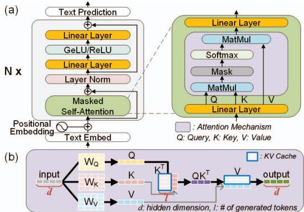

图 1. (a) LLM 的通用架构。(b) 使用 KV 缓存进行单批次处理时，注意力机制内部的矩阵乘法。  
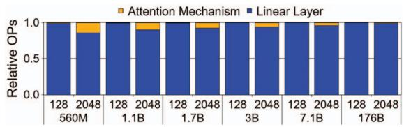  
图 2. 在词元长度为 128 和 2048 的文本生成任务中，不同模型规模的 Bloom 模型在注意力机制和线性层中执行 GEMM 的相对操作次数（OPs）。相对 OPs 与批大小无关，因为注意力机制和线性层中的 OPs 均随批大小线性增长。

为克服仅权重量化的局限并提高性能，我们提出了 FIGNA，这是一种专门为有效加速 FP-INT 量化网络而设计的硬件架构。FIGNA 专注于优化 FP-INT GEMM 运算，这是 LLM 中的一项关键运算。该优化涉及预对齐，即通过共享指数，在计算前将 FP 输入转换为 INT 格式，从而使所有计算均可使用整数运算完成。为确保整数运算在系统层面发挥优势，我们通过截断预对齐尾数和基于块的尾数分配等对应用透明的优化技术，以及 FIGNA 架构，最大限度地降低格式转换带来的开销。尽管该架构在共享输入指数这一点上与以往的块浮点（BFP）硬件具有相同的设计理念，但 BFP 硬件与 FIGNA 在数值精度方面存在关键差异。以往使用 BFP 格式的工作比常规 FP MAC 具有更高的数值误差，但试图通过针对给定硬件定制神经网络来维持神经网络的准确率。相比之下，我们通过理论分析设计 FIGNA，使其保持与常规 FP MAC 相同水平的数值精度。因此，FIGNA 允许用户直接将给定的神经网络部署到硬件上，无需针对硬件约束进行定制。

我们的贡献可总结如下：

我们提出了一种基于整数的 FP-INT GEMM 计算方案，以及对应用透明的优化，包括预对齐尾数截断和基于块的分配。

通过理论分析，我们精心设计截断量，并引入无 0 INT 格式，以确保所提出的方法保持常规 FP 算术的数值精度。

我们提出了一种新颖的 FIGNA 架构，专门用于处理基于整数的 FP-INT GEMM。FIGNA 充分利用简单整数单元的优势，实现了显著的性能提升。

## II. 背景

## A. LLM 推理与量化

LLM 通常由一系列解码器块组成，其中包含掩码自注意力层和线性层（图 1(a)）[48], [57]。在掩码自注意力中，输入值首先经过一个线性层处理，生成查询（Q）、键（K）和值（V）向量。随后利用这些向量执行注意力机制。注意力结果随后通过另一个线性层进行后处理。在注意力块之后，输出会进一步经过多个线性层处理。在 LLM 中，线性层和注意力机制都涉及 GEMM 计算，但区别在于参与相乘的对象。线性层在权重与激活值之间执行 GEMM 运算，而注意力机制则在激活值之间执行 GEMM 运算。当 LLM 的隐藏维度记为 d，且截至某一时刻总共已生成 l 个词元时，考虑到 KV 缓存 [37], [54]，线性层对应的运算量与 $d ^ { 2 } .$ 成正比，而注意力机制对应的运算量与 $( l + 1 ) d$ 成正比，如图 1(b) 所示。需要注意的是，LLM 的隐藏维度 d 通常远大于已生成的词元数量 l。例如，在 BLOOM-176B 模型中，d 为 14,336，而对于一般的文本生成任务，l 通常处于 [1, 2048] 范围内。因此，线性层执行的 GEMM 运算往往主导 LLM 中的计算工作负载（图 2）。因此，优化并加速线性层对应的 GEMM 运算，对于提高 LLM 计算的性能和效率至关重要 [20]。

为了提高 LLM 推理的效率，近期针对 LLM 的量化技术得到了积极研究。然而，与其他 DNN 相比，LLM 的激活值量化更具挑战性，因为其激活值往往分布范围较广，而且离群值起着关键作用 [11]。因此，对 LLM 激活值进行量化往往会导致精度下降。为了减少量化误差，研究者提出了更复杂的量化技术，例如向量级量化（如 VS-Quant [8]）和块级量化（如 MX [10] 和 RPTQ [55]）。这些技术通过精细设定量化偏移量和缩放因子等量化参数，在缓解精度下降方面展现出潜力，但它们并非普遍有效。根据 LLM 模型和任务的不同，仍可能出现精度问题 [55]。因此，为了使 LLM 得到更广泛的应用，

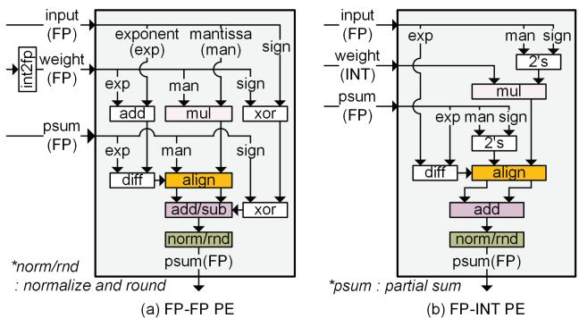

图 3. 用于 FP-INT MAC 运算的朴素 PE 设计。(a) FP-FP PE 采用典型的 FP MAC 单元，并将 INT 权重反量化为 FP 值。(b) FP-INT PE 针对 FP-INT 运算专门定制 FP MAC 单元。  
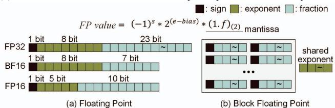  
图 4. 传统的 (a) 浮点格式和 (b) 块浮点格式。  
仅权重量化已被采用，作为提高 LLM 推理效率的一种务实解决方案 [14], [20], [30]。在这种情况下，LLM 的所有线性层都需要在激活值与权重之间执行 FP-INT GEMM 运算。

## B. LLM 中的 FP-INT GEMM 处理

FP-INT GEMM 由 FP-INT 乘加（MAC）运算组成，其中 FP 激活值与 INT 权重相乘，并对得到的 FP 乘积进行累加。在传统处理器中，没有专门设计用于处理 FP 值与 INT 值之间运算的算术单元。因此，FP-INT MAC 运算通常使用 FP MAC 单元执行 [15], [41]，在图 3(a) 中称为 FP-FP PE。在计算之前，需要将整数权重转换为由符号、尾数和指数构成的 FP 格式（图 4(a)），以确保与 FP 激活值兼容 [36]。

因此，尽管 FP-FP PE 可广泛用于一般的 FP MAC 运算，但在执行 FP-INT MAC 运算时会导致计算效率低下。为了克服这一低效问题，可以考虑采用专用的 FP-INT PE 作为替代方案（图 3(b)）。FP-INT PE 无需转换权重的数据类型，而是直接使用低精度整数权重进行乘法运算，从而缩小乘法器的规模。例如，在处理 FP32 激活值和 INT8 权重时，FP-INT PE 需要一个 25 位 × 8 位乘法器，用于 FP 激活值的带符号尾数与整数权重之间的乘法运算，而 FP-FP PE 则需要一个 24 位 × 24 位乘法器，用于两个 FP32 值的尾数之间的乘法运算。

图 5 汇总了 FP-INT PE 相较于传统 FP-FP PE 实现的功耗节省。值得注意的是，使用 FP32 激活值时，FP-INT PE 的功耗显著降低，降幅最高可达 50%。然而，在处理 FP16 或 BF16 激活值时，FP-INT PE 的性能增益有所减弱。这主要是因为 FP-INT PE 的显著收益来自乘法器规模的缩减，但对于 FP16 和 BF16，由于这些格式的尾数位数较少，乘法器规模的缩减幅度有限。例如，在处理 FP16 激活值和 INT8 权重时，FP-INT PE 将 FP-FP PE 的 11 位 × 11 位乘法器替换为 12 位 × 8 位乘法器，乘法器规模仅有小幅缩减。对于 BF16 激活值，FP-INT PE 将 FP-FP PE 的 8 位 × 8 位乘法器替换为 9 位 × 8 位乘法器，导致乘法器规模略有增加。

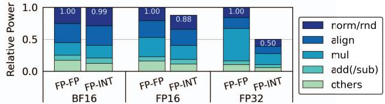  
图 5. FP-FP PE 和 FP-INT PE 在执行 FP-INT8 MAC 运算时的相对功耗。对于每种 FP 类型，功耗均以 FP-FP PE 的总功耗进行归一化。

图 5 中对 PE 各组成部分的细分表明，无论目标数据类型如何，在累加阶段处理 FP 值量级所必需的对齐和规格化操作都占据了 PE 的相当大一部分。这些操作需要根据指数差对操作数的尾数进行移位，因此需要规模较大的桶形移位器。因此，需要开发一种对齐和规格化相关开销更小的新型算术单元结构，以提高 FP-INT GEMM 的效率。

## C. 块浮点

块浮点（BFP）被提出作为传统 FP 格式的宽动态范围与 INT 格式的简单性之间的一种折中方案 [47]。BFP 为一组数值分配一个公共指数，使它们能够统一缩放（图 4(b)）。这一特性使 BFP 能够实现比 INT 格式更高的压缩比，同时也便于在各组内使用整数直接进行计算 [24], [56]。另一方面，与其他量化技术类似，使用 BFP 压缩 DNN 会引入相对于原始 FP 数值的数值偏差，可能导致神经网络准确率下降。

为解决这一准确率限制，先前的工作采用了 BFP-DNN 协同设计方法，重点是在保持 DNN 准确率的同时，尽量降低 BFP 格式的位精度。其中一种方法采用专门的搜索方法，为特定的 DNN 模型确定合适的 BFP 格式 [8], [9], [13], [29], [43]。然而，这种方法面临一些挑战，因为最优的 BFP 格式及其所需的硬件支持可能因 DNN 模型而异。另一种方法是 BFP 感知训练，通过训练，针对选定的 BFP 格式专门优化 DNN [9], [10], [35], [56]。虽然这种方法可以提高准确率，但其缺点是训练过程成本高昂，因此对于需要大量计算资源的大规模模型，其适用性较差。此外，如果目标 BFP 格式发生变化，就需要针对新的块大小重新训练 DNN，这给跨不同硬件配置部署基于 BFP 的解决方案带来了实际挑战。因此，本文并不开发需要投入大量精力的复杂量化方法，而是利用 BFP 格式中的共享指数概念，开发一种可靠的方法，以准确、高效地处理具有 FP 激活值的 GEMM 运算。

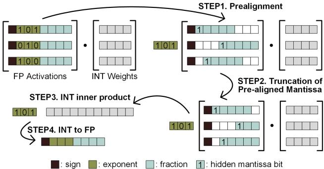  
图 6. 所提出的基于整数的 FP-INT GEMM 运算概览

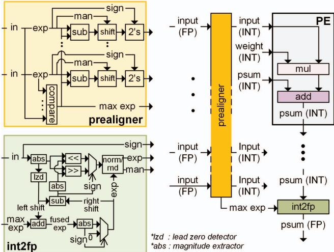  
图 7. FIGNA 中用于基于整数的 FP-INT GEMM 的关键硬件组件：预对齐器、PE 和 int2fp 单元。预对齐器负责通过将所有尾数对齐到同一尺度，将 FP 输入值转换为 INT 值。FIGNA PE 使用 INT 单元执行 MAC 运算，并在整个内积计算完成后，使用 int2fp 单元将计算结果转换回 FP 值

## III. 保持数值精度的基于整数的 FP-INT GEMM

本节介绍一种用于 FP-INT GEMM 的计算方法，以及一种名为 FIGNA 的加速器设计，主要关注在采用 BFP 共享指数概念的同时保持数值精度。基于对计算可靠性的全面理论分析，我们能够使所提出的方案以对应用透明的方式运行。因此，与传统 BFP 方法不同，所提出的设计使部署神经网络时无需考虑硬件。

## A. 基于整数的 FP-INT GEMM 概览

图 6 展示了所提出的基于整数的 FP-INT GEMM 的概览，图 7 展示了 FIGNA 中专为处理基于整数的 FP-INT GEMM 而设计的关键硬件组件。在计算开始之前，预对齐器将 FP 值转换为 INT 值。它分解每个 FP 值的指数和尾数，并负责预对齐过程，为后续 GEMM 计算动态对齐 FP 激活值的尾数。预对齐器分解 FP 值时，通过将隐含前导位 1 与小数部分组合来得到尾数，如图 4 所示。另一方面，预对齐器还通过检查指数值是否为零来检测次正规 FP 值。对于次正规值，由于它们没有隐含前导位，因此直接使用其小数部分作为尾数。接下来，预对齐器确定 FP 激活矩阵的一个向量中的最大指数。然后，根据每个 FP 激活值自身的指数与最大指数之间的差值，调整其尾数，确保所有预对齐后的尾数都处于同一尺度。预对齐使得 FP 激活值可以使用整数值来表示，并共享一个公共的最大指数，以指示激活向量的尺度。需要注意的是，预对齐的动态特性使我们的方法中共享指数的用法有别于 BFP。在 BFP 中，共享指数是用于表示特定数值的数值格式的组成部分。相比之下，在我们提出的方法中，共享指数作为计算的一个步骤引入，对用户不可见。完成预对齐后，我们可以用 INT-INT MAC 运算替代 FP-INT MAC 运算，从而消除每次 MAC 运算中对对齐和规格化的需要。在完成与权重矩阵的整个内积计算后，int2fp 单元遵循传统 FP 单元规格化部分所采用的 FP 格式化与异常处理规则，将计算结果转换回 FP 格式。

尽管基于整数的 FP-INT GEMM 能够消除每个 PE 中的对齐/规格化开销，但如果处理不当，也可能导致乘法器规模显著增大。例如，考虑 BF16 激活值的情况，由于其指数为 8 位，预对齐过程中尾数的最大移位量为 255。为精确保留其数值，预对齐后的尾数应使用 263 位整数表示，计入符号后则需要 264 位整数。因此，对于 BF16 与 INT8 之间的 MAC 运算，FP-INT PE 需要一个 9 位 × 8 位乘法器，而 FIGNA PE 则需要一个 264 位 × 8 位乘法器，使乘法器规模扩大至原来的 29.3 倍。在这种情况下，乘法器规模增大所引入的开销超过了消除对齐/规格化开销所带来的优势。因此，为了利用基于整数的 FP-INT GEMM 获得实质性的性能提升，关键在于开发一种方案，在保持原始 FP-INT GEMM 数值精度的同时，降低预对齐后尾数的位精度。

## B. 用于 FP-INT MAC 的保持数值精度的预对齐尾数截断的数学证明

所提出的基于整数的 FP-INT GEMM 即使对预对齐尾数进行截断，也有可能达到与 FP 运算相同的数值精度水平，因为尾数位数有限，FP 运算的结果无法用给定的 FP 格式完整表示。在这种情况下，需要通过舍入将结果近似为最接近的可表示 FP 值。这一舍入过程会在 FP 运算中引入误差，其上界为两个可表示 FP 数之间的最小增量，可记为 $\epsilon = 2 ^ { - p }$（$p$：尾数的位精度）。另一方面，如果对预对齐尾数进行截断，截断误差就会在实际计算之前产生。我们假设，通过在整个累加路径中增加整数累加器的位宽，计算结果能够以整数值的形式精确地通过累加路径。这种方法是可行的，因为位宽增加量很小，并且随累加次数呈对数增长。因此，对预对齐尾数进行截断，可以视为将 FP 运算的误差来源从运算结束时移至运算开始时。

为了确保数值精度，必须仔细考察预对齐尾数的截断，以保证基于整数的 FP-INT MAC 运算所引入的误差不超过 $\epsilon$。此前的工作 [23] 已研究了尾数截断对 FP 求和的影响，本文在 [23] 所给出的数学证明基础上进行扩展，以描述尾数截断对 FP-INT MAC 运算的影响。截断程度由参数 $\delta$ 控制，该参数决定预对齐尾数允许保留的额外位数。在此情境下，预对齐尾数仅保留最高的 $t ( = p + \delta )$ 位，其余位均被丢弃。为了保持 FP-INT GEMM 的整体精度，必须确保单个 FP-INT MAC 运算的误差上界与传统运算相同。这能够确保计算的每一步都保持数值精度，从而使整个 GEMM 获得准确的结果。因此，我们首先分析截断对基于整数的 FP-INT MAC 运算 $w x + w ^ { \prime } x ^ { \prime }$ 的影响，其中使用两个 FP 值 x 和 $x ^ { \prime }$（不失一般性，$x \geq x ^ { \prime }$），以及两个整数值 $w$ 和 $w ^ { \prime }$。我们假设这些值均为非负数，并在累加阶段同时考虑加法和减法，考察符号的影响。注意，在以下情况下能够计算出精确结果：1）$x = x ^ { \prime }$；2）$x ^ { \prime } = 0$；或 3）$\delta \geq k$，其中 k 为 x 与 $x ^ { \prime }$ 之间的指数差。因此，在以下分析中，我们重点考虑 $x > x ^ { \prime } > 0$ 且 $k > \delta$ 的情形。此外，我们假设 $w, w ^ { \prime } \in [ 1 , \ 2 ^ { p _ { w } } - 1 ]$，其中 $p _ { w }$ 为最大值的位精度。整数值为零时的影响将在下一节讨论。

对 $x ^ { \prime }$ 进行预对齐和截断后，我们得到 ${ \bar { x ^ { \prime } } }$。

$x ^ { \prime }$ 与 ${ \bar { x ^ { \prime } } }$ 之间的差值满足以下界限：

$$
\left| x ^ {\prime} - \bar {x} ^ {\prime} \right| = 0. 0 \dots 0 b _ {t} \dots b _ {(k + p - 1)} \leq 2 ^ {- (p + \delta - 1)} \left(1 - 2 ^ {- (k - \delta)}\right)\tag{1}
$$

这里，$b _ { i }$ 表示第 i 个小数位的二进制状态。由于 $x$ 和 $x ^ { \prime }$ 的绝对大小不影响预对齐阶段尾数移位和截断的位数，不失一般性，我们假设 $x$ 的指数为 0（这意味着 $x \geq 1$），而 $x ^ { \prime }$ 的指数为 $- k$。

在加法之后进行乘法的情况下，MAC 运算的相对误差定义如下：

$$
e _ {a d d} = \frac {\left| (w x + w ^ {\prime} x ^ {\prime}) - (w x + w ^ {\prime} \bar {x} ^ {\prime}) \right|}{\left| w x + w ^ {\prime} x ^ {\prime} \right|} = \frac {\left| w ^ {\prime} \right| \times \left| x ^ {\prime} - \bar {x} ^ {\prime} \right|}{\left| w x + w ^ {\prime} x ^ {\prime} \right|},\tag{2}
$$

由于 $|w x + w ^ { \prime } x ^ { \prime } | \geq 1$，应用式 1 可得

$$
e _ {a d d} \leq (2 ^ {p _ {w}} - 1) \times 2 ^ {- (p + \delta - 1)} (1 - 2 ^ {- (k - \delta)}) \leq 2 ^ {- (p + \delta - 1 - p _ {w})}\tag{3}
$$

当 $\delta = p _ { w } + 1$ 时，$e _ { a d d }$ 的上界为 $\epsilon$。

在减法之后进行乘法的情况下，相对误差定义如下：

$$
e _ {s u b} = \frac {\left| \left(w x - w ^ {\prime} x ^ {\prime}\right) - \left(w x - w ^ {\prime} \bar {x} ^ {\prime}\right) \right|}{\left| w x - w ^ {\prime} x ^ {\prime} \right|} = \frac {\left| w ^ {\prime} \right| \times \left| x ^ {\prime} - \bar {x} ^ {\prime} \right|}{\left| w x - w ^ {\prime} x ^ {\prime} \right|}.\tag{4}
$$

这里，$w x \geq 1$，且 $w ^ { \prime } x ^ { \prime }$ 满足以下界限：

$$
w ^ {\prime} x ^ {\prime} \leq (2 ^ {p _ {w}} - 1) (1. b _ {1} \dots b _ {p - 1}) 2 ^ {- k} <   1. 1 \dots 1 \times 2 ^ {- k + p _ {w}}\tag{5}
$$

如果 $\delta = p _ { w } + 1$，那么当 $k > \delta$ 时，wx 始终大于 $w ^ { \prime } x ^ { \prime }$，因此 $\vert w x - w ^ { \prime } x ^ { \prime } \vert$ 满足以下界限：

$$
\left| w x - w ^ {\prime} x ^ {\prime} \right| \geq 2 ^ {- 1} + \dots + 2 ^ {p _ {w} - k + 1} = 1 - 2 ^ {p _ {w} - k + 1}\tag{6}
$$

将式 6 应用于式 4，可得 $e _ { s u b } \leq \epsilon$。请注意，该证明同样适用于计算结果为次正规 FP 数的特殊情形。次正规 FP 数的指数为 0，且尾数不具有隐藏的前导位 1。在这种情况下，由两个次正规 FP 数之间的最小差值决定的舍入误差大于 $\epsilon$。与此同时，由于所提出的方案旨在保证误差水平小于 $\epsilon$，因此基于整数的 FP-INT GEMM 在处理次正规数时也能保持数值精度。

因此，当 $\delta = p _ { w } + 1$ 时，基于整数的 FP-INT MAC 运算能够保持与传统 FP-INT 运算相同的数值精度水平。上述分析与具体的 FP 格式无关，因此这一结论适用于任何 FP 格式。此外，将 δ 增加 1，即设置 $\delta = p _ { w } + 2$，能够将基于整数的 FP-INT MAC 运算的误差上界降低至 $\epsilon$ 的一半。这种增强的误差容限对于 FP-INT GEMM 尤为重要，因为在 PE 阵列末端，还需要额外将基于整数的计算结果转换回原始 FP 格式。因此，基于整数的 FP-INT GEMM 能够在 $\delta = p _ { w } + 2$ 时保持数值精度。

在 GEMM 的内积计算中，MAC 运算按顺序执行，误差随每次 MAC 运算而累积。因此，如果在两个输入的情况下，预对齐方法与传统 FP 运算的 MAC 计算误差水平能够保持一致，那么可以预期这两种方法在 GEMM 中也能达到相同水平的数值精度，因为在整个 GEMM 处理过程中累积的误差水平相同。图 8 展示了 NVIDIA A100 GPU 执行的 FP-INT GEMM 相对于精确运算的最低有效位单位（ULP）误差，以及所提出的基于整数的 FP-INT GEMM 相对于精确运算的 ULP 误差 [42]。为了评估实际的 FP-INT GEMM 运算，我们针对每个扇入值收集了一个包含 50,000 个 FP-INT 内积实例的数据集。这里，扇入是指每次内积运算所考虑的输入值数量，所报告的误差表示这些采样实例中观察到的平均误差。当权重处于 $1 \leq w \leq 2 ^ { p _ { w } } - 1$ 范围内时，采用 $\delta = 0$ 的尾数截断会显著增大基于整数的 FP-INT GEMM 的计算误差。相比之下，可以观察到，当 $\delta = p _ { w } + 2$ 时，所提出的方法与 NVIDIA A100 GPU 具有相同的数值精度，这与我们的数学分析所预测的一致（图 8(a)）。

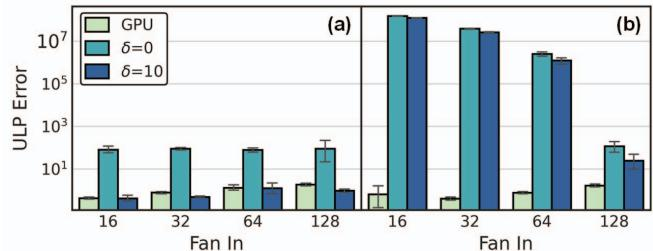  
图 8. NVIDIA A100 GPU 执行的 FP32-INT8 GEMM 和所提出的基于整数的 FP-INT GEMM（采用由 δ 参数化的预对齐尾数截断）相对于精确 FP-INT GEMM 的计算误差。子图 (a)/(b) 分别表示 INT8 权重中不包含/包含 0 值的情况。每个误差棒表示一个 95% 置信区间。

一种例外情况是权重范围包含 0 值时，即 $( 0 ~ \leq ~ w ~ \leq ~ 2 ^ { p _ { w } } ~ - ~ 1 )$。在这种情况下，可以观察到，即使采用 $\delta \ = \ p _ { w } \ + \ 2$，所提出方法的误差水平仍会显著增大，因而无法保证数值精度（图 8(b)）。因此，我们需要找出包含 0 时数值误差增大的根本原因，并制定解决方案。

## C. 用于可靠计算的无 0 有符号 INT 格式

第 III-B 节分析中的一个关键认识是，当非零整数值与 FP 值相乘时，FP 值的尺度变化保持在一个有限窗口内。此外，累加过程不会改变操作数的尺度。这一特性使我们能够在计算前大幅截断预对齐尾数中的低有效位，而不会对数值精度造成显著影响。相比之下，当整数权重包含 0 值时，由于乘法后的尺度变化变得不可预测，采用预对齐尾数截断实现可靠计算便不再可行。例如，考虑两个 FP 激活值 $1 . 0 1 1 \times 2 ^ { 2 3 }$ 和 $1 . 0 0 1 \times 2 ^ { - 1 }$ 分别与权重值 0 和 1 相乘的情况。正确的 FP-INT

MAC 运算结果应为 $1 . 0 0 1 \times 2 ^ { - 1 }$。然而，当我们应用预对齐和尾数截断的概念，并额外保留 1 位时，预对齐尾数表示为 1.0110 和 0.0000，共享最大指数 $2 ^ { 2 3 }$。与权重值相乘并累加后，计算结果变为 0，未能反映正确值 $1 . 0 0 1 \times 2 ^ { - 1 }$。

为了解决遇到 0 权重值时配置预对齐尾数有效位所带来的挑战，我们提出了一种无 0 有符号 INT 格式，该格式与用于权重量化的传统有符号 INT 格式保持高度兼容。在有符号整数常用的二进制补码格式中，每个位位置（以 k 为索引）的二进制状态 $0 ~ \mathrm { o r } ~ 1 $ 分别表示数值 $0 { \mathrm { ~ o r ~ } } 2 ^ { k - 1 }$，最高有效位（MSB）除外，其表示的数值为 $\mathrm { ~ 0 ~ o r ~ } - 2 ^ { M S B - 1 }$。当 $\textrm { a } \ 2 \ ' \mathrm { s }$ 补码整数表示中的所有二进制位均设为 0 时，所得整数值为 0。为避免在使用预对齐尾数进行计算时因 0 权重值而产生复杂情况，无 0 有符号 INT 格式被设计为使每个位位置的二进制状态 0/1 分别表示 $- 2 ^ { k - 1 } \ \mathrm { o r } \ + \mathrm { 2 } ^ { k - 1 }$。将传统二进制补码整数值 W 转换为无 0 有符号整数值 $W ^ { \prime }$，可以通过一个简单的线性方程实现：$W ^ { \prime } = 2 W + 1$。这也使 GEMM 运算满足 $Y W ^ { \prime } = 2 Y W + Y$（$Y$：输入激活向量），转换时只需进行简单的缩放和激活值求和。因此，即使权重采用无 0 有符号 INT 格式表示，也可以通过引入激活值求和单元，在 PE 设计中使用二进制补码乘法器和加法器。

在一般的量化算法中，会引入量化偏移量和缩放因子（通常为 FP 值），以提高非对称量化器设计的灵活性，并在 GEMM 运算后使用这些偏移量和缩放因子调整计算结果。通过在权重量化过程中仔细调节量化偏移量和缩放因子，可以在不改变每个量化阶段实际表示值的情况下，得到量化为不同 INT 格式（例如有符号 INT、无符号 INT，甚至无 0 有符号 INT 格式）的权重值。因此，无论采用何种 INT 格式，非对称量化都能达到相同水平的网络精度 [3]。

$p _ { w }$ 位无 0 有符号整数的最大绝对值为 $2 ^ { p _ { w } } - 1$，这意味着与权重相乘后，预对齐尾数的最大尺度偏移为 $2 ^ { p _ { w } } - 1$。因此，当权重采用无 0 有符号 INT 格式表示时，额外保留 $\delta = p _ { w } + 2$ 位的预对齐尾数截断可以确保基于整数的 FP-INT GEMM 的计算可靠性。

## D. 基于分块的尾数分配

图 9 展示了采用所提出的预对齐尾数截断和不含 0 的整数值的 FIGNA PE 相较于基准 FP-FP PE 所实现的面积/功耗降低幅度。对于 FP32 激活，FIGNA PE 在面积和功耗方面均实现了显著降低，降幅分别高达 89% 和 88%。然而，对于采用 INT8 权重的 BF16 激活，降幅相对有限，面积降低了 27%，功耗降低了 16%。同样，对于 FP16 激活，降幅也较为有限。这些发现表明，BF16 和 FP16 激活可能无法充分发挥 FIGNA PE 的潜在优势，因此需要进一步研究和优化，以便针对这些特定的激活类型更好地利用 FIGNA PE 的优势。

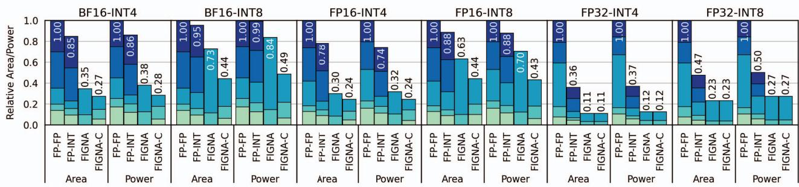  
其他 加法(/减法) 乘法 对齐 规格化/舍入

图 9. 用于 FP-INT MAC 运算的 FP-FP PE、FP-INT PE、FIGNA PE 和 FIGNA-C PE 的相对面积和功耗。对于每种数据类型，面积和功耗分别以 FP-FP PE 的总面积和总功耗进行归一化。评估涵盖三种 FP 格式（BF16、FP16 和 FP32）以及两种 INT 格式（INT4 和 INT8）。  
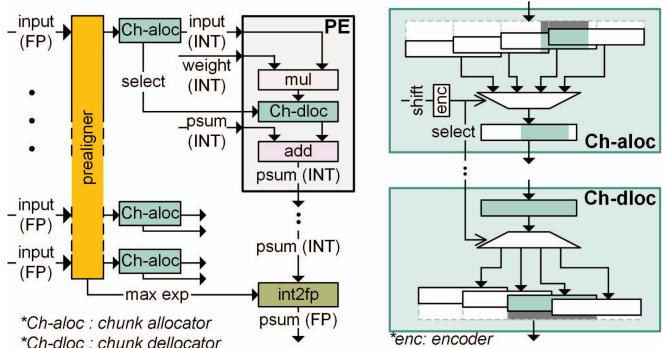  
图 10. FIGNA 中用于基于分块的尾数分配的硬件组件。预对齐尾数被划分为多个块，块分配器选择一组包含所有有效尾数值的连续块，并将其传递给 PE。块解分配器根据块位置 select，确保乘法结果被放置在累加器中的正确位置。块位置由预对齐时尾数的移位量决定。

在第 III-B 节中，我们讨论了预对齐尾数额外位数的计算，并假设 FP 激活和 FP 累加器的数据类型相同。然而，在实际场景中，即使使用 BF16 和 FP16 激活，DNN 处理也通常优先采用 FP32 累加器 [5], [34]。之所以偏好 FP32 累加器，是因为其尾数具有更高的分辨率，能够有效地减少舍入误差，并得到更准确的计算结果。在这种情况下，预对齐尾数所需的位数应根据累加器的数据类型来计算，因为尾数截断应模拟常规运算的舍入行为。因此，无论 FP 激活的数据类型如何，预对齐尾数都应由 $p _ { f p 3 2 } + n + 2$ 比特组成，其中 $p _ { f p 3 2 }$ 是 FP32 尾数的位精度，其值为 24。然而，无论 FP 激活的数据类型如何，都为预对齐尾数分配 $p _ { f p 3 2 } + n + 2$ 比特，可能会导致效率低下，尤其是对于较低精度的格式，例如

BF16 和 FP16。例如，使用 8 比特权重时，预对齐尾数需要 34 比特。然而，对于 BF16 和 FP16 激活，预对齐尾数分别只有 8 比特和 11 比特是有效的。因此，所分配比特中的很大一部分可能未被使用，导致计算资源利用不足。

为了减少预对齐尾数的有效位数，我们提出了一种基于分块的尾数分配方法（图 10）。在这种方法中，我们引入了块的概念，即一组二进制位，作为表示预对齐值的基本单位。例如，使用 7 比特的块时，总共需要 5 个块来表示原始的 34 比特预对齐尾数。然而，对于 BF16 激活，只有 2 个连续块包含有效值，其余 3 个块均填充为零。为了提高效率，块分配器通过传递由包含全部有效值的 2 个连续块组成的 14 比特值，以及这 2 个块的位置信息，来表示预对齐尾数。由于包含有效值的块有 4 种可能的位置，因此该位置信息需要额外 2 比特来表示。块位置（select）根据预对齐阶段的尾数移位量（shift）确定，因为该移位量定义了有效值在预对齐尾数各块中的位置。采用这种基于分块的方法，可以在不丢失任何相关信息的情况下，有效地将预对齐尾数的大小从 34 比特减小到 16 比特。位数的减少能够提高计算资源的利用率，从而提高 FIGNA PE 的效率。不采用基于分块的方法时，FIGNA PE 执行 35 比特有符号尾数与 INT8 权重之间的乘法。相比之下，基于分块的方法通过执行 15 比特有符号尾数与 INT8 权重之间的乘法，降低了乘法器开销。块解分配器使用一个 1 对 4 DEMUX，根据块位置确定乘法结果所需的移位量。该对齐操作在累加过程之前执行，以确保正确调整乘法结果的尺度。

在这种基于分块的尾数分配方法中，由于需要在减少有效位数与尽量降低多路复用开销之间进行权衡，找到最优的块大小至关重要。

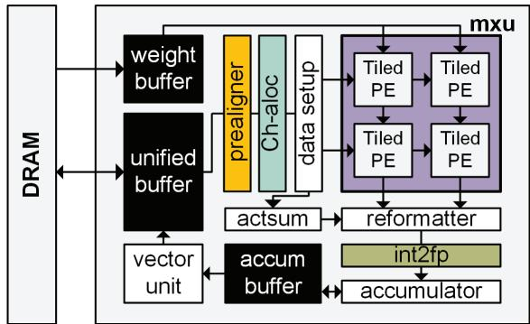  
图 11. FIGNA 架构的高层概览

较高精度的块能够减少块数量和多路复用开销，但可能引入更多冗余比特，并需要更大的乘法器。反之，较低精度的块能够减少冗余比特并缩小乘法器规模，但会增加块数量以及潜在的多路复用开销。为了找到最优的块大小，我们评估了不同块大小下 FIGNA PE 运算的整体效率，发现对于 BF16 激活采用 7 比特的块、对于 FP16 激活采用 5 比特的块时，效果最佳。因此，FIGNA-C PE 作为一种面向基于整数的 FP-INT MAC 和基于分块的尾数分配而设计的 PE，与其他 PE 设计相比，显著提高了面积/功耗效率（图 9）。对于 BF16 激活和 INT8 权重，与未采用基于分块的分配方法的 FIGNA PE 相比，FIGNA-C PE 的面积/功耗效率提升了 1.66/1.71 倍；与基准 FP-FP PE 相比，则提升了 2.27/2.04 倍。对于 FP32 激活，34 比特的块可实现最佳的面积/功耗效率，这表明预对齐尾数应直接送入 PE，无需任何多路复用。因此，在 FP32 情况下，FIGNA-C PE 和 FIGNA PE 的设计相同。

总体而言，基于整数的 FP-INT MAC 结合所有提出的优化技术，相较于基准 FP-FP PE，将 PE 的面积和功耗降低了 51% 至 89%（图 9）。这些结果证明了所提出方法在提高 FP-INT MAC 运算效率方面的有效性。

## E. FIGNA 整体架构

图 11 展示了 FIGNA 的整体架构。首先，预对齐器将 FP 输入激活转换为整数值，分块分配器从预对齐后的整数值中选择有效分块。数据设置单元确保输入按正确的时序送入矩阵乘法单元（mxu），该单元基于 Google TPU 的二维脉动阵列架构设计 [19], [25]。mxu 遵循典型的权重固定数据流，利用 FIGNA-C PE 中的整数单元执行 FP-INT GEMM 运算。PE 配备了用于存储权重值的寄存器，二维权重矩阵直接映射到二维 PE 阵列上。用于内积计算的激活向量被依次送入 PE 阵列。该向量在 PE 阵列的各列之间共享，以最大化输入向量的复用，使同一输入能够用于多次计算。每个 PE 对输入激活与权重执行 MAC 运算，并将 MAC 结果向下传递至下一个 PE 进行累加。通过这种方式，每列 PE 实际上完成了 GEMM 中的内积计算。PE 基于权重固定数据流以分块方式组织 [18]。在 mxu 的末端，int2fp 单元将整数计算结果转换回 FP 值。当扇入数超过 mxu 的行数时，输入向量被划分为适合 mxu 的子向量。随后，各子向量被依次送入 mxu 进行处理。为了完成整个 GEMM 运算，使用由 FP32 加法器组成的累加器合并不同子向量的计算结果。此外，还设计了 actsum 和 reformatter，以支持二进制补码 INT 格式与所提出的无零有符号 INT 格式之间的转换。在 FIGNA 中，片上缓冲区分为三类。统一缓冲区负责缓冲输入和输出数据。权重缓冲区专门用于存储权重值，accum 缓冲区则用于存储计算过程中产生的部分和。

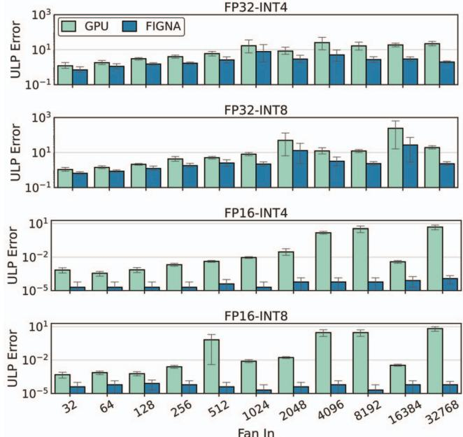  
图 12. NVIDIA GPU 和所提出的 FIGNA 执行 FP-INT GEMM 时相对于精确运算的数值误差。评估的扇入数范围为 32 至 32768，以覆盖 LLM 的大扇入数。每条误差棒表示一个 95% 置信区间。

## IV. 评估

## A. 精度评估

1) 数值精度：在本节中，我们使用大语言模型中常用的各种 FP 格式（FP32 和 FP16）与 INT 格式（INT4 和 INT8），全面分析所提出的 FIGNA 的数值精度。我们评估了从 32 到 32768 的扇入值，以覆盖大语言模型中的大扇入值。针对每个扇入值，采样构建一个包含 50,000 个 FP-INT 内积案例的数据集。我们使用高斯分布生成 INT 权重，以反映大语言模型中典型的权重分布。FP 激活值从广泛的取值范围中采样，从而能够展示存在离群值时的运算情况。

表 I  
使用 NVIDIA GPU 和 FIGNA 进行推理的语言模型的准确率结果。BERT、BLOOM、OPT 模型分别在 GLUE、PTB 和 WIKITEXT-2 上进行评估。

<table><tr><td rowspan="2"></td><td colspan="8">BERT-base</td><td colspan="8">BLOOM</td></tr><tr><td>QNLI</td><td>SST-2</td><td>MRPC</td><td>STSB</td><td>QQP</td><td>MNLI-m/mm</td><td>CoLA</td><td>RTE</td><td>560M</td><td>1.1B</td><td>1.7B</td><td>3B</td><td>7.1B</td><td>176B</td><td>176B&#x27;</td><td></td></tr><tr><td>GPU</td><td>91.54</td><td>92.43</td><td>89.35</td><td>88.59</td><td>89.34</td><td>84.12/84.68</td><td>59.57</td><td>72.56</td><td>41.26</td><td>46.98</td><td>27.92</td><td>23.13</td><td>19.40</td><td>13.58</td><td>14.02</td><td></td></tr><tr><td>FIGNA</td><td>91.54</td><td>92.43</td><td>89.35</td><td>88.59</td><td>89.34</td><td>84.12/84.68</td><td>59.57</td><td>72.56</td><td>41.29</td><td>46.98</td><td>27.92</td><td>23.13</td><td>19.40</td><td>13.58</td><td>14.02</td><td></td></tr><tr><td rowspan="2"></td><td colspan="8">BERT-large</td><td colspan="8">OPT</td></tr><tr><td>QNLI</td><td>SST-2</td><td>MRPC</td><td>STSB</td><td>QQP</td><td>MNLI-m/mm</td><td>CoLA</td><td>RTE</td><td>125M</td><td>350M</td><td>1.3B</td><td>2.7B</td><td>6.7B</td><td>13B</td><td>30B</td><td>66B</td></tr><tr><td>GPU</td><td>92.28</td><td>93.46</td><td>90.01</td><td>90.15</td><td>89.59</td><td>86.50/85.79</td><td>62.91</td><td>73.29</td><td>27.66</td><td>22.03</td><td>14.68</td><td>12.49</td><td>10.86</td><td>10.12</td><td>9.55</td><td>9.34</td></tr><tr><td>FIGNA</td><td>92.37</td><td>93.12</td><td>90.02</td><td>90.19</td><td>89.58</td><td>86.64/85.92</td><td>63.89</td><td>73.65</td><td>27.67</td><td>22.02</td><td>14.68</td><td>12.49</td><td>10.86</td><td>10.12</td><td>9.55</td><td>9.34</td></tr></table>

图 12 汇总了使用 NVIDIA GPU 或所提出的 FIGNA 执行 FP-INT GEMM 时，相对于精确运算的 ULP 误差。使用 FP32 激活值时，所提出的 FIGNA 的误差略低于 GPU。这一改善归因于对预对齐尾数采取的保守截断。根据第 III-B 节中的误差界分析，FIGNA 在设计中采用了足够多的额外位 δ，以便即使在最大权重与最小激活值相乘、最小权重与最大激活值相乘的最坏情况下，也能保持数值精度。然而，在实际计算场景中，这类情况很少出现，因此 FIGNA 的误差相对较小。对于 FP16，FIGNA 的误差远低于 GPU。在传统的 DNN 计算系统中，无论 FP 激活值采用何种数据类型，累加器均使用 FP32 格式，因此 FIGNA 中预对齐后的尾数包含 $p _ { f p 3 2 } + n + 2$ 位，在使用 INT8 权重的情况下相当于 34 位。这一配置使 FP16 在预对齐后具有 23 个额外的尾数位。因此，如果最大激活值与其他激活值之间的指数差处于这些额外位所能覆盖的范围内，FIGNA 就不会产生截断误差，从而确保运算精确。由于如此大的差异在实际计算场景中也很少出现，FIGNA 实现了优于传统 FP 单元的数值精度。因此，在 FP-INT GEMM 运算的各种计算场景中，所提出的 FIGNA 成功保持了与 GPU 相当的数值精度，甚至实现了更高的数值精度。

2) 推理准确率：为评估 FIGNA 处理语言模型推理任务的有效性，我们评估了分别使用 NVIDIA GPU 和 FIGNA 处理语言模型时的推理准确率。我们考察了基于编码器的模型（BERT [12]）和基于解码器的模型（BLOOM [48] 和 OPT [57]）。对于 BERT，我们在通用语言理解评估（GLUE）基准 [46] 上评估其性能。评估考虑了 BERT 模型的两个变体，即 BERT-base 和 BERT-large。BERT-base 使用 FP32 激活值和 INT8 权重，而 BERT-large 使用 BF16 激活值和 INT8 权重。对于 OPT 和 BLOOM，我们分别在 WikiText-2 [33] 和 Penn Treebank（PTB）[32] 数据集上测量文本生成的困惑度。在本实验中，我们覆盖了 OPT 和 BLOOM 所有可用的模型规模。这些模型均使用 FP16 激活值和 INT8 权重。此外，为进行全面分析，我们还报告了采用 INT4 权重的 BLOOM-176B（记为 BLOOM-176B’）的困惑度。表 I 汇总了评估结果。由于 FIGNA 保持了数值精度，GPU 与 FIGNA 的推理结果之间没有明显差异。

表 II  
FIGNA 与基线设计的硬件配置

<table><tr><td></td><td>FP-FP</td><td>FP-INT</td><td>[23]</td><td>FIGNA</td></tr><tr><td>mxu</td><td>128×128</td><td>128×128</td><td>128×(128×W*)</td><td>128×128</td></tr><tr><td>INT 权重</td><td>✗</td><td>√</td><td>√</td><td>√</td></tr><tr><td>INT 单元</td><td>✗</td><td>✗</td><td>√</td><td>√</td></tr><tr><td>权重位宽可扩展性</td><td>√</td><td>√</td><td>✗</td><td>√</td></tr><tr><td>分块分配</td><td>-</td><td>-</td><td>✗</td><td>√</td></tr></table>

\* : 权重位宽

## B. 硬件评估设置

1) 硬件配置：我们将 FIGNA 与 3 种基线设计进行比较：FP-FP 引擎、FP-INT 引擎和 [23]（表 II）。我们纳入了与 [23] 的比较，因为其方法同样应对了仅权重量化 DNN 所面临的挑战。与 FIGNA 类似，[23] 也采用预对齐的概念，在执行计算之前将 FP 激活值转换为 INT 值。然而，[23] 专门用于处理采用二进制编码格式进行非均匀量化的权重。在这种情况下，权重无法用传统的 INT 值表示，因此 [23] 中的设计以位串行方式处理 GEMM 运算，以利用 INT 加法单元。具体而言，它对激活值进行求和，其中每个 PE 处理各个权重位位置的二进制值。对于多位权重，[23] 将每个权重位位置的求和结果乘以该位位置的位权（对于非均匀量化，该位权表示为 FP 值），然后执行加法运算，从而合并各个权重位位置的求和结果。为了进行比较，我们对 [23] 的硬件设计进行了适当修改，使其能够处理 INT 权重值。对于 FIGNA，FP16 和 BF16 激活值采用基于分块的尾数分配。不过，在 FP32 输入的情况下不采用该方法。

为了测量这些设计的面积和功耗，我们使用 Synopsys Design Compiler，基于 28nm CMOS 工艺对设计进行综合，并使用 PrimePower [26] 测量功耗。由于 LLM 模型正被量化为多种格式，我们针对六种情况评估所有设计：输入采用 FP32、FP16 和 BF16 格式，权重采用 INT4 和 INT8 格式。我们为输入缓冲区和权重缓冲区编译生成 SRAM 存储阵列，并为累加缓冲区实现寄存器文件，以支持相对频繁的访问。测得 SRAM 和寄存器文件的访问能耗分别为 0.1053 pJ/bit 和 0.0625 pJ/bit。对于片外存储器，我们使用 HBM2 存储器，其访问能耗为 3.9 pJ/bit，带宽为 256 GB/s [18]。

为了公平比较，我们调整所有设计，使其具有相同的最大性能（TOPS）目标。FP-FP 引擎、FP-INT 引擎和 FIGNA 均采用 128×128 脉动阵列。对于 [23]，当权重为 4 位时，我们使用 128×128×4 脉动阵列；当权重为 8 位时，我们使用 128×128×8 脉动阵列，以匹配 TOPS 目标。所有设计均以 100MHz 的目标时钟频率进行综合。请注意，实验重点评估线性层中涉及的 GEMM 运算，因为这些运算是 LLM 推理中最主要的组成部分。

2) 仿真器设置：为了测量各设计的性能，我们实现了一个基于 System-C 的仿真器 [1]、[4]。在仿真过程中，我们获取各网络推理时的 DRAM 访问次数、SRAM 访问次数和运算次数，并测量延迟。我们将存储器访问次数与第 IV-B1 节中提到的每比特能耗相乘，计算存储器访问产生的能耗。利用逻辑综合得到的功耗测量值，我们计算每次运算的能耗，并将其乘以仿真得到的运算次数，以确定逻辑运算产生的动态能耗。我们将漏电功耗乘以延迟，得到该设计的漏电能耗。我们评估了所有涉及输入激活值与权重矩阵之间 GEMM 运算的线性层。请注意，这些 GEMM 运算占总计算时间的大部分，这主要是因为它们的隐藏维度很大 [21]、[40]。

3) 目标工作负载：我们测量了 FIGNA 和基线设计在处理第 IV-A 节介绍的所有语言模型时的 TOPS/mm2 和 TOPS/W，这些模型包括 BERT、BLOOM 和 OPT。对于基于编码器的 BERT 模型，我们假设它们对长度为 128 个词元的句子进行编码。这些模型中的每个线性层同时处理 128 个输入向量，实际上相当于处理 128 批数据。BLOOM 和 OPT 模型是基于解码器的模型，它们采用自回归方式生成文本。在我们的实验中，我们对这些模型采用的批大小为 32，这是考虑到近期研究表明，在这一批大小下，可以高效地对面向实际应用的语言模型中的生成任务进行批处理，且不会产生额外的计算成本

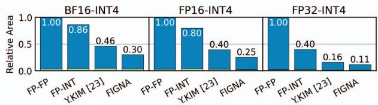

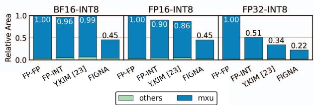  
图 13. FIGNA 和基线设计的面积构成

[54]。

## C. 面积效率分析

本节比较 FIGNA 与基线设计的面积效率（TOPS/mm2）。

图 13 展示了六种不同数据类型组合下各设计的面积构成。在这六种数据类型下，FP-FP 引擎的 mxu 面积最大，这是因为其 PE 使用了开销较大的 FP 单元。另一方面，FP-INT 引擎通过为乘法器采用更窄的位宽来降低 mxu 的复杂度，从而减小了 mxu 的面积。尽管如此，mxu 内部用于对齐和归一化逻辑的组件仍然较大，因此 mxu 的面积仍然相当可观，平均降幅最高仅为 26.2%。[23] 和 FIGNA 均通过采用预对齐进一步降低了 mxu 的复杂度，平均面积分别减少了 46.5% 和 70.3%。

值得注意的是，当输入为 BF16 或 FP16、权重为 INT8 时，与其他设计相比，FIGNA 的面积显著减小，而 [23] 的面积降幅很小，甚至略有增加。这是因为各设计对权重位宽变化的敏感程度不同。FP-FP 引擎在内部将 INT 权重转换为 FP 格式，从而确保即使权重位宽增加，PE 的面积也保持不变。FP-INT 引擎的乘法器面积会随权重位宽成正比增加。然而，考虑到乘法器在总面积中的占比较小（图 9），其面积增加不会显著影响总面积。另一方面，随着权重位宽增加，[23] 的面积会显著增加。在 [23] 中，权重被划分为 1 位切片，然后分配到 mxu 的不同列。随后，使用加法器执行累加操作，并在 mxu 的末端合并各个位平面。这种方法遵循位串行计算的设计思想，其中加法器和寄存器的数量随权重位宽成正比增加。因此，总面积也会大幅增加。相比之下，FIGNA 采用位并行计算方式，使用乘法器在 mxu 的单列内处理权重的所有位。因此，当权重位宽增加时，与 [23] 相比，它所需的额外寄存器要少得多。所以，当权重采用 INT8 格式时，FIGNA 的面积增幅小于 [23]，使其成为处理较大权重位宽的更高效选择。

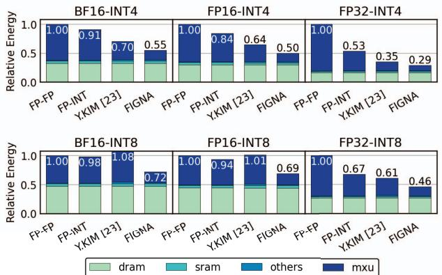

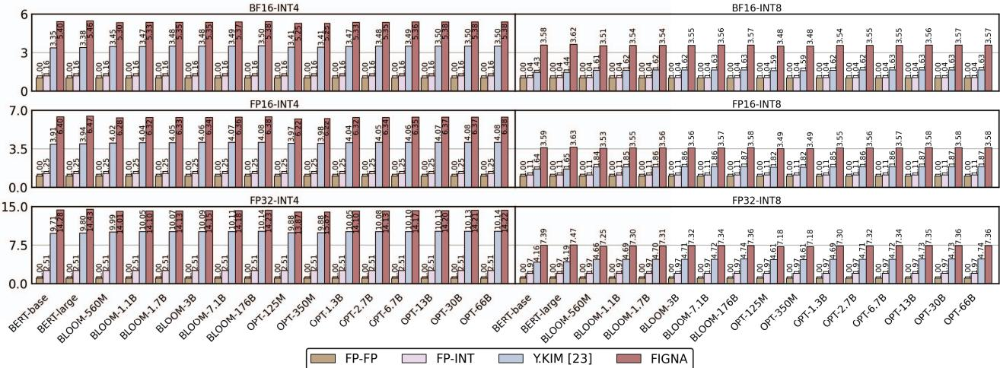  
图 14. FIGNA 与基线设计使用六种数据类型进行语言模型推理时的归一化 TOPS/mm2。每种情况下的 TOPS/mm2 均以 FP-FP 引擎的相应值进行归一化。  
图 15. FIGNA 与基线设计的能耗构成。评估的是 OPT-66B 推理期间的能耗。

图 14 展示了六种数据类型组合下的归一化 TOPS/mm2。对于每种数据类型，所有 TOPS/mm2 均以 FP-FP 引擎的相应值进行归一化。由于预对齐和块选择显著降低了逻辑复杂度，FIGNA 在所有模型和数据类型下的 $\mathrm { T O P S } / m m ^ { 2 }$ 均高于基线设计。与 FP-FP 引擎和 FP-INT 引擎相比，FIGNA 的 $\mathrm { T O P S } / m m ^ { 2 }$ 最高可达其 14.3 倍。此外，得益于块选择功能以及在权重位宽方面更好的可扩展性，FIGNA 的这一指标最高可达 [23] 的 2.51 倍。结果表明，通过采用基于整数的运算单元和块选择技术来优化 PE 复杂度，可以大幅提升 $\mathrm { T O P S } / m m ^ { 2 }$，为高效处理各种 LLM 模型和数据类型提供了有前景的方向。

## D. 能效分析

本节比较 FIGNA 与基线设计的能效（TOPS/W）。

图 15 展示了运行 OPT-66B 时各数据类型下的能耗构成。与面积分析中的趋势类似，所提出的 FIGNA 在所有数据格式下的能耗均低于基线设计。在 INT4 情况下，能耗符合预期的顺序：FP-FP 引擎、FP-INT 引擎、[23] 和 FIGNA。然而，对于 BF16-INT8 和 FP16-INT8 情况，与 INT4 情况相比，[23] 的能耗增加尤为明显。有趣的是，在这些情况下，[23] 的能耗甚至高于 FP-FP 引擎。这一出乎预期的现象源于 [23] 中时钟分配功耗的显著增加；由于位串行计算方式的特性，寄存器数量会随权重位宽的增加而成比例增加，因此需要增加时钟分配功耗来适应这种变化。相比之下，当权重位宽增加时，FIGNA 所需的额外寄存器较少，因此即使在 INT8 情况下，其能耗也显著低于基线设计。

图 16 比较了对各种 LLM 模型进行推理时，六种数据类型下的 TOPS/W。由于第 IV-C 节中已讨论的原因，TOPS/W 呈现出与 TOPS/mm2 类似的趋势。对于所有模型和数据格式，FIGNA 均表现出最高的 TOPS/W。在 BF16-INT8 和 FP16-INT8 格式下，FIGNA 相对于 [23] 的优势最为明显。

## E. 对片上缓冲区大小的依赖性

本节探讨在不同片上缓冲区大小下，FIGNA 是否始终具有更好的 TOPS/W 和 TOPS/mm2。在 LLM 推理中，DRAM 访问能耗占总能耗的很大一部分。缓解这一问题的一种有效方法是增大片上缓冲区，这有助于减少 DRAM 访问量，从而有望实现更高的 TOPS/W。然而，与逻辑电路相比，片上缓冲区的每比特面积更大，这可能带来一种权衡：增加片上缓冲区可能会增大芯片总面积，从而可能降低 TOPS/mm2。请注意，本节考察的 TOPS/mm2 值包含 SRAM 面积，而前面各节考察的 $\mathrm { T O P S } / m m ^ { 2 }$ 值仅考虑了逻辑面积。

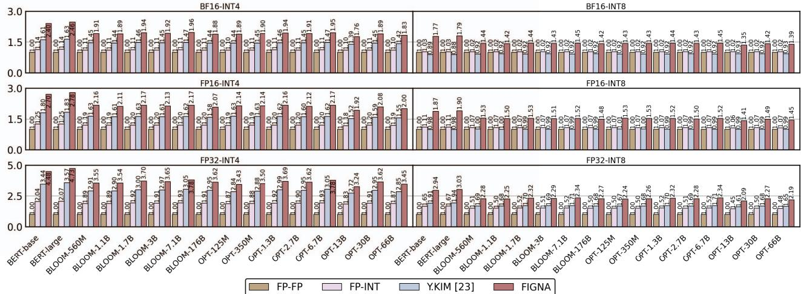  
图 16. FIGNA 与基线设计使用六种数据类型进行语言模型推理时的归一化 TOPS/W。每种情况下的 TOPS/W 均以 FP-FP 引擎的相应值进行归一化。

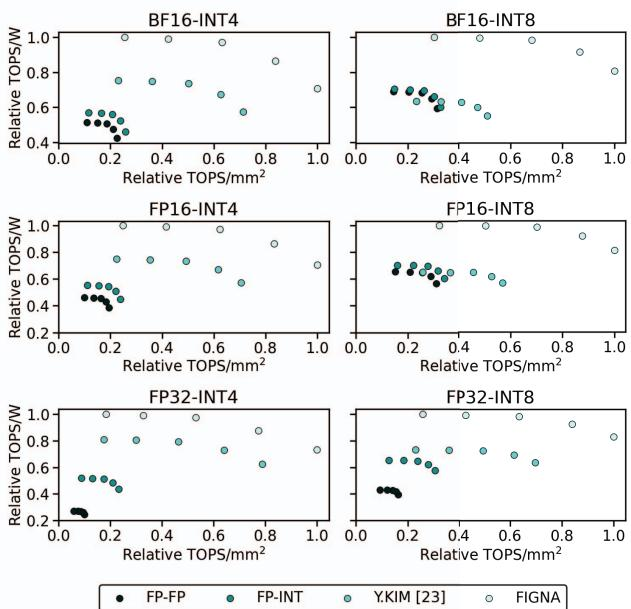  
图 17. 不同片上缓冲区大小下，FIGNA 与基线设计的 TOPS/W 和 TOPS/mm2 之间的权衡。

图 17 展示了在保持第 IV-B1 节所述 mxu 大小不变、改变片上缓冲区大小时，OPT-1.3B 的归一化 TOPS/W 和 $\mathrm { T O P S } / m m ^ { 2 }$。可以观察到，对于所有设计，增大片上缓冲区都会使 TOPS/W 提高，而 TOPS/mm2 降低。然而，与基线设计相比，FIGNA 的所有数据点都位于图的右上方，表明无论存储器大小如何，FIGNA 的 TOPS/mm2 和 TOPS/W 均优于其他设计。

## V. 结论

本文提出了一种名为 FIGNA 的新型计算方案和硬件架构，用于有效加速 FP-INT 格式的量化模型，旨在降低大语言模型（LLM）的计算成本。FIGNA 在输入数据参与计算之前，利用共享指数将其从 FP 格式转换为 INT 格式，从而能够构建高效的基于整数的 PE。与以往同样使用 FP 值共享指数的研究相比，一个关键区别在于，FIGNA 保持了 FP-INT MAC 计算的数值精度，而以往研究则试图在数值误差更大的情况下保持神经网络的精度。对于 FIGNA，我们通过数学推导得出了预对齐尾数为保持数值精度所需的额外位数。确保数值精度减轻了用户的负担，因为用户无需投入精力重新训练或微调模型，以补偿硬件约束造成的任何数值误差。实验结果表明，在使用 FP16-INT8 格式的量化网络时，FIGNA 的面积效率 $( \mathrm { T O P S } / m m ^ { 2 } )$ 和能效（TOPS/W）分别达到基线 FP-FP 引擎的 3.56 倍和 1.55 倍。

## 致谢

本研究得到韩国政府（MSIT）资助的信息通信技术规划评估院（IITP）资助项目（No.2020R1A2C2004329，NeuroHub：用于协作式存内神经网络硬件研究的基于 Web 的开放仿真平台；IITP-2023-RS-2023-00256081：旨在培养顶尖人才的人工智能半导体支持计划；No. 2021-0-01343：人工智能研究生院计划（首尔大学））、教育部资助的韩国国家研究基金会（NRF）基础科学研究计划（2022R1A6A3A01087416）、首尔大学 BK21 FOUR 计划以及首尔大学校际半导体研究中心的部分支持。EDA 工具由集成电路设计教育中心（IDEC）提供支持。

[1] I. S. Association et al., “Ieee standard for standard systemc language reference manual,” IEEE Computer Society, 2012.

[2] Y. Bai, Y.-X. Wang, and E. Liberty, “Proxquant: Quantized neural networks via proximal operators,” arXiv preprint arXiv:1810.00861, 2018.

[3] Y. Bhalgat, J. Lee, M. Nagel, T. Blankevoort, and N. Kwak, “Lsq+: Improving low-bit quantization through learnable offsets and better initialization,” in Proceedings ofthe IEEE/CVF Conference on Computer Vision and Pattern Recognition Workshops, 2020, pp. 696–697.

[4] D. C. Black and J. Donovan, SystemC: From the ground up. Springer, 2004.

[5] N. Burgess, J. Milanovic, N. Stephens, K. Monachopoulos, and D. Mansell, “Bfloat16 processing for neural networks,” in 2019 IEEE 26th Symposium on Computer Arithmetic (ARITH), 2019, pp. 88–91.

[6] A. Chowdhery, S. Narang, J. Devlin, M. Bosma, G. Mishra, A. Roberts, P. Barham, H. W. Chung, C. Sutton, S. Gehrmann, P. Schuh, K. Shi, S. Tsvyashchenko, J. Maynez, A. Rao, P. Barnes, Y. Tay, N. Shazeer, V. Prabhakaran, E. Reif, N. Du, B. Hutchinson, R. Pope, J. Bradbury, J. Austin, M. Isard, G. Gur-Ari, P. Yin, T. Duke, A. Levskaya, S. Ghemawat, S. Dev, H. Michalewski, X. Garcia, V. Misra, K. Robinson, L. Fedus, D. Zhou, D. Ippolito, D. Luan, H. Lim, B. Zoph, A. Spiridonov, R. Sepassi, D. Dohan, S. Agrawal, M. Omernick, A. M. Dai, T. S. Pillai, M. Pellat, A. Lewkowycz, E. Moreira, R. Child, O. Polozov, K. Lee, Z. Zhou, X. Wang, B. Saeta, M. Diaz, O. Firat, M. Catasta, J. Wei, K. Meier-Hellstern, D. Eck, J. Dean, S. Petrov, and N. Fiedel, “Palm: Scaling language modeling with pathways,” 2022.

[7] I. Chung, B. Kim, Y. Choi, S. J. Kwon, Y. Jeon, B. Park, S. Kim, and D. Lee, “Extremely low bit transformer quantization for on-device neural machine translation,” arXiv preprint arXiv:2009.07453, 2020.

[8] S. Dai, R. Venkatesan, M. Ren, B. Zimmer, W. Dally, and B. Khailany, “Vs-quant: Per-vector scaled quantization for accurate low-precision neural network inference,” Proceedings of Machine Learning and Systems, vol. 3, pp. 873–884, 2021.

[9] B. Darvish Rouhani, D. Lo, R. Zhao, M. Liu, J. Fowers, K. Ovtcharov, A. Vinogradsky, S. Massengill, L. Yang, R. Bittner et al., “Pushing the limits of narrow precision inferencing at cloud scale with microsoft floating point,” Advances in neural information processing systems, vol. 33, pp. 10 271–10 281, 2020.

[10] B. Darvish Rouhani, R. Zhao, V. Elango, R. Shafipour, M. Hall, M. Mesmakhosroshahi, A. More, L. Melnick, M. Golub, G. Varatkar et al., “With shared microexponents, a little shifting goes a long way,” in Proceedings of the 50th Annual International Symposium on Computer Architecture, 2023, pp. 1–13.

[11] T. Dettmers, M. Lewis, Y. Belkada, and L. Zettlemoyer, “Llm.int8 (): 8-bit matrix multiplication for transformers at scale,” arXiv preprint arXiv:2208.07339, 2022.

[12] J. Devlin, M.-W. Chang, K. Lee, and K. Toutanova, “Bert: Pre-training of deep bidirectional transformers for language understanding,” arXiv preprint arXiv:1810.04805, 2018.

[13] H. Fan, G. Wang, M. Ferianc, X. Niu, and W. Luk, “Static block floatingpoint quantization for convolutional neural networks on fpga,” in 2019 International Conference on Field-Programmable Technology (ICFPT). IEEE, 2019, pp. 28–35.

[14] E. Frantar, S. Ashkboos, T. Hoefler, and D. Alistarh, “Gptq: Accurate post-training quantization for generative pre-trained transformers,” arXiv preprint arXiv:2210.17323, 2022.

[15] E. Hokenek, R. Montoye, and P. Cook, “Second-generation risc floating point with multiply-add fused,” IEEE Journal of Solid-State Circuits, vol. 25, no. 5, pp. 1207–1213, 1990.

[16] Y. Jeon, C. Lee, E. Cho, and Y. Ro, “Mr. biq: Post-training nonuniform quantization based on minimizing the reconstruction error,” in Proceedings of the IEEE/CVF Conference on Computer Vision and Pattern Recognition, 2022, pp. 12 329–12 338.

[17] Y. Jeon, B. Park, S. J. Kwon, B. Kim, J. Yun, and D. Lee, “Biqgemm: matrix multiplication with lookup table for binary-coding-based quantized dnns,” in SC20: International Conference for High Performance Computing, Networking, Storage and Analysis. IEEE, 2020, pp. 1–14.

[18] N. P. Jouppi, D. H. Yoon, M. Ashcraft, M. Gottscho, T. B. Jablin, G. Kurian, J. Laudon, S. Li, P. Ma, X. Ma et al., “Ten lessons from three generations shaped google’s tpuv4i: Industrial product,” in 2021 ACM/IEEE 48th Annual International Symposium on Computer Architecture (ISCA). IEEE, 2021, pp. 1–14.

[19] N. P. Jouppi, C. Young, N. Patil, D. Patterson, G. Agrawal, R. Bajwa, S. Bates, S. Bhatia, N. Boden, A. Borchers et al., “In-datacenter performance analysis of a tensor processing unit,” in Proceedings of the 44th annual international symposium on computer architecture, 2017, pp. 1–12.

[20] S. Kim, C. Hooper, A. Gholami, Z. Dong, X. Li, S. Shen, M. W. Mahoney, and K. Keutzer, “Squeezellm: Dense-and-sparse quantization,” arXiv preprint arXiv:2306.07629, 2023.

[21] S. Kim, C. Hooper, T. Wattanawong, M. Kang, R. Yan, H. Genc, G. Dinh, Q. Huang, K. Keutzer, M. W. Mahoney et al., “Full stack optimization of transformer inference: a survey,” arXiv preprint arXiv:2302.14017, 2023.

[22] Y. J. Kim, R. Henry, R. Fahim, and H. H. Awadalla, “Who says elephants can’t run: Bringing large scale moe models into cloud scale production,” 2022.

[23] Y. Kim, J. Jang, J. Lee, J. Park, J. Kim, B. Kim, S. J. Kwon, D. Lee et al., “Winning both the accuracy of floating point activation and the simplicity of integer arithmetic,” in The Eleventh International Conference on Learning Representations, 2023.

[24] U. Koster, T. Webb, X. Wang, M. Nassar, A. K. Bansal, W. Constable, ¨ O. Elibol, S. Gray, S. Hall, L. Hornof et al., “Flexpoint: An adaptive numerical format for efficient training of deep neural networks,” Advances in neural information processing systems, vol. 30, 2017.

[25] S. Kung, “Vlsi array processors,” IEEE ASSP Magazine, vol. 2, no. 3, pp. 4–22, 1985.

[26] P. Kurup and T. Abbasi, Logic synthesis using Synopsys®. Springer Science & Business Media, 2012.

[27] S. J. Kwon, J. Kim, J. Bae, K. M. Yoo, J.-H. Kim, B. Park, B. Kim, J.-W. Ha, N. Sung, and D. Lee, “Alphatuning: Quantization-aware parameterefficient adaptation of large-scale pre-trained language models,” arXiv preprint arXiv:2210.03858, 2022.

[28] Y. Li, R. Gong, X. Tan, Y. Yang, P. Hu, Q. Zhang, F. Yu, W. Wang, and S. Gu, “Brecq: Pushing the limit of post-training quantization by block reconstruction,” arXiv preprint arXiv:2102.05426, 2021.

[29] X. Lian, Z. Liu, Z. Song, J. Dai, W. Zhou, and X. Ji, “High-performance fpga-based cnn accelerator with block-floating-point arithmetic,” IEEE Transactions on Very Large Scale Integration (VLSI) Systems, vol. 27, no. 8, pp. 1874–1885, 2019.

[30] J. Lin, J. Tang, H. Tang, S. Yang, X. Dang, and S. Han, “Awq: Activation-aware weight quantization for llm compression and accel eration,” 2023.

[31] A. S. Luccioni, S. Viguier, and A.-L. Ligozat, “Estimating the carbon footprint of bloom, a 176b parameter language model,” arXiv preprint arXiv:2211.02001, 2022.

[32] M. Marcus, B. Santorini, and M. A. Marcinkiewicz, “Building a large annotated corpus of english: The penn treebank,” 1993.

[33] S. Merity, C. Xiong, J. Bradbury, and R. Socher, “Pointer sentinel mixture models,” arXiv preprint arXiv:1609.07843, 2016.

[34] P. Micikevicius, S. Narang, J. Alben, G. Diamos, E. Elsen, D. Garcia, B. Ginsburg, M. Houston, O. Kuchaiev, G. Venkatesh, and H. Wu, “Mixed precision training,” 2018.

[35] P. Micikevicius, D. Stosic, N. Burgess, M. Cornea, P. Dubey, R. Grisenthwaite, S. Ha, A. Heinecke, P. Judd, J. Kamalu et al., “Fp8 formats for deep learning,” arXiv preprint arXiv:2209.05433, 2022.

[36] J.-M. Muller, N. Brisebarre, F. De Dinechin, C.-P. Jeannerod, V. Lefevre, G. Melquiond, N. Revol, D. Stehle, S. Torres´ et al., Handbook of floating-point arithmetic. Springer, 2018.

[37] NVIDIA, “Fastertransformer,” accessed: 2023-10-10. [Online]. Available: https://github.com/NVIDIA/FasterTransformer

[38] NVIDIA, “Nvidia a100 tensor core gpu,” accessed: 2023-07-19. [Online]. Available: https://www.nvidia.com/ko-kr/data-center/a100/

[39] G. Park, B. Park, S. J. Kwon, B. Kim, Y. Lee, and D. Lee, “nuqmm: Quantized matmul for efficient inference of large-scale generative language models,” arXiv preprint arXiv:2206.09557, 2022.

[40] Y. Qin, Y. Wang, D. Deng, Z. Zhao, X. Yang, L. Liu, S. Wei, Y. Hu, and S. Yin, “Fact: Ffn-attention co-optimized transformer architecture with eager correlation prediction,” in Proceedings of the 50th Annual International Symposium on Computer Architecture, 2023, pp. 1–14.

[41] E. Quinnell, E. E. Swartzlander, and C. Lemonds, “Floating-point fused multiply-add architectures,” in 2007 Conference Record of the Forty-First Asilomar Conference on Signals, Systems and Computers, 2007, pp. 331–337.

[42] J. Richard Shewchuk, “Adaptive precision floating-point arithmetic and fast robust geometric predicates,” Discrete & Computational Geometry, vol. 18, pp. 305–363, 1997.

[43] Z. Song, Z. Liu, and D. Wang, “Computation error analysis of block floating point arithmetic oriented convolution neural network accelerator design,” in Proceedings of the AAAI Conference on Artificial Intelligence, vol. 32, no. 1, 2018.

[44] H. Touvron, T. Lavril, G. Izacard, X. Martinet, M.-A. Lachaux, T. Lacroix, B. Roziere, N. Goyal, E. Hambro, F. Azhar, A. Rodriguez, \` A. Joulin, E. Grave, and G. Lample, “Llama: Open and efficient foundation language models,” 2023.

[45] A. K. Vijayakumar, M. Cogswell, R. R. Selvaraju, Q. Sun, S. Lee, D. Crandall, and D. Batra, “Diverse beam search: Decoding diverse solutions from neural sequence models,” 2018.

[46] A. Wang, A. Singh, J. Michael, F. Hill, O. Levy, and S. R. Bowman, “Glue: A multi-task benchmark and analysis platform for natural language understanding,” arXiv preprint arXiv:1804.07461, 2018.

[47] J. H. Wilkinson, Rounding errors in algebraic processes. Courier Corporation, 1994.

B. Beilharz, B. Wang, C. Brito, C. Zhou, C. Jain, C. Xu, C. Fourrier, D. L. Perin˜an, D. Molano, D. Yu, E. Manjavacas, F. Barth, F. Fuhrimann,´ G. Altay, G. Bayrak, G. Burns, H. U. Vrabec, I. Bello, I. Dash, J. Kang, J. Giorgi, J. Golde, J. D. Posada, K. R. Sivaraman, L. Bulchandani, L. Liu, L. Shinzato, M. H. de Bykhovetz, M. Takeuchi, M. Pamies, \` M. A. Castillo, M. Nezhurina, M. Sanger, M. Samwald, M. Cullan,¨ M. Weinberg, M. D. Wolf, M. Mihaljcic, M. Liu, M. Freidank, M. Kang, N. Seelam, N. Dahlberg, N. M. Broad, N. Muellner, P. Fung, P. Haller, R. Chandrasekhar, R. Eisenberg, R. Martin, R. Canalli, R. Su, R. Su, S. Cahyawijaya, S. Garda, S. S. Deshmukh, S. Mishra, S. Kiblawi, S. Ott, S. Sang-aroonsiri, S. Kumar, S. Schweter, S. Bharati, T. Laud, T. Gigant, T. Kainuma, W. Kusa, Y. Labrak, Y. S. Bajaj, Y. Venkatraman, Y. Xu, Y. Xu, Y. Xu, Z. Tan, Z. Xie, Z. Ye, M. Bras, Y. Belkada, and T. Wolf, “Bloom: A 176b-parameter open-access multilingual language model,” 2023.

[49] C.-J. Wu, R. Raghavendra, U. Gupta, B. Acun, N. Ardalani, K. Maeng, G. Chang, F. Aga, J. Huang, C. Bai et al., “Sustainable ai: Environmental implications, challenges and opportunities,” Proceedings of Machine Learning and Systems, vol. 4, pp. 795–813, 2022.

[50] X. Wu, Z. Yao, M. Zhang, C. Li, and Y. He, “Xtc: Extreme compression for pre-trained transformers made simple and efficient,” Advances in Neural Information Processing Systems, vol. 35, pp. 3217–3231, 2022.

[51] G. Xiao, J. Lin, M. Seznec, J. Demouth, and S. Han, “Smoothquant: Accurate and efficient post-training quantization for large language models,” arXiv preprint arXiv:2211.10438, 2022.

[52] C. Xu, J. Yao, Z. Lin, W. Ou, Y. Cao, Z. Wang, and H. Zha, “Alternating multi-bit quantization for recurrent neural networks,” arXiv preprint arXiv:1802.00150, 2018.

[53] Z. Yao, R. Yazdani Aminabadi, M. Zhang, X. Wu, C. Li, and Y. He, “Zeroquant: Efficient and affordable post-training quantization for largescale transformers,” Advances in Neural Information Processing Systems, vol. 35, pp. 27 168–27 183, 2022.

[54] G.-I. Yu, J. S. Jeong, G.-W. Kim, S. Kim, and B.-G. Chun, “Orca: A distributed serving system for Transformer-Based generative models,” in 16th USENIX Symposium on Operating Systems Design and Implementation (OSDI 22), 2022, pp. 521–538.

[55] Z. Yuan, L. Niu, J. Liu, W. Liu, X. Wang, Y. Shang, G. Sun, Q. Wu, J. Wu, and B. Wu, “Rptq: Reorder-based post-training quantization for large language models,” arXiv preprint arXiv:2304.01089, 2023.

[56] S. Q. Zhang, B. McDanel, and H. Kung, “Fast: Dnn training under variable precision block floating point with stochastic rounding,” in 2022 IEEE International Symposium on High-Performance Computer Architecture (HPCA). IEEE, 2022, pp. 846–860.

[57] S. Zhang, S. Roller, N. Goyal, M. Artetxe, M. Chen, S. Chen, C. Dewan, M. Diab, X. Li, X. V. Lin, T. Mihaylov, M. Ott, S. Shleifer, K. Shuster, D. Simig, P. S. Koura, A. Sridhar, T. Wang, and L. Zettlemoyer, “Opt: Open pre-trained transformer language models,” 2022.

> 版本说明：本页依据用户提供的 HPCA 2024 正式 PDF。PDF 使用 MinerU 解析，中文翻译及解读由 Codex/GPT 完成，未调用 GLM 翻译 API。参考文献保留原文；技术总结、通俗讲解和图表说明属于解读。[论文 DOI](https://doi.org/10.1109/HPCA57654.2024.00064)。

> 校对说明：误差界中的 ε、公式编号 (3)、0-less INT 的 W′=2W+1 与 YW′=2YW+Y 已对照原 PDF 第 5–6 页核对。译文忠实保留作者论述；误差界/ULP 相近不自动等同所有输入逐位相同。
